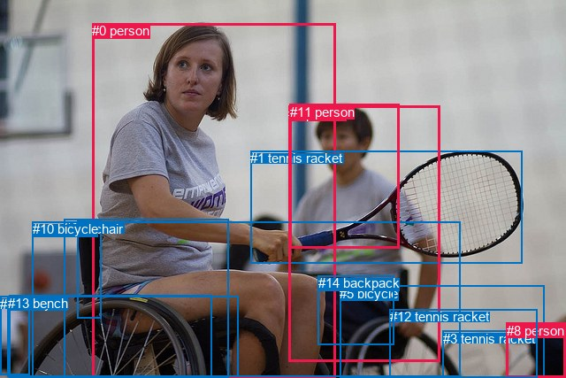
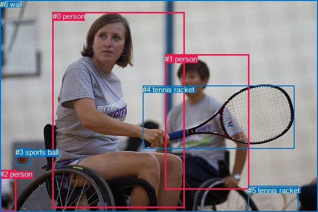

# 图片 1318：2377223.jpg

随机样本序号：414。图片 SHA256：`0035195299802ffbdd572dbe8195497d09a622124184be208f69d610f4fe7a15`。

红色框表示人，蓝色框表示其他物体。两个模式分别保留自身框编号，可依据位置比较对应对象。

## 自动检测框与输出

人的框编号：`[0, 2, 8, 11]`。状态：`ok`。

### 自动检测全部物体框

| 编号 | 类别 | 是否为人 | 检测分数 | 像素坐标 xyxy |
|---|---|---|---|---|
| 0 | person | True | 0.9997 | 104.0, 26.1, 379.5, 427.0 |
| 1 | tennis racket | False | 0.9996 | 283.4, 170.5, 590.5, 297.9 |
| 2 | person | True | 0.9845 | 326.1, 119.6, 497.4, 408.1 |
| 3 | tennis racket | False | 0.9377 | 500.9, 373.7, 607.8, 426.7 |
| 4 | chair | False | 0.8271 | 72.3, 247.3, 258.1, 427.0 |
| 5 | bicycle | False | 0.8148 | 384.2, 322.6, 615.4, 426.7 |
| 6 | chair | False | 0.8084 | 87.0, 249.9, 114.6, 359.9 |
| 7 | car | False | 0.7308 | 0.3, 334.8, 33.4, 423.3 |
| 8 | person | True | 0.7054 | 572.8, 364.7, 640.0, 426.6 |
| 9 | bicycle | False | 0.6354 | 10.5, 333.6, 239.2, 427.0 |
| 10 | bicycle | False | 0.6340 | 36.6, 250.2, 520.5, 425.4 |
| 11 | person | True | 0.5469 | 327.9, 117.8, 451.1, 280.8 |
| 12 | tennis racket | False | 0.4525 | 440.6, 349.4, 607.8, 426.6 |
| 13 | bench | False | 0.4020 | 8.7, 334.3, 269.4, 425.7 |
| 14 | backpack | False | 0.4016 | 359.8, 311.3, 445.6, 389.6 |

### 自动检测 Top50 人相关候选

评分物体对：210；人相关物体对：100；输出关系：50。

| 排名 | 主语编号与类别 | 关系 | 宾语编号与类别 | 类型 | 人与人 | 排序分数 | 原始融合 logit |
|---|---|---|---|---|---|---|---|
| 1 | #0 person | holding | #1 tennis racket | semantic | False | 0.99301 | 4.9569 |
| 2 | #0 person | riding | #10 bicycle | semantic | False | 0.98668 | 4.3052 |
| 3 | #2 person | holding | #1 tennis racket | semantic | False | 0.98317 | 4.0678 |
| 4 | #8 person | sitting on | #3 tennis racket | semantic | False | 0.98011 | 3.8974 |
| 5 | #0 person | sitting on | #4 chair | semantic | False | 0.97523 | 3.6729 |
| 6 | #2 person | wearing | #14 backpack | semantic | False | 0.97023 | 3.4839 |
| 7 | #2 person | sitting on | #10 bicycle | semantic | False | 0.96457 | 3.3040 |
| 8 | #8 person | sitting on | #5 bicycle | semantic | False | 0.96170 | 3.2231 |
| 9 | #8 person | sitting on | #12 tennis racket | semantic | False | 0.96086 | 3.2006 |
| 10 | #0 person | on | #10 bicycle | spatial | False | 0.95981 | 3.1731 |
| 11 | #2 person | riding | #5 bicycle | semantic | False | 0.95491 | 3.0529 |
| 12 | #11 person | sitting on | #10 bicycle | semantic | False | 0.95180 | 2.9829 |
| 13 | #0 person | sitting on | #6 chair | semantic | False | 0.94320 | 2.8098 |
| 14 | #0 person | on | #4 chair | spatial | False | 0.94294 | 2.8050 |
| 15 | #11 person | holding | #1 tennis racket | semantic | False | 0.93884 | 2.7312 |
| 16 | #2 person | looking at | #0 person | semantic | True | 0.93058 | 2.5956 |
| 17 | #2 person | on | #10 bicycle | spatial | False | 0.92297 | 2.4834 |
| 18 | #8 person | on | #3 tennis racket | spatial | False | 0.91526 | 2.3797 |
| 19 | #7 car | looking at | #0 person | semantic | False | 0.91306 | 2.3516 |
| 20 | #0 person | riding | #13 bench | semantic | False | 0.90286 | 2.2294 |
| 21 | #11 person | riding | #5 bicycle | semantic | False | 0.90058 | 2.2037 |
| 22 | #2 person | wearing | #11 person | semantic | True | 0.87915 | 1.9844 |
| 23 | #8 person | on | #5 bicycle | spatial | False | 0.87699 | 1.9643 |
| 24 | #11 person | looking at | #0 person | semantic | True | 0.87602 | 1.9553 |
| 25 | #2 person | on | #5 bicycle | spatial | False | 0.87484 | 1.9445 |
| 26 | #8 person | on | #12 tennis racket | spatial | False | 0.87289 | 1.9268 |
| 27 | #11 person | on | #10 bicycle | spatial | False | 0.86614 | 1.8673 |
| 28 | #2 person | on | #14 backpack | spatial | False | 0.84940 | 1.7299 |
| 29 | #2 person | in | #11 person | spatial | True | 0.79797 | 1.3736 |
| 30 | #0 person | riding | #9 bicycle | semantic | False | 0.78615 | 1.3019 |
| 31 | #11 person | sitting on | #14 backpack | semantic | False | 0.74220 | 1.0575 |
| 32 | #11 person | on | #2 person | spatial | True | 0.73593 | 1.0249 |
| 33 | #2 person | riding | #12 tennis racket | semantic | False | 0.72215 | 0.9552 |
| 34 | #11 person | on | #5 bicycle | spatial | False | 0.71871 | 0.9381 |
| 35 | #0 person | on | #13 bench | spatial | False | 0.70980 | 0.8944 |
| 36 | #0 person | on | #6 chair | spatial | False | 0.70618 | 0.8769 |
| 37 | #0 person | sitting on | #14 backpack | semantic | False | 0.65512 | 0.6416 |
| 38 | #0 person | holding | #11 person | semantic | True | 0.65011 | 0.6195 |
| 39 | #8 person | sitting on | #10 bicycle | semantic | False | 0.64882 | 0.6139 |
| 40 | #0 person | on | #1 tennis racket | spatial | False | 0.63335 | 0.5466 |
| 41 | #0 person | riding | #5 bicycle | semantic | False | 0.62106 | 0.4940 |
| 42 | #2 person | sitting on | #4 chair | semantic | False | 0.61548 | 0.4704 |
| 43 | #14 backpack | on | #2 person | spatial | False | 0.61418 | 0.4649 |
| 44 | #7 car | looking at | #2 person | semantic | False | 0.60936 | 0.4446 |
| 45 | #3 tennis racket | parked on | #8 person | semantic | False | 0.58086 | 0.3263 |
| 46 | #2 person | sitting on | #6 chair | semantic | False | 0.57435 | 0.2996 |
| 47 | #11 person | in | #14 backpack | spatial | False | 0.55689 | 0.2285 |
| 48 | #2 person | beside | #0 person | spatial | True | 0.53754 | 0.1504 |
| 49 | #0 person | holding | #2 person | semantic | True | 0.53492 | 0.1399 |
| 50 | #8 person | looking at | #0 person | semantic | True | 0.52852 | 0.1142 |

### 自动检测逐条人相关 GT 核验

R@50：20.00%；命中 1/5。

| GT 主语编号 | GT 关系 | GT 宾语编号 | 结果阶段 | 匹配预测主语编号 | 匹配预测宾语编号 |
|---|---|---|---|---|---|
| 0 | in front of | 1 | wrong_predicate | [0] | [2] |
| 0 | holding | 4 | hit50 | [0] | [1] |
| 0 | swinging | 4 | wrong_predicate | [0] | [1] |
| 1 | in front of | 6 | endpoint_missing_or_wrong_class | [2] | [] |
| 3 | beside | 2 | endpoint_missing_or_wrong_class | [] | [] |

## 真实框与输出

人的框编号：`[0, 1, 2]`。

### 真实框全部物体框

| 编号 | 类别 | 是否为人 | 检测分数 | 像素坐标 xyxy |
|---|---|---|---|---|
| 0 | person | True | GT | 106.0, 24.0, 372.0, 418.0 |
| 1 | person | True | GT | 332.0, 110.0, 501.0, 382.0 |
| 2 | person | True | GT | 0.0, 342.0, 32.0, 425.0 |
| 3 | sports ball | False | GT | 31.0, 298.0, 60.0, 332.0 |
| 4 | tennis racket | False | GT | 287.0, 172.0, 592.0, 299.0 |
| 5 | tennis racket | False | GT | 499.0, 375.0, 600.0, 427.0 |
| 6 | wall | False | GT | 0.0, 0.0, 640.0, 427.0 |

### 真实框 Top50 人相关候选

评分物体对：42；人相关物体对：30；输出关系：50。

| 排名 | 主语编号与类别 | 关系 | 宾语编号与类别 | 类型 | 人与人 | 排序分数 | 原始融合 logit |
|---|---|---|---|---|---|---|---|
| 1 | #0 person | holding | #4 tennis racket | semantic | False | 0.99357 | 5.0396 |
| 2 | #1 person | holding | #4 tennis racket | semantic | False | 0.96406 | 3.2892 |
| 3 | #1 person | looking at | #0 person | semantic | True | 0.96370 | 3.2789 |
| 4 | #1 person | in | #6 wall | spatial | False | 0.95062 | 2.9575 |
| 5 | #2 person | looking at | #0 person | semantic | True | 0.94025 | 2.7559 |
| 6 | #2 person | in | #6 wall | spatial | False | 0.91159 | 2.3332 |
| 7 | #1 person | sitting on | #6 wall | semantic | False | 0.90895 | 2.3008 |
| 8 | #1 person | riding | #5 tennis racket | semantic | False | 0.90847 | 2.2951 |
| 9 | #2 person | beside | #3 sports ball | spatial | False | 0.90293 | 2.2302 |
| 10 | #1 person | on | #5 tennis racket | spatial | False | 0.87690 | 1.9634 |
| 11 | #2 person | sitting on | #3 sports ball | semantic | False | 0.86316 | 1.8418 |
| 12 | #2 person | sitting on | #6 wall | semantic | False | 0.85727 | 1.7928 |
| 13 | #0 person | wearing | #6 wall | semantic | False | 0.83165 | 1.5974 |
| 14 | #0 person | in | #6 wall | spatial | False | 0.82160 | 1.5272 |
| 15 | #3 sports ball | beside | #2 person | spatial | False | 0.80202 | 1.3989 |
| 16 | #0 person | riding | #5 tennis racket | semantic | False | 0.79189 | 1.3363 |
| 17 | #2 person | looking at | #1 person | semantic | True | 0.79073 | 1.3294 |
| 18 | #0 person | on | #4 tennis racket | spatial | False | 0.76080 | 1.1571 |
| 19 | #0 person | beside | #2 person | spatial | True | 0.73593 | 1.0249 |
| 20 | #0 person | looking at | #1 person | semantic | True | 0.72152 | 0.9520 |
| 21 | #0 person | beside | #1 person | spatial | True | 0.71790 | 0.9341 |
| 22 | #1 person | beside | #0 person | spatial | True | 0.70476 | 0.8701 |
| 23 | #1 person | on | #4 tennis racket | spatial | False | 0.70178 | 0.8558 |
| 24 | #2 person | sitting on | #5 tennis racket | semantic | False | 0.62888 | 0.5274 |
| 25 | #2 person | beside | #0 person | spatial | True | 0.58680 | 0.3508 |
| 26 | #0 person | on | #5 tennis racket | spatial | False | 0.51747 | 0.0699 |
| 27 | #2 person | beside | #1 person | spatial | True | 0.50895 | 0.0358 |
| 28 | #4 tennis racket | holding | #0 person | semantic | False | 0.50214 | 0.0085 |
| 29 | #1 person | beside | #2 person | spatial | True | 0.44528 | -0.2198 |
| 30 | #0 person | pushing | #2 person | semantic | True | 0.42404 | -0.3062 |
| 31 | #1 person | looking at | #2 person | semantic | True | 0.40450 | -0.3867 |
| 32 | #4 tennis racket | beside | #0 person | spatial | False | 0.40307 | -0.3927 |
| 33 | #0 person | beside | #3 sports ball | spatial | False | 0.39931 | -0.4083 |
| 34 | #4 tennis racket | in front of | #1 person | spatial | False | 0.37092 | -0.5283 |
| 35 | #3 sports ball | beside | #0 person | spatial | False | 0.36055 | -0.5730 |
| 36 | #5 tennis racket | beside | #1 person | spatial | False | 0.32024 | -0.7527 |
| 37 | #2 person | on | #5 tennis racket | spatial | False | 0.31808 | -0.7626 |
| 38 | #0 person | sitting on | #3 sports ball | semantic | False | 0.31340 | -0.7843 |
| 39 | #4 tennis racket | holding | #1 person | semantic | False | 0.28975 | -0.8966 |
| 40 | #2 person | holding | #4 tennis racket | semantic | False | 0.24318 | -1.1353 |
| 41 | #6 wall | beside | #0 person | spatial | False | 0.21317 | -1.3059 |
| 42 | #1 person | beside | #3 sports ball | spatial | False | 0.17964 | -1.5188 |
| 43 | #5 tennis racket | beside | #0 person | spatial | False | 0.16954 | -1.5889 |
| 44 | #3 sports ball | talking to | #2 person | semantic | False | 0.14394 | -1.7830 |
| 45 | #1 person | looking at | #3 sports ball | semantic | False | 0.10374 | -2.1563 |
| 46 | #3 sports ball | playing | #0 person | semantic | False | 0.08402 | -2.3890 |
| 47 | #2 person | on | #4 tennis racket | spatial | False | 0.07732 | -2.4793 |
| 48 | #6 wall | beside | #1 person | spatial | False | 0.07685 | -2.4860 |
| 49 | #3 sports ball | beside | #1 person | spatial | False | 0.07279 | -2.5446 |
| 50 | #6 wall | looking at | #0 person | semantic | False | 0.06559 | -2.6566 |

### 真实框逐条人相关 GT 核验

R@50：40.00%；命中 2/5。

| GT 主语编号 | GT 关系 | GT 宾语编号 | 结果阶段 | 匹配预测主语编号 | 匹配预测宾语编号 |
|---|---|---|---|---|---|
| 0 | in front of | 1 | wrong_predicate | [0] | [1] |
| 0 | holding | 4 | hit50 | [0] | [4] |
| 0 | swinging | 4 | wrong_predicate | [0] | [4] |
| 1 | in front of | 6 | wrong_predicate | [1] | [6] |
| 3 | beside | 2 | hit50 | [3] | [2] |

## 全部人相关 GT

| 主语编号与类别 | 关系 | 宾语编号与类别 |
|---|---|---|
| #0 person | in front of | #1 person |
| #0 person | holding | #4 tennis racket |
| #0 person | swinging | #4 tennis racket |
| #1 person | in front of | #6 wall |
| #3 sports ball | beside | #2 person |

原始记录、全部人相关物体对的两项预测与分项分数见 [逐图证据 JSON](../evidence/cases/1318.json)。全部56类 logits 保留于本机 HOR/output/random500/logits/。

<!-- HOR_COMPLETE_RESULTS -->

## 六组条件的完整输出对照

以下保留同一图片三种框与候选模式、两种谓词输出规则的全部 Top50。框编号各自在所属模式内解释。

### 自动检测框完整枚举：空间与语义各保留一个谓词

| 排名 | 主语编号与类别 | 谓词 | 宾语编号与类别 | 分组 | 排序分数 | predicate logit | pair logit |
|---|---|---|---|---|---|---|---|
| 1 | #0 person | holding | #1 tennis racket | semantic | 0.9930142 | 4.7470117 | 0.2098435 |
| 2 | #0 person | riding | #10 bicycle | semantic | 0.9866823 | 3.9613700 | 0.3438798 |
| 3 | #2 person | holding | #1 tennis racket | semantic | 0.9831730 | 4.1023116 | -0.0345099 |
| 4 | #8 person | sitting on | #3 tennis racket | semantic | 0.9801087 | 3.9061627 | -0.0087834 |
| 5 | #0 person | sitting on | #4 chair | semantic | 0.9752263 | 3.3675885 | 0.3052982 |
| 6 | #2 person | wearing | #14 backpack | semantic | 0.9702257 | 3.1181974 | 0.3656842 |
| 7 | #2 person | sitting on | #10 bicycle | semantic | 0.9645665 | 3.3375134 | -0.0334942 |
| 8 | #8 person | sitting on | #5 bicycle | semantic | 0.9616960 | 3.4788442 | -0.2556995 |
| 9 | #8 person | sitting on | #12 tennis racket | semantic | 0.9608564 | 3.5149608 | -0.3143720 |
| 10 | #0 person | on | #10 bicycle | spatial | 0.9598107 | 2.8292542 | 0.3438798 |
| 11 | #2 person | riding | #5 bicycle | semantic | 0.9549070 | 3.1266351 | -0.0737472 |
| 12 | #11 person | sitting on | #10 bicycle | semantic | 0.9517971 | 3.3585744 | -0.3756397 |
| 13 | #0 person | sitting on | #6 chair | semantic | 0.9432040 | 3.0606990 | -0.2508837 |
| 14 | #0 person | on | #4 chair | spatial | 0.9429437 | 2.4996696 | 0.3052982 |
| 15 | #11 person | holding | #1 tennis racket | semantic | 0.9388440 | 3.0437574 | -0.3125351 |
| 16 | #2 person | looking at | #0 person | semantic | 0.9305760 | 2.8812413 | -0.2856712 |
| 17 | #2 person | on | #10 bicycle | spatial | 0.9229683 | 2.5168729 | -0.0334942 |
| 18 | #8 person | on | #3 tennis racket | spatial | 0.9152641 | 2.3884573 | -0.0087834 |
| 19 | #7 car | looking at | #0 person | semantic | 0.9130611 | 2.9960279 | -0.6444309 |
| 20 | #0 person | riding | #13 bench | semantic | 0.9028571 | 2.5206561 | -0.2912749 |
| 21 | #11 person | riding | #5 bicycle | semantic | 0.9005790 | 2.6444416 | -0.4407666 |
| 22 | #2 person | wearing | #11 person | semantic | 0.8791461 | 2.4310689 | -0.4467002 |
| 23 | #8 person | on | #5 bicycle | spatial | 0.8769930 | 2.2199574 | -0.2556995 |
| 24 | #11 person | looking at | #0 person | semantic | 0.8760194 | 2.4445152 | -0.4892516 |
| 25 | #2 person | on | #5 bicycle | spatial | 0.8748416 | 2.0182099 | -0.0737472 |
| 26 | #8 person | on | #12 tennis racket | spatial | 0.8728932 | 2.2411575 | -0.3143720 |
| 27 | #11 person | on | #10 bicycle | spatial | 0.8661404 | 2.2428951 | -0.3756397 |
| 28 | #2 person | on | #14 backpack | spatial | 0.8493971 | 1.3641963 | 0.3656842 |
| 29 | #2 person | in | #11 person | spatial | 0.7979687 | 1.8203473 | -0.4467002 |
| 30 | #0 person | riding | #9 bicycle | semantic | 0.7861484 | 1.7113690 | -0.4095054 |
| 31 | #11 person | sitting on | #14 backpack | semantic | 0.7422044 | 0.9482388 | 0.1092185 |
| 32 | #11 person | on | #2 person | spatial | 0.7359322 | 1.5837259 | -0.5587938 |
| 33 | #2 person | riding | #12 tennis racket | semantic | 0.7221519 | 1.6284256 | -0.6732644 |
| 34 | #11 person | on | #5 bicycle | spatial | 0.7187124 | 1.3788505 | -0.4407666 |
| 35 | #0 person | on | #13 bench | spatial | 0.7097976 | 1.1856761 | -0.2912749 |
| 36 | #0 person | on | #6 chair | spatial | 0.7061790 | 1.1277814 | -0.2508837 |
| 37 | #0 person | sitting on | #14 backpack | semantic | 0.6551234 | 1.4086685 | -0.7670314 |
| 38 | #0 person | holding | #11 person | semantic | 0.6501063 | 1.4999022 | -0.8803958 |
| 39 | #8 person | sitting on | #10 bicycle | semantic | 0.6488237 | 1.3363094 | -0.7224369 |
| 40 | #0 person | on | #1 tennis racket | spatial | 0.6333517 | 0.3367791 | 0.2098435 |
| 41 | #0 person | riding | #5 bicycle | semantic | 0.6210598 | 1.3211598 | -0.8271109 |
| 42 | #2 person | sitting on | #4 chair | semantic | 0.6154763 | 1.4838409 | -1.0134503 |
| 43 | #14 backpack | on | #2 person | spatial | 0.6141845 | 1.2261062 | -0.7611701 |
| 44 | #7 car | looking at | #2 person | semantic | 0.6093594 | 1.2898917 | -0.8452714 |
| 45 | #3 tennis racket | parked on | #8 person | semantic | 0.5808586 | 1.1674867 | -0.8411877 |
| 46 | #2 person | sitting on | #6 chair | semantic | 0.5743492 | 1.3514910 | -1.0518727 |
| 47 | #11 person | in | #14 backpack | spatial | 0.5568901 | 0.1193314 | 0.1092185 |
| 48 | #2 person | beside | #0 person | spatial | 0.5375389 | 0.4361100 | -0.2856712 |
| 49 | #0 person | holding | #2 person | semantic | 0.5349231 | 0.8462081 | -0.7062876 |
| 50 | #8 person | looking at | #0 person | semantic | 0.5285206 | 0.7744393 | -0.6602327 |

GT 命中：1/5，R@50=20.00%。

| GT主语 | GT谓词 | GT宾语 | 结果阶段 | 匹配主语框 | 匹配宾语框 |
|---|---|---|---|---|---|
| 0 | in front of | 1 | wrong_predicate | [0] | [2] |
| 0 | holding | 4 | hit50 | [0] | [1] |
| 0 | swinging | 4 | wrong_predicate | [0] | [1] |
| 1 | in front of | 6 | endpoint_missing_or_wrong_class | [2] | [] |
| 3 | beside | 2 | endpoint_missing_or_wrong_class | [] | [] |

### 自动检测框完整枚举：每对只保留一个谓词

| 排名 | 主语编号与类别 | 谓词 | 宾语编号与类别 | 分组 | 排序分数 | predicate logit | pair logit |
|---|---|---|---|---|---|---|---|
| 1 | #0 person | holding | #1 tennis racket | single | 0.9930142 | 4.7470117 | 0.2098435 |
| 2 | #0 person | riding | #10 bicycle | single | 0.9866823 | 3.9613700 | 0.3438798 |
| 3 | #2 person | holding | #1 tennis racket | single | 0.9831730 | 4.1023116 | -0.0345099 |
| 4 | #8 person | sitting on | #3 tennis racket | single | 0.9801087 | 3.9061627 | -0.0087834 |
| 5 | #0 person | sitting on | #4 chair | single | 0.9752263 | 3.3675885 | 0.3052982 |
| 6 | #2 person | wearing | #14 backpack | single | 0.9702257 | 3.1181974 | 0.3656842 |
| 7 | #2 person | sitting on | #10 bicycle | single | 0.9645665 | 3.3375134 | -0.0334942 |
| 8 | #8 person | sitting on | #5 bicycle | single | 0.9616960 | 3.4788442 | -0.2556995 |
| 9 | #8 person | sitting on | #12 tennis racket | single | 0.9608564 | 3.5149608 | -0.3143720 |
| 10 | #2 person | riding | #5 bicycle | single | 0.9549070 | 3.1266351 | -0.0737472 |
| 11 | #11 person | sitting on | #10 bicycle | single | 0.9517971 | 3.3585744 | -0.3756397 |
| 12 | #0 person | sitting on | #6 chair | single | 0.9432040 | 3.0606990 | -0.2508837 |
| 13 | #11 person | holding | #1 tennis racket | single | 0.9388440 | 3.0437574 | -0.3125351 |
| 14 | #2 person | looking at | #0 person | single | 0.9305760 | 2.8812413 | -0.2856712 |
| 15 | #7 car | looking at | #0 person | single | 0.9130611 | 2.9960279 | -0.6444309 |
| 16 | #0 person | riding | #13 bench | single | 0.9028571 | 2.5206561 | -0.2912749 |
| 17 | #11 person | riding | #5 bicycle | single | 0.9005790 | 2.6444416 | -0.4407666 |
| 18 | #2 person | wearing | #11 person | single | 0.8791461 | 2.4310689 | -0.4467002 |
| 19 | #11 person | looking at | #0 person | single | 0.8760194 | 2.4445152 | -0.4892516 |
| 20 | #0 person | riding | #9 bicycle | single | 0.7861484 | 1.7113690 | -0.4095054 |
| 21 | #11 person | sitting on | #14 backpack | single | 0.7422044 | 0.9482388 | 0.1092185 |
| 22 | #11 person | on | #2 person | single | 0.7359322 | 1.5837259 | -0.5587938 |
| 23 | #2 person | riding | #12 tennis racket | single | 0.7221519 | 1.6284256 | -0.6732644 |
| 24 | #0 person | sitting on | #14 backpack | single | 0.6551234 | 1.4086685 | -0.7670314 |
| 25 | #0 person | holding | #11 person | single | 0.6501063 | 1.4999022 | -0.8803958 |
| 26 | #8 person | sitting on | #10 bicycle | single | 0.6488237 | 1.3363094 | -0.7224369 |
| 27 | #0 person | riding | #5 bicycle | single | 0.6210598 | 1.3211598 | -0.8271109 |
| 28 | #2 person | sitting on | #4 chair | single | 0.6154763 | 1.4838409 | -1.0134503 |
| 29 | #14 backpack | on | #2 person | single | 0.6141845 | 1.2261062 | -0.7611701 |
| 30 | #7 car | looking at | #2 person | single | 0.6093594 | 1.2898917 | -0.8452714 |
| 31 | #3 tennis racket | parked on | #8 person | single | 0.5808586 | 1.1674867 | -0.8411877 |
| 32 | #2 person | sitting on | #6 chair | single | 0.5743492 | 1.3514910 | -1.0518727 |
| 33 | #0 person | holding | #2 person | single | 0.5349231 | 0.8462081 | -0.7062876 |
| 34 | #8 person | looking at | #0 person | single | 0.5285206 | 0.7744393 | -0.6602327 |
| 35 | #1 tennis racket | holding | #0 person | single | 0.4624341 | 0.7108116 | -0.8613590 |
| 36 | #8 person | sitting on | #14 backpack | single | 0.4360242 | 0.7827454 | -1.0400587 |
| 37 | #7 car | looking at | #11 person | single | 0.4217294 | 0.6663423 | -0.9820203 |
| 38 | #11 person | sitting on | #4 chair | single | 0.4174474 | 0.9903316 | -1.3235925 |
| 39 | #8 person | looking at | #2 person | single | 0.3992575 | 0.5079765 | -0.9165361 |
| 40 | #11 person | riding | #12 tennis racket | single | 0.3402061 | 0.3122301 | -0.9746062 |
| 41 | #8 person | sitting on | #6 chair | single | 0.3273767 | 0.4998908 | -1.2199646 |
| 42 | #11 person | sitting on | #6 chair | single | 0.2530360 | 0.0665483 | -1.1490335 |
| 43 | #2 person | sitting on | #3 tennis racket | single | 0.2458258 | -0.1110592 | -1.0099409 |
| 44 | #1 tennis racket | holding | #2 person | single | 0.2093965 | -0.1612854 | -1.1672816 |
| 45 | #8 person | sitting on | #4 chair | single | 0.2036192 | 0.0996118 | -1.4634374 |
| 46 | #12 tennis racket | on | #8 person | single | 0.1891664 | -0.2186208 | -1.2368149 |
| 47 | #11 person | sitting on | #3 tennis racket | single | 0.1786397 | -0.2840796 | -1.2415112 |
| 48 | #14 backpack | on | #11 person | single | 0.1618742 | -0.8199615 | -0.8243871 |
| 49 | #2 person | looking at | #7 car | single | 0.1560909 | -0.7098148 | -0.9777911 |
| 50 | #10 bicycle | carrying | #0 person | single | 0.1538200 | -0.7400253 | -0.9649237 |

GT 命中：1/5，R@50=20.00%。

| GT主语 | GT谓词 | GT宾语 | 结果阶段 | 匹配主语框 | 匹配宾语框 |
|---|---|---|---|---|---|
| 0 | in front of | 1 | wrong_predicate | [0] | [2] |
| 0 | holding | 4 | hit50 | [0] | [1] |
| 0 | swinging | 4 | wrong_predicate | [0] | [1] |
| 1 | in front of | 6 | endpoint_missing_or_wrong_class | [2] | [] |
| 3 | beside | 2 | endpoint_missing_or_wrong_class | [] | [] |

### 真实框完整枚举：空间与语义各保留一个谓词

| 排名 | 主语编号与类别 | 谓词 | 宾语编号与类别 | 分组 | 排序分数 | predicate logit | pair logit |
|---|---|---|---|---|---|---|---|
| 1 | #0 person | holding | #4 tennis racket | semantic | 0.9935655 | 4.8824878 | 0.1571342 |
| 2 | #1 person | holding | #4 tennis racket | semantic | 0.9640555 | 3.3424745 | -0.0532989 |
| 3 | #1 person | looking at | #0 person | semantic | 0.9636968 | 3.5978532 | -0.3189828 |
| 4 | #1 person | in | #6 wall | spatial | 0.9506174 | 3.0191402 | -0.0616270 |
| 5 | #2 person | looking at | #0 person | semantic | 0.9402457 | 3.4131217 | -0.6572218 |
| 6 | #2 person | in | #6 wall | spatial | 0.9115911 | 2.6049457 | -0.2717264 |
| 7 | #1 person | sitting on | #6 wall | semantic | 0.9089450 | 2.3624477 | -0.0616270 |
| 8 | #1 person | riding | #5 tennis racket | semantic | 0.9084712 | 3.3076711 | -1.0125607 |
| 9 | #2 person | beside | #3 sports ball | spatial | 0.9029262 | 2.3566589 | -0.1264899 |
| 10 | #1 person | on | #5 tennis racket | spatial | 0.8769019 | 2.9759746 | -1.0125607 |
| 11 | #2 person | sitting on | #3 sports ball | semantic | 0.8631557 | 1.9682412 | -0.1264899 |
| 12 | #2 person | sitting on | #6 wall | semantic | 0.8572680 | 2.0645080 | -0.2717264 |
| 13 | #0 person | wearing | #6 wall | semantic | 0.8316491 | 1.8415856 | -0.2442255 |
| 14 | #0 person | in | #6 wall | spatial | 0.8216008 | 1.7714562 | -0.2442255 |
| 15 | #3 sports ball | beside | #2 person | spatial | 0.8020151 | 1.5402055 | -0.1412686 |
| 16 | #0 person | riding | #5 tennis racket | semantic | 0.7918884 | 2.7315388 | -1.3951927 |
| 17 | #2 person | looking at | #1 person | semantic | 0.7907338 | 2.2073798 | -0.8780255 |
| 18 | #0 person | on | #4 tennis racket | spatial | 0.7608015 | 0.9999447 | 0.1571342 |
| 19 | #0 person | beside | #2 person | spatial | 0.7359285 | 2.0799251 | -1.0550116 |
| 20 | #0 person | looking at | #1 person | semantic | 0.7215237 | 1.7462492 | -0.7942167 |
| 21 | #0 person | beside | #1 person | spatial | 0.7178969 | 1.7282701 | -0.7942167 |
| 22 | #1 person | beside | #0 person | spatial | 0.7047611 | 1.1890569 | -0.3189828 |
| 23 | #1 person | on | #4 tennis racket | spatial | 0.7017810 | 0.9090919 | -0.0532989 |
| 24 | #2 person | sitting on | #5 tennis racket | semantic | 0.6288825 | 1.6041741 | -1.0767484 |
| 25 | #2 person | beside | #0 person | spatial | 0.5868035 | 1.0079885 | -0.6572218 |
| 26 | #0 person | on | #5 tennis racket | spatial | 0.5174693 | 1.4650984 | -1.3951927 |
| 27 | #2 person | beside | #1 person | spatial | 0.5089456 | 0.9138117 | -0.8780255 |
| 28 | #4 tennis racket | holding | #0 person | semantic | 0.5021355 | 0.8660784 | -0.8575366 |
| 29 | #1 person | beside | #2 person | spatial | 0.4452764 | 0.8480597 | -1.0678346 |
| 30 | #0 person | pushing | #2 person | semantic | 0.4240447 | 0.7488203 | -1.0550116 |
| 31 | #1 person | looking at | #2 person | semantic | 0.4045021 | 0.6810937 | -1.0678346 |
| 32 | #4 tennis racket | beside | #0 person | spatial | 0.4030690 | 0.4648428 | -0.8575366 |
| 33 | #0 person | beside | #3 sports ball | spatial | 0.3993105 | 1.0622439 | -1.4705826 |
| 34 | #4 tennis racket | in front of | #1 person | spatial | 0.3709223 | 0.6106081 | -1.1388702 |
| 35 | #3 sports ball | beside | #0 person | spatial | 0.3605499 | 0.1335492 | -0.7065277 |
| 36 | #5 tennis racket | beside | #1 person | spatial | 0.3202401 | 0.2265410 | -0.9792095 |
| 37 | #2 person | on | #5 tennis racket | spatial | 0.3180844 | 0.3141594 | -1.0767484 |
| 38 | #0 person | sitting on | #3 sports ball | semantic | 0.3134017 | 0.6863189 | -1.4705826 |
| 39 | #4 tennis racket | holding | #1 person | semantic | 0.2897490 | 0.2422667 | -1.1388702 |
| 40 | #2 person | holding | #4 tennis racket | semantic | 0.2431786 | 0.5393472 | -1.6746782 |
| 41 | #6 wall | beside | #0 person | spatial | 0.2131708 | -0.6465969 | -0.6593206 |
| 42 | #1 person | beside | #3 sports ball | spatial | 0.1796413 | 0.2220020 | -1.7407817 |
| 43 | #5 tennis racket | beside | #0 person | spatial | 0.1695381 | -0.4651527 | -1.1237518 |
| 44 | #3 sports ball | talking to | #2 person | semantic | 0.1439366 | -1.6417027 | -0.1412686 |
| 45 | #1 person | looking at | #3 sports ball | semantic | 0.1037412 | -0.4155478 | -1.7407817 |
| 46 | #3 sports ball | playing | #0 person | semantic | 0.0840184 | -1.6824327 | -0.7065277 |
| 47 | #2 person | on | #4 tennis racket | spatial | 0.0773193 | -0.8046615 | -1.6746782 |
| 48 | #6 wall | beside | #1 person | spatial | 0.0768474 | -1.6084683 | -0.8775049 |
| 49 | #3 sports ball | beside | #1 person | spatial | 0.0727910 | -1.5957720 | -0.9488141 |
| 50 | #6 wall | looking at | #0 person | semantic | 0.0655855 | -1.9972446 | -0.6593206 |

GT 命中：2/5，R@50=40.00%。

| GT主语 | GT谓词 | GT宾语 | 结果阶段 | 匹配主语框 | 匹配宾语框 |
|---|---|---|---|---|---|
| 0 | in front of | 1 | wrong_predicate | [0] | [1] |
| 0 | holding | 4 | hit50 | [0] | [4] |
| 0 | swinging | 4 | wrong_predicate | [0] | [4] |
| 1 | in front of | 6 | wrong_predicate | [1] | [6] |
| 3 | beside | 2 | hit50 | [3] | [2] |

### 真实框完整枚举：每对只保留一个谓词

| 排名 | 主语编号与类别 | 谓词 | 宾语编号与类别 | 分组 | 排序分数 | predicate logit | pair logit |
|---|---|---|---|---|---|---|---|
| 1 | #0 person | holding | #4 tennis racket | single | 0.9935655 | 4.8824878 | 0.1571342 |
| 2 | #1 person | holding | #4 tennis racket | single | 0.9640555 | 3.3424745 | -0.0532989 |
| 3 | #1 person | looking at | #0 person | single | 0.9636968 | 3.5978532 | -0.3189828 |
| 4 | #1 person | in | #6 wall | single | 0.9506174 | 3.0191402 | -0.0616270 |
| 5 | #2 person | looking at | #0 person | single | 0.9402457 | 3.4131217 | -0.6572218 |
| 6 | #2 person | in | #6 wall | single | 0.9115911 | 2.6049457 | -0.2717264 |
| 7 | #1 person | riding | #5 tennis racket | single | 0.9084712 | 3.3076711 | -1.0125607 |
| 8 | #2 person | beside | #3 sports ball | single | 0.9029262 | 2.3566589 | -0.1264899 |
| 9 | #0 person | wearing | #6 wall | single | 0.8316491 | 1.8415856 | -0.2442255 |
| 10 | #3 sports ball | beside | #2 person | single | 0.8020151 | 1.5402055 | -0.1412686 |
| 11 | #0 person | riding | #5 tennis racket | single | 0.7918884 | 2.7315388 | -1.3951927 |
| 12 | #2 person | looking at | #1 person | single | 0.7907338 | 2.2073798 | -0.8780255 |
| 13 | #0 person | beside | #2 person | single | 0.7359285 | 2.0799251 | -1.0550116 |
| 14 | #0 person | looking at | #1 person | single | 0.7215237 | 1.7462492 | -0.7942167 |
| 15 | #2 person | sitting on | #5 tennis racket | single | 0.6288825 | 1.6041741 | -1.0767484 |
| 16 | #4 tennis racket | holding | #0 person | single | 0.5021355 | 0.8660784 | -0.8575366 |
| 17 | #1 person | beside | #2 person | single | 0.4452764 | 0.8480597 | -1.0678346 |
| 18 | #0 person | beside | #3 sports ball | single | 0.3993105 | 1.0622439 | -1.4705826 |
| 19 | #4 tennis racket | in front of | #1 person | single | 0.3709223 | 0.6106081 | -1.1388702 |
| 20 | #3 sports ball | beside | #0 person | single | 0.3605499 | 0.1335492 | -0.7065277 |
| 21 | #5 tennis racket | beside | #1 person | single | 0.3202401 | 0.2265410 | -0.9792095 |
| 22 | #2 person | holding | #4 tennis racket | single | 0.2431786 | 0.5393472 | -1.6746782 |
| 23 | #6 wall | beside | #0 person | single | 0.2131708 | -0.6465969 | -0.6593206 |
| 24 | #1 person | beside | #3 sports ball | single | 0.1796413 | 0.2220020 | -1.7407817 |
| 25 | #5 tennis racket | beside | #0 person | single | 0.1695381 | -0.4651527 | -1.1237518 |
| 26 | #6 wall | beside | #1 person | single | 0.0768474 | -1.6084683 | -0.8775049 |
| 27 | #3 sports ball | beside | #1 person | single | 0.0727910 | -1.5957720 | -0.9488141 |
| 28 | #5 tennis racket | in front of | #2 person | single | 0.0532263 | -1.4125342 | -1.4659739 |
| 29 | #4 tennis racket | in front of | #2 person | single | 0.0364216 | -0.8060787 | -2.4694123 |
| 30 | #6 wall | in | #2 person | single | 0.0166158 | -2.9977942 | -1.0828505 |

GT 命中：2/5，R@50=40.00%。

| GT主语 | GT谓词 | GT宾语 | 结果阶段 | 匹配主语框 | 匹配宾语框 |
|---|---|---|---|---|---|
| 0 | in front of | 1 | wrong_predicate | [0] | [1] |
| 0 | holding | 4 | hit50 | [0] | [4] |
| 0 | swinging | 4 | wrong_predicate | [0] | [4] |
| 1 | in front of | 6 | wrong_predicate | [1] | [6] |
| 3 | beside | 2 | hit50 | [3] | [2] |

### 真实框400候选：空间与语义各保留一个谓词

| 排名 | 主语编号与类别 | 谓词 | 宾语编号与类别 | 分组 | 排序分数 | predicate logit | pair logit |
|---|---|---|---|---|---|---|---|
| 1 | #0 person | holding | #4 tennis racket | semantic | 0.9935276 | 4.8765788 | 0.1571342 |
| 2 | #1 person | holding | #4 tennis racket | semantic | 0.9640555 | 3.3424745 | -0.0532989 |
| 3 | #1 person | looking at | #0 person | semantic | 0.9636968 | 3.5978532 | -0.3189828 |
| 4 | #1 person | in | #6 wall | spatial | 0.9506174 | 3.0191402 | -0.0616270 |
| 5 | #2 person | looking at | #0 person | semantic | 0.9402457 | 3.4131217 | -0.6572218 |
| 6 | #1 person | sitting on | #6 wall | semantic | 0.9089450 | 2.3624477 | -0.0616270 |
| 7 | #2 person | in | #6 wall | spatial | 0.9077371 | 2.5580382 | -0.2717264 |
| 8 | #1 person | riding | #5 tennis racket | semantic | 0.9033851 | 3.2479768 | -1.0125607 |
| 9 | #2 person | beside | #3 sports ball | spatial | 0.9029313 | 2.3567166 | -0.1264899 |
| 10 | #1 person | on | #5 tennis racket | spatial | 0.8769019 | 2.9759746 | -1.0125607 |
| 11 | #2 person | sitting on | #3 sports ball | semantic | 0.8606488 | 1.9471788 | -0.1264899 |
| 12 | #2 person | sitting on | #6 wall | semantic | 0.8572680 | 2.0645080 | -0.2717264 |
| 13 | #0 person | wearing | #6 wall | semantic | 0.8290636 | 1.8232307 | -0.2442255 |
| 14 | #0 person | in | #6 wall | spatial | 0.8176428 | 1.7446837 | -0.2442255 |
| 15 | #3 sports ball | beside | #2 person | spatial | 0.8020266 | 1.5402775 | -0.1412686 |
| 16 | #2 person | looking at | #1 person | semantic | 0.7906761 | 2.2070312 | -0.8780255 |
| 17 | #0 person | riding | #5 tennis racket | semantic | 0.7869268 | 2.7016921 | -1.3951927 |
| 18 | #0 person | on | #4 tennis racket | spatial | 0.7608015 | 0.9999447 | 0.1571342 |
| 19 | #0 person | beside | #2 person | spatial | 0.7417237 | 2.1099582 | -1.0550116 |
| 20 | #0 person | looking at | #1 person | semantic | 0.7215237 | 1.7462492 | -0.7942167 |
| 21 | #0 person | beside | #1 person | spatial | 0.7117986 | 1.6983523 | -0.7942167 |
| 22 | #1 person | beside | #0 person | spatial | 0.7109597 | 1.2190323 | -0.3189828 |
| 23 | #1 person | on | #4 tennis racket | spatial | 0.7017810 | 0.9090919 | -0.0532989 |
| 24 | #2 person | sitting on | #5 tennis racket | semantic | 0.6288825 | 1.6041741 | -1.0767484 |
| 25 | #2 person | beside | #0 person | spatial | 0.5868174 | 1.0080462 | -0.6572218 |
| 26 | #0 person | on | #5 tennis racket | spatial | 0.5174693 | 1.4650984 | -1.3951927 |
| 27 | #4 tennis racket | holding | #0 person | semantic | 0.5021355 | 0.8660784 | -0.8575366 |
| 28 | #2 person | beside | #1 person | spatial | 0.5014454 | 0.8838072 | -0.8780255 |
| 29 | #1 person | beside | #2 person | spatial | 0.4378805 | 0.8180661 | -1.0678346 |
| 30 | #0 person | pushing | #2 person | semantic | 0.4240447 | 0.7488203 | -1.0550116 |
| 31 | #1 person | looking at | #2 person | semantic | 0.4045021 | 0.6810937 | -1.0678346 |
| 32 | #4 tennis racket | beside | #0 person | spatial | 0.4030760 | 0.4648719 | -0.8575366 |
| 33 | #0 person | beside | #3 sports ball | spatial | 0.3993244 | 1.0623016 | -1.4705826 |
| 34 | #4 tennis racket | in front of | #1 person | spatial | 0.3640460 | 0.5810242 | -1.1388702 |
| 35 | #3 sports ball | beside | #0 person | spatial | 0.3605699 | 0.1336360 | -0.7065277 |
| 36 | #2 person | on | #5 tennis racket | spatial | 0.3210758 | 0.3279161 | -1.0767484 |
| 37 | #5 tennis racket | beside | #1 person | spatial | 0.3202654 | 0.2266569 | -0.9792095 |
| 38 | #0 person | sitting on | #3 sports ball | semantic | 0.3134017 | 0.6863189 | -1.4705826 |
| 39 | #4 tennis racket | holding | #1 person | semantic | 0.2897490 | 0.2422667 | -1.1388702 |
| 40 | #2 person | holding | #4 tennis racket | semantic | 0.2473818 | 0.5620532 | -1.6746782 |
| 41 | #6 wall | beside | #0 person | spatial | 0.2081911 | -0.6765432 | -0.6593206 |
| 42 | #1 person | beside | #3 sports ball | spatial | 0.1752536 | 0.1919398 | -1.7407817 |
| 43 | #5 tennis racket | beside | #0 person | spatial | 0.1695340 | -0.4651818 | -1.1237518 |
| 44 | #3 sports ball | talking to | #2 person | semantic | 0.1457849 | -1.6267819 | -0.1412686 |
| 45 | #1 person | looking at | #3 sports ball | semantic | 0.1010398 | -0.4449420 | -1.7407817 |
| 46 | #3 sports ball | playing | #0 person | semantic | 0.0851836 | -1.6673870 | -0.7065277 |
| 47 | #2 person | on | #4 tennis racket | spatial | 0.0783064 | -0.7909048 | -1.6746782 |
| 48 | #6 wall | beside | #1 person | spatial | 0.0779195 | -1.5934517 | -0.8775049 |
| 49 | #3 sports ball | beside | #1 person | spatial | 0.0738140 | -1.5807118 | -0.9488141 |
| 50 | #6 wall | looking at | #0 person | semantic | 0.0628935 | -2.0420330 | -0.6593206 |

GT 命中：2/5，R@50=40.00%。

| GT主语 | GT谓词 | GT宾语 | 结果阶段 | 匹配主语框 | 匹配宾语框 |
|---|---|---|---|---|---|
| 0 | in front of | 1 | wrong_predicate | [0] | [1] |
| 0 | holding | 4 | hit50 | [0] | [4] |
| 0 | swinging | 4 | wrong_predicate | [0] | [4] |
| 1 | in front of | 6 | wrong_predicate | [1] | [6] |
| 3 | beside | 2 | hit50 | [3] | [2] |

### 真实框400候选：每对只保留一个谓词

| 排名 | 主语编号与类别 | 谓词 | 宾语编号与类别 | 分组 | 排序分数 | predicate logit | pair logit |
|---|---|---|---|---|---|---|---|
| 1 | #0 person | holding | #4 tennis racket | single | 0.9935276 | 4.8765788 | 0.1571342 |
| 2 | #1 person | holding | #4 tennis racket | single | 0.9640555 | 3.3424745 | -0.0532989 |
| 3 | #1 person | looking at | #0 person | single | 0.9636968 | 3.5978532 | -0.3189828 |
| 4 | #1 person | in | #6 wall | single | 0.9506174 | 3.0191402 | -0.0616270 |
| 5 | #2 person | looking at | #0 person | single | 0.9402457 | 3.4131217 | -0.6572218 |
| 6 | #2 person | in | #6 wall | single | 0.9077371 | 2.5580382 | -0.2717264 |
| 7 | #1 person | riding | #5 tennis racket | single | 0.9033851 | 3.2479768 | -1.0125607 |
| 8 | #2 person | beside | #3 sports ball | single | 0.9029313 | 2.3567166 | -0.1264899 |
| 9 | #0 person | wearing | #6 wall | single | 0.8290636 | 1.8232307 | -0.2442255 |
| 10 | #3 sports ball | beside | #2 person | single | 0.8020266 | 1.5402775 | -0.1412686 |
| 11 | #2 person | looking at | #1 person | single | 0.7906761 | 2.2070312 | -0.8780255 |
| 12 | #0 person | riding | #5 tennis racket | single | 0.7869268 | 2.7016921 | -1.3951927 |
| 13 | #0 person | beside | #2 person | single | 0.7417237 | 2.1099582 | -1.0550116 |
| 14 | #0 person | looking at | #1 person | single | 0.7215237 | 1.7462492 | -0.7942167 |
| 15 | #2 person | sitting on | #5 tennis racket | single | 0.6288825 | 1.6041741 | -1.0767484 |
| 16 | #4 tennis racket | holding | #0 person | single | 0.5021355 | 0.8660784 | -0.8575366 |
| 17 | #1 person | beside | #2 person | single | 0.4378805 | 0.8180661 | -1.0678346 |
| 18 | #0 person | beside | #3 sports ball | single | 0.3993244 | 1.0623016 | -1.4705826 |
| 19 | #4 tennis racket | in front of | #1 person | single | 0.3640460 | 0.5810242 | -1.1388702 |
| 20 | #3 sports ball | beside | #0 person | single | 0.3605699 | 0.1336360 | -0.7065277 |
| 21 | #5 tennis racket | beside | #1 person | single | 0.3202654 | 0.2266569 | -0.9792095 |
| 22 | #2 person | holding | #4 tennis racket | single | 0.2473818 | 0.5620532 | -1.6746782 |
| 23 | #6 wall | beside | #0 person | single | 0.2081911 | -0.6765432 | -0.6593206 |
| 24 | #1 person | beside | #3 sports ball | single | 0.1752536 | 0.1919398 | -1.7407817 |
| 25 | #5 tennis racket | beside | #0 person | single | 0.1695340 | -0.4651818 | -1.1237518 |
| 26 | #6 wall | beside | #1 person | single | 0.0779195 | -1.5934517 | -0.8775049 |
| 27 | #3 sports ball | beside | #1 person | single | 0.0738140 | -1.5807118 | -0.9488141 |
| 28 | #5 tennis racket | in front of | #2 person | single | 0.0524732 | -1.4275796 | -1.4659739 |
| 29 | #4 tennis racket | in front of | #2 person | single | 0.0364216 | -0.8060787 | -2.4694123 |
| 30 | #6 wall | in | #2 person | single | 0.0167401 | -2.9902158 | -1.0828505 |

GT 命中：2/5，R@50=40.00%。

| GT主语 | GT谓词 | GT宾语 | 结果阶段 | 匹配主语框 | 匹配宾语框 |
|---|---|---|---|---|---|
| 0 | in front of | 1 | wrong_predicate | [0] | [1] |
| 0 | holding | 4 | hit50 | [0] | [4] |
| 0 | swinging | 4 | wrong_predicate | [0] | [4] |
| 1 | in front of | 6 | wrong_predicate | [1] | [6] |
| 3 | beside | 2 | hit50 | [3] | [2] |
