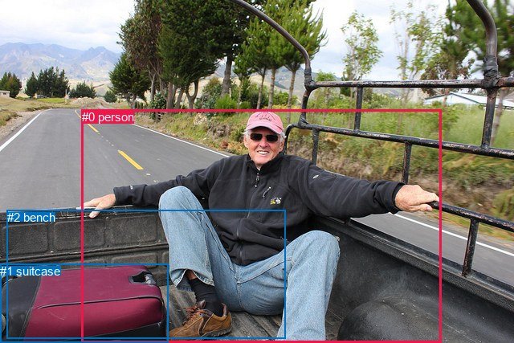
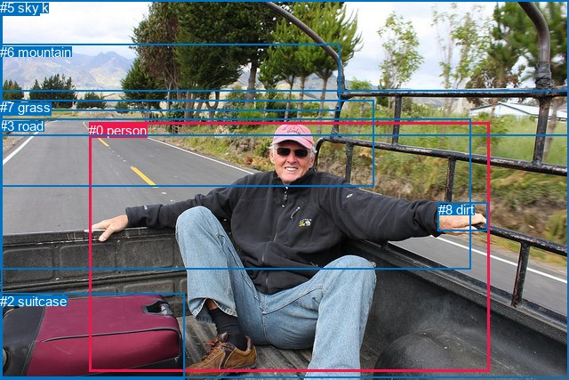

# 图片 1324：2377760.jpg

随机样本序号：406。图片 SHA256：`2b12954b33d24104b1c77ed71d924c579f6a2b7d9d00de617b7ca8ce17ff340d`。

红色框表示人，蓝色框表示其他物体。两个模式分别保留自身框编号，可依据位置比较对应对象。

## 自动检测框与输出

人的框编号：`[0]`。状态：`ok`。

### 自动检测全部物体框

| 编号 | 类别 | 是否为人 | 检测分数 | 像素坐标 xyxy |
|---|---|---|---|---|
| 0 | person | True | 0.9995 | 101.8, 136.9, 549.0, 427.0 |
| 1 | suitcase | False | 0.9892 | 0.0, 328.8, 210.0, 427.0 |
| 2 | bench | False | 0.5588 | 8.6, 261.7, 355.6, 421.2 |

### 自动检测 Top50 人相关候选

评分物体对：6；人相关物体对：4；输出关系：8。

| 排名 | 主语编号与类别 | 关系 | 宾语编号与类别 | 类型 | 人与人 | 排序分数 | 原始融合 logit |
|---|---|---|---|---|---|---|---|
| 1 | #0 person | wearing | #1 suitcase | semantic | False | 0.99198 | 4.8176 |
| 2 | #0 person | sitting on | #2 bench | semantic | False | 0.98510 | 4.1916 |
| 3 | #0 person | on | #2 bench | spatial | False | 0.85384 | 1.7650 |
| 4 | #1 suitcase | beside | #0 person | spatial | False | 0.84595 | 1.7032 |
| 5 | #0 person | beside | #1 suitcase | spatial | False | 0.81665 | 1.4938 |
| 6 | #2 bench | beside | #0 person | spatial | False | 0.15111 | -1.7259 |
| 7 | #1 suitcase | holding | #0 person | semantic | False | 0.10927 | -2.0982 |
| 8 | #2 bench | holding | #0 person | semantic | False | 0.01960 | -3.9124 |

### 自动检测逐条人相关 GT 核验

R@50：33.33%；命中 1/3。

| GT 主语编号 | GT 关系 | GT 宾语编号 | 结果阶段 | 匹配预测主语编号 | 匹配预测宾语编号 |
|---|---|---|---|---|---|
| 0 | on | 1 | endpoint_missing_or_wrong_class | [0] | [] |
| 0 | sitting on | 1 | endpoint_missing_or_wrong_class | [0] | [] |
| 0 | beside | 2 | hit50 | [0] | [1] |

## 真实框与输出

人的框编号：`[0]`。

### 真实框全部物体框

| 编号 | 类别 | 是否为人 | 检测分数 | 像素坐标 xyxy |
|---|---|---|---|---|
| 0 | person | True | GT | 100.0, 138.0, 551.0, 418.0 |
| 1 | truck | False | GT | 2.0, 0.0, 640.0, 425.0 |
| 2 | suitcase | False | GT | 0.0, 330.0, 207.0, 427.0 |
| 3 | road | False | GT | 0.0, 133.0, 529.0, 302.0 |
| 4 | tree | False | GT | 0.0, 0.0, 640.0, 152.0 |
| 5 | sky | False | GT | 0.0, 0.0, 640.0, 102.0 |
| 6 | mountain | False | GT | 0.0, 50.0, 383.0, 125.0 |
| 7 | grass | False | GT | 0.0, 112.0, 420.0, 210.0 |
| 8 | dirt | False | GT | 493.0, 227.0, 549.0, 259.0 |

### 真实框 Top50 人相关候选

评分物体对：72；人相关物体对：16；输出关系：32。

| 排名 | 主语编号与类别 | 关系 | 宾语编号与类别 | 类型 | 人与人 | 排序分数 | 原始融合 logit |
|---|---|---|---|---|---|---|---|
| 1 | #0 person | sitting on | #1 truck | semantic | False | 0.98382 | 4.1074 |
| 2 | #0 person | on | #1 truck | spatial | False | 0.97738 | 3.7662 |
| 3 | #0 person | on | #3 road | spatial | False | 0.91316 | 2.3528 |
| 4 | #0 person | holding | #8 dirt | semantic | False | 0.90389 | 2.2412 |
| 5 | #2 suitcase | beside | #0 person | spatial | False | 0.86393 | 1.8484 |
| 6 | #0 person | sitting on | #3 road | semantic | False | 0.83824 | 1.6452 |
| 7 | #0 person | on | #8 dirt | spatial | False | 0.82607 | 1.5580 |
| 8 | #0 person | wearing | #2 suitcase | semantic | False | 0.79461 | 1.3529 |
| 9 | #8 dirt | on | #0 person | spatial | False | 0.79436 | 1.3514 |
| 10 | #0 person | on | #2 suitcase | spatial | False | 0.75153 | 1.1068 |
| 11 | #3 road | wearing | #0 person | semantic | False | 0.66553 | 0.6880 |
| 12 | #0 person | on | #7 grass | spatial | False | 0.58983 | 0.3633 |
| 13 | #3 road | in | #0 person | spatial | False | 0.56722 | 0.2705 |
| 14 | #0 person | sitting on | #7 grass | semantic | False | 0.40989 | -0.3644 |
| 15 | #2 suitcase | sitting on | #0 person | semantic | False | 0.20519 | -1.3542 |
| 16 | #8 dirt | holding | #0 person | semantic | False | 0.17211 | -1.5708 |
| 17 | #0 person | in | #4 tree | spatial | False | 0.13528 | -1.8550 |
| 18 | #0 person | looking at | #5 sky | semantic | False | 0.09986 | -2.1987 |
| 19 | #0 person | looking at | #4 tree | semantic | False | 0.09728 | -2.2278 |
| 20 | #7 grass | beside | #0 person | spatial | False | 0.08156 | -2.4213 |
| 21 | #1 truck | in | #0 person | spatial | False | 0.07206 | -2.5555 |
| 22 | #1 truck | holding | #0 person | semantic | False | 0.06447 | -2.6748 |
| 23 | #5 sky | over | #0 person | spatial | False | 0.05528 | -2.8384 |
| 24 | #0 person | in | #5 sky | spatial | False | 0.03590 | -3.2904 |
| 25 | #4 tree | beside | #0 person | spatial | False | 0.03098 | -3.4429 |
| 26 | #0 person | on | #6 mountain | spatial | False | 0.01938 | -3.9237 |
| 27 | #6 mountain | beside | #0 person | spatial | False | 0.01927 | -3.9299 |
| 28 | #0 person | sitting on | #6 mountain | semantic | False | 0.01748 | -4.0291 |
| 29 | #7 grass | holding | #0 person | semantic | False | 0.01229 | -4.3866 |
| 30 | #6 mountain | looking at | #0 person | semantic | False | 0.00959 | -4.6373 |
| 31 | #4 tree | looking at | #0 person | semantic | False | 0.00761 | -4.8705 |
| 32 | #5 sky | holding | #0 person | semantic | False | 0.00381 | -5.5652 |

### 真实框逐条人相关 GT 核验

R@50：66.67%；命中 2/3。

| GT 主语编号 | GT 关系 | GT 宾语编号 | 结果阶段 | 匹配预测主语编号 | 匹配预测宾语编号 |
|---|---|---|---|---|---|
| 0 | on | 1 | hit50 | [0] | [1] |
| 0 | sitting on | 1 | hit50 | [0] | [1] |
| 0 | beside | 2 | wrong_predicate | [0] | [2] |

## 全部人相关 GT

| 主语编号与类别 | 关系 | 宾语编号与类别 |
|---|---|---|
| #0 person | on | #1 truck |
| #0 person | sitting on | #1 truck |
| #0 person | beside | #2 suitcase |

原始记录、全部人相关物体对的两项预测与分项分数见 [逐图证据 JSON](../evidence/cases/1324.json)。全部56类 logits 保留于本机 HOR/output/random500/logits/。

<!-- HOR_COMPLETE_RESULTS -->

## 六组条件的完整输出对照

以下保留同一图片三种框与候选模式、两种谓词输出规则的全部 Top50。框编号各自在所属模式内解释。

### 自动检测框完整枚举：空间与语义各保留一个谓词

| 排名 | 主语编号与类别 | 谓词 | 宾语编号与类别 | 分组 | 排序分数 | predicate logit | pair logit |
|---|---|---|---|---|---|---|---|
| 1 | #0 person | wearing | #1 suitcase | semantic | 0.9919788 | 5.2029080 | -0.3852986 |
| 2 | #0 person | sitting on | #2 bench | semantic | 0.9851032 | 4.1168809 | 0.0747185 |
| 3 | #0 person | on | #2 bench | spatial | 0.8538378 | 1.6903057 | 0.0747185 |
| 4 | #1 suitcase | beside | #0 person | spatial | 0.8459530 | 2.2688141 | -0.5656080 |
| 5 | #0 person | beside | #1 suitcase | spatial | 0.8166528 | 1.8791313 | -0.3852986 |
| 6 | #2 bench | beside | #0 person | spatial | 0.1511123 | -0.9602416 | -0.7656623 |
| 7 | #1 suitcase | holding | #0 person | semantic | 0.1092742 | -1.5325680 | -0.5656080 |
| 8 | #2 bench | holding | #0 person | semantic | 0.0196012 | -3.1467042 | -0.7656623 |

GT 命中：1/3，R@50=33.33%。

| GT主语 | GT谓词 | GT宾语 | 结果阶段 | 匹配主语框 | 匹配宾语框 |
|---|---|---|---|---|---|
| 0 | on | 1 | endpoint_missing_or_wrong_class | [0] | [] |
| 0 | sitting on | 1 | endpoint_missing_or_wrong_class | [0] | [] |
| 0 | beside | 2 | hit50 | [0] | [1] |

### 自动检测框完整枚举：每对只保留一个谓词

| 排名 | 主语编号与类别 | 谓词 | 宾语编号与类别 | 分组 | 排序分数 | predicate logit | pair logit |
|---|---|---|---|---|---|---|---|
| 1 | #0 person | wearing | #1 suitcase | single | 0.9919788 | 5.2029080 | -0.3852986 |
| 2 | #0 person | sitting on | #2 bench | single | 0.9851032 | 4.1168809 | 0.0747185 |
| 3 | #1 suitcase | beside | #0 person | single | 0.8459530 | 2.2688141 | -0.5656080 |
| 4 | #2 bench | beside | #0 person | single | 0.1511123 | -0.9602416 | -0.7656623 |

GT 命中：0/3，R@50=0.00%。

| GT主语 | GT谓词 | GT宾语 | 结果阶段 | 匹配主语框 | 匹配宾语框 |
|---|---|---|---|---|---|
| 0 | on | 1 | endpoint_missing_or_wrong_class | [0] | [] |
| 0 | sitting on | 1 | endpoint_missing_or_wrong_class | [0] | [] |
| 0 | beside | 2 | wrong_predicate | [0] | [1] |

### 真实框完整枚举：空间与语义各保留一个谓词

| 排名 | 主语编号与类别 | 谓词 | 宾语编号与类别 | 分组 | 排序分数 | predicate logit | pair logit |
|---|---|---|---|---|---|---|---|
| 1 | #0 person | sitting on | #1 truck | semantic | 0.9838153 | 3.5240054 | 0.5833614 |
| 2 | #0 person | on | #1 truck | spatial | 0.9773844 | 3.1828780 | 0.5833614 |
| 3 | #0 person | on | #3 road | spatial | 0.9131575 | 2.8263583 | -0.4735463 |
| 4 | #0 person | holding | #8 dirt | semantic | 0.9038860 | 2.1278458 | 0.1133220 |
| 5 | #2 suitcase | beside | #0 person | spatial | 0.8639333 | 2.4248214 | -0.5764710 |
| 6 | #0 person | sitting on | #3 road | semantic | 0.8382368 | 2.1187134 | -0.4735463 |
| 7 | #0 person | on | #8 dirt | spatial | 0.8260667 | 1.4446821 | 0.1133220 |
| 8 | #0 person | wearing | #2 suitcase | semantic | 0.7946104 | 1.8057728 | -0.4528297 |
| 9 | #8 dirt | on | #0 person | spatial | 0.7943615 | 1.7981009 | -0.4466825 |
| 10 | #0 person | on | #2 suitcase | spatial | 0.7515321 | 1.5596304 | -0.4528297 |
| 11 | #3 road | wearing | #0 person | semantic | 0.6655273 | 1.3550100 | -0.6669858 |
| 12 | #0 person | on | #7 grass | spatial | 0.5898338 | 1.0409536 | -0.6776754 |
| 13 | #3 road | in | #0 person | spatial | 0.5672245 | 0.9375219 | -0.6669858 |
| 14 | #0 person | sitting on | #7 grass | semantic | 0.4098937 | 0.3132706 | -0.6776754 |
| 15 | #2 suitcase | sitting on | #0 person | semantic | 0.2051853 | -0.7777247 | -0.5764710 |
| 16 | #8 dirt | holding | #0 person | semantic | 0.1721084 | -1.1240754 | -0.4466825 |
| 17 | #0 person | in | #4 tree | spatial | 0.1352815 | -0.8445091 | -1.0105371 |
| 18 | #0 person | looking at | #5 sky | semantic | 0.0998632 | -0.9768226 | -1.2219230 |
| 19 | #0 person | looking at | #4 tree | semantic | 0.0972821 | -1.2172582 | -1.0105371 |
| 20 | #7 grass | beside | #0 person | spatial | 0.0815592 | -1.6833062 | -0.7380416 |
| 21 | #1 truck | in | #0 person | spatial | 0.0720573 | -1.4363678 | -1.1191411 |
| 22 | #1 truck | holding | #0 person | semantic | 0.0644748 | -1.5556924 | -1.1191411 |
| 23 | #5 sky | over | #0 person | spatial | 0.0552837 | -1.8542423 | -0.9841636 |
| 24 | #0 person | in | #5 sky | spatial | 0.0359013 | -2.0684965 | -1.2219230 |
| 25 | #4 tree | beside | #0 person | spatial | 0.0309825 | -2.6156504 | -0.8272086 |
| 26 | #0 person | on | #6 mountain | spatial | 0.0193839 | -2.6658154 | -1.2579229 |
| 27 | #6 mountain | beside | #0 person | spatial | 0.0192669 | -3.3426456 | -0.5872679 |
| 28 | #0 person | sitting on | #6 mountain | semantic | 0.0174800 | -2.7711380 | -1.2579229 |
| 29 | #7 grass | holding | #0 person | semantic | 0.0122900 | -3.6485615 | -0.7380416 |
| 30 | #6 mountain | looking at | #0 person | semantic | 0.0095911 | -4.0500135 | -0.5872679 |
| 31 | #4 tree | looking at | #0 person | semantic | 0.0076108 | -4.0433326 | -0.8272086 |
| 32 | #5 sky | holding | #0 person | semantic | 0.0038144 | -4.5809970 | -0.9841636 |

GT 命中：2/3，R@50=66.67%。

| GT主语 | GT谓词 | GT宾语 | 结果阶段 | 匹配主语框 | 匹配宾语框 |
|---|---|---|---|---|---|
| 0 | on | 1 | hit50 | [0] | [1] |
| 0 | sitting on | 1 | hit50 | [0] | [1] |
| 0 | beside | 2 | wrong_predicate | [0] | [2] |

### 真实框完整枚举：每对只保留一个谓词

| 排名 | 主语编号与类别 | 谓词 | 宾语编号与类别 | 分组 | 排序分数 | predicate logit | pair logit |
|---|---|---|---|---|---|---|---|
| 1 | #0 person | sitting on | #1 truck | single | 0.9838153 | 3.5240054 | 0.5833614 |
| 2 | #0 person | on | #3 road | single | 0.9131575 | 2.8263583 | -0.4735463 |
| 3 | #0 person | holding | #8 dirt | single | 0.9038860 | 2.1278458 | 0.1133220 |
| 4 | #2 suitcase | beside | #0 person | single | 0.8639333 | 2.4248214 | -0.5764710 |
| 5 | #0 person | wearing | #2 suitcase | single | 0.7946104 | 1.8057728 | -0.4528297 |
| 6 | #8 dirt | on | #0 person | single | 0.7943615 | 1.7981009 | -0.4466825 |
| 7 | #3 road | wearing | #0 person | single | 0.6655273 | 1.3550100 | -0.6669858 |
| 8 | #0 person | on | #7 grass | single | 0.5898338 | 1.0409536 | -0.6776754 |
| 9 | #0 person | in | #4 tree | single | 0.1352815 | -0.8445091 | -1.0105371 |
| 10 | #0 person | looking at | #5 sky | single | 0.0998632 | -0.9768226 | -1.2219230 |
| 11 | #7 grass | beside | #0 person | single | 0.0815592 | -1.6833062 | -0.7380416 |
| 12 | #1 truck | in | #0 person | single | 0.0720573 | -1.4363678 | -1.1191411 |
| 13 | #5 sky | over | #0 person | single | 0.0552837 | -1.8542423 | -0.9841636 |
| 14 | #4 tree | beside | #0 person | single | 0.0309825 | -2.6156504 | -0.8272086 |
| 15 | #0 person | on | #6 mountain | single | 0.0193839 | -2.6658154 | -1.2579229 |
| 16 | #6 mountain | beside | #0 person | single | 0.0192669 | -3.3426456 | -0.5872679 |

GT 命中：1/3，R@50=33.33%。

| GT主语 | GT谓词 | GT宾语 | 结果阶段 | 匹配主语框 | 匹配宾语框 |
|---|---|---|---|---|---|
| 0 | on | 1 | wrong_predicate | [0] | [1] |
| 0 | sitting on | 1 | hit50 | [0] | [1] |
| 0 | beside | 2 | wrong_predicate | [0] | [2] |

### 真实框400候选：空间与语义各保留一个谓词

| 排名 | 主语编号与类别 | 谓词 | 宾语编号与类别 | 分组 | 排序分数 | predicate logit | pair logit |
|---|---|---|---|---|---|---|---|
| 1 | #0 person | sitting on | #1 truck | semantic | 0.9835252 | 3.5059476 | 0.5833614 |
| 2 | #0 person | on | #1 truck | spatial | 0.9773844 | 3.1828780 | 0.5833614 |
| 3 | #0 person | on | #3 road | spatial | 0.9131575 | 2.8263583 | -0.4735463 |
| 4 | #0 person | holding | #8 dirt | semantic | 0.9038860 | 2.1278458 | 0.1133220 |
| 5 | #2 suitcase | beside | #0 person | spatial | 0.8674320 | 2.4549127 | -0.5764710 |
| 6 | #0 person | sitting on | #3 road | semantic | 0.8382368 | 2.1187134 | -0.4735463 |
| 7 | #0 person | on | #8 dirt | spatial | 0.8260667 | 1.4446821 | 0.1133220 |
| 8 | #8 dirt | on | #0 person | spatial | 0.8005638 | 1.8365040 | -0.4466825 |
| 9 | #0 person | wearing | #2 suitcase | semantic | 0.7856041 | 1.7514582 | -0.4528297 |
| 10 | #0 person | on | #2 suitcase | spatial | 0.7458707 | 1.5295386 | -0.4528297 |
| 11 | #3 road | wearing | #0 person | semantic | 0.6601137 | 1.3307867 | -0.6669858 |
| 12 | #0 person | on | #7 grass | spatial | 0.5970937 | 1.0710454 | -0.6776754 |
| 13 | #3 road | in | #0 person | spatial | 0.5606409 | 0.9107494 | -0.6669858 |
| 14 | #0 person | sitting on | #7 grass | semantic | 0.4120795 | 0.3223000 | -0.6776754 |
| 15 | #2 suitcase | sitting on | #0 person | semantic | 0.2093879 | -0.7521479 | -0.5764710 |
| 16 | #8 dirt | holding | #0 person | semantic | 0.1721084 | -1.1240754 | -0.4466825 |
| 17 | #0 person | in | #4 tree | spatial | 0.1349422 | -0.8474128 | -1.0105371 |
| 18 | #0 person | looking at | #5 sky | semantic | 0.0985498 | -0.9915197 | -1.2219230 |
| 19 | #0 person | looking at | #4 tree | semantic | 0.0959385 | -1.2326527 | -1.0105371 |
| 20 | #7 grass | beside | #0 person | spatial | 0.0804355 | -1.6984024 | -0.7380416 |
| 21 | #1 truck | in | #0 person | spatial | 0.0721683 | -1.4347084 | -1.1191411 |
| 22 | #1 truck | holding | #0 person | semantic | 0.0642524 | -1.5593853 | -1.1191411 |
| 23 | #5 sky | over | #0 person | spatial | 0.0539350 | -1.8803678 | -0.9841636 |
| 24 | #0 person | in | #5 sky | spatial | 0.0354692 | -2.0810530 | -1.2219230 |
| 25 | #4 tree | beside | #0 person | spatial | 0.0305327 | -2.6307395 | -0.8272086 |
| 26 | #6 mountain | beside | #0 person | spatial | 0.0194073 | -3.3352385 | -0.5872679 |
| 27 | #0 person | on | #6 mountain | spatial | 0.0190363 | -2.6842639 | -1.2579229 |
| 28 | #0 person | sitting on | #6 mountain | semantic | 0.0169707 | -2.8012292 | -1.2579229 |
| 29 | #7 grass | holding | #0 person | semantic | 0.0120999 | -3.6643457 | -0.7380416 |
| 30 | #6 mountain | looking at | #0 person | semantic | 0.0094509 | -4.0648847 | -0.5872679 |
| 31 | #4 tree | looking at | #0 person | semantic | 0.0073894 | -4.0730777 | -0.8272086 |
| 32 | #5 sky | holding | #0 person | semantic | 0.0038261 | -4.5779057 | -0.9841636 |

GT 命中：2/3，R@50=66.67%。

| GT主语 | GT谓词 | GT宾语 | 结果阶段 | 匹配主语框 | 匹配宾语框 |
|---|---|---|---|---|---|
| 0 | on | 1 | hit50 | [0] | [1] |
| 0 | sitting on | 1 | hit50 | [0] | [1] |
| 0 | beside | 2 | wrong_predicate | [0] | [2] |

### 真实框400候选：每对只保留一个谓词

| 排名 | 主语编号与类别 | 谓词 | 宾语编号与类别 | 分组 | 排序分数 | predicate logit | pair logit |
|---|---|---|---|---|---|---|---|
| 1 | #0 person | sitting on | #1 truck | single | 0.9835252 | 3.5059476 | 0.5833614 |
| 2 | #0 person | on | #3 road | single | 0.9131575 | 2.8263583 | -0.4735463 |
| 3 | #0 person | holding | #8 dirt | single | 0.9038860 | 2.1278458 | 0.1133220 |
| 4 | #2 suitcase | beside | #0 person | single | 0.8674320 | 2.4549127 | -0.5764710 |
| 5 | #8 dirt | on | #0 person | single | 0.8005638 | 1.8365040 | -0.4466825 |
| 6 | #0 person | wearing | #2 suitcase | single | 0.7856041 | 1.7514582 | -0.4528297 |
| 7 | #3 road | wearing | #0 person | single | 0.6601137 | 1.3307867 | -0.6669858 |
| 8 | #0 person | on | #7 grass | single | 0.5970937 | 1.0710454 | -0.6776754 |
| 9 | #0 person | in | #4 tree | single | 0.1349422 | -0.8474128 | -1.0105371 |
| 10 | #0 person | looking at | #5 sky | single | 0.0985498 | -0.9915197 | -1.2219230 |
| 11 | #7 grass | beside | #0 person | single | 0.0804355 | -1.6984024 | -0.7380416 |
| 12 | #1 truck | in | #0 person | single | 0.0721683 | -1.4347084 | -1.1191411 |
| 13 | #5 sky | over | #0 person | single | 0.0539350 | -1.8803678 | -0.9841636 |
| 14 | #4 tree | beside | #0 person | single | 0.0305327 | -2.6307395 | -0.8272086 |
| 15 | #6 mountain | beside | #0 person | single | 0.0194073 | -3.3352385 | -0.5872679 |
| 16 | #0 person | on | #6 mountain | single | 0.0190363 | -2.6842639 | -1.2579229 |

GT 命中：1/3，R@50=33.33%。

| GT主语 | GT谓词 | GT宾语 | 结果阶段 | 匹配主语框 | 匹配宾语框 |
|---|---|---|---|---|---|
| 0 | on | 1 | wrong_predicate | [0] | [1] |
| 0 | sitting on | 1 | hit50 | [0] | [1] |
| 0 | beside | 2 | wrong_predicate | [0] | [2] |
