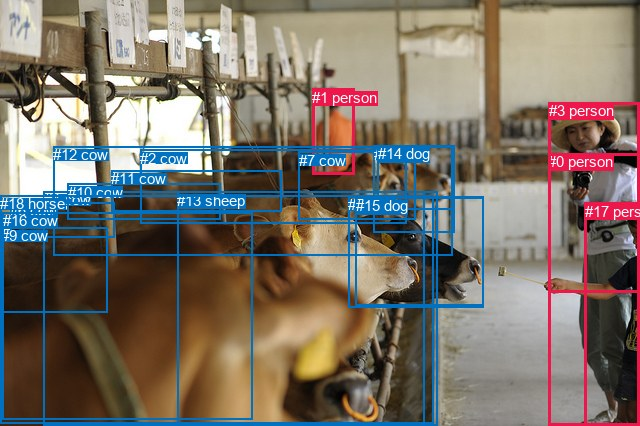
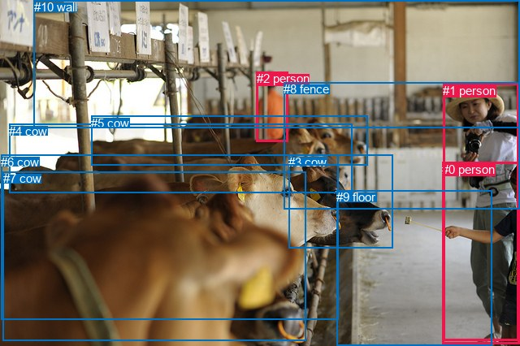

# 图片 1326：2377788.jpg

随机样本序号：35。图片 SHA256：`ec9bba125a948bc97bf1f68c4ee76efc43e97800039928bb52d894408dd4945f`。

红色框表示人，蓝色框表示其他物体。两个模式分别保留自身框编号，可依据位置比较对应对象。

## 自动检测框与输出

人的框编号：`[0, 1, 3, 17]`。状态：`ok`。

### 自动检测全部物体框

| 编号 | 类别 | 是否为人 | 检测分数 | 像素坐标 xyxy |
|---|---|---|---|---|
| 0 | person | True | 0.9977 | 548.5, 153.4, 639.9, 425.5 |
| 1 | person | True | 0.9880 | 312.3, 88.6, 354.5, 174.2 |
| 2 | cow | False | 0.9724 | 140.3, 149.6, 406.4, 223.8 |
| 3 | person | True | 0.9513 | 548.7, 102.2, 639.0, 292.1 |
| 4 | cow | False | 0.9282 | 43.9, 191.5, 437.3, 426.0 |
| 5 | cow | False | 0.8854 | 348.2, 196.3, 483.1, 307.4 |
| 6 | cow | False | 0.8803 | 10.1, 202.5, 114.3, 237.4 |
| 7 | cow | False | 0.8514 | 298.7, 151.6, 415.4, 219.6 |
| 8 | cow | False | 0.7746 | 373.6, 145.5, 454.4, 232.9 |
| 9 | cow | False | 0.7089 | 0.5, 227.5, 107.3, 312.7 |
| 10 | cow | False | 0.6954 | 68.0, 183.6, 220.3, 219.2 |
| 11 | cow | False | 0.6835 | 111.0, 170.3, 281.5, 211.1 |
| 12 | cow | False | 0.6654 | 53.4, 146.1, 452.6, 255.4 |
| 13 | sheep | False | 0.5589 | 177.1, 191.6, 424.1, 426.0 |
| 14 | dog | False | 0.5553 | 377.6, 145.4, 453.3, 209.2 |
| 15 | dog | False | 0.4602 | 356.0, 197.3, 483.4, 305.8 |
| 16 | cow | False | 0.4442 | 2.5, 212.3, 252.7, 419.9 |
| 17 | person | True | 0.4429 | 584.9, 203.0, 640.0, 426.0 |
| 18 | horse | False | 0.4227 | 0.0, 195.4, 433.5, 423.4 |

### 自动检测 Top50 人相关候选

评分物体对：342；人相关物体对：132；输出关系：50。

| 排名 | 主语编号与类别 | 关系 | 宾语编号与类别 | 类型 | 人与人 | 排序分数 | 原始融合 logit |
|---|---|---|---|---|---|---|---|
| 1 | #1 person | looking at | #2 cow | semantic | False | 0.97082 | 3.5048 |
| 2 | #1 person | looking at | #8 cow | semantic | False | 0.96812 | 3.4133 |
| 3 | #1 person | standing on | #7 cow | semantic | False | 0.96655 | 3.3635 |
| 4 | #0 person | feeding | #13 sheep | semantic | False | 0.95172 | 2.9813 |
| 5 | #17 person | holding | #0 person | semantic | True | 0.94684 | 2.8797 |
| 6 | #1 person | looking at | #12 cow | semantic | False | 0.94632 | 2.8695 |
| 7 | #17 person | feeding | #4 cow | semantic | False | 0.93917 | 2.7369 |
| 8 | #17 person | feeding | #18 horse | semantic | False | 0.93914 | 2.7363 |
| 9 | #0 person | feeding | #4 cow | semantic | False | 0.92555 | 2.5202 |
| 10 | #1 person | looking at | #14 dog | semantic | False | 0.92416 | 2.5003 |
| 11 | #0 person | feeding | #18 horse | semantic | False | 0.92189 | 2.4683 |
| 12 | #17 person | looking at | #13 sheep | semantic | False | 0.92136 | 2.4610 |
| 13 | #3 person | holding | #0 person | semantic | True | 0.91785 | 2.4135 |
| 14 | #1 person | on | #7 cow | spatial | False | 0.91546 | 2.3822 |
| 15 | #3 person | looking at | #13 sheep | semantic | False | 0.91327 | 2.3542 |
| 16 | #1 person | looking at | #13 sheep | semantic | False | 0.90202 | 2.2198 |
| 17 | #3 person | looking at | #4 cow | semantic | False | 0.89862 | 2.1820 |
| 18 | #3 person | looking at | #18 horse | semantic | False | 0.88376 | 2.0285 |
| 19 | #0 person | holding | #3 person | semantic | True | 0.88208 | 2.0123 |
| 20 | #17 person | holding | #3 person | semantic | True | 0.88065 | 1.9986 |
| 21 | #1 person | looking at | #11 cow | semantic | False | 0.81544 | 1.4858 |
| 22 | #17 person | in | #0 person | spatial | True | 0.80673 | 1.4289 |
| 23 | #3 person | looking at | #16 cow | semantic | False | 0.79650 | 1.3646 |
| 24 | #17 person | looking at | #16 cow | semantic | False | 0.78972 | 1.3232 |
| 25 | #1 person | beside | #8 cow | spatial | False | 0.75383 | 1.1191 |
| 26 | #1 person | beside | #14 dog | spatial | False | 0.74762 | 1.0859 |
| 27 | #3 person | looking at | #5 cow | semantic | False | 0.73981 | 1.0450 |
| 28 | #0 person | looking at | #16 cow | semantic | False | 0.71868 | 0.9379 |
| 29 | #1 person | looking at | #4 cow | semantic | False | 0.71779 | 0.9335 |
| 30 | #1 person | beside | #2 cow | spatial | False | 0.71702 | 0.9297 |
| 31 | #3 person | looking at | #2 cow | semantic | False | 0.71460 | 0.9178 |
| 32 | #3 person | looking at | #12 cow | semantic | False | 0.70804 | 0.8859 |
| 33 | #3 person | looking at | #15 dog | semantic | False | 0.68711 | 0.7866 |
| 34 | #3 person | in | #0 person | spatial | True | 0.67438 | 0.7281 |
| 35 | #1 person | looking at | #18 horse | semantic | False | 0.63160 | 0.5391 |
| 36 | #0 person | eating | #6 cow | semantic | False | 0.59900 | 0.4013 |
| 37 | #1 person | beside | #12 cow | spatial | False | 0.58810 | 0.3561 |
| 38 | #0 person | holding | #17 person | semantic | True | 0.57316 | 0.2947 |
| 39 | #0 person | feeding | #12 cow | semantic | False | 0.57245 | 0.2919 |
| 40 | #3 person | looking at | #11 cow | semantic | False | 0.56723 | 0.2706 |
| 41 | #0 person | in | #3 person | spatial | True | 0.55452 | 0.2189 |
| 42 | #1 person | looking at | #5 cow | semantic | False | 0.54541 | 0.1821 |
| 43 | #3 person | beside | #13 sheep | spatial | False | 0.54437 | 0.1779 |
| 44 | #17 person | eating | #6 cow | semantic | False | 0.54124 | 0.1653 |
| 45 | #0 person | eating | #10 cow | semantic | False | 0.52807 | 0.1124 |
| 46 | #17 person | looking at | #5 cow | semantic | False | 0.52025 | 0.0810 |
| 47 | #0 person | eating | #11 cow | semantic | False | 0.51427 | 0.0571 |
| 48 | #17 person | feeding | #12 cow | semantic | False | 0.50813 | 0.0325 |
| 49 | #17 person | beside | #4 cow | spatial | False | 0.50352 | 0.0141 |
| 50 | #1 person | looking at | #15 dog | semantic | False | 0.50056 | 0.0022 |

### 自动检测逐条人相关 GT 核验

R@50：0.00%；命中 0/2。

| GT 主语编号 | GT 关系 | GT 宾语编号 | 结果阶段 | 匹配预测主语编号 | 匹配预测宾语编号 |
|---|---|---|---|---|---|
| 0 | feeding | 3 | wrong_predicate | [0, 17] | [5] |
| 6 | in front of | 1 | rank_below50 | [4, 16] | [0, 3] |

## 真实框与输出

人的框编号：`[0, 1, 2]`。

### 真实框全部物体框

| 编号 | 类别 | 是否为人 | 检测分数 | 像素坐标 xyxy |
|---|---|---|---|---|
| 0 | person | True | GT | 544.0, 200.0, 640.0, 424.0 |
| 1 | person | True | GT | 545.0, 103.0, 638.0, 420.0 |
| 2 | person | True | GT | 316.0, 88.0, 355.0, 174.0 |
| 3 | cow | False | GT | 355.0, 191.0, 483.0, 306.0 |
| 4 | cow | False | GT | 11.0, 153.0, 433.0, 238.0 |
| 5 | cow | False | GT | 112.0, 143.0, 453.0, 204.0 |
| 6 | cow | False | GT | 1.0, 191.0, 416.0, 394.0 |
| 7 | cow | False | GT | 4.0, 211.0, 376.0, 419.0 |
| 8 | fence | False | GT | 349.0, 101.0, 640.0, 257.0 |
| 9 | floor | False | GT | 414.0, 234.0, 605.0, 426.0 |
| 10 | wall | False | GT | 42.0, 0.0, 640.0, 157.0 |

### 真实框 Top50 人相关候选

评分物体对：110；人相关物体对：54；输出关系：50。

| 排名 | 主语编号与类别 | 关系 | 宾语编号与类别 | 类型 | 人与人 | 排序分数 | 原始融合 logit |
|---|---|---|---|---|---|---|---|
| 1 | #0 person | feeding | #6 cow | semantic | False | 0.98828 | 4.4343 |
| 2 | #0 person | feeding | #7 cow | semantic | False | 0.98230 | 4.0162 |
| 3 | #1 person | feeding | #6 cow | semantic | False | 0.97771 | 3.7812 |
| 4 | #2 person | looking at | #5 cow | semantic | False | 0.96833 | 3.4203 |
| 5 | #1 person | feeding | #7 cow | semantic | False | 0.96668 | 3.3676 |
| 6 | #1 person | standing on | #9 floor | semantic | False | 0.96466 | 3.3069 |
| 7 | #0 person | standing on | #9 floor | semantic | False | 0.95943 | 3.1633 |
| 8 | #1 person | feeding | #4 cow | semantic | False | 0.95724 | 3.1085 |
| 9 | #2 person | looking at | #4 cow | semantic | False | 0.95116 | 2.9692 |
| 10 | #1 person | on | #9 floor | spatial | False | 0.93161 | 2.6117 |
| 11 | #0 person | on | #9 floor | spatial | False | 0.92538 | 2.5178 |
| 12 | #2 person | in | #10 wall | spatial | False | 0.92469 | 2.5079 |
| 13 | #1 person | wearing | #0 person | semantic | True | 0.91897 | 2.4285 |
| 14 | #0 person | feeding | #4 cow | semantic | False | 0.91067 | 2.3219 |
| 15 | #2 person | in | #8 fence | spatial | False | 0.90036 | 2.2012 |
| 16 | #2 person | beside | #5 cow | spatial | False | 0.89212 | 2.1125 |
| 17 | #0 person | holding | #1 person | semantic | True | 0.87348 | 1.9321 |
| 18 | #1 person | holding | #3 cow | semantic | False | 0.87279 | 1.9258 |
| 19 | #2 person | standing on | #8 fence | semantic | False | 0.85374 | 1.7643 |
| 20 | #1 person | feeding | #5 cow | semantic | False | 0.85269 | 1.7559 |
| 21 | #1 person | in | #0 person | spatial | True | 0.84730 | 1.7136 |
| 22 | #2 person | standing on | #9 floor | semantic | False | 0.81508 | 1.4834 |
| 23 | #2 person | standing on | #10 wall | semantic | False | 0.81024 | 1.4516 |
| 24 | #2 person | looking at | #6 cow | semantic | False | 0.80088 | 1.3918 |
| 25 | #2 person | looking at | #3 cow | semantic | False | 0.79531 | 1.3573 |
| 26 | #1 person | beside | #3 cow | spatial | False | 0.75519 | 1.1265 |
| 27 | #2 person | looking at | #7 cow | semantic | False | 0.74955 | 1.0962 |
| 28 | #2 person | beside | #4 cow | spatial | False | 0.74216 | 1.0572 |
| 29 | #0 person | feeding | #5 cow | semantic | False | 0.73767 | 1.0339 |
| 30 | #6 cow | eating | #1 person | semantic | False | 0.72127 | 0.9508 |
| 31 | #0 person | looking at | #3 cow | semantic | False | 0.70926 | 0.8918 |
| 32 | #1 person | beside | #7 cow | spatial | False | 0.68946 | 0.7976 |
| 33 | #1 person | beside | #6 cow | spatial | False | 0.68779 | 0.7898 |
| 34 | #2 person | on | #9 floor | spatial | False | 0.67105 | 0.7129 |
| 35 | #7 cow | eating | #1 person | semantic | False | 0.63438 | 0.5510 |
| 36 | #1 person | holding | #8 fence | semantic | False | 0.60862 | 0.4415 |
| 37 | #0 person | beside | #7 cow | spatial | False | 0.59721 | 0.3938 |
| 38 | #1 person | beside | #4 cow | spatial | False | 0.59569 | 0.3875 |
| 39 | #0 person | beside | #3 cow | spatial | False | 0.57954 | 0.3209 |
| 40 | #0 person | beside | #6 cow | spatial | False | 0.57449 | 0.3002 |
| 41 | #6 cow | eating | #0 person | semantic | False | 0.56542 | 0.2632 |
| 42 | #0 person | in | #1 person | spatial | True | 0.49735 | -0.0106 |
| 43 | #1 person | in | #8 fence | spatial | False | 0.49725 | -0.0110 |
| 44 | #7 cow | eating | #0 person | semantic | False | 0.46809 | -0.1278 |
| 45 | #1 person | beside | #5 cow | spatial | False | 0.43970 | -0.2424 |
| 46 | #2 person | beside | #3 cow | spatial | False | 0.37826 | -0.4969 |
| 47 | #0 person | beside | #4 cow | spatial | False | 0.31246 | -0.7887 |
| 48 | #9 floor | beside | #1 person | spatial | False | 0.20122 | -1.3787 |
| 49 | #2 person | beside | #6 cow | spatial | False | 0.19879 | -1.3938 |
| 50 | #0 person | beside | #5 cow | spatial | False | 0.19096 | -1.4438 |

### 真实框逐条人相关 GT 核验

R@50：0.00%；命中 0/2。

| GT 主语编号 | GT 关系 | GT 宾语编号 | 结果阶段 | 匹配预测主语编号 | 匹配预测宾语编号 |
|---|---|---|---|---|---|
| 0 | feeding | 3 | wrong_predicate | [0] | [3] |
| 6 | in front of | 1 | wrong_predicate | [6] | [1] |

## 全部人相关 GT

| 主语编号与类别 | 关系 | 宾语编号与类别 |
|---|---|---|
| #0 person | feeding | #3 cow |
| #6 cow | in front of | #1 person |

原始记录、全部人相关物体对的两项预测与分项分数见 [逐图证据 JSON](../evidence/cases/1326.json)。全部56类 logits 保留于本机 HOR/output/random500/logits/。

<!-- HOR_COMPLETE_RESULTS -->

## 六组条件的完整输出对照

以下保留同一图片三种框与候选模式、两种谓词输出规则的全部 Top50。框编号各自在所属模式内解释。

### 自动检测框完整枚举：空间与语义各保留一个谓词

| 排名 | 主语编号与类别 | 谓词 | 宾语编号与类别 | 分组 | 排序分数 | predicate logit | pair logit |
|---|---|---|---|---|---|---|---|
| 1 | #1 person | looking at | #2 cow | semantic | 0.9708227 | 3.6698890 | -0.1651359 |
| 2 | #1 person | looking at | #8 cow | semantic | 0.9681172 | 3.4200940 | -0.0068069 |
| 3 | #1 person | standing on | #7 cow | semantic | 0.9665452 | 3.4357247 | -0.0721915 |
| 4 | #0 person | feeding | #13 sheep | semantic | 0.9517201 | 3.6667590 | -0.6855046 |
| 5 | #17 person | holding | #0 person | semantic | 0.9468352 | 3.2225289 | -0.3428024 |
| 6 | #1 person | looking at | #12 cow | semantic | 0.9463203 | 3.1268516 | -0.2573053 |
| 7 | #17 person | feeding | #4 cow | semantic | 0.9391695 | 3.1855402 | -0.4486345 |
| 8 | #17 person | feeding | #18 horse | semantic | 0.9391374 | 3.2456665 | -0.5093232 |
| 9 | #0 person | feeding | #4 cow | semantic | 0.9255477 | 3.1252623 | -0.6050355 |
| 10 | #1 person | looking at | #14 dog | semantic | 0.9241639 | 2.5411730 | -0.0408584 |
| 11 | #0 person | feeding | #18 horse | semantic | 0.9218926 | 3.1252465 | -0.6569029 |
| 12 | #17 person | looking at | #13 sheep | semantic | 0.9213606 | 2.9639535 | -0.5029761 |
| 13 | #3 person | holding | #0 person | semantic | 0.9178501 | 2.9559689 | -0.5424790 |
| 14 | #1 person | on | #7 cow | spatial | 0.9154585 | 2.4543734 | -0.0721915 |
| 15 | #3 person | looking at | #13 sheep | semantic | 0.9132700 | 2.7592416 | -0.4050094 |
| 16 | #1 person | looking at | #13 sheep | semantic | 0.9020165 | 2.6012464 | -0.3814130 |
| 17 | #3 person | looking at | #4 cow | semantic | 0.8986236 | 2.6087856 | -0.4267622 |
| 18 | #3 person | looking at | #18 horse | semantic | 0.8837550 | 2.5213008 | -0.4928206 |
| 19 | #0 person | holding | #3 person | semantic | 0.8820797 | 2.6040759 | -0.5918028 |
| 20 | #17 person | holding | #3 person | semantic | 0.8806523 | 2.6749773 | -0.6763555 |
| 21 | #1 person | looking at | #11 cow | semantic | 0.8154439 | 2.0974746 | -0.6116955 |
| 22 | #17 person | in | #0 person | spatial | 0.8067262 | 1.7716789 | -0.3428024 |
| 23 | #3 person | looking at | #16 cow | semantic | 0.7965044 | 2.0791049 | -0.7145162 |
| 24 | #17 person | looking at | #16 cow | semantic | 0.7897151 | 1.9678044 | -0.6445957 |
| 25 | #1 person | beside | #8 cow | spatial | 0.7538251 | 1.1259246 | -0.0068069 |
| 26 | #1 person | beside | #14 dog | spatial | 0.7476152 | 1.1267920 | -0.0408584 |
| 27 | #3 person | looking at | #5 cow | semantic | 0.7398083 | 1.8129902 | -0.7680175 |
| 28 | #0 person | looking at | #16 cow | semantic | 0.7186774 | 1.7404313 | -0.8025209 |
| 29 | #1 person | looking at | #4 cow | semantic | 0.7177906 | 1.5438695 | -0.6103410 |
| 30 | #1 person | beside | #2 cow | spatial | 0.7170174 | 1.0948501 | -0.1651359 |
| 31 | #3 person | looking at | #2 cow | semantic | 0.7146008 | 1.6273875 | -0.7095524 |
| 32 | #3 person | looking at | #12 cow | semantic | 0.7080396 | 1.4146571 | -0.5287750 |
| 33 | #3 person | looking at | #15 dog | semantic | 0.6871094 | 1.5409493 | -0.7543097 |
| 34 | #3 person | in | #0 person | spatial | 0.6743773 | 1.2705293 | -0.5424790 |
| 35 | #1 person | looking at | #18 horse | semantic | 0.6315951 | 1.2412143 | -0.7021483 |
| 36 | #0 person | eating | #6 cow | semantic | 0.5989965 | 1.1962905 | -0.7950047 |
| 37 | #1 person | beside | #12 cow | spatial | 0.5880994 | 0.6134191 | -0.2573053 |
| 38 | #0 person | holding | #17 person | semantic | 0.5731550 | 0.9339466 | -0.6392112 |
| 39 | #0 person | feeding | #12 cow | semantic | 0.5724545 | 1.1694756 | -0.8776028 |
| 40 | #3 person | looking at | #11 cow | semantic | 0.5672306 | 1.0749812 | -0.8044201 |
| 41 | #0 person | in | #3 person | spatial | 0.5545171 | 0.8107419 | -0.5918028 |
| 42 | #1 person | looking at | #5 cow | semantic | 0.5454110 | 0.9129992 | -0.7308533 |
| 43 | #3 person | beside | #13 sheep | spatial | 0.5443687 | 0.5829520 | -0.4050094 |
| 44 | #17 person | eating | #6 cow | semantic | 0.5412429 | 0.9311008 | -0.7657536 |
| 45 | #0 person | eating | #10 cow | semantic | 0.5280742 | 1.0215359 | -0.9091208 |
| 46 | #17 person | looking at | #5 cow | semantic | 0.5202497 | 1.1091037 | -1.0280604 |
| 47 | #0 person | eating | #11 cow | semantic | 0.5142691 | 1.0614429 | -1.0043509 |
| 48 | #17 person | feeding | #12 cow | semantic | 0.5081329 | 0.8385601 | -0.8060256 |
| 49 | #17 person | beside | #4 cow | spatial | 0.5035242 | 0.4627318 | -0.4486345 |
| 50 | #1 person | looking at | #15 dog | semantic | 0.5005615 | 0.7621942 | -0.7599483 |

GT 命中：0/2，R@50=0.00%。

| GT主语 | GT谓词 | GT宾语 | 结果阶段 | 匹配主语框 | 匹配宾语框 |
|---|---|---|---|---|---|
| 0 | feeding | 3 | wrong_predicate | [0, 17] | [5] |
| 6 | in front of | 1 | rank_below50 | [4, 16] | [0, 3] |

### 自动检测框完整枚举：每对只保留一个谓词

| 排名 | 主语编号与类别 | 谓词 | 宾语编号与类别 | 分组 | 排序分数 | predicate logit | pair logit |
|---|---|---|---|---|---|---|---|
| 1 | #1 person | looking at | #2 cow | single | 0.9708227 | 3.6698890 | -0.1651359 |
| 2 | #1 person | looking at | #8 cow | single | 0.9681172 | 3.4200940 | -0.0068069 |
| 3 | #1 person | standing on | #7 cow | single | 0.9665452 | 3.4357247 | -0.0721915 |
| 4 | #0 person | feeding | #13 sheep | single | 0.9517201 | 3.6667590 | -0.6855046 |
| 5 | #17 person | holding | #0 person | single | 0.9468352 | 3.2225289 | -0.3428024 |
| 6 | #1 person | looking at | #12 cow | single | 0.9463203 | 3.1268516 | -0.2573053 |
| 7 | #17 person | feeding | #4 cow | single | 0.9391695 | 3.1855402 | -0.4486345 |
| 8 | #17 person | feeding | #18 horse | single | 0.9391374 | 3.2456665 | -0.5093232 |
| 9 | #0 person | feeding | #4 cow | single | 0.9255477 | 3.1252623 | -0.6050355 |
| 10 | #1 person | looking at | #14 dog | single | 0.9241639 | 2.5411730 | -0.0408584 |
| 11 | #0 person | feeding | #18 horse | single | 0.9218926 | 3.1252465 | -0.6569029 |
| 12 | #17 person | looking at | #13 sheep | single | 0.9213606 | 2.9639535 | -0.5029761 |
| 13 | #3 person | holding | #0 person | single | 0.9178501 | 2.9559689 | -0.5424790 |
| 14 | #3 person | looking at | #13 sheep | single | 0.9132700 | 2.7592416 | -0.4050094 |
| 15 | #1 person | looking at | #13 sheep | single | 0.9020165 | 2.6012464 | -0.3814130 |
| 16 | #3 person | looking at | #4 cow | single | 0.8986236 | 2.6087856 | -0.4267622 |
| 17 | #3 person | looking at | #18 horse | single | 0.8837550 | 2.5213008 | -0.4928206 |
| 18 | #0 person | holding | #3 person | single | 0.8820797 | 2.6040759 | -0.5918028 |
| 19 | #17 person | holding | #3 person | single | 0.8806523 | 2.6749773 | -0.6763555 |
| 20 | #1 person | looking at | #11 cow | single | 0.8154439 | 2.0974746 | -0.6116955 |
| 21 | #3 person | looking at | #16 cow | single | 0.7965044 | 2.0791049 | -0.7145162 |
| 22 | #17 person | looking at | #16 cow | single | 0.7897151 | 1.9678044 | -0.6445957 |
| 23 | #3 person | looking at | #5 cow | single | 0.7398083 | 1.8129902 | -0.7680175 |
| 24 | #0 person | looking at | #16 cow | single | 0.7186774 | 1.7404313 | -0.8025209 |
| 25 | #1 person | looking at | #4 cow | single | 0.7177906 | 1.5438695 | -0.6103410 |
| 26 | #3 person | looking at | #2 cow | single | 0.7146008 | 1.6273875 | -0.7095524 |
| 27 | #3 person | looking at | #12 cow | single | 0.7080396 | 1.4146571 | -0.5287750 |
| 28 | #3 person | looking at | #15 dog | single | 0.6871094 | 1.5409493 | -0.7543097 |
| 29 | #1 person | looking at | #18 horse | single | 0.6315951 | 1.2412143 | -0.7021483 |
| 30 | #0 person | eating | #6 cow | single | 0.5989965 | 1.1962905 | -0.7950047 |
| 31 | #0 person | holding | #17 person | single | 0.5731550 | 0.9339466 | -0.6392112 |
| 32 | #0 person | feeding | #12 cow | single | 0.5724545 | 1.1694756 | -0.8776028 |
| 33 | #3 person | looking at | #11 cow | single | 0.5672306 | 1.0749812 | -0.8044201 |
| 34 | #1 person | looking at | #5 cow | single | 0.5454110 | 0.9129992 | -0.7308533 |
| 35 | #17 person | eating | #6 cow | single | 0.5412429 | 0.9311008 | -0.7657536 |
| 36 | #0 person | eating | #10 cow | single | 0.5280742 | 1.0215359 | -0.9091208 |
| 37 | #17 person | looking at | #5 cow | single | 0.5202497 | 1.1091037 | -1.0280604 |
| 38 | #0 person | eating | #11 cow | single | 0.5142691 | 1.0614429 | -1.0043509 |
| 39 | #17 person | feeding | #12 cow | single | 0.5081329 | 0.8385601 | -0.8060256 |
| 40 | #1 person | looking at | #15 dog | single | 0.5005615 | 0.7621942 | -0.7599483 |
| 41 | #3 person | looking at | #10 cow | single | 0.4859118 | 0.6280141 | -0.6843816 |
| 42 | #17 person | eating | #11 cow | single | 0.4740267 | 0.9534688 | -1.0574557 |
| 43 | #3 person | looking at | #6 cow | single | 0.4668694 | 0.3819232 | -0.5146400 |
| 44 | #3 person | holding | #17 person | single | 0.4633660 | 0.8592024 | -1.0060015 |
| 45 | #17 person | eating | #10 cow | single | 0.4583943 | 0.7912650 | -0.9580734 |
| 46 | #17 person | looking at | #15 dog | single | 0.4526783 | 0.8393288 | -1.0291840 |
| 47 | #3 person | looking at | #8 cow | single | 0.4300261 | 0.3685670 | -0.6503115 |
| 48 | #0 person | looking at | #5 cow | single | 0.4213768 | 0.6703944 | -0.9875184 |
| 49 | #1 person | looking at | #16 cow | single | 0.3586950 | 0.4906101 | -1.0716429 |
| 50 | #0 person | feeding | #2 cow | single | 0.3533490 | 0.4473772 | -1.0517278 |

GT 命中：0/2，R@50=0.00%。

| GT主语 | GT谓词 | GT宾语 | 结果阶段 | 匹配主语框 | 匹配宾语框 |
|---|---|---|---|---|---|
| 0 | feeding | 3 | wrong_predicate | [0, 17] | [5] |
| 6 | in front of | 1 | wrong_predicate | [4, 16] | [0, 3] |

### 真实框完整枚举：空间与语义各保留一个谓词

| 排名 | 主语编号与类别 | 谓词 | 宾语编号与类别 | 分组 | 排序分数 | predicate logit | pair logit |
|---|---|---|---|---|---|---|---|
| 1 | #0 person | feeding | #6 cow | semantic | 0.9882759 | 4.9304881 | -0.4961685 |
| 2 | #0 person | feeding | #7 cow | semantic | 0.9822975 | 4.5695148 | -0.5533254 |
| 3 | #1 person | feeding | #6 cow | semantic | 0.9777132 | 4.0279937 | -0.2467718 |
| 4 | #2 person | looking at | #5 cow | semantic | 0.9683332 | 3.4858556 | -0.0655452 |
| 5 | #1 person | feeding | #7 cow | semantic | 0.9666774 | 3.6670165 | -0.2993857 |
| 6 | #1 person | standing on | #9 floor | semantic | 0.9646643 | 3.4636722 | -0.1567842 |
| 7 | #0 person | standing on | #9 floor | semantic | 0.9594292 | 3.2890401 | -0.1257491 |
| 8 | #1 person | feeding | #4 cow | semantic | 0.9572404 | 3.4864354 | -0.3779737 |
| 9 | #2 person | looking at | #4 cow | semantic | 0.9511619 | 3.2472167 | -0.2780418 |
| 10 | #1 person | on | #9 floor | spatial | 0.9316113 | 2.7684927 | -0.1567842 |
| 11 | #0 person | on | #9 floor | spatial | 0.9253805 | 2.6435513 | -0.1257491 |
| 12 | #2 person | in | #10 wall | spatial | 0.9246906 | 2.9930353 | -0.4851811 |
| 13 | #1 person | wearing | #0 person | semantic | 0.9189721 | 3.1109724 | -0.6825103 |
| 14 | #0 person | feeding | #4 cow | semantic | 0.9106727 | 3.1252584 | -0.8033816 |
| 15 | #2 person | in | #8 fence | spatial | 0.9003599 | 2.6642375 | -0.4630079 |
| 16 | #2 person | beside | #5 cow | spatial | 0.8921154 | 2.1780777 | -0.0655452 |
| 17 | #0 person | holding | #1 person | semantic | 0.8734838 | 2.8404140 | -0.9082947 |
| 18 | #1 person | holding | #3 cow | semantic | 0.8727857 | 2.4078684 | -0.4820512 |
| 19 | #2 person | standing on | #8 fence | semantic | 0.8537428 | 2.2272716 | -0.4630079 |
| 20 | #1 person | feeding | #5 cow | semantic | 0.8526944 | 2.2528572 | -0.4969653 |
| 21 | #1 person | in | #0 person | spatial | 0.8472970 | 2.3960671 | -0.6825103 |
| 22 | #2 person | standing on | #9 floor | semantic | 0.8150813 | 1.9363627 | -0.4529913 |
| 23 | #2 person | standing on | #10 wall | semantic | 0.8102414 | 1.9367604 | -0.4851811 |
| 24 | #2 person | looking at | #6 cow | semantic | 0.8008798 | 2.0778418 | -0.6860396 |
| 25 | #2 person | looking at | #3 cow | semantic | 0.7953128 | 1.9868712 | -0.6296184 |
| 26 | #1 person | beside | #3 cow | spatial | 0.7551906 | 1.6085410 | -0.4820512 |
| 27 | #2 person | looking at | #7 cow | semantic | 0.7495534 | 1.8903222 | -0.7940904 |
| 28 | #2 person | beside | #4 cow | spatial | 0.7421645 | 1.3352909 | -0.2780418 |
| 29 | #0 person | feeding | #5 cow | semantic | 0.7376661 | 2.0421643 | -1.0082912 |
| 30 | #6 cow | eating | #1 person | semantic | 0.7212729 | 2.2462668 | -1.2954819 |
| 31 | #0 person | looking at | #3 cow | semantic | 0.7092569 | 1.7895889 | -0.8978109 |
| 32 | #1 person | beside | #7 cow | spatial | 0.6894618 | 1.0969901 | -0.2993857 |
| 33 | #1 person | beside | #6 cow | spatial | 0.6877894 | 1.0365763 | -0.2467718 |
| 34 | #2 person | on | #9 floor | spatial | 0.6710488 | 1.1659236 | -0.4529913 |
| 35 | #7 cow | eating | #1 person | semantic | 0.6343755 | 1.7976336 | -1.2465997 |
| 36 | #1 person | holding | #8 fence | semantic | 0.6086216 | 1.3648453 | -0.9233235 |
| 37 | #0 person | beside | #7 cow | spatial | 0.5972079 | 0.9471703 | -0.5533254 |
| 38 | #1 person | beside | #4 cow | spatial | 0.5956858 | 0.7654948 | -0.3779737 |
| 39 | #0 person | beside | #3 cow | spatial | 0.5795373 | 1.2186852 | -0.8978109 |
| 40 | #0 person | beside | #6 cow | spatial | 0.5744910 | 0.7963667 | -0.4961685 |
| 41 | #6 cow | eating | #0 person | semantic | 0.5654244 | 1.6550617 | -1.3918550 |
| 42 | #0 person | in | #1 person | spatial | 0.4973506 | 0.8976970 | -0.9082947 |
| 43 | #1 person | in | #8 fence | spatial | 0.4972461 | 0.9123077 | -0.9233235 |
| 44 | #7 cow | eating | #0 person | semantic | 0.4680915 | 1.2545419 | -1.3823497 |
| 45 | #1 person | beside | #5 cow | spatial | 0.4396985 | 0.2545795 | -0.4969653 |
| 46 | #2 person | beside | #3 cow | spatial | 0.3782609 | 0.1326818 | -0.6296184 |
| 47 | #0 person | beside | #4 cow | spatial | 0.3124555 | 0.0147171 | -0.8033816 |
| 48 | #9 floor | beside | #1 person | spatial | 0.2012235 | -0.2230926 | -1.1555725 |
| 49 | #2 person | beside | #6 cow | spatial | 0.1987946 | -0.7078054 | -0.6860396 |
| 50 | #0 person | beside | #5 cow | spatial | 0.1909641 | -0.4354663 | -1.0082912 |

GT 命中：0/2，R@50=0.00%。

| GT主语 | GT谓词 | GT宾语 | 结果阶段 | 匹配主语框 | 匹配宾语框 |
|---|---|---|---|---|---|
| 0 | feeding | 3 | wrong_predicate | [0] | [3] |
| 6 | in front of | 1 | wrong_predicate | [6] | [1] |

### 真实框完整枚举：每对只保留一个谓词

| 排名 | 主语编号与类别 | 谓词 | 宾语编号与类别 | 分组 | 排序分数 | predicate logit | pair logit |
|---|---|---|---|---|---|---|---|
| 1 | #0 person | feeding | #6 cow | single | 0.9882759 | 4.9304881 | -0.4961685 |
| 2 | #0 person | feeding | #7 cow | single | 0.9822975 | 4.5695148 | -0.5533254 |
| 3 | #1 person | feeding | #6 cow | single | 0.9777132 | 4.0279937 | -0.2467718 |
| 4 | #2 person | looking at | #5 cow | single | 0.9683332 | 3.4858556 | -0.0655452 |
| 5 | #1 person | feeding | #7 cow | single | 0.9666774 | 3.6670165 | -0.2993857 |
| 6 | #1 person | standing on | #9 floor | single | 0.9646643 | 3.4636722 | -0.1567842 |
| 7 | #0 person | standing on | #9 floor | single | 0.9594292 | 3.2890401 | -0.1257491 |
| 8 | #1 person | feeding | #4 cow | single | 0.9572404 | 3.4864354 | -0.3779737 |
| 9 | #2 person | looking at | #4 cow | single | 0.9511619 | 3.2472167 | -0.2780418 |
| 10 | #2 person | in | #10 wall | single | 0.9246906 | 2.9930353 | -0.4851811 |
| 11 | #1 person | wearing | #0 person | single | 0.9189721 | 3.1109724 | -0.6825103 |
| 12 | #0 person | feeding | #4 cow | single | 0.9106727 | 3.1252584 | -0.8033816 |
| 13 | #2 person | in | #8 fence | single | 0.9003599 | 2.6642375 | -0.4630079 |
| 14 | #0 person | holding | #1 person | single | 0.8734838 | 2.8404140 | -0.9082947 |
| 15 | #1 person | holding | #3 cow | single | 0.8727857 | 2.4078684 | -0.4820512 |
| 16 | #1 person | feeding | #5 cow | single | 0.8526944 | 2.2528572 | -0.4969653 |
| 17 | #2 person | standing on | #9 floor | single | 0.8150813 | 1.9363627 | -0.4529913 |
| 18 | #2 person | looking at | #6 cow | single | 0.8008798 | 2.0778418 | -0.6860396 |
| 19 | #2 person | looking at | #3 cow | single | 0.7953128 | 1.9868712 | -0.6296184 |
| 20 | #2 person | looking at | #7 cow | single | 0.7495534 | 1.8903222 | -0.7940904 |
| 21 | #0 person | feeding | #5 cow | single | 0.7376661 | 2.0421643 | -1.0082912 |
| 22 | #6 cow | eating | #1 person | single | 0.7212729 | 2.2462668 | -1.2954819 |
| 23 | #0 person | looking at | #3 cow | single | 0.7092569 | 1.7895889 | -0.8978109 |
| 24 | #7 cow | eating | #1 person | single | 0.6343755 | 1.7976336 | -1.2465997 |
| 25 | #1 person | holding | #8 fence | single | 0.6086216 | 1.3648453 | -0.9233235 |
| 26 | #6 cow | eating | #0 person | single | 0.5654244 | 1.6550617 | -1.3918550 |
| 27 | #7 cow | eating | #0 person | single | 0.4680915 | 1.2545419 | -1.3823497 |
| 28 | #9 floor | beside | #1 person | single | 0.2012235 | -0.2230926 | -1.1555725 |
| 29 | #4 cow | eating | #1 person | single | 0.1700171 | -0.0925035 | -1.4930027 |
| 30 | #1 person | in | #10 wall | single | 0.1587732 | -0.5377178 | -1.1296669 |
| 31 | #2 person | looking at | #1 person | single | 0.1583882 | -0.0755458 | -1.5947243 |
| 32 | #0 person | holding | #8 fence | single | 0.1267429 | -0.6195302 | -1.3105388 |
| 33 | #1 person | wearing | #2 person | single | 0.1220391 | -0.9060524 | -1.0672085 |
| 34 | #5 cow | looking at | #1 person | single | 0.0927854 | -0.6539903 | -1.6260993 |
| 35 | #4 cow | eating | #0 person | single | 0.0905999 | -0.7353024 | -1.5710299 |
| 36 | #8 fence | beside | #1 person | single | 0.0899817 | -1.3032842 | -1.0105743 |
| 37 | #9 floor | beside | #0 person | single | 0.0780995 | -1.0959125 | -1.3725407 |
| 38 | #3 cow | on | #1 person | single | 0.0773994 | -1.2065926 | -1.2716248 |
| 39 | #5 cow | beside | #2 person | single | 0.0570995 | -1.2180846 | -1.5860806 |
| 40 | #0 person | in | #10 wall | single | 0.0454222 | -1.4941626 | -1.5511054 |
| 41 | #5 cow | eating | #0 person | single | 0.0447023 | -1.3311732 | -1.7308236 |
| 42 | #2 person | looking at | #0 person | single | 0.0331311 | -1.5951207 | -1.7784686 |
| 43 | #0 person | wearing | #2 person | single | 0.0257941 | -2.0110755 | -1.6204017 |
| 44 | #3 cow | looking at | #0 person | single | 0.0253122 | -2.0573843 | -1.5934457 |
| 45 | #10 wall | over | #2 person | single | 0.0184035 | -2.6531701 | -1.3234711 |
| 46 | #4 cow | in | #2 person | single | 0.0167036 | -2.2468386 | -1.8284483 |
| 47 | #8 fence | beside | #2 person | single | 0.0165208 | -2.5998387 | -1.4866346 |
| 48 | #8 fence | in | #0 person | single | 0.0118339 | -2.9881110 | -1.4367679 |
| 49 | #10 wall | over | #1 person | single | 0.0115605 | -3.1413684 | -1.3071620 |
| 50 | #3 cow | on | #2 person | single | 0.0098018 | -2.8745570 | -1.7407860 |

GT 命中：0/2，R@50=0.00%。

| GT主语 | GT谓词 | GT宾语 | 结果阶段 | 匹配主语框 | 匹配宾语框 |
|---|---|---|---|---|---|
| 0 | feeding | 3 | wrong_predicate | [0] | [3] |
| 6 | in front of | 1 | wrong_predicate | [6] | [1] |

### 真实框400候选：空间与语义各保留一个谓词

| 排名 | 主语编号与类别 | 谓词 | 宾语编号与类别 | 分组 | 排序分数 | predicate logit | pair logit |
|---|---|---|---|---|---|---|---|
| 1 | #0 person | feeding | #6 cow | semantic | 0.9889530 | 4.9906535 | -0.4961685 |
| 2 | #0 person | feeding | #7 cow | semantic | 0.9822975 | 4.5695148 | -0.5533254 |
| 3 | #1 person | feeding | #6 cow | semantic | 0.9789873 | 4.0881629 | -0.2467718 |
| 4 | #2 person | looking at | #5 cow | semantic | 0.9683332 | 3.4858556 | -0.0655452 |
| 5 | #1 person | feeding | #7 cow | semantic | 0.9666774 | 3.6670165 | -0.2993857 |
| 6 | #1 person | standing on | #9 floor | semantic | 0.9646643 | 3.4636722 | -0.1567842 |
| 7 | #0 person | standing on | #9 floor | semantic | 0.9591423 | 3.2816954 | -0.1257491 |
| 8 | #1 person | feeding | #4 cow | semantic | 0.9572404 | 3.4864354 | -0.3779737 |
| 9 | #2 person | looking at | #4 cow | semantic | 0.9511619 | 3.2472167 | -0.2780418 |
| 10 | #1 person | on | #9 floor | spatial | 0.9309143 | 2.7576032 | -0.1567842 |
| 11 | #0 person | on | #9 floor | spatial | 0.9253805 | 2.6435513 | -0.1257491 |
| 12 | #2 person | in | #10 wall | spatial | 0.9246906 | 2.9930353 | -0.4851811 |
| 13 | #1 person | wearing | #0 person | semantic | 0.9194079 | 3.1168404 | -0.6825103 |
| 14 | #0 person | feeding | #4 cow | semantic | 0.9106729 | 3.1252604 | -0.8033816 |
| 15 | #2 person | in | #8 fence | spatial | 0.9044896 | 2.7111449 | -0.4630079 |
| 16 | #2 person | beside | #5 cow | spatial | 0.8949666 | 2.2080536 | -0.0655452 |
| 17 | #0 person | holding | #1 person | semantic | 0.8734838 | 2.8404140 | -0.9082947 |
| 18 | #1 person | holding | #3 cow | semantic | 0.8700764 | 2.3836856 | -0.4820512 |
| 19 | #1 person | feeding | #5 cow | semantic | 0.8564342 | 2.2829485 | -0.4969653 |
| 20 | #2 person | standing on | #8 fence | semantic | 0.8528234 | 2.2199273 | -0.4630079 |
| 21 | #1 person | in | #0 person | spatial | 0.8481538 | 2.4027047 | -0.6825103 |
| 22 | #2 person | standing on | #9 floor | semantic | 0.8150813 | 1.9363627 | -0.4529913 |
| 23 | #2 person | standing on | #10 wall | semantic | 0.8102414 | 1.9367604 | -0.4851811 |
| 24 | #2 person | looking at | #6 cow | semantic | 0.8055259 | 2.1072359 | -0.6860396 |
| 25 | #2 person | looking at | #3 cow | semantic | 0.7904862 | 1.9574771 | -0.6296184 |
| 26 | #1 person | beside | #3 cow | spatial | 0.7551906 | 1.6085410 | -0.4820512 |
| 27 | #2 person | looking at | #7 cow | semantic | 0.7550306 | 1.9197159 | -0.7940904 |
| 28 | #2 person | beside | #4 cow | spatial | 0.7478642 | 1.3652954 | -0.2780418 |
| 29 | #0 person | feeding | #5 cow | semantic | 0.7318019 | 2.0120749 | -1.0082912 |
| 30 | #6 cow | eating | #1 person | semantic | 0.7214671 | 2.2472324 | -1.2954819 |
| 31 | #0 person | looking at | #3 cow | semantic | 0.7152809 | 1.8189831 | -0.8978109 |
| 32 | #1 person | beside | #7 cow | spatial | 0.6894493 | 1.0969319 | -0.2993857 |
| 33 | #1 person | beside | #6 cow | spatial | 0.6813291 | 1.0066586 | -0.2467718 |
| 34 | #2 person | on | #9 floor | spatial | 0.6655855 | 1.1412773 | -0.4529913 |
| 35 | #7 cow | eating | #1 person | semantic | 0.6412152 | 1.8272419 | -1.2465997 |
| 36 | #1 person | holding | #8 fence | semantic | 0.6086216 | 1.3648453 | -0.9233235 |
| 37 | #0 person | beside | #7 cow | spatial | 0.5972079 | 0.9471703 | -0.5533254 |
| 38 | #1 person | beside | #4 cow | spatial | 0.5884323 | 0.7354617 | -0.3779737 |
| 39 | #0 person | beside | #3 cow | spatial | 0.5868377 | 1.2487187 | -0.8978109 |
| 40 | #0 person | beside | #6 cow | spatial | 0.5818017 | 0.8263421 | -0.4961685 |
| 41 | #6 cow | eating | #0 person | semantic | 0.5725670 | 1.6841874 | -1.3918550 |
| 42 | #0 person | in | #1 person | spatial | 0.4981802 | 0.9010158 | -0.9082947 |
| 43 | #1 person | in | #8 fence | spatial | 0.4955868 | 0.9056702 | -0.9233235 |
| 44 | #7 cow | eating | #0 person | semantic | 0.4686925 | 1.2569556 | -1.3823497 |
| 45 | #1 person | beside | #5 cow | spatial | 0.4471106 | 0.2846131 | -0.4969653 |
| 46 | #2 person | beside | #3 cow | spatial | 0.3782677 | 0.1327109 | -0.6296184 |
| 47 | #0 person | beside | #4 cow | spatial | 0.3060585 | -0.0152297 | -0.8033816 |
| 48 | #9 floor | beside | #1 person | spatial | 0.2012235 | -0.2230926 | -1.1555725 |
| 49 | #2 person | beside | #6 cow | spatial | 0.1987946 | -0.7078054 | -0.6860396 |
| 50 | #0 person | beside | #5 cow | spatial | 0.1863627 | -0.4655285 | -1.0082912 |

GT 命中：0/2，R@50=0.00%。

| GT主语 | GT谓词 | GT宾语 | 结果阶段 | 匹配主语框 | 匹配宾语框 |
|---|---|---|---|---|---|
| 0 | feeding | 3 | wrong_predicate | [0] | [3] |
| 6 | in front of | 1 | wrong_predicate | [6] | [1] |

### 真实框400候选：每对只保留一个谓词

| 排名 | 主语编号与类别 | 谓词 | 宾语编号与类别 | 分组 | 排序分数 | predicate logit | pair logit |
|---|---|---|---|---|---|---|---|
| 1 | #0 person | feeding | #6 cow | single | 0.9889530 | 4.9906535 | -0.4961685 |
| 2 | #0 person | feeding | #7 cow | single | 0.9822975 | 4.5695148 | -0.5533254 |
| 3 | #1 person | feeding | #6 cow | single | 0.9789873 | 4.0881629 | -0.2467718 |
| 4 | #2 person | looking at | #5 cow | single | 0.9683332 | 3.4858556 | -0.0655452 |
| 5 | #1 person | feeding | #7 cow | single | 0.9666774 | 3.6670165 | -0.2993857 |
| 6 | #1 person | standing on | #9 floor | single | 0.9646643 | 3.4636722 | -0.1567842 |
| 7 | #0 person | standing on | #9 floor | single | 0.9591423 | 3.2816954 | -0.1257491 |
| 8 | #1 person | feeding | #4 cow | single | 0.9572404 | 3.4864354 | -0.3779737 |
| 9 | #2 person | looking at | #4 cow | single | 0.9511619 | 3.2472167 | -0.2780418 |
| 10 | #2 person | in | #10 wall | single | 0.9246906 | 2.9930353 | -0.4851811 |
| 11 | #1 person | wearing | #0 person | single | 0.9194079 | 3.1168404 | -0.6825103 |
| 12 | #0 person | feeding | #4 cow | single | 0.9106729 | 3.1252604 | -0.8033816 |
| 13 | #2 person | in | #8 fence | single | 0.9044896 | 2.7111449 | -0.4630079 |
| 14 | #0 person | holding | #1 person | single | 0.8734838 | 2.8404140 | -0.9082947 |
| 15 | #1 person | holding | #3 cow | single | 0.8700764 | 2.3836856 | -0.4820512 |
| 16 | #1 person | feeding | #5 cow | single | 0.8564342 | 2.2829485 | -0.4969653 |
| 17 | #2 person | standing on | #9 floor | single | 0.8150813 | 1.9363627 | -0.4529913 |
| 18 | #2 person | looking at | #6 cow | single | 0.8055259 | 2.1072359 | -0.6860396 |
| 19 | #2 person | looking at | #3 cow | single | 0.7904862 | 1.9574771 | -0.6296184 |
| 20 | #2 person | looking at | #7 cow | single | 0.7550306 | 1.9197159 | -0.7940904 |
| 21 | #0 person | feeding | #5 cow | single | 0.7318019 | 2.0120749 | -1.0082912 |
| 22 | #6 cow | eating | #1 person | single | 0.7214671 | 2.2472324 | -1.2954819 |
| 23 | #0 person | looking at | #3 cow | single | 0.7152809 | 1.8189831 | -0.8978109 |
| 24 | #7 cow | eating | #1 person | single | 0.6412152 | 1.8272419 | -1.2465997 |
| 25 | #1 person | holding | #8 fence | single | 0.6086216 | 1.3648453 | -0.9233235 |
| 26 | #6 cow | eating | #0 person | single | 0.5725670 | 1.6841874 | -1.3918550 |
| 27 | #7 cow | eating | #0 person | single | 0.4686925 | 1.2569556 | -1.3823497 |
| 28 | #9 floor | beside | #1 person | single | 0.2012235 | -0.2230926 | -1.1555725 |
| 29 | #4 cow | eating | #1 person | single | 0.1700511 | -0.0922623 | -1.4930027 |
| 30 | #2 person | looking at | #1 person | single | 0.1624171 | -0.0456285 | -1.5947243 |
| 31 | #1 person | in | #10 wall | single | 0.1594391 | -0.5327401 | -1.1296669 |
| 32 | #0 person | holding | #8 fence | single | 0.1211708 | -0.6708503 | -1.3105388 |
| 33 | #1 person | wearing | #2 person | single | 0.1194673 | -0.9302757 | -1.0672085 |
| 34 | #4 cow | eating | #0 person | single | 0.0929928 | -0.7065988 | -1.5710299 |
| 35 | #5 cow | looking at | #1 person | single | 0.0927854 | -0.6539903 | -1.6260993 |
| 36 | #8 fence | beside | #1 person | single | 0.0875456 | -1.3334041 | -1.0105743 |
| 37 | #9 floor | beside | #0 person | single | 0.0770252 | -1.1109293 | -1.3725407 |
| 38 | #3 cow | on | #1 person | single | 0.0770115 | -1.2120376 | -1.2716248 |
| 39 | #5 cow | beside | #2 person | single | 0.0562952 | -1.2331228 | -1.5860806 |
| 40 | #0 person | in | #10 wall | single | 0.0453683 | -1.4954071 | -1.5511054 |
| 41 | #5 cow | eating | #0 person | single | 0.0447281 | -1.3305700 | -1.7308236 |
| 42 | #2 person | looking at | #0 person | single | 0.0331336 | -1.5950446 | -1.7784686 |
| 43 | #0 person | wearing | #2 person | single | 0.0260257 | -2.0018978 | -1.6204017 |
| 44 | #3 cow | looking at | #0 person | single | 0.0253111 | -2.0574279 | -1.5934457 |
| 45 | #10 wall | over | #2 person | single | 0.0189059 | -2.6257231 | -1.3234711 |
| 46 | #8 fence | beside | #2 person | single | 0.0167664 | -2.5848365 | -1.4866346 |
| 47 | #4 cow | in | #2 person | single | 0.0164113 | -2.2647879 | -1.8284483 |
| 48 | #8 fence | in | #0 person | single | 0.0117952 | -2.9914298 | -1.4367679 |
| 49 | #10 wall | over | #1 person | single | 0.0113899 | -3.1564140 | -1.3071620 |
| 50 | #3 cow | on | #2 person | single | 0.0097556 | -2.8793213 | -1.7407860 |

GT 命中：0/2，R@50=0.00%。

| GT主语 | GT谓词 | GT宾语 | 结果阶段 | 匹配主语框 | 匹配宾语框 |
|---|---|---|---|---|---|
| 0 | feeding | 3 | wrong_predicate | [0] | [3] |
| 6 | in front of | 1 | wrong_predicate | [6] | [1] |
