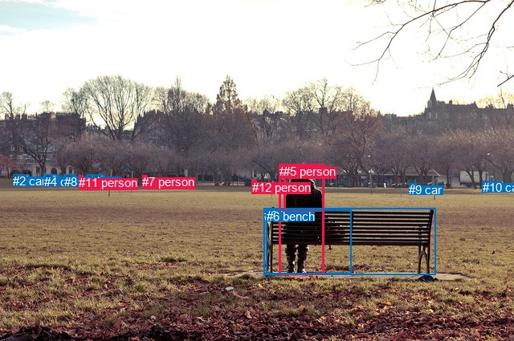
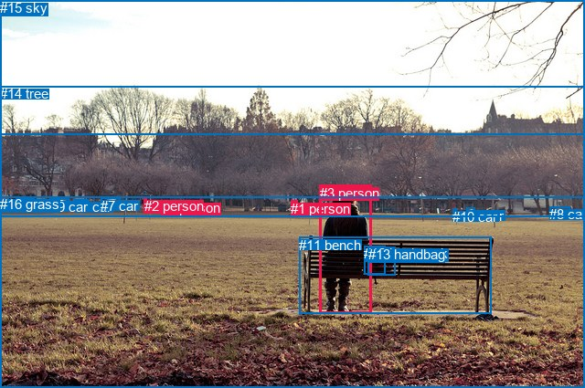

# 图片 1327：2377789.jpg

随机样本序号：267。图片 SHA256：`d741aa1df43eb6907db785a7a3ac80fd63ec7595183d3c4a4a94795fad7bd6e5`。

红色框表示人，蓝色框表示其他物体。两个模式分别保留自身框编号，可依据位置比较对应对象。

## 自动检测框与输出

人的框编号：`[1, 5, 7, 11, 12]`。状态：`ok`。

### 自动检测全部物体框

| 编号 | 类别 | 是否为人 | 检测分数 | 像素坐标 xyxy |
|---|---|---|---|---|
| 0 | bench | False | 0.9993 | 328.6, 259.6, 542.7, 342.7 |
| 1 | person | True | 0.9976 | 347.9, 204.9, 403.1, 342.7 |
| 2 | car | False | 0.9910 | 16.0, 217.4, 36.9, 224.7 |
| 3 | car | False | 0.9770 | 108.8, 217.4, 130.4, 225.8 |
| 4 | car | False | 0.9504 | 54.5, 217.7, 74.9, 225.1 |
| 5 | person | True | 0.8464 | 353.4, 205.0, 403.6, 263.5 |
| 6 | bench | False | 0.6539 | 331.7, 261.2, 437.1, 341.5 |
| 7 | person | True | 0.5993 | 177.3, 218.3, 183.5, 231.6 |
| 8 | car | False | 0.5713 | 80.0, 217.6, 94.6, 223.3 |
| 9 | car | False | 0.4800 | 509.3, 228.3, 518.2, 234.2 |
| 10 | car | False | 0.4247 | 600.7, 225.4, 621.4, 234.5 |
| 11 | person | True | 0.4173 | 98.3, 219.1, 103.9, 229.5 |
| 12 | person | True | 0.3620 | 314.0, 225.0, 319.4, 238.4 |

### 自动检测 Top50 人相关候选

评分物体对：156；人相关物体对：100；输出关系：50。

| 排名 | 主语编号与类别 | 关系 | 宾语编号与类别 | 类型 | 人与人 | 排序分数 | 原始融合 logit |
|---|---|---|---|---|---|---|---|
| 1 | #1 person | sitting on | #0 bench | semantic | False | 0.98896 | 4.4951 |
| 2 | #1 person | wearing | #5 person | semantic | True | 0.98865 | 4.4675 |
| 3 | #1 person | wearing | #6 bench | semantic | False | 0.98396 | 4.1165 |
| 4 | #3 car | parked on | #11 person | semantic | False | 0.97191 | 3.5439 |
| 5 | #1 person | on | #0 bench | spatial | False | 0.95071 | 2.9594 |
| 6 | #5 person | sitting on | #0 bench | semantic | False | 0.94144 | 2.7773 |
| 7 | #1 person | in | #5 person | spatial | True | 0.91999 | 2.4422 |
| 8 | #3 car | in | #11 person | spatial | False | 0.91085 | 2.3241 |
| 9 | #1 person | in | #6 bench | spatial | False | 0.90246 | 2.2248 |
| 10 | #8 car | parked on | #11 person | semantic | False | 0.88296 | 2.0207 |
| 11 | #11 person | parked on | #8 car | semantic | False | 0.86496 | 1.8571 |
| 12 | #5 person | wearing | #6 bench | semantic | False | 0.85310 | 1.7591 |
| 13 | #5 person | on | #0 bench | spatial | False | 0.84462 | 1.6930 |
| 14 | #11 person | in | #8 car | spatial | False | 0.84420 | 1.6898 |
| 15 | #8 car | on | #11 person | spatial | False | 0.74709 | 1.0832 |
| 16 | #5 person | on | #1 person | spatial | True | 0.69626 | 0.8296 |
| 17 | #6 bench | on | #1 person | spatial | False | 0.68862 | 0.7937 |
| 18 | #5 person | on | #6 bench | spatial | False | 0.68761 | 0.7890 |
| 19 | #11 person | parked on | #3 car | semantic | False | 0.63266 | 0.5437 |
| 20 | #11 person | in | #3 car | spatial | False | 0.62775 | 0.5226 |
| 21 | #4 car | parked on | #11 person | semantic | False | 0.58419 | 0.3400 |
| 22 | #7 person | in | #8 car | spatial | False | 0.53154 | 0.1263 |
| 23 | #2 car | parked on | #11 person | semantic | False | 0.51005 | 0.0402 |
| 24 | #4 car | on | #11 person | spatial | False | 0.50010 | 0.0004 |
| 25 | #7 person | in | #11 person | spatial | True | 0.48871 | -0.0452 |
| 26 | #2 car | on | #11 person | spatial | False | 0.47471 | -0.1012 |
| 27 | #11 person | in | #4 car | spatial | False | 0.43435 | -0.2641 |
| 28 | #6 bench | on | #5 person | spatial | False | 0.42890 | -0.2863 |
| 29 | #7 person | in | #3 car | spatial | False | 0.40090 | -0.4017 |
| 30 | #7 person | walking on | #3 car | semantic | False | 0.33926 | -0.6666 |
| 31 | #7 person | walking on | #11 person | semantic | True | 0.32797 | -0.7174 |
| 32 | #11 person | in | #2 car | spatial | False | 0.32431 | -0.7340 |
| 33 | #7 person | walking on | #8 car | semantic | False | 0.30562 | -0.8207 |
| 34 | #9 car | parked on | #12 person | semantic | False | 0.29489 | -0.8717 |
| 35 | #12 person | parked on | #9 car | semantic | False | 0.28656 | -0.9121 |
| 36 | #12 person | parked on | #10 car | semantic | False | 0.27240 | -0.9825 |
| 37 | #11 person | parked on | #4 car | semantic | False | 0.23992 | -1.1531 |
| 38 | #5 person | wearing | #1 person | semantic | True | 0.23890 | -1.1587 |
| 39 | #7 person | in | #4 car | spatial | False | 0.22150 | -1.2570 |
| 40 | #6 bench | holding | #1 person | semantic | False | 0.19833 | -1.3968 |
| 41 | #12 person | parked on | #0 bench | semantic | False | 0.19721 | -1.4038 |
| 42 | #3 car | parked on | #7 person | semantic | False | 0.17786 | -1.5309 |
| 43 | #9 car | parked on | #11 person | semantic | False | 0.16806 | -1.5995 |
| 44 | #1 person | looking at | #12 person | semantic | True | 0.16510 | -1.6207 |
| 45 | #12 person | beside | #0 bench | spatial | False | 0.16043 | -1.6550 |
| 46 | #0 bench | in front of | #1 person | spatial | False | 0.14791 | -1.7511 |
| 47 | #7 person | in | #2 car | spatial | False | 0.14478 | -1.7761 |
| 48 | #11 person | in | #7 person | spatial | True | 0.14411 | -1.7816 |
| 49 | #11 person | parked on | #2 car | semantic | False | 0.13749 | -1.8363 |
| 50 | #12 person | in | #9 car | spatial | False | 0.11784 | -2.0130 |

### 自动检测逐条人相关 GT 核验

R@50：50.00%；命中 2/4。

| GT 主语编号 | GT 关系 | GT 宾语编号 | 结果阶段 | 匹配预测主语编号 | 匹配预测宾语编号 |
|---|---|---|---|---|---|
| 3 | on | 11 | hit50 | [1] | [0] |
| 3 | sitting on | 11 | hit50 | [1] | [0] |
| 12 | beside | 3 | endpoint_missing_or_wrong_class | [] | [1] |
| 13 | beside | 3 | endpoint_missing_or_wrong_class | [] | [1] |

## 真实框与输出

人的框编号：`[0, 1, 2, 3]`。

### 真实框全部物体框

| 编号 | 类别 | 是否为人 | 检测分数 | 像素坐标 xyxy |
|---|---|---|---|---|
| 0 | person | True | GT | 176.0, 219.0, 183.0, 231.0 |
| 1 | person | True | GT | 318.0, 220.0, 325.0, 233.0 |
| 2 | person | True | GT | 158.0, 217.0, 161.0, 224.0 |
| 3 | person | True | GT | 350.0, 203.0, 407.0, 343.0 |
| 4 | car | False | GT | 81.0, 218.0, 96.0, 222.0 |
| 5 | car | False | GT | 17.0, 217.0, 37.0, 225.0 |
| 6 | car | False | GT | 510.0, 228.0, 519.0, 234.0 |
| 7 | car | False | GT | 110.0, 217.0, 131.0, 226.0 |
| 8 | car | False | GT | 601.0, 226.0, 624.0, 234.0 |
| 9 | car | False | GT | 55.0, 218.0, 75.0, 225.0 |
| 10 | car | False | GT | 495.0, 229.0, 499.0, 234.0 |
| 11 | bench | False | GT | 327.0, 260.0, 537.0, 344.0 |
| 12 | backpack | False | GT | 398.0, 269.0, 421.0, 300.0 |
| 13 | handbag | False | GT | 403.0, 270.0, 432.0, 301.0 |
| 14 | tree | False | GT | 0.0, 94.0, 640.0, 237.0 |
| 15 | sky | False | GT | 0.0, 0.0, 640.0, 147.0 |
| 16 | grass | False | GT | 0.0, 215.0, 640.0, 425.0 |

### 真实框 Top50 人相关候选

评分物体对：272；人相关物体对：116；输出关系：50。

| 排名 | 主语编号与类别 | 关系 | 宾语编号与类别 | 类型 | 人与人 | 排序分数 | 原始融合 logit |
|---|---|---|---|---|---|---|---|
| 1 | #3 person | sitting on | #11 bench | semantic | False | 0.98964 | 4.5592 |
| 2 | #1 person | parked on | #16 grass | semantic | False | 0.98535 | 4.2084 |
| 3 | #3 person | holding | #12 backpack | semantic | False | 0.97573 | 3.6939 |
| 4 | #3 person | holding | #13 handbag | semantic | False | 0.97298 | 3.5838 |
| 5 | #0 person | in | #16 grass | spatial | False | 0.96605 | 3.3484 |
| 6 | #2 person | in | #16 grass | spatial | False | 0.96584 | 3.3421 |
| 7 | #1 person | in | #16 grass | spatial | False | 0.95241 | 2.9965 |
| 8 | #3 person | on | #11 bench | spatial | False | 0.94211 | 2.7895 |
| 9 | #2 person | standing on | #16 grass | semantic | False | 0.94010 | 2.7533 |
| 10 | #0 person | standing on | #16 grass | semantic | False | 0.94007 | 2.7527 |
| 11 | #1 person | parked on | #14 tree | semantic | False | 0.93116 | 2.6046 |
| 12 | #3 person | in | #16 grass | spatial | False | 0.91437 | 2.3682 |
| 13 | #3 person | sitting on | #16 grass | semantic | False | 0.89861 | 2.1818 |
| 14 | #1 person | in | #14 tree | spatial | False | 0.79961 | 1.3838 |
| 15 | #3 person | on | #12 backpack | spatial | False | 0.75527 | 1.1269 |
| 16 | #3 person | on | #13 handbag | spatial | False | 0.74778 | 1.0868 |
| 17 | #12 backpack | on | #3 person | spatial | False | 0.74645 | 1.0797 |
| 18 | #3 person | looking at | #14 tree | semantic | False | 0.74181 | 1.0554 |
| 19 | #13 handbag | on | #3 person | spatial | False | 0.74003 | 1.0461 |
| 20 | #2 person | in | #14 tree | spatial | False | 0.69673 | 0.8318 |
| 21 | #0 person | in | #14 tree | spatial | False | 0.64266 | 0.5869 |
| 22 | #13 handbag | sitting on | #3 person | semantic | False | 0.48890 | -0.0444 |
| 23 | #15 sky | over | #3 person | spatial | False | 0.47806 | -0.0878 |
| 24 | #12 backpack | sitting on | #3 person | semantic | False | 0.46609 | -0.1359 |
| 25 | #3 person | looking at | #15 sky | semantic | False | 0.44912 | -0.2042 |
| 26 | #11 bench | beside | #3 person | spatial | False | 0.41714 | -0.3345 |
| 27 | #2 person | standing on | #14 tree | semantic | False | 0.40548 | -0.3827 |
| 28 | #0 person | standing on | #14 tree | semantic | False | 0.37753 | -0.5001 |
| 29 | #3 person | in front of | #14 tree | spatial | False | 0.24021 | -1.1515 |
| 30 | #3 person | looking at | #0 person | semantic | True | 0.19595 | -1.4118 |
| 31 | #1 person | beside | #11 bench | spatial | False | 0.15066 | -1.7295 |
| 32 | #16 grass | beside | #3 person | spatial | False | 0.14479 | -1.7761 |
| 33 | #0 person | beside | #3 person | spatial | True | 0.14122 | -1.8052 |
| 34 | #1 person | parked on | #11 bench | semantic | False | 0.13358 | -1.8697 |
| 35 | #2 person | in | #4 car | spatial | False | 0.12790 | -1.9197 |
| 36 | #1 person | parked on | #8 car | semantic | False | 0.11261 | -2.0644 |
| 37 | #16 grass | in | #0 person | spatial | False | 0.11052 | -2.0854 |
| 38 | #2 person | beside | #7 car | spatial | False | 0.10800 | -2.1113 |
| 39 | #3 person | looking at | #2 person | semantic | True | 0.10526 | -2.1401 |
| 40 | #2 person | beside | #3 person | spatial | True | 0.10458 | -2.1474 |
| 41 | #3 person | looking at | #1 person | semantic | True | 0.10447 | -2.1485 |
| 42 | #2 person | beside | #0 person | spatial | True | 0.10412 | -2.1522 |
| 43 | #11 bench | holding | #3 person | semantic | False | 0.10035 | -2.1934 |
| 44 | #1 person | beside | #3 person | spatial | True | 0.09661 | -2.2354 |
| 45 | #3 person | looking at | #9 car | semantic | False | 0.08496 | -2.3768 |
| 46 | #2 person | standing on | #4 car | semantic | False | 0.07365 | -2.5319 |
| 47 | #0 person | beside | #2 person | spatial | True | 0.07210 | -2.5549 |
| 48 | #1 person | looking at | #3 person | semantic | True | 0.07074 | -2.5753 |
| 49 | #15 sky | flying over | #3 person | semantic | False | 0.07041 | -2.5804 |
| 50 | #3 person | looking at | #5 car | semantic | False | 0.07035 | -2.5814 |

### 真实框逐条人相关 GT 核验

R@50：50.00%；命中 2/4。

| GT 主语编号 | GT 关系 | GT 宾语编号 | 结果阶段 | 匹配预测主语编号 | 匹配预测宾语编号 |
|---|---|---|---|---|---|
| 3 | on | 11 | hit50 | [3] | [11] |
| 3 | sitting on | 11 | hit50 | [3] | [11] |
| 12 | beside | 3 | wrong_predicate | [12] | [3] |
| 13 | beside | 3 | wrong_predicate | [13] | [3] |

## 全部人相关 GT

| 主语编号与类别 | 关系 | 宾语编号与类别 |
|---|---|---|
| #3 person | on | #11 bench |
| #3 person | sitting on | #11 bench |
| #12 backpack | beside | #3 person |
| #13 handbag | beside | #3 person |

原始记录、全部人相关物体对的两项预测与分项分数见 [逐图证据 JSON](../evidence/cases/1327.json)。全部56类 logits 保留于本机 HOR/output/random500/logits/。

<!-- HOR_COMPLETE_RESULTS -->

## 六组条件的完整输出对照

以下保留同一图片三种框与候选模式、两种谓词输出规则的全部 Top50。框编号各自在所属模式内解释。

### 自动检测框完整枚举：空间与语义各保留一个谓词

| 排名 | 主语编号与类别 | 谓词 | 宾语编号与类别 | 分组 | 排序分数 | predicate logit | pair logit |
|---|---|---|---|---|---|---|---|
| 1 | #1 person | sitting on | #0 bench | semantic | 0.9889598 | 4.1620097 | 0.3331016 |
| 2 | #1 person | wearing | #5 person | semantic | 0.9886547 | 4.4351335 | 0.0324127 |
| 3 | #1 person | wearing | #6 bench | semantic | 0.9839604 | 3.7802052 | 0.3363187 |
| 4 | #3 car | parked on | #11 person | semantic | 0.9719106 | 3.4830031 | 0.0608679 |
| 5 | #1 person | on | #0 bench | spatial | 0.9507082 | 2.6263480 | 0.3331016 |
| 6 | #5 person | sitting on | #0 bench | semantic | 0.9414371 | 3.1689830 | -0.3916781 |
| 7 | #1 person | in | #5 person | spatial | 0.9199892 | 2.4097877 | 0.0324127 |
| 8 | #3 car | in | #11 person | spatial | 0.9108537 | 2.2632365 | 0.0608679 |
| 9 | #1 person | in | #6 bench | spatial | 0.9024565 | 1.8885026 | 0.3363187 |
| 10 | #8 car | parked on | #11 person | semantic | 0.8829557 | 2.1897192 | -0.1689970 |
| 11 | #11 person | parked on | #8 car | semantic | 0.8649600 | 2.0396447 | -0.1825330 |
| 12 | #5 person | wearing | #6 bench | semantic | 0.8531008 | 2.2145624 | -0.4554312 |
| 13 | #5 person | on | #0 bench | spatial | 0.8446220 | 2.0847058 | -0.3916781 |
| 14 | #11 person | in | #8 car | spatial | 0.8442006 | 1.8723540 | -0.1825330 |
| 15 | #8 car | on | #11 person | spatial | 0.7470943 | 1.2521720 | -0.1689970 |
| 16 | #5 person | on | #1 person | spatial | 0.6962644 | 1.4387436 | -0.6091717 |
| 17 | #6 bench | on | #1 person | spatial | 0.6886151 | 1.1696305 | -0.3759779 |
| 18 | #5 person | on | #6 bench | spatial | 0.6876120 | 1.2444100 | -0.4554312 |
| 19 | #11 person | parked on | #3 car | semantic | 0.6326638 | 1.1382489 | -0.5945870 |
| 20 | #11 person | in | #3 car | spatial | 0.6277537 | 1.1171789 | -0.5945870 |
| 21 | #4 car | parked on | #11 person | semantic | 0.5841857 | 0.4454184 | -0.1054384 |
| 22 | #7 person | in | #8 car | spatial | 0.5315356 | 0.4506588 | -0.3243487 |
| 23 | #2 car | parked on | #11 person | semantic | 0.5100521 | -0.0361404 | 0.0763541 |
| 24 | #4 car | on | #11 person | spatial | 0.5000996 | 0.1058369 | -0.1054384 |
| 25 | #7 person | in | #11 person | spatial | 0.4887112 | 0.1879120 | -0.2330751 |
| 26 | #2 car | on | #11 person | spatial | 0.4747144 | -0.1775827 | 0.0763541 |
| 27 | #11 person | in | #4 car | spatial | 0.4343536 | 0.0409970 | -0.3051069 |
| 28 | #6 bench | on | #5 person | spatial | 0.4288979 | 0.6606574 | -0.9470066 |
| 29 | #7 person | in | #3 car | spatial | 0.4008982 | 0.1325860 | -0.5343099 |
| 30 | #7 person | walking on | #3 car | semantic | 0.3392642 | -0.1322651 | -0.5343099 |
| 31 | #7 person | walking on | #11 person | semantic | 0.3279710 | -0.4843011 | -0.2330751 |
| 32 | #11 person | in | #2 car | spatial | 0.3243141 | -0.0914288 | -0.6425868 |
| 33 | #7 person | walking on | #8 car | semantic | 0.3056198 | -0.4963293 | -0.3243487 |
| 34 | #9 car | parked on | #12 person | semantic | 0.2948936 | -0.1570930 | -0.7146411 |
| 35 | #12 person | parked on | #9 car | semantic | 0.2865630 | -0.0666285 | -0.8455071 |
| 36 | #12 person | parked on | #10 car | semantic | 0.2723999 | -0.4276285 | -0.5548518 |
| 37 | #11 person | parked on | #4 car | semantic | 0.2399244 | -0.8479869 | -0.3051069 |
| 38 | #5 person | wearing | #1 person | semantic | 0.2389034 | -0.5495291 | -0.6091717 |
| 39 | #7 person | in | #4 car | spatial | 0.2214953 | -0.7471831 | -0.5097905 |
| 40 | #6 bench | holding | #1 person | semantic | 0.1983267 | -1.0208075 | -0.3759779 |
| 41 | #12 person | parked on | #0 bench | semantic | 0.1972082 | -0.1555529 | -1.2482824 |
| 42 | #3 car | parked on | #7 person | semantic | 0.1778650 | -1.4647279 | -0.0661521 |
| 43 | #9 car | parked on | #11 person | semantic | 0.1680571 | -1.3151925 | -0.2842678 |
| 44 | #1 person | looking at | #12 person | semantic | 0.1651032 | -0.3630357 | -1.2577014 |
| 45 | #12 person | beside | #0 bench | spatial | 0.1604321 | -0.4067340 | -1.2482824 |
| 46 | #0 bench | in front of | #1 person | spatial | 0.1479056 | -0.7155702 | -1.0355531 |
| 47 | #7 person | in | #2 car | spatial | 0.1447836 | -0.8759058 | -0.9002088 |
| 48 | #11 person | in | #7 person | spatial | 0.1441111 | -1.3809409 | -0.4006150 |
| 49 | #11 person | parked on | #2 car | semantic | 0.1374909 | -1.1937008 | -0.6425868 |
| 50 | #12 person | in | #9 car | spatial | 0.1178409 | -1.1675298 | -0.8455071 |

GT 命中：2/4，R@50=50.00%。

| GT主语 | GT谓词 | GT宾语 | 结果阶段 | 匹配主语框 | 匹配宾语框 |
|---|---|---|---|---|---|
| 3 | on | 11 | hit50 | [1] | [0] |
| 3 | sitting on | 11 | hit50 | [1] | [0] |
| 12 | beside | 3 | endpoint_missing_or_wrong_class | [] | [1] |
| 13 | beside | 3 | endpoint_missing_or_wrong_class | [] | [1] |

### 自动检测框完整枚举：每对只保留一个谓词

| 排名 | 主语编号与类别 | 谓词 | 宾语编号与类别 | 分组 | 排序分数 | predicate logit | pair logit |
|---|---|---|---|---|---|---|---|
| 1 | #1 person | sitting on | #0 bench | single | 0.9889598 | 4.1620097 | 0.3331016 |
| 2 | #1 person | wearing | #5 person | single | 0.9886547 | 4.4351335 | 0.0324127 |
| 3 | #1 person | wearing | #6 bench | single | 0.9839604 | 3.7802052 | 0.3363187 |
| 4 | #3 car | parked on | #11 person | single | 0.9719106 | 3.4830031 | 0.0608679 |
| 5 | #5 person | sitting on | #0 bench | single | 0.9414371 | 3.1689830 | -0.3916781 |
| 6 | #8 car | parked on | #11 person | single | 0.8829557 | 2.1897192 | -0.1689970 |
| 7 | #11 person | parked on | #8 car | single | 0.8649600 | 2.0396447 | -0.1825330 |
| 8 | #5 person | wearing | #6 bench | single | 0.8531008 | 2.2145624 | -0.4554312 |
| 9 | #5 person | on | #1 person | single | 0.6962644 | 1.4387436 | -0.6091717 |
| 10 | #6 bench | on | #1 person | single | 0.6886151 | 1.1696305 | -0.3759779 |
| 11 | #11 person | parked on | #3 car | single | 0.6326638 | 1.1382489 | -0.5945870 |
| 12 | #4 car | parked on | #11 person | single | 0.5841857 | 0.4454184 | -0.1054384 |
| 13 | #7 person | in | #8 car | single | 0.5315356 | 0.4506588 | -0.3243487 |
| 14 | #2 car | parked on | #11 person | single | 0.5100521 | -0.0361404 | 0.0763541 |
| 15 | #7 person | in | #11 person | single | 0.4887112 | 0.1879120 | -0.2330751 |
| 16 | #11 person | in | #4 car | single | 0.4343536 | 0.0409970 | -0.3051069 |
| 17 | #6 bench | on | #5 person | single | 0.4288979 | 0.6606574 | -0.9470066 |
| 18 | #7 person | in | #3 car | single | 0.4008982 | 0.1325860 | -0.5343099 |
| 19 | #11 person | in | #2 car | single | 0.3243141 | -0.0914288 | -0.6425868 |
| 20 | #9 car | parked on | #12 person | single | 0.2948936 | -0.1570930 | -0.7146411 |
| 21 | #12 person | parked on | #9 car | single | 0.2865630 | -0.0666285 | -0.8455071 |
| 22 | #12 person | parked on | #10 car | single | 0.2723999 | -0.4276285 | -0.5548518 |
| 23 | #7 person | in | #4 car | single | 0.2214953 | -0.7471831 | -0.5097905 |
| 24 | #12 person | parked on | #0 bench | single | 0.1972082 | -0.1555529 | -1.2482824 |
| 25 | #3 car | parked on | #7 person | single | 0.1778650 | -1.4647279 | -0.0661521 |
| 26 | #9 car | parked on | #11 person | single | 0.1680571 | -1.3151925 | -0.2842678 |
| 27 | #1 person | looking at | #12 person | single | 0.1651032 | -0.3630357 | -1.2577014 |
| 28 | #0 bench | in front of | #1 person | single | 0.1479056 | -0.7155702 | -1.0355531 |
| 29 | #7 person | in | #2 car | single | 0.1447836 | -0.8759058 | -0.9002088 |
| 30 | #11 person | in | #7 person | single | 0.1441111 | -1.3809409 | -0.4006150 |
| 31 | #1 person | looking at | #7 person | single | 0.0981109 | -1.0287580 | -1.1896355 |
| 32 | #12 person | parked on | #11 person | single | 0.0860144 | -1.9175911 | -0.4457089 |
| 33 | #8 car | on | #7 person | single | 0.0779204 | -2.0183473 | -0.4525973 |
| 34 | #12 person | parked on | #8 car | single | 0.0755882 | -1.9772246 | -0.5266326 |
| 35 | #12 person | looking at | #1 person | single | 0.0726312 | -1.5634274 | -0.9835293 |
| 36 | #7 person | in | #10 car | single | 0.0709205 | -1.6863558 | -0.8862787 |
| 37 | #7 person | in | #12 person | single | 0.0697397 | -1.6116035 | -0.9790915 |
| 38 | #3 car | parked on | #12 person | single | 0.0656618 | -1.6470063 | -1.0083141 |
| 39 | #2 car | on | #7 person | single | 0.0636284 | -2.4072022 | -0.2817504 |
| 40 | #9 car | looking at | #1 person | single | 0.0598238 | -1.5742898 | -1.1803744 |
| 41 | #4 car | on | #7 person | single | 0.0574623 | -2.3775454 | -0.4199008 |
| 42 | #0 bench | in | #5 person | single | 0.0558295 | -1.6269221 | -1.2010827 |
| 43 | #12 person | parked on | #7 person | single | 0.0523518 | -2.5177212 | -0.3782754 |
| 44 | #1 person | looking at | #10 car | single | 0.0480542 | -1.3323393 | -1.6538389 |
| 45 | #11 person | in | #10 car | single | 0.0464911 | -1.9622667 | -1.0586209 |
| 46 | #12 person | parked on | #3 car | single | 0.0434236 | -2.2480307 | -0.8443259 |
| 47 | #12 person | parked on | #4 car | single | 0.0433778 | -2.3681705 | -0.7252904 |
| 48 | #9 car | parked on | #7 person | single | 0.0400735 | -2.7729633 | -0.4031787 |
| 49 | #7 person | beside | #0 bench | single | 0.0399776 | -2.0461142 | -1.1325238 |
| 50 | #10 car | on | #11 person | single | 0.0396308 | -2.5116091 | -0.6761031 |

GT 命中：1/4，R@50=25.00%。

| GT主语 | GT谓词 | GT宾语 | 结果阶段 | 匹配主语框 | 匹配宾语框 |
|---|---|---|---|---|---|
| 3 | on | 11 | wrong_predicate | [1] | [0] |
| 3 | sitting on | 11 | hit50 | [1] | [0] |
| 12 | beside | 3 | endpoint_missing_or_wrong_class | [] | [1] |
| 13 | beside | 3 | endpoint_missing_or_wrong_class | [] | [1] |

### 真实框完整枚举：空间与语义各保留一个谓词

| 排名 | 主语编号与类别 | 谓词 | 宾语编号与类别 | 分组 | 排序分数 | predicate logit | pair logit |
|---|---|---|---|---|---|---|---|
| 1 | #3 person | sitting on | #11 bench | semantic | 0.9896379 | 4.2251973 | 0.3339786 |
| 2 | #1 person | parked on | #16 grass | semantic | 0.9853484 | 4.2052541 | 0.0031932 |
| 3 | #3 person | holding | #12 backpack | semantic | 0.9757284 | 3.7072816 | -0.0134071 |
| 4 | #3 person | holding | #13 handbag | semantic | 0.9729793 | 3.6046424 | -0.0208831 |
| 5 | #0 person | in | #16 grass | spatial | 0.9660537 | 3.4740510 | -0.1256128 |
| 6 | #2 person | in | #16 grass | spatial | 0.9658448 | 3.3877635 | -0.0456758 |
| 7 | #1 person | in | #16 grass | spatial | 0.9524145 | 2.9932785 | 0.0031932 |
| 8 | #3 person | on | #11 bench | spatial | 0.9421063 | 2.4555321 | 0.3339786 |
| 9 | #2 person | standing on | #16 grass | semantic | 0.9401011 | 2.7990050 | -0.0456758 |
| 10 | #0 person | standing on | #16 grass | semantic | 0.9400684 | 2.8783617 | -0.1256128 |
| 11 | #1 person | parked on | #14 tree | semantic | 0.9311599 | 2.7604012 | -0.1557568 |
| 12 | #3 person | in | #16 grass | spatial | 0.9143704 | 2.4224148 | -0.0542101 |
| 13 | #3 person | sitting on | #16 grass | semantic | 0.8986061 | 2.2360420 | -0.0542101 |
| 14 | #1 person | in | #14 tree | spatial | 0.7996059 | 1.5395899 | -0.1557568 |
| 15 | #3 person | on | #12 backpack | spatial | 0.7552745 | 1.1403513 | -0.0134071 |
| 16 | #3 person | on | #13 handbag | spatial | 0.7477785 | 1.1076822 | -0.0208831 |
| 17 | #12 backpack | on | #3 person | spatial | 0.7464465 | 1.3000169 | -0.2202676 |
| 18 | #3 person | looking at | #14 tree | semantic | 0.7418053 | 2.1609259 | -1.1055533 |
| 19 | #13 handbag | on | #3 person | spatial | 0.7400285 | 1.2862601 | -0.2401434 |
| 20 | #2 person | in | #14 tree | spatial | 0.6967308 | 1.1623259 | -0.3305476 |
| 21 | #0 person | in | #14 tree | spatial | 0.6426650 | 1.0481534 | -0.4612038 |
| 22 | #13 handbag | sitting on | #3 person | semantic | 0.4889036 | 0.1957502 | -0.2401434 |
| 23 | #15 sky | over | #3 person | spatial | 0.4780586 | 0.6712303 | -0.7590523 |
| 24 | #12 backpack | sitting on | #3 person | semantic | 0.4660888 | 0.0844140 | -0.2202676 |
| 25 | #3 person | looking at | #15 sky | semantic | 0.4491169 | 1.2562051 | -1.4604446 |
| 26 | #11 bench | beside | #3 person | spatial | 0.4171360 | 0.7369938 | -1.0715356 |
| 27 | #2 person | standing on | #14 tree | semantic | 0.4054835 | -0.0521207 | -0.3305476 |
| 28 | #0 person | standing on | #14 tree | semantic | 0.3775255 | -0.0388608 | -0.4612038 |
| 29 | #3 person | in front of | #14 tree | spatial | 0.2402090 | -0.0459809 | -1.1055533 |
| 30 | #3 person | looking at | #0 person | semantic | 0.1959468 | -0.2581191 | -1.1537032 |
| 31 | #1 person | beside | #11 bench | spatial | 0.1506557 | -0.4665117 | -1.2629559 |
| 32 | #16 grass | beside | #3 person | spatial | 0.1447898 | -0.7664120 | -1.0096519 |
| 33 | #0 person | beside | #3 person | spatial | 0.1412181 | -0.7719417 | -1.0332677 |
| 34 | #1 person | parked on | #11 bench | semantic | 0.1335788 | -0.6067233 | -1.2629559 |
| 35 | #2 person | in | #4 car | spatial | 0.1278987 | -1.8086736 | -0.1109933 |
| 36 | #1 person | parked on | #8 car | semantic | 0.1126100 | -1.4961269 | -0.5682273 |
| 37 | #16 grass | in | #0 person | spatial | 0.1105207 | -0.9580040 | -1.1274292 |
| 38 | #2 person | beside | #7 car | spatial | 0.1080006 | -1.7466617 | -0.3646672 |
| 39 | #3 person | looking at | #2 person | semantic | 0.1052560 | -0.7084422 | -1.4317003 |
| 40 | #2 person | beside | #3 person | spatial | 0.1045786 | -1.1182730 | -1.0290819 |
| 41 | #3 person | looking at | #1 person | semantic | 0.1044732 | -0.8643019 | -1.2841796 |
| 42 | #2 person | beside | #0 person | spatial | 0.1041234 | -2.1691539 | 0.0169275 |
| 43 | #11 bench | holding | #3 person | semantic | 0.1003470 | -1.1218398 | -1.0715356 |
| 44 | #1 person | beside | #3 person | spatial | 0.0966132 | -1.2807786 | -0.9546573 |
| 45 | #3 person | looking at | #9 car | semantic | 0.0849608 | -0.9901249 | -1.3866519 |
| 46 | #2 person | standing on | #4 car | semantic | 0.0736515 | -2.4209130 | -0.1109933 |
| 47 | #0 person | beside | #2 person | spatial | 0.0720960 | -2.2292204 | -0.3257093 |
| 48 | #1 person | looking at | #3 person | semantic | 0.0707448 | -1.6206467 | -0.9546573 |
| 49 | #15 sky | flying over | #3 person | semantic | 0.0704125 | -1.8213177 | -0.7590523 |
| 50 | #3 person | looking at | #5 car | semantic | 0.0703472 | -1.0403173 | -1.5410516 |

GT 命中：2/4，R@50=50.00%。

| GT主语 | GT谓词 | GT宾语 | 结果阶段 | 匹配主语框 | 匹配宾语框 |
|---|---|---|---|---|---|
| 3 | on | 11 | hit50 | [3] | [11] |
| 3 | sitting on | 11 | hit50 | [3] | [11] |
| 12 | beside | 3 | wrong_predicate | [12] | [3] |
| 13 | beside | 3 | wrong_predicate | [13] | [3] |

### 真实框完整枚举：每对只保留一个谓词

| 排名 | 主语编号与类别 | 谓词 | 宾语编号与类别 | 分组 | 排序分数 | predicate logit | pair logit |
|---|---|---|---|---|---|---|---|
| 1 | #3 person | sitting on | #11 bench | single | 0.9896379 | 4.2251973 | 0.3339786 |
| 2 | #1 person | parked on | #16 grass | single | 0.9853484 | 4.2052541 | 0.0031932 |
| 3 | #3 person | holding | #12 backpack | single | 0.9757284 | 3.7072816 | -0.0134071 |
| 4 | #3 person | holding | #13 handbag | single | 0.9729793 | 3.6046424 | -0.0208831 |
| 5 | #0 person | in | #16 grass | single | 0.9660537 | 3.4740510 | -0.1256128 |
| 6 | #2 person | in | #16 grass | single | 0.9658448 | 3.3877635 | -0.0456758 |
| 7 | #1 person | parked on | #14 tree | single | 0.9311599 | 2.7604012 | -0.1557568 |
| 8 | #3 person | in | #16 grass | single | 0.9143704 | 2.4224148 | -0.0542101 |
| 9 | #12 backpack | on | #3 person | single | 0.7464465 | 1.3000169 | -0.2202676 |
| 10 | #3 person | looking at | #14 tree | single | 0.7418053 | 2.1609259 | -1.1055533 |
| 11 | #13 handbag | on | #3 person | single | 0.7400285 | 1.2862601 | -0.2401434 |
| 12 | #2 person | in | #14 tree | single | 0.6967308 | 1.1623259 | -0.3305476 |
| 13 | #0 person | in | #14 tree | single | 0.6426650 | 1.0481534 | -0.4612038 |
| 14 | #15 sky | over | #3 person | single | 0.4780586 | 0.6712303 | -0.7590523 |
| 15 | #3 person | looking at | #15 sky | single | 0.4491169 | 1.2562051 | -1.4604446 |
| 16 | #11 bench | beside | #3 person | single | 0.4171360 | 0.7369938 | -1.0715356 |
| 17 | #3 person | looking at | #0 person | single | 0.1959468 | -0.2581191 | -1.1537032 |
| 18 | #1 person | beside | #11 bench | single | 0.1506557 | -0.4665117 | -1.2629559 |
| 19 | #16 grass | beside | #3 person | single | 0.1447898 | -0.7664120 | -1.0096519 |
| 20 | #0 person | beside | #3 person | single | 0.1412181 | -0.7719417 | -1.0332677 |
| 21 | #2 person | in | #4 car | single | 0.1278987 | -1.8086736 | -0.1109933 |
| 22 | #1 person | parked on | #8 car | single | 0.1126100 | -1.4961269 | -0.5682273 |
| 23 | #16 grass | in | #0 person | single | 0.1105207 | -0.9580040 | -1.1274292 |
| 24 | #2 person | beside | #7 car | single | 0.1080006 | -1.7466617 | -0.3646672 |
| 25 | #3 person | looking at | #2 person | single | 0.1052560 | -0.7084422 | -1.4317003 |
| 26 | #2 person | beside | #3 person | single | 0.1045786 | -1.1182730 | -1.0290819 |
| 27 | #3 person | looking at | #1 person | single | 0.1044732 | -0.8643019 | -1.2841796 |
| 28 | #2 person | beside | #0 person | single | 0.1041234 | -2.1691539 | 0.0169275 |
| 29 | #1 person | beside | #3 person | single | 0.0966132 | -1.2807786 | -0.9546573 |
| 30 | #3 person | looking at | #9 car | single | 0.0849608 | -0.9901249 | -1.3866519 |
| 31 | #0 person | beside | #2 person | single | 0.0720960 | -2.2292204 | -0.3257093 |
| 32 | #3 person | looking at | #5 car | single | 0.0703472 | -1.0403173 | -1.5410516 |
| 33 | #14 tree | beside | #3 person | single | 0.0701179 | -2.0320516 | -0.5528277 |
| 34 | #16 grass | in | #2 person | single | 0.0690959 | -1.3387887 | -1.2618716 |
| 35 | #0 person | in | #4 car | single | 0.0687569 | -2.2901943 | -0.3157487 |
| 36 | #3 person | looking at | #7 car | single | 0.0635013 | -1.0212622 | -1.6698257 |
| 37 | #6 car | looking at | #3 person | single | 0.0608980 | -1.5748127 | -1.1609110 |
| 38 | #0 person | beside | #11 bench | single | 0.0597280 | -1.6285231 | -1.1278455 |
| 39 | #3 person | looking at | #8 car | single | 0.0563818 | -1.1790941 | -1.6384808 |
| 40 | #3 person | looking at | #4 car | single | 0.0548753 | -1.4990616 | -1.3471923 |
| 41 | #7 car | beside | #3 person | single | 0.0531714 | -1.8533401 | -1.0262574 |
| 42 | #2 person | in | #9 car | single | 0.0498769 | -2.6574817 | -0.2895515 |
| 43 | #10 car | looking at | #3 person | single | 0.0481765 | -1.8624225 | -1.1210866 |
| 44 | #7 car | parked on | #0 person | single | 0.0461255 | -2.9541533 | -0.0750123 |
| 45 | #1 person | parked on | #4 car | single | 0.0455731 | -2.5048356 | -0.5369567 |
| 46 | #9 car | beside | #3 person | single | 0.0423360 | -1.8533113 | -1.2655470 |
| 47 | #0 person | beside | #7 car | single | 0.0416772 | -2.6176889 | -0.5175406 |
| 48 | #8 car | looking at | #3 person | single | 0.0392887 | -1.9871457 | -1.2095907 |
| 49 | #1 person | parked on | #10 car | single | 0.0373078 | -2.4287381 | -0.8217931 |
| 50 | #16 grass | in | #1 person | single | 0.0366310 | -2.0670092 | -1.2025331 |

GT 命中：1/4，R@50=25.00%。

| GT主语 | GT谓词 | GT宾语 | 结果阶段 | 匹配主语框 | 匹配宾语框 |
|---|---|---|---|---|---|
| 3 | on | 11 | wrong_predicate | [3] | [11] |
| 3 | sitting on | 11 | hit50 | [3] | [11] |
| 12 | beside | 3 | wrong_predicate | [12] | [3] |
| 13 | beside | 3 | wrong_predicate | [13] | [3] |

### 真实框400候选：空间与语义各保留一个谓词

| 排名 | 主语编号与类别 | 谓词 | 宾语编号与类别 | 分组 | 排序分数 | predicate logit | pair logit |
|---|---|---|---|---|---|---|---|
| 1 | #3 person | sitting on | #11 bench | semantic | 0.9896379 | 4.2251973 | 0.3339786 |
| 2 | #1 person | parked on | #16 grass | semantic | 0.9853484 | 4.2052541 | 0.0031932 |
| 3 | #3 person | holding | #12 backpack | semantic | 0.9757284 | 3.7072816 | -0.0134071 |
| 4 | #3 person | holding | #13 handbag | semantic | 0.9729793 | 3.6046424 | -0.0208831 |
| 5 | #0 person | in | #16 grass | spatial | 0.9660537 | 3.4740510 | -0.1256128 |
| 6 | #2 person | in | #16 grass | spatial | 0.9658448 | 3.3877635 | -0.0456758 |
| 7 | #1 person | in | #16 grass | spatial | 0.9521127 | 2.9866409 | 0.0031932 |
| 8 | #3 person | on | #11 bench | spatial | 0.9421063 | 2.4555321 | 0.3339786 |
| 9 | #2 person | standing on | #16 grass | semantic | 0.9401011 | 2.7990050 | -0.0456758 |
| 10 | #0 person | standing on | #16 grass | semantic | 0.9396533 | 2.8710179 | -0.1256128 |
| 11 | #1 person | parked on | #14 tree | semantic | 0.9311608 | 2.7604160 | -0.1557568 |
| 12 | #3 person | in | #16 grass | spatial | 0.9146298 | 2.4257336 | -0.0542101 |
| 13 | #3 person | sitting on | #16 grass | semantic | 0.8986061 | 2.2360420 | -0.0542101 |
| 14 | #1 person | in | #14 tree | spatial | 0.8038616 | 1.5663629 | -0.1557568 |
| 15 | #3 person | on | #12 backpack | spatial | 0.7552745 | 1.1403513 | -0.0134071 |
| 16 | #3 person | on | #13 handbag | spatial | 0.7477785 | 1.1076822 | -0.0208831 |
| 17 | #3 person | looking at | #14 tree | semantic | 0.7473950 | 2.1903200 | -1.1055533 |
| 18 | #12 backpack | on | #3 person | spatial | 0.7464465 | 1.3000169 | -0.2202676 |
| 19 | #13 handbag | on | #3 person | spatial | 0.7400285 | 1.2862601 | -0.2401434 |
| 20 | #2 person | in | #14 tree | spatial | 0.7030511 | 1.1924171 | -0.3305476 |
| 21 | #0 person | in | #14 tree | spatial | 0.6426650 | 1.0481534 | -0.4612038 |
| 22 | #13 handbag | sitting on | #3 person | semantic | 0.4889036 | 0.1957502 | -0.2401434 |
| 23 | #15 sky | over | #3 person | spatial | 0.4842505 | 0.6960335 | -0.7590523 |
| 24 | #12 backpack | sitting on | #3 person | semantic | 0.4660888 | 0.0844140 | -0.2202676 |
| 25 | #3 person | looking at | #15 sky | semantic | 0.4491169 | 1.2562051 | -1.4604446 |
| 26 | #11 bench | beside | #3 person | spatial | 0.4171360 | 0.7369938 | -1.0715356 |
| 27 | #2 person | standing on | #14 tree | semantic | 0.4109786 | -0.0293736 | -0.3305476 |
| 28 | #0 person | standing on | #14 tree | semantic | 0.3721949 | -0.0616083 | -0.4612038 |
| 29 | #3 person | in front of | #14 tree | spatial | 0.2402299 | -0.0458665 | -1.1055533 |
| 30 | #3 person | looking at | #0 person | semantic | 0.1912492 | -0.2882104 | -1.1537032 |
| 31 | #1 person | beside | #11 bench | spatial | 0.1506631 | -0.4664536 | -1.2629559 |
| 32 | #16 grass | beside | #3 person | spatial | 0.1447827 | -0.7664700 | -1.0096519 |
| 33 | #0 person | beside | #3 person | spatial | 0.1412207 | -0.7719202 | -1.0332677 |
| 34 | #2 person | in | #4 car | spatial | 0.1342802 | -1.7526395 | -0.1109933 |
| 35 | #1 person | parked on | #11 bench | semantic | 0.1335788 | -0.6067233 | -1.2629559 |
| 36 | #1 person | parked on | #8 car | semantic | 0.1111153 | -1.5111723 | -0.5682273 |
| 37 | #16 grass | in | #0 person | spatial | 0.1105207 | -0.9580040 | -1.1274292 |
| 38 | #2 person | beside | #7 car | spatial | 0.1080075 | -1.7465897 | -0.3646672 |
| 39 | #2 person | beside | #3 person | spatial | 0.1059946 | -1.1032419 | -1.0290819 |
| 40 | #3 person | looking at | #1 person | semantic | 0.1044732 | -0.8643019 | -1.2841796 |
| 41 | #2 person | beside | #0 person | spatial | 0.1041207 | -2.1691825 | 0.0169275 |
| 42 | #3 person | looking at | #2 person | semantic | 0.1024876 | -0.7381845 | -1.4317003 |
| 43 | #11 bench | holding | #3 person | semantic | 0.1003470 | -1.1218398 | -1.0715356 |
| 44 | #1 person | beside | #3 person | spatial | 0.0979298 | -1.2657838 | -0.9546573 |
| 45 | #3 person | looking at | #9 car | semantic | 0.0837717 | -1.0055192 | -1.3866519 |
| 46 | #2 person | standing on | #4 car | semantic | 0.0766608 | -2.3776124 | -0.1109933 |
| 47 | #0 person | beside | #2 person | spatial | 0.0721037 | -2.2291050 | -0.3257093 |
| 48 | #1 person | looking at | #3 person | semantic | 0.0707448 | -1.6206467 | -0.9546573 |
| 49 | #15 sky | flying over | #3 person | semantic | 0.0704125 | -1.8213177 | -0.7590523 |
| 50 | #0 person | in | #4 car | spatial | 0.0696190 | -2.2768080 | -0.3157487 |

GT 命中：2/4，R@50=50.00%。

| GT主语 | GT谓词 | GT宾语 | 结果阶段 | 匹配主语框 | 匹配宾语框 |
|---|---|---|---|---|---|
| 3 | on | 11 | hit50 | [3] | [11] |
| 3 | sitting on | 11 | hit50 | [3] | [11] |
| 12 | beside | 3 | wrong_predicate | [12] | [3] |
| 13 | beside | 3 | wrong_predicate | [13] | [3] |

### 真实框400候选：每对只保留一个谓词

| 排名 | 主语编号与类别 | 谓词 | 宾语编号与类别 | 分组 | 排序分数 | predicate logit | pair logit |
|---|---|---|---|---|---|---|---|
| 1 | #3 person | sitting on | #11 bench | single | 0.9896379 | 4.2251973 | 0.3339786 |
| 2 | #1 person | parked on | #16 grass | single | 0.9853484 | 4.2052541 | 0.0031932 |
| 3 | #3 person | holding | #12 backpack | single | 0.9757284 | 3.7072816 | -0.0134071 |
| 4 | #3 person | holding | #13 handbag | single | 0.9729793 | 3.6046424 | -0.0208831 |
| 5 | #0 person | in | #16 grass | single | 0.9660537 | 3.4740510 | -0.1256128 |
| 6 | #2 person | in | #16 grass | single | 0.9658448 | 3.3877635 | -0.0456758 |
| 7 | #1 person | parked on | #14 tree | single | 0.9311608 | 2.7604160 | -0.1557568 |
| 8 | #3 person | in | #16 grass | single | 0.9146298 | 2.4257336 | -0.0542101 |
| 9 | #3 person | looking at | #14 tree | single | 0.7473950 | 2.1903200 | -1.1055533 |
| 10 | #12 backpack | on | #3 person | single | 0.7464465 | 1.3000169 | -0.2202676 |
| 11 | #13 handbag | on | #3 person | single | 0.7400285 | 1.2862601 | -0.2401434 |
| 12 | #2 person | in | #14 tree | single | 0.7030511 | 1.1924171 | -0.3305476 |
| 13 | #0 person | in | #14 tree | single | 0.6426650 | 1.0481534 | -0.4612038 |
| 14 | #15 sky | over | #3 person | single | 0.4842505 | 0.6960335 | -0.7590523 |
| 15 | #3 person | looking at | #15 sky | single | 0.4491169 | 1.2562051 | -1.4604446 |
| 16 | #11 bench | beside | #3 person | single | 0.4171360 | 0.7369938 | -1.0715356 |
| 17 | #3 person | looking at | #0 person | single | 0.1912492 | -0.2882104 | -1.1537032 |
| 18 | #1 person | beside | #11 bench | single | 0.1506631 | -0.4664536 | -1.2629559 |
| 19 | #16 grass | beside | #3 person | single | 0.1447827 | -0.7664700 | -1.0096519 |
| 20 | #0 person | beside | #3 person | single | 0.1412207 | -0.7719202 | -1.0332677 |
| 21 | #2 person | in | #4 car | single | 0.1342802 | -1.7526395 | -0.1109933 |
| 22 | #1 person | parked on | #8 car | single | 0.1111153 | -1.5111723 | -0.5682273 |
| 23 | #16 grass | in | #0 person | single | 0.1105207 | -0.9580040 | -1.1274292 |
| 24 | #2 person | beside | #7 car | single | 0.1080075 | -1.7465897 | -0.3646672 |
| 25 | #2 person | beside | #3 person | single | 0.1059946 | -1.1032419 | -1.0290819 |
| 26 | #3 person | looking at | #1 person | single | 0.1044732 | -0.8643019 | -1.2841796 |
| 27 | #2 person | beside | #0 person | single | 0.1041207 | -2.1691825 | 0.0169275 |
| 28 | #3 person | looking at | #2 person | single | 0.1024876 | -0.7381845 | -1.4317003 |
| 29 | #1 person | beside | #3 person | single | 0.0979298 | -1.2657838 | -0.9546573 |
| 30 | #3 person | looking at | #9 car | single | 0.0837717 | -1.0055192 | -1.3866519 |
| 31 | #0 person | beside | #2 person | single | 0.0721037 | -2.2291050 | -0.3257093 |
| 32 | #0 person | in | #4 car | single | 0.0696190 | -2.2768080 | -0.3157487 |
| 33 | #3 person | looking at | #5 car | single | 0.0693920 | -1.0550141 | -1.5410516 |
| 34 | #14 tree | beside | #3 person | single | 0.0691479 | -2.0470250 | -0.5528277 |
| 35 | #16 grass | in | #2 person | single | 0.0688828 | -1.3421075 | -1.2618716 |
| 36 | #3 person | looking at | #7 car | single | 0.0635013 | -1.0212622 | -1.6698257 |
| 37 | #6 car | looking at | #3 person | single | 0.0635000 | -1.5301986 | -1.1609110 |
| 38 | #0 person | beside | #11 bench | single | 0.0597312 | -1.6284654 | -1.1278455 |
| 39 | #3 person | looking at | #8 car | single | 0.0571689 | -1.1643972 | -1.6384808 |
| 40 | #3 person | looking at | #4 car | single | 0.0548753 | -1.4990616 | -1.3471923 |
| 41 | #7 car | beside | #3 person | single | 0.0531743 | -1.8532825 | -1.0262574 |
| 42 | #2 person | in | #9 car | single | 0.0499556 | -2.6558223 | -0.2895515 |
| 43 | #10 car | looking at | #3 person | single | 0.0481924 | -1.8620739 | -1.1210866 |
| 44 | #7 car | parked on | #0 person | single | 0.0461252 | -2.9541609 | -0.0750123 |
| 45 | #1 person | parked on | #4 car | single | 0.0455725 | -2.5048509 | -0.5369567 |
| 46 | #9 car | beside | #3 person | single | 0.0423337 | -1.8533692 | -1.2655470 |
| 47 | #0 person | beside | #7 car | single | 0.0410793 | -2.6327634 | -0.5175406 |
| 48 | #8 car | looking at | #3 person | single | 0.0387280 | -2.0021040 | -1.2095907 |
| 49 | #16 grass | in | #1 person | single | 0.0365579 | -2.0690835 | -1.2025331 |
| 50 | #1 person | parked on | #10 car | single | 0.0362425 | -2.4588144 | -0.8217931 |

GT 命中：1/4，R@50=25.00%。

| GT主语 | GT谓词 | GT宾语 | 结果阶段 | 匹配主语框 | 匹配宾语框 |
|---|---|---|---|---|---|
| 3 | on | 11 | wrong_predicate | [3] | [11] |
| 3 | sitting on | 11 | hit50 | [3] | [11] |
| 12 | beside | 3 | wrong_predicate | [12] | [3] |
| 13 | beside | 3 | wrong_predicate | [13] | [3] |
