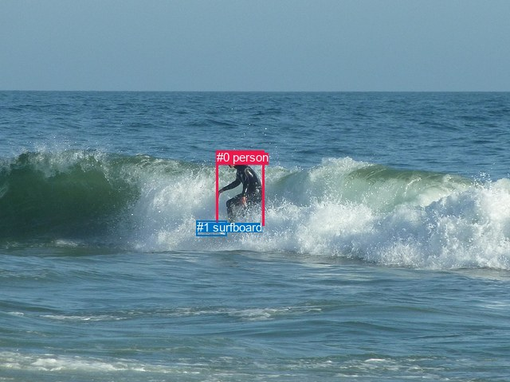
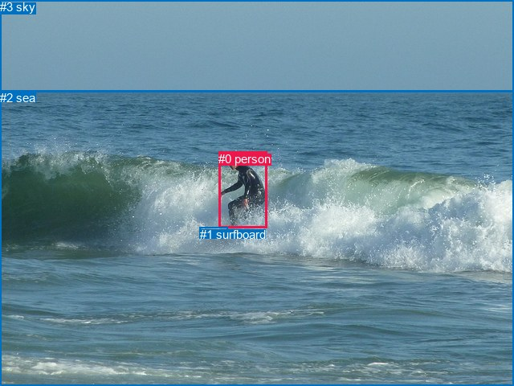

# 图片 1337：2378360.jpg

随机样本序号：233。图片 SHA256：`33051682e3da464d8d6b754321a18eb34ea1db742d52f775e281b399df5827f0`。

红色框表示人，蓝色框表示其他物体。两个模式分别保留自身框编号，可依据位置比较对应对象。

## 自动检测框与输出

人的框编号：`[0]`。状态：`ok`。

### 自动检测全部物体框

| 编号 | 类别 | 是否为人 | 检测分数 | 像素坐标 xyxy |
|---|---|---|---|---|
| 0 | person | True | 0.9997 | 271.6, 189.2, 331.5, 283.8 |
| 1 | surfboard | False | 0.5472 | 247.0, 277.3, 284.5, 296.9 |

### 自动检测 Top50 人相关候选

评分物体对：2；人相关物体对：2；输出关系：4。

| 排名 | 主语编号与类别 | 关系 | 宾语编号与类别 | 类型 | 人与人 | 排序分数 | 原始融合 logit |
|---|---|---|---|---|---|---|---|
| 1 | #0 person | riding | #1 surfboard | semantic | False | 0.98484 | 4.1738 |
| 2 | #0 person | on | #1 surfboard | spatial | False | 0.47510 | -0.0997 |
| 3 | #1 surfboard | in | #0 person | spatial | False | 0.00066 | -7.3157 |
| 4 | #1 surfboard | wearing | #0 person | semantic | False | 0.00034 | -7.9837 |

### 自动检测逐条人相关 GT 核验

R@50：25.00%；命中 1/4。

| GT 主语编号 | GT 关系 | GT 宾语编号 | 结果阶段 | 匹配预测主语编号 | 匹配预测宾语编号 |
|---|---|---|---|---|---|
| 0 | playing | 1 | wrong_predicate | [0] | [1] |
| 0 | riding | 1 | hit50 | [0] | [1] |
| 0 | on | 2 | endpoint_missing_or_wrong_class | [0] | [] |
| 3 | over | 0 | endpoint_missing_or_wrong_class | [] | [0] |

## 真实框与输出

人的框编号：`[0]`。

### 真实框全部物体框

| 编号 | 类别 | 是否为人 | 检测分数 | 像素坐标 xyxy |
|---|---|---|---|---|
| 0 | person | True | GT | 272.0, 189.0, 333.0, 284.0 |
| 1 | surfboard | False | GT | 249.0, 283.0, 284.0, 296.0 |
| 2 | sea | False | GT | 0.0, 113.0, 640.0, 480.0 |
| 3 | sky | False | GT | 0.0, 0.0, 640.0, 115.0 |

### 真实框 Top50 人相关候选

评分物体对：12；人相关物体对：6；输出关系：12。

| 排名 | 主语编号与类别 | 关系 | 宾语编号与类别 | 类型 | 人与人 | 排序分数 | 原始融合 logit |
|---|---|---|---|---|---|---|---|
| 1 | #0 person | riding | #1 surfboard | semantic | False | 0.99312 | 4.9717 |
| 2 | #0 person | in | #2 sea | spatial | False | 0.98898 | 4.4969 |
| 3 | #0 person | on | #1 surfboard | spatial | False | 0.98088 | 3.9376 |
| 4 | #0 person | riding | #2 sea | semantic | False | 0.95465 | 3.0470 |
| 5 | #3 sky | over | #0 person | spatial | False | 0.87985 | 1.9910 |
| 6 | #2 sea | beside | #0 person | spatial | False | 0.62751 | 0.5215 |
| 7 | #3 sky | flying over | #0 person | semantic | False | 0.60388 | 0.4217 |
| 8 | #0 person | looking at | #3 sky | semantic | False | 0.49750 | -0.0100 |
| 9 | #1 surfboard | beside | #0 person | spatial | False | 0.33112 | -0.7031 |
| 10 | #0 person | beside | #3 sky | spatial | False | 0.31304 | -0.7859 |
| 11 | #2 sea | catching | #0 person | semantic | False | 0.24739 | -1.1126 |
| 12 | #1 surfboard | holding | #0 person | semantic | False | 0.13220 | -1.8817 |

### 真实框逐条人相关 GT 核验

R@50：50.00%；命中 2/4。

| GT 主语编号 | GT 关系 | GT 宾语编号 | 结果阶段 | 匹配预测主语编号 | 匹配预测宾语编号 |
|---|---|---|---|---|---|
| 0 | playing | 1 | wrong_predicate | [0] | [1] |
| 0 | riding | 1 | hit50 | [0] | [1] |
| 0 | on | 2 | wrong_predicate | [0] | [2] |
| 3 | over | 0 | hit50 | [3] | [0] |

## 全部人相关 GT

| 主语编号与类别 | 关系 | 宾语编号与类别 |
|---|---|---|
| #0 person | playing | #1 surfboard |
| #0 person | riding | #1 surfboard |
| #0 person | on | #2 sea |
| #3 sky | over | #0 person |

原始记录、全部人相关物体对的两项预测与分项分数见 [逐图证据 JSON](../evidence/cases/1337.json)。全部56类 logits 保留于本机 HOR/output/random500/logits/。

<!-- HOR_COMPLETE_RESULTS -->

## 六组条件的完整输出对照

以下保留同一图片三种框与候选模式、两种谓词输出规则的全部 Top50。框编号各自在所属模式内解释。

### 自动检测框完整枚举：空间与语义各保留一个谓词

| 排名 | 主语编号与类别 | 谓词 | 宾语编号与类别 | 分组 | 排序分数 | predicate logit | pair logit |
|---|---|---|---|---|---|---|---|
| 1 | #0 person | riding | #1 surfboard | semantic | 0.9848391 | 3.8596482 | 0.3141083 |
| 2 | #0 person | on | #1 surfboard | spatial | 0.4750994 | -0.4137931 | 0.3141083 |
| 3 | #1 surfboard | in | #0 person | spatial | 0.0006646 | -6.4374847 | -0.8782285 |
| 4 | #1 surfboard | wearing | #0 person | semantic | 0.0003409 | -7.1054235 | -0.8782285 |

GT 命中：1/4，R@50=25.00%。

| GT主语 | GT谓词 | GT宾语 | 结果阶段 | 匹配主语框 | 匹配宾语框 |
|---|---|---|---|---|---|
| 0 | playing | 1 | wrong_predicate | [0] | [1] |
| 0 | riding | 1 | hit50 | [0] | [1] |
| 0 | on | 2 | endpoint_missing_or_wrong_class | [0] | [] |
| 3 | over | 0 | endpoint_missing_or_wrong_class | [] | [0] |

### 自动检测框完整枚举：每对只保留一个谓词

| 排名 | 主语编号与类别 | 谓词 | 宾语编号与类别 | 分组 | 排序分数 | predicate logit | pair logit |
|---|---|---|---|---|---|---|---|
| 1 | #0 person | riding | #1 surfboard | single | 0.9848391 | 3.8596482 | 0.3141083 |
| 2 | #1 surfboard | in | #0 person | single | 0.0006646 | -6.4374847 | -0.8782285 |

GT 命中：1/4，R@50=25.00%。

| GT主语 | GT谓词 | GT宾语 | 结果阶段 | 匹配主语框 | 匹配宾语框 |
|---|---|---|---|---|---|
| 0 | playing | 1 | wrong_predicate | [0] | [1] |
| 0 | riding | 1 | hit50 | [0] | [1] |
| 0 | on | 2 | endpoint_missing_or_wrong_class | [0] | [] |
| 3 | over | 0 | endpoint_missing_or_wrong_class | [] | [0] |

### 真实框完整枚举：空间与语义各保留一个谓词

| 排名 | 主语编号与类别 | 谓词 | 宾语编号与类别 | 分组 | 排序分数 | predicate logit | pair logit |
|---|---|---|---|---|---|---|---|
| 1 | #0 person | riding | #1 surfboard | semantic | 0.9931165 | 4.6605916 | 0.3111304 |
| 2 | #0 person | in | #2 sea | spatial | 0.9889792 | 4.2183785 | 0.2785181 |
| 3 | #0 person | on | #1 surfboard | spatial | 0.9808787 | 3.6265140 | 0.3111304 |
| 4 | #0 person | riding | #2 sea | semantic | 0.9546539 | 2.7685080 | 0.2785181 |
| 5 | #3 sky | over | #0 person | spatial | 0.8798541 | 2.7090082 | -0.7179587 |
| 6 | #2 sea | beside | #0 person | spatial | 0.6275076 | 1.4918189 | -0.9702798 |
| 7 | #3 sky | flying over | #0 person | semantic | 0.6038830 | 1.1396294 | -0.7179587 |
| 8 | #0 person | looking at | #3 sky | semantic | 0.4974978 | 1.0578771 | -1.0678859 |
| 9 | #1 surfboard | beside | #0 person | spatial | 0.3311206 | 0.1661272 | -0.8692482 |
| 10 | #0 person | beside | #3 sky | spatial | 0.3130427 | 0.2819533 | -1.0678859 |
| 11 | #2 sea | catching | #0 person | semantic | 0.2473864 | -0.1423206 | -0.9702798 |
| 12 | #1 surfboard | holding | #0 person | semantic | 0.1321953 | -1.0124381 | -0.8692482 |

GT 命中：2/4，R@50=50.00%。

| GT主语 | GT谓词 | GT宾语 | 结果阶段 | 匹配主语框 | 匹配宾语框 |
|---|---|---|---|---|---|
| 0 | playing | 1 | wrong_predicate | [0] | [1] |
| 0 | riding | 1 | hit50 | [0] | [1] |
| 0 | on | 2 | wrong_predicate | [0] | [2] |
| 3 | over | 0 | hit50 | [3] | [0] |

### 真实框完整枚举：每对只保留一个谓词

| 排名 | 主语编号与类别 | 谓词 | 宾语编号与类别 | 分组 | 排序分数 | predicate logit | pair logit |
|---|---|---|---|---|---|---|---|
| 1 | #0 person | riding | #1 surfboard | single | 0.9931165 | 4.6605916 | 0.3111304 |
| 2 | #0 person | in | #2 sea | single | 0.9889792 | 4.2183785 | 0.2785181 |
| 3 | #3 sky | over | #0 person | single | 0.8798541 | 2.7090082 | -0.7179587 |
| 4 | #2 sea | beside | #0 person | single | 0.6275076 | 1.4918189 | -0.9702798 |
| 5 | #0 person | looking at | #3 sky | single | 0.4974978 | 1.0578771 | -1.0678859 |
| 6 | #1 surfboard | beside | #0 person | single | 0.3311206 | 0.1661272 | -0.8692482 |

GT 命中：2/4，R@50=50.00%。

| GT主语 | GT谓词 | GT宾语 | 结果阶段 | 匹配主语框 | 匹配宾语框 |
|---|---|---|---|---|---|
| 0 | playing | 1 | wrong_predicate | [0] | [1] |
| 0 | riding | 1 | hit50 | [0] | [1] |
| 0 | on | 2 | wrong_predicate | [0] | [2] |
| 3 | over | 0 | hit50 | [3] | [0] |

### 真实框400候选：空间与语义各保留一个谓词

| 排名 | 主语编号与类别 | 谓词 | 宾语编号与类别 | 分组 | 排序分数 | predicate logit | pair logit |
|---|---|---|---|---|---|---|---|
| 1 | #0 person | riding | #1 surfboard | semantic | 0.9931165 | 4.6605916 | 0.3111304 |
| 2 | #0 person | in | #2 sea | spatial | 0.9889792 | 4.2183785 | 0.2785181 |
| 3 | #0 person | on | #1 surfboard | spatial | 0.9815859 | 3.6649165 | 0.3111304 |
| 4 | #0 person | riding | #2 sea | semantic | 0.9546434 | 2.7682638 | 0.2785181 |
| 5 | #3 sky | over | #0 person | spatial | 0.8824515 | 2.7338114 | -0.7179587 |
| 6 | #2 sea | beside | #0 person | spatial | 0.6275076 | 1.4918189 | -0.9702798 |
| 7 | #3 sky | flying over | #0 person | semantic | 0.6038830 | 1.1396294 | -0.7179587 |
| 8 | #0 person | looking at | #3 sky | semantic | 0.4901507 | 1.0284834 | -1.0678859 |
| 9 | #1 surfboard | beside | #0 person | spatial | 0.3311271 | 0.1661563 | -0.8692482 |
| 10 | #0 person | beside | #3 sky | spatial | 0.3130395 | 0.2819386 | -1.0678859 |
| 11 | #2 sea | catching | #0 person | semantic | 0.2471411 | -0.1436386 | -0.9702798 |
| 12 | #1 surfboard | holding | #0 person | semantic | 0.1323861 | -1.0107763 | -0.8692482 |

GT 命中：2/4，R@50=50.00%。

| GT主语 | GT谓词 | GT宾语 | 结果阶段 | 匹配主语框 | 匹配宾语框 |
|---|---|---|---|---|---|
| 0 | playing | 1 | wrong_predicate | [0] | [1] |
| 0 | riding | 1 | hit50 | [0] | [1] |
| 0 | on | 2 | wrong_predicate | [0] | [2] |
| 3 | over | 0 | hit50 | [3] | [0] |

### 真实框400候选：每对只保留一个谓词

| 排名 | 主语编号与类别 | 谓词 | 宾语编号与类别 | 分组 | 排序分数 | predicate logit | pair logit |
|---|---|---|---|---|---|---|---|
| 1 | #0 person | riding | #1 surfboard | single | 0.9931165 | 4.6605916 | 0.3111304 |
| 2 | #0 person | in | #2 sea | single | 0.9889792 | 4.2183785 | 0.2785181 |
| 3 | #3 sky | over | #0 person | single | 0.8824515 | 2.7338114 | -0.7179587 |
| 4 | #2 sea | beside | #0 person | single | 0.6275076 | 1.4918189 | -0.9702798 |
| 5 | #0 person | looking at | #3 sky | single | 0.4901507 | 1.0284834 | -1.0678859 |
| 6 | #1 surfboard | beside | #0 person | single | 0.3311271 | 0.1661563 | -0.8692482 |

GT 命中：2/4，R@50=50.00%。

| GT主语 | GT谓词 | GT宾语 | 结果阶段 | 匹配主语框 | 匹配宾语框 |
|---|---|---|---|---|---|
| 0 | playing | 1 | wrong_predicate | [0] | [1] |
| 0 | riding | 1 | hit50 | [0] | [1] |
| 0 | on | 2 | wrong_predicate | [0] | [2] |
| 3 | over | 0 | hit50 | [3] | [0] |
