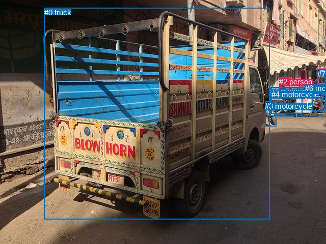
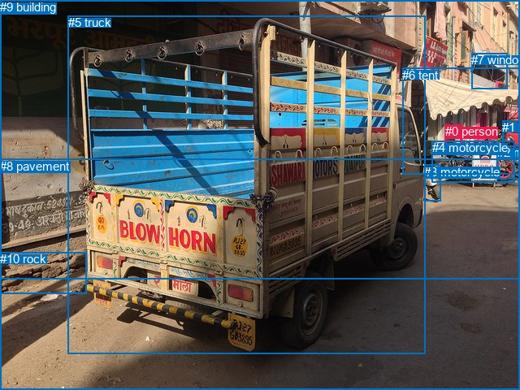

# 图片 1343：2378563.jpg

随机样本序号：175。图片 SHA256：`0ece3434b584ed5deb58f902633b449bd79bf464ce5fd9859d74dbe908e78325`。

红色框表示人，蓝色框表示其他物体。两个模式分别保留自身框编号，可依据位置比较对应对象。

## 自动检测框与输出

人的框编号：`[2]`。状态：`ok`。

### 自动检测全部物体框

| 编号 | 类别 | 是否为人 | 检测分数 | 像素坐标 xyxy |
|---|---|---|---|---|
| 0 | truck | False | 0.9915 | 86.7, 15.8, 529.3, 431.8 |
| 1 | motorcycle | False | 0.9774 | 530.6, 171.3, 632.1, 228.2 |
| 2 | person | True | 0.9545 | 548.1, 152.3, 569.7, 183.5 |
| 3 | motorcycle | False | 0.9420 | 520.4, 199.7, 542.7, 248.6 |
| 4 | motorcycle | False | 0.8483 | 532.9, 176.9, 593.0, 224.4 |
| 5 | motorcycle | False | 0.7994 | 613.9, 167.7, 639.5, 217.8 |
| 6 | motorcycle | False | 0.5867 | 598.6, 165.4, 639.7, 192.6 |
| 7 | truck | False | 0.4142 | 622.9, 136.7, 639.9, 185.9 |

### 自动检测 Top50 人相关候选

评分物体对：56；人相关物体对：14；输出关系：28。

| 排名 | 主语编号与类别 | 关系 | 宾语编号与类别 | 类型 | 人与人 | 排序分数 | 原始融合 logit |
|---|---|---|---|---|---|---|---|
| 1 | #2 person | beside | #1 motorcycle | spatial | False | 0.95948 | 3.1646 |
| 2 | #2 person | walking on | #1 motorcycle | semantic | False | 0.95860 | 3.1422 |
| 3 | #2 person | walking on | #4 motorcycle | semantic | False | 0.95179 | 2.9827 |
| 4 | #2 person | beside | #4 motorcycle | spatial | False | 0.94371 | 2.8193 |
| 5 | #2 person | walking on | #0 truck | semantic | False | 0.84885 | 1.7256 |
| 6 | #2 person | walking on | #6 motorcycle | semantic | False | 0.83411 | 1.6150 |
| 7 | #2 person | beside | #6 motorcycle | spatial | False | 0.79726 | 1.3693 |
| 8 | #2 person | walking on | #3 motorcycle | semantic | False | 0.76522 | 1.1815 |
| 9 | #2 person | beside | #0 truck | spatial | False | 0.75541 | 1.1277 |
| 10 | #0 truck | beside | #2 person | spatial | False | 0.71357 | 0.9128 |
| 11 | #2 person | walking on | #5 motorcycle | semantic | False | 0.69181 | 0.8086 |
| 12 | #2 person | walking on | #7 truck | semantic | False | 0.67995 | 0.7535 |
| 13 | #2 person | beside | #3 motorcycle | spatial | False | 0.66617 | 0.6909 |
| 14 | #4 motorcycle | beside | #2 person | spatial | False | 0.49020 | -0.0392 |
| 15 | #2 person | beside | #5 motorcycle | spatial | False | 0.47714 | -0.0915 |
| 16 | #1 motorcycle | beside | #2 person | spatial | False | 0.45705 | -0.1722 |
| 17 | #1 motorcycle | parked on | #2 person | semantic | False | 0.41660 | -0.3368 |
| 18 | #4 motorcycle | parked on | #2 person | semantic | False | 0.36966 | -0.5337 |
| 19 | #0 truck | parked on | #2 person | semantic | False | 0.36903 | -0.5364 |
| 20 | #2 person | beside | #7 truck | spatial | False | 0.33644 | -0.6792 |
| 21 | #6 motorcycle | parked on | #2 person | semantic | False | 0.31981 | -0.7546 |
| 22 | #6 motorcycle | beside | #2 person | spatial | False | 0.26685 | -1.0106 |
| 23 | #3 motorcycle | beside | #2 person | spatial | False | 0.23531 | -1.1785 |
| 24 | #5 motorcycle | parked on | #2 person | semantic | False | 0.19173 | -1.4388 |
| 25 | #7 truck | parked on | #2 person | semantic | False | 0.15812 | -1.6723 |
| 26 | #7 truck | in front of | #2 person | spatial | False | 0.11308 | -2.0597 |
| 27 | #5 motorcycle | beside | #2 person | spatial | False | 0.10785 | -2.1129 |
| 28 | #3 motorcycle | parked on | #2 person | semantic | False | 0.09593 | -2.2433 |

### 自动检测逐条人相关 GT 核验

R@50：66.67%；命中 2/3。

| GT 主语编号 | GT 关系 | GT 宾语编号 | 结果阶段 | 匹配预测主语编号 | 匹配预测宾语编号 |
|---|---|---|---|---|---|
| 0 | beside | 4 | hit50 | [2] | [1, 4] |
| 0 | standing on | 8 | endpoint_missing_or_wrong_class | [2] | [] |
| 4 | beside | 0 | hit50 | [1, 4] | [2] |

## 真实框与输出

人的框编号：`[0]`。

### 真实框全部物体框

| 编号 | 类别 | 是否为人 | 检测分数 | 像素坐标 xyxy |
|---|---|---|---|---|
| 0 | person | True | GT | 548.0, 153.0, 569.0, 184.0 |
| 1 | car | False | GT | 618.0, 148.0, 640.0, 180.0 |
| 2 | motorcycle | False | GT | 612.0, 179.0, 640.0, 220.0 |
| 3 | motorcycle | False | GT | 522.0, 203.0, 543.0, 247.0 |
| 4 | motorcycle | False | GT | 532.0, 173.0, 634.0, 224.0 |
| 5 | truck | False | GT | 84.0, 19.0, 523.0, 436.0 |
| 6 | tent | False | GT | 495.0, 84.0, 640.0, 215.0 |
| 7 | window | False | GT | 580.0, 65.0, 624.0, 109.0 |
| 8 | pavement | False | GT | 0.0, 196.0, 640.0, 480.0 |
| 9 | building | False | GT | 0.0, 0.0, 640.0, 343.0 |
| 10 | rock | False | GT | 0.0, 310.0, 107.0, 361.0 |

### 真实框 Top50 人相关候选

评分物体对：110；人相关物体对：20；输出关系：40。

| 排名 | 主语编号与类别 | 关系 | 宾语编号与类别 | 类型 | 人与人 | 排序分数 | 原始融合 logit |
|---|---|---|---|---|---|---|---|
| 1 | #0 person | standing on | #4 motorcycle | semantic | False | 0.89850 | 2.1806 |
| 2 | #0 person | beside | #4 motorcycle | spatial | False | 0.88266 | 2.0179 |
| 3 | #0 person | walking on | #9 building | semantic | False | 0.86451 | 1.8532 |
| 4 | #0 person | walking on | #8 pavement | semantic | False | 0.86011 | 1.8162 |
| 5 | #0 person | in | #9 building | spatial | False | 0.82217 | 1.5311 |
| 6 | #0 person | in | #6 tent | spatial | False | 0.81391 | 1.4756 |
| 7 | #0 person | looking at | #6 tent | semantic | False | 0.81232 | 1.4652 |
| 8 | #6 tent | over | #0 person | spatial | False | 0.64342 | 0.5902 |
| 9 | #0 person | on | #8 pavement | spatial | False | 0.46548 | -0.1383 |
| 10 | #0 person | standing on | #5 truck | semantic | False | 0.45330 | -0.1874 |
| 11 | #0 person | on back of | #5 truck | spatial | False | 0.37532 | -0.5094 |
| 12 | #0 person | beside | #1 car | spatial | False | 0.35982 | -0.5761 |
| 13 | #0 person | standing on | #1 car | semantic | False | 0.33946 | -0.6657 |
| 14 | #7 window | over | #0 person | spatial | False | 0.29113 | -0.8899 |
| 15 | #0 person | looking at | #7 window | semantic | False | 0.28431 | -0.9232 |
| 16 | #4 motorcycle | parked on | #0 person | semantic | False | 0.27871 | -0.9509 |
| 17 | #0 person | on | #3 motorcycle | spatial | False | 0.21995 | -1.2659 |
| 18 | #0 person | standing on | #3 motorcycle | semantic | False | 0.21418 | -1.2999 |
| 19 | #0 person | in | #7 window | spatial | False | 0.20378 | -1.3628 |
| 20 | #0 person | standing on | #2 motorcycle | semantic | False | 0.18918 | -1.4554 |
| 21 | #0 person | beside | #2 motorcycle | spatial | False | 0.16516 | -1.6203 |
| 22 | #4 motorcycle | beside | #0 person | spatial | False | 0.15758 | -1.6764 |
| 23 | #1 car | beside | #0 person | spatial | False | 0.12041 | -1.9886 |
| 24 | #1 car | parked on | #0 person | semantic | False | 0.08805 | -2.3376 |
| 25 | #0 person | walking on | #10 rock | semantic | False | 0.07608 | -2.4968 |
| 26 | #5 truck | beside | #0 person | spatial | False | 0.05012 | -2.9420 |
| 27 | #6 tent | wearing | #0 person | semantic | False | 0.04887 | -2.9684 |
| 28 | #2 motorcycle | parked on | #0 person | semantic | False | 0.04747 | -2.9991 |
| 29 | #2 motorcycle | beside | #0 person | spatial | False | 0.04517 | -3.0512 |
| 30 | #5 truck | parked on | #0 person | semantic | False | 0.03803 | -3.2305 |
| 31 | #3 motorcycle | beside | #0 person | spatial | False | 0.01702 | -4.0563 |
| 32 | #7 window | holding | #0 person | semantic | False | 0.00997 | -4.5982 |
| 33 | #0 person | on | #10 rock | spatial | False | 0.00869 | -4.7372 |
| 34 | #3 motorcycle | parked on | #0 person | semantic | False | 0.00849 | -4.7605 |
| 35 | #8 pavement | in | #0 person | spatial | False | 0.00621 | -5.0753 |
| 36 | #9 building | beside | #0 person | spatial | False | 0.00462 | -5.3731 |
| 37 | #10 rock | in front of | #0 person | spatial | False | 0.00328 | -5.7161 |
| 38 | #9 building | holding | #0 person | semantic | False | 0.00198 | -6.2236 |
| 39 | #8 pavement | holding | #0 person | semantic | False | 0.00164 | -6.4099 |
| 40 | #10 rock | holding | #0 person | semantic | False | 0.00119 | -6.7341 |

### 真实框逐条人相关 GT 核验

R@50：66.67%；命中 2/3。

| GT 主语编号 | GT 关系 | GT 宾语编号 | 结果阶段 | 匹配预测主语编号 | 匹配预测宾语编号 |
|---|---|---|---|---|---|
| 0 | beside | 4 | hit50 | [0] | [4] |
| 0 | standing on | 8 | wrong_predicate | [0] | [8] |
| 4 | beside | 0 | hit50 | [4] | [0] |

## 全部人相关 GT

| 主语编号与类别 | 关系 | 宾语编号与类别 |
|---|---|---|
| #0 person | beside | #4 motorcycle |
| #0 person | standing on | #8 pavement |
| #4 motorcycle | beside | #0 person |

原始记录、全部人相关物体对的两项预测与分项分数见 [逐图证据 JSON](../evidence/cases/1343.json)。全部56类 logits 保留于本机 HOR/output/random500/logits/。

<!-- HOR_COMPLETE_RESULTS -->

## 六组条件的完整输出对照

以下保留同一图片三种框与候选模式、两种谓词输出规则的全部 Top50。框编号各自在所属模式内解释。

### 自动检测框完整枚举：空间与语义各保留一个谓词

| 排名 | 主语编号与类别 | 谓词 | 宾语编号与类别 | 分组 | 排序分数 | predicate logit | pair logit |
|---|---|---|---|---|---|---|---|
| 1 | #2 person | beside | #1 motorcycle | spatial | 0.9594802 | 3.4648881 | -0.3002856 |
| 2 | #2 person | walking on | #1 motorcycle | semantic | 0.9585992 | 3.4424605 | -0.3002856 |
| 3 | #2 person | walking on | #4 motorcycle | semantic | 0.9517881 | 3.4484811 | -0.4657440 |
| 4 | #2 person | beside | #4 motorcycle | spatial | 0.9437124 | 3.2850924 | -0.4657440 |
| 5 | #2 person | walking on | #0 truck | semantic | 0.8488501 | 2.3802495 | -0.6546390 |
| 6 | #2 person | walking on | #6 motorcycle | semantic | 0.8341110 | 1.8175611 | -0.2025139 |
| 7 | #2 person | beside | #6 motorcycle | spatial | 0.7972601 | 1.5717711 | -0.2025139 |
| 8 | #2 person | walking on | #3 motorcycle | semantic | 0.7652196 | 1.9108315 | -0.7293191 |
| 9 | #2 person | beside | #0 truck | spatial | 0.7554112 | 1.7823229 | -0.6546390 |
| 10 | #0 truck | beside | #2 person | spatial | 0.7135696 | 2.1339059 | -1.2211215 |
| 11 | #2 person | walking on | #5 motorcycle | semantic | 0.6918051 | 1.0291820 | -0.2206101 |
| 12 | #2 person | walking on | #7 truck | semantic | 0.6799464 | 1.0231605 | -0.2696350 |
| 13 | #2 person | beside | #3 motorcycle | spatial | 0.6661698 | 1.4202309 | -0.7293191 |
| 14 | #4 motorcycle | beside | #2 person | spatial | 0.4902016 | 0.5180497 | -0.5572485 |
| 15 | #2 person | beside | #5 motorcycle | spatial | 0.4771416 | 0.1291127 | -0.2206101 |
| 16 | #1 motorcycle | beside | #2 person | spatial | 0.4570525 | 0.3684464 | -0.5406605 |
| 17 | #1 motorcycle | parked on | #2 person | semantic | 0.4165954 | 0.2038951 | -0.5406605 |
| 18 | #4 motorcycle | parked on | #2 person | semantic | 0.3696556 | 0.0235538 | -0.5572485 |
| 19 | #0 truck | parked on | #2 person | semantic | 0.3690282 | 0.6847334 | -1.2211215 |
| 20 | #2 person | beside | #7 truck | spatial | 0.3364394 | -0.4095674 | -0.2696350 |
| 21 | #6 motorcycle | parked on | #2 person | semantic | 0.3198118 | -0.3080935 | -0.4465431 |
| 22 | #6 motorcycle | beside | #2 person | spatial | 0.2668540 | -0.5641003 | -0.4465431 |
| 23 | #3 motorcycle | beside | #2 person | spatial | 0.2353149 | -0.0843749 | -1.0941644 |
| 24 | #5 motorcycle | parked on | #2 person | semantic | 0.1917259 | -1.0001130 | -0.4387213 |
| 25 | #7 truck | parked on | #2 person | semantic | 0.1581163 | -1.1501374 | -0.5221740 |
| 26 | #7 truck | in front of | #2 person | spatial | 0.1130791 | -1.5374942 | -0.5221740 |
| 27 | #5 motorcycle | beside | #2 person | spatial | 0.1078519 | -1.6741517 | -0.4387213 |
| 28 | #3 motorcycle | parked on | #2 person | semantic | 0.0959260 | -1.1491702 | -1.0941644 |

GT 命中：2/3，R@50=66.67%。

| GT主语 | GT谓词 | GT宾语 | 结果阶段 | 匹配主语框 | 匹配宾语框 |
|---|---|---|---|---|---|
| 0 | beside | 4 | hit50 | [2] | [1, 4] |
| 0 | standing on | 8 | endpoint_missing_or_wrong_class | [2] | [] |
| 4 | beside | 0 | hit50 | [1, 4] | [2] |

### 自动检测框完整枚举：每对只保留一个谓词

| 排名 | 主语编号与类别 | 谓词 | 宾语编号与类别 | 分组 | 排序分数 | predicate logit | pair logit |
|---|---|---|---|---|---|---|---|
| 1 | #2 person | beside | #1 motorcycle | single | 0.9594802 | 3.4648881 | -0.3002856 |
| 2 | #2 person | walking on | #4 motorcycle | single | 0.9517881 | 3.4484811 | -0.4657440 |
| 3 | #2 person | walking on | #0 truck | single | 0.8488501 | 2.3802495 | -0.6546390 |
| 4 | #2 person | walking on | #6 motorcycle | single | 0.8341110 | 1.8175611 | -0.2025139 |
| 5 | #2 person | walking on | #3 motorcycle | single | 0.7652196 | 1.9108315 | -0.7293191 |
| 6 | #0 truck | beside | #2 person | single | 0.7135696 | 2.1339059 | -1.2211215 |
| 7 | #2 person | walking on | #5 motorcycle | single | 0.6918051 | 1.0291820 | -0.2206101 |
| 8 | #2 person | walking on | #7 truck | single | 0.6799464 | 1.0231605 | -0.2696350 |
| 9 | #4 motorcycle | beside | #2 person | single | 0.4902016 | 0.5180497 | -0.5572485 |
| 10 | #1 motorcycle | beside | #2 person | single | 0.4570525 | 0.3684464 | -0.5406605 |
| 11 | #6 motorcycle | parked on | #2 person | single | 0.3198118 | -0.3080935 | -0.4465431 |
| 12 | #3 motorcycle | beside | #2 person | single | 0.2353149 | -0.0843749 | -1.0941644 |
| 13 | #5 motorcycle | parked on | #2 person | single | 0.1917259 | -1.0001130 | -0.4387213 |
| 14 | #7 truck | parked on | #2 person | single | 0.1581163 | -1.1501374 | -0.5221740 |

GT 命中：2/3，R@50=66.67%。

| GT主语 | GT谓词 | GT宾语 | 结果阶段 | 匹配主语框 | 匹配宾语框 |
|---|---|---|---|---|---|
| 0 | beside | 4 | hit50 | [2] | [1, 4] |
| 0 | standing on | 8 | endpoint_missing_or_wrong_class | [2] | [] |
| 4 | beside | 0 | hit50 | [1, 4] | [2] |

### 真实框完整枚举：空间与语义各保留一个谓词

| 排名 | 主语编号与类别 | 谓词 | 宾语编号与类别 | 分组 | 排序分数 | predicate logit | pair logit |
|---|---|---|---|---|---|---|---|
| 1 | #0 person | standing on | #4 motorcycle | semantic | 0.8984971 | 2.4914632 | -0.3108268 |
| 2 | #0 person | beside | #4 motorcycle | spatial | 0.8826616 | 2.3287072 | -0.3108268 |
| 3 | #0 person | walking on | #9 building | semantic | 0.8645058 | 2.2809858 | -0.4277560 |
| 4 | #0 person | walking on | #8 pavement | semantic | 0.8601115 | 2.5939679 | -0.7777516 |
| 5 | #0 person | in | #9 building | spatial | 0.8221683 | 1.9588637 | -0.4277560 |
| 6 | #0 person | in | #6 tent | spatial | 0.8139082 | 1.3736329 | 0.1019745 |
| 7 | #0 person | looking at | #6 tent | semantic | 0.8123249 | 1.3632135 | 0.1019745 |
| 8 | #6 tent | over | #0 person | spatial | 0.6434220 | 1.0334511 | -0.4432031 |
| 9 | #0 person | on | #8 pavement | spatial | 0.4654815 | 0.6394577 | -0.7777516 |
| 10 | #0 person | standing on | #5 truck | semantic | 0.4532961 | 0.4936109 | -0.6809727 |
| 11 | #0 person | on back of | #5 truck | spatial | 0.3753230 | 0.1715250 | -0.6809727 |
| 12 | #0 person | beside | #1 car | spatial | 0.3598227 | -0.2893538 | -0.2867801 |
| 13 | #0 person | standing on | #1 car | semantic | 0.3394566 | -0.3789363 | -0.2867801 |
| 14 | #7 window | over | #0 person | spatial | 0.2911338 | -0.3305106 | -0.5593735 |
| 15 | #0 person | looking at | #7 window | semantic | 0.2843082 | -0.4348316 | -0.4883592 |
| 16 | #4 motorcycle | parked on | #0 person | semantic | 0.2787078 | -0.4276853 | -0.5231951 |
| 17 | #0 person | on | #3 motorcycle | spatial | 0.2199544 | -0.5527525 | -0.7131795 |
| 18 | #0 person | standing on | #3 motorcycle | semantic | 0.2141825 | -0.5867167 | -0.7131795 |
| 19 | #0 person | in | #7 window | spatial | 0.2037810 | -0.8744690 | -0.4883592 |
| 20 | #0 person | standing on | #2 motorcycle | semantic | 0.1891787 | -1.1613088 | -0.2940466 |
| 21 | #0 person | beside | #2 motorcycle | spatial | 0.1651627 | -1.3262591 | -0.2940466 |
| 22 | #4 motorcycle | beside | #0 person | spatial | 0.1575768 | -1.1531746 | -0.5231951 |
| 23 | #1 car | beside | #0 person | spatial | 0.1204088 | -1.4768238 | -0.5117409 |
| 24 | #1 car | parked on | #0 person | semantic | 0.0880548 | -1.8258801 | -0.5117409 |
| 25 | #0 person | walking on | #10 rock | semantic | 0.0760828 | -1.0132744 | -1.4835262 |
| 26 | #5 truck | beside | #0 person | spatial | 0.0501162 | -1.6877515 | -1.2542448 |
| 27 | #6 tent | wearing | #0 person | semantic | 0.0488717 | -2.5252464 | -0.4432031 |
| 28 | #2 motorcycle | parked on | #0 person | semantic | 0.0474672 | -2.5333371 | -0.4657476 |
| 29 | #2 motorcycle | beside | #0 person | spatial | 0.0451670 | -2.5854220 | -0.4657476 |
| 30 | #5 truck | parked on | #0 person | semantic | 0.0380341 | -1.9762504 | -1.2542448 |
| 31 | #3 motorcycle | beside | #0 person | spatial | 0.0170176 | -2.9334445 | -1.1229011 |
| 32 | #7 window | holding | #0 person | semantic | 0.0099697 | -4.0388145 | -0.5593735 |
| 33 | #0 person | on | #10 rock | spatial | 0.0086868 | -3.2536955 | -1.4835262 |
| 34 | #3 motorcycle | parked on | #0 person | semantic | 0.0084887 | -3.6375911 | -1.1229011 |
| 35 | #8 pavement | in | #0 person | spatial | 0.0062103 | -3.4809031 | -1.5944051 |
| 36 | #9 building | beside | #0 person | spatial | 0.0046183 | -4.3123684 | -1.0607390 |
| 37 | #10 rock | in front of | #0 person | spatial | 0.0032818 | -3.9150894 | -1.8009882 |
| 38 | #9 building | holding | #0 person | semantic | 0.0019781 | -5.1628919 | -1.0607390 |
| 39 | #8 pavement | holding | #0 person | semantic | 0.0016425 | -4.8154736 | -1.5944051 |
| 40 | #10 rock | holding | #0 person | semantic | 0.0011882 | -4.9331589 | -1.8009882 |

GT 命中：2/3，R@50=66.67%。

| GT主语 | GT谓词 | GT宾语 | 结果阶段 | 匹配主语框 | 匹配宾语框 |
|---|---|---|---|---|---|
| 0 | beside | 4 | hit50 | [0] | [4] |
| 0 | standing on | 8 | wrong_predicate | [0] | [8] |
| 4 | beside | 0 | hit50 | [4] | [0] |

### 真实框完整枚举：每对只保留一个谓词

| 排名 | 主语编号与类别 | 谓词 | 宾语编号与类别 | 分组 | 排序分数 | predicate logit | pair logit |
|---|---|---|---|---|---|---|---|
| 1 | #0 person | standing on | #4 motorcycle | single | 0.8984971 | 2.4914632 | -0.3108268 |
| 2 | #0 person | walking on | #9 building | single | 0.8645058 | 2.2809858 | -0.4277560 |
| 3 | #0 person | walking on | #8 pavement | single | 0.8601115 | 2.5939679 | -0.7777516 |
| 4 | #0 person | in | #6 tent | single | 0.8139082 | 1.3736329 | 0.1019745 |
| 5 | #6 tent | over | #0 person | single | 0.6434220 | 1.0334511 | -0.4432031 |
| 6 | #0 person | standing on | #5 truck | single | 0.4532961 | 0.4936109 | -0.6809727 |
| 7 | #0 person | beside | #1 car | single | 0.3598227 | -0.2893538 | -0.2867801 |
| 8 | #7 window | over | #0 person | single | 0.2911338 | -0.3305106 | -0.5593735 |
| 9 | #0 person | looking at | #7 window | single | 0.2843082 | -0.4348316 | -0.4883592 |
| 10 | #4 motorcycle | parked on | #0 person | single | 0.2787078 | -0.4276853 | -0.5231951 |
| 11 | #0 person | on | #3 motorcycle | single | 0.2199544 | -0.5527525 | -0.7131795 |
| 12 | #0 person | standing on | #2 motorcycle | single | 0.1891787 | -1.1613088 | -0.2940466 |
| 13 | #1 car | beside | #0 person | single | 0.1204088 | -1.4768238 | -0.5117409 |
| 14 | #0 person | walking on | #10 rock | single | 0.0760828 | -1.0132744 | -1.4835262 |
| 15 | #5 truck | beside | #0 person | single | 0.0501162 | -1.6877515 | -1.2542448 |
| 16 | #2 motorcycle | parked on | #0 person | single | 0.0474672 | -2.5333371 | -0.4657476 |
| 17 | #3 motorcycle | beside | #0 person | single | 0.0170176 | -2.9334445 | -1.1229011 |
| 18 | #8 pavement | in | #0 person | single | 0.0062103 | -3.4809031 | -1.5944051 |
| 19 | #9 building | beside | #0 person | single | 0.0046183 | -4.3123684 | -1.0607390 |
| 20 | #10 rock | in front of | #0 person | single | 0.0032818 | -3.9150894 | -1.8009882 |

GT 命中：0/3，R@50=0.00%。

| GT主语 | GT谓词 | GT宾语 | 结果阶段 | 匹配主语框 | 匹配宾语框 |
|---|---|---|---|---|---|
| 0 | beside | 4 | wrong_predicate | [0] | [4] |
| 0 | standing on | 8 | wrong_predicate | [0] | [8] |
| 4 | beside | 0 | wrong_predicate | [4] | [0] |

### 真实框400候选：空间与语义各保留一个谓词

| 排名 | 主语编号与类别 | 谓词 | 宾语编号与类别 | 分组 | 排序分数 | predicate logit | pair logit |
|---|---|---|---|---|---|---|---|
| 1 | #0 person | standing on | #4 motorcycle | semantic | 0.8984971 | 2.4914632 | -0.3108268 |
| 2 | #0 person | beside | #4 motorcycle | spatial | 0.8826736 | 2.3288231 | -0.3108268 |
| 3 | #0 person | walking on | #9 building | semantic | 0.8707258 | 2.3351474 | -0.4277560 |
| 4 | #0 person | walking on | #8 pavement | semantic | 0.8568213 | 2.5668874 | -0.7777516 |
| 5 | #0 person | in | #9 building | spatial | 0.8187132 | 1.9354100 | -0.4277560 |
| 6 | #0 person | in | #6 tent | spatial | 0.8139082 | 1.3736329 | 0.1019745 |
| 7 | #0 person | looking at | #6 tent | semantic | 0.8078026 | 1.3338199 | 0.1019745 |
| 8 | #6 tent | over | #0 person | spatial | 0.6422079 | 1.0281630 | -0.4432031 |
| 9 | #0 person | on | #8 pavement | spatial | 0.4654815 | 0.6394577 | -0.7777516 |
| 10 | #0 person | standing on | #5 truck | semantic | 0.4598509 | 0.5200300 | -0.6809727 |
| 11 | #0 person | on back of | #5 truck | spatial | 0.3825709 | 0.2023225 | -0.6809727 |
| 12 | #0 person | beside | #1 car | spatial | 0.3529504 | -0.3193154 | -0.2867801 |
| 13 | #0 person | standing on | #1 car | semantic | 0.3402804 | -0.3752646 | -0.2867801 |
| 14 | #7 window | over | #0 person | spatial | 0.2977972 | -0.2984362 | -0.5593735 |
| 15 | #0 person | looking at | #7 window | semantic | 0.2843791 | -0.4344831 | -0.4883592 |
| 16 | #4 motorcycle | parked on | #0 person | semantic | 0.2727036 | -0.4577537 | -0.5231951 |
| 17 | #0 person | on | #3 motorcycle | spatial | 0.2208901 | -0.5473075 | -0.7131795 |
| 18 | #0 person | standing on | #3 motorcycle | semantic | 0.2186625 | -0.5602980 | -0.7131795 |
| 19 | #0 person | in | #7 window | spatial | 0.2040504 | -0.8728096 | -0.4883592 |
| 20 | #0 person | standing on | #2 motorcycle | semantic | 0.1886161 | -1.1649806 | -0.2940466 |
| 21 | #0 person | beside | #2 motorcycle | spatial | 0.1651537 | -1.3263242 | -0.2940466 |
| 22 | #4 motorcycle | beside | #0 person | spatial | 0.1575730 | -1.1532035 | -0.5231951 |
| 23 | #1 car | beside | #0 person | spatial | 0.1203996 | -1.4769104 | -0.5117409 |
| 24 | #1 car | parked on | #0 person | semantic | 0.0868550 | -1.8409142 | -0.5117409 |
| 25 | #0 person | walking on | #10 rock | semantic | 0.0760828 | -1.0132744 | -1.4835262 |
| 26 | #5 truck | beside | #0 person | spatial | 0.0501210 | -1.6876502 | -1.2542448 |
| 27 | #6 tent | wearing | #0 person | semantic | 0.0494378 | -2.5131347 | -0.4432031 |
| 28 | #2 motorcycle | parked on | #0 person | semantic | 0.0467919 | -2.5483749 | -0.4657476 |
| 29 | #2 motorcycle | beside | #0 person | spatial | 0.0451661 | -2.5854437 | -0.4657476 |
| 30 | #5 truck | parked on | #0 person | semantic | 0.0385879 | -1.9612203 | -1.2542448 |
| 31 | #3 motorcycle | beside | #0 person | spatial | 0.0171434 | -2.9259505 | -1.1229011 |
| 32 | #7 window | holding | #0 person | semantic | 0.0100626 | -4.0294456 | -0.5593735 |
| 33 | #0 person | on | #10 rock | spatial | 0.0087103 | -3.2509730 | -1.4835262 |
| 34 | #3 motorcycle | parked on | #0 person | semantic | 0.0082396 | -3.6676328 | -1.1229011 |
| 35 | #8 pavement | in | #0 person | spatial | 0.0063039 | -3.4658575 | -1.5944051 |
| 36 | #9 building | beside | #0 person | spatial | 0.0046277 | -4.3103218 | -1.0607390 |
| 37 | #10 rock | in front of | #0 person | spatial | 0.0032818 | -3.9150894 | -1.8009882 |
| 38 | #9 building | holding | #0 person | semantic | 0.0019915 | -5.1561246 | -1.0607390 |
| 39 | #8 pavement | holding | #0 person | semantic | 0.0016675 | -4.8003597 | -1.5944051 |
| 40 | #10 rock | holding | #0 person | semantic | 0.0011988 | -4.9242277 | -1.8009882 |

GT 命中：2/3，R@50=66.67%。

| GT主语 | GT谓词 | GT宾语 | 结果阶段 | 匹配主语框 | 匹配宾语框 |
|---|---|---|---|---|---|
| 0 | beside | 4 | hit50 | [0] | [4] |
| 0 | standing on | 8 | wrong_predicate | [0] | [8] |
| 4 | beside | 0 | hit50 | [4] | [0] |

### 真实框400候选：每对只保留一个谓词

| 排名 | 主语编号与类别 | 谓词 | 宾语编号与类别 | 分组 | 排序分数 | predicate logit | pair logit |
|---|---|---|---|---|---|---|---|
| 1 | #0 person | standing on | #4 motorcycle | single | 0.8984971 | 2.4914632 | -0.3108268 |
| 2 | #0 person | walking on | #9 building | single | 0.8707258 | 2.3351474 | -0.4277560 |
| 3 | #0 person | walking on | #8 pavement | single | 0.8568213 | 2.5668874 | -0.7777516 |
| 4 | #0 person | in | #6 tent | single | 0.8139082 | 1.3736329 | 0.1019745 |
| 5 | #6 tent | over | #0 person | single | 0.6422079 | 1.0281630 | -0.4432031 |
| 6 | #0 person | standing on | #5 truck | single | 0.4598509 | 0.5200300 | -0.6809727 |
| 7 | #0 person | beside | #1 car | single | 0.3529504 | -0.3193154 | -0.2867801 |
| 8 | #7 window | over | #0 person | single | 0.2977972 | -0.2984362 | -0.5593735 |
| 9 | #0 person | looking at | #7 window | single | 0.2843791 | -0.4344831 | -0.4883592 |
| 10 | #4 motorcycle | parked on | #0 person | single | 0.2727036 | -0.4577537 | -0.5231951 |
| 11 | #0 person | on | #3 motorcycle | single | 0.2208901 | -0.5473075 | -0.7131795 |
| 12 | #0 person | standing on | #2 motorcycle | single | 0.1886161 | -1.1649806 | -0.2940466 |
| 13 | #1 car | beside | #0 person | single | 0.1203996 | -1.4769104 | -0.5117409 |
| 14 | #0 person | walking on | #10 rock | single | 0.0760828 | -1.0132744 | -1.4835262 |
| 15 | #5 truck | beside | #0 person | single | 0.0501210 | -1.6876502 | -1.2542448 |
| 16 | #2 motorcycle | parked on | #0 person | single | 0.0467919 | -2.5483749 | -0.4657476 |
| 17 | #3 motorcycle | beside | #0 person | single | 0.0171434 | -2.9259505 | -1.1229011 |
| 18 | #8 pavement | in | #0 person | single | 0.0063039 | -3.4658575 | -1.5944051 |
| 19 | #9 building | beside | #0 person | single | 0.0046277 | -4.3103218 | -1.0607390 |
| 20 | #10 rock | in front of | #0 person | single | 0.0032818 | -3.9150894 | -1.8009882 |

GT 命中：0/3，R@50=0.00%。

| GT主语 | GT谓词 | GT宾语 | 结果阶段 | 匹配主语框 | 匹配宾语框 |
|---|---|---|---|---|---|
| 0 | beside | 4 | wrong_predicate | [0] | [4] |
| 0 | standing on | 8 | wrong_predicate | [0] | [8] |
| 4 | beside | 0 | wrong_predicate | [4] | [0] |
