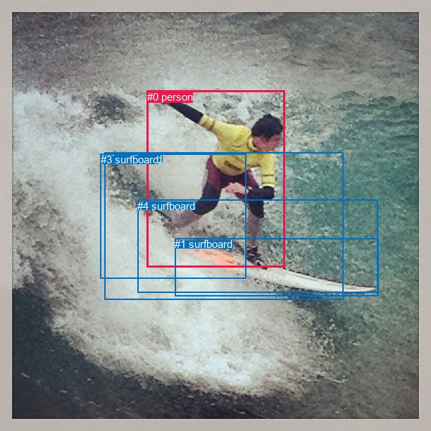
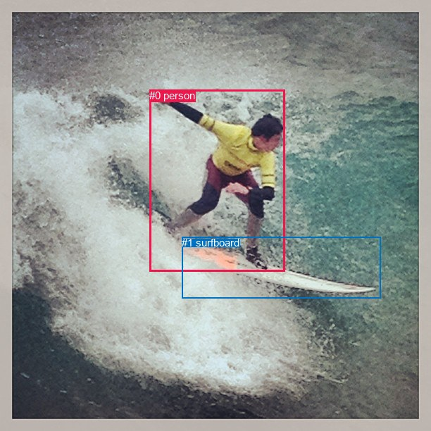

# 图片 1346：2378709.jpg

随机样本序号：296。图片 SHA256：`90fab997d1351b1c2ae1a437689245f962dbfa58e577911c9c83991490aadc5e`。

红色框表示人，蓝色框表示其他物体。两个模式分别保留自身框编号，可依据位置比较对应对象。

## 自动检测框与输出

人的框编号：`[0]`。状态：`ok`。

### 自动检测全部物体框

| 编号 | 类别 | 是否为人 | 检测分数 | 像素坐标 xyxy |
|---|---|---|---|---|
| 0 | person | True | 0.9996 | 208.8, 128.9, 404.9, 379.5 |
| 1 | surfboard | False | 0.9947 | 248.1, 338.3, 537.3, 420.8 |
| 2 | surfboard | False | 0.9144 | 148.4, 216.9, 487.6, 425.4 |
| 3 | surfboard | False | 0.7669 | 142.7, 218.1, 349.4, 395.5 |
| 4 | surfboard | False | 0.7100 | 195.3, 283.7, 536.4, 415.3 |

### 自动检测 Top50 人相关候选

评分物体对：20；人相关物体对：8；输出关系：16。

| 排名 | 主语编号与类别 | 关系 | 宾语编号与类别 | 类型 | 人与人 | 排序分数 | 原始融合 logit |
|---|---|---|---|---|---|---|---|
| 1 | #0 person | riding | #1 surfboard | semantic | False | 0.98696 | 4.3264 |
| 2 | #0 person | riding | #4 surfboard | semantic | False | 0.98683 | 4.3164 |
| 3 | #0 person | riding | #3 surfboard | semantic | False | 0.97543 | 3.6816 |
| 4 | #0 person | riding | #2 surfboard | semantic | False | 0.97159 | 3.5321 |
| 5 | #0 person | on | #2 surfboard | spatial | False | 0.91313 | 2.3524 |
| 6 | #0 person | on | #1 surfboard | spatial | False | 0.86110 | 1.8244 |
| 7 | #0 person | on | #4 surfboard | spatial | False | 0.85814 | 1.7999 |
| 8 | #0 person | on | #3 surfboard | spatial | False | 0.82420 | 1.5451 |
| 9 | #2 surfboard | in | #0 person | spatial | False | 0.11973 | -1.9949 |
| 10 | #3 surfboard | on | #0 person | spatial | False | 0.10404 | -2.1531 |
| 11 | #4 surfboard | in | #0 person | spatial | False | 0.05813 | -2.7853 |
| 12 | #1 surfboard | in | #0 person | spatial | False | 0.04737 | -3.0012 |
| 13 | #2 surfboard | wearing | #0 person | semantic | False | 0.04553 | -3.0428 |
| 14 | #1 surfboard | holding | #0 person | semantic | False | 0.02279 | -3.7583 |
| 15 | #4 surfboard | holding | #0 person | semantic | False | 0.01687 | -4.0651 |
| 16 | #3 surfboard | wearing | #0 person | semantic | False | 0.01092 | -4.5065 |

### 自动检测逐条人相关 GT 核验

R@50：0.00%；命中 0/2。

| GT 主语编号 | GT 关系 | GT 宾语编号 | 结果阶段 | 匹配预测主语编号 | 匹配预测宾语编号 |
|---|---|---|---|---|---|
| 0 | standing on | 1 | wrong_predicate | [0] | [1] |
| 0 | playing | 1 | wrong_predicate | [0] | [1] |

## 真实框与输出

人的框编号：`[0]`。

### 真实框全部物体框

| 编号 | 类别 | 是否为人 | 检测分数 | 像素坐标 xyxy |
|---|---|---|---|---|
| 0 | person | True | GT | 212.0, 127.0, 404.0, 385.0 |
| 1 | surfboard | False | GT | 258.0, 336.0, 540.0, 423.0 |

### 真实框 Top50 人相关候选

评分物体对：2；人相关物体对：2；输出关系：4。

| 排名 | 主语编号与类别 | 关系 | 宾语编号与类别 | 类型 | 人与人 | 排序分数 | 原始融合 logit |
|---|---|---|---|---|---|---|---|
| 1 | #0 person | riding | #1 surfboard | semantic | False | 0.97559 | 3.6882 |
| 2 | #0 person | on | #1 surfboard | spatial | False | 0.35313 | -0.6053 |
| 3 | #1 surfboard | in | #0 person | spatial | False | 0.00096 | -6.9508 |
| 4 | #1 surfboard | lying on | #0 person | semantic | False | 0.00023 | -8.3750 |

### 真实框逐条人相关 GT 核验

R@50：0.00%；命中 0/2。

| GT 主语编号 | GT 关系 | GT 宾语编号 | 结果阶段 | 匹配预测主语编号 | 匹配预测宾语编号 |
|---|---|---|---|---|---|
| 0 | standing on | 1 | wrong_predicate | [0] | [1] |
| 0 | playing | 1 | wrong_predicate | [0] | [1] |

## 全部人相关 GT

| 主语编号与类别 | 关系 | 宾语编号与类别 |
|---|---|---|
| #0 person | standing on | #1 surfboard |
| #0 person | playing | #1 surfboard |

原始记录、全部人相关物体对的两项预测与分项分数见 [逐图证据 JSON](../evidence/cases/1346.json)。全部56类 logits 保留于本机 HOR/output/random500/logits/。

<!-- HOR_COMPLETE_RESULTS -->

## 六组条件的完整输出对照

以下保留同一图片三种框与候选模式、两种谓词输出规则的全部 Top50。框编号各自在所属模式内解释。

### 自动检测框完整枚举：空间与语义各保留一个谓词

| 排名 | 主语编号与类别 | 谓词 | 宾语编号与类别 | 分组 | 排序分数 | predicate logit | pair logit |
|---|---|---|---|---|---|---|---|
| 1 | #0 person | riding | #1 surfboard | semantic | 0.9869570 | 4.0524125 | 0.2739604 |
| 2 | #0 person | riding | #4 surfboard | semantic | 0.9868281 | 4.1130843 | 0.2033247 |
| 3 | #0 person | riding | #3 surfboard | semantic | 0.9754350 | 3.9374242 | -0.2558632 |
| 4 | #0 person | riding | #2 surfboard | semantic | 0.9715868 | 3.5239654 | 0.0081090 |
| 5 | #0 person | on | #2 surfboard | spatial | 0.9131271 | 2.3443193 | 0.0081090 |
| 6 | #0 person | on | #1 surfboard | spatial | 0.8610979 | 1.5504780 | 0.2739604 |
| 7 | #0 person | on | #4 surfboard | spatial | 0.8581415 | 1.5966144 | 0.2033247 |
| 8 | #0 person | on | #3 surfboard | spatial | 0.8242015 | 1.8009396 | -0.2558632 |
| 9 | #2 surfboard | in | #0 person | spatial | 0.1197345 | -1.2271051 | -0.7678412 |
| 10 | #3 surfboard | on | #0 person | spatial | 0.1040429 | -1.6849542 | -0.4681355 |
| 11 | #4 surfboard | in | #0 person | spatial | 0.0581258 | -2.0423918 | -0.7428707 |
| 12 | #1 surfboard | in | #0 person | spatial | 0.0473725 | -2.3049667 | -0.6962163 |
| 13 | #2 surfboard | wearing | #0 person | semantic | 0.0455292 | -2.2749629 | -0.7678412 |
| 14 | #1 surfboard | holding | #0 person | semantic | 0.0227926 | -3.0620465 | -0.6962163 |
| 15 | #4 surfboard | holding | #0 person | semantic | 0.0168713 | -3.3222532 | -0.7428707 |
| 16 | #3 surfboard | wearing | #0 person | semantic | 0.0109168 | -4.0383387 | -0.4681355 |

GT 命中：0/2，R@50=0.00%。

| GT主语 | GT谓词 | GT宾语 | 结果阶段 | 匹配主语框 | 匹配宾语框 |
|---|---|---|---|---|---|
| 0 | standing on | 1 | wrong_predicate | [0] | [1] |
| 0 | playing | 1 | wrong_predicate | [0] | [1] |

### 自动检测框完整枚举：每对只保留一个谓词

| 排名 | 主语编号与类别 | 谓词 | 宾语编号与类别 | 分组 | 排序分数 | predicate logit | pair logit |
|---|---|---|---|---|---|---|---|
| 1 | #0 person | riding | #1 surfboard | single | 0.9869570 | 4.0524125 | 0.2739604 |
| 2 | #0 person | riding | #4 surfboard | single | 0.9868281 | 4.1130843 | 0.2033247 |
| 3 | #0 person | riding | #3 surfboard | single | 0.9754350 | 3.9374242 | -0.2558632 |
| 4 | #0 person | riding | #2 surfboard | single | 0.9715868 | 3.5239654 | 0.0081090 |
| 5 | #2 surfboard | in | #0 person | single | 0.1197345 | -1.2271051 | -0.7678412 |
| 6 | #3 surfboard | on | #0 person | single | 0.1040429 | -1.6849542 | -0.4681355 |
| 7 | #4 surfboard | in | #0 person | single | 0.0581258 | -2.0423918 | -0.7428707 |
| 8 | #1 surfboard | in | #0 person | single | 0.0473725 | -2.3049667 | -0.6962163 |

GT 命中：0/2，R@50=0.00%。

| GT主语 | GT谓词 | GT宾语 | 结果阶段 | 匹配主语框 | 匹配宾语框 |
|---|---|---|---|---|---|
| 0 | standing on | 1 | wrong_predicate | [0] | [1] |
| 0 | playing | 1 | wrong_predicate | [0] | [1] |

### 真实框完整枚举：空间与语义各保留一个谓词

| 排名 | 主语编号与类别 | 谓词 | 宾语编号与类别 | 分组 | 排序分数 | predicate logit | pair logit |
|---|---|---|---|---|---|---|---|
| 1 | #0 person | riding | #1 surfboard | semantic | 0.9755932 | 3.4409366 | 0.2472489 |
| 2 | #0 person | on | #1 surfboard | spatial | 0.3531287 | -0.8525639 | 0.2472489 |
| 3 | #1 surfboard | in | #0 person | spatial | 0.0009570 | -6.2656641 | -0.6851019 |
| 4 | #1 surfboard | lying on | #0 person | semantic | 0.0002305 | -7.6898575 | -0.6851019 |

GT 命中：0/2，R@50=0.00%。

| GT主语 | GT谓词 | GT宾语 | 结果阶段 | 匹配主语框 | 匹配宾语框 |
|---|---|---|---|---|---|
| 0 | standing on | 1 | wrong_predicate | [0] | [1] |
| 0 | playing | 1 | wrong_predicate | [0] | [1] |

### 真实框完整枚举：每对只保留一个谓词

| 排名 | 主语编号与类别 | 谓词 | 宾语编号与类别 | 分组 | 排序分数 | predicate logit | pair logit |
|---|---|---|---|---|---|---|---|
| 1 | #0 person | riding | #1 surfboard | single | 0.9755932 | 3.4409366 | 0.2472489 |
| 2 | #1 surfboard | in | #0 person | single | 0.0009570 | -6.2656641 | -0.6851019 |

GT 命中：0/2，R@50=0.00%。

| GT主语 | GT谓词 | GT宾语 | 结果阶段 | 匹配主语框 | 匹配宾语框 |
|---|---|---|---|---|---|
| 0 | standing on | 1 | wrong_predicate | [0] | [1] |
| 0 | playing | 1 | wrong_predicate | [0] | [1] |

### 真实框400候选：空间与语义各保留一个谓词

| 排名 | 主语编号与类别 | 谓词 | 宾语编号与类别 | 分组 | 排序分数 | predicate logit | pair logit |
|---|---|---|---|---|---|---|---|
| 1 | #0 person | riding | #1 surfboard | semantic | 0.9755932 | 3.4409366 | 0.2472489 |
| 2 | #0 person | on | #1 surfboard | spatial | 0.3531287 | -0.8525639 | 0.2472489 |
| 3 | #1 surfboard | in | #0 person | spatial | 0.0009598 | -6.2627325 | -0.6851019 |
| 4 | #1 surfboard | lying on | #0 person | semantic | 0.0002305 | -7.6898575 | -0.6851019 |

GT 命中：0/2，R@50=0.00%。

| GT主语 | GT谓词 | GT宾语 | 结果阶段 | 匹配主语框 | 匹配宾语框 |
|---|---|---|---|---|---|
| 0 | standing on | 1 | wrong_predicate | [0] | [1] |
| 0 | playing | 1 | wrong_predicate | [0] | [1] |

### 真实框400候选：每对只保留一个谓词

| 排名 | 主语编号与类别 | 谓词 | 宾语编号与类别 | 分组 | 排序分数 | predicate logit | pair logit |
|---|---|---|---|---|---|---|---|
| 1 | #0 person | riding | #1 surfboard | single | 0.9755932 | 3.4409366 | 0.2472489 |
| 2 | #1 surfboard | in | #0 person | single | 0.0009598 | -6.2627325 | -0.6851019 |

GT 命中：0/2，R@50=0.00%。

| GT主语 | GT谓词 | GT宾语 | 结果阶段 | 匹配主语框 | 匹配宾语框 |
|---|---|---|---|---|---|
| 0 | standing on | 1 | wrong_predicate | [0] | [1] |
| 0 | playing | 1 | wrong_predicate | [0] | [1] |
