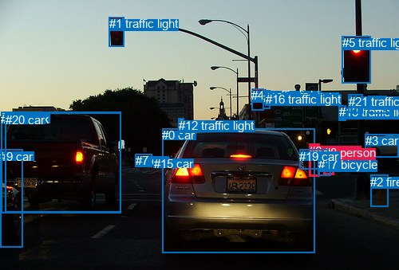
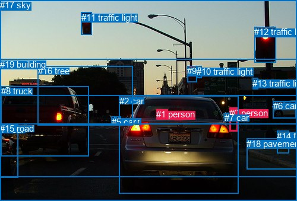

# 图片 1350：2378868.jpg

随机样本序号：229。图片 SHA256：`adf4b5c957aee8afdecd9c10efa3521026bb94e81fa37278604a6dcb45652fa2`。

红色框表示人，蓝色框表示其他物体。两个模式分别保留自身框编号，可依据位置比较对应对象。

## 自动检测框与输出

人的框编号：`[6, 8]`。状态：`ok`。

### 自动检测全部物体框

| 编号 | 类别 | 是否为人 | 检测分数 | 像素坐标 xyxy |
|---|---|---|---|---|
| 0 | car | False | 0.9990 | 203.1, 161.5, 394.2, 317.0 |
| 1 | traffic light | False | 0.9978 | 136.8, 21.3, 155.5, 58.5 |
| 2 | fire hydrant | False | 0.9948 | 464.2, 219.6, 486.5, 259.9 |
| 3 | car | False | 0.9923 | 457.8, 168.4, 499.8, 197.7 |
| 4 | traffic light | False | 0.9916 | 315.5, 111.1, 330.5, 138.4 |
| 5 | traffic light | False | 0.9893 | 428.6, 45.1, 464.3, 104.6 |
| 6 | person | True | 0.9750 | 387.2, 180.8, 400.4, 221.1 |
| 7 | car | False | 0.9726 | 169.8, 193.1, 190.2, 209.5 |
| 8 | person | True | 0.9683 | 405.7, 183.3, 418.3, 219.8 |
| 9 | car | False | 0.9553 | 0.1, 188.0, 28.9, 310.7 |
| 10 | traffic light | False | 0.9249 | 329.9, 113.6, 338.6, 136.2 |
| 11 | truck | False | 0.9002 | 1.2, 140.9, 151.1, 267.4 |
| 12 | traffic light | False | 0.8619 | 223.8, 148.6, 230.3, 169.5 |
| 13 | traffic light | False | 0.8187 | 425.0, 132.1, 433.8, 151.5 |
| 14 | traffic light | False | 0.7679 | 461.2, 120.2, 484.4, 142.4 |
| 15 | car | False | 0.7053 | 192.8, 196.6, 204.1, 207.2 |
| 16 | traffic light | False | 0.6610 | 333.0, 115.5, 338.3, 132.6 |
| 17 | bicycle | False | 0.5841 | 398.9, 198.5, 414.2, 220.9 |
| 18 | traffic light | False | 0.5259 | 439.6, 118.7, 455.0, 142.1 |
| 19 | car | False | 0.5122 | 375.1, 187.6, 411.5, 212.7 |
| 20 | car | False | 0.4978 | 6.6, 141.6, 151.2, 266.3 |
| 21 | traffic light | False | 0.4972 | 436.7, 118.5, 446.7, 141.4 |

### 自动检测 Top50 人相关候选

评分物体对：462；人相关物体对：82；输出关系：50。

| 排名 | 主语编号与类别 | 关系 | 宾语编号与类别 | 类型 | 人与人 | 排序分数 | 原始融合 logit |
|---|---|---|---|---|---|---|---|
| 1 | #6 person | pushing | #17 bicycle | semantic | False | 0.98898 | 4.4965 |
| 2 | #8 person | pushing | #17 bicycle | semantic | False | 0.98410 | 4.1255 |
| 3 | #6 person | walking on | #19 car | semantic | False | 0.97007 | 3.4784 |
| 4 | #8 person | walking on | #19 car | semantic | False | 0.96628 | 3.3554 |
| 5 | #8 person | on | #17 bicycle | spatial | False | 0.90739 | 2.2822 |
| 6 | #6 person | beside | #19 car | spatial | False | 0.89038 | 2.0946 |
| 7 | #6 person | beside | #17 bicycle | spatial | False | 0.87611 | 1.9561 |
| 8 | #19 car | parked on | #6 person | semantic | False | 0.84919 | 1.7283 |
| 9 | #8 person | beside | #19 car | spatial | False | 0.83680 | 1.6346 |
| 10 | #8 person | walking on | #15 car | semantic | False | 0.77386 | 1.2302 |
| 11 | #8 person | walking on | #6 person | semantic | True | 0.76395 | 1.1745 |
| 12 | #19 car | parked on | #8 person | semantic | False | 0.71925 | 0.9407 |
| 13 | #8 person | walking on | #7 car | semantic | False | 0.71125 | 0.9015 |
| 14 | #17 bicycle | parked on | #8 person | semantic | False | 0.67856 | 0.7472 |
| 15 | #17 bicycle | walking on | #6 person | semantic | False | 0.65956 | 0.6614 |
| 16 | #6 person | walking on | #8 person | semantic | True | 0.64839 | 0.6120 |
| 17 | #6 person | parked on | #15 car | semantic | False | 0.58170 | 0.3298 |
| 18 | #6 person | beside | #0 car | spatial | False | 0.58059 | 0.3252 |
| 19 | #8 person | beside | #6 person | spatial | True | 0.55626 | 0.2260 |
| 20 | #6 person | walking on | #7 car | semantic | False | 0.52699 | 0.1081 |
| 21 | #17 bicycle | beside | #6 person | spatial | False | 0.43348 | -0.2677 |
| 22 | #6 person | beside | #8 person | spatial | True | 0.43295 | -0.2698 |
| 23 | #19 car | beside | #6 person | spatial | False | 0.41273 | -0.3527 |
| 24 | #8 person | walking on | #0 car | semantic | False | 0.39160 | -0.4406 |
| 25 | #6 person | walking on | #0 car | semantic | False | 0.38770 | -0.4570 |
| 26 | #17 bicycle | beside | #8 person | spatial | False | 0.38699 | -0.4600 |
| 27 | #8 person | beside | #0 car | spatial | False | 0.35519 | -0.5963 |
| 28 | #6 person | walking on | #3 car | semantic | False | 0.33413 | -0.6896 |
| 29 | #8 person | walking on | #3 car | semantic | False | 0.30316 | -0.8323 |
| 30 | #19 car | beside | #8 person | spatial | False | 0.29534 | -0.8696 |
| 31 | #0 car | beside | #6 person | spatial | False | 0.25234 | -1.0862 |
| 32 | #8 person | beside | #3 car | spatial | False | 0.18892 | -1.4571 |
| 33 | #6 person | beside | #3 car | spatial | False | 0.14711 | -1.7575 |
| 34 | #0 car | driving | #6 person | semantic | False | 0.13998 | -1.8155 |
| 35 | #8 person | walking on | #2 fire hydrant | semantic | False | 0.11237 | -2.0667 |
| 36 | #0 car | beside | #8 person | spatial | False | 0.09797 | -2.2199 |
| 37 | #3 car | beside | #8 person | spatial | False | 0.09553 | -2.2479 |
| 38 | #8 person | walking on | #20 car | semantic | False | 0.09089 | -2.3028 |
| 39 | #8 person | walking on | #11 truck | semantic | False | 0.08982 | -2.3159 |
| 40 | #3 car | parked on | #6 person | semantic | False | 0.07970 | -2.4464 |
| 41 | #3 car | parked on | #8 person | semantic | False | 0.07758 | -2.4757 |
| 42 | #6 person | looking at | #14 traffic light | semantic | False | 0.06303 | -2.6990 |
| 43 | #8 person | walking on | #9 car | semantic | False | 0.06260 | -2.7063 |
| 44 | #6 person | walking on | #11 truck | semantic | False | 0.06149 | -2.7254 |
| 45 | #6 person | walking on | #20 car | semantic | False | 0.06052 | -2.7424 |
| 46 | #8 person | looking at | #14 traffic light | semantic | False | 0.05995 | -2.7524 |
| 47 | #2 fire hydrant | beside | #8 person | spatial | False | 0.05211 | -2.9008 |
| 48 | #6 person | in | #15 car | spatial | False | 0.04872 | -2.9717 |
| 49 | #8 person | walking on | #12 traffic light | semantic | False | 0.04644 | -3.0220 |
| 50 | #8 person | looking at | #13 traffic light | semantic | False | 0.04536 | -3.0468 |

### 自动检测逐条人相关 GT 核验

R@50：0.00%；命中 0/1。

| GT 主语编号 | GT 关系 | GT 宾语编号 | 结果阶段 | 匹配预测主语编号 | 匹配预测宾语编号 |
|---|---|---|---|---|---|
| 1 | in | 2 | endpoint_missing_or_wrong_class | [] | [0] |

## 真实框与输出

人的框编号：`[0, 1]`。

### 真实框全部物体框

| 编号 | 类别 | 是否为人 | 检测分数 | 像素坐标 xyxy |
|---|---|---|---|---|
| 0 | person | True | GT | 386.0, 182.0, 400.0, 221.0 |
| 1 | person | True | GT | 263.0, 184.0, 282.0, 198.0 |
| 2 | car | False | GT | 201.0, 162.0, 402.0, 327.0 |
| 3 | car | False | GT | 195.0, 196.0, 203.0, 206.0 |
| 4 | car | False | GT | 0.0, 210.0, 31.0, 299.0 |
| 5 | car | False | GT | 188.0, 197.0, 195.0, 208.0 |
| 6 | car | False | GT | 460.0, 170.0, 499.0, 199.0 |
| 7 | car | False | GT | 378.0, 190.0, 387.0, 198.0 |
| 8 | truck | False | GT | 2.0, 145.0, 150.0, 264.0 |
| 9 | traffic light | False | GT | 315.0, 111.0, 331.0, 138.0 |
| 10 | traffic light | False | GT | 331.0, 112.0, 339.0, 132.0 |
| 11 | traffic light | False | GT | 137.0, 21.0, 155.0, 58.0 |
| 12 | traffic light | False | GT | 428.0, 45.0, 464.0, 105.0 |
| 13 | traffic light | False | GT | 425.0, 132.0, 434.0, 151.0 |
| 14 | fire hydrant | False | GT | 466.0, 221.0, 486.0, 259.0 |
| 15 | road | False | GT | 0.0, 208.0, 500.0, 339.0 |
| 16 | tree | False | GT | 64.0, 111.0, 224.0, 211.0 |
| 17 | sky | False | GT | 0.0, 0.0, 500.0, 162.0 |
| 18 | pavement | False | GT | 415.0, 234.0, 500.0, 286.0 |
| 19 | building | False | GT | 0.0, 100.0, 500.0, 299.0 |

### 真实框 Top50 人相关候选

评分物体对：380；人相关物体对：74；输出关系：50。

| 排名 | 主语编号与类别 | 关系 | 宾语编号与类别 | 类型 | 人与人 | 排序分数 | 原始融合 logit |
|---|---|---|---|---|---|---|---|
| 1 | #0 person | crossing | #15 road | semantic | False | 0.98886 | 4.4856 |
| 2 | #1 person | in | #2 car | spatial | False | 0.97910 | 3.8468 |
| 3 | #1 person | driving on | #2 car | semantic | False | 0.92056 | 2.4499 |
| 4 | #0 person | on | #15 road | spatial | False | 0.91799 | 2.4153 |
| 5 | #0 person | pushing | #7 car | semantic | False | 0.90491 | 2.2531 |
| 6 | #7 car | parked on | #0 person | semantic | False | 0.90291 | 2.2300 |
| 7 | #0 person | on | #7 car | spatial | False | 0.84703 | 1.7115 |
| 8 | #7 car | on | #0 person | spatial | False | 0.68593 | 0.7812 |
| 9 | #0 person | walking on | #19 building | semantic | False | 0.49811 | -0.0076 |
| 10 | #0 person | walking on | #18 pavement | semantic | False | 0.44427 | -0.2239 |
| 11 | #0 person | crossing | #2 car | semantic | False | 0.43473 | -0.2626 |
| 12 | #0 person | in | #19 building | spatial | False | 0.42435 | -0.3049 |
| 13 | #0 person | beside | #2 car | spatial | False | 0.37681 | -0.5031 |
| 14 | #2 car | in | #1 person | spatial | False | 0.28696 | -0.9102 |
| 15 | #0 person | on | #18 pavement | spatial | False | 0.24316 | -1.1355 |
| 16 | #1 person | on | #8 truck | spatial | False | 0.23432 | -1.1841 |
| 17 | #2 car | carrying | #1 person | semantic | False | 0.18458 | -1.4856 |
| 18 | #1 person | in | #19 building | spatial | False | 0.17598 | -1.5438 |
| 19 | #1 person | on | #15 road | spatial | False | 0.13680 | -1.8421 |
| 20 | #1 person | driving on | #8 truck | semantic | False | 0.08019 | -2.4397 |
| 21 | #0 person | beside | #6 car | spatial | False | 0.07627 | -2.4941 |
| 22 | #6 car | beside | #0 person | spatial | False | 0.07046 | -2.5796 |
| 23 | #0 person | walking on | #6 car | semantic | False | 0.06406 | -2.6818 |
| 24 | #0 person | walking on | #5 car | semantic | False | 0.04649 | -3.0210 |
| 25 | #0 person | walking on | #3 car | semantic | False | 0.04643 | -3.0223 |
| 26 | #13 traffic light | on | #0 person | spatial | False | 0.03945 | -3.1924 |
| 27 | #1 person | crossing | #15 road | semantic | False | 0.03681 | -3.2646 |
| 28 | #6 car | parked on | #0 person | semantic | False | 0.03196 | -3.4108 |
| 29 | #1 person | looking at | #19 building | semantic | False | 0.03177 | -3.4170 |
| 30 | #2 car | beside | #0 person | spatial | False | 0.02941 | -3.4965 |
| 31 | #0 person | on | #5 car | spatial | False | 0.02332 | -3.7350 |
| 32 | #0 person | on | #3 car | spatial | False | 0.02198 | -3.7954 |
| 33 | #0 person | looking at | #8 truck | semantic | False | 0.02058 | -3.8625 |
| 34 | #1 person | in | #3 car | spatial | False | 0.02049 | -3.8672 |
| 35 | #9 traffic light | over | #1 person | spatial | False | 0.01900 | -3.9443 |
| 36 | #10 traffic light | over | #1 person | spatial | False | 0.01890 | -3.9496 |
| 37 | #10 traffic light | on | #0 person | spatial | False | 0.01866 | -3.9627 |
| 38 | #1 person | on | #5 car | spatial | False | 0.01605 | -4.1157 |
| 39 | #1 person | looking at | #11 traffic light | semantic | False | 0.01158 | -4.4464 |
| 40 | #0 person | looking at | #12 traffic light | semantic | False | 0.01148 | -4.4556 |
| 41 | #8 truck | in front of | #0 person | spatial | False | 0.01103 | -4.4959 |
| 42 | #0 person | looking at | #13 traffic light | semantic | False | 0.01045 | -4.5508 |
| 43 | #9 traffic light | on | #0 person | spatial | False | 0.01039 | -4.5565 |
| 44 | #1 person | on | #4 car | spatial | False | 0.00991 | -4.6045 |
| 45 | #18 pavement | beside | #0 person | spatial | False | 0.00954 | -4.6426 |
| 46 | #2 car | parked on | #0 person | semantic | False | 0.00816 | -4.7998 |
| 47 | #0 person | beside | #8 truck | spatial | False | 0.00781 | -4.8450 |
| 48 | #0 person | in | #13 traffic light | spatial | False | 0.00781 | -4.8451 |
| 49 | #14 fire hydrant | beside | #0 person | spatial | False | 0.00757 | -4.8757 |
| 50 | #17 sky | over | #0 person | spatial | False | 0.00724 | -4.9203 |

### 真实框逐条人相关 GT 核验

R@50：100.00%；命中 1/1。

| GT 主语编号 | GT 关系 | GT 宾语编号 | 结果阶段 | 匹配预测主语编号 | 匹配预测宾语编号 |
|---|---|---|---|---|---|
| 1 | in | 2 | hit50 | [1] | [2] |

## 全部人相关 GT

| 主语编号与类别 | 关系 | 宾语编号与类别 |
|---|---|---|
| #1 person | in | #2 car |

原始记录、全部人相关物体对的两项预测与分项分数见 [逐图证据 JSON](../evidence/cases/1350.json)。全部56类 logits 保留于本机 HOR/output/random500/logits/。

<!-- HOR_COMPLETE_RESULTS -->

## 六组条件的完整输出对照

以下保留同一图片三种框与候选模式、两种谓词输出规则的全部 Top50。框编号各自在所属模式内解释。

### 自动检测框完整枚举：空间与语义各保留一个谓词

| 排名 | 主语编号与类别 | 谓词 | 宾语编号与类别 | 分组 | 排序分数 | predicate logit | pair logit |
|---|---|---|---|---|---|---|---|
| 1 | #6 person | pushing | #17 bicycle | semantic | 0.9889750 | 4.5090261 | -0.0125182 |
| 2 | #8 person | pushing | #17 bicycle | semantic | 0.9841018 | 4.0879359 | 0.0375900 |
| 3 | #6 person | walking on | #19 car | semantic | 0.9700677 | 3.5929313 | -0.1145035 |
| 4 | #8 person | walking on | #19 car | semantic | 0.9662818 | 3.4785590 | -0.1231409 |
| 5 | #8 person | on | #17 bicycle | spatial | 0.9073892 | 2.2445755 | 0.0375900 |
| 6 | #6 person | beside | #19 car | spatial | 0.8903819 | 2.2091522 | -0.1145035 |
| 7 | #6 person | beside | #17 bicycle | spatial | 0.8761078 | 1.9685950 | -0.0125182 |
| 8 | #19 car | parked on | #6 person | semantic | 0.8491898 | 1.9475942 | -0.2193332 |
| 9 | #8 person | beside | #19 car | spatial | 0.8368045 | 1.7577829 | -0.1231409 |
| 10 | #8 person | walking on | #15 car | semantic | 0.7738601 | 1.5075192 | -0.2772817 |
| 11 | #8 person | walking on | #6 person | semantic | 0.7639511 | 1.3496203 | -0.1751556 |
| 12 | #19 car | parked on | #8 person | semantic | 0.7192503 | 1.2562728 | -0.3155268 |
| 13 | #8 person | walking on | #7 car | semantic | 0.7112488 | 1.0561647 | -0.1547081 |
| 14 | #17 bicycle | parked on | #8 person | semantic | 0.6785604 | 1.1072736 | -0.3601094 |
| 15 | #17 bicycle | walking on | #6 person | semantic | 0.6595647 | 0.9794664 | -0.3181115 |
| 16 | #6 person | walking on | #8 person | semantic | 0.6483929 | 0.8651495 | -0.2531669 |
| 17 | #6 person | parked on | #15 car | semantic | 0.5817000 | 0.5323372 | -0.2025811 |
| 18 | #6 person | beside | #0 car | spatial | 0.5805879 | 1.9331551 | -1.6079679 |
| 19 | #8 person | beside | #6 person | spatial | 0.5562623 | 0.4011617 | -0.1751556 |
| 20 | #6 person | walking on | #7 car | semantic | 0.5269867 | 0.2218885 | -0.1138368 |
| 21 | #17 bicycle | beside | #6 person | spatial | 0.4334803 | 0.0504460 | -0.3181115 |
| 22 | #6 person | beside | #8 person | spatial | 0.4329530 | -0.0166459 | -0.2531669 |
| 23 | #19 car | beside | #6 person | spatial | 0.4127344 | -0.1333399 | -0.2193332 |
| 24 | #8 person | walking on | #0 car | semantic | 0.3915951 | 1.2442660 | -1.6848782 |
| 25 | #6 person | walking on | #0 car | semantic | 0.3877011 | 1.1509819 | -1.6079679 |
| 26 | #17 bicycle | beside | #8 person | spatial | 0.3869850 | -0.0998940 | -0.3601094 |
| 27 | #8 person | beside | #0 car | spatial | 0.3551922 | 1.0885849 | -1.6848782 |
| 28 | #6 person | walking on | #3 car | semantic | 0.3341289 | 0.2678685 | -0.9574379 |
| 29 | #8 person | walking on | #3 car | semantic | 0.3031550 | 0.1535387 | -0.9858572 |
| 30 | #19 car | beside | #8 person | spatial | 0.2953448 | -0.5540385 | -0.3155268 |
| 31 | #0 car | beside | #6 person | spatial | 0.2523394 | 0.6058874 | -1.6920617 |
| 32 | #8 person | beside | #3 car | spatial | 0.1889174 | -0.4712029 | -0.9858572 |
| 33 | #6 person | beside | #3 car | spatial | 0.1471092 | -0.8000181 | -0.9574379 |
| 34 | #0 car | driving | #6 person | semantic | 0.1399759 | -0.1234283 | -1.6920617 |
| 35 | #8 person | walking on | #2 fire hydrant | semantic | 0.1123741 | -1.1027606 | -0.9639564 |
| 36 | #0 car | beside | #8 person | spatial | 0.0979740 | -0.4166803 | -1.8032610 |
| 37 | #3 car | beside | #8 person | spatial | 0.0955298 | -1.3576729 | -0.8902384 |
| 38 | #8 person | walking on | #20 car | semantic | 0.0908923 | -0.9298019 | -1.3729868 |
| 39 | #8 person | walking on | #11 truck | semantic | 0.0898155 | -0.9576354 | -1.3582542 |
| 40 | #3 car | parked on | #6 person | semantic | 0.0797009 | -1.5258195 | -0.9205988 |
| 41 | #3 car | parked on | #8 person | semantic | 0.0775815 | -1.5854321 | -0.8902384 |
| 42 | #6 person | looking at | #14 traffic light | semantic | 0.0630303 | -1.5553114 | -1.1437232 |
| 43 | #8 person | walking on | #9 car | semantic | 0.0626017 | -1.1564481 | -1.5498675 |
| 44 | #6 person | walking on | #11 truck | semantic | 0.0614924 | -1.4719357 | -1.2534417 |
| 45 | #6 person | walking on | #20 car | semantic | 0.0605154 | -1.4712772 | -1.2711562 |
| 46 | #8 person | looking at | #14 traffic light | semantic | 0.0599484 | -1.6413963 | -1.1110537 |
| 47 | #2 fire hydrant | beside | #8 person | spatial | 0.0521150 | -1.6269908 | -1.2737902 |
| 48 | #6 person | in | #15 car | spatial | 0.0487229 | -2.7690744 | -0.2025811 |
| 49 | #8 person | walking on | #12 traffic light | semantic | 0.0464418 | -1.5361080 | -1.4858923 |
| 50 | #8 person | looking at | #13 traffic light | semantic | 0.0453578 | -1.8628590 | -1.1838951 |

GT 命中：0/1，R@50=0.00%。

| GT主语 | GT谓词 | GT宾语 | 结果阶段 | 匹配主语框 | 匹配宾语框 |
|---|---|---|---|---|---|
| 1 | in | 2 | endpoint_missing_or_wrong_class | [] | [0] |

### 自动检测框完整枚举：每对只保留一个谓词

| 排名 | 主语编号与类别 | 谓词 | 宾语编号与类别 | 分组 | 排序分数 | predicate logit | pair logit |
|---|---|---|---|---|---|---|---|
| 1 | #6 person | pushing | #17 bicycle | single | 0.9889750 | 4.5090261 | -0.0125182 |
| 2 | #8 person | pushing | #17 bicycle | single | 0.9841018 | 4.0879359 | 0.0375900 |
| 3 | #6 person | walking on | #19 car | single | 0.9700677 | 3.5929313 | -0.1145035 |
| 4 | #8 person | walking on | #19 car | single | 0.9662818 | 3.4785590 | -0.1231409 |
| 5 | #19 car | parked on | #6 person | single | 0.8491898 | 1.9475942 | -0.2193332 |
| 6 | #8 person | walking on | #15 car | single | 0.7738601 | 1.5075192 | -0.2772817 |
| 7 | #8 person | walking on | #6 person | single | 0.7639511 | 1.3496203 | -0.1751556 |
| 8 | #19 car | parked on | #8 person | single | 0.7192503 | 1.2562728 | -0.3155268 |
| 9 | #8 person | walking on | #7 car | single | 0.7112488 | 1.0561647 | -0.1547081 |
| 10 | #17 bicycle | parked on | #8 person | single | 0.6785604 | 1.1072736 | -0.3601094 |
| 11 | #17 bicycle | walking on | #6 person | single | 0.6595647 | 0.9794664 | -0.3181115 |
| 12 | #6 person | walking on | #8 person | single | 0.6483929 | 0.8651495 | -0.2531669 |
| 13 | #6 person | parked on | #15 car | single | 0.5817000 | 0.5323372 | -0.2025811 |
| 14 | #6 person | beside | #0 car | single | 0.5805879 | 1.9331551 | -1.6079679 |
| 15 | #6 person | walking on | #7 car | single | 0.5269867 | 0.2218885 | -0.1138368 |
| 16 | #8 person | walking on | #0 car | single | 0.3915951 | 1.2442660 | -1.6848782 |
| 17 | #6 person | walking on | #3 car | single | 0.3341289 | 0.2678685 | -0.9574379 |
| 18 | #8 person | walking on | #3 car | single | 0.3031550 | 0.1535387 | -0.9858572 |
| 19 | #0 car | beside | #6 person | single | 0.2523394 | 0.6058874 | -1.6920617 |
| 20 | #8 person | walking on | #2 fire hydrant | single | 0.1123741 | -1.1027606 | -0.9639564 |
| 21 | #0 car | beside | #8 person | single | 0.0979740 | -0.4166803 | -1.8032610 |
| 22 | #3 car | beside | #8 person | single | 0.0955298 | -1.3576729 | -0.8902384 |
| 23 | #8 person | walking on | #20 car | single | 0.0908923 | -0.9298019 | -1.3729868 |
| 24 | #8 person | walking on | #11 truck | single | 0.0898155 | -0.9576354 | -1.3582542 |
| 25 | #3 car | parked on | #6 person | single | 0.0797009 | -1.5258195 | -0.9205988 |
| 26 | #6 person | looking at | #14 traffic light | single | 0.0630303 | -1.5553114 | -1.1437232 |
| 27 | #8 person | walking on | #9 car | single | 0.0626017 | -1.1564481 | -1.5498675 |
| 28 | #6 person | walking on | #11 truck | single | 0.0614924 | -1.4719357 | -1.2534417 |
| 29 | #6 person | walking on | #20 car | single | 0.0605154 | -1.4712772 | -1.2711562 |
| 30 | #8 person | looking at | #14 traffic light | single | 0.0599484 | -1.6413963 | -1.1110537 |
| 31 | #2 fire hydrant | beside | #8 person | single | 0.0521150 | -1.6269908 | -1.2737902 |
| 32 | #8 person | walking on | #12 traffic light | single | 0.0464418 | -1.5361080 | -1.4858923 |
| 33 | #8 person | looking at | #13 traffic light | single | 0.0453578 | -1.8628590 | -1.1838951 |
| 34 | #6 person | walking on | #2 fire hydrant | single | 0.0444692 | -1.9069521 | -1.1605175 |
| 35 | #15 car | driving | #6 person | single | 0.0423301 | -1.7032182 | -1.4157869 |
| 36 | #6 person | looking at | #5 traffic light | single | 0.0420780 | -1.7997241 | -1.3255173 |
| 37 | #8 person | looking at | #18 traffic light | single | 0.0413283 | -1.9799225 | -1.1640774 |
| 38 | #8 person | looking at | #5 traffic light | single | 0.0389644 | -1.9426410 | -1.2627227 |
| 39 | #6 person | walking on | #9 car | single | 0.0368624 | -1.8498712 | -1.4131331 |
| 40 | #8 person | looking at | #21 traffic light | single | 0.0344005 | -2.1607425 | -1.1739342 |
| 41 | #6 person | crossing | #12 traffic light | single | 0.0314217 | -2.0012541 | -1.4270765 |
| 42 | #6 person | looking at | #18 traffic light | single | 0.0300267 | -2.3018620 | -1.1733186 |
| 43 | #6 person | looking at | #13 traffic light | single | 0.0293835 | -2.3363113 | -1.1611855 |
| 44 | #7 car | driving | #6 person | single | 0.0264597 | -2.1695523 | -1.4357636 |
| 45 | #9 car | driving | #6 person | single | 0.0259074 | -1.9138761 | -1.7131035 |
| 46 | #6 person | looking at | #21 traffic light | single | 0.0248655 | -2.4997215 | -1.1693722 |
| 47 | #14 traffic light | over | #8 person | single | 0.0216538 | -2.7689466 | -1.0417349 |
| 48 | #15 car | driving | #8 person | single | 0.0214237 | -2.2147131 | -1.6068871 |
| 49 | #11 truck | in front of | #6 person | single | 0.0209343 | -2.1574636 | -1.6877463 |
| 50 | #20 car | in front of | #6 person | single | 0.0202917 | -2.1872485 | -1.6897947 |

GT 命中：0/1，R@50=0.00%。

| GT主语 | GT谓词 | GT宾语 | 结果阶段 | 匹配主语框 | 匹配宾语框 |
|---|---|---|---|---|---|
| 1 | in | 2 | endpoint_missing_or_wrong_class | [] | [0] |

### 真实框完整枚举：空间与语义各保留一个谓词

| 排名 | 主语编号与类别 | 谓词 | 宾语编号与类别 | 分组 | 排序分数 | predicate logit | pair logit |
|---|---|---|---|---|---|---|---|
| 1 | #0 person | crossing | #15 road | semantic | 0.9888553 | 4.6031919 | -0.1176041 |
| 2 | #1 person | in | #2 car | spatial | 0.9790992 | 3.5882230 | 0.2586259 |
| 3 | #1 person | driving on | #2 car | semantic | 0.9205563 | 2.1913037 | 0.2586259 |
| 4 | #0 person | on | #15 road | spatial | 0.9179876 | 2.5329175 | -0.1176041 |
| 5 | #0 person | pushing | #7 car | semantic | 0.9049137 | 2.4035597 | -0.1505053 |
| 6 | #7 car | parked on | #0 person | semantic | 0.9029142 | 2.5204639 | -0.2904323 |
| 7 | #0 person | on | #7 car | spatial | 0.8470252 | 1.8619623 | -0.1505053 |
| 8 | #7 car | on | #0 person | spatial | 0.6859307 | 1.0715957 | -0.2904323 |
| 9 | #0 person | walking on | #19 building | semantic | 0.4981065 | 0.3852649 | -0.3928389 |
| 10 | #0 person | walking on | #18 pavement | semantic | 0.4442692 | 0.2708931 | -0.4947463 |
| 11 | #0 person | crossing | #2 car | semantic | 0.4347307 | 1.2795534 | -1.5421288 |
| 12 | #0 person | in | #19 building | spatial | 0.4243517 | 0.0879045 | -0.3928389 |
| 13 | #0 person | beside | #2 car | spatial | 0.3768068 | 1.0390048 | -1.5421288 |
| 14 | #2 car | in | #1 person | spatial | 0.2869574 | -0.4706755 | -0.4395322 |
| 15 | #0 person | on | #18 pavement | spatial | 0.2431556 | -0.6407099 | -0.4947463 |
| 16 | #1 person | on | #8 truck | spatial | 0.2343214 | -0.4789295 | -0.7051390 |
| 17 | #2 car | carrying | #1 person | semantic | 0.1845837 | -1.0460632 | -0.4395322 |
| 18 | #1 person | in | #19 building | spatial | 0.1759831 | 0.2426715 | -1.7864749 |
| 19 | #1 person | on | #15 road | spatial | 0.1368018 | -0.2108307 | -1.6312807 |
| 20 | #1 person | driving on | #8 truck | semantic | 0.0801925 | -1.7345958 | -0.7051390 |
| 21 | #0 person | beside | #6 car | spatial | 0.0762700 | -1.5485244 | -0.9456155 |
| 22 | #6 car | beside | #0 person | spatial | 0.0704609 | -1.6707907 | -0.9088405 |
| 23 | #0 person | walking on | #6 car | semantic | 0.0640569 | -1.7361681 | -0.9456155 |
| 24 | #0 person | walking on | #5 car | semantic | 0.0464861 | -2.8931653 | -0.1278345 |
| 25 | #0 person | walking on | #3 car | semantic | 0.0464273 | -2.7795706 | -0.2427565 |
| 26 | #13 traffic light | on | #0 person | spatial | 0.0394535 | -2.2814357 | -0.9109443 |
| 27 | #1 person | crossing | #15 road | semantic | 0.0368068 | -1.6332910 | -1.6312807 |
| 28 | #6 car | parked on | #0 person | semantic | 0.0319598 | -2.5019536 | -0.9088405 |
| 29 | #1 person | looking at | #19 building | semantic | 0.0317686 | -1.6305172 | -1.7864749 |
| 30 | #2 car | beside | #0 person | spatial | 0.0294119 | -1.8220634 | -1.6744401 |
| 31 | #0 person | on | #5 car | spatial | 0.0233167 | -3.6071591 | -0.1278345 |
| 32 | #0 person | on | #3 car | spatial | 0.0219800 | -3.5526385 | -0.2427565 |
| 33 | #0 person | looking at | #8 truck | semantic | 0.0205825 | -2.6040053 | -1.2585096 |
| 34 | #1 person | in | #3 car | spatial | 0.0204874 | -2.5252278 | -1.3420179 |
| 35 | #9 traffic light | over | #1 person | spatial | 0.0189965 | -2.4511631 | -1.4931571 |
| 36 | #10 traffic light | over | #1 person | spatial | 0.0188988 | -2.3617084 | -1.5878711 |
| 37 | #10 traffic light | on | #0 person | spatial | 0.0186576 | -2.9798045 | -0.9828638 |
| 38 | #1 person | on | #5 car | spatial | 0.0160529 | -2.7086535 | -1.4070323 |
| 39 | #1 person | looking at | #11 traffic light | semantic | 0.0115847 | -3.0724788 | -1.3739398 |
| 40 | #0 person | looking at | #12 traffic light | semantic | 0.0114802 | -3.1136827 | -1.3418999 |
| 41 | #8 truck | in front of | #0 person | spatial | 0.0110311 | -2.8428588 | -1.6530857 |
| 42 | #0 person | looking at | #13 traffic light | semantic | 0.0104481 | -3.3842425 | -1.1665927 |
| 43 | #9 traffic light | on | #0 person | spatial | 0.0103894 | -3.4731679 | -1.0833546 |
| 44 | #1 person | on | #4 car | spatial | 0.0099076 | -3.1029787 | -1.5015185 |
| 45 | #18 pavement | beside | #0 person | spatial | 0.0095404 | -2.9847455 | -1.6578829 |
| 46 | #2 car | parked on | #0 person | semantic | 0.0081640 | -3.1253862 | -1.6744401 |
| 47 | #0 person | beside | #8 truck | spatial | 0.0078063 | -3.5864837 | -1.2585096 |
| 48 | #0 person | in | #13 traffic light | spatial | 0.0078056 | -3.6784844 | -1.1665927 |
| 49 | #14 fire hydrant | beside | #0 person | spatial | 0.0075723 | -3.4145865 | -1.4610651 |
| 50 | #17 sky | over | #0 person | spatial | 0.0072438 | -3.4292483 | -1.4910972 |

GT 命中：1/1，R@50=100.00%。

| GT主语 | GT谓词 | GT宾语 | 结果阶段 | 匹配主语框 | 匹配宾语框 |
|---|---|---|---|---|---|
| 1 | in | 2 | hit50 | [1] | [2] |

### 真实框完整枚举：每对只保留一个谓词

| 排名 | 主语编号与类别 | 谓词 | 宾语编号与类别 | 分组 | 排序分数 | predicate logit | pair logit |
|---|---|---|---|---|---|---|---|
| 1 | #0 person | crossing | #15 road | single | 0.9888553 | 4.6031919 | -0.1176041 |
| 2 | #1 person | in | #2 car | single | 0.9790992 | 3.5882230 | 0.2586259 |
| 3 | #0 person | pushing | #7 car | single | 0.9049137 | 2.4035597 | -0.1505053 |
| 4 | #7 car | parked on | #0 person | single | 0.9029142 | 2.5204639 | -0.2904323 |
| 5 | #0 person | walking on | #19 building | single | 0.4981065 | 0.3852649 | -0.3928389 |
| 6 | #0 person | walking on | #18 pavement | single | 0.4442692 | 0.2708931 | -0.4947463 |
| 7 | #0 person | crossing | #2 car | single | 0.4347307 | 1.2795534 | -1.5421288 |
| 8 | #2 car | in | #1 person | single | 0.2869574 | -0.4706755 | -0.4395322 |
| 9 | #1 person | on | #8 truck | single | 0.2343214 | -0.4789295 | -0.7051390 |
| 10 | #1 person | in | #19 building | single | 0.1759831 | 0.2426715 | -1.7864749 |
| 11 | #1 person | on | #15 road | single | 0.1368018 | -0.2108307 | -1.6312807 |
| 12 | #0 person | beside | #6 car | single | 0.0762700 | -1.5485244 | -0.9456155 |
| 13 | #6 car | beside | #0 person | single | 0.0704609 | -1.6707907 | -0.9088405 |
| 14 | #0 person | walking on | #5 car | single | 0.0464861 | -2.8931653 | -0.1278345 |
| 15 | #0 person | walking on | #3 car | single | 0.0464273 | -2.7795706 | -0.2427565 |
| 16 | #13 traffic light | on | #0 person | single | 0.0394535 | -2.2814357 | -0.9109443 |
| 17 | #2 car | beside | #0 person | single | 0.0294119 | -1.8220634 | -1.6744401 |
| 18 | #0 person | looking at | #8 truck | single | 0.0205825 | -2.6040053 | -1.2585096 |
| 19 | #1 person | in | #3 car | single | 0.0204874 | -2.5252278 | -1.3420179 |
| 20 | #9 traffic light | over | #1 person | single | 0.0189965 | -2.4511631 | -1.4931571 |
| 21 | #10 traffic light | over | #1 person | single | 0.0188988 | -2.3617084 | -1.5878711 |
| 22 | #10 traffic light | on | #0 person | single | 0.0186576 | -2.9798045 | -0.9828638 |
| 23 | #1 person | on | #5 car | single | 0.0160529 | -2.7086535 | -1.4070323 |
| 24 | #1 person | looking at | #11 traffic light | single | 0.0115847 | -3.0724788 | -1.3739398 |
| 25 | #0 person | looking at | #12 traffic light | single | 0.0114802 | -3.1136827 | -1.3418999 |
| 26 | #8 truck | in front of | #0 person | single | 0.0110311 | -2.8428588 | -1.6530857 |
| 27 | #0 person | looking at | #13 traffic light | single | 0.0104481 | -3.3842425 | -1.1665927 |
| 28 | #9 traffic light | on | #0 person | single | 0.0103894 | -3.4731679 | -1.0833546 |
| 29 | #1 person | on | #4 car | single | 0.0099076 | -3.1029787 | -1.5015185 |
| 30 | #18 pavement | beside | #0 person | single | 0.0095404 | -2.9847455 | -1.6578829 |
| 31 | #14 fire hydrant | beside | #0 person | single | 0.0075723 | -3.4145865 | -1.4610651 |
| 32 | #17 sky | over | #0 person | single | 0.0072438 | -3.4292483 | -1.4910972 |
| 33 | #0 person | walking on | #16 tree | single | 0.0071510 | -3.7881484 | -1.1451812 |
| 34 | #1 person | in | #6 car | single | 0.0068853 | -3.0913763 | -1.8800740 |
| 35 | #11 traffic light | on | #0 person | single | 0.0067653 | -3.1087711 | -1.8803918 |
| 36 | #16 tree | beside | #0 person | single | 0.0065727 | -3.7406118 | -1.2776215 |
| 37 | #1 person | on | #18 pavement | single | 0.0059997 | -2.4173455 | -2.6926873 |
| 38 | #1 person | looking at | #10 traffic light | single | 0.0059195 | -3.3696704 | -1.7538983 |
| 39 | #1 person | in | #9 traffic light | single | 0.0058570 | -3.5168529 | -1.6173891 |
| 40 | #12 traffic light | on | #0 person | single | 0.0056719 | -3.5449638 | -1.6215847 |
| 41 | #11 traffic light | over | #1 person | single | 0.0056560 | -3.3030319 | -1.8663322 |
| 42 | #1 person | on | #7 car | single | 0.0054882 | -3.3145511 | -1.8850973 |
| 43 | #0 person | looking at | #10 traffic light | single | 0.0053999 | -3.9419765 | -1.2739853 |
| 44 | #0 person | looking at | #17 sky | single | 0.0053569 | -3.7474566 | -1.4765426 |
| 45 | #0 person | looking at | #9 traffic light | single | 0.0052077 | -3.9601870 | -1.2922034 |
| 46 | #0 person | walking on | #14 fire hydrant | single | 0.0051920 | -4.0636649 | -1.1917633 |
| 47 | #12 traffic light | over | #1 person | single | 0.0045675 | -3.3199031 | -2.0643158 |
| 48 | #0 person | walking on | #4 car | single | 0.0045419 | -4.0099139 | -1.3799441 |
| 49 | #1 person | in | #16 tree | single | 0.0044965 | -3.5802479 | -1.8196924 |
| 50 | #13 traffic light | over | #1 person | single | 0.0037073 | -3.1133585 | -2.4803703 |

GT 命中：1/1，R@50=100.00%。

| GT主语 | GT谓词 | GT宾语 | 结果阶段 | 匹配主语框 | 匹配宾语框 |
|---|---|---|---|---|---|
| 1 | in | 2 | hit50 | [1] | [2] |

### 真实框400候选：空间与语义各保留一个谓词

| 排名 | 主语编号与类别 | 谓词 | 宾语编号与类别 | 分组 | 排序分数 | predicate logit | pair logit |
|---|---|---|---|---|---|---|---|
| 1 | #0 person | crossing | #15 road | semantic | 0.9888553 | 4.6031919 | -0.1176041 |
| 2 | #1 person | in | #2 car | spatial | 0.9790992 | 3.5882230 | 0.2586259 |
| 3 | #1 person | driving on | #2 car | semantic | 0.9205563 | 2.1913037 | 0.2586259 |
| 4 | #0 person | on | #15 road | spatial | 0.9179876 | 2.5329175 | -0.1176041 |
| 5 | #0 person | pushing | #7 car | semantic | 0.9049137 | 2.4035597 | -0.1505053 |
| 6 | #7 car | parked on | #0 person | semantic | 0.9029142 | 2.5204639 | -0.2904323 |
| 7 | #0 person | on | #7 car | spatial | 0.8470252 | 1.8619623 | -0.1505053 |
| 8 | #7 car | on | #0 person | spatial | 0.6859307 | 1.0715957 | -0.2904323 |
| 9 | #0 person | walking on | #19 building | semantic | 0.4981065 | 0.3852649 | -0.3928389 |
| 10 | #0 person | walking on | #18 pavement | semantic | 0.4442692 | 0.2708931 | -0.4947463 |
| 11 | #0 person | crossing | #2 car | semantic | 0.4347307 | 1.2795534 | -1.5421288 |
| 12 | #0 person | in | #19 building | spatial | 0.4243517 | 0.0879045 | -0.3928389 |
| 13 | #0 person | beside | #2 car | spatial | 0.3768068 | 1.0390048 | -1.5421288 |
| 14 | #2 car | in | #1 person | spatial | 0.2869574 | -0.4706755 | -0.4395322 |
| 15 | #0 person | on | #18 pavement | spatial | 0.2431556 | -0.6407099 | -0.4947463 |
| 16 | #1 person | on | #8 truck | spatial | 0.2343214 | -0.4789295 | -0.7051390 |
| 17 | #2 car | carrying | #1 person | semantic | 0.1845837 | -1.0460632 | -0.4395322 |
| 18 | #1 person | in | #19 building | spatial | 0.1759831 | 0.2426715 | -1.7864749 |
| 19 | #1 person | on | #15 road | spatial | 0.1368018 | -0.2108307 | -1.6312807 |
| 20 | #1 person | driving on | #8 truck | semantic | 0.0801925 | -1.7345958 | -0.7051390 |
| 21 | #0 person | beside | #6 car | spatial | 0.0762700 | -1.5485244 | -0.9456155 |
| 22 | #6 car | beside | #0 person | spatial | 0.0704609 | -1.6707907 | -0.9088405 |
| 23 | #0 person | walking on | #6 car | semantic | 0.0640569 | -1.7361681 | -0.9456155 |
| 24 | #0 person | walking on | #5 car | semantic | 0.0464861 | -2.8931653 | -0.1278345 |
| 25 | #0 person | walking on | #3 car | semantic | 0.0464273 | -2.7795706 | -0.2427565 |
| 26 | #13 traffic light | on | #0 person | spatial | 0.0394535 | -2.2814357 | -0.9109443 |
| 27 | #1 person | crossing | #15 road | semantic | 0.0368068 | -1.6332910 | -1.6312807 |
| 28 | #6 car | parked on | #0 person | semantic | 0.0319598 | -2.5019536 | -0.9088405 |
| 29 | #1 person | looking at | #19 building | semantic | 0.0317686 | -1.6305172 | -1.7864749 |
| 30 | #2 car | beside | #0 person | spatial | 0.0294119 | -1.8220634 | -1.6744401 |
| 31 | #0 person | on | #5 car | spatial | 0.0233167 | -3.6071591 | -0.1278345 |
| 32 | #0 person | on | #3 car | spatial | 0.0219800 | -3.5526385 | -0.2427565 |
| 33 | #0 person | looking at | #8 truck | semantic | 0.0205825 | -2.6040053 | -1.2585096 |
| 34 | #1 person | in | #3 car | spatial | 0.0204874 | -2.5252278 | -1.3420179 |
| 35 | #9 traffic light | over | #1 person | spatial | 0.0189965 | -2.4511631 | -1.4931571 |
| 36 | #10 traffic light | over | #1 person | spatial | 0.0188988 | -2.3617084 | -1.5878711 |
| 37 | #10 traffic light | on | #0 person | spatial | 0.0186576 | -2.9798045 | -0.9828638 |
| 38 | #1 person | on | #5 car | spatial | 0.0160529 | -2.7086535 | -1.4070323 |
| 39 | #1 person | looking at | #11 traffic light | semantic | 0.0115847 | -3.0724788 | -1.3739398 |
| 40 | #0 person | looking at | #12 traffic light | semantic | 0.0114802 | -3.1136827 | -1.3418999 |
| 41 | #8 truck | in front of | #0 person | spatial | 0.0110311 | -2.8428588 | -1.6530857 |
| 42 | #0 person | looking at | #13 traffic light | semantic | 0.0104481 | -3.3842425 | -1.1665927 |
| 43 | #9 traffic light | on | #0 person | spatial | 0.0103894 | -3.4731679 | -1.0833546 |
| 44 | #1 person | on | #4 car | spatial | 0.0099076 | -3.1029787 | -1.5015185 |
| 45 | #18 pavement | beside | #0 person | spatial | 0.0095404 | -2.9847455 | -1.6578829 |
| 46 | #2 car | parked on | #0 person | semantic | 0.0081640 | -3.1253862 | -1.6744401 |
| 47 | #0 person | beside | #8 truck | spatial | 0.0078063 | -3.5864837 | -1.2585096 |
| 48 | #0 person | in | #13 traffic light | spatial | 0.0078056 | -3.6784844 | -1.1665927 |
| 49 | #14 fire hydrant | beside | #0 person | spatial | 0.0075723 | -3.4145865 | -1.4610651 |
| 50 | #17 sky | over | #0 person | spatial | 0.0072438 | -3.4292483 | -1.4910972 |

GT 命中：1/1，R@50=100.00%。

| GT主语 | GT谓词 | GT宾语 | 结果阶段 | 匹配主语框 | 匹配宾语框 |
|---|---|---|---|---|---|
| 1 | in | 2 | hit50 | [1] | [2] |

### 真实框400候选：每对只保留一个谓词

| 排名 | 主语编号与类别 | 谓词 | 宾语编号与类别 | 分组 | 排序分数 | predicate logit | pair logit |
|---|---|---|---|---|---|---|---|
| 1 | #0 person | crossing | #15 road | single | 0.9888553 | 4.6031919 | -0.1176041 |
| 2 | #1 person | in | #2 car | single | 0.9790992 | 3.5882230 | 0.2586259 |
| 3 | #0 person | pushing | #7 car | single | 0.9049137 | 2.4035597 | -0.1505053 |
| 4 | #7 car | parked on | #0 person | single | 0.9029142 | 2.5204639 | -0.2904323 |
| 5 | #0 person | walking on | #19 building | single | 0.4981065 | 0.3852649 | -0.3928389 |
| 6 | #0 person | walking on | #18 pavement | single | 0.4442692 | 0.2708931 | -0.4947463 |
| 7 | #0 person | crossing | #2 car | single | 0.4347307 | 1.2795534 | -1.5421288 |
| 8 | #2 car | in | #1 person | single | 0.2869574 | -0.4706755 | -0.4395322 |
| 9 | #1 person | on | #8 truck | single | 0.2343214 | -0.4789295 | -0.7051390 |
| 10 | #1 person | in | #19 building | single | 0.1759831 | 0.2426715 | -1.7864749 |
| 11 | #1 person | on | #15 road | single | 0.1368018 | -0.2108307 | -1.6312807 |
| 12 | #0 person | beside | #6 car | single | 0.0762700 | -1.5485244 | -0.9456155 |
| 13 | #6 car | beside | #0 person | single | 0.0704609 | -1.6707907 | -0.9088405 |
| 14 | #0 person | walking on | #5 car | single | 0.0464861 | -2.8931653 | -0.1278345 |
| 15 | #0 person | walking on | #3 car | single | 0.0464273 | -2.7795706 | -0.2427565 |
| 16 | #13 traffic light | on | #0 person | single | 0.0394535 | -2.2814357 | -0.9109443 |
| 17 | #2 car | beside | #0 person | single | 0.0294119 | -1.8220634 | -1.6744401 |
| 18 | #0 person | looking at | #8 truck | single | 0.0205825 | -2.6040053 | -1.2585096 |
| 19 | #1 person | in | #3 car | single | 0.0204874 | -2.5252278 | -1.3420179 |
| 20 | #9 traffic light | over | #1 person | single | 0.0189965 | -2.4511631 | -1.4931571 |
| 21 | #10 traffic light | over | #1 person | single | 0.0188988 | -2.3617084 | -1.5878711 |
| 22 | #10 traffic light | on | #0 person | single | 0.0186576 | -2.9798045 | -0.9828638 |
| 23 | #1 person | on | #5 car | single | 0.0160529 | -2.7086535 | -1.4070323 |
| 24 | #1 person | looking at | #11 traffic light | single | 0.0115847 | -3.0724788 | -1.3739398 |
| 25 | #0 person | looking at | #12 traffic light | single | 0.0114802 | -3.1136827 | -1.3418999 |
| 26 | #8 truck | in front of | #0 person | single | 0.0110311 | -2.8428588 | -1.6530857 |
| 27 | #0 person | looking at | #13 traffic light | single | 0.0104481 | -3.3842425 | -1.1665927 |
| 28 | #9 traffic light | on | #0 person | single | 0.0103894 | -3.4731679 | -1.0833546 |
| 29 | #1 person | on | #4 car | single | 0.0099076 | -3.1029787 | -1.5015185 |
| 30 | #18 pavement | beside | #0 person | single | 0.0095404 | -2.9847455 | -1.6578829 |
| 31 | #14 fire hydrant | beside | #0 person | single | 0.0075723 | -3.4145865 | -1.4610651 |
| 32 | #17 sky | over | #0 person | single | 0.0072438 | -3.4292483 | -1.4910972 |
| 33 | #0 person | walking on | #16 tree | single | 0.0071510 | -3.7881484 | -1.1451812 |
| 34 | #1 person | in | #6 car | single | 0.0068853 | -3.0913763 | -1.8800740 |
| 35 | #11 traffic light | on | #0 person | single | 0.0067653 | -3.1087711 | -1.8803918 |
| 36 | #16 tree | beside | #0 person | single | 0.0065727 | -3.7406118 | -1.2776215 |
| 37 | #1 person | on | #18 pavement | single | 0.0059997 | -2.4173455 | -2.6926873 |
| 38 | #1 person | looking at | #10 traffic light | single | 0.0059195 | -3.3696704 | -1.7538983 |
| 39 | #1 person | in | #9 traffic light | single | 0.0058570 | -3.5168529 | -1.6173891 |
| 40 | #12 traffic light | on | #0 person | single | 0.0056719 | -3.5449638 | -1.6215847 |
| 41 | #11 traffic light | over | #1 person | single | 0.0056560 | -3.3030319 | -1.8663322 |
| 42 | #1 person | on | #7 car | single | 0.0054882 | -3.3145511 | -1.8850973 |
| 43 | #0 person | looking at | #10 traffic light | single | 0.0053999 | -3.9419765 | -1.2739853 |
| 44 | #0 person | looking at | #17 sky | single | 0.0053569 | -3.7474566 | -1.4765426 |
| 45 | #0 person | looking at | #9 traffic light | single | 0.0052077 | -3.9601870 | -1.2922034 |
| 46 | #0 person | walking on | #14 fire hydrant | single | 0.0051920 | -4.0636649 | -1.1917633 |
| 47 | #12 traffic light | over | #1 person | single | 0.0045675 | -3.3199031 | -2.0643158 |
| 48 | #0 person | walking on | #4 car | single | 0.0045419 | -4.0099139 | -1.3799441 |
| 49 | #1 person | in | #16 tree | single | 0.0044965 | -3.5802479 | -1.8196924 |
| 50 | #13 traffic light | over | #1 person | single | 0.0037073 | -3.1133585 | -2.4803703 |

GT 命中：1/1，R@50=100.00%。

| GT主语 | GT谓词 | GT宾语 | 结果阶段 | 匹配主语框 | 匹配宾语框 |
|---|---|---|---|---|---|
| 1 | in | 2 | hit50 | [1] | [2] |
