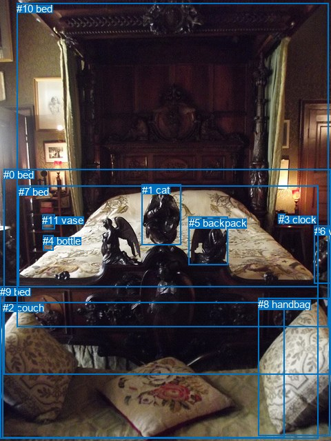
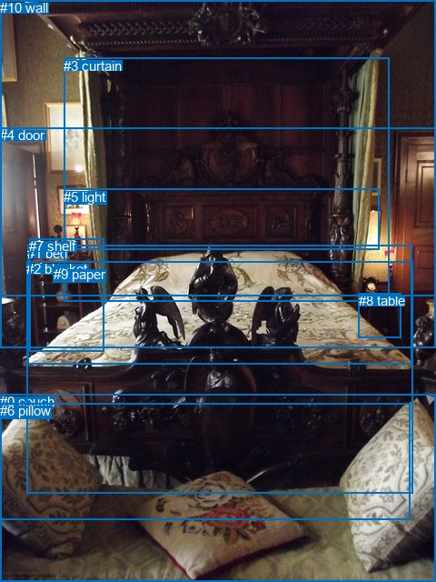

# 图片 1354：2378991.jpg

随机样本序号：112。图片 SHA256：`d9e151b4520f1c6627774f3544d12459d2ee0c0fcdd74f7630a0f93997f7581f`。

红色框表示人，蓝色框表示其他物体。两个模式分别保留自身框编号，可依据位置比较对应对象。

## 自动检测框与输出

人的框编号：`[]`。状态：`no_person`。

### 自动检测全部物体框

| 编号 | 类别 | 是否为人 | 检测分数 | 像素坐标 xyxy |
|---|---|---|---|---|
| 0 | bed | False | 0.9768 | 5.2, 245.3, 480.0, 543.6 |
| 1 | cat | False | 0.8342 | 205.6, 267.1, 263.0, 355.2 |
| 2 | couch | False | 0.6861 | 3.6, 438.5, 412.6, 635.4 |
| 3 | clock | False | 0.6541 | 403.8, 310.4, 413.9, 319.9 |
| 4 | bottle | False | 0.6116 | 62.2, 341.2, 77.8, 363.6 |
| 5 | backpack | False | 0.5684 | 274.0, 314.5, 330.9, 384.7 |
| 6 | vase | False | 0.5610 | 455.9, 327.5, 480.0, 411.6 |
| 7 | bed | False | 0.5538 | 26.7, 269.9, 461.5, 416.6 |
| 8 | handbag | False | 0.5268 | 374.5, 432.7, 478.7, 632.8 |
| 9 | bed | False | 0.4740 | 0.2, 415.0, 461.2, 636.8 |
| 10 | bed | False | 0.4406 | 24.1, 4.4, 476.9, 474.2 |
| 11 | vase | False | 0.4141 | 61.3, 311.5, 79.5, 332.2 |

### 自动检测 Top50 人相关候选

评分物体对：0；人相关物体对：0；输出关系：0。

| 排名 | 主语编号与类别 | 关系 | 宾语编号与类别 | 类型 | 人与人 | 排序分数 | 原始融合 logit |
|---|---|---|---|---|---|---|---|

### 自动检测逐条人相关 GT 核验

本图没有人相关 GT，R@50 无分母；预测候选继续展示。

## 真实框与输出

人的框编号：`[]`。

### 真实框全部物体框

| 编号 | 类别 | 是否为人 | 检测分数 | 像素坐标 xyxy |
|---|---|---|---|---|
| 0 | couch | False | GT | 0.0, 433.0, 480.0, 640.0 |
| 1 | bed | False | GT | 30.0, 270.0, 453.0, 401.0 |
| 2 | blanket | False | GT | 29.0, 287.0, 455.0, 542.0 |
| 3 | curtain | False | GT | 70.0, 64.0, 428.0, 332.0 |
| 4 | door | False | GT | 0.0, 140.0, 480.0, 382.0 |
| 5 | light | False | GT | 70.0, 208.0, 417.0, 275.0 |
| 6 | pillow | False | GT | 0.0, 443.0, 452.0, 571.0 |
| 7 | shelf | False | GT | 32.0, 262.0, 114.0, 386.0 |
| 8 | table | False | GT | 395.0, 322.0, 442.0, 371.0 |
| 9 | paper | False | GT | 59.0, 293.0, 77.0, 309.0 |
| 10 | wall | False | GT | 0.0, 0.0, 480.0, 325.0 |

### 真实框 Top50 人相关候选

评分物体对：0；人相关物体对：0；输出关系：0。

| 排名 | 主语编号与类别 | 关系 | 宾语编号与类别 | 类型 | 人与人 | 排序分数 | 原始融合 logit |
|---|---|---|---|---|---|---|---|

### 真实框逐条人相关 GT 核验

本图没有人相关 GT，R@50 无分母；预测候选继续展示。

## 全部人相关 GT

| 主语编号与类别 | 关系 | 宾语编号与类别 |
|---|---|---|

原始记录、全部人相关物体对的两项预测与分项分数见 [逐图证据 JSON](../evidence/cases/1354.json)。全部56类 logits 保留于本机 HOR/output/random500/logits/。

<!-- HOR_COMPLETE_RESULTS -->

## 六组条件的完整输出对照

以下保留同一图片三种框与候选模式、两种谓词输出规则的全部 Top50。框编号各自在所属模式内解释。

### 自动检测框完整枚举：空间与语义各保留一个谓词

| 排名 | 主语编号与类别 | 谓词 | 宾语编号与类别 | 分组 | 排序分数 | predicate logit | pair logit |
|---|---|---|---|---|---|---|---|

没有人相关 GT，本条件的召回率无分母。

### 自动检测框完整枚举：每对只保留一个谓词

| 排名 | 主语编号与类别 | 谓词 | 宾语编号与类别 | 分组 | 排序分数 | predicate logit | pair logit |
|---|---|---|---|---|---|---|---|

没有人相关 GT，本条件的召回率无分母。

### 真实框完整枚举：空间与语义各保留一个谓词

| 排名 | 主语编号与类别 | 谓词 | 宾语编号与类别 | 分组 | 排序分数 | predicate logit | pair logit |
|---|---|---|---|---|---|---|---|

没有人相关 GT，本条件的召回率无分母。

### 真实框完整枚举：每对只保留一个谓词

| 排名 | 主语编号与类别 | 谓词 | 宾语编号与类别 | 分组 | 排序分数 | predicate logit | pair logit |
|---|---|---|---|---|---|---|---|

没有人相关 GT，本条件的召回率无分母。

### 真实框400候选：空间与语义各保留一个谓词

| 排名 | 主语编号与类别 | 谓词 | 宾语编号与类别 | 分组 | 排序分数 | predicate logit | pair logit |
|---|---|---|---|---|---|---|---|

没有人相关 GT，本条件的召回率无分母。

### 真实框400候选：每对只保留一个谓词

| 排名 | 主语编号与类别 | 谓词 | 宾语编号与类别 | 分组 | 排序分数 | predicate logit | pair logit |
|---|---|---|---|---|---|---|---|

没有人相关 GT，本条件的召回率无分母。
