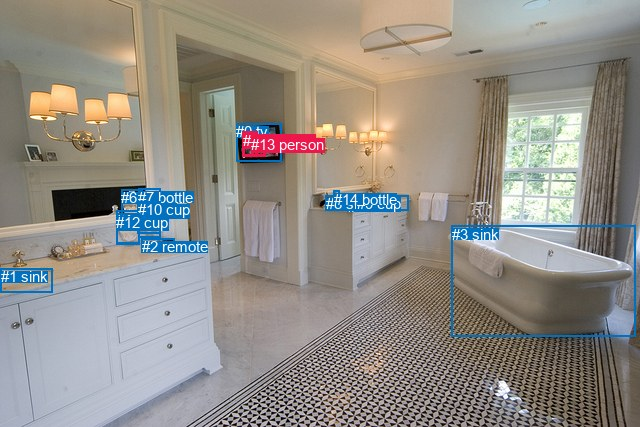
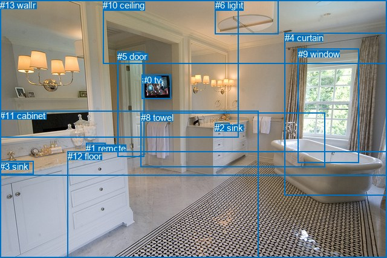

# 图片 1356：2379081.jpg

随机样本序号：405。图片 SHA256：`d709cf143b54cc05aa07bec37026c9c2db9ef09e2e6ab4c3c55992528ca88127`。

红色框表示人，蓝色框表示其他物体。两个模式分别保留自身框编号，可依据位置比较对应对象。

## 自动检测框与输出

人的框编号：`[11, 13]`。状态：`ok`。

### 自动检测全部物体框

| 编号 | 类别 | 是否为人 | 检测分数 | 像素坐标 xyxy |
|---|---|---|---|---|
| 0 | tv | False | 0.9874 | 236.1, 123.5, 281.5, 161.8 |
| 1 | sink | False | 0.9617 | 0.8, 268.1, 52.7, 292.9 |
| 2 | remote | False | 0.9570 | 141.7, 238.2, 174.1, 247.8 |
| 3 | sink | False | 0.8514 | 451.9, 225.5, 635.2, 336.4 |
| 4 | vase | False | 0.6342 | 116.2, 210.6, 139.7, 244.0 |
| 5 | sink | False | 0.5551 | 347.6, 198.0, 399.9, 205.1 |
| 6 | bottle | False | 0.5520 | 121.3, 189.4, 142.1, 227.5 |
| 7 | bottle | False | 0.5337 | 138.3, 188.9, 160.1, 237.1 |
| 8 | sink | False | 0.4992 | 325.9, 195.3, 408.4, 210.9 |
| 9 | cup | False | 0.3916 | 356.6, 194.6, 362.9, 202.5 |
| 10 | cup | False | 0.3897 | 137.8, 201.1, 160.9, 233.1 |
| 11 | person | True | 0.3880 | 242.7, 131.7, 257.3, 156.9 |
| 12 | cup | False | 0.3740 | 116.3, 213.6, 139.5, 244.5 |
| 13 | person | True | 0.3573 | 251.1, 135.7, 265.9, 156.3 |
| 14 | bottle | False | 0.3541 | 333.9, 190.8, 339.8, 204.8 |

### 自动检测 Top50 人相关候选

评分物体对：210；人相关物体对：54；输出关系：50。

| 排名 | 主语编号与类别 | 关系 | 宾语编号与类别 | 类型 | 人与人 | 排序分数 | 原始融合 logit |
|---|---|---|---|---|---|---|---|
| 1 | #11 person | on | #0 tv | spatial | False | 0.97055 | 3.4953 |
| 2 | #13 person | on | #0 tv | spatial | False | 0.95986 | 3.1743 |
| 3 | #13 person | looking at | #0 tv | semantic | False | 0.94806 | 2.9042 |
| 4 | #13 person | on | #11 person | spatial | True | 0.90162 | 2.2153 |
| 5 | #11 person | looking at | #0 tv | semantic | False | 0.87284 | 1.9263 |
| 6 | #11 person | on | #13 person | spatial | True | 0.84071 | 1.6635 |
| 7 | #0 tv | on | #13 person | spatial | False | 0.78008 | 1.2661 |
| 8 | #0 tv | on | #11 person | spatial | False | 0.73254 | 1.0075 |
| 9 | #13 person | looking at | #11 person | semantic | True | 0.56829 | 0.2749 |
| 10 | #0 tv | wearing | #13 person | semantic | False | 0.54023 | 0.1612 |
| 11 | #11 person | wearing | #13 person | semantic | True | 0.41765 | -0.3324 |
| 12 | #0 tv | wearing | #11 person | semantic | False | 0.40143 | -0.3995 |
| 13 | #3 sink | in | #13 person | spatial | False | 0.15387 | -1.7046 |
| 14 | #3 sink | in | #11 person | spatial | False | 0.14418 | -1.7810 |
| 15 | #11 person | looking at | #3 sink | semantic | False | 0.07159 | -2.5626 |
| 16 | #13 person | looking at | #3 sink | semantic | False | 0.07031 | -2.5820 |
| 17 | #1 sink | in | #11 person | spatial | False | 0.06677 | -2.6373 |
| 18 | #1 sink | in | #13 person | spatial | False | 0.06517 | -2.6634 |
| 19 | #3 sink | playing | #13 person | semantic | False | 0.06373 | -2.6873 |
| 20 | #11 person | on | #3 sink | spatial | False | 0.05790 | -2.7895 |
| 21 | #13 person | on | #3 sink | spatial | False | 0.05662 | -2.8130 |
| 22 | #3 sink | playing | #11 person | semantic | False | 0.05603 | -2.8241 |
| 23 | #8 sink | in | #13 person | spatial | False | 0.02574 | -3.6335 |
| 24 | #11 person | on | #1 sink | spatial | False | 0.02513 | -3.6584 |
| 25 | #8 sink | in | #11 person | spatial | False | 0.02445 | -3.6862 |
| 26 | #9 cup | on | #13 person | spatial | False | 0.02290 | -3.7535 |
| 27 | #13 person | on | #1 sink | spatial | False | 0.02213 | -3.7884 |
| 28 | #13 person | on | #5 sink | spatial | False | 0.02212 | -3.7887 |
| 29 | #13 person | on | #8 sink | spatial | False | 0.02197 | -3.7960 |
| 30 | #5 sink | in | #13 person | spatial | False | 0.02090 | -3.8471 |
| 31 | #11 person | on | #5 sink | spatial | False | 0.02064 | -3.8598 |
| 32 | #11 person | on | #8 sink | spatial | False | 0.02020 | -3.8819 |
| 33 | #9 cup | on | #11 person | spatial | False | 0.01931 | -3.9277 |
| 34 | #1 sink | playing | #11 person | semantic | False | 0.01901 | -3.9435 |
| 35 | #1 sink | playing | #13 person | semantic | False | 0.01891 | -3.9487 |
| 36 | #5 sink | in | #11 person | spatial | False | 0.01825 | -3.9852 |
| 37 | #11 person | on | #9 cup | spatial | False | 0.01814 | -3.9915 |
| 38 | #13 person | on | #9 cup | spatial | False | 0.01732 | -4.0386 |
| 39 | #11 person | on | #14 bottle | spatial | False | 0.01499 | -4.1853 |
| 40 | #13 person | on | #14 bottle | spatial | False | 0.01410 | -4.2475 |
| 41 | #14 bottle | on | #13 person | spatial | False | 0.01275 | -4.3491 |
| 42 | #6 bottle | looking at | #11 person | semantic | False | 0.01168 | -4.4383 |
| 43 | #14 bottle | on | #11 person | spatial | False | 0.01129 | -4.4721 |
| 44 | #6 bottle | looking at | #13 person | semantic | False | 0.00961 | -4.6355 |
| 45 | #8 sink | holding | #13 person | semantic | False | 0.00944 | -4.6532 |
| 46 | #8 sink | holding | #11 person | semantic | False | 0.00884 | -4.7195 |
| 47 | #2 remote | on | #13 person | spatial | False | 0.00862 | -4.7446 |
| 48 | #2 remote | on | #11 person | spatial | False | 0.00805 | -4.8135 |
| 49 | #13 person | in | #6 bottle | spatial | False | 0.00793 | -4.8291 |
| 50 | #5 sink | holding | #13 person | semantic | False | 0.00770 | -4.8584 |

### 自动检测逐条人相关 GT 核验

本图没有人相关 GT，R@50 无分母；预测候选继续展示。

## 真实框与输出

人的框编号：`[]`。

### 真实框全部物体框

| 编号 | 类别 | 是否为人 | 检测分数 | 像素坐标 xyxy |
|---|---|---|---|---|
| 0 | tv | False | GT | 235.0, 124.0, 283.0, 164.0 |
| 1 | remote | False | GT | 142.0, 237.0, 174.0, 248.0 |
| 2 | sink | False | GT | 355.0, 203.0, 379.0, 207.0 |
| 3 | sink | False | GT | 0.0, 267.0, 55.0, 289.0 |
| 4 | curtain | False | GT | 471.0, 54.0, 640.0, 323.0 |
| 5 | door | False | GT | 194.0, 85.0, 238.0, 260.0 |
| 6 | light | False | GT | 356.0, 0.0, 461.0, 57.0 |
| 7 | mirror | False | GT | 0.0, 0.0, 394.0, 228.0 |
| 8 | towel | False | GT | 233.0, 186.0, 538.0, 276.0 |
| 9 | window | False | GT | 493.0, 81.0, 594.0, 270.0 |
| 10 | ceiling | False | GT | 170.0, 0.0, 640.0, 106.0 |
| 11 | cabinet | False | GT | 0.0, 183.0, 427.0, 427.0 |
| 12 | floor | False | GT | 112.0, 250.0, 640.0, 427.0 |
| 13 | wall | False | GT | 0.0, 0.0, 640.0, 291.0 |

### 真实框 Top50 人相关候选

评分物体对：0；人相关物体对：0；输出关系：0。

| 排名 | 主语编号与类别 | 关系 | 宾语编号与类别 | 类型 | 人与人 | 排序分数 | 原始融合 logit |
|---|---|---|---|---|---|---|---|

### 真实框逐条人相关 GT 核验

本图没有人相关 GT，R@50 无分母；预测候选继续展示。

## 全部人相关 GT

| 主语编号与类别 | 关系 | 宾语编号与类别 |
|---|---|---|

原始记录、全部人相关物体对的两项预测与分项分数见 [逐图证据 JSON](../evidence/cases/1356.json)。全部56类 logits 保留于本机 HOR/output/random500/logits/。

<!-- HOR_COMPLETE_RESULTS -->

## 六组条件的完整输出对照

以下保留同一图片三种框与候选模式、两种谓词输出规则的全部 Top50。框编号各自在所属模式内解释。

### 自动检测框完整枚举：空间与语义各保留一个谓词

| 排名 | 主语编号与类别 | 谓词 | 宾语编号与类别 | 分组 | 排序分数 | predicate logit | pair logit |
|---|---|---|---|---|---|---|---|
| 1 | #11 person | on | #0 tv | spatial | 0.9705545 | 3.4522796 | 0.0430438 |
| 2 | #13 person | on | #0 tv | spatial | 0.9598559 | 3.1456323 | 0.0286745 |
| 3 | #13 person | looking at | #0 tv | semantic | 0.9480551 | 2.8755546 | 0.0286745 |
| 4 | #13 person | on | #11 person | spatial | 0.9016178 | 2.1970201 | 0.0183110 |
| 5 | #11 person | looking at | #0 tv | semantic | 0.8728376 | 1.8832402 | 0.0430438 |
| 6 | #11 person | on | #13 person | spatial | 0.8407131 | 1.6298623 | 0.0336817 |
| 7 | #0 tv | on | #13 person | spatial | 0.7800751 | 1.2933850 | -0.0272814 |
| 8 | #0 tv | on | #11 person | spatial | 0.7325362 | 1.0391879 | -0.0316596 |
| 9 | #13 person | looking at | #11 person | semantic | 0.5682907 | 0.2565694 | 0.0183110 |
| 10 | #0 tv | wearing | #13 person | semantic | 0.5402253 | 0.1885309 | -0.0272814 |
| 11 | #11 person | wearing | #13 person | semantic | 0.4176473 | -0.3661208 | 0.0336817 |
| 12 | #0 tv | wearing | #11 person | semantic | 0.4014290 | -0.3678546 | -0.0316596 |
| 13 | #3 sink | in | #13 person | spatial | 0.1538696 | -0.2794027 | -1.4251657 |
| 14 | #3 sink | in | #11 person | spatial | 0.1441845 | -0.3597202 | -1.4212410 |
| 15 | #11 person | looking at | #3 sink | semantic | 0.0715865 | -1.0741234 | -1.4884467 |
| 16 | #13 person | looking at | #3 sink | semantic | 0.0703067 | -1.1028202 | -1.4791679 |
| 17 | #1 sink | in | #11 person | spatial | 0.0667736 | -0.6281133 | -2.0092273 |
| 18 | #1 sink | in | #13 person | spatial | 0.0651689 | -0.6314321 | -2.0319507 |
| 19 | #3 sink | playing | #13 person | semantic | 0.0637283 | -1.2621121 | -1.4251657 |
| 20 | #11 person | on | #3 sink | spatial | 0.0578951 | -1.3010368 | -1.4884467 |
| 21 | #13 person | on | #3 sink | spatial | 0.0566247 | -1.3338501 | -1.4791679 |
| 22 | #3 sink | playing | #11 person | semantic | 0.0560349 | -1.4028730 | -1.4212410 |
| 23 | #8 sink | in | #13 person | spatial | 0.0257438 | -2.6426079 | -0.9908745 |
| 24 | #11 person | on | #1 sink | spatial | 0.0251253 | -1.8804166 | -1.7780155 |
| 25 | #8 sink | in | #11 person | spatial | 0.0244543 | -2.6652322 | -1.0209596 |
| 26 | #9 cup | on | #13 person | spatial | 0.0228999 | -2.7851963 | -0.9682612 |
| 27 | #13 person | on | #1 sink | spatial | 0.0221302 | -1.9880965 | -1.8003387 |
| 28 | #13 person | on | #5 sink | spatial | 0.0221241 | -3.1445022 | -0.6442147 |
| 29 | #13 person | on | #8 sink | spatial | 0.0219664 | -3.2883987 | -0.5076331 |
| 30 | #5 sink | in | #13 person | spatial | 0.0208954 | -2.8199482 | -1.0271630 |
| 31 | #11 person | on | #5 sink | spatial | 0.0206364 | -3.1813993 | -0.6784495 |
| 32 | #11 person | on | #8 sink | spatial | 0.0201951 | -3.3441572 | -0.5377539 |
| 33 | #9 cup | on | #11 person | spatial | 0.0193092 | -2.9207520 | -1.0069220 |
| 34 | #1 sink | playing | #11 person | semantic | 0.0190127 | -1.9342268 | -2.0092273 |
| 35 | #1 sink | playing | #13 person | semantic | 0.0189149 | -1.9167573 | -2.0319507 |
| 36 | #5 sink | in | #11 person | spatial | 0.0182499 | -2.9219489 | -1.0632288 |
| 37 | #11 person | on | #9 cup | spatial | 0.0181371 | -3.3214078 | -0.6700833 |
| 38 | #13 person | on | #9 cup | spatial | 0.0173171 | -3.4069896 | -0.6316020 |
| 39 | #11 person | on | #14 bottle | spatial | 0.0149893 | -3.4351406 | -0.7501784 |
| 40 | #13 person | on | #14 bottle | spatial | 0.0140981 | -3.5392437 | -0.7082714 |
| 41 | #14 bottle | on | #13 person | spatial | 0.0127541 | -3.4850423 | -0.8640258 |
| 42 | #6 bottle | looking at | #11 person | semantic | 0.0116776 | -3.4413145 | -0.9970202 |
| 43 | #14 bottle | on | #11 person | spatial | 0.0112948 | -3.5658600 | -0.9061976 |
| 44 | #6 bottle | looking at | #13 person | semantic | 0.0096084 | -3.6048989 | -1.0305669 |
| 45 | #8 sink | holding | #13 person | semantic | 0.0094414 | -3.6622896 | -0.9908745 |
| 46 | #8 sink | holding | #11 person | semantic | 0.0088406 | -3.6985636 | -1.0209596 |
| 47 | #2 remote | on | #13 person | spatial | 0.0086234 | -3.4194150 | -1.3251964 |
| 48 | #2 remote | on | #11 person | spatial | 0.0080540 | -3.5327568 | -1.2807400 |
| 49 | #13 person | in | #6 bottle | spatial | 0.0079301 | -3.3893042 | -1.4398295 |
| 50 | #5 sink | holding | #13 person | semantic | 0.0077029 | -3.8312621 | -1.0271630 |

没有人相关 GT，本条件的召回率无分母。

### 自动检测框完整枚举：每对只保留一个谓词

| 排名 | 主语编号与类别 | 谓词 | 宾语编号与类别 | 分组 | 排序分数 | predicate logit | pair logit |
|---|---|---|---|---|---|---|---|
| 1 | #11 person | on | #0 tv | single | 0.9705545 | 3.4522796 | 0.0430438 |
| 2 | #13 person | on | #0 tv | single | 0.9598559 | 3.1456323 | 0.0286745 |
| 3 | #13 person | on | #11 person | single | 0.9016178 | 2.1970201 | 0.0183110 |
| 4 | #11 person | on | #13 person | single | 0.8407131 | 1.6298623 | 0.0336817 |
| 5 | #0 tv | on | #13 person | single | 0.7800751 | 1.2933850 | -0.0272814 |
| 6 | #0 tv | on | #11 person | single | 0.7325362 | 1.0391879 | -0.0316596 |
| 7 | #3 sink | in | #13 person | single | 0.1538696 | -0.2794027 | -1.4251657 |
| 8 | #3 sink | in | #11 person | single | 0.1441845 | -0.3597202 | -1.4212410 |
| 9 | #11 person | looking at | #3 sink | single | 0.0715865 | -1.0741234 | -1.4884467 |
| 10 | #13 person | looking at | #3 sink | single | 0.0703067 | -1.1028202 | -1.4791679 |
| 11 | #1 sink | in | #11 person | single | 0.0667736 | -0.6281133 | -2.0092273 |
| 12 | #1 sink | in | #13 person | single | 0.0651689 | -0.6314321 | -2.0319507 |
| 13 | #8 sink | in | #13 person | single | 0.0257438 | -2.6426079 | -0.9908745 |
| 14 | #11 person | on | #1 sink | single | 0.0251253 | -1.8804166 | -1.7780155 |
| 15 | #8 sink | in | #11 person | single | 0.0244543 | -2.6652322 | -1.0209596 |
| 16 | #9 cup | on | #13 person | single | 0.0228999 | -2.7851963 | -0.9682612 |
| 17 | #13 person | on | #1 sink | single | 0.0221302 | -1.9880965 | -1.8003387 |
| 18 | #13 person | on | #5 sink | single | 0.0221241 | -3.1445022 | -0.6442147 |
| 19 | #13 person | on | #8 sink | single | 0.0219664 | -3.2883987 | -0.5076331 |
| 20 | #5 sink | in | #13 person | single | 0.0208954 | -2.8199482 | -1.0271630 |
| 21 | #11 person | on | #5 sink | single | 0.0206364 | -3.1813993 | -0.6784495 |
| 22 | #11 person | on | #8 sink | single | 0.0201951 | -3.3441572 | -0.5377539 |
| 23 | #9 cup | on | #11 person | single | 0.0193092 | -2.9207520 | -1.0069220 |
| 24 | #5 sink | in | #11 person | single | 0.0182499 | -2.9219489 | -1.0632288 |
| 25 | #11 person | on | #9 cup | single | 0.0181371 | -3.3214078 | -0.6700833 |
| 26 | #13 person | on | #9 cup | single | 0.0173171 | -3.4069896 | -0.6316020 |
| 27 | #11 person | on | #14 bottle | single | 0.0149893 | -3.4351406 | -0.7501784 |
| 28 | #13 person | on | #14 bottle | single | 0.0140981 | -3.5392437 | -0.7082714 |
| 29 | #14 bottle | on | #13 person | single | 0.0127541 | -3.4850423 | -0.8640258 |
| 30 | #6 bottle | looking at | #11 person | single | 0.0116776 | -3.4413145 | -0.9970202 |
| 31 | #14 bottle | on | #11 person | single | 0.0112948 | -3.5658600 | -0.9061976 |
| 32 | #6 bottle | looking at | #13 person | single | 0.0096084 | -3.6048989 | -1.0305669 |
| 33 | #2 remote | on | #13 person | single | 0.0086234 | -3.4194150 | -1.3251964 |
| 34 | #2 remote | on | #11 person | single | 0.0080540 | -3.5327568 | -1.2807400 |
| 35 | #13 person | in | #6 bottle | single | 0.0079301 | -3.3893042 | -1.4398295 |
| 36 | #7 bottle | looking at | #11 person | single | 0.0072599 | -3.9117517 | -1.0063553 |
| 37 | #11 person | in | #6 bottle | single | 0.0068720 | -3.5681920 | -1.4052114 |
| 38 | #7 bottle | looking at | #13 person | single | 0.0067124 | -3.9470997 | -1.0499704 |
| 39 | #11 person | on | #2 remote | single | 0.0066135 | -3.5266166 | -1.4853832 |
| 40 | #13 person | on | #2 remote | single | 0.0060611 | -3.5800653 | -1.5197264 |
| 41 | #12 cup | in | #11 person | single | 0.0059279 | -3.9121318 | -1.2100095 |
| 42 | #13 person | in | #7 bottle | single | 0.0058834 | -3.6745081 | -1.4552090 |
| 43 | #4 vase | in | #11 person | single | 0.0058718 | -3.9564948 | -1.1752081 |
| 44 | #13 person | in | #10 cup | single | 0.0053858 | -3.7138929 | -1.5046895 |
| 45 | #12 cup | in | #13 person | single | 0.0053815 | -3.9631321 | -1.2562563 |
| 46 | #4 vase | in | #13 person | single | 0.0052975 | -4.0166774 | -1.2185307 |
| 47 | #11 person | on | #7 bottle | single | 0.0051879 | -3.8448770 | -1.4113522 |
| 48 | #13 person | on | #4 vase | single | 0.0046665 | -3.7947297 | -1.5679307 |
| 49 | #11 person | on | #10 cup | single | 0.0045404 | -3.9284172 | -1.4617800 |
| 50 | #11 person | on | #4 vase | single | 0.0044288 | -3.8882253 | -1.5269694 |

没有人相关 GT，本条件的召回率无分母。

### 真实框完整枚举：空间与语义各保留一个谓词

| 排名 | 主语编号与类别 | 谓词 | 宾语编号与类别 | 分组 | 排序分数 | predicate logit | pair logit |
|---|---|---|---|---|---|---|---|

没有人相关 GT，本条件的召回率无分母。

### 真实框完整枚举：每对只保留一个谓词

| 排名 | 主语编号与类别 | 谓词 | 宾语编号与类别 | 分组 | 排序分数 | predicate logit | pair logit |
|---|---|---|---|---|---|---|---|

没有人相关 GT，本条件的召回率无分母。

### 真实框400候选：空间与语义各保留一个谓词

| 排名 | 主语编号与类别 | 谓词 | 宾语编号与类别 | 分组 | 排序分数 | predicate logit | pair logit |
|---|---|---|---|---|---|---|---|

没有人相关 GT，本条件的召回率无分母。

### 真实框400候选：每对只保留一个谓词

| 排名 | 主语编号与类别 | 谓词 | 宾语编号与类别 | 分组 | 排序分数 | predicate logit | pair logit |
|---|---|---|---|---|---|---|---|

没有人相关 GT，本条件的召回率无分母。
