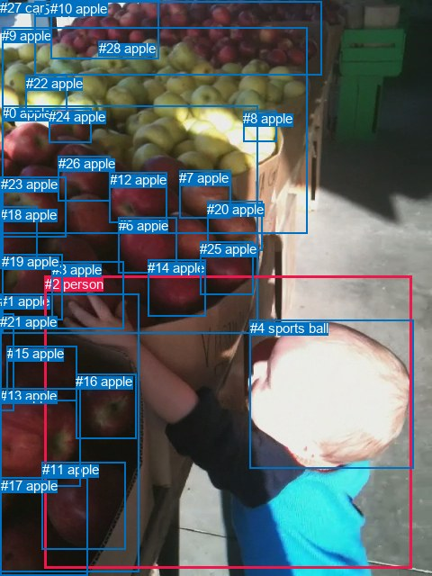
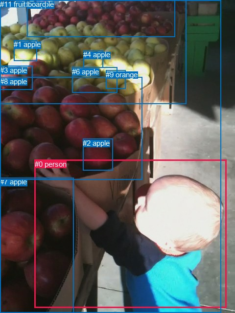

# 图片 1357：2379131.jpg

随机样本序号：439。图片 SHA256：`21c1c260e938546b28665f994fd1147b610a3043221c69307c3a3a5784d0b289`。

红色框表示人，蓝色框表示其他物体。两个模式分别保留自身框编号，可依据位置比较对应对象。

## 自动检测框与输出

人的框编号：`[2]`。状态：`ok`。

### 自动检测全部物体框

| 编号 | 类别 | 是否为人 | 检测分数 | 像素坐标 xyxy |
|---|---|---|---|---|
| 0 | apple | False | 0.9893 | 2.2, 117.3, 286.1, 370.7 |
| 1 | apple | False | 0.9465 | 0.0, 326.2, 154.8, 635.3 |
| 2 | person | True | 0.9288 | 49.6, 307.0, 457.4, 631.9 |
| 3 | apple | False | 0.8238 | 57.6, 290.7, 137.8, 365.1 |
| 4 | sports ball | False | 0.8040 | 277.7, 355.7, 459.2, 520.2 |
| 5 | apple | False | 0.8018 | 38.5, 1.6, 357.8, 83.8 |
| 6 | apple | False | 0.7653 | 131.6, 241.6, 196.7, 303.0 |
| 7 | apple | False | 0.7082 | 199.4, 189.0, 256.8, 242.1 |
| 8 | apple | False | 0.6484 | 270.1, 123.4, 307.8, 157.6 |
| 9 | apple | False | 0.6343 | 2.3, 30.8, 342.0, 259.0 |
| 10 | apple | False | 0.5992 | 56.3, 0.7, 176.7, 65.2 |
| 11 | apple | False | 0.5941 | 46.6, 513.1, 139.9, 611.0 |
| 12 | apple | False | 0.5855 | 121.8, 191.4, 185.8, 247.9 |
| 13 | apple | False | 0.5813 | 0.3, 431.3, 89.8, 540.8 |
| 14 | apple | False | 0.5774 | 164.4, 288.6, 229.0, 351.0 |
| 15 | apple | False | 0.5731 | 7.9, 384.2, 85.4, 445.9 |
| 16 | apple | False | 0.5701 | 84.3, 415.1, 151.2, 487.1 |
| 17 | apple | False | 0.5572 | 0.7, 530.9, 97.9, 639.6 |
| 18 | apple | False | 0.4901 | 0.1, 229.6, 41.8, 298.1 |
| 19 | apple | False | 0.4694 | 2.2, 282.1, 69.3, 355.5 |
| 20 | apple | False | 0.4498 | 230.4, 223.6, 291.2, 278.8 |
| 21 | apple | False | 0.4276 | 0.0, 348.8, 15.3, 456.2 |
| 22 | apple | False | 0.4193 | 28.7, 83.6, 74.6, 125.6 |
| 23 | apple | False | 0.4032 | 0.9, 196.5, 73.5, 263.3 |
| 24 | apple | False | 0.3861 | 54.4, 120.7, 101.7, 158.3 |
| 25 | apple | False | 0.3779 | 222.4, 268.3, 281.6, 327.6 |
| 26 | apple | False | 0.3733 | 64.6, 173.1, 122.3, 223.5 |
| 27 | car | False | 0.3642 | 0.0, 0.1, 8.6, 17.3 |
| 28 | apple | False | 0.3527 | 109.9, 45.1, 130.5, 56.3 |

### 自动检测 Top50 人相关候选

评分物体对：812；人相关物体对：56；输出关系：50。

| 排名 | 主语编号与类别 | 关系 | 宾语编号与类别 | 类型 | 人与人 | 排序分数 | 原始融合 logit |
|---|---|---|---|---|---|---|---|
| 1 | #2 person | holding | #0 apple | semantic | False | 0.98253 | 4.0294 |
| 2 | #2 person | holding | #13 apple | semantic | False | 0.97381 | 3.6158 |
| 3 | #2 person | picking | #19 apple | semantic | False | 0.97276 | 3.5753 |
| 4 | #2 person | holding | #1 apple | semantic | False | 0.96649 | 3.3617 |
| 5 | #2 person | picking | #23 apple | semantic | False | 0.94608 | 2.8649 |
| 6 | #2 person | picking | #14 apple | semantic | False | 0.94295 | 2.8050 |
| 7 | #2 person | picking | #25 apple | semantic | False | 0.93485 | 2.6637 |
| 8 | #2 person | holding | #16 apple | semantic | False | 0.93284 | 2.6312 |
| 9 | #2 person | holding | #17 apple | semantic | False | 0.92119 | 2.4586 |
| 10 | #2 person | holding | #15 apple | semantic | False | 0.91303 | 2.3512 |
| 11 | #2 person | picking | #9 apple | semantic | False | 0.91175 | 2.3352 |
| 12 | #2 person | picking | #12 apple | semantic | False | 0.90753 | 2.2839 |
| 13 | #2 person | picking | #6 apple | semantic | False | 0.90401 | 2.2425 |
| 14 | #2 person | picking | #18 apple | semantic | False | 0.90271 | 2.2277 |
| 15 | #2 person | picking | #26 apple | semantic | False | 0.89387 | 2.1309 |
| 16 | #2 person | holding | #3 apple | semantic | False | 0.87270 | 1.9251 |
| 17 | #2 person | holding | #11 apple | semantic | False | 0.86455 | 1.8536 |
| 18 | #2 person | in | #4 sports ball | spatial | False | 0.85632 | 1.7850 |
| 19 | #2 person | on | #3 apple | spatial | False | 0.84880 | 1.7252 |
| 20 | #2 person | picking | #7 apple | semantic | False | 0.81630 | 1.4915 |
| 21 | #4 sports ball | on | #2 person | spatial | False | 0.80757 | 1.4343 |
| 22 | #2 person | picking | #21 apple | semantic | False | 0.79703 | 1.3678 |
| 23 | #2 person | picking | #20 apple | semantic | False | 0.76993 | 1.2079 |
| 24 | #2 person | in | #1 apple | spatial | False | 0.73388 | 1.0144 |
| 25 | #2 person | picking | #5 apple | semantic | False | 0.71765 | 0.9328 |
| 26 | #2 person | picking | #24 apple | semantic | False | 0.69056 | 0.8028 |
| 27 | #2 person | on | #0 apple | spatial | False | 0.65267 | 0.6308 |
| 28 | #2 person | picking | #22 apple | semantic | False | 0.56702 | 0.2697 |
| 29 | #2 person | on | #13 apple | spatial | False | 0.55477 | 0.2199 |
| 30 | #2 person | picking | #10 apple | semantic | False | 0.54997 | 0.2005 |
| 31 | #2 person | wearing | #4 sports ball | semantic | False | 0.54842 | 0.1943 |
| 32 | #3 apple | on | #2 person | spatial | False | 0.54522 | 0.1814 |
| 33 | #2 person | on | #9 apple | spatial | False | 0.53389 | 0.1358 |
| 34 | #2 person | on | #16 apple | spatial | False | 0.45074 | -0.1977 |
| 35 | #2 person | on | #17 apple | spatial | False | 0.42149 | -0.3167 |
| 36 | #2 person | on | #19 apple | spatial | False | 0.39185 | -0.4395 |
| 37 | #2 person | in | #27 car | spatial | False | 0.38842 | -0.4540 |
| 38 | #2 person | on | #23 apple | spatial | False | 0.33490 | -0.6861 |
| 39 | #2 person | on | #15 apple | spatial | False | 0.33224 | -0.6981 |
| 40 | #2 person | on | #11 apple | spatial | False | 0.31539 | -0.7750 |
| 41 | #2 person | on | #5 apple | spatial | False | 0.27882 | -0.9503 |
| 42 | #2 person | picking | #28 apple | semantic | False | 0.26074 | -1.0421 |
| 43 | #2 person | on | #14 apple | spatial | False | 0.24207 | -1.1414 |
| 44 | #2 person | on | #18 apple | spatial | False | 0.23922 | -1.1570 |
| 45 | #2 person | on | #12 apple | spatial | False | 0.19107 | -1.4431 |
| 46 | #2 person | on | #25 apple | spatial | False | 0.18983 | -1.4511 |
| 47 | #11 apple | in | #2 person | spatial | False | 0.18685 | -1.4706 |
| 48 | #0 apple | on | #2 person | spatial | False | 0.18134 | -1.5073 |
| 49 | #2 person | on | #26 apple | spatial | False | 0.17647 | -1.5405 |
| 50 | #2 person | picking | #8 apple | semantic | False | 0.16102 | -1.6507 |

### 自动检测逐条人相关 GT 核验

R@50：0.00%；命中 0/2。

| GT 主语编号 | GT 关系 | GT 宾语编号 | 结果阶段 | 匹配预测主语编号 | 匹配预测宾语编号 |
|---|---|---|---|---|---|
| 0 | looking at | 8 | wrong_predicate | [2] | [0] |
| 0 | catching | 8 | wrong_predicate | [2] | [0] |

## 真实框与输出

人的框编号：`[0]`。

### 真实框全部物体框

| 编号 | 类别 | 是否为人 | 检测分数 | 像素坐标 xyxy |
|---|---|---|---|---|
| 0 | person | True | GT | 71.0, 327.0, 462.0, 630.0 |
| 1 | apple | False | GT | 28.0, 82.0, 75.0, 124.0 |
| 2 | apple | False | GT | 169.0, 284.0, 230.0, 349.0 |
| 3 | apple | False | GT | 0.0, 135.0, 66.0, 184.0 |
| 4 | apple | False | GT | 170.0, 103.0, 210.0, 138.0 |
| 5 | apple | False | GT | 55.0, 0.0, 357.0, 76.0 |
| 6 | apple | False | GT | 147.0, 138.0, 239.0, 190.0 |
| 7 | apple | False | GT | 0.0, 363.0, 150.0, 640.0 |
| 8 | apple | False | GT | 0.0, 158.0, 291.0, 368.0 |
| 9 | orange | False | GT | 216.0, 144.0, 256.0, 181.0 |
| 10 | cardboard | False | GT | 0.0, 0.0, 452.0, 640.0 |
| 11 | fruit | False | GT | 0.0, 0.0, 380.0, 212.0 |

### 真实框 Top50 人相关候选

评分物体对：132；人相关物体对：22；输出关系：44。

| 排名 | 主语编号与类别 | 关系 | 宾语编号与类别 | 类型 | 人与人 | 排序分数 | 原始融合 logit |
|---|---|---|---|---|---|---|---|
| 1 | #0 person | picking | #8 apple | semantic | False | 0.98412 | 4.1269 |
| 2 | #0 person | standing on | #10 cardboard | semantic | False | 0.96969 | 3.4656 |
| 3 | #0 person | picking | #3 apple | semantic | False | 0.95994 | 3.1764 |
| 4 | #0 person | picking | #2 apple | semantic | False | 0.95939 | 3.1622 |
| 5 | #0 person | in | #10 cardboard | spatial | False | 0.94887 | 2.9208 |
| 6 | #0 person | picking | #11 fruit | semantic | False | 0.94820 | 2.9072 |
| 7 | #0 person | holding | #7 apple | semantic | False | 0.94389 | 2.8228 |
| 8 | #0 person | picking | #1 apple | semantic | False | 0.91738 | 2.4073 |
| 9 | #0 person | picking | #5 apple | semantic | False | 0.83696 | 1.6358 |
| 10 | #0 person | picking | #6 apple | semantic | False | 0.79237 | 1.3393 |
| 11 | #0 person | picking | #4 apple | semantic | False | 0.73907 | 1.0412 |
| 12 | #0 person | picking | #9 orange | semantic | False | 0.72392 | 0.9640 |
| 13 | #0 person | beside | #7 apple | spatial | False | 0.71062 | 0.8984 |
| 14 | #0 person | beside | #8 apple | spatial | False | 0.56509 | 0.2618 |
| 15 | #10 cardboard | beside | #0 person | spatial | False | 0.32574 | -0.7275 |
| 16 | #7 apple | beside | #0 person | spatial | False | 0.30719 | -0.8133 |
| 17 | #0 person | beside | #3 apple | spatial | False | 0.21869 | -1.2733 |
| 18 | #0 person | beside | #11 fruit | spatial | False | 0.16791 | -1.6005 |
| 19 | #0 person | leaning on | #2 apple | spatial | False | 0.16160 | -1.6463 |
| 20 | #0 person | beside | #1 apple | spatial | False | 0.10461 | -2.1470 |
| 21 | #0 person | leaning on | #5 apple | spatial | False | 0.06308 | -2.6981 |
| 22 | #7 apple | holding | #0 person | semantic | False | 0.05208 | -2.9015 |
| 23 | #10 cardboard | holding | #0 person | semantic | False | 0.04931 | -2.9590 |
| 24 | #8 apple | beside | #0 person | spatial | False | 0.04568 | -3.0393 |
| 25 | #11 fruit | beside | #0 person | spatial | False | 0.04346 | -3.0914 |
| 26 | #0 person | in | #4 apple | spatial | False | 0.03629 | -3.2791 |
| 27 | #0 person | leaning on | #6 apple | spatial | False | 0.03590 | -3.2904 |
| 28 | #0 person | in | #9 orange | spatial | False | 0.02650 | -3.6037 |
| 29 | #3 apple | in front of | #0 person | spatial | False | 0.00999 | -4.5963 |
| 30 | #2 apple | beside | #0 person | spatial | False | 0.00952 | -4.6452 |
| 31 | #8 apple | holding | #0 person | semantic | False | 0.00792 | -4.8303 |
| 32 | #1 apple | in front of | #0 person | spatial | False | 0.00406 | -5.5023 |
| 33 | #11 fruit | looking at | #0 person | semantic | False | 0.00376 | -5.5807 |
| 34 | #5 apple | beside | #0 person | spatial | False | 0.00372 | -5.5890 |
| 35 | #2 apple | holding | #0 person | semantic | False | 0.00245 | -6.0088 |
| 36 | #6 apple | beside | #0 person | spatial | False | 0.00178 | -6.3280 |
| 37 | #3 apple | holding | #0 person | semantic | False | 0.00156 | -6.4619 |
| 38 | #9 orange | beside | #0 person | spatial | False | 0.00138 | -6.5843 |
| 39 | #4 apple | beside | #0 person | spatial | False | 0.00128 | -6.6630 |
| 40 | #1 apple | holding | #0 person | semantic | False | 0.00074 | -7.2095 |
| 41 | #9 orange | looking at | #0 person | semantic | False | 0.00071 | -7.2565 |
| 42 | #5 apple | holding | #0 person | semantic | False | 0.00068 | -7.2933 |
| 43 | #6 apple | holding | #0 person | semantic | False | 0.00048 | -7.6508 |
| 44 | #4 apple | looking at | #0 person | semantic | False | 0.00040 | -7.8240 |

### 真实框逐条人相关 GT 核验

R@50：0.00%；命中 0/2。

| GT 主语编号 | GT 关系 | GT 宾语编号 | 结果阶段 | 匹配预测主语编号 | 匹配预测宾语编号 |
|---|---|---|---|---|---|
| 0 | looking at | 8 | wrong_predicate | [0] | [8] |
| 0 | catching | 8 | wrong_predicate | [0] | [8] |

## 全部人相关 GT

| 主语编号与类别 | 关系 | 宾语编号与类别 |
|---|---|---|
| #0 person | looking at | #8 apple |
| #0 person | catching | #8 apple |

原始记录、全部人相关物体对的两项预测与分项分数见 [逐图证据 JSON](../evidence/cases/1357.json)。全部56类 logits 保留于本机 HOR/output/random500/logits/。

<!-- HOR_COMPLETE_RESULTS -->

## 六组条件的完整输出对照

以下保留同一图片三种框与候选模式、两种谓词输出规则的全部 Top50。框编号各自在所属模式内解释。

### 自动检测框完整枚举：空间与语义各保留一个谓词

| 排名 | 主语编号与类别 | 谓词 | 宾语编号与类别 | 分组 | 排序分数 | predicate logit | pair logit |
|---|---|---|---|---|---|---|---|
| 1 | #2 person | holding | #0 apple | semantic | 0.9825253 | 3.6906552 | 0.3387231 |
| 2 | #2 person | holding | #13 apple | semantic | 0.9738088 | 3.4606433 | 0.1551477 |
| 3 | #2 person | picking | #19 apple | semantic | 0.9727553 | 3.4858146 | 0.0894610 |
| 4 | #2 person | holding | #1 apple | semantic | 0.9664863 | 3.6105504 | -0.2488368 |
| 5 | #2 person | picking | #23 apple | semantic | 0.9460820 | 2.7041602 | 0.1607045 |
| 6 | #2 person | picking | #14 apple | semantic | 0.9429471 | 2.8540907 | -0.0490590 |
| 7 | #2 person | picking | #25 apple | semantic | 0.9348481 | 2.6133604 | 0.0503021 |
| 8 | #2 person | holding | #16 apple | semantic | 0.9328440 | 2.6830816 | -0.0518620 |
| 9 | #2 person | holding | #17 apple | semantic | 0.9211890 | 2.4600768 | -0.0014644 |
| 10 | #2 person | holding | #15 apple | semantic | 0.9130304 | 2.5202594 | -0.1690494 |
| 11 | #2 person | picking | #9 apple | semantic | 0.9117482 | 2.3435922 | -0.0084220 |
| 12 | #2 person | picking | #12 apple | semantic | 0.9075314 | 2.2225571 | 0.0613021 |
| 13 | #2 person | picking | #6 apple | semantic | 0.9040055 | 2.2224135 | 0.0201316 |
| 14 | #2 person | picking | #18 apple | semantic | 0.9027073 | 2.1024790 | 0.1251956 |
| 15 | #2 person | picking | #26 apple | semantic | 0.8938681 | 2.0120621 | 0.1188134 |
| 16 | #2 person | holding | #3 apple | semantic | 0.8727008 | 1.4593806 | 0.4656718 |
| 17 | #2 person | holding | #11 apple | semantic | 0.8645460 | 2.2010722 | -0.3474995 |
| 18 | #2 person | in | #4 sports ball | spatial | 0.8563161 | 1.6318264 | 0.1531972 |
| 19 | #2 person | on | #3 apple | spatial | 0.8488013 | 1.2595582 | 0.4656718 |
| 20 | #2 person | picking | #7 apple | semantic | 0.8163029 | 1.5305781 | -0.0390805 |
| 21 | #4 sports ball | on | #2 person | spatial | 0.8075655 | 1.7757425 | -0.3414739 |
| 22 | #2 person | picking | #21 apple | semantic | 0.7970319 | 1.1998854 | 0.1679600 |
| 23 | #2 person | picking | #20 apple | semantic | 0.7699253 | 1.2297130 | -0.0218234 |
| 24 | #2 person | in | #1 apple | spatial | 0.7338778 | 1.2632236 | -0.2488368 |
| 25 | #2 person | picking | #5 apple | semantic | 0.7176524 | 0.8093696 | 0.1234771 |
| 26 | #2 person | picking | #24 apple | semantic | 0.6905637 | 0.8091302 | -0.0063741 |
| 27 | #2 person | on | #0 apple | spatial | 0.6526675 | 0.2920618 | 0.3387231 |
| 28 | #2 person | picking | #22 apple | semantic | 0.5670151 | 0.4184227 | -0.1487398 |
| 29 | #2 person | on | #13 apple | spatial | 0.5547662 | 0.0647993 | 0.1551477 |
| 30 | #2 person | picking | #10 apple | semantic | 0.5499651 | 0.3579288 | -0.1573989 |
| 31 | #2 person | wearing | #4 sports ball | semantic | 0.5484174 | 0.0410814 | 0.1531972 |
| 32 | #3 apple | on | #2 person | spatial | 0.5452189 | 0.8833156 | -0.7019443 |
| 33 | #2 person | on | #9 apple | spatial | 0.5338882 | 0.1441832 | -0.0084220 |
| 34 | #2 person | on | #16 apple | spatial | 0.4507350 | -0.1458392 | -0.0518620 |
| 35 | #2 person | on | #17 apple | spatial | 0.4214869 | -0.3152080 | -0.0014644 |
| 36 | #2 person | on | #19 apple | spatial | 0.3918501 | -0.5290031 | 0.0894610 |
| 37 | #2 person | in | #27 car | spatial | 0.3884177 | 0.3910227 | -0.8449910 |
| 38 | #2 person | on | #23 apple | spatial | 0.3348957 | -0.8468292 | 0.1607045 |
| 39 | #2 person | on | #15 apple | spatial | 0.3322441 | -0.5290031 | -0.1690494 |
| 40 | #2 person | on | #11 apple | spatial | 0.3153877 | -0.4275503 | -0.3474995 |
| 41 | #2 person | on | #5 apple | spatial | 0.2788194 | -1.0738022 | 0.1234771 |
| 42 | #2 person | picking | #28 apple | semantic | 0.2607368 | -0.7246859 | -0.3174564 |
| 43 | #2 person | on | #14 apple | spatial | 0.2420720 | -1.0922945 | -0.0490590 |
| 44 | #2 person | on | #18 apple | spatial | 0.2392205 | -1.2821531 | 0.1251956 |
| 45 | #2 person | on | #12 apple | spatial | 0.1910675 | -1.5043910 | 0.0613021 |
| 46 | #2 person | on | #25 apple | spatial | 0.1898337 | -1.5013933 | 0.0503021 |
| 47 | #11 apple | in | #2 person | spatial | 0.1868475 | -0.2655611 | -1.2050650 |
| 48 | #0 apple | on | #2 person | spatial | 0.1813409 | -0.1731515 | -1.3341373 |
| 49 | #2 person | on | #26 apple | spatial | 0.1764656 | -1.6592929 | 0.1188134 |
| 50 | #2 person | picking | #8 apple | semantic | 0.1610172 | -1.2212272 | -0.4294520 |

GT 命中：0/2，R@50=0.00%。

| GT主语 | GT谓词 | GT宾语 | 结果阶段 | 匹配主语框 | 匹配宾语框 |
|---|---|---|---|---|---|
| 0 | looking at | 8 | wrong_predicate | [2] | [0] |
| 0 | catching | 8 | wrong_predicate | [2] | [0] |

### 自动检测框完整枚举：每对只保留一个谓词

| 排名 | 主语编号与类别 | 谓词 | 宾语编号与类别 | 分组 | 排序分数 | predicate logit | pair logit |
|---|---|---|---|---|---|---|---|
| 1 | #2 person | holding | #0 apple | single | 0.9825253 | 3.6906552 | 0.3387231 |
| 2 | #2 person | holding | #13 apple | single | 0.9738088 | 3.4606433 | 0.1551477 |
| 3 | #2 person | picking | #19 apple | single | 0.9727553 | 3.4858146 | 0.0894610 |
| 4 | #2 person | holding | #1 apple | single | 0.9664863 | 3.6105504 | -0.2488368 |
| 5 | #2 person | picking | #23 apple | single | 0.9460820 | 2.7041602 | 0.1607045 |
| 6 | #2 person | picking | #14 apple | single | 0.9429471 | 2.8540907 | -0.0490590 |
| 7 | #2 person | picking | #25 apple | single | 0.9348481 | 2.6133604 | 0.0503021 |
| 8 | #2 person | holding | #16 apple | single | 0.9328440 | 2.6830816 | -0.0518620 |
| 9 | #2 person | holding | #17 apple | single | 0.9211890 | 2.4600768 | -0.0014644 |
| 10 | #2 person | holding | #15 apple | single | 0.9130304 | 2.5202594 | -0.1690494 |
| 11 | #2 person | picking | #9 apple | single | 0.9117482 | 2.3435922 | -0.0084220 |
| 12 | #2 person | picking | #12 apple | single | 0.9075314 | 2.2225571 | 0.0613021 |
| 13 | #2 person | picking | #6 apple | single | 0.9040055 | 2.2224135 | 0.0201316 |
| 14 | #2 person | picking | #18 apple | single | 0.9027073 | 2.1024790 | 0.1251956 |
| 15 | #2 person | picking | #26 apple | single | 0.8938681 | 2.0120621 | 0.1188134 |
| 16 | #2 person | holding | #3 apple | single | 0.8727008 | 1.4593806 | 0.4656718 |
| 17 | #2 person | holding | #11 apple | single | 0.8645460 | 2.2010722 | -0.3474995 |
| 18 | #2 person | in | #4 sports ball | single | 0.8563161 | 1.6318264 | 0.1531972 |
| 19 | #2 person | picking | #7 apple | single | 0.8163029 | 1.5305781 | -0.0390805 |
| 20 | #4 sports ball | on | #2 person | single | 0.8075655 | 1.7757425 | -0.3414739 |
| 21 | #2 person | picking | #21 apple | single | 0.7970319 | 1.1998854 | 0.1679600 |
| 22 | #2 person | picking | #20 apple | single | 0.7699253 | 1.2297130 | -0.0218234 |
| 23 | #2 person | picking | #5 apple | single | 0.7176524 | 0.8093696 | 0.1234771 |
| 24 | #2 person | picking | #24 apple | single | 0.6905637 | 0.8091302 | -0.0063741 |
| 25 | #2 person | picking | #22 apple | single | 0.5670151 | 0.4184227 | -0.1487398 |
| 26 | #2 person | picking | #10 apple | single | 0.5499651 | 0.3579288 | -0.1573989 |
| 27 | #3 apple | on | #2 person | single | 0.5452189 | 0.8833156 | -0.7019443 |
| 28 | #2 person | in | #27 car | single | 0.3884177 | 0.3910227 | -0.8449910 |
| 29 | #2 person | picking | #28 apple | single | 0.2607368 | -0.7246859 | -0.3174564 |
| 30 | #11 apple | in | #2 person | single | 0.1868475 | -0.2655611 | -1.2050650 |
| 31 | #0 apple | on | #2 person | single | 0.1813409 | -0.1731515 | -1.3341373 |
| 32 | #2 person | picking | #8 apple | single | 0.1610172 | -1.2212272 | -0.4294520 |
| 33 | #1 apple | on | #2 person | single | 0.1602770 | -0.6890178 | -0.9671508 |
| 34 | #16 apple | in | #2 person | single | 0.1439847 | -0.2944384 | -1.4881430 |
| 35 | #27 car | beside | #2 person | single | 0.1327159 | -0.9174612 | -0.9596945 |
| 36 | #14 apple | in | #2 person | single | 0.1281874 | -0.3931098 | -1.5239716 |
| 37 | #17 apple | in | #2 person | single | 0.0933882 | -0.8367484 | -1.4362009 |
| 38 | #13 apple | in | #2 person | single | 0.0877548 | -0.7893960 | -1.5519658 |
| 39 | #25 apple | in | #2 person | single | 0.0822410 | -0.7027643 | -1.7095172 |
| 40 | #15 apple | in | #2 person | single | 0.0710102 | -0.9329920 | -1.6382816 |
| 41 | #9 apple | on | #2 person | single | 0.0640786 | -1.4579809 | -1.2234409 |
| 42 | #5 apple | in | #2 person | single | 0.0290941 | -1.9083424 | -1.5993519 |
| 43 | #19 apple | in | #2 person | single | 0.0242328 | -2.0161076 | -1.6794080 |
| 44 | #21 apple | in | #2 person | single | 0.0207521 | -2.0984461 | -1.7556908 |
| 45 | #6 apple | in | #2 person | single | 0.0162525 | -2.3914158 | -1.7117039 |
| 46 | #10 apple | in | #2 person | single | 0.0157531 | -2.3637631 | -1.7710752 |
| 47 | #8 apple | on | #2 person | single | 0.0144165 | -2.5034707 | -1.7213877 |
| 48 | #20 apple | in | #2 person | single | 0.0128159 | -2.5540442 | -1.7901261 |
| 49 | #12 apple | in | #2 person | single | 0.0114173 | -2.7212055 | -1.7399389 |
| 50 | #23 apple | in | #2 person | single | 0.0108847 | -2.6398964 | -1.8695576 |

GT 命中：0/2，R@50=0.00%。

| GT主语 | GT谓词 | GT宾语 | 结果阶段 | 匹配主语框 | 匹配宾语框 |
|---|---|---|---|---|---|
| 0 | looking at | 8 | wrong_predicate | [2] | [0] |
| 0 | catching | 8 | wrong_predicate | [2] | [0] |

### 真实框完整枚举：空间与语义各保留一个谓词

| 排名 | 主语编号与类别 | 谓词 | 宾语编号与类别 | 分组 | 排序分数 | predicate logit | pair logit |
|---|---|---|---|---|---|---|---|
| 1 | #0 person | picking | #8 apple | semantic | 0.9841233 | 3.6060119 | 0.5208873 |
| 2 | #0 person | standing on | #10 cardboard | semantic | 0.9696938 | 2.8928518 | 0.5727773 |
| 3 | #0 person | picking | #3 apple | semantic | 0.9599354 | 3.1849027 | -0.0085275 |
| 4 | #0 person | picking | #2 apple | semantic | 0.9593858 | 3.2449174 | -0.0827425 |
| 5 | #0 person | in | #10 cardboard | spatial | 0.9488673 | 2.3480668 | 0.5727773 |
| 6 | #0 person | picking | #11 fruit | semantic | 0.9481996 | 2.7028437 | 0.2043225 |
| 7 | #0 person | holding | #7 apple | semantic | 0.9438942 | 3.3757291 | -0.5529535 |
| 8 | #0 person | picking | #1 apple | semantic | 0.9173792 | 2.5831494 | -0.1758901 |
| 9 | #0 person | picking | #5 apple | semantic | 0.8369582 | 1.5293574 | 0.1064097 |
| 10 | #0 person | picking | #6 apple | semantic | 0.7923701 | 1.8309636 | -0.4916925 |
| 11 | #0 person | picking | #4 apple | semantic | 0.7390726 | 1.4101415 | -0.3689876 |
| 12 | #0 person | picking | #9 orange | semantic | 0.7239233 | 1.4400411 | -0.4760339 |
| 13 | #0 person | beside | #7 apple | spatial | 0.7106225 | 1.4513631 | -0.5529535 |
| 14 | #0 person | beside | #8 apple | spatial | 0.5650854 | -0.2590604 | 0.5208873 |
| 15 | #10 cardboard | beside | #0 person | spatial | 0.3257377 | 0.3439860 | -1.0715127 |
| 16 | #7 apple | beside | #0 person | spatial | 0.3071916 | 0.1964502 | -1.0097322 |
| 17 | #0 person | beside | #3 apple | spatial | 0.2186864 | -1.2648101 | -0.0085275 |
| 18 | #0 person | beside | #11 fruit | spatial | 0.1679090 | -1.8048422 | 0.2043225 |
| 19 | #0 person | leaning on | #2 apple | spatial | 0.1616039 | -1.5635998 | -0.0827425 |
| 20 | #0 person | beside | #1 apple | spatial | 0.1046085 | -1.9711463 | -0.1758901 |
| 21 | #0 person | leaning on | #5 apple | spatial | 0.0630839 | -2.8045380 | 0.1064097 |
| 22 | #7 apple | holding | #0 person | semantic | 0.0520775 | -1.8918066 | -1.0097322 |
| 23 | #10 cardboard | holding | #0 person | semantic | 0.0493132 | -1.8874800 | -1.0715127 |
| 24 | #8 apple | beside | #0 person | spatial | 0.0456838 | -1.5963356 | -1.4429166 |
| 25 | #11 fruit | beside | #0 person | spatial | 0.0434635 | -1.7375433 | -1.3538532 |
| 26 | #0 person | in | #4 apple | spatial | 0.0362946 | -2.9101281 | -0.3689876 |
| 27 | #0 person | leaning on | #6 apple | spatial | 0.0359013 | -2.7987289 | -0.4916925 |
| 28 | #0 person | in | #9 orange | spatial | 0.0265022 | -3.1276348 | -0.4760339 |
| 29 | #3 apple | in front of | #0 person | spatial | 0.0099886 | -2.7224584 | -1.8738134 |
| 30 | #2 apple | beside | #0 person | spatial | 0.0095162 | -3.0586669 | -1.5865362 |
| 31 | #8 apple | holding | #0 person | semantic | 0.0079208 | -3.3873990 | -1.4429166 |
| 32 | #1 apple | in front of | #0 person | spatial | 0.0040607 | -3.5085065 | -1.9938263 |
| 33 | #11 fruit | looking at | #0 person | semantic | 0.0037557 | -4.2268581 | -1.3538532 |
| 34 | #5 apple | beside | #0 person | spatial | 0.0037247 | -3.9465902 | -1.6424351 |
| 35 | #2 apple | holding | #0 person | semantic | 0.0024511 | -4.4222269 | -1.5865362 |
| 36 | #6 apple | beside | #0 person | spatial | 0.0017825 | -4.4616570 | -1.8662930 |
| 37 | #3 apple | holding | #0 person | semantic | 0.0015594 | -4.5880718 | -1.8738134 |
| 38 | #9 orange | beside | #0 person | spatial | 0.0013799 | -4.8427820 | -1.7415572 |
| 39 | #4 apple | beside | #0 person | spatial | 0.0012757 | -4.6031914 | -2.0597918 |
| 40 | #1 apple | holding | #0 person | semantic | 0.0007390 | -5.2156644 | -1.9938263 |
| 41 | #9 orange | looking at | #0 person | semantic | 0.0007051 | -5.5149164 | -1.7415572 |
| 42 | #5 apple | holding | #0 person | semantic | 0.0006796 | -5.6508832 | -1.6424351 |
| 43 | #6 apple | holding | #0 person | semantic | 0.0004754 | -5.7845063 | -1.8662930 |
| 44 | #4 apple | looking at | #0 person | semantic | 0.0003999 | -5.7642231 | -2.0597918 |

GT 命中：0/2，R@50=0.00%。

| GT主语 | GT谓词 | GT宾语 | 结果阶段 | 匹配主语框 | 匹配宾语框 |
|---|---|---|---|---|---|
| 0 | looking at | 8 | wrong_predicate | [0] | [8] |
| 0 | catching | 8 | wrong_predicate | [0] | [8] |

### 真实框完整枚举：每对只保留一个谓词

| 排名 | 主语编号与类别 | 谓词 | 宾语编号与类别 | 分组 | 排序分数 | predicate logit | pair logit |
|---|---|---|---|---|---|---|---|
| 1 | #0 person | picking | #8 apple | single | 0.9841233 | 3.6060119 | 0.5208873 |
| 2 | #0 person | standing on | #10 cardboard | single | 0.9696938 | 2.8928518 | 0.5727773 |
| 3 | #0 person | picking | #3 apple | single | 0.9599354 | 3.1849027 | -0.0085275 |
| 4 | #0 person | picking | #2 apple | single | 0.9593858 | 3.2449174 | -0.0827425 |
| 5 | #0 person | picking | #11 fruit | single | 0.9481996 | 2.7028437 | 0.2043225 |
| 6 | #0 person | holding | #7 apple | single | 0.9438942 | 3.3757291 | -0.5529535 |
| 7 | #0 person | picking | #1 apple | single | 0.9173792 | 2.5831494 | -0.1758901 |
| 8 | #0 person | picking | #5 apple | single | 0.8369582 | 1.5293574 | 0.1064097 |
| 9 | #0 person | picking | #6 apple | single | 0.7923701 | 1.8309636 | -0.4916925 |
| 10 | #0 person | picking | #4 apple | single | 0.7390726 | 1.4101415 | -0.3689876 |
| 11 | #0 person | picking | #9 orange | single | 0.7239233 | 1.4400411 | -0.4760339 |
| 12 | #10 cardboard | beside | #0 person | single | 0.3257377 | 0.3439860 | -1.0715127 |
| 13 | #7 apple | beside | #0 person | single | 0.3071916 | 0.1964502 | -1.0097322 |
| 14 | #8 apple | beside | #0 person | single | 0.0456838 | -1.5963356 | -1.4429166 |
| 15 | #11 fruit | beside | #0 person | single | 0.0434635 | -1.7375433 | -1.3538532 |
| 16 | #3 apple | in front of | #0 person | single | 0.0099886 | -2.7224584 | -1.8738134 |
| 17 | #2 apple | beside | #0 person | single | 0.0095162 | -3.0586669 | -1.5865362 |
| 18 | #1 apple | in front of | #0 person | single | 0.0040607 | -3.5085065 | -1.9938263 |
| 19 | #5 apple | beside | #0 person | single | 0.0037247 | -3.9465902 | -1.6424351 |
| 20 | #6 apple | beside | #0 person | single | 0.0017825 | -4.4616570 | -1.8662930 |
| 21 | #9 orange | beside | #0 person | single | 0.0013799 | -4.8427820 | -1.7415572 |
| 22 | #4 apple | beside | #0 person | single | 0.0012757 | -4.6031914 | -2.0597918 |

GT 命中：0/2，R@50=0.00%。

| GT主语 | GT谓词 | GT宾语 | 结果阶段 | 匹配主语框 | 匹配宾语框 |
|---|---|---|---|---|---|
| 0 | looking at | 8 | wrong_predicate | [0] | [8] |
| 0 | catching | 8 | wrong_predicate | [0] | [8] |

### 真实框400候选：空间与语义各保留一个谓词

| 排名 | 主语编号与类别 | 谓词 | 宾语编号与类别 | 分组 | 排序分数 | predicate logit | pair logit |
|---|---|---|---|---|---|---|---|
| 1 | #0 person | picking | #8 apple | semantic | 0.9841236 | 3.6060357 | 0.5208873 |
| 2 | #0 person | standing on | #10 cardboard | semantic | 0.9699089 | 2.9001956 | 0.5727773 |
| 3 | #0 person | picking | #3 apple | semantic | 0.9599354 | 3.1849027 | -0.0085275 |
| 4 | #0 person | picking | #2 apple | semantic | 0.9593867 | 3.2449412 | -0.0827425 |
| 5 | #0 person | in | #10 cardboard | spatial | 0.9488673 | 2.3480668 | 0.5727773 |
| 6 | #0 person | picking | #11 fruit | semantic | 0.9481996 | 2.7028437 | 0.2043225 |
| 7 | #0 person | holding | #7 apple | semantic | 0.9438942 | 3.3757291 | -0.5529535 |
| 8 | #0 person | picking | #1 apple | semantic | 0.9173774 | 2.5831256 | -0.1758901 |
| 9 | #0 person | picking | #5 apple | semantic | 0.8369597 | 1.5293694 | 0.1064097 |
| 10 | #0 person | picking | #6 apple | semantic | 0.7923701 | 1.8309636 | -0.4916925 |
| 11 | #0 person | picking | #4 apple | semantic | 0.7448291 | 1.4402084 | -0.3689876 |
| 12 | #0 person | picking | #9 orange | semantic | 0.7239282 | 1.4400649 | -0.4760339 |
| 13 | #0 person | beside | #7 apple | spatial | 0.7106374 | 1.4514351 | -0.5529535 |
| 14 | #0 person | beside | #8 apple | spatial | 0.5650836 | -0.2590675 | 0.5208873 |
| 15 | #10 cardboard | beside | #0 person | spatial | 0.3191637 | 0.3138947 | -1.0715127 |
| 16 | #7 apple | beside | #0 person | spatial | 0.3136077 | 0.2264256 | -1.0097322 |
| 17 | #0 person | beside | #3 apple | spatial | 0.2161292 | -1.2798402 | -0.0085275 |
| 18 | #0 person | beside | #11 fruit | spatial | 0.1679140 | -1.8048060 | 0.2043225 |
| 19 | #0 person | leaning on | #2 apple | spatial | 0.1616876 | -1.5629818 | -0.0827425 |
| 20 | #0 person | beside | #1 apple | spatial | 0.1032103 | -1.9861629 | -0.1758901 |
| 21 | #0 person | leaning on | #5 apple | spatial | 0.0631570 | -2.8033020 | 0.1064097 |
| 22 | #7 apple | holding | #0 person | semantic | 0.0520775 | -1.8918066 | -1.0097322 |
| 23 | #10 cardboard | holding | #0 person | semantic | 0.0486810 | -1.9010487 | -1.0715127 |
| 24 | #8 apple | beside | #0 person | spatial | 0.0456869 | -1.5962636 | -1.4429166 |
| 25 | #11 fruit | beside | #0 person | spatial | 0.0447294 | -1.7075100 | -1.3538532 |
| 26 | #0 person | in | #4 apple | spatial | 0.0367547 | -2.8970532 | -0.3689876 |
| 27 | #0 person | leaning on | #6 apple | spatial | 0.0353904 | -2.8135891 | -0.4916925 |
| 28 | #0 person | in | #9 orange | spatial | 0.0272622 | -3.0985806 | -0.4760339 |
| 29 | #3 apple | in front of | #0 person | spatial | 0.0099886 | -2.7224584 | -1.8738134 |
| 30 | #2 apple | beside | #0 person | spatial | 0.0097315 | -3.0360699 | -1.5865362 |
| 31 | #8 apple | holding | #0 person | semantic | 0.0078965 | -3.3904905 | -1.4429166 |
| 32 | #1 apple | in front of | #0 person | spatial | 0.0040607 | -3.5085065 | -1.9938263 |
| 33 | #11 fruit | looking at | #0 person | semantic | 0.0038627 | -4.1986585 | -1.3538532 |
| 34 | #5 apple | beside | #0 person | spatial | 0.0038520 | -3.9128675 | -1.6424351 |
| 35 | #2 apple | holding | #0 person | semantic | 0.0025260 | -4.3920674 | -1.5865362 |
| 36 | #6 apple | beside | #0 person | spatial | 0.0018028 | -4.4503007 | -1.8662930 |
| 37 | #3 apple | holding | #0 person | semantic | 0.0015500 | -4.5941176 | -1.8738134 |
| 38 | #9 orange | beside | #0 person | spatial | 0.0014109 | -4.8205376 | -1.7415572 |
| 39 | #4 apple | beside | #0 person | spatial | 0.0013067 | -4.5791888 | -2.0597918 |
| 40 | #1 apple | holding | #0 person | semantic | 0.0007424 | -5.2110615 | -1.9938263 |
| 41 | #9 orange | looking at | #0 person | semantic | 0.0007211 | -5.4925222 | -1.7415572 |
| 42 | #5 apple | holding | #0 person | semantic | 0.0006899 | -5.6358376 | -1.6424351 |
| 43 | #6 apple | holding | #0 person | semantic | 0.0004769 | -5.7814837 | -1.8662930 |
| 44 | #4 apple | looking at | #0 person | semantic | 0.0004089 | -5.7419162 | -2.0597918 |

GT 命中：0/2，R@50=0.00%。

| GT主语 | GT谓词 | GT宾语 | 结果阶段 | 匹配主语框 | 匹配宾语框 |
|---|---|---|---|---|---|
| 0 | looking at | 8 | wrong_predicate | [0] | [8] |
| 0 | catching | 8 | wrong_predicate | [0] | [8] |

### 真实框400候选：每对只保留一个谓词

| 排名 | 主语编号与类别 | 谓词 | 宾语编号与类别 | 分组 | 排序分数 | predicate logit | pair logit |
|---|---|---|---|---|---|---|---|
| 1 | #0 person | picking | #8 apple | single | 0.9841236 | 3.6060357 | 0.5208873 |
| 2 | #0 person | standing on | #10 cardboard | single | 0.9699089 | 2.9001956 | 0.5727773 |
| 3 | #0 person | picking | #3 apple | single | 0.9599354 | 3.1849027 | -0.0085275 |
| 4 | #0 person | picking | #2 apple | single | 0.9593867 | 3.2449412 | -0.0827425 |
| 5 | #0 person | picking | #11 fruit | single | 0.9481996 | 2.7028437 | 0.2043225 |
| 6 | #0 person | holding | #7 apple | single | 0.9438942 | 3.3757291 | -0.5529535 |
| 7 | #0 person | picking | #1 apple | single | 0.9173774 | 2.5831256 | -0.1758901 |
| 8 | #0 person | picking | #5 apple | single | 0.8369597 | 1.5293694 | 0.1064097 |
| 9 | #0 person | picking | #6 apple | single | 0.7923701 | 1.8309636 | -0.4916925 |
| 10 | #0 person | picking | #4 apple | single | 0.7448291 | 1.4402084 | -0.3689876 |
| 11 | #0 person | picking | #9 orange | single | 0.7239282 | 1.4400649 | -0.4760339 |
| 12 | #10 cardboard | beside | #0 person | single | 0.3191637 | 0.3138947 | -1.0715127 |
| 13 | #7 apple | beside | #0 person | single | 0.3136077 | 0.2264256 | -1.0097322 |
| 14 | #8 apple | beside | #0 person | single | 0.0456869 | -1.5962636 | -1.4429166 |
| 15 | #11 fruit | beside | #0 person | single | 0.0447294 | -1.7075100 | -1.3538532 |
| 16 | #3 apple | in front of | #0 person | single | 0.0099886 | -2.7224584 | -1.8738134 |
| 17 | #2 apple | beside | #0 person | single | 0.0097315 | -3.0360699 | -1.5865362 |
| 18 | #1 apple | in front of | #0 person | single | 0.0040607 | -3.5085065 | -1.9938263 |
| 19 | #5 apple | beside | #0 person | single | 0.0038520 | -3.9128675 | -1.6424351 |
| 20 | #6 apple | beside | #0 person | single | 0.0018028 | -4.4503007 | -1.8662930 |
| 21 | #9 orange | beside | #0 person | single | 0.0014109 | -4.8205376 | -1.7415572 |
| 22 | #4 apple | beside | #0 person | single | 0.0013067 | -4.5791888 | -2.0597918 |

GT 命中：0/2，R@50=0.00%。

| GT主语 | GT谓词 | GT宾语 | 结果阶段 | 匹配主语框 | 匹配宾语框 |
|---|---|---|---|---|---|
| 0 | looking at | 8 | wrong_predicate | [0] | [8] |
| 0 | catching | 8 | wrong_predicate | [0] | [8] |
