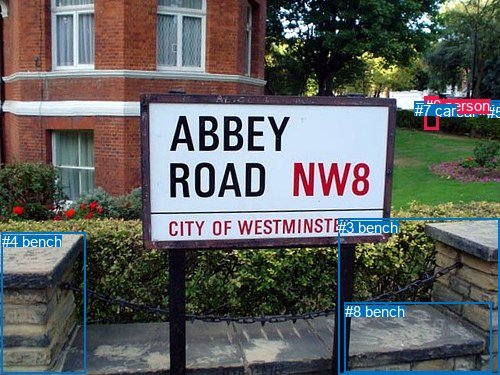
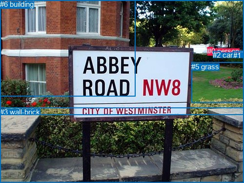

# 图片 1380：2380325.jpg

随机样本序号：247。图片 SHA256：`ab17c10220fca3e893e48673b0eacaf9d206999ab17279560c982d16fb8798a9`。

红色框表示人，蓝色框表示其他物体。两个模式分别保留自身框编号，可依据位置比较对应对象。

## 自动检测框与输出

人的框编号：`[0, 6]`。状态：`ok`。

### 自动检测全部物体框

| 编号 | 类别 | 是否为人 | 检测分数 | 像素坐标 xyxy |
|---|---|---|---|---|
| 0 | person | True | 0.9695 | 425.2, 96.7, 436.0, 109.8 |
| 1 | car | False | 0.9530 | 435.6, 102.7, 469.8, 111.0 |
| 2 | car | False | 0.8507 | 478.8, 101.0, 499.8, 112.2 |
| 3 | bench | False | 0.7808 | 338.4, 218.8, 500.0, 374.6 |
| 4 | bench | False | 0.7754 | 1.7, 232.8, 85.8, 373.4 |
| 5 | car | False | 0.6741 | 487.5, 103.9, 500.0, 112.4 |
| 6 | person | True | 0.6487 | 424.6, 96.5, 438.1, 129.9 |
| 7 | car | False | 0.4264 | 414.8, 102.0, 426.6, 109.7 |
| 8 | bench | False | 0.4009 | 344.7, 302.8, 491.2, 372.4 |

### 自动检测 Top50 人相关候选

评分物体对：72；人相关物体对：30；输出关系：50。

| 排名 | 主语编号与类别 | 关系 | 宾语编号与类别 | 类型 | 人与人 | 排序分数 | 原始融合 logit |
|---|---|---|---|---|---|---|---|
| 1 | #6 person | wearing | #0 person | semantic | True | 0.96991 | 3.4731 |
| 2 | #0 person | parked on | #1 car | semantic | False | 0.96383 | 3.2827 |
| 3 | #7 car | parked on | #0 person | semantic | False | 0.96069 | 3.1963 |
| 4 | #7 car | parked on | #6 person | semantic | False | 0.95713 | 3.1059 |
| 5 | #0 person | on | #6 person | spatial | True | 0.94514 | 2.8466 |
| 6 | #0 person | on | #7 car | spatial | False | 0.89459 | 2.1385 |
| 7 | #0 person | wearing | #7 car | semantic | False | 0.83913 | 1.6518 |
| 8 | #7 car | on | #6 person | spatial | False | 0.83493 | 1.6210 |
| 9 | #6 person | in | #0 person | spatial | True | 0.83485 | 1.6204 |
| 10 | #1 car | parked on | #6 person | semantic | False | 0.82865 | 1.5761 |
| 11 | #0 person | parked on | #6 person | semantic | True | 0.80621 | 1.4256 |
| 12 | #7 car | on | #0 person | spatial | False | 0.78947 | 1.3217 |
| 13 | #6 person | in | #1 car | spatial | False | 0.78875 | 1.3174 |
| 14 | #0 person | in | #1 car | spatial | False | 0.76770 | 1.1954 |
| 15 | #6 person | wearing | #7 car | semantic | False | 0.72484 | 0.9686 |
| 16 | #1 car | on | #6 person | spatial | False | 0.67671 | 0.7387 |
| 17 | #2 car | parked on | #6 person | semantic | False | 0.63515 | 0.5544 |
| 18 | #6 person | on | #7 car | spatial | False | 0.63389 | 0.5489 |
| 19 | #1 car | parked on | #0 person | semantic | False | 0.60301 | 0.4180 |
| 20 | #5 car | parked on | #6 person | semantic | False | 0.56369 | 0.2562 |
| 21 | #6 person | parked on | #1 car | semantic | False | 0.53496 | 0.1401 |
| 22 | #0 person | parked on | #3 bench | semantic | False | 0.44066 | -0.2385 |
| 23 | #2 car | parked on | #0 person | semantic | False | 0.39304 | -0.4346 |
| 24 | #1 car | on | #0 person | spatial | False | 0.39063 | -0.4447 |
| 25 | #0 person | parked on | #2 car | semantic | False | 0.37951 | -0.4916 |
| 26 | #5 car | on | #6 person | spatial | False | 0.35607 | -0.5925 |
| 27 | #2 car | in | #6 person | spatial | False | 0.30453 | -0.8258 |
| 28 | #0 person | parked on | #5 car | semantic | False | 0.27900 | -0.9495 |
| 29 | #5 car | parked on | #0 person | semantic | False | 0.27366 | -0.9761 |
| 30 | #0 person | parked on | #8 bench | semantic | False | 0.22739 | -1.2231 |
| 31 | #6 person | beside | #3 bench | spatial | False | 0.16622 | -1.6127 |
| 32 | #6 person | in | #2 car | spatial | False | 0.16552 | -1.6177 |
| 33 | #6 person | in | #5 car | spatial | False | 0.15150 | -1.7229 |
| 34 | #0 person | in | #2 car | spatial | False | 0.12609 | -1.9360 |
| 35 | #0 person | in | #5 car | spatial | False | 0.12063 | -1.9865 |
| 36 | #5 car | on | #0 person | spatial | False | 0.11527 | -2.0380 |
| 37 | #2 car | on | #0 person | spatial | False | 0.10602 | -2.1320 |
| 38 | #6 person | beside | #4 bench | spatial | False | 0.10111 | -2.1849 |
| 39 | #0 person | parked on | #4 bench | semantic | False | 0.09969 | -2.2007 |
| 40 | #0 person | on | #3 bench | spatial | False | 0.08813 | -2.3367 |
| 41 | #6 person | looking at | #2 car | semantic | False | 0.08237 | -2.4106 |
| 42 | #6 person | on | #8 bench | spatial | False | 0.07883 | -2.4583 |
| 43 | #6 person | wearing | #5 car | semantic | False | 0.07370 | -2.5312 |
| 44 | #0 person | on | #8 bench | spatial | False | 0.05825 | -2.7830 |
| 45 | #6 person | looking at | #4 bench | semantic | False | 0.05810 | -2.7858 |
| 46 | #6 person | looking at | #3 bench | semantic | False | 0.05509 | -2.8422 |
| 47 | #0 person | beside | #4 bench | spatial | False | 0.04845 | -2.9775 |
| 48 | #3 bench | in | #6 person | spatial | False | 0.03037 | -3.4635 |
| 49 | #6 person | standing on | #8 bench | semantic | False | 0.02590 | -3.6273 |
| 50 | #4 bench | in front of | #0 person | spatial | False | 0.02380 | -3.7138 |

### 自动检测逐条人相关 GT 核验

R@50：0.00%；命中 0/2。

| GT 主语编号 | GT 关系 | GT 宾语编号 | 结果阶段 | 匹配预测主语编号 | 匹配预测宾语编号 |
|---|---|---|---|---|---|
| 0 | beside | 2 | endpoint_missing_or_wrong_class | [0] | [] |
| 2 | beside | 0 | endpoint_missing_or_wrong_class | [] | [0] |

## 真实框与输出

人的框编号：`[0]`。

### 真实框全部物体框

| 编号 | 类别 | 是否为人 | 检测分数 | 像素坐标 xyxy |
|---|---|---|---|---|
| 0 | person | True | GT | 425.0, 96.0, 436.0, 110.0 |
| 1 | car | False | GT | 478.0, 105.0, 500.0, 114.0 |
| 2 | car | False | GT | 436.0, 104.0, 452.0, 110.0 |
| 3 | wall-brick | False | GT | 0.0, 221.0, 500.0, 375.0 |
| 4 | tree | False | GT | 0.0, 0.0, 500.0, 236.0 |
| 5 | grass | False | GT | 392.0, 128.0, 500.0, 210.0 |
| 6 | building | False | GT | 0.0, 0.0, 278.0, 197.0 |

### 真实框 Top50 人相关候选

评分物体对：42；人相关物体对：12；输出关系：24。

| 排名 | 主语编号与类别 | 关系 | 宾语编号与类别 | 类型 | 人与人 | 排序分数 | 原始融合 logit |
|---|---|---|---|---|---|---|---|
| 1 | #0 person | parked on | #5 grass | semantic | False | 0.97723 | 3.7592 |
| 2 | #0 person | parked on | #2 car | semantic | False | 0.97469 | 3.6509 |
| 3 | #0 person | in | #4 tree | spatial | False | 0.95589 | 3.0759 |
| 4 | #0 person | parked on | #6 building | semantic | False | 0.94671 | 2.8772 |
| 5 | #0 person | parked on | #4 tree | semantic | False | 0.93726 | 2.7040 |
| 6 | #0 person | in | #5 grass | spatial | False | 0.91280 | 2.3483 |
| 7 | #0 person | beside | #2 car | spatial | False | 0.88876 | 2.0782 |
| 8 | #0 person | beside | #6 building | spatial | False | 0.85259 | 1.7550 |
| 9 | #2 car | parked on | #0 person | semantic | False | 0.83329 | 1.6091 |
| 10 | #2 car | beside | #0 person | spatial | False | 0.70021 | 0.8483 |
| 11 | #0 person | parked on | #1 car | semantic | False | 0.68834 | 0.7924 |
| 12 | #0 person | parked on | #3 wall-brick | semantic | False | 0.47599 | -0.0961 |
| 13 | #1 car | parked on | #0 person | semantic | False | 0.25129 | -1.0918 |
| 14 | #0 person | beside | #1 car | spatial | False | 0.19409 | -1.4237 |
| 15 | #6 building | beside | #0 person | spatial | False | 0.18682 | -1.4708 |
| 16 | #0 person | beside | #3 wall-brick | spatial | False | 0.16439 | -1.6259 |
| 17 | #1 car | beside | #0 person | spatial | False | 0.15593 | -1.6888 |
| 18 | #3 wall-brick | beside | #0 person | spatial | False | 0.12880 | -1.9116 |
| 19 | #5 grass | beside | #0 person | spatial | False | 0.12818 | -1.9171 |
| 20 | #4 tree | beside | #0 person | spatial | False | 0.04531 | -3.0478 |
| 21 | #3 wall-brick | holding | #0 person | semantic | False | 0.03263 | -3.3893 |
| 22 | #4 tree | holding | #0 person | semantic | False | 0.01999 | -3.8923 |
| 23 | #6 building | holding | #0 person | semantic | False | 0.01991 | -3.8966 |
| 24 | #5 grass | holding | #0 person | semantic | False | 0.01831 | -3.9819 |

### 真实框逐条人相关 GT 核验

R@50：100.00%；命中 2/2。

| GT 主语编号 | GT 关系 | GT 宾语编号 | 结果阶段 | 匹配预测主语编号 | 匹配预测宾语编号 |
|---|---|---|---|---|---|
| 0 | beside | 2 | hit50 | [0] | [2] |
| 2 | beside | 0 | hit50 | [2] | [0] |

## 全部人相关 GT

| 主语编号与类别 | 关系 | 宾语编号与类别 |
|---|---|---|
| #0 person | beside | #2 car |
| #2 car | beside | #0 person |

原始记录、全部人相关物体对的两项预测与分项分数见 [逐图证据 JSON](../evidence/cases/1380.json)。全部56类 logits 保留于本机 HOR/output/random500/logits/。

<!-- HOR_COMPLETE_RESULTS -->

## 六组条件的完整输出对照

以下保留同一图片三种框与候选模式、两种谓词输出规则的全部 Top50。框编号各自在所属模式内解释。

### 自动检测框完整枚举：空间与语义各保留一个谓词

| 排名 | 主语编号与类别 | 谓词 | 宾语编号与类别 | 分组 | 排序分数 | predicate logit | pair logit |
|---|---|---|---|---|---|---|---|
| 1 | #6 person | wearing | #0 person | semantic | 0.9699138 | 3.8846154 | -0.4114731 |
| 2 | #0 person | parked on | #1 car | semantic | 0.9638323 | 3.3627591 | -0.0800102 |
| 3 | #7 car | parked on | #0 person | semantic | 0.9606947 | 3.3021355 | -0.1058389 |
| 4 | #7 car | parked on | #6 person | semantic | 0.9571345 | 3.1821513 | -0.0762749 |
| 5 | #0 person | on | #6 person | spatial | 0.9451436 | 2.8900156 | -0.0433971 |
| 6 | #0 person | on | #7 car | spatial | 0.8945918 | 2.2314262 | -0.0928994 |
| 7 | #0 person | wearing | #7 car | semantic | 0.8391333 | 1.7446928 | -0.0928994 |
| 8 | #7 car | on | #6 person | spatial | 0.8349304 | 1.6972556 | -0.0762749 |
| 9 | #6 person | in | #0 person | spatial | 0.8348507 | 2.0318761 | -0.4114731 |
| 10 | #1 car | parked on | #6 person | semantic | 0.8286549 | 1.7084885 | -0.1323645 |
| 11 | #0 person | parked on | #6 person | semantic | 0.8062072 | 1.4689479 | -0.0433971 |
| 12 | #7 car | on | #0 person | spatial | 0.7894686 | 1.4275641 | -0.1058389 |
| 13 | #6 person | in | #1 car | spatial | 0.7887510 | 1.6240964 | -0.3066837 |
| 14 | #0 person | in | #1 car | spatial | 0.7677047 | 1.2754059 | -0.0800102 |
| 15 | #6 person | wearing | #7 car | semantic | 0.7248401 | 1.4087181 | -0.4401193 |
| 16 | #1 car | on | #6 person | spatial | 0.6767051 | 0.8710351 | -0.1323645 |
| 17 | #2 car | parked on | #6 person | semantic | 0.6351508 | 0.6252489 | -0.0708707 |
| 18 | #6 person | on | #7 car | spatial | 0.6338887 | 0.9890552 | -0.4401193 |
| 19 | #1 car | parked on | #0 person | semantic | 0.6030145 | 0.6855536 | -0.2675120 |
| 20 | #5 car | parked on | #6 person | semantic | 0.5636908 | 0.3244743 | -0.0683198 |
| 21 | #6 person | parked on | #1 car | semantic | 0.5349619 | 0.4467602 | -0.3066837 |
| 22 | #0 person | parked on | #3 bench | semantic | 0.4406636 | 0.5652037 | -0.8036728 |
| 23 | #2 car | parked on | #0 person | semantic | 0.3930361 | -0.2774692 | -0.1570985 |
| 24 | #1 car | on | #0 person | spatial | 0.3906310 | -0.1771483 | -0.2675120 |
| 25 | #0 person | parked on | #2 car | semantic | 0.3795095 | -0.3679128 | -0.1237180 |
| 26 | #5 car | on | #6 person | spatial | 0.3560659 | -0.5241609 | -0.0683198 |
| 27 | #2 car | in | #6 person | spatial | 0.3045276 | -0.7549589 | -0.0708707 |
| 28 | #0 person | parked on | #5 car | semantic | 0.2789952 | -0.8191056 | -0.1303456 |
| 29 | #5 car | parked on | #0 person | semantic | 0.2736599 | -0.8186810 | -0.1574515 |
| 30 | #0 person | parked on | #8 bench | semantic | 0.2273944 | -0.0963464 | -1.1267362 |
| 31 | #6 person | beside | #3 bench | spatial | 0.1662182 | -0.8730760 | -0.7395946 |
| 32 | #6 person | in | #2 car | spatial | 0.1655168 | -1.2418776 | -0.3758622 |
| 33 | #6 person | in | #5 car | spatial | 0.1515043 | -1.3354700 | -0.3873814 |
| 34 | #0 person | in | #2 car | spatial | 0.1260920 | -1.8122454 | -0.1237180 |
| 35 | #0 person | in | #5 car | spatial | 0.1206278 | -1.8561530 | -0.1303456 |
| 36 | #5 car | on | #0 person | spatial | 0.1152662 | -1.8805912 | -0.1574515 |
| 37 | #2 car | on | #0 person | spatial | 0.1060208 | -1.9749486 | -0.1570985 |
| 38 | #6 person | beside | #4 bench | spatial | 0.1011114 | -1.0251286 | -1.1598080 |
| 39 | #0 person | parked on | #4 bench | semantic | 0.0996913 | -1.0582521 | -1.1424077 |
| 40 | #0 person | on | #3 bench | spatial | 0.0881317 | -1.5329902 | -0.8036728 |
| 41 | #6 person | looking at | #2 car | semantic | 0.0823674 | -2.0347447 | -0.3758622 |
| 42 | #6 person | on | #8 bench | spatial | 0.0788345 | -1.2852678 | -1.1730219 |
| 43 | #6 person | wearing | #5 car | semantic | 0.0736980 | -2.1438439 | -0.3873814 |
| 44 | #0 person | on | #8 bench | spatial | 0.0582511 | -1.6562390 | -1.1267362 |
| 45 | #6 person | looking at | #4 bench | semantic | 0.0580967 | -1.6259849 | -1.1598080 |
| 46 | #6 person | looking at | #3 bench | semantic | 0.0550881 | -2.1025641 | -0.7395946 |
| 47 | #0 person | beside | #4 bench | spatial | 0.0484509 | -1.8351321 | -1.1424077 |
| 48 | #3 bench | in | #6 person | spatial | 0.0303686 | -2.2556815 | -1.2078241 |
| 49 | #6 person | standing on | #8 bench | semantic | 0.0258995 | -2.4542696 | -1.1730219 |
| 50 | #4 bench | in front of | #0 person | spatial | 0.0238050 | -2.1790133 | -1.5347550 |

GT 命中：0/2，R@50=0.00%。

| GT主语 | GT谓词 | GT宾语 | 结果阶段 | 匹配主语框 | 匹配宾语框 |
|---|---|---|---|---|---|
| 0 | beside | 2 | endpoint_missing_or_wrong_class | [0] | [] |
| 2 | beside | 0 | endpoint_missing_or_wrong_class | [] | [0] |

### 自动检测框完整枚举：每对只保留一个谓词

| 排名 | 主语编号与类别 | 谓词 | 宾语编号与类别 | 分组 | 排序分数 | predicate logit | pair logit |
|---|---|---|---|---|---|---|---|
| 1 | #6 person | wearing | #0 person | single | 0.9699138 | 3.8846154 | -0.4114731 |
| 2 | #0 person | parked on | #1 car | single | 0.9638323 | 3.3627591 | -0.0800102 |
| 3 | #7 car | parked on | #0 person | single | 0.9606947 | 3.3021355 | -0.1058389 |
| 4 | #7 car | parked on | #6 person | single | 0.9571345 | 3.1821513 | -0.0762749 |
| 5 | #0 person | on | #6 person | single | 0.9451436 | 2.8900156 | -0.0433971 |
| 6 | #0 person | on | #7 car | single | 0.8945918 | 2.2314262 | -0.0928994 |
| 7 | #1 car | parked on | #6 person | single | 0.8286549 | 1.7084885 | -0.1323645 |
| 8 | #6 person | in | #1 car | single | 0.7887510 | 1.6240964 | -0.3066837 |
| 9 | #6 person | wearing | #7 car | single | 0.7248401 | 1.4087181 | -0.4401193 |
| 10 | #2 car | parked on | #6 person | single | 0.6351508 | 0.6252489 | -0.0708707 |
| 11 | #1 car | parked on | #0 person | single | 0.6030145 | 0.6855536 | -0.2675120 |
| 12 | #5 car | parked on | #6 person | single | 0.5636908 | 0.3244743 | -0.0683198 |
| 13 | #0 person | parked on | #3 bench | single | 0.4406636 | 0.5652037 | -0.8036728 |
| 14 | #2 car | parked on | #0 person | single | 0.3930361 | -0.2774692 | -0.1570985 |
| 15 | #0 person | parked on | #2 car | single | 0.3795095 | -0.3679128 | -0.1237180 |
| 16 | #0 person | parked on | #5 car | single | 0.2789952 | -0.8191056 | -0.1303456 |
| 17 | #5 car | parked on | #0 person | single | 0.2736599 | -0.8186810 | -0.1574515 |
| 18 | #0 person | parked on | #8 bench | single | 0.2273944 | -0.0963464 | -1.1267362 |
| 19 | #6 person | beside | #3 bench | single | 0.1662182 | -0.8730760 | -0.7395946 |
| 20 | #6 person | in | #2 car | single | 0.1655168 | -1.2418776 | -0.3758622 |
| 21 | #6 person | in | #5 car | single | 0.1515043 | -1.3354700 | -0.3873814 |
| 22 | #6 person | beside | #4 bench | single | 0.1011114 | -1.0251286 | -1.1598080 |
| 23 | #0 person | parked on | #4 bench | single | 0.0996913 | -1.0582521 | -1.1424077 |
| 24 | #6 person | on | #8 bench | single | 0.0788345 | -1.2852678 | -1.1730219 |
| 25 | #3 bench | in | #6 person | single | 0.0303686 | -2.2556815 | -1.2078241 |
| 26 | #4 bench | in front of | #0 person | single | 0.0238050 | -2.1790133 | -1.5347550 |
| 27 | #4 bench | in front of | #6 person | single | 0.0235675 | -2.0655763 | -1.6584624 |
| 28 | #8 bench | in | #6 person | single | 0.0178509 | -2.5290425 | -1.4786495 |
| 29 | #3 bench | beside | #0 person | single | 0.0174954 | -2.9236665 | -1.1045005 |
| 30 | #8 bench | in | #0 person | single | 0.0106919 | -3.1019905 | -1.4255302 |

GT 命中：0/2，R@50=0.00%。

| GT主语 | GT谓词 | GT宾语 | 结果阶段 | 匹配主语框 | 匹配宾语框 |
|---|---|---|---|---|---|
| 0 | beside | 2 | endpoint_missing_or_wrong_class | [0] | [] |
| 2 | beside | 0 | endpoint_missing_or_wrong_class | [] | [0] |

### 真实框完整枚举：空间与语义各保留一个谓词

| 排名 | 主语编号与类别 | 谓词 | 宾语编号与类别 | 分组 | 排序分数 | predicate logit | pair logit |
|---|---|---|---|---|---|---|---|
| 1 | #0 person | parked on | #5 grass | semantic | 0.9772290 | 3.9032893 | -0.1440549 |
| 2 | #0 person | parked on | #2 car | semantic | 0.9746895 | 3.7241292 | -0.0732303 |
| 3 | #0 person | in | #4 tree | spatial | 0.9558860 | 3.1023521 | -0.0264908 |
| 4 | #0 person | parked on | #6 building | semantic | 0.9467097 | 3.1817088 | -0.3044703 |
| 5 | #0 person | parked on | #4 tree | semantic | 0.9372606 | 2.7304621 | -0.0264908 |
| 6 | #0 person | in | #5 grass | spatial | 0.9127988 | 2.4923515 | -0.1440549 |
| 7 | #0 person | beside | #2 car | spatial | 0.8887631 | 2.1513982 | -0.0732303 |
| 8 | #0 person | beside | #6 building | spatial | 0.8525867 | 2.0595050 | -0.3044703 |
| 9 | #2 car | parked on | #0 person | semantic | 0.8332883 | 1.8587923 | -0.2496787 |
| 10 | #2 car | beside | #0 person | spatial | 0.7002091 | 1.0979729 | -0.2496787 |
| 11 | #0 person | parked on | #1 car | semantic | 0.6883441 | 0.9249225 | -0.1325335 |
| 12 | #0 person | parked on | #3 wall-brick | semantic | 0.4759872 | 0.5953870 | -0.6915121 |
| 13 | #1 car | parked on | #0 person | semantic | 0.2512885 | -0.9087870 | -0.1829650 |
| 14 | #0 person | beside | #1 car | spatial | 0.1940879 | -1.2911298 | -0.1325335 |
| 15 | #6 building | beside | #0 person | spatial | 0.1868210 | -0.6804590 | -0.7903413 |
| 16 | #0 person | beside | #3 wall-brick | spatial | 0.1643920 | -0.9343934 | -0.6915121 |
| 17 | #1 car | beside | #0 person | spatial | 0.1559305 | -1.5058596 | -0.1829650 |
| 18 | #3 wall-brick | beside | #0 person | spatial | 0.1288023 | -0.9475813 | -0.9640087 |
| 19 | #5 grass | beside | #0 person | spatial | 0.1281834 | -0.9010711 | -1.0160463 |
| 20 | #4 tree | beside | #0 person | spatial | 0.0453115 | -2.4212575 | -0.6265659 |
| 21 | #3 wall-brick | holding | #0 person | semantic | 0.0326325 | -2.4252598 | -0.9640087 |
| 22 | #4 tree | holding | #0 person | semantic | 0.0199912 | -3.2657042 | -0.6265659 |
| 23 | #6 building | holding | #0 person | semantic | 0.0199074 | -3.1062155 | -0.7903413 |
| 24 | #5 grass | holding | #0 person | semantic | 0.0183082 | -2.9658823 | -1.0160463 |

GT 命中：2/2，R@50=100.00%。

| GT主语 | GT谓词 | GT宾语 | 结果阶段 | 匹配主语框 | 匹配宾语框 |
|---|---|---|---|---|---|
| 0 | beside | 2 | hit50 | [0] | [2] |
| 2 | beside | 0 | hit50 | [2] | [0] |

### 真实框完整枚举：每对只保留一个谓词

| 排名 | 主语编号与类别 | 谓词 | 宾语编号与类别 | 分组 | 排序分数 | predicate logit | pair logit |
|---|---|---|---|---|---|---|---|
| 1 | #0 person | parked on | #5 grass | single | 0.9772290 | 3.9032893 | -0.1440549 |
| 2 | #0 person | parked on | #2 car | single | 0.9746895 | 3.7241292 | -0.0732303 |
| 3 | #0 person | in | #4 tree | single | 0.9558860 | 3.1023521 | -0.0264908 |
| 4 | #0 person | parked on | #6 building | single | 0.9467097 | 3.1817088 | -0.3044703 |
| 5 | #2 car | parked on | #0 person | single | 0.8332883 | 1.8587923 | -0.2496787 |
| 6 | #0 person | parked on | #1 car | single | 0.6883441 | 0.9249225 | -0.1325335 |
| 7 | #0 person | parked on | #3 wall-brick | single | 0.4759872 | 0.5953870 | -0.6915121 |
| 8 | #1 car | parked on | #0 person | single | 0.2512885 | -0.9087870 | -0.1829650 |
| 9 | #6 building | beside | #0 person | single | 0.1868210 | -0.6804590 | -0.7903413 |
| 10 | #3 wall-brick | beside | #0 person | single | 0.1288023 | -0.9475813 | -0.9640087 |
| 11 | #5 grass | beside | #0 person | single | 0.1281834 | -0.9010711 | -1.0160463 |
| 12 | #4 tree | beside | #0 person | single | 0.0453115 | -2.4212575 | -0.6265659 |

GT 命中：0/2，R@50=0.00%。

| GT主语 | GT谓词 | GT宾语 | 结果阶段 | 匹配主语框 | 匹配宾语框 |
|---|---|---|---|---|---|
| 0 | beside | 2 | wrong_predicate | [0] | [2] |
| 2 | beside | 0 | wrong_predicate | [2] | [0] |

### 真实框400候选：空间与语义各保留一个谓词

| 排名 | 主语编号与类别 | 谓词 | 宾语编号与类别 | 分组 | 排序分数 | predicate logit | pair logit |
|---|---|---|---|---|---|---|---|
| 1 | #0 person | parked on | #5 grass | semantic | 0.9772294 | 3.9033046 | -0.1440549 |
| 2 | #0 person | parked on | #2 car | semantic | 0.9746888 | 3.7240987 | -0.0732303 |
| 3 | #0 person | in | #4 tree | spatial | 0.9537189 | 3.0521259 | -0.0264908 |
| 4 | #0 person | parked on | #6 building | semantic | 0.9467105 | 3.1817245 | -0.3044703 |
| 5 | #0 person | parked on | #4 tree | semantic | 0.9372606 | 2.7304621 | -0.0264908 |
| 6 | #0 person | in | #5 grass | spatial | 0.9122690 | 2.4857140 | -0.1440549 |
| 7 | #0 person | beside | #2 car | spatial | 0.8857531 | 2.1213064 | -0.0732303 |
| 8 | #0 person | beside | #6 building | spatial | 0.8563215 | 2.0895381 | -0.3044703 |
| 9 | #2 car | parked on | #0 person | semantic | 0.8374205 | 1.8888373 | -0.2496787 |
| 10 | #2 car | beside | #0 person | spatial | 0.7064636 | 1.1279488 | -0.2496787 |
| 11 | #0 person | parked on | #1 car | semantic | 0.6947587 | 0.9549952 | -0.1325335 |
| 12 | #0 person | parked on | #3 wall-brick | semantic | 0.4910076 | 0.6555386 | -0.6915121 |
| 13 | #1 car | parked on | #0 person | semantic | 0.2484720 | -0.9238136 | -0.1829650 |
| 14 | #0 person | beside | #1 car | spatial | 0.1964522 | -1.2760839 | -0.1325335 |
| 15 | #6 building | beside | #0 person | spatial | 0.1822981 | -0.7105136 | -0.7903413 |
| 16 | #0 person | beside | #3 wall-brick | spatial | 0.1685624 | -0.9043381 | -0.6915121 |
| 17 | #1 car | beside | #0 person | spatial | 0.1559238 | -1.5059102 | -0.1829650 |
| 18 | #3 wall-brick | beside | #0 person | spatial | 0.1322118 | -0.9175334 | -0.9640087 |
| 19 | #5 grass | beside | #0 person | spatial | 0.1298709 | -0.8860543 | -1.0160463 |
| 20 | #4 tree | beside | #0 person | spatial | 0.0459643 | -2.4062693 | -0.6265659 |
| 21 | #3 wall-brick | holding | #0 person | semantic | 0.0326792 | -2.4237828 | -0.9640087 |
| 22 | #4 tree | holding | #0 person | semantic | 0.0201756 | -3.2563348 | -0.6265659 |
| 23 | #6 building | holding | #0 person | semantic | 0.0193707 | -3.1340909 | -0.7903413 |
| 24 | #5 grass | holding | #0 person | semantic | 0.0185806 | -2.9508367 | -1.0160463 |

GT 命中：2/2，R@50=100.00%。

| GT主语 | GT谓词 | GT宾语 | 结果阶段 | 匹配主语框 | 匹配宾语框 |
|---|---|---|---|---|---|
| 0 | beside | 2 | hit50 | [0] | [2] |
| 2 | beside | 0 | hit50 | [2] | [0] |

### 真实框400候选：每对只保留一个谓词

| 排名 | 主语编号与类别 | 谓词 | 宾语编号与类别 | 分组 | 排序分数 | predicate logit | pair logit |
|---|---|---|---|---|---|---|---|
| 1 | #0 person | parked on | #5 grass | single | 0.9772294 | 3.9033046 | -0.1440549 |
| 2 | #0 person | parked on | #2 car | single | 0.9746888 | 3.7240987 | -0.0732303 |
| 3 | #0 person | in | #4 tree | single | 0.9537189 | 3.0521259 | -0.0264908 |
| 4 | #0 person | parked on | #6 building | single | 0.9467105 | 3.1817245 | -0.3044703 |
| 5 | #2 car | parked on | #0 person | single | 0.8374205 | 1.8888373 | -0.2496787 |
| 6 | #0 person | parked on | #1 car | single | 0.6947587 | 0.9549952 | -0.1325335 |
| 7 | #0 person | parked on | #3 wall-brick | single | 0.4910076 | 0.6555386 | -0.6915121 |
| 8 | #1 car | parked on | #0 person | single | 0.2484720 | -0.9238136 | -0.1829650 |
| 9 | #6 building | beside | #0 person | single | 0.1822981 | -0.7105136 | -0.7903413 |
| 10 | #3 wall-brick | beside | #0 person | single | 0.1322118 | -0.9175334 | -0.9640087 |
| 11 | #5 grass | beside | #0 person | single | 0.1298709 | -0.8860543 | -1.0160463 |
| 12 | #4 tree | beside | #0 person | single | 0.0459643 | -2.4062693 | -0.6265659 |

GT 命中：0/2，R@50=0.00%。

| GT主语 | GT谓词 | GT宾语 | 结果阶段 | 匹配主语框 | 匹配宾语框 |
|---|---|---|---|---|---|
| 0 | beside | 2 | wrong_predicate | [0] | [2] |
| 2 | beside | 0 | wrong_predicate | [2] | [0] |
