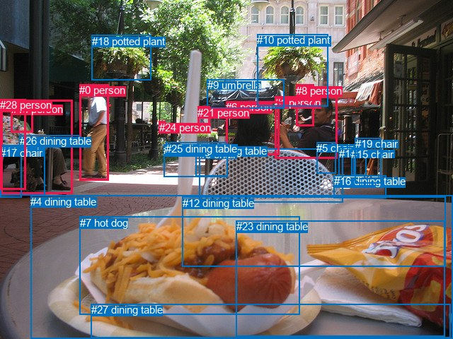
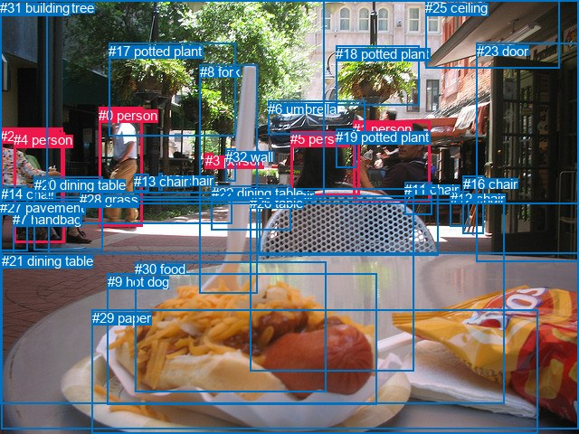

# 图片 1382：2380359.jpg

随机样本序号：195。图片 SHA256：`5643aadb0049998a1f1e2a418af7be084c40d5ff5ac7eadf17b38cb5c61c0117`。

红色框表示人，蓝色框表示其他物体。两个模式分别保留自身框编号，可依据位置比较对应对象。

## 自动检测框与输出

人的框编号：`[0, 1, 2, 6, 8, 13, 21, 24, 28]`。状态：`ok`。

### 自动检测全部物体框

| 编号 | 类别 | 是否为人 | 检测分数 | 像素坐标 xyxy |
|---|---|---|---|---|
| 0 | person | True | 0.9984 | 112.1, 119.2, 153.5, 255.7 |
| 1 | person | True | 0.9960 | 388.4, 136.7, 476.1, 225.0 |
| 2 | person | True | 0.9908 | 1.0, 141.7, 102.7, 274.3 |
| 3 | chair | False | 0.9799 | 281.9, 210.1, 484.5, 286.8 |
| 4 | dining table | False | 0.9757 | 43.0, 276.7, 639.2, 480.0 |
| 5 | chair | False | 0.9576 | 447.0, 201.2, 475.0, 245.5 |
| 6 | person | True | 0.9504 | 319.3, 143.5, 394.2, 219.1 |
| 7 | hot dog | False | 0.9448 | 112.5, 306.7, 423.6, 445.3 |
| 8 | person | True | 0.9254 | 418.1, 119.7, 443.7, 179.0 |
| 9 | umbrella | False | 0.9101 | 292.5, 112.1, 401.6, 154.0 |
| 10 | potted plant | False | 0.9035 | 363.4, 48.3, 463.1, 150.3 |
| 11 | chair | False | 0.8295 | 0.1, 205.6, 30.1, 279.1 |
| 12 | dining table | False | 0.7795 | 258.0, 278.5, 629.6, 377.6 |
| 13 | person | True | 0.7348 | 15.7, 145.8, 46.0, 187.8 |
| 14 | chair | False | 0.6831 | 478.8, 208.5, 500.0, 249.2 |
| 15 | chair | False | 0.6538 | 496.0, 209.6, 517.7, 248.8 |
| 16 | dining table | False | 0.6158 | 471.7, 248.3, 545.8, 280.6 |
| 17 | chair | False | 0.5607 | 0.0, 207.5, 63.5, 277.0 |
| 18 | potted plant | False | 0.5605 | 130.0, 49.8, 213.6, 113.8 |
| 19 | chair | False | 0.5563 | 501.6, 195.4, 538.7, 259.8 |
| 20 | dining table | False | 0.5273 | 276.3, 204.6, 321.4, 249.7 |
| 21 | person | True | 0.5166 | 279.4, 150.7, 296.8, 184.9 |
| 22 | dining table | False | 0.4918 | 231.3, 204.4, 321.5, 250.2 |
| 23 | dining table | False | 0.4532 | 333.5, 312.2, 628.8, 476.5 |
| 24 | person | True | 0.4489 | 224.9, 171.5, 233.7, 182.1 |
| 25 | dining table | False | 0.4483 | 234.4, 202.0, 320.6, 218.7 |
| 26 | dining table | False | 0.4401 | 27.8, 191.3, 112.8, 204.1 |
| 27 | dining table | False | 0.4307 | 128.6, 430.0, 636.7, 478.7 |
| 28 | person | True | 0.3944 | 0.5, 140.2, 36.1, 268.3 |

### 自动检测 Top50 人相关候选

评分物体对：812；人相关物体对：432；输出关系：50。

| 排名 | 主语编号与类别 | 关系 | 宾语编号与类别 | 类型 | 人与人 | 排序分数 | 原始融合 logit |
|---|---|---|---|---|---|---|---|
| 1 | #28 person | sitting on | #11 chair | semantic | False | 0.99038 | 4.6339 |
| 2 | #2 person | sitting on | #26 dining table | semantic | False | 0.98287 | 4.0495 |
| 3 | #28 person | sitting on | #26 dining table | semantic | False | 0.98172 | 3.9835 |
| 4 | #2 person | sitting on | #11 chair | semantic | False | 0.98123 | 3.9565 |
| 5 | #28 person | sitting on | #17 chair | semantic | False | 0.98100 | 3.9444 |
| 6 | #2 person | sitting on | #17 chair | semantic | False | 0.98018 | 3.9011 |
| 7 | #28 person | wearing | #13 person | semantic | True | 0.97564 | 3.6900 |
| 8 | #1 person | holding | #8 person | semantic | True | 0.97499 | 3.6630 |
| 9 | #1 person | talking to | #6 person | semantic | True | 0.97306 | 3.5869 |
| 10 | #21 person | walking on | #25 dining table | semantic | False | 0.97257 | 3.5683 |
| 11 | #0 person | walking on | #26 dining table | semantic | False | 0.95755 | 3.1161 |
| 12 | #13 person | sitting on | #26 dining table | semantic | False | 0.95641 | 3.0882 |
| 13 | #28 person | on | #26 dining table | spatial | False | 0.95498 | 3.0546 |
| 14 | #8 person | talking to | #1 person | semantic | True | 0.95495 | 3.0538 |
| 15 | #6 person | sitting on | #3 chair | semantic | False | 0.95009 | 2.9462 |
| 16 | #2 person | on | #26 dining table | spatial | False | 0.94645 | 2.8720 |
| 17 | #6 person | talking to | #1 person | semantic | True | 0.93020 | 2.5898 |
| 18 | #28 person | on | #11 chair | spatial | False | 0.92643 | 2.5331 |
| 19 | #2 person | wearing | #13 person | semantic | True | 0.92552 | 2.5198 |
| 20 | #28 person | on | #17 chair | spatial | False | 0.91941 | 2.4343 |
| 21 | #21 person | walking on | #22 dining table | semantic | False | 0.91830 | 2.4195 |
| 22 | #13 person | on | #26 dining table | spatial | False | 0.91421 | 2.3661 |
| 23 | #21 person | walking on | #20 dining table | semantic | False | 0.91008 | 2.3146 |
| 24 | #0 person | on | #26 dining table | spatial | False | 0.90623 | 2.2684 |
| 25 | #28 person | in | #13 person | spatial | True | 0.90360 | 2.2378 |
| 26 | #1 person | sitting on | #5 chair | semantic | False | 0.89405 | 2.1328 |
| 27 | #6 person | sitting on | #20 dining table | semantic | False | 0.88936 | 2.0842 |
| 28 | #6 person | sitting on | #22 dining table | semantic | False | 0.88259 | 2.0172 |
| 29 | #28 person | sitting on | #2 person | semantic | True | 0.88119 | 2.0038 |
| 30 | #2 person | on | #17 chair | spatial | False | 0.86860 | 1.8886 |
| 31 | #6 person | on | #3 chair | spatial | False | 0.85464 | 1.7714 |
| 32 | #21 person | on | #25 dining table | spatial | False | 0.85404 | 1.7667 |
| 33 | #21 person | walking on | #24 person | semantic | True | 0.85275 | 1.7563 |
| 34 | #18 potted plant | hanging from | #24 person | spatial | False | 0.84855 | 1.7233 |
| 35 | #2 person | on | #11 chair | spatial | False | 0.84698 | 1.7111 |
| 36 | #6 person | on | #22 dining table | spatial | False | 0.83941 | 1.6539 |
| 37 | #1 person | sitting on | #3 chair | semantic | False | 0.83836 | 1.6460 |
| 38 | #2 person | in | #13 person | spatial | True | 0.83688 | 1.6352 |
| 39 | #17 chair | beside | #28 person | spatial | False | 0.81306 | 1.4700 |
| 40 | #21 person | on | #20 dining table | spatial | False | 0.80398 | 1.4114 |
| 41 | #6 person | on | #20 dining table | spatial | False | 0.79769 | 1.3719 |
| 42 | #21 person | standing on | #9 umbrella | semantic | False | 0.79157 | 1.3344 |
| 43 | #6 person | sitting on | #25 dining table | semantic | False | 0.79048 | 1.3278 |
| 44 | #0 person | walking on | #16 dining table | semantic | False | 0.78728 | 1.3086 |
| 45 | #1 person | on | #16 dining table | spatial | False | 0.77586 | 1.2417 |
| 46 | #13 person | on | #2 person | spatial | True | 0.75314 | 1.1154 |
| 47 | #6 person | on | #25 dining table | spatial | False | 0.74954 | 1.0962 |
| 48 | #21 person | on | #22 dining table | spatial | False | 0.73835 | 1.0374 |
| 49 | #1 person | standing on | #16 dining table | semantic | False | 0.73592 | 1.0249 |
| 50 | #8 person | talking to | #6 person | semantic | True | 0.71249 | 0.9075 |

### 自动检测逐条人相关 GT 核验

R@50：20.00%；命中 1/5。

| GT 主语编号 | GT 关系 | GT 宾语编号 | 结果阶段 | 匹配预测主语编号 | 匹配预测宾语编号 |
|---|---|---|---|---|---|
| 0 | walking on | 27 | endpoint_missing_or_wrong_class | [0] | [] |
| 1 | sitting on | 11 | hit50 | [1] | [5] |
| 1 | in front of | 23 | endpoint_missing_or_wrong_class | [1] | [] |
| 1 | in front of | 25 | endpoint_missing_or_wrong_class | [1] | [] |
| 2 | sitting on | 4 | endpoint_missing_or_wrong_class | [] | [2] |

## 真实框与输出

人的框编号：`[0, 1, 2, 3, 4, 5]`。

### 真实框全部物体框

| 编号 | 类别 | 是否为人 | 检测分数 | 像素坐标 xyxy |
|---|---|---|---|---|
| 0 | person | True | GT | 109.0, 119.0, 157.0, 251.0 |
| 1 | person | True | GT | 390.0, 134.0, 475.0, 223.0 |
| 2 | person | True | GT | 0.0, 142.0, 69.0, 228.0 |
| 3 | person | True | GT | 227.0, 169.0, 236.0, 183.0 |
| 4 | person | True | GT | 15.0, 146.0, 72.0, 268.0 |
| 5 | person | True | GT | 321.0, 145.0, 397.0, 216.0 |
| 6 | umbrella | False | GT | 296.0, 112.0, 403.0, 149.0 |
| 7 | handbag | False | GT | 14.0, 234.0, 54.0, 281.0 |
| 8 | fork | False | GT | 221.0, 71.0, 285.0, 324.0 |
| 9 | hot dog | False | GT | 119.0, 303.0, 417.0, 447.0 |
| 10 | chair | False | GT | 176.0, 191.0, 180.0, 210.0 |
| 11 | chair | False | GT | 447.0, 201.0, 478.0, 237.0 |
| 12 | chair | False | GT | 498.0, 211.0, 519.0, 250.0 |
| 13 | chair | False | GT | 148.0, 192.0, 164.0, 211.0 |
| 14 | chair | False | GT | 1.0, 206.0, 30.0, 278.0 |
| 15 | chair | False | GT | 287.0, 208.0, 485.0, 282.0 |
| 16 | chair | False | GT | 512.0, 195.0, 535.0, 259.0 |
| 17 | potted plant | False | GT | 120.0, 48.0, 260.0, 151.0 |
| 18 | potted plant | False | GT | 371.0, 51.0, 463.0, 117.0 |
| 19 | potted plant | False | GT | 371.0, 143.0, 394.0, 186.0 |
| 20 | dining table | False | GT | 38.0, 196.0, 114.0, 277.0 |
| 21 | dining table | False | GT | 2.0, 280.0, 640.0, 475.0 |
| 22 | dining table | False | GT | 234.0, 205.0, 322.0, 254.0 |
| 23 | door | False | GT | 527.0, 48.0, 640.0, 289.0 |
| 24 | tree | False | GT | 51.0, 0.0, 359.0, 218.0 |
| 25 | ceiling | False | GT | 470.0, 0.0, 618.0, 76.0 |
| 26 | table | False | GT | 276.0, 216.0, 457.0, 410.0 |
| 27 | pavement | False | GT | 0.0, 221.0, 558.0, 447.0 |
| 28 | grass | False | GT | 88.0, 212.0, 256.0, 247.0 |
| 29 | paper | False | GT | 102.0, 343.0, 595.0, 480.0 |
| 30 | food | False | GT | 149.0, 289.0, 360.0, 433.0 |
| 31 | building | False | GT | 0.0, 0.0, 640.0, 226.0 |
| 32 | wall | False | GT | 249.0, 165.0, 260.0, 201.0 |

### 真实框 Top50 人相关候选

评分物体对：1056；人相关物体对：354；输出关系：50。

| 排名 | 主语编号与类别 | 关系 | 宾语编号与类别 | 类型 | 人与人 | 排序分数 | 原始融合 logit |
|---|---|---|---|---|---|---|---|
| 1 | #4 person | sitting on | #20 dining table | semantic | False | 0.99116 | 4.7200 |
| 2 | #0 person | walking on | #27 pavement | semantic | False | 0.99028 | 4.6238 |
| 3 | #0 person | walking on | #28 grass | semantic | False | 0.99020 | 4.6157 |
| 4 | #4 person | sitting on | #14 chair | semantic | False | 0.98900 | 4.4991 |
| 5 | #1 person | holding | #19 potted plant | semantic | False | 0.98620 | 4.2691 |
| 6 | #1 person | talking to | #5 person | semantic | True | 0.98548 | 4.2178 |
| 7 | #2 person | sitting on | #20 dining table | semantic | False | 0.98379 | 4.1060 |
| 8 | #0 person | wearing | #13 chair | semantic | False | 0.98366 | 4.0976 |
| 9 | #2 person | sitting on | #14 chair | semantic | False | 0.98223 | 4.0123 |
| 10 | #2 person | sitting on | #4 person | semantic | True | 0.97268 | 3.5725 |
| 11 | #5 person | sitting on | #15 chair | semantic | False | 0.96575 | 3.3393 |
| 12 | #1 person | sitting on | #11 chair | semantic | False | 0.95263 | 3.0013 |
| 13 | #4 person | wearing | #2 person | semantic | True | 0.94191 | 2.7859 |
| 14 | #5 person | talking to | #1 person | semantic | True | 0.93827 | 2.7212 |
| 15 | #5 person | holding | #19 potted plant | semantic | False | 0.93469 | 2.6611 |
| 16 | #1 person | sitting on | #15 chair | semantic | False | 0.93445 | 2.6571 |
| 17 | #4 person | sitting on | #7 handbag | semantic | False | 0.93259 | 2.6271 |
| 18 | #4 person | on | #20 dining table | spatial | False | 0.92860 | 2.5653 |
| 19 | #2 person | on | #20 dining table | spatial | False | 0.90946 | 2.3071 |
| 20 | #0 person | in | #13 chair | spatial | False | 0.90830 | 2.2931 |
| 21 | #7 handbag | beside | #4 person | spatial | False | 0.90423 | 2.2451 |
| 22 | #0 person | walking on | #24 tree | semantic | False | 0.89346 | 2.1266 |
| 23 | #5 person | sitting on | #22 dining table | semantic | False | 0.89193 | 2.1106 |
| 24 | #4 person | sitting on | #27 pavement | semantic | False | 0.88659 | 2.0563 |
| 25 | #1 person | on | #27 pavement | spatial | False | 0.88456 | 2.0363 |
| 26 | #4 person | in | #2 person | spatial | True | 0.87541 | 1.9497 |
| 27 | #5 person | on | #15 chair | spatial | False | 0.86394 | 1.8484 |
| 28 | #4 person | on | #14 chair | spatial | False | 0.86244 | 1.8357 |
| 29 | #0 person | on | #27 pavement | spatial | False | 0.86015 | 1.8165 |
| 30 | #3 person | in | #31 building | spatial | False | 0.85981 | 1.8137 |
| 31 | #0 person | on | #28 grass | spatial | False | 0.85974 | 1.8131 |
| 32 | #2 person | on | #14 chair | spatial | False | 0.85902 | 1.8071 |
| 33 | #0 person | walking on | #31 building | semantic | False | 0.84615 | 1.7047 |
| 34 | #7 handbag | sitting on | #4 person | semantic | False | 0.84109 | 1.6664 |
| 35 | #2 person | on | #4 person | spatial | True | 0.83220 | 1.6013 |
| 36 | #5 person | on | #22 dining table | spatial | False | 0.81154 | 1.4601 |
| 37 | #1 person | standing on | #27 pavement | semantic | False | 0.81099 | 1.4564 |
| 38 | #14 chair | beside | #4 person | spatial | False | 0.80691 | 1.4301 |
| 39 | #1 person | on | #15 chair | spatial | False | 0.80156 | 1.3961 |
| 40 | #5 person | in | #19 potted plant | spatial | False | 0.78844 | 1.3156 |
| 41 | #1 person | on | #11 chair | spatial | False | 0.78829 | 1.3147 |
| 42 | #2 person | sitting on | #27 pavement | semantic | False | 0.77211 | 1.2203 |
| 43 | #3 person | parked on | #31 building | semantic | False | 0.77045 | 1.2109 |
| 44 | #4 person | on | #7 handbag | spatial | False | 0.76190 | 1.1631 |
| 45 | #5 person | sitting on | #27 pavement | semantic | False | 0.75676 | 1.1350 |
| 46 | #4 person | on | #27 pavement | spatial | False | 0.74235 | 1.0582 |
| 47 | #0 person | walking on | #20 dining table | semantic | False | 0.73040 | 0.9966 |
| 48 | #1 person | on | #19 potted plant | spatial | False | 0.72207 | 0.9547 |
| 49 | #5 person | sitting on | #26 table | semantic | False | 0.72201 | 0.9545 |
| 50 | #1 person | beside | #5 person | spatial | True | 0.70661 | 0.8790 |

### 真实框逐条人相关 GT 核验

R@50：60.00%；命中 3/5。

| GT 主语编号 | GT 关系 | GT 宾语编号 | 结果阶段 | 匹配预测主语编号 | 匹配预测宾语编号 |
|---|---|---|---|---|---|
| 0 | walking on | 27 | hit50 | [0] | [27] |
| 1 | sitting on | 11 | hit50 | [1] | [11] |
| 1 | in front of | 23 | wrong_predicate | [1] | [23] |
| 1 | in front of | 25 | wrong_predicate | [1] | [25] |
| 2 | sitting on | 4 | hit50 | [2] | [4] |

## 全部人相关 GT

| 主语编号与类别 | 关系 | 宾语编号与类别 |
|---|---|---|
| #0 person | walking on | #27 pavement |
| #1 person | sitting on | #11 chair |
| #1 person | in front of | #23 door |
| #1 person | in front of | #25 ceiling |
| #2 person | sitting on | #4 person |

原始记录、全部人相关物体对的两项预测与分项分数见 [逐图证据 JSON](../evidence/cases/1382.json)。全部56类 logits 保留于本机 HOR/output/random500/logits/。

<!-- HOR_COMPLETE_RESULTS -->

## 六组条件的完整输出对照

以下保留同一图片三种框与候选模式、两种谓词输出规则的全部 Top50。框编号各自在所属模式内解释。

### 自动检测框完整枚举：空间与语义各保留一个谓词

| 排名 | 主语编号与类别 | 谓词 | 宾语编号与类别 | 分组 | 排序分数 | predicate logit | pair logit |
|---|---|---|---|---|---|---|---|
| 1 | #28 person | sitting on | #11 chair | semantic | 0.9903764 | 4.3425260 | 0.2913416 |
| 2 | #2 person | sitting on | #26 dining table | semantic | 0.9828668 | 3.4879222 | 0.5615366 |
| 3 | #28 person | sitting on | #26 dining table | semantic | 0.9817201 | 3.4337792 | 0.5497258 |
| 4 | #2 person | sitting on | #11 chair | semantic | 0.9812286 | 3.8098960 | 0.1465774 |
| 5 | #28 person | sitting on | #17 chair | semantic | 0.9810049 | 3.9031262 | 0.0412689 |
| 6 | #2 person | sitting on | #17 chair | semantic | 0.9801807 | 4.0054336 | -0.1043503 |
| 7 | #28 person | wearing | #13 person | semantic | 0.9756355 | 3.3428273 | 0.3471357 |
| 8 | #1 person | holding | #8 person | semantic | 0.9749854 | 3.5418448 | 0.1211212 |
| 9 | #1 person | talking to | #6 person | semantic | 0.9730605 | 4.4061322 | -0.8192766 |
| 10 | #21 person | walking on | #25 dining table | semantic | 0.9725693 | 3.5779338 | -0.0096543 |
| 11 | #0 person | walking on | #26 dining table | semantic | 0.9575524 | 3.0212107 | 0.0948997 |
| 12 | #13 person | sitting on | #26 dining table | semantic | 0.9564053 | 2.9432425 | 0.1450025 |
| 13 | #28 person | on | #26 dining table | spatial | 0.9549785 | 2.5048246 | 0.5497258 |
| 14 | #8 person | talking to | #1 person | semantic | 0.9549475 | 3.4483390 | -0.3945132 |
| 15 | #6 person | sitting on | #3 chair | semantic | 0.9500853 | 3.1990266 | -0.2527916 |
| 16 | #2 person | on | #26 dining table | spatial | 0.9464463 | 2.3104925 | 0.5615366 |
| 17 | #6 person | talking to | #1 person | semantic | 0.9302022 | 3.3942847 | -0.8044847 |
| 18 | #28 person | on | #11 chair | spatial | 0.9264284 | 2.2417364 | 0.2913416 |
| 19 | #2 person | wearing | #13 person | semantic | 0.9255152 | 2.3203301 | 0.1994259 |
| 20 | #28 person | on | #17 chair | spatial | 0.9194059 | 2.3930330 | 0.0412689 |
| 21 | #21 person | walking on | #22 dining table | semantic | 0.9182996 | 2.4525294 | -0.0330651 |
| 22 | #13 person | on | #26 dining table | spatial | 0.9142069 | 2.2211161 | 0.1450025 |
| 23 | #21 person | walking on | #20 dining table | semantic | 0.9100773 | 2.3562484 | -0.0416684 |
| 24 | #0 person | on | #26 dining table | spatial | 0.9062262 | 2.1735034 | 0.0948997 |
| 25 | #28 person | in | #13 person | spatial | 0.9035967 | 1.8907080 | 0.3471357 |
| 26 | #1 person | sitting on | #5 chair | semantic | 0.8940544 | 1.9954081 | 0.1374320 |
| 27 | #6 person | sitting on | #20 dining table | semantic | 0.8893562 | 2.3083062 | -0.2241243 |
| 28 | #6 person | sitting on | #22 dining table | semantic | 0.8825891 | 2.2330699 | -0.2158900 |
| 29 | #28 person | sitting on | #2 person | semantic | 0.8811930 | 2.5188971 | -0.5151201 |
| 30 | #2 person | on | #17 chair | spatial | 0.8685964 | 1.9929557 | -0.1043503 |
| 31 | #6 person | on | #3 chair | spatial | 0.8546369 | 2.0242333 | -0.2527916 |
| 32 | #21 person | on | #25 dining table | spatial | 0.8540428 | 1.7763219 | -0.0096543 |
| 33 | #21 person | walking on | #24 person | semantic | 0.8527503 | 1.7664523 | -0.0101151 |
| 34 | #18 potted plant | hanging from | #24 person | spatial | 0.8485520 | 2.1033597 | -0.3800705 |
| 35 | #2 person | on | #11 chair | spatial | 0.8469792 | 1.5645247 | 0.1465774 |
| 36 | #6 person | on | #22 dining table | spatial | 0.8394124 | 1.8697524 | -0.2158900 |
| 37 | #1 person | sitting on | #3 chair | semantic | 0.8383558 | 2.0464816 | -0.4004361 |
| 38 | #2 person | in | #13 person | spatial | 0.8368841 | 1.4357986 | 0.1994259 |
| 39 | #17 chair | beside | #28 person | spatial | 0.8130634 | 1.9418001 | -0.4717602 |
| 40 | #21 person | on | #20 dining table | spatial | 0.8039838 | 1.4530506 | -0.0416684 |
| 41 | #6 person | on | #20 dining table | spatial | 0.7976933 | 1.5960636 | -0.2241243 |
| 42 | #21 person | standing on | #9 umbrella | semantic | 0.7915692 | 1.4662170 | -0.1318066 |
| 43 | #6 person | sitting on | #25 dining table | semantic | 0.7904809 | 1.7787127 | -0.4508865 |
| 44 | #0 person | walking on | #16 dining table | semantic | 0.7872760 | 1.5528026 | -0.2442195 |
| 45 | #1 person | on | #16 dining table | spatial | 0.7758564 | 1.8273520 | -0.5856718 |
| 46 | #13 person | on | #2 person | spatial | 0.7531378 | 1.6559563 | -0.5405382 |
| 47 | #6 person | on | #25 dining table | spatial | 0.7495425 | 1.5470600 | -0.4508865 |
| 48 | #21 person | on | #22 dining table | spatial | 0.7383482 | 1.0704660 | -0.0330651 |
| 49 | #1 person | standing on | #16 dining table | semantic | 0.7359236 | 1.6105595 | -0.5856718 |
| 50 | #8 person | talking to | #6 person | semantic | 0.7124854 | 1.7677307 | -0.8602449 |

GT 命中：1/5，R@50=20.00%。

| GT主语 | GT谓词 | GT宾语 | 结果阶段 | 匹配主语框 | 匹配宾语框 |
|---|---|---|---|---|---|
| 0 | walking on | 27 | endpoint_missing_or_wrong_class | [0] | [] |
| 1 | sitting on | 11 | hit50 | [1] | [5] |
| 1 | in front of | 23 | endpoint_missing_or_wrong_class | [1] | [] |
| 1 | in front of | 25 | endpoint_missing_or_wrong_class | [1] | [] |
| 2 | sitting on | 4 | endpoint_missing_or_wrong_class | [] | [2] |

### 自动检测框完整枚举：每对只保留一个谓词

| 排名 | 主语编号与类别 | 谓词 | 宾语编号与类别 | 分组 | 排序分数 | predicate logit | pair logit |
|---|---|---|---|---|---|---|---|
| 1 | #28 person | sitting on | #11 chair | single | 0.9903764 | 4.3425260 | 0.2913416 |
| 2 | #2 person | sitting on | #26 dining table | single | 0.9828668 | 3.4879222 | 0.5615366 |
| 3 | #28 person | sitting on | #26 dining table | single | 0.9817201 | 3.4337792 | 0.5497258 |
| 4 | #2 person | sitting on | #11 chair | single | 0.9812286 | 3.8098960 | 0.1465774 |
| 5 | #28 person | sitting on | #17 chair | single | 0.9810049 | 3.9031262 | 0.0412689 |
| 6 | #2 person | sitting on | #17 chair | single | 0.9801807 | 4.0054336 | -0.1043503 |
| 7 | #28 person | wearing | #13 person | single | 0.9756355 | 3.3428273 | 0.3471357 |
| 8 | #1 person | holding | #8 person | single | 0.9749854 | 3.5418448 | 0.1211212 |
| 9 | #1 person | talking to | #6 person | single | 0.9730605 | 4.4061322 | -0.8192766 |
| 10 | #21 person | walking on | #25 dining table | single | 0.9725693 | 3.5779338 | -0.0096543 |
| 11 | #0 person | walking on | #26 dining table | single | 0.9575524 | 3.0212107 | 0.0948997 |
| 12 | #13 person | sitting on | #26 dining table | single | 0.9564053 | 2.9432425 | 0.1450025 |
| 13 | #8 person | talking to | #1 person | single | 0.9549475 | 3.4483390 | -0.3945132 |
| 14 | #6 person | sitting on | #3 chair | single | 0.9500853 | 3.1990266 | -0.2527916 |
| 15 | #6 person | talking to | #1 person | single | 0.9302022 | 3.3942847 | -0.8044847 |
| 16 | #2 person | wearing | #13 person | single | 0.9255152 | 2.3203301 | 0.1994259 |
| 17 | #21 person | walking on | #22 dining table | single | 0.9182996 | 2.4525294 | -0.0330651 |
| 18 | #21 person | walking on | #20 dining table | single | 0.9100773 | 2.3562484 | -0.0416684 |
| 19 | #1 person | sitting on | #5 chair | single | 0.8940544 | 1.9954081 | 0.1374320 |
| 20 | #6 person | sitting on | #20 dining table | single | 0.8893562 | 2.3083062 | -0.2241243 |
| 21 | #6 person | sitting on | #22 dining table | single | 0.8825891 | 2.2330699 | -0.2158900 |
| 22 | #28 person | sitting on | #2 person | single | 0.8811930 | 2.5188971 | -0.5151201 |
| 23 | #21 person | walking on | #24 person | single | 0.8527503 | 1.7664523 | -0.0101151 |
| 24 | #18 potted plant | hanging from | #24 person | single | 0.8485520 | 2.1033597 | -0.3800705 |
| 25 | #1 person | sitting on | #3 chair | single | 0.8383558 | 2.0464816 | -0.4004361 |
| 26 | #17 chair | beside | #28 person | single | 0.8130634 | 1.9418001 | -0.4717602 |
| 27 | #21 person | standing on | #9 umbrella | single | 0.7915692 | 1.4662170 | -0.1318066 |
| 28 | #6 person | sitting on | #25 dining table | single | 0.7904809 | 1.7787127 | -0.4508865 |
| 29 | #0 person | walking on | #16 dining table | single | 0.7872760 | 1.5528026 | -0.2442195 |
| 30 | #1 person | on | #16 dining table | single | 0.7758564 | 1.8273520 | -0.5856718 |
| 31 | #13 person | on | #2 person | single | 0.7531378 | 1.6559563 | -0.5405382 |
| 32 | #8 person | talking to | #6 person | single | 0.7124854 | 1.7677307 | -0.8602449 |
| 33 | #17 chair | beside | #2 person | single | 0.6768816 | 1.1902709 | -0.4507936 |
| 34 | #9 umbrella | over | #6 person | single | 0.6649062 | 1.1267443 | -0.4415090 |
| 35 | #13 person | on | #28 person | single | 0.6410288 | 1.0644422 | -0.4846102 |
| 36 | #0 person | walking on | #22 dining table | single | 0.6067972 | 1.2879744 | -0.8541052 |
| 37 | #9 umbrella | over | #21 person | single | 0.6062266 | 0.7048359 | -0.2733578 |
| 38 | #2 person | sitting on | #28 person | single | 0.6023961 | 1.0262880 | -0.6108289 |
| 39 | #9 umbrella | on | #24 person | single | 0.5783733 | 0.2822428 | 0.0338562 |
| 40 | #0 person | walking on | #24 person | single | 0.5716448 | 1.0472727 | -0.7587077 |
| 41 | #10 potted plant | hanging from | #24 person | single | 0.5715584 | 0.7191534 | -0.4309413 |
| 42 | #8 person | standing on | #16 dining table | single | 0.5583975 | 0.8347173 | -0.6000565 |
| 43 | #6 person | on | #16 dining table | single | 0.5275151 | 0.8205838 | -0.7104121 |
| 44 | #0 person | walking on | #4 dining table | single | 0.5260600 | 1.0021148 | -0.8977799 |
| 45 | #6 person | eating | #9 umbrella | single | 0.5068446 | 0.4662147 | -0.4388347 |
| 46 | #0 person | walking on | #25 dining table | single | 0.4906404 | 1.2067461 | -1.2441888 |
| 47 | #6 person | talking to | #8 person | single | 0.4680467 | 0.4828110 | -0.6107987 |
| 48 | #21 person | walking on | #16 dining table | single | 0.4544502 | 0.0603242 | -0.2430301 |
| 49 | #24 person | on | #25 dining table | single | 0.4462646 | -0.0277052 | -0.1880699 |
| 50 | #11 chair | beside | #28 person | single | 0.4424511 | 0.3175087 | -0.5487289 |

GT 命中：1/5，R@50=20.00%。

| GT主语 | GT谓词 | GT宾语 | 结果阶段 | 匹配主语框 | 匹配宾语框 |
|---|---|---|---|---|---|
| 0 | walking on | 27 | endpoint_missing_or_wrong_class | [0] | [] |
| 1 | sitting on | 11 | hit50 | [1] | [5] |
| 1 | in front of | 23 | endpoint_missing_or_wrong_class | [1] | [] |
| 1 | in front of | 25 | endpoint_missing_or_wrong_class | [1] | [] |
| 2 | sitting on | 4 | endpoint_missing_or_wrong_class | [] | [2] |

### 真实框完整枚举：空间与语义各保留一个谓词

| 排名 | 主语编号与类别 | 谓词 | 宾语编号与类别 | 分组 | 排序分数 | predicate logit | pair logit |
|---|---|---|---|---|---|---|---|
| 1 | #4 person | sitting on | #20 dining table | semantic | 0.9911637 | 4.2703252 | 0.4496872 |
| 2 | #0 person | walking on | #27 pavement | semantic | 0.9902800 | 4.9349809 | -0.3111888 |
| 3 | #0 person | walking on | #28 grass | semantic | 0.9902017 | 4.6792264 | -0.0635339 |
| 4 | #4 person | sitting on | #14 chair | semantic | 0.9890028 | 4.3726010 | 0.1264554 |
| 5 | #1 person | holding | #19 potted plant | semantic | 0.9861991 | 4.2876687 | -0.0185417 |
| 6 | #1 person | talking to | #5 person | semantic | 0.9854828 | 4.8875918 | -0.6697946 |
| 7 | #2 person | sitting on | #20 dining table | semantic | 0.9837928 | 4.0687165 | 0.0372468 |
| 8 | #0 person | wearing | #13 chair | semantic | 0.9836593 | 3.3678021 | 0.7298143 |
| 9 | #2 person | sitting on | #14 chair | semantic | 0.9822290 | 4.1619782 | -0.1497220 |
| 10 | #2 person | sitting on | #4 person | semantic | 0.9726815 | 4.0415492 | -0.4690545 |
| 11 | #5 person | sitting on | #15 chair | semantic | 0.9657543 | 3.6082864 | -0.2689371 |
| 12 | #1 person | sitting on | #11 chair | semantic | 0.9526348 | 2.8018475 | 0.1994981 |
| 13 | #4 person | wearing | #2 person | semantic | 0.9419112 | 2.7849383 | 0.0009990 |
| 14 | #5 person | talking to | #1 person | semantic | 0.9382688 | 3.5161490 | -0.7949015 |
| 15 | #5 person | holding | #19 potted plant | semantic | 0.9346938 | 3.0995483 | -0.4384168 |
| 16 | #1 person | sitting on | #15 chair | semantic | 0.9344498 | 2.9341974 | -0.2770568 |
| 17 | #4 person | sitting on | #7 handbag | semantic | 0.9325860 | 2.9611406 | -0.3340327 |
| 18 | #4 person | on | #20 dining table | spatial | 0.9285963 | 2.1156373 | 0.4496872 |
| 19 | #2 person | on | #20 dining table | spatial | 0.9094614 | 2.2698298 | 0.0372468 |
| 20 | #0 person | in | #13 chair | spatial | 0.9083006 | 1.5632458 | 0.7298143 |
| 21 | #7 handbag | beside | #4 person | spatial | 0.9042306 | 2.5740051 | -0.3288633 |
| 22 | #0 person | walking on | #24 tree | semantic | 0.8934588 | 2.9730153 | -0.8464463 |
| 23 | #5 person | sitting on | #22 dining table | semantic | 0.8919258 | 2.3233600 | -0.2127946 |
| 24 | #4 person | sitting on | #27 pavement | semantic | 0.8865864 | 2.4858813 | -0.4295446 |
| 25 | #1 person | on | #27 pavement | spatial | 0.8845580 | 2.6418138 | -0.6054941 |
| 26 | #4 person | in | #2 person | spatial | 0.8754122 | 1.9486847 | 0.0009990 |
| 27 | #5 person | on | #15 chair | spatial | 0.8639435 | 2.1173744 | -0.2689371 |
| 28 | #4 person | on | #14 chair | spatial | 0.8624396 | 1.7092466 | 0.1264554 |
| 29 | #0 person | on | #27 pavement | spatial | 0.8601452 | 2.1276851 | -0.3111888 |
| 30 | #3 person | in | #31 building | spatial | 0.8598073 | 1.8902631 | -0.0765727 |
| 31 | #0 person | on | #28 grass | spatial | 0.8597375 | 1.8766446 | -0.0635339 |
| 32 | #2 person | on | #14 chair | spatial | 0.8590167 | 1.9568686 | -0.1497220 |
| 33 | #0 person | walking on | #31 building | semantic | 0.8461466 | 2.2117577 | -0.5070653 |
| 34 | #7 handbag | sitting on | #4 person | semantic | 0.8410890 | 1.9952168 | -0.3288633 |
| 35 | #2 person | on | #4 person | spatial | 0.8321982 | 2.0703416 | -0.4690545 |
| 36 | #5 person | on | #22 dining table | spatial | 0.8115442 | 1.6728702 | -0.2127946 |
| 37 | #1 person | standing on | #27 pavement | semantic | 0.8109867 | 2.0619283 | -0.6054941 |
| 38 | #14 chair | beside | #4 person | spatial | 0.8069095 | 1.8816757 | -0.4516228 |
| 39 | #1 person | on | #15 chair | spatial | 0.8015647 | 1.6731596 | -0.2770568 |
| 40 | #5 person | in | #19 potted plant | spatial | 0.7884412 | 1.7539721 | -0.4384168 |
| 41 | #1 person | on | #11 chair | spatial | 0.7882906 | 1.1151543 | 0.1994981 |
| 42 | #2 person | sitting on | #27 pavement | semantic | 0.7721124 | 1.8810520 | -0.6607745 |
| 43 | #3 person | parked on | #31 building | semantic | 0.7704523 | 1.2874398 | -0.0765727 |
| 44 | #4 person | on | #7 handbag | spatial | 0.7618954 | 1.4971313 | -0.3340327 |
| 45 | #5 person | sitting on | #27 pavement | semantic | 0.7567607 | 1.5981975 | -0.4631962 |
| 46 | #4 person | on | #27 pavement | spatial | 0.7423468 | 1.4877467 | -0.4295446 |
| 47 | #0 person | walking on | #20 dining table | semantic | 0.7303972 | 0.8907948 | 0.1058438 |
| 48 | #1 person | on | #19 potted plant | spatial | 0.7220653 | 0.9732714 | -0.0185417 |
| 49 | #5 person | sitting on | #26 table | semantic | 0.7220129 | 1.6613846 | -0.7069160 |
| 50 | #1 person | beside | #5 person | spatial | 0.7066085 | 1.5487638 | -0.6697946 |

GT 命中：3/5，R@50=60.00%。

| GT主语 | GT谓词 | GT宾语 | 结果阶段 | 匹配主语框 | 匹配宾语框 |
|---|---|---|---|---|---|
| 0 | walking on | 27 | hit50 | [0] | [27] |
| 1 | sitting on | 11 | hit50 | [1] | [11] |
| 1 | in front of | 23 | wrong_predicate | [1] | [23] |
| 1 | in front of | 25 | wrong_predicate | [1] | [25] |
| 2 | sitting on | 4 | hit50 | [2] | [4] |

### 真实框完整枚举：每对只保留一个谓词

| 排名 | 主语编号与类别 | 谓词 | 宾语编号与类别 | 分组 | 排序分数 | predicate logit | pair logit |
|---|---|---|---|---|---|---|---|
| 1 | #4 person | sitting on | #20 dining table | single | 0.9911637 | 4.2703252 | 0.4496872 |
| 2 | #0 person | walking on | #27 pavement | single | 0.9902800 | 4.9349809 | -0.3111888 |
| 3 | #0 person | walking on | #28 grass | single | 0.9902017 | 4.6792264 | -0.0635339 |
| 4 | #4 person | sitting on | #14 chair | single | 0.9890028 | 4.3726010 | 0.1264554 |
| 5 | #1 person | holding | #19 potted plant | single | 0.9861991 | 4.2876687 | -0.0185417 |
| 6 | #1 person | talking to | #5 person | single | 0.9854828 | 4.8875918 | -0.6697946 |
| 7 | #2 person | sitting on | #20 dining table | single | 0.9837928 | 4.0687165 | 0.0372468 |
| 8 | #0 person | wearing | #13 chair | single | 0.9836593 | 3.3678021 | 0.7298143 |
| 9 | #2 person | sitting on | #14 chair | single | 0.9822290 | 4.1619782 | -0.1497220 |
| 10 | #2 person | sitting on | #4 person | single | 0.9726815 | 4.0415492 | -0.4690545 |
| 11 | #5 person | sitting on | #15 chair | single | 0.9657543 | 3.6082864 | -0.2689371 |
| 12 | #1 person | sitting on | #11 chair | single | 0.9526348 | 2.8018475 | 0.1994981 |
| 13 | #4 person | wearing | #2 person | single | 0.9419112 | 2.7849383 | 0.0009990 |
| 14 | #5 person | talking to | #1 person | single | 0.9382688 | 3.5161490 | -0.7949015 |
| 15 | #5 person | holding | #19 potted plant | single | 0.9346938 | 3.0995483 | -0.4384168 |
| 16 | #1 person | sitting on | #15 chair | single | 0.9344498 | 2.9341974 | -0.2770568 |
| 17 | #4 person | sitting on | #7 handbag | single | 0.9325860 | 2.9611406 | -0.3340327 |
| 18 | #7 handbag | beside | #4 person | single | 0.9042306 | 2.5740051 | -0.3288633 |
| 19 | #0 person | walking on | #24 tree | single | 0.8934588 | 2.9730153 | -0.8464463 |
| 20 | #5 person | sitting on | #22 dining table | single | 0.8919258 | 2.3233600 | -0.2127946 |
| 21 | #4 person | sitting on | #27 pavement | single | 0.8865864 | 2.4858813 | -0.4295446 |
| 22 | #1 person | on | #27 pavement | single | 0.8845580 | 2.6418138 | -0.6054941 |
| 23 | #3 person | in | #31 building | single | 0.8598073 | 1.8902631 | -0.0765727 |
| 24 | #0 person | walking on | #31 building | single | 0.8461466 | 2.2117577 | -0.5070653 |
| 25 | #14 chair | beside | #4 person | single | 0.8069095 | 1.8816757 | -0.4516228 |
| 26 | #2 person | sitting on | #27 pavement | single | 0.7721124 | 1.8810520 | -0.6607745 |
| 27 | #5 person | sitting on | #27 pavement | single | 0.7567607 | 1.5981975 | -0.4631962 |
| 28 | #0 person | walking on | #20 dining table | single | 0.7303972 | 0.8907948 | 0.1058438 |
| 29 | #5 person | sitting on | #26 table | single | 0.7220129 | 1.6613846 | -0.7069160 |
| 30 | #0 person | walking on | #17 potted plant | single | 0.6922002 | 2.0612736 | -1.2508478 |
| 31 | #4 person | sitting on | #21 dining table | single | 0.6818424 | 1.2310138 | -0.4687617 |
| 32 | #3 person | on | #24 tree | single | 0.6748575 | 1.0458198 | -0.3155819 |
| 33 | #6 umbrella | over | #5 person | single | 0.6702473 | 1.1700559 | -0.4607518 |
| 34 | #0 person | walking on | #21 dining table | single | 0.6564959 | 1.3301082 | -0.6823912 |
| 35 | #32 wall | on | #3 person | single | 0.6256304 | 0.4247646 | 0.0887518 |
| 36 | #2 person | sitting on | #28 grass | single | 0.5842997 | 1.0746126 | -0.7341633 |
| 37 | #1 person | on | #21 dining table | single | 0.5828757 | 0.9836388 | -0.6490490 |
| 38 | #5 person | sitting on | #21 dining table | single | 0.5324302 | 0.7405887 | -0.6106856 |
| 39 | #1 person | in | #31 building | single | 0.5290775 | 0.7043200 | -0.5878787 |
| 40 | #17 potted plant | hanging from | #3 person | single | 0.5054931 | 0.1775289 | -0.1555555 |
| 41 | #5 person | holding | #6 umbrella | single | 0.5032507 | 0.4551015 | -0.4420983 |
| 42 | #0 person | walking on | #10 chair | single | 0.4998970 | -0.0646267 | 0.0642146 |
| 43 | #7 handbag | beside | #2 person | single | 0.4919868 | 0.4392037 | -0.4712590 |
| 44 | #2 person | sitting on | #21 dining table | single | 0.4794771 | 0.6201601 | -0.7022975 |
| 45 | #4 person | sitting on | #28 grass | single | 0.4724720 | 0.4005566 | -0.5107800 |
| 46 | #2 person | sitting on | #7 handbag | single | 0.4675487 | 0.4816256 | -0.6116133 |
| 47 | #1 person | sitting on | #26 table | single | 0.4339548 | 0.5690064 | -0.8347400 |
| 48 | #3 person | on | #28 grass | single | 0.4000961 | -0.1906157 | -0.2144488 |
| 49 | #1 person | looking at | #9 hot dog | single | 0.3959909 | 0.8622298 | -1.2844279 |
| 50 | #1 person | holding | #6 umbrella | single | 0.3914687 | 0.3809061 | -0.8220487 |

GT 命中：3/5，R@50=60.00%。

| GT主语 | GT谓词 | GT宾语 | 结果阶段 | 匹配主语框 | 匹配宾语框 |
|---|---|---|---|---|---|
| 0 | walking on | 27 | hit50 | [0] | [27] |
| 1 | sitting on | 11 | hit50 | [1] | [11] |
| 1 | in front of | 23 | wrong_predicate | [1] | [23] |
| 1 | in front of | 25 | wrong_predicate | [1] | [25] |
| 2 | sitting on | 4 | hit50 | [2] | [4] |

### 真实框400候选：空间与语义各保留一个谓词

| 排名 | 主语编号与类别 | 谓词 | 宾语编号与类别 | 分组 | 排序分数 | predicate logit | pair logit |
|---|---|---|---|---|---|---|---|
| 1 | #0 person | walking on | #27 pavement | semantic | 0.9922515 | 5.1636691 | -0.3111888 |
| 2 | #0 person | walking on | #28 grass | semantic | 0.9905739 | 4.7183337 | -0.0635339 |
| 3 | #4 person | sitting on | #20 dining table | semantic | 0.9903944 | 4.1860766 | 0.4496872 |
| 4 | #4 person | sitting on | #14 chair | semantic | 0.9870876 | 4.2101111 | 0.1264554 |
| 5 | #1 person | holding | #19 potted plant | semantic | 0.9865172 | 4.3113036 | -0.0185417 |
| 6 | #1 person | talking to | #5 person | semantic | 0.9855006 | 4.8888421 | -0.6697946 |
| 7 | #0 person | holding | #13 chair | semantic | 0.9823745 | 3.2908154 | 0.7298143 |
| 8 | #2 person | sitting on | #20 dining table | semantic | 0.9805909 | 3.8851647 | 0.0372468 |
| 9 | #2 person | sitting on | #14 chair | semantic | 0.9787247 | 3.9784265 | -0.1497220 |
| 10 | #5 person | sitting on | #15 chair | semantic | 0.9675959 | 3.6654649 | -0.2689371 |
| 11 | #2 person | sitting on | #4 person | semantic | 0.9638630 | 3.7526860 | -0.4690545 |
| 12 | #5 person | talking to | #1 person | semantic | 0.9508616 | 3.7576289 | -0.7949015 |
| 13 | #4 person | wearing | #2 person | semantic | 0.9500751 | 2.9450216 | 0.0009990 |
| 14 | #1 person | sitting on | #15 chair | semantic | 0.9440473 | 3.1027274 | -0.2770568 |
| 15 | #1 person | sitting on | #11 chair | semantic | 0.9420086 | 2.5882201 | 0.1994981 |
| 16 | #5 person | holding | #19 potted plant | semantic | 0.9226912 | 2.9179029 | -0.4384168 |
| 17 | #5 person | sitting on | #22 dining table | semantic | 0.9158623 | 2.6002059 | -0.2127946 |
| 18 | #4 person | sitting on | #7 handbag | semantic | 0.9110247 | 2.6602440 | -0.3340327 |
| 19 | #1 person | on | #27 pavement | spatial | 0.9082553 | 2.8980098 | -0.6054941 |
| 20 | #5 person | sitting on | #27 pavement | semantic | 0.9055448 | 2.7236071 | -0.4631962 |
| 21 | #1 person | sitting on | #27 pavement | semantic | 0.9033818 | 2.8408718 | -0.6054941 |
| 22 | #4 person | on | #20 dining table | spatial | 0.8919484 | 1.6611118 | 0.4496872 |
| 23 | #0 person | in | #13 chair | spatial | 0.8806227 | 1.2685256 | 0.7298143 |
| 24 | #2 person | sitting on | #27 pavement | semantic | 0.8801240 | 2.6543798 | -0.6607745 |
| 25 | #4 person | sitting on | #27 pavement | semantic | 0.8765371 | 2.3895831 | -0.4295446 |
| 26 | #2 person | on | #20 dining table | spatial | 0.8552064 | 1.7387872 | 0.0372468 |
| 27 | #0 person | on | #27 pavement | spatial | 0.8505741 | 2.0502992 | -0.3111888 |
| 28 | #0 person | walking on | #31 building | semantic | 0.8488701 | 2.2328315 | -0.5070653 |
| 29 | #4 person | in | #2 person | spatial | 0.8449112 | 1.6942348 | 0.0009990 |
| 30 | #5 person | on | #15 chair | spatial | 0.8346016 | 1.8875346 | -0.2689371 |
| 31 | #5 person | sitting on | #26 table | semantic | 0.8313764 | 2.3023295 | -0.7069160 |
| 32 | #0 person | walking on | #24 tree | semantic | 0.8264781 | 2.4073157 | -0.8464463 |
| 33 | #7 handbag | sitting on | #4 person | semantic | 0.8154528 | 1.8147011 | -0.3288633 |
| 34 | #0 person | on | #28 grass | spatial | 0.8143702 | 1.5421948 | -0.0635339 |
| 35 | #2 person | on | #14 chair | spatial | 0.8038017 | 1.5599489 | -0.1497220 |
| 36 | #4 person | on | #14 chair | spatial | 0.8035592 | 1.2822347 | 0.1264554 |
| 37 | #7 handbag | beside | #4 person | spatial | 0.7932268 | 1.6733503 | -0.3288633 |
| 38 | #1 person | on | #15 chair | spatial | 0.7863817 | 1.5803084 | -0.2770568 |
| 39 | #5 person | on | #22 dining table | spatial | 0.7809012 | 1.4837208 | -0.2127946 |
| 40 | #5 person | in | #19 potted plant | spatial | 0.7746174 | 1.6729865 | -0.4384168 |
| 41 | #5 person | on | #27 pavement | spatial | 0.7645132 | 1.6407804 | -0.4631962 |
| 42 | #1 person | on | #21 dining table | spatial | 0.7542740 | 1.7705874 | -0.6490490 |
| 43 | #1 person | sitting on | #21 dining table | semantic | 0.7467715 | 1.7305160 | -0.6490490 |
| 44 | #5 person | sitting on | #21 dining table | semantic | 0.7165331 | 1.5380149 | -0.6106856 |
| 45 | #0 person | walking on | #21 dining table | semantic | 0.7122855 | 1.5889010 | -0.6823912 |
| 46 | #2 person | on | #4 person | spatial | 0.7108915 | 1.3687725 | -0.4690545 |
| 47 | #1 person | on | #19 potted plant | spatial | 0.7063916 | 0.8964643 | -0.0185417 |
| 48 | #1 person | beside | #5 person | spatial | 0.7004166 | 1.5190768 | -0.6697946 |
| 49 | #1 person | on | #11 chair | spatial | 0.6895349 | 0.5984478 | 0.1994981 |
| 50 | #4 person | on | #7 handbag | spatial | 0.6890518 | 1.1297231 | -0.3340327 |

GT 命中：3/5，R@50=60.00%。

| GT主语 | GT谓词 | GT宾语 | 结果阶段 | 匹配主语框 | 匹配宾语框 |
|---|---|---|---|---|---|
| 0 | walking on | 27 | hit50 | [0] | [27] |
| 1 | sitting on | 11 | hit50 | [1] | [11] |
| 1 | in front of | 23 | wrong_predicate | [1] | [23] |
| 1 | in front of | 25 | pair_not_selected | [1] | [25] |
| 2 | sitting on | 4 | hit50 | [2] | [4] |

### 真实框400候选：每对只保留一个谓词

| 排名 | 主语编号与类别 | 谓词 | 宾语编号与类别 | 分组 | 排序分数 | predicate logit | pair logit |
|---|---|---|---|---|---|---|---|
| 1 | #0 person | walking on | #27 pavement | single | 0.9922515 | 5.1636691 | -0.3111888 |
| 2 | #0 person | walking on | #28 grass | single | 0.9905739 | 4.7183337 | -0.0635339 |
| 3 | #4 person | sitting on | #20 dining table | single | 0.9903944 | 4.1860766 | 0.4496872 |
| 4 | #4 person | sitting on | #14 chair | single | 0.9870876 | 4.2101111 | 0.1264554 |
| 5 | #1 person | holding | #19 potted plant | single | 0.9865172 | 4.3113036 | -0.0185417 |
| 6 | #1 person | talking to | #5 person | single | 0.9855006 | 4.8888421 | -0.6697946 |
| 7 | #0 person | holding | #13 chair | single | 0.9823745 | 3.2908154 | 0.7298143 |
| 8 | #2 person | sitting on | #20 dining table | single | 0.9805909 | 3.8851647 | 0.0372468 |
| 9 | #2 person | sitting on | #14 chair | single | 0.9787247 | 3.9784265 | -0.1497220 |
| 10 | #5 person | sitting on | #15 chair | single | 0.9675959 | 3.6654649 | -0.2689371 |
| 11 | #2 person | sitting on | #4 person | single | 0.9638630 | 3.7526860 | -0.4690545 |
| 12 | #5 person | talking to | #1 person | single | 0.9508616 | 3.7576289 | -0.7949015 |
| 13 | #4 person | wearing | #2 person | single | 0.9500751 | 2.9450216 | 0.0009990 |
| 14 | #1 person | sitting on | #15 chair | single | 0.9440473 | 3.1027274 | -0.2770568 |
| 15 | #1 person | sitting on | #11 chair | single | 0.9420086 | 2.5882201 | 0.1994981 |
| 16 | #5 person | holding | #19 potted plant | single | 0.9226912 | 2.9179029 | -0.4384168 |
| 17 | #5 person | sitting on | #22 dining table | single | 0.9158623 | 2.6002059 | -0.2127946 |
| 18 | #4 person | sitting on | #7 handbag | single | 0.9110247 | 2.6602440 | -0.3340327 |
| 19 | #1 person | on | #27 pavement | single | 0.9082553 | 2.8980098 | -0.6054941 |
| 20 | #5 person | sitting on | #27 pavement | single | 0.9055448 | 2.7236071 | -0.4631962 |
| 21 | #2 person | sitting on | #27 pavement | single | 0.8801240 | 2.6543798 | -0.6607745 |
| 22 | #4 person | sitting on | #27 pavement | single | 0.8765371 | 2.3895831 | -0.4295446 |
| 23 | #0 person | walking on | #31 building | single | 0.8488701 | 2.2328315 | -0.5070653 |
| 24 | #5 person | sitting on | #26 table | single | 0.8313764 | 2.3023295 | -0.7069160 |
| 25 | #0 person | walking on | #24 tree | single | 0.8264781 | 2.4073157 | -0.8464463 |
| 26 | #7 handbag | sitting on | #4 person | single | 0.8154528 | 1.8147011 | -0.3288633 |
| 27 | #1 person | on | #21 dining table | single | 0.7542740 | 1.7705874 | -0.6490490 |
| 28 | #5 person | sitting on | #21 dining table | single | 0.7165331 | 1.5380149 | -0.6106856 |
| 29 | #0 person | walking on | #21 dining table | single | 0.7122855 | 1.5889010 | -0.6823912 |
| 30 | #1 person | sitting on | #26 table | single | 0.6781614 | 1.5800753 | -0.8347400 |
| 31 | #1 person | in | #31 building | single | 0.6668388 | 1.2818007 | -0.5878787 |
| 32 | #4 person | sitting on | #21 dining table | single | 0.6442224 | 1.0625000 | -0.4687617 |
| 33 | #14 chair | beside | #4 person | single | 0.6430695 | 1.0403347 | -0.4516228 |
| 34 | #2 person | sitting on | #28 grass | single | 0.6287846 | 1.2611694 | -0.7341633 |
| 35 | #6 umbrella | over | #5 person | single | 0.6013361 | 0.8717871 | -0.4607518 |
| 36 | #2 person | sitting on | #21 dining table | single | 0.5934535 | 1.0805578 | -0.7022975 |
| 37 | #1 person | sitting on | #22 dining table | single | 0.5648308 | 1.0444260 | -0.7836345 |
| 38 | #4 person | sitting on | #28 grass | single | 0.5572007 | 0.7405887 | -0.5107800 |
| 39 | #5 person | in | #31 building | single | 0.4997162 | 0.6702423 | -0.6713775 |
| 40 | #5 person | holding | #6 umbrella | single | 0.4943883 | 0.4196506 | -0.4420983 |
| 41 | #0 person | walking on | #17 potted plant | single | 0.4934768 | 1.2247534 | -1.2508478 |
| 42 | #3 person | on | #24 tree | single | 0.4918399 | 0.2829385 | -0.3155819 |
| 43 | #2 person | sitting on | #7 handbag | single | 0.4112858 | 0.2529607 | -0.6116133 |
| 44 | #1 person | looking at | #23 door | single | 0.3810826 | 0.8248177 | -1.3097734 |
| 45 | #19 potted plant | on | #5 person | single | 0.3405463 | 0.0986547 | -0.7595154 |
| 46 | #0 person | walking on | #20 dining table | single | 0.3387489 | -0.7747183 | 0.1058438 |
| 47 | #2 person | sitting on | #31 building | single | 0.3162288 | 0.1206102 | -0.8917675 |
| 48 | #1 person | holding | #6 umbrella | single | 0.3097818 | 0.0209093 | -0.8220487 |
| 49 | #1 person | looking at | #9 hot dog | single | 0.2709619 | 0.2946801 | -1.2844279 |
| 50 | #7 handbag | beside | #2 person | single | 0.2525085 | -0.6140189 | -0.4712590 |

GT 命中：3/5，R@50=60.00%。

| GT主语 | GT谓词 | GT宾语 | 结果阶段 | 匹配主语框 | 匹配宾语框 |
|---|---|---|---|---|---|
| 0 | walking on | 27 | hit50 | [0] | [27] |
| 1 | sitting on | 11 | hit50 | [1] | [11] |
| 1 | in front of | 23 | wrong_predicate | [1] | [23] |
| 1 | in front of | 25 | pair_not_selected | [1] | [25] |
| 2 | sitting on | 4 | hit50 | [2] | [4] |
