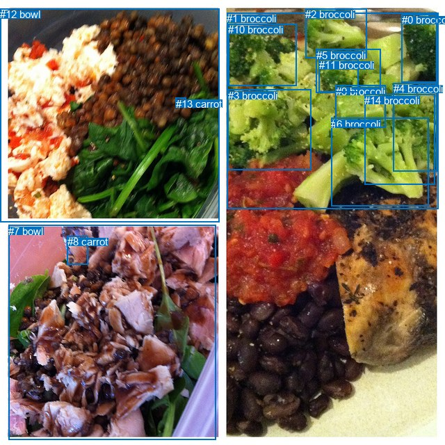
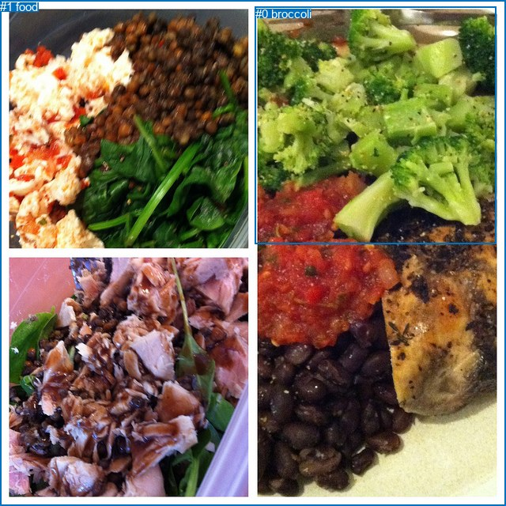

# 图片 1386：2380538.jpg

随机样本序号：171。图片 SHA256：`ecbe85cfbd9d41ad80a6724b5841876e35134b195d116881c550cdf7f61545d8`。

红色框表示人，蓝色框表示其他物体。两个模式分别保留自身框编号，可依据位置比较对应对象。

## 自动检测框与输出

人的框编号：`[]`。状态：`no_person`。

### 自动检测全部物体框

| 编号 | 类别 | 是否为人 | 检测分数 | 像素坐标 xyxy |
|---|---|---|---|---|
| 0 | broccoli | False | 0.9829 | 577.8, 20.2, 628.7, 118.6 |
| 1 | broccoli | False | 0.9435 | 326.3, 18.4, 630.7, 301.0 |
| 2 | broccoli | False | 0.9386 | 439.4, 12.2, 527.8, 83.8 |
| 3 | broccoli | False | 0.9005 | 327.5, 128.5, 447.7, 244.1 |
| 4 | broccoli | False | 0.7901 | 565.6, 119.4, 628.8, 246.1 |
| 5 | broccoli | False | 0.7660 | 454.6, 70.9, 547.7, 133.1 |
| 6 | broccoli | False | 0.7520 | 476.1, 169.9, 616.1, 296.4 |
| 7 | bowl | False | 0.7391 | 12.1, 323.6, 310.4, 632.2 |
| 8 | carrot | False | 0.7282 | 96.7, 339.5, 126.5, 380.9 |
| 9 | broccoli | False | 0.6848 | 482.9, 123.0, 554.5, 183.8 |
| 10 | broccoli | False | 0.6123 | 328.2, 34.3, 426.6, 123.7 |
| 11 | broccoli | False | 0.5855 | 458.6, 85.4, 515.6, 132.4 |
| 12 | bowl | False | 0.5443 | 0.0, 12.1, 315.7, 319.6 |
| 13 | carrot | False | 0.4655 | 252.8, 140.6, 268.0, 153.8 |
| 14 | broccoli | False | 0.4053 | 524.2, 135.7, 625.2, 266.0 |

### 自动检测 Top50 人相关候选

评分物体对：0；人相关物体对：0；输出关系：0。

| 排名 | 主语编号与类别 | 关系 | 宾语编号与类别 | 类型 | 人与人 | 排序分数 | 原始融合 logit |
|---|---|---|---|---|---|---|---|

### 自动检测逐条人相关 GT 核验

本图没有人相关 GT，R@50 无分母；预测候选继续展示。

## 真实框与输出

人的框编号：`[]`。

### 真实框全部物体框

| 编号 | 类别 | 是否为人 | 检测分数 | 像素坐标 xyxy |
|---|---|---|---|---|
| 0 | broccoli | False | GT | 323.0, 9.0, 628.0, 309.0 |
| 1 | food | False | GT | 0.0, 0.0, 640.0, 640.0 |

### 真实框 Top50 人相关候选

评分物体对：0；人相关物体对：0；输出关系：0。

| 排名 | 主语编号与类别 | 关系 | 宾语编号与类别 | 类型 | 人与人 | 排序分数 | 原始融合 logit |
|---|---|---|---|---|---|---|---|

### 真实框逐条人相关 GT 核验

本图没有人相关 GT，R@50 无分母；预测候选继续展示。

## 全部人相关 GT

| 主语编号与类别 | 关系 | 宾语编号与类别 |
|---|---|---|

原始记录、全部人相关物体对的两项预测与分项分数见 [逐图证据 JSON](../evidence/cases/1386.json)。全部56类 logits 保留于本机 HOR/output/random500/logits/。

<!-- HOR_COMPLETE_RESULTS -->

## 六组条件的完整输出对照

以下保留同一图片三种框与候选模式、两种谓词输出规则的全部 Top50。框编号各自在所属模式内解释。

### 自动检测框完整枚举：空间与语义各保留一个谓词

| 排名 | 主语编号与类别 | 谓词 | 宾语编号与类别 | 分组 | 排序分数 | predicate logit | pair logit |
|---|---|---|---|---|---|---|---|

没有人相关 GT，本条件的召回率无分母。

### 自动检测框完整枚举：每对只保留一个谓词

| 排名 | 主语编号与类别 | 谓词 | 宾语编号与类别 | 分组 | 排序分数 | predicate logit | pair logit |
|---|---|---|---|---|---|---|---|

没有人相关 GT，本条件的召回率无分母。

### 真实框完整枚举：空间与语义各保留一个谓词

| 排名 | 主语编号与类别 | 谓词 | 宾语编号与类别 | 分组 | 排序分数 | predicate logit | pair logit |
|---|---|---|---|---|---|---|---|

没有人相关 GT，本条件的召回率无分母。

### 真实框完整枚举：每对只保留一个谓词

| 排名 | 主语编号与类别 | 谓词 | 宾语编号与类别 | 分组 | 排序分数 | predicate logit | pair logit |
|---|---|---|---|---|---|---|---|

没有人相关 GT，本条件的召回率无分母。

### 真实框400候选：空间与语义各保留一个谓词

| 排名 | 主语编号与类别 | 谓词 | 宾语编号与类别 | 分组 | 排序分数 | predicate logit | pair logit |
|---|---|---|---|---|---|---|---|

没有人相关 GT，本条件的召回率无分母。

### 真实框400候选：每对只保留一个谓词

| 排名 | 主语编号与类别 | 谓词 | 宾语编号与类别 | 分组 | 排序分数 | predicate logit | pair logit |
|---|---|---|---|---|---|---|---|

没有人相关 GT，本条件的召回率无分母。
