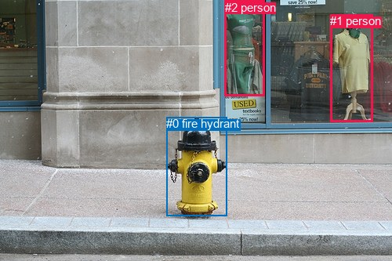
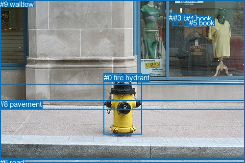

# 图片 1388：2380607.jpg

随机样本序号：12。图片 SHA256：`16dc0c853ddc5911447c5569ec831d1fdd27c4a72cac5ea80c4f230b8d4b5105`。

红色框表示人，蓝色框表示其他物体。两个模式分别保留自身框编号，可依据位置比较对应对象。

## 自动检测框与输出

人的框编号：`[1, 2]`。状态：`ok`。

### 自动检测全部物体框

| 编号 | 类别 | 是否为人 | 检测分数 | 像素坐标 xyxy |
|---|---|---|---|---|
| 0 | fire hydrant | False | 0.9995 | 212.2, 149.1, 289.9, 276.0 |
| 1 | person | True | 0.9952 | 421.3, 18.0, 475.3, 155.9 |
| 2 | person | True | 0.9893 | 286.9, 0.6, 337.9, 122.8 |

### 自动检测 Top50 人相关候选

评分物体对：6；人相关物体对：6；输出关系：12。

| 排名 | 主语编号与类别 | 关系 | 宾语编号与类别 | 类型 | 人与人 | 排序分数 | 原始融合 logit |
|---|---|---|---|---|---|---|---|
| 1 | #1 person | walking on | #0 fire hydrant | semantic | False | 0.94540 | 2.8517 |
| 2 | #1 person | looking at | #2 person | semantic | True | 0.94020 | 2.7552 |
| 3 | #1 person | beside | #2 person | spatial | True | 0.92905 | 2.5722 |
| 4 | #2 person | looking at | #1 person | semantic | True | 0.88816 | 2.0721 |
| 5 | #2 person | beside | #1 person | spatial | True | 0.82961 | 1.5829 |
| 6 | #0 fire hydrant | in front of | #2 person | spatial | False | 0.79201 | 1.3371 |
| 7 | #2 person | looking at | #0 fire hydrant | semantic | False | 0.76992 | 1.2078 |
| 8 | #2 person | over | #0 fire hydrant | spatial | False | 0.74533 | 1.0739 |
| 9 | #0 fire hydrant | in front of | #1 person | spatial | False | 0.73271 | 1.0084 |
| 10 | #1 person | beside | #0 fire hydrant | spatial | False | 0.61768 | 0.4797 |
| 11 | #0 fire hydrant | looking at | #2 person | semantic | False | 0.42888 | -0.2864 |
| 12 | #0 fire hydrant | looking at | #1 person | semantic | False | 0.39672 | -0.4191 |

### 自动检测逐条人相关 GT 核验

本图没有人相关 GT，R@50 无分母；预测候选继续展示。

## 真实框与输出

人的框编号：`[]`。

### 真实框全部物体框

| 编号 | 类别 | 是否为人 | 检测分数 | 像素坐标 xyxy |
|---|---|---|---|---|
| 0 | fire hydrant | False | GT | 212.0, 150.0, 290.0, 275.0 |
| 1 | book | False | GT | 345.0, 27.0, 353.0, 43.0 |
| 2 | book | False | GT | 351.0, 28.0, 361.0, 52.0 |
| 3 | book | False | GT | 354.0, 28.0, 385.0, 52.0 |
| 4 | book | False | GT | 380.0, 29.0, 392.0, 52.0 |
| 5 | book | False | GT | 386.0, 38.0, 396.0, 54.0 |
| 6 | road | False | GT | 0.0, 323.0, 500.0, 333.0 |
| 7 | window | False | GT | 0.0, 0.0, 500.0, 173.0 |
| 8 | pavement | False | GT | 0.0, 204.0, 500.0, 327.0 |
| 9 | wall | False | GT | 0.0, 0.0, 500.0, 223.0 |

### 真实框 Top50 人相关候选

评分物体对：0；人相关物体对：0；输出关系：0。

| 排名 | 主语编号与类别 | 关系 | 宾语编号与类别 | 类型 | 人与人 | 排序分数 | 原始融合 logit |
|---|---|---|---|---|---|---|---|

### 真实框逐条人相关 GT 核验

本图没有人相关 GT，R@50 无分母；预测候选继续展示。

## 全部人相关 GT

| 主语编号与类别 | 关系 | 宾语编号与类别 |
|---|---|---|

原始记录、全部人相关物体对的两项预测与分项分数见 [逐图证据 JSON](../evidence/cases/1388.json)。全部56类 logits 保留于本机 HOR/output/random500/logits/。

<!-- HOR_COMPLETE_RESULTS -->

## 六组条件的完整输出对照

以下保留同一图片三种框与候选模式、两种谓词输出规则的全部 Top50。框编号各自在所属模式内解释。

### 自动检测框完整枚举：空间与语义各保留一个谓词

| 排名 | 主语编号与类别 | 谓词 | 宾语编号与类别 | 分组 | 排序分数 | predicate logit | pair logit |
|---|---|---|---|---|---|---|---|
| 1 | #1 person | walking on | #0 fire hydrant | semantic | 0.9454043 | 3.5912862 | -0.7396296 |
| 2 | #1 person | looking at | #2 person | semantic | 0.9402037 | 3.5873933 | -0.8322418 |
| 3 | #1 person | beside | #2 person | spatial | 0.9290530 | 3.4044747 | -0.8322418 |
| 4 | #2 person | looking at | #1 person | semantic | 0.8881616 | 3.3543344 | -1.2822360 |
| 5 | #2 person | beside | #1 person | spatial | 0.8296080 | 2.8650875 | -1.2822360 |
| 6 | #0 fire hydrant | in front of | #2 person | spatial | 0.7920145 | 2.6579480 | -1.3208363 |
| 7 | #2 person | looking at | #0 fire hydrant | semantic | 0.7699161 | 2.0973654 | -0.8895277 |
| 8 | #2 person | over | #0 fire hydrant | spatial | 0.7453288 | 1.9633799 | -0.8895277 |
| 9 | #0 fire hydrant | in front of | #1 person | spatial | 0.7327122 | 2.1798854 | -1.1714582 |
| 10 | #1 person | beside | #0 fire hydrant | spatial | 0.6176751 | 1.2193213 | -0.7396296 |
| 11 | #0 fire hydrant | looking at | #2 person | semantic | 0.4288790 | 1.0344100 | -1.3208363 |
| 12 | #0 fire hydrant | looking at | #1 person | semantic | 0.3967240 | 0.7523241 | -1.1714582 |

没有人相关 GT，本条件的召回率无分母。

### 自动检测框完整枚举：每对只保留一个谓词

| 排名 | 主语编号与类别 | 谓词 | 宾语编号与类别 | 分组 | 排序分数 | predicate logit | pair logit |
|---|---|---|---|---|---|---|---|
| 1 | #1 person | walking on | #0 fire hydrant | single | 0.9454043 | 3.5912862 | -0.7396296 |
| 2 | #1 person | looking at | #2 person | single | 0.9402037 | 3.5873933 | -0.8322418 |
| 3 | #2 person | looking at | #1 person | single | 0.8881616 | 3.3543344 | -1.2822360 |
| 4 | #0 fire hydrant | in front of | #2 person | single | 0.7920145 | 2.6579480 | -1.3208363 |
| 5 | #2 person | looking at | #0 fire hydrant | single | 0.7699161 | 2.0973654 | -0.8895277 |
| 6 | #0 fire hydrant | in front of | #1 person | single | 0.7327122 | 2.1798854 | -1.1714582 |

没有人相关 GT，本条件的召回率无分母。

### 真实框完整枚举：空间与语义各保留一个谓词

| 排名 | 主语编号与类别 | 谓词 | 宾语编号与类别 | 分组 | 排序分数 | predicate logit | pair logit |
|---|---|---|---|---|---|---|---|

没有人相关 GT，本条件的召回率无分母。

### 真实框完整枚举：每对只保留一个谓词

| 排名 | 主语编号与类别 | 谓词 | 宾语编号与类别 | 分组 | 排序分数 | predicate logit | pair logit |
|---|---|---|---|---|---|---|---|

没有人相关 GT，本条件的召回率无分母。

### 真实框400候选：空间与语义各保留一个谓词

| 排名 | 主语编号与类别 | 谓词 | 宾语编号与类别 | 分组 | 排序分数 | predicate logit | pair logit |
|---|---|---|---|---|---|---|---|

没有人相关 GT，本条件的召回率无分母。

### 真实框400候选：每对只保留一个谓词

| 排名 | 主语编号与类别 | 谓词 | 宾语编号与类别 | 分组 | 排序分数 | predicate logit | pair logit |
|---|---|---|---|---|---|---|---|

没有人相关 GT，本条件的召回率无分母。
