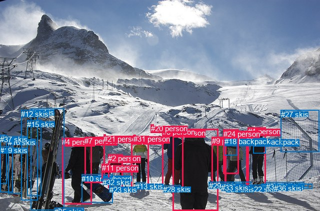
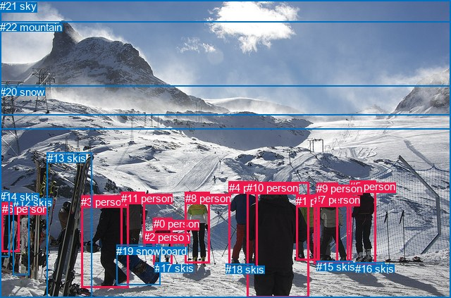

# 图片 1390：2380682.jpg

随机样本序号：369。图片 SHA256：`dc1916be24b981565d21c53ce855fc5863dee819d94bc500c5c0e68112bbe78e`。

红色框表示人，蓝色框表示其他物体。两个模式分别保留自身框编号，可依据位置比较对应对象。

## 自动检测框与输出

人的框编号：`[0, 1, 2, 3, 4, 5, 6, 7, 9, 11, 20, 21, 24, 31]`。状态：`ok`。

### 自动检测全部物体框

| 编号 | 类别 | 是否为人 | 检测分数 | 像素坐标 xyxy |
|---|---|---|---|---|
| 0 | person | True | 0.9991 | 345.8, 258.2, 436.6, 423.0 |
| 1 | person | True | 0.9983 | 495.9, 255.4, 531.9, 376.9 |
| 2 | person | True | 0.9962 | 216.3, 309.1, 245.7, 376.3 |
| 3 | person | True | 0.9957 | 263.0, 272.6, 298.0, 377.4 |
| 4 | person | True | 0.9952 | 124.3, 276.2, 183.6, 409.5 |
| 5 | person | True | 0.9945 | 324.5, 256.3, 366.1, 378.9 |
| 6 | person | True | 0.9940 | 450.3, 267.1, 495.0, 375.9 |
| 7 | person | True | 0.9928 | 169.3, 274.5, 209.7, 366.7 |
| 8 | skis | False | 0.9854 | 61.1, 217.5, 128.1, 421.8 |
| 9 | person | True | 0.9837 | 423.7, 274.0, 451.7, 370.5 |
| 10 | snowboard | False | 0.9777 | 163.1, 350.0, 225.7, 406.6 |
| 11 | person | True | 0.9434 | 203.7, 328.1, 218.5, 358.8 |
| 12 | skis | False | 0.9081 | 42.3, 220.2, 75.4, 401.6 |
| 13 | skis | False | 0.8560 | 271.5, 365.3, 292.0, 379.2 |
| 14 | backpack | False | 0.8267 | 506.1, 276.5, 531.5, 307.1 |
| 15 | skis | False | 0.7901 | 54.4, 240.8, 82.9, 392.3 |
| 16 | skis | False | 0.7163 | 16.2, 276.8, 43.0, 388.3 |
| 17 | skis | False | 0.7116 | 522.6, 368.5, 624.2, 378.4 |
| 18 | backpack | False | 0.6918 | 448.9, 275.0, 474.3, 311.4 |
| 19 | skis | False | 0.6886 | 0.4, 293.4, 25.5, 385.8 |
| 20 | person | True | 0.6160 | 301.9, 249.5, 307.1, 261.0 |
| 21 | person | True | 0.6135 | 207.1, 269.6, 211.1, 276.5 |
| 22 | skis | False | 0.6134 | 499.8, 370.5, 543.1, 379.6 |
| 23 | skis | False | 0.6083 | 218.6, 371.6, 240.3, 380.6 |
| 24 | person | True | 0.5919 | 446.5, 259.9, 477.2, 348.9 |
| 25 | skis | False | 0.5847 | 452.7, 371.4, 504.1, 377.7 |
| 26 | skis | False | 0.5559 | 429.2, 364.9, 502.6, 378.8 |
| 27 | skis | False | 0.5444 | 561.6, 220.9, 638.2, 304.7 |
| 28 | skis | False | 0.5420 | 326.5, 371.2, 361.1, 379.4 |
| 29 | skis | False | 0.5251 | 417.8, 364.0, 466.1, 378.8 |
| 30 | skis | False | 0.4911 | 532.0, 365.9, 609.0, 374.6 |
| 31 | person | True | 0.4513 | 266.9, 270.3, 271.3, 280.0 |
| 32 | skis | False | 0.4500 | 205.1, 356.9, 220.7, 361.2 |
| 33 | skis | False | 0.4451 | 442.1, 368.4, 491.1, 377.9 |
| 34 | skis | False | 0.4067 | 552.5, 365.8, 600.7, 372.4 |
| 35 | skis | False | 0.3642 | 109.2, 416.5, 167.9, 423.0 |
| 36 | skis | False | 0.3610 | 548.2, 368.9, 616.9, 375.3 |
| 37 | skis | False | 0.3537 | 0.1, 270.9, 13.9, 368.6 |

### 自动检测 Top50 人相关候选

评分物体对：1406；人相关物体对：854；输出关系：50。

| 排名 | 主语编号与类别 | 关系 | 宾语编号与类别 | 类型 | 人与人 | 排序分数 | 原始融合 logit |
|---|---|---|---|---|---|---|---|
| 1 | #1 person | wearing | #14 backpack | semantic | False | 0.98898 | 4.4973 |
| 2 | #24 person | wearing | #18 backpack | semantic | False | 0.98832 | 4.4382 |
| 3 | #6 person | wearing | #18 backpack | semantic | False | 0.98773 | 4.3883 |
| 4 | #5 person | wearing | #28 skis | semantic | False | 0.98484 | 4.1739 |
| 5 | #3 person | wearing | #31 person | semantic | True | 0.98479 | 4.1702 |
| 6 | #3 person | wearing | #13 skis | semantic | False | 0.98233 | 4.0178 |
| 7 | #6 person | wearing | #33 skis | semantic | False | 0.98030 | 3.9070 |
| 8 | #6 person | wearing | #26 skis | semantic | False | 0.97651 | 3.7274 |
| 9 | #6 person | wearing | #25 skis | semantic | False | 0.96749 | 3.3933 |
| 10 | #1 person | wearing | #22 skis | semantic | False | 0.96628 | 3.3554 |
| 11 | #2 person | in | #31 person | spatial | True | 0.96186 | 3.2277 |
| 12 | #1 person | in | #14 backpack | spatial | False | 0.95717 | 3.1069 |
| 13 | #24 person | in | #18 backpack | spatial | False | 0.95709 | 3.1049 |
| 14 | #2 person | wearing | #23 skis | semantic | False | 0.95562 | 3.0696 |
| 15 | #2 person | holding | #11 person | semantic | True | 0.95326 | 3.0153 |
| 16 | #6 person | in | #18 backpack | spatial | False | 0.95272 | 3.0032 |
| 17 | #9 person | wearing | #29 skis | semantic | False | 0.94581 | 2.8595 |
| 18 | #3 person | in | #31 person | spatial | True | 0.94560 | 2.8554 |
| 19 | #6 person | wearing | #29 skis | semantic | False | 0.94441 | 2.8325 |
| 20 | #7 person | wearing | #21 person | semantic | True | 0.93910 | 2.7357 |
| 21 | #7 person | holding | #11 person | semantic | True | 0.93031 | 2.5915 |
| 22 | #2 person | wearing | #32 skis | semantic | False | 0.92733 | 2.5464 |
| 23 | #1 person | on | #22 skis | spatial | False | 0.92208 | 2.4710 |
| 24 | #1 person | wearing | #25 skis | semantic | False | 0.92097 | 2.4556 |
| 25 | #1 person | wearing | #26 skis | semantic | False | 0.92029 | 2.4463 |
| 26 | #0 person | wearing | #28 skis | semantic | False | 0.91636 | 2.3939 |
| 27 | #3 person | on | #13 skis | spatial | False | 0.91001 | 2.3137 |
| 28 | #6 person | on | #26 skis | spatial | False | 0.90760 | 2.2847 |
| 29 | #7 person | in | #21 person | spatial | True | 0.90421 | 2.2449 |
| 30 | #2 person | wearing | #31 person | semantic | True | 0.90004 | 2.1976 |
| 31 | #6 person | on | #33 skis | spatial | False | 0.89839 | 2.1795 |
| 32 | #2 person | in | #11 person | spatial | True | 0.89073 | 2.0982 |
| 33 | #11 person | on | #32 skis | spatial | False | 0.89028 | 2.0936 |
| 34 | #2 person | in | #21 person | spatial | True | 0.88961 | 2.0867 |
| 35 | #9 person | wearing | #18 backpack | semantic | False | 0.88851 | 2.0756 |
| 36 | #9 person | wearing | #26 skis | semantic | False | 0.88827 | 2.0732 |
| 37 | #4 person | holding | #10 snowboard | semantic | False | 0.88437 | 2.0345 |
| 38 | #2 person | on | #23 skis | spatial | False | 0.88383 | 2.0292 |
| 39 | #4 person | holding | #8 skis | semantic | False | 0.88176 | 2.0092 |
| 40 | #2 person | on | #32 skis | spatial | False | 0.87512 | 1.9470 |
| 41 | #6 person | on | #25 skis | spatial | False | 0.87030 | 1.9036 |
| 42 | #5 person | on | #28 skis | spatial | False | 0.85785 | 1.7975 |
| 43 | #9 person | wearing | #33 skis | semantic | False | 0.84049 | 1.6619 |
| 44 | #7 person | wearing | #32 skis | semantic | False | 0.83594 | 1.6283 |
| 45 | #6 person | on | #29 skis | spatial | False | 0.83330 | 1.6092 |
| 46 | #6 person | wearing | #14 backpack | semantic | False | 0.83300 | 1.6070 |
| 47 | #1 person | on | #25 skis | spatial | False | 0.82098 | 1.5230 |
| 48 | #1 person | on | #26 skis | spatial | False | 0.81133 | 1.4587 |
| 49 | #9 person | on | #29 skis | spatial | False | 0.80844 | 1.4399 |
| 50 | #0 person | wearing | #29 skis | semantic | False | 0.78313 | 1.2840 |

### 自动检测逐条人相关 GT 核验

R@50：14.29%；命中 1/7。

| GT 主语编号 | GT 关系 | GT 宾语编号 | 结果阶段 | 匹配预测主语编号 | 匹配预测宾语编号 |
|---|---|---|---|---|---|
| 3 | holding | 19 | hit50 | [4] | [10] |
| 4 | wearing | 10 | wrong_predicate | [5] | [0] |
| 5 | standing on | 20 | endpoint_missing_or_wrong_class | [1] | [] |
| 8 | on | 10 | wrong_predicate | [3] | [0] |
| 9 | looking at | 5 | rank_below50 | [6, 24] | [1] |
| 10 | walking on | 20 | endpoint_missing_or_wrong_class | [0] | [] |
| 11 | carrying | 19 | wrong_predicate | [7] | [10] |

## 真实框与输出

人的框编号：`[0, 1, 2, 3, 4, 5, 6, 7, 8, 9, 10, 11]`。

### 真实框全部物体框

| 编号 | 类别 | 是否为人 | 检测分数 | 像素坐标 xyxy |
|---|---|---|---|---|
| 0 | person | True | GT | 218.0, 309.0, 245.0, 375.0 |
| 1 | person | True | GT | 420.0, 277.0, 453.0, 370.0 |
| 2 | person | True | GT | 204.0, 328.0, 218.0, 357.0 |
| 3 | person | True | GT | 115.0, 278.0, 182.0, 409.0 |
| 4 | person | True | GT | 325.0, 258.0, 366.0, 379.0 |
| 5 | person | True | GT | 496.0, 256.0, 533.0, 376.0 |
| 6 | person | True | GT | 3.0, 288.0, 27.0, 358.0 |
| 7 | person | True | GT | 446.0, 275.0, 494.0, 374.0 |
| 8 | person | True | GT | 263.0, 273.0, 297.0, 374.0 |
| 9 | person | True | GT | 449.0, 259.0, 479.0, 373.0 |
| 10 | person | True | GT | 350.0, 258.0, 438.0, 423.0 |
| 11 | person | True | GT | 172.0, 273.0, 206.0, 360.0 |
| 12 | skis | False | GT | 19.0, 279.0, 41.0, 391.0 |
| 13 | skis | False | GT | 67.0, 216.0, 131.0, 423.0 |
| 14 | skis | False | GT | 0.0, 271.0, 14.0, 364.0 |
| 15 | skis | False | GT | 449.0, 370.0, 501.0, 382.0 |
| 16 | skis | False | GT | 504.0, 373.0, 545.0, 380.0 |
| 17 | skis | False | GT | 220.0, 372.0, 241.0, 375.0 |
| 18 | skis | False | GT | 320.0, 374.0, 360.0, 378.0 |
| 19 | snowboard | False | GT | 165.0, 348.0, 227.0, 405.0 |
| 20 | snow | False | GT | 0.0, 122.0, 640.0, 423.0 |
| 21 | sky | False | GT | 0.0, 0.0, 640.0, 164.0 |
| 22 | mountain | False | GT | 0.0, 30.0, 640.0, 183.0 |

### 真实框 Top50 人相关候选

评分物体对：506；人相关物体对：396；输出关系：50。

| 排名 | 主语编号与类别 | 关系 | 宾语编号与类别 | 类型 | 人与人 | 排序分数 | 原始融合 logit |
|---|---|---|---|---|---|---|---|
| 1 | #4 person | wearing | #18 skis | semantic | False | 0.98838 | 4.4436 |
| 2 | #0 person | wearing | #17 skis | semantic | False | 0.98074 | 3.9304 |
| 3 | #5 person | wearing | #16 skis | semantic | False | 0.97366 | 3.6100 |
| 4 | #11 person | holding | #2 person | semantic | True | 0.97261 | 3.5698 |
| 5 | #10 person | standing on | #20 snow | semantic | False | 0.97002 | 3.4766 |
| 6 | #3 person | standing on | #20 snow | semantic | False | 0.96811 | 3.4130 |
| 7 | #3 person | holding | #13 skis | semantic | False | 0.96610 | 3.3497 |
| 8 | #9 person | wearing | #15 skis | semantic | False | 0.96397 | 3.2868 |
| 9 | #10 person | wearing | #18 skis | semantic | False | 0.95624 | 3.0844 |
| 10 | #11 person | standing on | #20 snow | semantic | False | 0.95580 | 3.0737 |
| 11 | #5 person | wearing | #15 skis | semantic | False | 0.95486 | 3.0517 |
| 12 | #7 person | wearing | #15 skis | semantic | False | 0.95371 | 3.0254 |
| 13 | #6 person | on | #14 skis | spatial | False | 0.95148 | 2.9760 |
| 14 | #5 person | on | #16 skis | spatial | False | 0.94681 | 2.8793 |
| 15 | #14 skis | holding | #6 person | semantic | False | 0.94533 | 2.8501 |
| 16 | #5 person | standing on | #20 snow | semantic | False | 0.94410 | 2.8267 |
| 17 | #4 person | standing on | #20 snow | semantic | False | 0.94381 | 2.8212 |
| 18 | #9 person | standing on | #20 snow | semantic | False | 0.94241 | 2.7951 |
| 19 | #0 person | standing on | #20 snow | semantic | False | 0.94039 | 2.7585 |
| 20 | #3 person | holding | #19 snowboard | semantic | False | 0.93733 | 2.7051 |
| 21 | #6 person | on | #12 skis | spatial | False | 0.93403 | 2.6504 |
| 22 | #8 person | standing on | #20 snow | semantic | False | 0.93375 | 2.6459 |
| 23 | #3 person | on | #20 snow | spatial | False | 0.92665 | 2.5363 |
| 24 | #12 skis | on | #6 person | spatial | False | 0.92406 | 2.4988 |
| 25 | #9 person | wearing | #7 person | semantic | True | 0.91443 | 2.3689 |
| 26 | #14 skis | on | #6 person | spatial | False | 0.91277 | 2.3479 |
| 27 | #10 person | on | #20 snow | spatial | False | 0.90229 | 2.2230 |
| 28 | #1 person | standing on | #20 snow | semantic | False | 0.90108 | 2.2093 |
| 29 | #0 person | on | #17 skis | spatial | False | 0.90037 | 2.2013 |
| 30 | #0 person | on | #20 snow | spatial | False | 0.89989 | 2.1960 |
| 31 | #4 person | on | #18 skis | spatial | False | 0.89414 | 2.1337 |
| 32 | #8 person | on | #20 snow | spatial | False | 0.89377 | 2.1298 |
| 33 | #6 person | holding | #12 skis | semantic | False | 0.89098 | 2.1008 |
| 34 | #9 person | on | #15 skis | spatial | False | 0.88464 | 2.0372 |
| 35 | #19 snowboard | on | #2 person | spatial | False | 0.88381 | 2.0290 |
| 36 | #5 person | on | #15 skis | spatial | False | 0.88149 | 2.0066 |
| 37 | #12 skis | holding | #6 person | semantic | False | 0.87695 | 1.9639 |
| 38 | #7 person | on | #15 skis | spatial | False | 0.87512 | 1.9470 |
| 39 | #7 person | standing on | #20 snow | semantic | False | 0.87112 | 1.9109 |
| 40 | #0 person | holding | #2 person | semantic | True | 0.86916 | 1.8935 |
| 41 | #5 person | on | #20 snow | spatial | False | 0.86759 | 1.8798 |
| 42 | #10 person | on | #18 skis | spatial | False | 0.85405 | 1.7667 |
| 43 | #9 person | in | #7 person | spatial | True | 0.84955 | 1.7311 |
| 44 | #4 person | on | #20 snow | spatial | False | 0.84260 | 1.6777 |
| 45 | #11 person | on | #20 snow | spatial | False | 0.83598 | 1.6286 |
| 46 | #6 person | holding | #14 skis | semantic | False | 0.82744 | 1.5676 |
| 47 | #9 person | on | #20 snow | spatial | False | 0.80064 | 1.3903 |
| 48 | #19 snowboard | lying on | #2 person | semantic | False | 0.78722 | 1.3082 |
| 49 | #3 person | on | #19 snowboard | spatial | False | 0.76454 | 1.1777 |
| 50 | #0 person | in | #2 person | spatial | True | 0.74701 | 1.0827 |

### 真实框逐条人相关 GT 核验

R@50：28.57%；命中 2/7。

| GT 主语编号 | GT 关系 | GT 宾语编号 | 结果阶段 | 匹配预测主语编号 | 匹配预测宾语编号 |
|---|---|---|---|---|---|
| 3 | holding | 19 | hit50 | [3] | [19] |
| 4 | wearing | 10 | wrong_predicate | [4] | [10] |
| 5 | standing on | 20 | hit50 | [5] | [20] |
| 8 | on | 10 | wrong_predicate | [8] | [10] |
| 9 | looking at | 5 | rank_below50 | [9] | [5] |
| 10 | walking on | 20 | wrong_predicate | [10] | [20] |
| 11 | carrying | 19 | wrong_predicate | [11] | [19] |

## 全部人相关 GT

| 主语编号与类别 | 关系 | 宾语编号与类别 |
|---|---|---|
| #3 person | holding | #19 snowboard |
| #4 person | wearing | #10 person |
| #5 person | standing on | #20 snow |
| #8 person | on | #10 person |
| #9 person | looking at | #5 person |
| #10 person | walking on | #20 snow |
| #11 person | carrying | #19 snowboard |

原始记录、全部人相关物体对的两项预测与分项分数见 [逐图证据 JSON](../evidence/cases/1390.json)。全部56类 logits 保留于本机 HOR/output/random500/logits/。

<!-- HOR_COMPLETE_RESULTS -->

## 六组条件的完整输出对照

以下保留同一图片三种框与候选模式、两种谓词输出规则的全部 Top50。框编号各自在所属模式内解释。

### 自动检测框完整枚举：空间与语义各保留一个谓词

| 排名 | 主语编号与类别 | 谓词 | 宾语编号与类别 | 分组 | 排序分数 | predicate logit | pair logit |
|---|---|---|---|---|---|---|---|
| 1 | #1 person | wearing | #14 backpack | semantic | 0.9889838 | 4.2237420 | 0.2735706 |
| 2 | #24 person | wearing | #18 backpack | semantic | 0.9883209 | 4.2604537 | 0.1777504 |
| 3 | #6 person | wearing | #18 backpack | semantic | 0.9877302 | 3.8904834 | 0.4977898 |
| 4 | #5 person | wearing | #28 skis | semantic | 0.9848412 | 3.9709849 | 0.2029070 |
| 5 | #3 person | wearing | #31 person | semantic | 0.9847856 | 3.8918414 | 0.2783370 |
| 6 | #3 person | wearing | #13 skis | semantic | 0.9823260 | 3.8065372 | 0.2112893 |
| 7 | #6 person | wearing | #33 skis | semantic | 0.9802963 | 3.6890340 | 0.2180132 |
| 8 | #6 person | wearing | #26 skis | semantic | 0.9765093 | 3.5187182 | 0.2086588 |
| 9 | #6 person | wearing | #25 skis | semantic | 0.9674933 | 3.2295418 | 0.1637191 |
| 10 | #1 person | wearing | #22 skis | semantic | 0.9662808 | 3.3542714 | 0.0011162 |
| 11 | #2 person | in | #31 person | spatial | 0.9618621 | 3.2930570 | -0.0653956 |
| 12 | #1 person | in | #14 backpack | spatial | 0.9571749 | 2.8332911 | 0.2735706 |
| 13 | #24 person | in | #18 backpack | spatial | 0.9570926 | 2.9271059 | 0.1777504 |
| 14 | #2 person | wearing | #23 skis | semantic | 0.9556205 | 3.5319581 | -0.4623749 |
| 15 | #2 person | holding | #11 person | semantic | 0.9532616 | 2.9260077 | 0.0893139 |
| 16 | #6 person | in | #18 backpack | spatial | 0.9527173 | 2.5053835 | 0.4977898 |
| 17 | #9 person | wearing | #29 skis | semantic | 0.9458094 | 2.7766700 | 0.0828646 |
| 18 | #3 person | in | #31 person | spatial | 0.9455971 | 2.5770602 | 0.2783370 |
| 19 | #6 person | wearing | #29 skis | semantic | 0.9444078 | 2.6379495 | 0.1945657 |
| 20 | #7 person | wearing | #21 person | semantic | 0.9391003 | 3.0005479 | -0.2648544 |
| 21 | #7 person | holding | #11 person | semantic | 0.9303142 | 2.4201555 | 0.1713701 |
| 22 | #2 person | wearing | #32 skis | semantic | 0.9273311 | 2.9271259 | -0.3807275 |
| 23 | #1 person | on | #22 skis | spatial | 0.9220805 | 2.4698396 | 0.0011162 |
| 24 | #1 person | wearing | #25 skis | semantic | 0.9209665 | 2.5168324 | -0.0612801 |
| 25 | #1 person | wearing | #26 skis | semantic | 0.9202935 | 2.5227008 | -0.0763605 |
| 26 | #0 person | wearing | #28 skis | semantic | 0.9163605 | 2.4354339 | -0.0415393 |
| 27 | #3 person | on | #13 skis | spatial | 0.9100069 | 2.1024313 | 0.2112893 |
| 28 | #6 person | on | #26 skis | spatial | 0.9076049 | 2.0760760 | 0.2086588 |
| 29 | #7 person | in | #21 person | spatial | 0.9042132 | 2.5097947 | -0.2648544 |
| 30 | #2 person | wearing | #31 person | semantic | 0.9000350 | 2.2630091 | -0.0653956 |
| 31 | #6 person | on | #33 skis | spatial | 0.8983896 | 1.9614453 | 0.2180132 |
| 32 | #2 person | in | #11 person | spatial | 0.8907264 | 2.0088677 | 0.0893139 |
| 33 | #11 person | on | #32 skis | spatial | 0.8902760 | 2.7564445 | -0.6628809 |
| 34 | #2 person | in | #21 person | spatial | 0.8896070 | 2.5562572 | -0.4695241 |
| 35 | #9 person | wearing | #18 backpack | semantic | 0.8885096 | 1.7251253 | 0.3504819 |
| 36 | #9 person | wearing | #26 skis | semantic | 0.8882708 | 2.0389853 | 0.0342134 |
| 37 | #4 person | holding | #10 snowboard | semantic | 0.8843719 | 2.3862209 | -0.3517224 |
| 38 | #2 person | on | #23 skis | spatial | 0.8838335 | 2.4916191 | -0.4623749 |
| 39 | #4 person | holding | #8 skis | semantic | 0.8817600 | 2.3858023 | -0.3765992 |
| 40 | #2 person | on | #32 skis | spatial | 0.8751156 | 2.3276954 | -0.3807275 |
| 41 | #6 person | on | #25 skis | spatial | 0.8703025 | 1.7399168 | 0.1637191 |
| 42 | #5 person | on | #28 skis | spatial | 0.8578472 | 1.5946159 | 0.2029070 |
| 43 | #9 person | wearing | #33 skis | semantic | 0.8404879 | 1.6059723 | 0.0558907 |
| 44 | #7 person | wearing | #32 skis | semantic | 0.8359390 | 1.9524703 | -0.3241529 |
| 45 | #6 person | on | #29 skis | spatial | 0.8333021 | 1.4146476 | 0.1945657 |
| 46 | #6 person | wearing | #14 backpack | semantic | 0.8329951 | 1.3597388 | 0.2472659 |
| 47 | #1 person | on | #25 skis | spatial | 0.8209836 | 1.5843058 | -0.0612801 |
| 48 | #1 person | on | #26 skis | spatial | 0.8113264 | 1.5350122 | -0.0763605 |
| 49 | #9 person | on | #29 skis | spatial | 0.8084403 | 1.3570428 | 0.0828646 |
| 50 | #0 person | wearing | #29 skis | semantic | 0.7831325 | 1.6184597 | -0.3344444 |

GT 命中：1/7，R@50=14.29%。

| GT主语 | GT谓词 | GT宾语 | 结果阶段 | 匹配主语框 | 匹配宾语框 |
|---|---|---|---|---|---|
| 3 | holding | 19 | hit50 | [4] | [10] |
| 4 | wearing | 10 | wrong_predicate | [5] | [0] |
| 5 | standing on | 20 | endpoint_missing_or_wrong_class | [1] | [] |
| 8 | on | 10 | wrong_predicate | [3] | [0] |
| 9 | looking at | 5 | rank_below50 | [6, 24] | [1] |
| 10 | walking on | 20 | endpoint_missing_or_wrong_class | [0] | [] |
| 11 | carrying | 19 | wrong_predicate | [7] | [10] |

### 自动检测框完整枚举：每对只保留一个谓词

| 排名 | 主语编号与类别 | 谓词 | 宾语编号与类别 | 分组 | 排序分数 | predicate logit | pair logit |
|---|---|---|---|---|---|---|---|
| 1 | #1 person | wearing | #14 backpack | single | 0.9889838 | 4.2237420 | 0.2735706 |
| 2 | #24 person | wearing | #18 backpack | single | 0.9883209 | 4.2604537 | 0.1777504 |
| 3 | #6 person | wearing | #18 backpack | single | 0.9877302 | 3.8904834 | 0.4977898 |
| 4 | #5 person | wearing | #28 skis | single | 0.9848412 | 3.9709849 | 0.2029070 |
| 5 | #3 person | wearing | #31 person | single | 0.9847856 | 3.8918414 | 0.2783370 |
| 6 | #3 person | wearing | #13 skis | single | 0.9823260 | 3.8065372 | 0.2112893 |
| 7 | #6 person | wearing | #33 skis | single | 0.9802963 | 3.6890340 | 0.2180132 |
| 8 | #6 person | wearing | #26 skis | single | 0.9765093 | 3.5187182 | 0.2086588 |
| 9 | #6 person | wearing | #25 skis | single | 0.9674933 | 3.2295418 | 0.1637191 |
| 10 | #1 person | wearing | #22 skis | single | 0.9662808 | 3.3542714 | 0.0011162 |
| 11 | #2 person | in | #31 person | single | 0.9618621 | 3.2930570 | -0.0653956 |
| 12 | #2 person | wearing | #23 skis | single | 0.9556205 | 3.5319581 | -0.4623749 |
| 13 | #2 person | holding | #11 person | single | 0.9532616 | 2.9260077 | 0.0893139 |
| 14 | #9 person | wearing | #29 skis | single | 0.9458094 | 2.7766700 | 0.0828646 |
| 15 | #6 person | wearing | #29 skis | single | 0.9444078 | 2.6379495 | 0.1945657 |
| 16 | #7 person | wearing | #21 person | single | 0.9391003 | 3.0005479 | -0.2648544 |
| 17 | #7 person | holding | #11 person | single | 0.9303142 | 2.4201555 | 0.1713701 |
| 18 | #2 person | wearing | #32 skis | single | 0.9273311 | 2.9271259 | -0.3807275 |
| 19 | #1 person | wearing | #25 skis | single | 0.9209665 | 2.5168324 | -0.0612801 |
| 20 | #1 person | wearing | #26 skis | single | 0.9202935 | 2.5227008 | -0.0763605 |
| 21 | #0 person | wearing | #28 skis | single | 0.9163605 | 2.4354339 | -0.0415393 |
| 22 | #11 person | on | #32 skis | single | 0.8902760 | 2.7564445 | -0.6628809 |
| 23 | #2 person | in | #21 person | single | 0.8896070 | 2.5562572 | -0.4695241 |
| 24 | #9 person | wearing | #18 backpack | single | 0.8885096 | 1.7251253 | 0.3504819 |
| 25 | #9 person | wearing | #26 skis | single | 0.8882708 | 2.0389853 | 0.0342134 |
| 26 | #4 person | holding | #10 snowboard | single | 0.8843719 | 2.3862209 | -0.3517224 |
| 27 | #4 person | holding | #8 skis | single | 0.8817600 | 2.3858023 | -0.3765992 |
| 28 | #9 person | wearing | #33 skis | single | 0.8404879 | 1.6059723 | 0.0558907 |
| 29 | #7 person | wearing | #32 skis | single | 0.8359390 | 1.9524703 | -0.3241529 |
| 30 | #6 person | wearing | #14 backpack | single | 0.8329951 | 1.3597388 | 0.2472659 |
| 31 | #0 person | wearing | #29 skis | single | 0.7831325 | 1.6184597 | -0.3344444 |
| 32 | #7 person | wearing | #31 person | single | 0.7768834 | 1.3808823 | -0.1332868 |
| 33 | #4 person | wearing | #35 skis | single | 0.7607017 | 1.5531611 | -0.3966310 |
| 34 | #20 person | on | #21 person | single | 0.7507861 | 1.1816783 | -0.0788687 |
| 35 | #1 person | wearing | #33 skis | single | 0.7009600 | 0.9307256 | -0.0788521 |
| 36 | #1 person | on | #17 skis | single | 0.6912256 | 1.0472383 | -0.2413829 |
| 37 | #10 snowboard | on | #11 person | single | 0.6578582 | 1.1229157 | -0.4691514 |
| 38 | #24 person | wearing | #29 skis | single | 0.6520997 | 0.8294678 | -0.2011862 |
| 39 | #0 person | wearing | #26 skis | single | 0.6477031 | 0.9534454 | -0.3444875 |
| 40 | #1 person | wearing | #18 backpack | single | 0.6472081 | 0.5281682 | 0.0786214 |
| 41 | #4 person | holding | #15 skis | single | 0.6459413 | 1.0307679 | -0.4295220 |
| 42 | #4 person | in | #21 person | single | 0.6359283 | 1.3851471 | -0.8274122 |
| 43 | #24 person | wearing | #14 backpack | single | 0.6354240 | 0.7777004 | -0.2221430 |
| 44 | #11 person | in | #21 person | single | 0.6266866 | 1.1999450 | -0.6819167 |
| 45 | #1 person | on | #30 skis | single | 0.6148541 | 0.6394286 | -0.1716660 |
| 46 | #0 person | wearing | #18 backpack | single | 0.5970008 | 0.7108974 | -0.3179138 |
| 47 | #1 person | wearing | #29 skis | single | 0.5709569 | 0.4558849 | -0.1701284 |
| 48 | #3 person | wearing | #28 skis | single | 0.5650699 | 0.0419788 | 0.2197852 |
| 49 | #1 person | on | #34 skis | single | 0.5630493 | 0.4422574 | -0.1887107 |
| 50 | #24 person | wearing | #33 skis | single | 0.5574326 | 0.4477620 | -0.2170133 |

GT 命中：1/7，R@50=14.29%。

| GT主语 | GT谓词 | GT宾语 | 结果阶段 | 匹配主语框 | 匹配宾语框 |
|---|---|---|---|---|---|
| 3 | holding | 19 | hit50 | [4] | [10] |
| 4 | wearing | 10 | wrong_predicate | [5] | [0] |
| 5 | standing on | 20 | endpoint_missing_or_wrong_class | [1] | [] |
| 8 | on | 10 | wrong_predicate | [3] | [0] |
| 9 | looking at | 5 | rank_below50 | [6, 24] | [1] |
| 10 | walking on | 20 | endpoint_missing_or_wrong_class | [0] | [] |
| 11 | carrying | 19 | wrong_predicate | [7] | [10] |

### 真实框完整枚举：空间与语义各保留一个谓词

| 排名 | 主语编号与类别 | 谓词 | 宾语编号与类别 | 分组 | 排序分数 | predicate logit | pair logit |
|---|---|---|---|---|---|---|---|
| 1 | #4 person | wearing | #18 skis | semantic | 0.9883832 | 4.2836328 | 0.1599905 |
| 2 | #0 person | wearing | #17 skis | semantic | 0.9807419 | 4.3129725 | -0.3825972 |
| 3 | #5 person | wearing | #16 skis | semantic | 0.9736618 | 3.6258445 | -0.0157990 |
| 4 | #11 person | holding | #2 person | semantic | 0.9726099 | 3.4816623 | 0.0881408 |
| 5 | #10 person | standing on | #20 snow | semantic | 0.9700153 | 3.7584710 | -0.2818472 |
| 6 | #3 person | standing on | #20 snow | semantic | 0.9681078 | 3.6440215 | -0.2310405 |
| 7 | #3 person | holding | #13 skis | semantic | 0.9660962 | 3.7116733 | -0.3619382 |
| 8 | #9 person | wearing | #15 skis | semantic | 0.9639720 | 3.2471461 | 0.0396198 |
| 9 | #10 person | wearing | #18 skis | semantic | 0.9562449 | 3.1576233 | -0.0732180 |
| 10 | #11 person | standing on | #20 snow | semantic | 0.9557952 | 3.3371940 | -0.2634841 |
| 11 | #5 person | wearing | #15 skis | semantic | 0.9548553 | 3.1443839 | -0.0926986 |
| 12 | #7 person | wearing | #15 skis | semantic | 0.9537094 | 3.0650949 | -0.0396750 |
| 13 | #6 person | on | #14 skis | spatial | 0.9514782 | 3.2556872 | -0.2796822 |
| 14 | #5 person | on | #16 skis | spatial | 0.9468144 | 2.8951144 | -0.0157990 |
| 15 | #14 skis | holding | #6 person | semantic | 0.9453263 | 3.1187906 | -0.2686436 |
| 16 | #5 person | standing on | #20 snow | semantic | 0.9441040 | 2.9210172 | -0.0942724 |
| 17 | #4 person | standing on | #20 snow | semantic | 0.9438105 | 3.2270312 | -0.4058348 |
| 18 | #9 person | standing on | #20 snow | semantic | 0.9424120 | 2.9246888 | -0.1295598 |
| 19 | #0 person | standing on | #20 snow | semantic | 0.9403908 | 3.1933670 | -0.4348801 |
| 20 | #3 person | holding | #19 snowboard | semantic | 0.9373285 | 3.0807257 | -0.3756001 |
| 21 | #6 person | on | #12 skis | spatial | 0.9340349 | 2.9536161 | -0.3032280 |
| 22 | #8 person | standing on | #20 snow | semantic | 0.9337547 | 2.8953128 | -0.2494620 |
| 23 | #3 person | on | #20 snow | spatial | 0.9266473 | 2.7673345 | -0.2310405 |
| 24 | #12 skis | on | #6 person | spatial | 0.9240608 | 2.8659201 | -0.3670759 |
| 25 | #9 person | wearing | #7 person | semantic | 0.9144272 | 2.8261595 | -0.4572291 |
| 26 | #14 skis | on | #6 person | spatial | 0.9127685 | 2.6165600 | -0.2686436 |
| 27 | #10 person | on | #20 snow | spatial | 0.9022940 | 2.5048246 | -0.2818472 |
| 28 | #1 person | standing on | #20 snow | semantic | 0.9010822 | 2.6311212 | -0.4218136 |
| 29 | #0 person | on | #17 skis | spatial | 0.9003656 | 2.5838909 | -0.3825972 |
| 30 | #0 person | on | #20 snow | spatial | 0.8998938 | 2.6309247 | -0.4348801 |
| 31 | #4 person | on | #18 skis | spatial | 0.8941399 | 1.9737539 | 0.1599905 |
| 32 | #8 person | on | #20 snow | spatial | 0.8937700 | 2.3793044 | -0.2494620 |
| 33 | #6 person | holding | #12 skis | semantic | 0.8909808 | 2.4040260 | -0.3032280 |
| 34 | #9 person | on | #15 skis | spatial | 0.8846430 | 1.9975319 | 0.0396198 |
| 35 | #19 snowboard | on | #2 person | spatial | 0.8838077 | 2.4882007 | -0.4592073 |
| 36 | #5 person | on | #15 skis | spatial | 0.8814858 | 2.0992742 | -0.0926986 |
| 37 | #12 skis | holding | #6 person | semantic | 0.8769494 | 2.3309288 | -0.3670759 |
| 38 | #7 person | on | #15 skis | spatial | 0.8751156 | 1.9866424 | -0.0396750 |
| 39 | #7 person | standing on | #20 snow | semantic | 0.8711239 | 2.3757024 | -0.4647700 |
| 40 | #0 person | holding | #2 person | semantic | 0.8691591 | 1.7819910 | 0.1115531 |
| 41 | #5 person | on | #20 snow | spatial | 0.8675881 | 1.9740720 | -0.0942724 |
| 42 | #10 person | on | #18 skis | spatial | 0.8540473 | 1.8399220 | -0.0732180 |
| 43 | #9 person | in | #7 person | spatial | 0.8495522 | 2.1883221 | -0.4572291 |
| 44 | #4 person | on | #20 snow | spatial | 0.8426014 | 2.0835476 | -0.4058348 |
| 45 | #11 person | on | #20 snow | spatial | 0.8359814 | 1.8921103 | -0.2634841 |
| 46 | #6 person | holding | #14 skis | semantic | 0.8274399 | 1.8472729 | -0.2796822 |
| 47 | #9 person | on | #20 snow | spatial | 0.8006364 | 1.5198364 | -0.1295598 |
| 48 | #19 snowboard | lying on | #2 person | semantic | 0.7872152 | 1.7674274 | -0.4592073 |
| 49 | #3 person | on | #19 snowboard | spatial | 0.7645371 | 1.5533171 | -0.3756001 |
| 50 | #0 person | in | #2 person | spatial | 0.7470061 | 0.9711547 | 0.1115531 |

GT 命中：2/7，R@50=28.57%。

| GT主语 | GT谓词 | GT宾语 | 结果阶段 | 匹配主语框 | 匹配宾语框 |
|---|---|---|---|---|---|
| 3 | holding | 19 | hit50 | [3] | [19] |
| 4 | wearing | 10 | wrong_predicate | [4] | [10] |
| 5 | standing on | 20 | hit50 | [5] | [20] |
| 8 | on | 10 | wrong_predicate | [8] | [10] |
| 9 | looking at | 5 | rank_below50 | [9] | [5] |
| 10 | walking on | 20 | wrong_predicate | [10] | [20] |
| 11 | carrying | 19 | wrong_predicate | [11] | [19] |

### 真实框完整枚举：每对只保留一个谓词

| 排名 | 主语编号与类别 | 谓词 | 宾语编号与类别 | 分组 | 排序分数 | predicate logit | pair logit |
|---|---|---|---|---|---|---|---|
| 1 | #4 person | wearing | #18 skis | single | 0.9883832 | 4.2836328 | 0.1599905 |
| 2 | #0 person | wearing | #17 skis | single | 0.9807419 | 4.3129725 | -0.3825972 |
| 3 | #5 person | wearing | #16 skis | single | 0.9736618 | 3.6258445 | -0.0157990 |
| 4 | #11 person | holding | #2 person | single | 0.9726099 | 3.4816623 | 0.0881408 |
| 5 | #10 person | standing on | #20 snow | single | 0.9700153 | 3.7584710 | -0.2818472 |
| 6 | #3 person | standing on | #20 snow | single | 0.9681078 | 3.6440215 | -0.2310405 |
| 7 | #3 person | holding | #13 skis | single | 0.9660962 | 3.7116733 | -0.3619382 |
| 8 | #9 person | wearing | #15 skis | single | 0.9639720 | 3.2471461 | 0.0396198 |
| 9 | #10 person | wearing | #18 skis | single | 0.9562449 | 3.1576233 | -0.0732180 |
| 10 | #11 person | standing on | #20 snow | single | 0.9557952 | 3.3371940 | -0.2634841 |
| 11 | #5 person | wearing | #15 skis | single | 0.9548553 | 3.1443839 | -0.0926986 |
| 12 | #7 person | wearing | #15 skis | single | 0.9537094 | 3.0650949 | -0.0396750 |
| 13 | #6 person | on | #14 skis | single | 0.9514782 | 3.2556872 | -0.2796822 |
| 14 | #14 skis | holding | #6 person | single | 0.9453263 | 3.1187906 | -0.2686436 |
| 15 | #5 person | standing on | #20 snow | single | 0.9441040 | 2.9210172 | -0.0942724 |
| 16 | #4 person | standing on | #20 snow | single | 0.9438105 | 3.2270312 | -0.4058348 |
| 17 | #9 person | standing on | #20 snow | single | 0.9424120 | 2.9246888 | -0.1295598 |
| 18 | #0 person | standing on | #20 snow | single | 0.9403908 | 3.1933670 | -0.4348801 |
| 19 | #3 person | holding | #19 snowboard | single | 0.9373285 | 3.0807257 | -0.3756001 |
| 20 | #6 person | on | #12 skis | single | 0.9340349 | 2.9536161 | -0.3032280 |
| 21 | #8 person | standing on | #20 snow | single | 0.9337547 | 2.8953128 | -0.2494620 |
| 22 | #12 skis | on | #6 person | single | 0.9240608 | 2.8659201 | -0.3670759 |
| 23 | #9 person | wearing | #7 person | single | 0.9144272 | 2.8261595 | -0.4572291 |
| 24 | #1 person | standing on | #20 snow | single | 0.9010822 | 2.6311212 | -0.4218136 |
| 25 | #19 snowboard | on | #2 person | single | 0.8838077 | 2.4882007 | -0.4592073 |
| 26 | #7 person | standing on | #20 snow | single | 0.8711239 | 2.3757024 | -0.4647700 |
| 27 | #0 person | holding | #2 person | single | 0.8691591 | 1.7819910 | 0.1115531 |
| 28 | #13 skis | leaning on | #3 person | single | 0.7236888 | 1.8030124 | -0.8401785 |
| 29 | #11 person | holding | #19 snowboard | single | 0.6968100 | 1.6095476 | -0.7773945 |
| 30 | #6 person | on | #20 snow | single | 0.6725661 | 1.0788064 | -0.3589922 |
| 31 | #3 person | beside | #11 person | single | 0.5929232 | 0.7970605 | -0.4209974 |
| 32 | #2 person | on | #20 snow | single | 0.5823831 | 1.0183344 | -0.6857704 |
| 33 | #1 person | wearing | #15 skis | single | 0.4729089 | -0.0616803 | -0.0467904 |
| 34 | #16 skis | on | #5 person | single | 0.4354443 | 1.0581574 | -1.3178297 |
| 35 | #0 person | holding | #19 snowboard | single | 0.4352017 | 0.6110072 | -0.8716662 |
| 36 | #10 person | beside | #4 person | single | 0.4118851 | 0.2233605 | -0.5795385 |
| 37 | #10 person | standing on | #15 skis | single | 0.4117047 | -0.0323114 | -0.3246111 |
| 38 | #17 skis | on | #0 person | single | 0.4102552 | 0.6967726 | -1.0596831 |
| 39 | #1 person | beside | #9 person | single | 0.4026337 | 0.7095046 | -1.1040077 |
| 40 | #7 person | wearing | #16 skis | single | 0.4007283 | 0.0051227 | -0.4075540 |
| 41 | #19 snowboard | beside | #3 person | single | 0.3794602 | 0.4106164 | -0.9024562 |
| 42 | #11 person | beside | #3 person | single | 0.3712935 | 0.4353876 | -0.9620593 |
| 43 | #4 person | beside | #10 person | single | 0.3378848 | 0.5560989 | -1.2288333 |
| 44 | #5 person | looking at | #21 sky | single | 0.3328907 | 0.9963002 | -1.6914396 |
| 45 | #18 skis | on | #4 person | single | 0.3219580 | 0.2571626 | -1.0019506 |
| 46 | #8 person | wearing | #18 skis | single | 0.3207298 | -0.8593280 | 0.1089082 |
| 47 | #1 person | beside | #7 person | single | 0.3117200 | -0.1640091 | -0.6280811 |
| 48 | #2 person | holding | #19 snowboard | single | 0.3110664 | 0.2241225 | -1.0192609 |
| 49 | #10 person | looking at | #21 sky | single | 0.3072762 | 0.6771502 | -1.4900345 |
| 50 | #9 person | wearing | #16 skis | single | 0.3063819 | -0.5028162 | -0.3142732 |

GT 命中：2/7，R@50=28.57%。

| GT主语 | GT谓词 | GT宾语 | 结果阶段 | 匹配主语框 | 匹配宾语框 |
|---|---|---|---|---|---|
| 3 | holding | 19 | hit50 | [3] | [19] |
| 4 | wearing | 10 | wrong_predicate | [4] | [10] |
| 5 | standing on | 20 | hit50 | [5] | [20] |
| 8 | on | 10 | wrong_predicate | [8] | [10] |
| 9 | looking at | 5 | wrong_predicate | [9] | [5] |
| 10 | walking on | 20 | wrong_predicate | [10] | [20] |
| 11 | carrying | 19 | wrong_predicate | [11] | [19] |

### 真实框400候选：空间与语义各保留一个谓词

| 排名 | 主语编号与类别 | 谓词 | 宾语编号与类别 | 分组 | 排序分数 | predicate logit | pair logit |
|---|---|---|---|---|---|---|---|
| 1 | #4 person | wearing | #18 skis | semantic | 0.9864342 | 4.1265569 | 0.1599905 |
| 2 | #0 person | wearing | #17 skis | semantic | 0.9785793 | 4.2043443 | -0.3825972 |
| 3 | #5 person | wearing | #16 skis | semantic | 0.9722325 | 3.5715299 | -0.0157990 |
| 4 | #10 person | standing on | #20 snow | semantic | 0.9695851 | 3.7437825 | -0.2818472 |
| 5 | #11 person | holding | #2 person | semantic | 0.9692144 | 3.3612981 | 0.0881408 |
| 6 | #3 person | standing on | #20 snow | semantic | 0.9661964 | 3.5838389 | -0.2310405 |
| 7 | #3 person | holding | #13 skis | semantic | 0.9628202 | 3.6160398 | -0.3619382 |
| 8 | #9 person | wearing | #15 skis | semantic | 0.9583359 | 3.0959377 | 0.0396198 |
| 9 | #11 person | standing on | #20 snow | semantic | 0.9528527 | 3.2696667 | -0.2634841 |
| 10 | #6 person | on | #14 skis | spatial | 0.9499476 | 3.2230182 | -0.2796822 |
| 11 | #5 person | wearing | #15 skis | semantic | 0.9475793 | 2.9873080 | -0.0926986 |
| 12 | #7 person | wearing | #15 skis | semantic | 0.9465568 | 2.9138870 | -0.0396750 |
| 13 | #5 person | on | #16 skis | spatial | 0.9442768 | 2.8458214 | -0.0157990 |
| 14 | #10 person | wearing | #18 skis | semantic | 0.9439891 | 2.8977866 | -0.0732180 |
| 15 | #5 person | standing on | #20 snow | semantic | 0.9433238 | 2.9063287 | -0.0942724 |
| 16 | #14 skis | holding | #6 person | semantic | 0.9427720 | 3.0704250 | -0.2686436 |
| 17 | #4 person | standing on | #20 snow | semantic | 0.9397055 | 3.1521602 | -0.4058348 |
| 18 | #9 person | standing on | #20 snow | semantic | 0.9388471 | 2.8608346 | -0.1295598 |
| 19 | #0 person | standing on | #20 snow | semantic | 0.9360529 | 3.1184959 | -0.4348801 |
| 20 | #8 person | standing on | #20 snow | semantic | 0.9323789 | 2.8732800 | -0.2494620 |
| 21 | #3 person | holding | #19 snowboard | semantic | 0.9298743 | 2.9603605 | -0.3756001 |
| 22 | #6 person | on | #12 skis | spatial | 0.9262199 | 2.8332510 | -0.3032280 |
| 23 | #3 person | on | #20 snow | spatial | 0.9239938 | 2.7289314 | -0.2310405 |
| 24 | #12 skis | on | #6 person | spatial | 0.9172832 | 2.7730689 | -0.3670759 |
| 25 | #14 skis | on | #6 person | spatial | 0.9096619 | 2.5781565 | -0.2686436 |
| 26 | #9 person | wearing | #7 person | semantic | 0.9091153 | 2.7601094 | -0.4572291 |
| 27 | #10 person | on | #20 snow | spatial | 0.9008186 | 2.4882007 | -0.2818472 |
| 28 | #1 person | standing on | #20 snow | semantic | 0.8994336 | 2.6127605 | -0.4218136 |
| 29 | #0 person | on | #17 skis | spatial | 0.8958557 | 2.5345984 | -0.3825972 |
| 30 | #0 person | on | #20 snow | spatial | 0.8943402 | 2.5707421 | -0.4348801 |
| 31 | #8 person | on | #20 snow | spatial | 0.8889983 | 2.3300123 | -0.2494620 |
| 32 | #4 person | on | #18 skis | spatial | 0.8863876 | 1.8943706 | 0.1599905 |
| 33 | #6 person | holding | #12 skis | semantic | 0.8862486 | 2.3562098 | -0.3032280 |
| 34 | #9 person | on | #15 skis | spatial | 0.8736264 | 1.8937907 | 0.0396198 |
| 35 | #5 person | on | #15 skis | spatial | 0.8692704 | 1.9872217 | -0.0926986 |
| 36 | #12 skis | holding | #6 person | semantic | 0.8661885 | 2.2347465 | -0.3670759 |
| 37 | #5 person | on | #20 snow | spatial | 0.8643953 | 1.9465585 | -0.0942724 |
| 38 | #19 snowboard | on | #2 person | spatial | 0.8639446 | 2.3076534 | -0.4592073 |
| 39 | #7 person | standing on | #20 snow | semantic | 0.8629172 | 2.3045039 | -0.4647700 |
| 40 | #7 person | on | #15 skis | spatial | 0.8610484 | 1.8636999 | -0.0396750 |
| 41 | #0 person | holding | #2 person | semantic | 0.8460739 | 1.5925808 | 0.1115531 |
| 42 | #9 person | in | #7 person | spatial | 0.8421388 | 2.1314583 | -0.4572291 |
| 43 | #10 person | on | #18 skis | spatial | 0.8308820 | 1.6651087 | -0.0732180 |
| 44 | #11 person | on | #20 snow | spatial | 0.8291101 | 1.8428178 | -0.2634841 |
| 45 | #4 person | on | #20 snow | spatial | 0.8290809 | 1.9849620 | -0.4058348 |
| 46 | #6 person | holding | #14 skis | semantic | 0.8222390 | 1.8112731 | -0.2796822 |
| 47 | #9 person | on | #20 snow | spatial | 0.7953235 | 1.4868779 | -0.1295598 |
| 48 | #19 snowboard | lying on | #2 person | semantic | 0.7921847 | 1.7973518 | -0.4592073 |
| 49 | #3 person | on | #19 snowboard | spatial | 0.7605939 | 1.5315380 | -0.3756001 |
| 50 | #0 person | in | #2 person | spatial | 0.7189202 | 0.8275585 | 0.1115531 |

GT 命中：2/7，R@50=28.57%。

| GT主语 | GT谓词 | GT宾语 | 结果阶段 | 匹配主语框 | 匹配宾语框 |
|---|---|---|---|---|---|
| 3 | holding | 19 | hit50 | [3] | [19] |
| 4 | wearing | 10 | wrong_predicate | [4] | [10] |
| 5 | standing on | 20 | hit50 | [5] | [20] |
| 8 | on | 10 | wrong_predicate | [8] | [10] |
| 9 | looking at | 5 | rank_below50 | [9] | [5] |
| 10 | walking on | 20 | wrong_predicate | [10] | [20] |
| 11 | carrying | 19 | wrong_predicate | [11] | [19] |

### 真实框400候选：每对只保留一个谓词

| 排名 | 主语编号与类别 | 谓词 | 宾语编号与类别 | 分组 | 排序分数 | predicate logit | pair logit |
|---|---|---|---|---|---|---|---|
| 1 | #4 person | wearing | #18 skis | single | 0.9864342 | 4.1265569 | 0.1599905 |
| 2 | #0 person | wearing | #17 skis | single | 0.9785793 | 4.2043443 | -0.3825972 |
| 3 | #5 person | wearing | #16 skis | single | 0.9722325 | 3.5715299 | -0.0157990 |
| 4 | #10 person | standing on | #20 snow | single | 0.9695851 | 3.7437825 | -0.2818472 |
| 5 | #11 person | holding | #2 person | single | 0.9692144 | 3.3612981 | 0.0881408 |
| 6 | #3 person | standing on | #20 snow | single | 0.9661964 | 3.5838389 | -0.2310405 |
| 7 | #3 person | holding | #13 skis | single | 0.9628202 | 3.6160398 | -0.3619382 |
| 8 | #9 person | wearing | #15 skis | single | 0.9583359 | 3.0959377 | 0.0396198 |
| 9 | #11 person | standing on | #20 snow | single | 0.9528527 | 3.2696667 | -0.2634841 |
| 10 | #6 person | on | #14 skis | single | 0.9499476 | 3.2230182 | -0.2796822 |
| 11 | #5 person | wearing | #15 skis | single | 0.9475793 | 2.9873080 | -0.0926986 |
| 12 | #7 person | wearing | #15 skis | single | 0.9465568 | 2.9138870 | -0.0396750 |
| 13 | #10 person | wearing | #18 skis | single | 0.9439891 | 2.8977866 | -0.0732180 |
| 14 | #5 person | standing on | #20 snow | single | 0.9433238 | 2.9063287 | -0.0942724 |
| 15 | #14 skis | holding | #6 person | single | 0.9427720 | 3.0704250 | -0.2686436 |
| 16 | #4 person | standing on | #20 snow | single | 0.9397055 | 3.1521602 | -0.4058348 |
| 17 | #9 person | standing on | #20 snow | single | 0.9388471 | 2.8608346 | -0.1295598 |
| 18 | #0 person | standing on | #20 snow | single | 0.9360529 | 3.1184959 | -0.4348801 |
| 19 | #8 person | standing on | #20 snow | single | 0.9323789 | 2.8732800 | -0.2494620 |
| 20 | #3 person | holding | #19 snowboard | single | 0.9298743 | 2.9603605 | -0.3756001 |
| 21 | #6 person | on | #12 skis | single | 0.9262199 | 2.8332510 | -0.3032280 |
| 22 | #12 skis | on | #6 person | single | 0.9172832 | 2.7730689 | -0.3670759 |
| 23 | #9 person | wearing | #7 person | single | 0.9091153 | 2.7601094 | -0.4572291 |
| 24 | #1 person | standing on | #20 snow | single | 0.8994336 | 2.6127605 | -0.4218136 |
| 25 | #19 snowboard | on | #2 person | single | 0.8639446 | 2.3076534 | -0.4592073 |
| 26 | #7 person | standing on | #20 snow | single | 0.8629172 | 2.3045039 | -0.4647700 |
| 27 | #0 person | holding | #2 person | single | 0.8460739 | 1.5925808 | 0.1115531 |
| 28 | #13 skis | leaning on | #3 person | single | 0.7054195 | 1.7134190 | -0.8401785 |
| 29 | #11 person | holding | #19 snowboard | single | 0.6681815 | 1.4773660 | -0.7773945 |
| 30 | #6 person | on | #20 snow | single | 0.6579534 | 1.0131793 | -0.3589922 |
| 31 | #3 person | beside | #11 person | single | 0.5413195 | 0.5866532 | -0.4209974 |
| 32 | #2 person | on | #20 snow | single | 0.5167907 | 0.7529583 | -0.6857704 |
| 33 | #1 person | wearing | #15 skis | single | 0.4579364 | -0.1218624 | -0.0467904 |
| 34 | #16 skis | on | #5 person | single | 0.4133955 | 0.9678836 | -1.3178297 |
| 35 | #0 person | holding | #19 snowboard | single | 0.3970071 | 0.4537148 | -0.8716662 |
| 36 | #10 person | beside | #4 person | single | 0.3831304 | 0.1032562 | -0.5795385 |
| 37 | #17 skis | on | #0 person | single | 0.3801951 | 0.5709629 | -1.0596831 |
| 38 | #10 person | standing on | #15 skis | single | 0.3694175 | -0.2101054 | -0.3246111 |
| 39 | #7 person | wearing | #16 skis | single | 0.3692851 | -0.1277308 | -0.4075540 |
| 40 | #1 person | beside | #9 person | single | 0.3600189 | 0.5287256 | -1.1040077 |
| 41 | #11 person | beside | #3 person | single | 0.3573369 | 0.3751178 | -0.9620593 |
| 42 | #5 person | looking at | #21 sky | single | 0.3468611 | 1.0585742 | -1.6914396 |
| 43 | #10 person | looking at | #21 sky | single | 0.3204606 | 0.7383785 | -1.4900345 |
| 44 | #19 snowboard | beside | #3 person | single | 0.3180436 | 0.1396790 | -0.9024562 |
| 45 | #4 person | beside | #10 person | single | 0.3179435 | 0.4655943 | -1.2288333 |
| 46 | #18 skis | on | #4 person | single | 0.2883499 | 0.0985389 | -1.0019506 |
| 47 | #9 person | wearing | #16 skis | single | 0.2862624 | -0.5993333 | -0.3142732 |
| 48 | #10 person | looking at | #22 mountain | single | 0.2832805 | 0.4597788 | -1.3880260 |
| 49 | #9 person | looking at | #21 sky | single | 0.2797378 | 0.7366357 | -1.6823982 |
| 50 | #3 person | looking at | #22 mountain | single | 0.2744099 | 0.2523861 | -1.2247486 |

GT 命中：2/7，R@50=28.57%。

| GT主语 | GT谓词 | GT宾语 | 结果阶段 | 匹配主语框 | 匹配宾语框 |
|---|---|---|---|---|---|
| 3 | holding | 19 | hit50 | [3] | [19] |
| 4 | wearing | 10 | wrong_predicate | [4] | [10] |
| 5 | standing on | 20 | hit50 | [5] | [20] |
| 8 | on | 10 | wrong_predicate | [8] | [10] |
| 9 | looking at | 5 | wrong_predicate | [9] | [5] |
| 10 | walking on | 20 | wrong_predicate | [10] | [20] |
| 11 | carrying | 19 | wrong_predicate | [11] | [19] |
