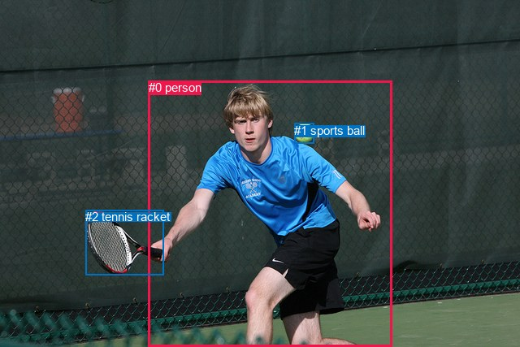
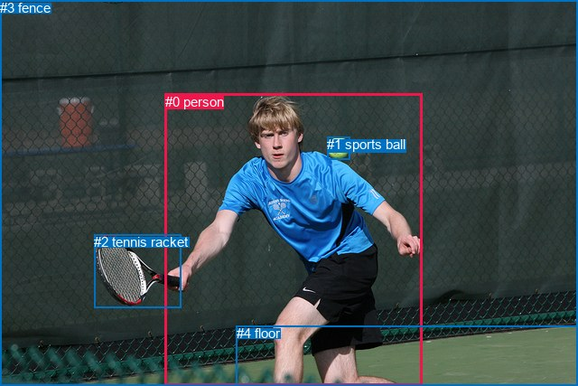

# 图片 1391：2380691.jpg

随机样本序号：387。图片 SHA256：`c977609c2c685eef309ff9140d94fc4ae47dd66a8d8624f6af6a63fb5a5a166c`。

红色框表示人，蓝色框表示其他物体。两个模式分别保留自身框编号，可依据位置比较对应对象。

## 自动检测框与输出

人的框编号：`[0]`。状态：`ok`。

### 自动检测全部物体框

| 编号 | 类别 | 是否为人 | 检测分数 | 像素坐标 xyxy |
|---|---|---|---|---|
| 0 | person | True | 0.9997 | 182.7, 99.3, 482.1, 427.0 |
| 1 | sports ball | False | 0.9997 | 362.1, 151.6, 386.9, 176.1 |
| 2 | tennis racket | False | 0.9994 | 105.3, 258.4, 201.2, 338.8 |

### 自动检测 Top50 人相关候选

评分物体对：6；人相关物体对：4；输出关系：8。

| 排名 | 主语编号与类别 | 关系 | 宾语编号与类别 | 类型 | 人与人 | 排序分数 | 原始融合 logit |
|---|---|---|---|---|---|---|---|
| 1 | #0 person | holding | #2 tennis racket | semantic | False | 0.99481 | 5.2562 |
| 2 | #0 person | catching | #1 sports ball | semantic | False | 0.96027 | 3.1851 |
| 3 | #1 sports ball | flying over | #0 person | semantic | False | 0.87371 | 1.9341 |
| 4 | #0 person | beside | #2 tennis racket | spatial | False | 0.78344 | 1.2858 |
| 5 | #2 tennis racket | beside | #0 person | spatial | False | 0.70312 | 0.8622 |
| 6 | #0 person | beside | #1 sports ball | spatial | False | 0.66298 | 0.6766 |
| 7 | #1 sports ball | over | #0 person | spatial | False | 0.63691 | 0.5620 |
| 8 | #2 tennis racket | holding | #0 person | semantic | False | 0.28533 | -0.9182 |

### 自动检测逐条人相关 GT 核验

R@50：20.00%；命中 1/5。

| GT 主语编号 | GT 关系 | GT 宾语编号 | 结果阶段 | 匹配预测主语编号 | 匹配预测宾语编号 |
|---|---|---|---|---|---|
| 0 | looking at | 1 | wrong_predicate | [0] | [1] |
| 0 | chasing | 1 | wrong_predicate | [0] | [1] |
| 0 | about to hit | 1 | wrong_predicate | [0] | [1] |
| 0 | holding | 2 | hit50 | [0] | [2] |
| 0 | running on | 4 | endpoint_missing_or_wrong_class | [0] | [] |

## 真实框与输出

人的框编号：`[0]`。

### 真实框全部物体框

| 编号 | 类别 | 是否为人 | 检测分数 | 像素坐标 xyxy |
|---|---|---|---|---|
| 0 | person | True | GT | 183.0, 104.0, 468.0, 427.0 |
| 1 | sports ball | False | GT | 362.0, 151.0, 388.0, 176.0 |
| 2 | tennis racket | False | GT | 104.0, 259.0, 201.0, 340.0 |
| 3 | fence | False | GT | 0.0, 0.0, 640.0, 427.0 |
| 4 | floor | False | GT | 262.0, 360.0, 640.0, 427.0 |

### 真实框 Top50 人相关候选

评分物体对：20；人相关物体对：8；输出关系：16。

| 排名 | 主语编号与类别 | 关系 | 宾语编号与类别 | 类型 | 人与人 | 排序分数 | 原始融合 logit |
|---|---|---|---|---|---|---|---|
| 1 | #0 person | holding | #2 tennis racket | semantic | False | 0.99264 | 4.9037 |
| 2 | #0 person | playing | #1 sports ball | semantic | False | 0.98655 | 4.2954 |
| 3 | #0 person | playing | #3 fence | semantic | False | 0.97048 | 3.4928 |
| 4 | #0 person | playing | #4 floor | semantic | False | 0.96461 | 3.3053 |
| 5 | #0 person | on | #4 floor | spatial | False | 0.95934 | 3.1611 |
| 6 | #0 person | in front of | #3 fence | spatial | False | 0.87192 | 1.9181 |
| 7 | #1 sports ball | flying over | #0 person | semantic | False | 0.74939 | 1.0953 |
| 8 | #0 person | in | #2 tennis racket | spatial | False | 0.71944 | 0.9417 |
| 9 | #3 fence | beside | #0 person | spatial | False | 0.71461 | 0.9179 |
| 10 | #0 person | in | #1 sports ball | spatial | False | 0.70564 | 0.8743 |
| 11 | #1 sports ball | over | #0 person | spatial | False | 0.55992 | 0.2408 |
| 12 | #2 tennis racket | holding | #0 person | semantic | False | 0.53998 | 0.1603 |
| 13 | #2 tennis racket | in | #0 person | spatial | False | 0.42871 | -0.2871 |
| 14 | #3 fence | looking at | #0 person | semantic | False | 0.39219 | -0.4381 |
| 15 | #4 floor | beside | #0 person | spatial | False | 0.34928 | -0.6222 |
| 16 | #4 floor | holding | #0 person | semantic | False | 0.10223 | -2.1727 |

### 真实框逐条人相关 GT 核验

R@50：20.00%；命中 1/5。

| GT 主语编号 | GT 关系 | GT 宾语编号 | 结果阶段 | 匹配预测主语编号 | 匹配预测宾语编号 |
|---|---|---|---|---|---|
| 0 | looking at | 1 | wrong_predicate | [0] | [1] |
| 0 | chasing | 1 | wrong_predicate | [0] | [1] |
| 0 | about to hit | 1 | wrong_predicate | [0] | [1] |
| 0 | holding | 2 | hit50 | [0] | [2] |
| 0 | running on | 4 | wrong_predicate | [0] | [4] |

## 全部人相关 GT

| 主语编号与类别 | 关系 | 宾语编号与类别 |
|---|---|---|
| #0 person | looking at | #1 sports ball |
| #0 person | chasing | #1 sports ball |
| #0 person | about to hit | #1 sports ball |
| #0 person | holding | #2 tennis racket |
| #0 person | running on | #4 floor |

原始记录、全部人相关物体对的两项预测与分项分数见 [逐图证据 JSON](../evidence/cases/1391.json)。全部56类 logits 保留于本机 HOR/output/random500/logits/。

<!-- HOR_COMPLETE_RESULTS -->

## 六组条件的完整输出对照

以下保留同一图片三种框与候选模式、两种谓词输出规则的全部 Top50。框编号各自在所属模式内解释。

### 自动检测框完整枚举：空间与语义各保留一个谓词

| 排名 | 主语编号与类别 | 谓词 | 宾语编号与类别 | 分组 | 排序分数 | predicate logit | pair logit |
|---|---|---|---|---|---|---|---|
| 1 | #0 person | holding | #2 tennis racket | semantic | 0.9948121 | 5.2103276 | 0.0458946 |
| 2 | #0 person | catching | #1 sports ball | semantic | 0.9602711 | 2.6184111 | 0.5667233 |
| 3 | #1 sports ball | flying over | #0 person | semantic | 0.8737062 | 2.4587302 | -0.5245967 |
| 4 | #0 person | beside | #2 tennis racket | spatial | 0.7834419 | 1.2399435 | 0.0458946 |
| 5 | #2 tennis racket | beside | #0 person | spatial | 0.7031239 | 1.7231236 | -0.8609056 |
| 6 | #0 person | beside | #1 sports ball | spatial | 0.6629795 | 0.1098771 | 0.5667233 |
| 7 | #1 sports ball | over | #0 person | spatial | 0.6369132 | 1.0865884 | -0.5245967 |
| 8 | #2 tennis racket | holding | #0 person | semantic | 0.2853342 | -0.0572481 | -0.8609056 |

GT 命中：1/5，R@50=20.00%。

| GT主语 | GT谓词 | GT宾语 | 结果阶段 | 匹配主语框 | 匹配宾语框 |
|---|---|---|---|---|---|
| 0 | looking at | 1 | wrong_predicate | [0] | [1] |
| 0 | chasing | 1 | wrong_predicate | [0] | [1] |
| 0 | about to hit | 1 | wrong_predicate | [0] | [1] |
| 0 | holding | 2 | hit50 | [0] | [2] |
| 0 | running on | 4 | endpoint_missing_or_wrong_class | [0] | [] |

### 自动检测框完整枚举：每对只保留一个谓词

| 排名 | 主语编号与类别 | 谓词 | 宾语编号与类别 | 分组 | 排序分数 | predicate logit | pair logit |
|---|---|---|---|---|---|---|---|
| 1 | #0 person | holding | #2 tennis racket | single | 0.9948121 | 5.2103276 | 0.0458946 |
| 2 | #0 person | catching | #1 sports ball | single | 0.9602711 | 2.6184111 | 0.5667233 |
| 3 | #1 sports ball | flying over | #0 person | single | 0.8737062 | 2.4587302 | -0.5245967 |
| 4 | #2 tennis racket | beside | #0 person | single | 0.7031239 | 1.7231236 | -0.8609056 |

GT 命中：1/5，R@50=20.00%。

| GT主语 | GT谓词 | GT宾语 | 结果阶段 | 匹配主语框 | 匹配宾语框 |
|---|---|---|---|---|---|
| 0 | looking at | 1 | wrong_predicate | [0] | [1] |
| 0 | chasing | 1 | wrong_predicate | [0] | [1] |
| 0 | about to hit | 1 | wrong_predicate | [0] | [1] |
| 0 | holding | 2 | hit50 | [0] | [2] |
| 0 | running on | 4 | endpoint_missing_or_wrong_class | [0] | [] |

### 真实框完整枚举：空间与语义各保留一个谓词

| 排名 | 主语编号与类别 | 谓词 | 宾语编号与类别 | 分组 | 排序分数 | predicate logit | pair logit |
|---|---|---|---|---|---|---|---|
| 1 | #0 person | holding | #2 tennis racket | semantic | 0.9926358 | 4.8389325 | 0.0648025 |
| 2 | #0 person | playing | #1 sports ball | semantic | 0.9865518 | 3.7191281 | 0.5762380 |
| 3 | #0 person | playing | #3 fence | semantic | 0.9704835 | 3.5971150 | -0.1042700 |
| 4 | #0 person | playing | #4 floor | semantic | 0.9646099 | 3.3139443 | -0.0086546 |
| 5 | #0 person | on | #4 floor | spatial | 0.9593428 | 3.1697288 | -0.0086546 |
| 6 | #0 person | in front of | #3 fence | spatial | 0.8719249 | 2.0223560 | -0.1042700 |
| 7 | #1 sports ball | flying over | #0 person | semantic | 0.7493852 | 1.6172810 | -0.5219451 |
| 8 | #0 person | in | #2 tennis racket | spatial | 0.7194422 | 0.8768940 | 0.0648025 |
| 9 | #3 fence | beside | #0 person | spatial | 0.7146148 | 1.1306663 | -0.2127624 |
| 10 | #0 person | in | #1 sports ball | spatial | 0.7056388 | 0.2980576 | 0.5762380 |
| 11 | #1 sports ball | over | #0 person | spatial | 0.5599160 | 0.7627664 | -0.5219451 |
| 12 | #2 tennis racket | holding | #0 person | semantic | 0.5399815 | 1.0209265 | -0.8606582 |
| 13 | #2 tennis racket | in | #0 person | spatial | 0.4287128 | 0.5735536 | -0.8606582 |
| 14 | #3 fence | looking at | #0 person | semantic | 0.3921915 | -0.2253470 | -0.2127624 |
| 15 | #4 floor | beside | #0 person | spatial | 0.3492786 | 0.0458493 | -0.6680610 |
| 16 | #4 floor | holding | #0 person | semantic | 0.1022282 | -1.5046473 | -0.6680610 |

GT 命中：1/5，R@50=20.00%。

| GT主语 | GT谓词 | GT宾语 | 结果阶段 | 匹配主语框 | 匹配宾语框 |
|---|---|---|---|---|---|
| 0 | looking at | 1 | wrong_predicate | [0] | [1] |
| 0 | chasing | 1 | wrong_predicate | [0] | [1] |
| 0 | about to hit | 1 | wrong_predicate | [0] | [1] |
| 0 | holding | 2 | hit50 | [0] | [2] |
| 0 | running on | 4 | wrong_predicate | [0] | [4] |

### 真实框完整枚举：每对只保留一个谓词

| 排名 | 主语编号与类别 | 谓词 | 宾语编号与类别 | 分组 | 排序分数 | predicate logit | pair logit |
|---|---|---|---|---|---|---|---|
| 1 | #0 person | holding | #2 tennis racket | single | 0.9926358 | 4.8389325 | 0.0648025 |
| 2 | #0 person | playing | #1 sports ball | single | 0.9865518 | 3.7191281 | 0.5762380 |
| 3 | #0 person | playing | #3 fence | single | 0.9704835 | 3.5971150 | -0.1042700 |
| 4 | #0 person | playing | #4 floor | single | 0.9646099 | 3.3139443 | -0.0086546 |
| 5 | #1 sports ball | flying over | #0 person | single | 0.7493852 | 1.6172810 | -0.5219451 |
| 6 | #3 fence | beside | #0 person | single | 0.7146148 | 1.1306663 | -0.2127624 |
| 7 | #2 tennis racket | holding | #0 person | single | 0.5399815 | 1.0209265 | -0.8606582 |
| 8 | #4 floor | beside | #0 person | single | 0.3492786 | 0.0458493 | -0.6680610 |

GT 命中：1/5，R@50=20.00%。

| GT主语 | GT谓词 | GT宾语 | 结果阶段 | 匹配主语框 | 匹配宾语框 |
|---|---|---|---|---|---|
| 0 | looking at | 1 | wrong_predicate | [0] | [1] |
| 0 | chasing | 1 | wrong_predicate | [0] | [1] |
| 0 | about to hit | 1 | wrong_predicate | [0] | [1] |
| 0 | holding | 2 | hit50 | [0] | [2] |
| 0 | running on | 4 | wrong_predicate | [0] | [4] |

### 真实框400候选：空间与语义各保留一个谓词

| 排名 | 主语编号与类别 | 谓词 | 宾语编号与类别 | 分组 | 排序分数 | predicate logit | pair logit |
|---|---|---|---|---|---|---|---|
| 1 | #0 person | holding | #2 tennis racket | semantic | 0.9926358 | 4.8389325 | 0.0648025 |
| 2 | #0 person | playing | #1 sports ball | semantic | 0.9857975 | 3.6637931 | 0.5762380 |
| 3 | #0 person | playing | #3 fence | semantic | 0.9704835 | 3.5971150 | -0.1042700 |
| 4 | #0 person | playing | #4 floor | semantic | 0.9647749 | 3.3187919 | -0.0086546 |
| 5 | #0 person | on | #4 floor | spatial | 0.9593428 | 3.1697288 | -0.0086546 |
| 6 | #0 person | in front of | #3 fence | spatial | 0.8719249 | 2.0223560 | -0.1042700 |
| 7 | #1 sports ball | flying over | #0 person | semantic | 0.7493852 | 1.6172810 | -0.5219451 |
| 8 | #0 person | in | #2 tennis racket | spatial | 0.7194422 | 0.8768940 | 0.0648025 |
| 9 | #3 fence | beside | #0 person | spatial | 0.7146031 | 1.1306086 | -0.2127624 |
| 10 | #0 person | in | #1 sports ball | spatial | 0.7056388 | 0.2980576 | 0.5762380 |
| 11 | #1 sports ball | over | #0 person | spatial | 0.5537955 | 0.7379632 | -0.5219451 |
| 12 | #2 tennis racket | holding | #0 person | semantic | 0.5399815 | 1.0209265 | -0.8606582 |
| 13 | #2 tennis racket | in | #0 person | spatial | 0.4287128 | 0.5735536 | -0.8606582 |
| 14 | #3 fence | looking at | #0 person | semantic | 0.3920254 | -0.2260442 | -0.2127624 |
| 15 | #4 floor | beside | #0 person | spatial | 0.3561351 | 0.0758824 | -0.6680610 |
| 16 | #4 floor | holding | #0 person | semantic | 0.1035488 | -1.4903402 | -0.6680610 |

GT 命中：1/5，R@50=20.00%。

| GT主语 | GT谓词 | GT宾语 | 结果阶段 | 匹配主语框 | 匹配宾语框 |
|---|---|---|---|---|---|
| 0 | looking at | 1 | wrong_predicate | [0] | [1] |
| 0 | chasing | 1 | wrong_predicate | [0] | [1] |
| 0 | about to hit | 1 | wrong_predicate | [0] | [1] |
| 0 | holding | 2 | hit50 | [0] | [2] |
| 0 | running on | 4 | wrong_predicate | [0] | [4] |

### 真实框400候选：每对只保留一个谓词

| 排名 | 主语编号与类别 | 谓词 | 宾语编号与类别 | 分组 | 排序分数 | predicate logit | pair logit |
|---|---|---|---|---|---|---|---|
| 1 | #0 person | holding | #2 tennis racket | single | 0.9926358 | 4.8389325 | 0.0648025 |
| 2 | #0 person | playing | #1 sports ball | single | 0.9857975 | 3.6637931 | 0.5762380 |
| 3 | #0 person | playing | #3 fence | single | 0.9704835 | 3.5971150 | -0.1042700 |
| 4 | #0 person | playing | #4 floor | single | 0.9647749 | 3.3187919 | -0.0086546 |
| 5 | #1 sports ball | flying over | #0 person | single | 0.7493852 | 1.6172810 | -0.5219451 |
| 6 | #3 fence | beside | #0 person | single | 0.7146031 | 1.1306086 | -0.2127624 |
| 7 | #2 tennis racket | holding | #0 person | single | 0.5399815 | 1.0209265 | -0.8606582 |
| 8 | #4 floor | beside | #0 person | single | 0.3561351 | 0.0758824 | -0.6680610 |

GT 命中：1/5，R@50=20.00%。

| GT主语 | GT谓词 | GT宾语 | 结果阶段 | 匹配主语框 | 匹配宾语框 |
|---|---|---|---|---|---|
| 0 | looking at | 1 | wrong_predicate | [0] | [1] |
| 0 | chasing | 1 | wrong_predicate | [0] | [1] |
| 0 | about to hit | 1 | wrong_predicate | [0] | [1] |
| 0 | holding | 2 | hit50 | [0] | [2] |
| 0 | running on | 4 | wrong_predicate | [0] | [4] |
