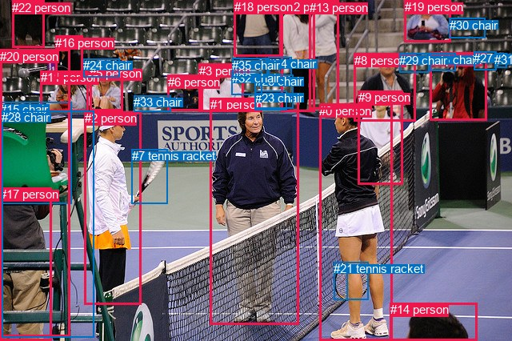
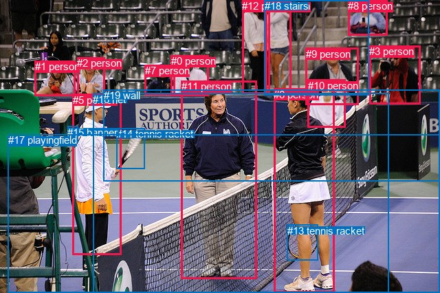

# 图片 1395：2380947.jpg

随机样本序号：386。图片 SHA256：`b8d9c78cd2f203cd1692d3631dbc656b5db9cf506082b9f52f7d3e8a80f44478`。

红色框表示人，蓝色框表示其他物体。两个模式分别保留自身框编号，可依据位置比较对应对象。

## 自动检测框与输出

人的框编号：`[0, 1, 2, 3, 4, 5, 6, 8, 9, 11, 12, 13, 14, 16, 17, 18, 19, 20, 22]`。状态：`ok`。

### 自动检测全部物体框

| 编号 | 类别 | 是否为人 | 检测分数 | 像素坐标 xyxy |
|---|---|---|---|---|
| 0 | person | True | 0.9984 | 399.4, 129.9, 490.2, 426.0 |
| 1 | person | True | 0.9976 | 262.9, 122.1, 373.0, 405.4 |
| 2 | person | True | 0.9952 | 105.5, 139.2, 176.2, 380.4 |
| 3 | person | True | 0.9934 | 248.6, 79.6, 304.9, 139.8 |
| 4 | person | True | 0.9895 | 537.2, 65.8, 609.0, 150.5 |
| 5 | person | True | 0.9868 | 112.4, 83.4, 153.6, 138.6 |
| 6 | person | True | 0.9826 | 209.9, 93.6, 253.1, 138.4 |
| 7 | tennis racket | False | 0.9780 | 164.6, 186.1, 209.7, 254.9 |
| 8 | person | True | 0.9769 | 442.7, 66.6, 519.9, 151.6 |
| 9 | person | True | 0.9538 | 448.0, 113.3, 503.8, 230.0 |
| 10 | tennis racket | False | 0.9536 | 417.0, 327.5, 460.5, 375.0 |
| 11 | person | True | 0.9311 | 50.8, 88.5, 110.3, 140.0 |
| 12 | person | True | 0.9178 | 351.0, 0.0, 393.9, 139.1 |
| 13 | person | True | 0.9033 | 386.9, 0.7, 423.8, 137.0 |
| 14 | person | True | 0.8941 | 487.7, 378.4, 596.7, 425.8 |
| 15 | chair | False | 0.8809 | 0.0, 128.0, 89.6, 254.1 |
| 16 | person | True | 0.8381 | 69.0, 44.8, 104.0, 98.8 |
| 17 | person | True | 0.7962 | 0.2, 234.2, 64.5, 425.5 |
| 18 | person | True | 0.7862 | 293.0, 0.3, 351.8, 70.8 |
| 19 | person | True | 0.7404 | 505.7, 0.0, 563.8, 52.2 |
| 20 | person | True | 0.7380 | 0.0, 61.8, 87.6, 420.4 |
| 21 | tennis racket | False | 0.7327 | 417.1, 327.1, 434.8, 374.6 |
| 22 | person | True | 0.6970 | 15.2, 0.6, 55.1, 59.1 |
| 23 | chair | False | 0.6736 | 318.6, 113.7, 358.3, 137.7 |
| 24 | chair | False | 0.6037 | 104.3, 73.1, 149.4, 96.3 |
| 25 | chair | False | 0.5556 | 537.9, 66.3, 569.9, 88.5 |
| 26 | chair | False | 0.5283 | 318.9, 93.1, 366.7, 135.8 |
| 27 | chair | False | 0.5024 | 592.1, 64.5, 621.0, 87.6 |
| 28 | chair | False | 0.4706 | 2.2, 138.4, 117.9, 421.7 |
| 29 | chair | False | 0.4557 | 499.0, 66.8, 536.4, 90.8 |
| 30 | chair | False | 0.4519 | 561.7, 22.7, 606.7, 48.0 |
| 31 | chair | False | 0.4112 | 618.3, 66.1, 633.0, 84.6 |
| 32 | chair | False | 0.4084 | 289.7, 89.1, 327.2, 118.2 |
| 33 | chair | False | 0.3908 | 167.1, 119.2, 213.7, 139.7 |
| 34 | chair | False | 0.3800 | 335.1, 71.3, 364.3, 94.5 |
| 35 | chair | False | 0.3790 | 290.3, 72.9, 335.0, 96.8 |

### 自动检测 Top50 人相关候选

评分物体对：1260；人相关物体对：988；输出关系：50。

| 排名 | 主语编号与类别 | 关系 | 宾语编号与类别 | 类型 | 人与人 | 排序分数 | 原始融合 logit |
|---|---|---|---|---|---|---|---|
| 1 | #2 person | holding | #7 tennis racket | semantic | False | 0.99400 | 5.1098 |
| 2 | #17 person | leaning on | #28 chair | spatial | False | 0.99158 | 4.7681 |
| 3 | #20 person | leaning on | #28 chair | spatial | False | 0.99024 | 4.6196 |
| 4 | #4 person | holding | #25 chair | semantic | False | 0.98408 | 4.1243 |
| 5 | #17 person | leaning on | #15 chair | spatial | False | 0.97680 | 3.7403 |
| 6 | #19 person | sitting on | #30 chair | semantic | False | 0.97560 | 3.6886 |
| 7 | #0 person | holding | #21 tennis racket | semantic | False | 0.97498 | 3.6626 |
| 8 | #17 person | standing on | #28 chair | semantic | False | 0.97457 | 3.6460 |
| 9 | #20 person | standing on | #28 chair | semantic | False | 0.96819 | 3.4156 |
| 10 | #19 person | on | #30 chair | spatial | False | 0.96329 | 3.2673 |
| 11 | #3 person | sitting on | #35 chair | semantic | False | 0.95884 | 3.1482 |
| 12 | #4 person | wearing | #27 chair | semantic | False | 0.95869 | 3.1445 |
| 13 | #5 person | wearing | #24 chair | semantic | False | 0.95846 | 3.1387 |
| 14 | #20 person | on | #15 chair | spatial | False | 0.95426 | 3.0380 |
| 15 | #0 person | holding | #10 tennis racket | semantic | False | 0.94459 | 2.8360 |
| 16 | #20 person | holding | #15 chair | semantic | False | 0.94333 | 2.8122 |
| 17 | #6 person | wearing | #33 chair | semantic | False | 0.93511 | 2.6680 |
| 18 | #20 person | wearing | #17 person | semantic | True | 0.93230 | 2.6225 |
| 19 | #19 person | holding | #25 chair | semantic | False | 0.93100 | 2.6022 |
| 20 | #4 person | in | #27 chair | spatial | False | 0.92471 | 2.5082 |
| 21 | #3 person | in | #35 chair | spatial | False | 0.92368 | 2.4934 |
| 22 | #3 person | in | #32 chair | spatial | False | 0.91019 | 2.3159 |
| 23 | #16 person | wearing | #24 chair | semantic | False | 0.90756 | 2.2842 |
| 24 | #19 person | wearing | #29 chair | semantic | False | 0.90708 | 2.2785 |
| 25 | #19 person | wearing | #27 chair | semantic | False | 0.90231 | 2.2232 |
| 26 | #5 person | in | #24 chair | spatial | False | 0.90163 | 2.2154 |
| 27 | #1 person | in | #23 chair | spatial | False | 0.90116 | 2.2102 |
| 28 | #16 person | wearing | #11 person | semantic | True | 0.89646 | 2.1584 |
| 29 | #4 person | in | #25 chair | spatial | False | 0.89462 | 2.1388 |
| 30 | #17 person | standing on | #15 chair | semantic | False | 0.89359 | 2.1280 |
| 31 | #3 person | wearing | #32 chair | semantic | False | 0.88824 | 2.0728 |
| 32 | #14 person | looking at | #0 person | semantic | True | 0.88712 | 2.0617 |
| 33 | #12 person | holding | #34 chair | semantic | False | 0.88163 | 2.0079 |
| 34 | #12 person | wearing | #26 chair | semantic | False | 0.87653 | 1.9600 |
| 35 | #6 person | in | #33 chair | spatial | False | 0.87113 | 1.9110 |
| 36 | #20 person | wearing | #11 person | semantic | True | 0.85890 | 1.8062 |
| 37 | #2 person | standing on | #28 chair | semantic | False | 0.84747 | 1.7149 |
| 38 | #19 person | wearing | #31 chair | semantic | False | 0.84523 | 1.6977 |
| 39 | #1 person | wearing | #23 chair | semantic | False | 0.84042 | 1.6613 |
| 40 | #5 person | wearing | #33 chair | semantic | False | 0.83877 | 1.6491 |
| 41 | #2 person | leaning on | #15 chair | spatial | False | 0.83693 | 1.6355 |
| 42 | #19 person | in | #29 chair | spatial | False | 0.83025 | 1.5874 |
| 43 | #18 person | wearing | #34 chair | semantic | False | 0.82970 | 1.5835 |
| 44 | #1 person | looking at | #0 person | semantic | True | 0.80297 | 1.4050 |
| 45 | #2 person | leaning on | #28 chair | spatial | False | 0.80010 | 1.3869 |
| 46 | #11 person | wearing | #24 chair | semantic | False | 0.79084 | 1.3300 |
| 47 | #0 person | in | #10 tennis racket | spatial | False | 0.79000 | 1.3249 |
| 48 | #16 person | in | #24 chair | spatial | False | 0.77705 | 1.2485 |
| 49 | #2 person | on | #7 tennis racket | spatial | False | 0.77668 | 1.2464 |
| 50 | #11 person | on | #15 chair | spatial | False | 0.76983 | 1.2074 |

### 自动检测逐条人相关 GT 核验

R@50：14.29%；命中 1/7。

| GT 主语编号 | GT 关系 | GT 宾语编号 | 结果阶段 | 匹配预测主语编号 | 匹配预测宾语编号 |
|---|---|---|---|---|---|
| 3 | looking at | 6 | rank_below50 | [4] | [0] |
| 5 | holding | 14 | hit50 | [2] | [7] |
| 6 | talking to | 11 | rank_below50 | [0] | [1] |
| 6 | attached to | 14 | wrong_predicate | [0] | [7] |
| 6 | holding | 14 | wrong_predicate | [0] | [7] |
| 6 | standing on | 17 | endpoint_missing_or_wrong_class | [0] | [] |
| 12 | talking to | 4 | rank_below50 | [12] | [13] |

## 真实框与输出

人的框编号：`[0, 1, 2, 3, 4, 5, 6, 7, 8, 9, 10, 11, 12]`。

### 真实框全部物体框

| 编号 | 类别 | 是否为人 | 检测分数 | 像素坐标 xyxy |
|---|---|---|---|---|
| 0 | person | True | GT | 249.0, 80.0, 304.0, 139.0 |
| 1 | person | True | GT | 51.0, 88.0, 109.0, 139.0 |
| 2 | person | True | GT | 112.0, 83.0, 153.0, 143.0 |
| 3 | person | True | GT | 537.0, 66.0, 611.0, 151.0 |
| 4 | person | True | GT | 386.0, 0.0, 423.0, 138.0 |
| 5 | person | True | GT | 106.0, 137.0, 177.0, 370.0 |
| 6 | person | True | GT | 398.0, 129.0, 486.0, 426.0 |
| 7 | person | True | GT | 211.0, 94.0, 254.0, 138.0 |
| 8 | person | True | GT | 506.0, 0.0, 563.0, 51.0 |
| 9 | person | True | GT | 445.0, 70.0, 522.0, 153.0 |
| 10 | person | True | GT | 448.0, 116.0, 503.0, 186.0 |
| 11 | person | True | GT | 264.0, 117.0, 374.0, 405.0 |
| 12 | person | True | GT | 352.0, 0.0, 392.0, 137.0 |
| 13 | tennis racket | False | GT | 418.0, 327.0, 463.0, 379.0 |
| 14 | tennis racket | False | GT | 169.0, 186.0, 211.0, 245.0 |
| 15 | banner | False | GT | 98.0, 184.0, 113.0, 208.0 |
| 16 | net | False | GT | 135.0, 136.0, 565.0, 426.0 |
| 17 | playingfield | False | GT | 12.0, 195.0, 640.0, 426.0 |
| 18 | stairs | False | GT | 385.0, 0.0, 537.0, 138.0 |
| 19 | wall | False | GT | 151.0, 130.0, 640.0, 263.0 |

### 真实框 Top50 人相关候选

评分物体对：380；人相关物体对：338；输出关系：50。

| 排名 | 主语编号与类别 | 关系 | 宾语编号与类别 | 类型 | 人与人 | 排序分数 | 原始融合 logit |
|---|---|---|---|---|---|---|---|
| 1 | #5 person | holding | #14 tennis racket | semantic | False | 0.99521 | 5.3360 |
| 2 | #5 person | standing on | #17 playingfield | semantic | False | 0.97328 | 3.5953 |
| 3 | #11 person | standing on | #17 playingfield | semantic | False | 0.97111 | 3.5151 |
| 4 | #11 person | on | #17 playingfield | spatial | False | 0.97082 | 3.5047 |
| 5 | #6 person | standing on | #17 playingfield | semantic | False | 0.95542 | 3.0648 |
| 6 | #6 person | on | #17 playingfield | spatial | False | 0.95507 | 3.0566 |
| 7 | #5 person | wearing | #15 banner | semantic | False | 0.95339 | 3.0183 |
| 8 | #4 person | standing on | #18 stairs | semantic | False | 0.95193 | 2.9859 |
| 9 | #8 person | sitting on | #18 stairs | semantic | False | 0.94838 | 2.9109 |
| 10 | #5 person | leaning on | #16 net | spatial | False | 0.94769 | 2.8969 |
| 11 | #5 person | on | #17 playingfield | spatial | False | 0.94577 | 2.8588 |
| 12 | #4 person | in | #18 stairs | spatial | False | 0.94220 | 2.7913 |
| 13 | #6 person | wearing | #13 tennis racket | semantic | False | 0.94019 | 2.7550 |
| 14 | #5 person | leaning on | #15 banner | spatial | False | 0.93918 | 2.7371 |
| 15 | #2 person | looking at | #17 playingfield | semantic | False | 0.93662 | 2.6930 |
| 16 | #10 person | leaning on | #19 wall | spatial | False | 0.93525 | 2.6703 |
| 17 | #11 person | leaning on | #16 net | spatial | False | 0.92266 | 2.4790 |
| 18 | #6 person | leaning on | #16 net | spatial | False | 0.91772 | 2.4117 |
| 19 | #8 person | in | #18 stairs | spatial | False | 0.91310 | 2.3520 |
| 20 | #10 person | looking at | #16 net | semantic | False | 0.90817 | 2.2915 |
| 21 | #0 person | looking at | #17 playingfield | semantic | False | 0.88593 | 2.0498 |
| 22 | #11 person | standing on | #16 net | semantic | False | 0.87286 | 1.9265 |
| 23 | #7 person | looking at | #17 playingfield | semantic | False | 0.87242 | 1.9225 |
| 24 | #5 person | standing on | #16 net | semantic | False | 0.86148 | 1.8276 |
| 25 | #9 person | looking at | #17 playingfield | semantic | False | 0.85486 | 1.7732 |
| 26 | #8 person | looking at | #17 playingfield | semantic | False | 0.83085 | 1.5917 |
| 27 | #6 person | leaning on | #19 wall | spatial | False | 0.82523 | 1.5522 |
| 28 | #0 person | leaning on | #19 wall | spatial | False | 0.81346 | 1.4726 |
| 29 | #6 person | standing on | #16 net | semantic | False | 0.80874 | 1.4418 |
| 30 | #10 person | looking at | #19 wall | semantic | False | 0.80567 | 1.4221 |
| 31 | #6 person | in | #13 tennis racket | spatial | False | 0.80445 | 1.4144 |
| 32 | #4 person | looking at | #17 playingfield | semantic | False | 0.79865 | 1.3779 |
| 33 | #9 person | looking at | #16 net | semantic | False | 0.79235 | 1.3392 |
| 34 | #5 person | on | #14 tennis racket | spatial | False | 0.79024 | 1.3264 |
| 35 | #9 person | looking at | #19 wall | semantic | False | 0.78823 | 1.3143 |
| 36 | #12 person | standing on | #18 stairs | semantic | False | 0.78692 | 1.3065 |
| 37 | #1 person | on | #15 banner | spatial | False | 0.78322 | 1.2845 |
| 38 | #10 person | leaning on | #16 net | spatial | False | 0.77187 | 1.2189 |
| 39 | #9 person | in | #18 stairs | spatial | False | 0.76075 | 1.1568 |
| 40 | #11 person | leaning on | #19 wall | spatial | False | 0.75929 | 1.1488 |
| 41 | #0 person | looking at | #16 net | semantic | False | 0.75450 | 1.1228 |
| 42 | #12 person | looking at | #17 playingfield | semantic | False | 0.75391 | 1.1196 |
| 43 | #10 person | looking at | #17 playingfield | semantic | False | 0.75144 | 1.1063 |
| 44 | #13 tennis racket | on | #6 person | spatial | False | 0.74815 | 1.0888 |
| 45 | #10 person | on | #17 playingfield | spatial | False | 0.74494 | 1.0718 |
| 46 | #1 person | looking at | #17 playingfield | semantic | False | 0.73289 | 1.0093 |
| 47 | #12 person | talking to | #4 person | semantic | True | 0.72584 | 0.9736 |
| 48 | #3 person | looking at | #17 playingfield | semantic | False | 0.72285 | 0.9586 |
| 49 | #0 person | sitting on | #19 wall | semantic | False | 0.71904 | 0.9397 |
| 50 | #5 person | leaning on | #19 wall | spatial | False | 0.68551 | 0.7792 |

### 真实框逐条人相关 GT 核验

R@50：42.86%；命中 3/7。

| GT 主语编号 | GT 关系 | GT 宾语编号 | 结果阶段 | 匹配预测主语编号 | 匹配预测宾语编号 |
|---|---|---|---|---|---|
| 3 | looking at | 6 | rank_below50 | [3] | [6] |
| 5 | holding | 14 | hit50 | [5] | [14] |
| 6 | talking to | 11 | rank_below50 | [6] | [11] |
| 6 | attached to | 14 | wrong_predicate | [6] | [14] |
| 6 | holding | 14 | wrong_predicate | [6] | [14] |
| 6 | standing on | 17 | hit50 | [6] | [17] |
| 12 | talking to | 4 | hit50 | [12] | [4] |

## 全部人相关 GT

| 主语编号与类别 | 关系 | 宾语编号与类别 |
|---|---|---|
| #3 person | looking at | #6 person |
| #5 person | holding | #14 tennis racket |
| #6 person | talking to | #11 person |
| #6 person | attached to | #14 tennis racket |
| #6 person | holding | #14 tennis racket |
| #6 person | standing on | #17 playingfield |
| #12 person | talking to | #4 person |

原始记录、全部人相关物体对的两项预测与分项分数见 [逐图证据 JSON](../evidence/cases/1395.json)。全部56类 logits 保留于本机 HOR/output/random500/logits/。

<!-- HOR_COMPLETE_RESULTS -->

## 六组条件的完整输出对照

以下保留同一图片三种框与候选模式、两种谓词输出规则的全部 Top50。框编号各自在所属模式内解释。

### 自动检测框完整枚举：空间与语义各保留一个谓词

| 排名 | 主语编号与类别 | 谓词 | 宾语编号与类别 | 分组 | 排序分数 | predicate logit | pair logit |
|---|---|---|---|---|---|---|---|
| 1 | #2 person | holding | #7 tennis racket | semantic | 0.9939992 | 4.6432748 | 0.4665744 |
| 2 | #17 person | leaning on | #28 chair | spatial | 0.9915753 | 4.7077842 | 0.0603421 |
| 3 | #20 person | leaning on | #28 chair | spatial | 0.9902395 | 4.5020223 | 0.1175758 |
| 4 | #4 person | holding | #25 chair | semantic | 0.9840826 | 3.7992024 | 0.3250909 |
| 5 | #17 person | leaning on | #15 chair | spatial | 0.9768044 | 3.9687848 | -0.2284588 |
| 6 | #19 person | sitting on | #30 chair | semantic | 0.9756036 | 3.4517732 | 0.2368504 |
| 7 | #0 person | holding | #21 tennis racket | semantic | 0.9749759 | 3.8738170 | -0.2112406 |
| 8 | #17 person | standing on | #28 chair | semantic | 0.9745685 | 3.5856652 | 0.0603421 |
| 9 | #20 person | standing on | #28 chair | semantic | 0.9681882 | 3.2980123 | 0.1175758 |
| 10 | #19 person | on | #30 chair | spatial | 0.9632888 | 3.0304227 | 0.2368504 |
| 11 | #3 person | sitting on | #35 chair | semantic | 0.9588369 | 3.2321057 | -0.0839264 |
| 12 | #4 person | wearing | #27 chair | semantic | 0.9586911 | 2.8303781 | 0.3141108 |
| 13 | #5 person | wearing | #24 chair | semantic | 0.9584627 | 3.2459335 | -0.1071949 |
| 14 | #20 person | on | #15 chair | spatial | 0.9542614 | 2.8561316 | 0.1818642 |
| 15 | #0 person | holding | #10 tennis racket | semantic | 0.9445899 | 2.9995236 | -0.1635348 |
| 16 | #20 person | holding | #15 chair | semantic | 0.9433309 | 2.6303244 | 0.1818642 |
| 17 | #6 person | wearing | #33 chair | semantic | 0.9351115 | 2.5442085 | 0.1237857 |
| 18 | #20 person | wearing | #17 person | semantic | 0.9322981 | 2.5943046 | 0.0282339 |
| 19 | #19 person | holding | #25 chair | semantic | 0.9310005 | 2.2787714 | 0.3233892 |
| 20 | #4 person | in | #27 chair | spatial | 0.9247133 | 2.1940699 | 0.3141108 |
| 21 | #3 person | in | #35 chair | spatial | 0.9236761 | 2.5773029 | -0.0839264 |
| 22 | #3 person | in | #32 chair | spatial | 0.9101874 | 2.1765852 | 0.1393392 |
| 23 | #16 person | wearing | #24 chair | semantic | 0.9075560 | 2.6161270 | -0.3319752 |
| 24 | #19 person | wearing | #29 chair | semantic | 0.9070778 | 2.2058334 | 0.0726327 |
| 25 | #19 person | wearing | #27 chair | semantic | 0.9023100 | 1.9601336 | 0.2630250 |
| 26 | #5 person | in | #24 chair | spatial | 0.9016252 | 2.3226094 | -0.1071949 |
| 27 | #1 person | in | #23 chair | spatial | 0.9011625 | 1.8561850 | 0.3540229 |
| 28 | #16 person | wearing | #11 person | semantic | 0.8964552 | 2.4434109 | -0.2849670 |
| 29 | #4 person | in | #25 chair | spatial | 0.8946176 | 1.8137097 | 0.3250909 |
| 30 | #17 person | standing on | #15 chair | semantic | 0.8935903 | 2.3564100 | -0.2284588 |
| 31 | #3 person | wearing | #32 chair | semantic | 0.8882360 | 1.9335089 | 0.1393392 |
| 32 | #14 person | looking at | #0 person | semantic | 0.8871248 | 2.5677776 | -0.5060741 |
| 33 | #12 person | holding | #34 chair | semantic | 0.8816257 | 1.6852598 | 0.3226553 |
| 34 | #12 person | wearing | #26 chair | semantic | 0.8765287 | 1.6068697 | 0.3530917 |
| 35 | #6 person | in | #33 chair | spatial | 0.8711276 | 1.7871799 | 0.1237857 |
| 36 | #20 person | wearing | #11 person | semantic | 0.8588964 | 1.9145474 | -0.1083927 |
| 37 | #2 person | standing on | #28 chair | semantic | 0.8474739 | 2.2940831 | -0.5791593 |
| 38 | #19 person | wearing | #31 chair | semantic | 0.8452309 | 1.5519495 | 0.1457258 |
| 39 | #1 person | wearing | #23 chair | semantic | 0.8404174 | 1.3073144 | 0.3540229 |
| 40 | #5 person | wearing | #33 chair | semantic | 0.8387713 | 1.6906695 | -0.0415554 |
| 41 | #2 person | leaning on | #15 chair | spatial | 0.8369281 | 2.1371737 | -0.5016266 |
| 42 | #19 person | in | #29 chair | spatial | 0.8302547 | 1.5148005 | 0.0726327 |
| 43 | #18 person | wearing | #34 chair | semantic | 0.8297049 | 1.3199482 | 0.2635894 |
| 44 | #1 person | looking at | #0 person | semantic | 0.8029684 | 2.3581848 | -0.9532338 |
| 45 | #2 person | leaning on | #28 chair | spatial | 0.8001014 | 1.9660873 | -0.5791593 |
| 46 | #11 person | wearing | #24 chair | semantic | 0.7908446 | 1.6963916 | -0.3663677 |
| 47 | #0 person | in | #10 tennis racket | spatial | 0.7899988 | 1.4884529 | -0.1635348 |
| 48 | #16 person | in | #24 chair | spatial | 0.7770457 | 1.5805073 | -0.3319752 |
| 49 | #2 person | on | #7 tennis racket | spatial | 0.7766777 | 0.7798352 | 0.4665744 |
| 50 | #11 person | on | #15 chair | spatial | 0.7698314 | 1.7339215 | -0.5265626 |

GT 命中：1/7，R@50=14.29%。

| GT主语 | GT谓词 | GT宾语 | 结果阶段 | 匹配主语框 | 匹配宾语框 |
|---|---|---|---|---|---|
| 3 | looking at | 6 | rank_below50 | [4] | [0] |
| 5 | holding | 14 | hit50 | [2] | [7] |
| 6 | talking to | 11 | rank_below50 | [0] | [1] |
| 6 | attached to | 14 | wrong_predicate | [0] | [7] |
| 6 | holding | 14 | wrong_predicate | [0] | [7] |
| 6 | standing on | 17 | endpoint_missing_or_wrong_class | [0] | [] |
| 12 | talking to | 4 | rank_below50 | [12] | [13] |

### 自动检测框完整枚举：每对只保留一个谓词

| 排名 | 主语编号与类别 | 谓词 | 宾语编号与类别 | 分组 | 排序分数 | predicate logit | pair logit |
|---|---|---|---|---|---|---|---|
| 1 | #2 person | holding | #7 tennis racket | single | 0.9939992 | 4.6432748 | 0.4665744 |
| 2 | #17 person | leaning on | #28 chair | single | 0.9915753 | 4.7077842 | 0.0603421 |
| 3 | #20 person | leaning on | #28 chair | single | 0.9902395 | 4.5020223 | 0.1175758 |
| 4 | #4 person | holding | #25 chair | single | 0.9840826 | 3.7992024 | 0.3250909 |
| 5 | #17 person | leaning on | #15 chair | single | 0.9768044 | 3.9687848 | -0.2284588 |
| 6 | #19 person | sitting on | #30 chair | single | 0.9756036 | 3.4517732 | 0.2368504 |
| 7 | #0 person | holding | #21 tennis racket | single | 0.9749759 | 3.8738170 | -0.2112406 |
| 8 | #3 person | sitting on | #35 chair | single | 0.9588369 | 3.2321057 | -0.0839264 |
| 9 | #4 person | wearing | #27 chair | single | 0.9586911 | 2.8303781 | 0.3141108 |
| 10 | #5 person | wearing | #24 chair | single | 0.9584627 | 3.2459335 | -0.1071949 |
| 11 | #20 person | on | #15 chair | single | 0.9542614 | 2.8561316 | 0.1818642 |
| 12 | #0 person | holding | #10 tennis racket | single | 0.9445899 | 2.9995236 | -0.1635348 |
| 13 | #6 person | wearing | #33 chair | single | 0.9351115 | 2.5442085 | 0.1237857 |
| 14 | #20 person | wearing | #17 person | single | 0.9322981 | 2.5943046 | 0.0282339 |
| 15 | #19 person | holding | #25 chair | single | 0.9310005 | 2.2787714 | 0.3233892 |
| 16 | #3 person | in | #32 chair | single | 0.9101874 | 2.1765852 | 0.1393392 |
| 17 | #16 person | wearing | #24 chair | single | 0.9075560 | 2.6161270 | -0.3319752 |
| 18 | #19 person | wearing | #29 chair | single | 0.9070778 | 2.2058334 | 0.0726327 |
| 19 | #19 person | wearing | #27 chair | single | 0.9023100 | 1.9601336 | 0.2630250 |
| 20 | #1 person | in | #23 chair | single | 0.9011625 | 1.8561850 | 0.3540229 |
| 21 | #16 person | wearing | #11 person | single | 0.8964552 | 2.4434109 | -0.2849670 |
| 22 | #14 person | looking at | #0 person | single | 0.8871248 | 2.5677776 | -0.5060741 |
| 23 | #12 person | holding | #34 chair | single | 0.8816257 | 1.6852598 | 0.3226553 |
| 24 | #12 person | wearing | #26 chair | single | 0.8765287 | 1.6068697 | 0.3530917 |
| 25 | #20 person | wearing | #11 person | single | 0.8588964 | 1.9145474 | -0.1083927 |
| 26 | #2 person | standing on | #28 chair | single | 0.8474739 | 2.2940831 | -0.5791593 |
| 27 | #19 person | wearing | #31 chair | single | 0.8452309 | 1.5519495 | 0.1457258 |
| 28 | #5 person | wearing | #33 chair | single | 0.8387713 | 1.6906695 | -0.0415554 |
| 29 | #2 person | leaning on | #15 chair | single | 0.8369281 | 2.1371737 | -0.5016266 |
| 30 | #18 person | wearing | #34 chair | single | 0.8297049 | 1.3199482 | 0.2635894 |
| 31 | #1 person | looking at | #0 person | single | 0.8029684 | 2.3581848 | -0.9532338 |
| 32 | #11 person | wearing | #24 chair | single | 0.7908446 | 1.6963916 | -0.3663677 |
| 33 | #11 person | on | #15 chair | single | 0.7698314 | 1.7339215 | -0.5265626 |
| 34 | #18 person | wearing | #26 chair | single | 0.7677508 | 0.9669762 | 0.2286780 |
| 35 | #17 person | on | #20 person | single | 0.7624223 | 1.6375957 | -0.4715900 |
| 36 | #1 person | holding | #7 tennis racket | single | 0.7622985 | 1.2957206 | -0.1303982 |
| 37 | #18 person | standing on | #35 chair | single | 0.7457755 | 1.1504173 | -0.0742103 |
| 38 | #9 person | talking to | #0 person | single | 0.7213858 | 1.9263153 | -0.9749690 |
| 39 | #1 person | wearing | #26 chair | single | 0.7204076 | 1.0116639 | -0.0651793 |
| 40 | #3 person | wearing | #33 chair | single | 0.7188280 | 0.9765301 | -0.0378746 |
| 41 | #6 person | sitting on | #35 chair | single | 0.7136601 | 1.0053377 | -0.0921106 |
| 42 | #11 person | wearing | #16 person | single | 0.7123750 | 1.2662396 | -0.3592926 |
| 43 | #0 person | playing | #7 tennis racket | single | 0.7076315 | 1.7575254 | -0.8736171 |
| 44 | #8 person | in | #29 chair | single | 0.6965088 | 0.7392883 | 0.0914395 |
| 45 | #3 person | wearing | #26 chair | single | 0.6906674 | 0.4692702 | 0.3339710 |
| 46 | #2 person | wearing | #33 chair | single | 0.6451497 | 0.9553862 | -0.3575997 |
| 47 | #1 person | looking at | #2 person | single | 0.6319817 | 1.7567086 | -1.2159810 |
| 48 | #2 person | talking to | #1 person | single | 0.6300321 | 1.6274033 | -1.0950488 |
| 49 | #18 person | wearing | #32 chair | single | 0.6058074 | 0.4891295 | -0.0594070 |
| 50 | #14 person | looking at | #1 person | single | 0.5928543 | 1.3819084 | -1.0061309 |

GT 命中：1/7，R@50=14.29%。

| GT主语 | GT谓词 | GT宾语 | 结果阶段 | 匹配主语框 | 匹配宾语框 |
|---|---|---|---|---|---|
| 3 | looking at | 6 | rank_below50 | [4] | [0] |
| 5 | holding | 14 | hit50 | [2] | [7] |
| 6 | talking to | 11 | rank_below50 | [0] | [1] |
| 6 | attached to | 14 | wrong_predicate | [0] | [7] |
| 6 | holding | 14 | wrong_predicate | [0] | [7] |
| 6 | standing on | 17 | endpoint_missing_or_wrong_class | [0] | [] |
| 12 | talking to | 4 | rank_below50 | [12] | [13] |

### 真实框完整枚举：空间与语义各保留一个谓词

| 排名 | 主语编号与类别 | 谓词 | 宾语编号与类别 | 分组 | 排序分数 | predicate logit | pair logit |
|---|---|---|---|---|---|---|---|
| 1 | #5 person | holding | #14 tennis racket | semantic | 0.9952080 | 4.8662791 | 0.4697107 |
| 2 | #5 person | standing on | #17 playingfield | semantic | 0.9732807 | 3.7382646 | -0.1429773 |
| 3 | #11 person | standing on | #17 playingfield | semantic | 0.9711141 | 3.3698258 | 0.1452651 |
| 4 | #11 person | on | #17 playingfield | spatial | 0.9708210 | 3.3594279 | 0.1452651 |
| 5 | #6 person | standing on | #17 playingfield | semantic | 0.9554188 | 3.1217513 | -0.0569121 |
| 6 | #6 person | on | #17 playingfield | spatial | 0.9550679 | 3.1135426 | -0.0569121 |
| 7 | #5 person | wearing | #15 banner | semantic | 0.9533925 | 3.2751279 | -0.2568622 |
| 8 | #4 person | standing on | #18 stairs | semantic | 0.9519329 | 3.1615291 | -0.1756328 |
| 9 | #8 person | sitting on | #18 stairs | semantic | 0.9483815 | 3.1598101 | -0.2489336 |
| 10 | #5 person | leaning on | #16 net | spatial | 0.9476945 | 3.4434581 | -0.5465274 |
| 11 | #5 person | on | #17 playingfield | spatial | 0.9457704 | 3.0017509 | -0.1429773 |
| 12 | #4 person | in | #18 stairs | spatial | 0.9422038 | 2.9669309 | -0.1756328 |
| 13 | #6 person | wearing | #13 tennis racket | semantic | 0.9401949 | 2.8627248 | -0.1077282 |
| 14 | #5 person | leaning on | #15 banner | spatial | 0.9391828 | 2.9939990 | -0.2568622 |
| 15 | #2 person | looking at | #17 playingfield | semantic | 0.9366152 | 3.0057902 | -0.3127412 |
| 16 | #10 person | leaning on | #19 wall | spatial | 0.9352511 | 3.1425457 | -0.4722487 |
| 17 | #11 person | leaning on | #16 net | spatial | 0.9226556 | 2.6449051 | -0.1659171 |
| 18 | #6 person | leaning on | #16 net | spatial | 0.9177186 | 2.6616473 | -0.2499012 |
| 19 | #8 person | in | #18 stairs | spatial | 0.9130967 | 2.6009793 | -0.2489336 |
| 20 | #10 person | looking at | #16 net | semantic | 0.9081664 | 2.8363986 | -0.5449483 |
| 21 | #0 person | looking at | #17 playingfield | semantic | 0.8859285 | 2.3737650 | -0.3239542 |
| 22 | #11 person | standing on | #16 net | semantic | 0.8728616 | 2.0924172 | -0.1659171 |
| 23 | #7 person | looking at | #17 playingfield | semantic | 0.8724171 | 2.4038563 | -0.4813553 |
| 24 | #5 person | standing on | #16 net | semantic | 0.8614789 | 2.3741550 | -0.5465274 |
| 25 | #9 person | looking at | #17 playingfield | semantic | 0.8548605 | 2.1533647 | -0.3801212 |
| 26 | #8 person | looking at | #17 playingfield | semantic | 0.8308507 | 2.0665774 | -0.4749094 |
| 27 | #6 person | leaning on | #19 wall | spatial | 0.8252296 | 2.5086513 | -0.9564630 |
| 28 | #0 person | leaning on | #19 wall | spatial | 0.8134565 | 2.2453136 | -0.7726858 |
| 29 | #6 person | standing on | #16 net | semantic | 0.8087397 | 1.6917429 | -0.2499012 |
| 30 | #10 person | looking at | #19 wall | semantic | 0.8056750 | 1.8943968 | -0.4722487 |
| 31 | #6 person | in | #13 tennis racket | spatial | 0.8044522 | 1.5220852 | -0.1077282 |
| 32 | #4 person | looking at | #17 playingfield | semantic | 0.7986476 | 1.6753912 | -0.2975282 |
| 33 | #9 person | looking at | #16 net | semantic | 0.7923509 | 2.0456591 | -0.7065043 |
| 34 | #5 person | on | #14 tennis racket | spatial | 0.7902367 | 0.8566418 | 0.4697107 |
| 35 | #9 person | looking at | #19 wall | semantic | 0.7882330 | 1.9154234 | -0.6011159 |
| 36 | #12 person | standing on | #18 stairs | semantic | 0.7869248 | 1.6496224 | -0.3431345 |
| 37 | #1 person | on | #15 banner | spatial | 0.7832201 | 1.4971886 | -0.2126577 |
| 38 | #10 person | leaning on | #16 net | spatial | 0.7718709 | 1.7638540 | -0.5449483 |
| 39 | #9 person | in | #18 stairs | spatial | 0.7607547 | 1.6885080 | -0.5316862 |
| 40 | #11 person | leaning on | #19 wall | spatial | 0.7592908 | 1.8462167 | -0.6974218 |
| 41 | #0 person | looking at | #16 net | semantic | 0.7545043 | 2.1568508 | -1.0340693 |
| 42 | #12 person | looking at | #17 playingfield | semantic | 0.7539132 | 1.4038725 | -0.2842792 |
| 43 | #10 person | looking at | #17 playingfield | semantic | 0.7514415 | 1.3374147 | -0.2310995 |
| 44 | #13 tennis racket | on | #6 person | spatial | 0.7481495 | 1.6235776 | -0.5348108 |
| 45 | #10 person | on | #17 playingfield | spatial | 0.7449415 | 1.3029122 | -0.2310995 |
| 46 | #1 person | looking at | #17 playingfield | semantic | 0.7328867 | 1.8322310 | -0.8229128 |
| 47 | #12 person | talking to | #4 person | semantic | 0.7258394 | 1.6478662 | -0.6742513 |
| 48 | #3 person | looking at | #17 playingfield | semantic | 0.7228487 | 1.5165672 | -0.5579309 |
| 49 | #0 person | sitting on | #19 wall | semantic | 0.7190408 | 1.7123942 | -0.7726858 |
| 50 | #5 person | leaning on | #19 wall | spatial | 0.6855084 | 1.7859669 | -1.0067632 |

GT 命中：3/7，R@50=42.86%。

| GT主语 | GT谓词 | GT宾语 | 结果阶段 | 匹配主语框 | 匹配宾语框 |
|---|---|---|---|---|---|
| 3 | looking at | 6 | rank_below50 | [3] | [6] |
| 5 | holding | 14 | hit50 | [5] | [14] |
| 6 | talking to | 11 | rank_below50 | [6] | [11] |
| 6 | attached to | 14 | wrong_predicate | [6] | [14] |
| 6 | holding | 14 | wrong_predicate | [6] | [14] |
| 6 | standing on | 17 | hit50 | [6] | [17] |
| 12 | talking to | 4 | hit50 | [12] | [4] |

### 真实框完整枚举：每对只保留一个谓词

| 排名 | 主语编号与类别 | 谓词 | 宾语编号与类别 | 分组 | 排序分数 | predicate logit | pair logit |
|---|---|---|---|---|---|---|---|
| 1 | #5 person | holding | #14 tennis racket | single | 0.9952080 | 4.8662791 | 0.4697107 |
| 2 | #5 person | standing on | #17 playingfield | single | 0.9732807 | 3.7382646 | -0.1429773 |
| 3 | #11 person | standing on | #17 playingfield | single | 0.9711141 | 3.3698258 | 0.1452651 |
| 4 | #6 person | standing on | #17 playingfield | single | 0.9554188 | 3.1217513 | -0.0569121 |
| 5 | #5 person | wearing | #15 banner | single | 0.9533925 | 3.2751279 | -0.2568622 |
| 6 | #4 person | standing on | #18 stairs | single | 0.9519329 | 3.1615291 | -0.1756328 |
| 7 | #8 person | sitting on | #18 stairs | single | 0.9483815 | 3.1598101 | -0.2489336 |
| 8 | #5 person | leaning on | #16 net | single | 0.9476945 | 3.4434581 | -0.5465274 |
| 9 | #6 person | wearing | #13 tennis racket | single | 0.9401949 | 2.8627248 | -0.1077282 |
| 10 | #2 person | looking at | #17 playingfield | single | 0.9366152 | 3.0057902 | -0.3127412 |
| 11 | #10 person | leaning on | #19 wall | single | 0.9352511 | 3.1425457 | -0.4722487 |
| 12 | #11 person | leaning on | #16 net | single | 0.9226556 | 2.6449051 | -0.1659171 |
| 13 | #6 person | leaning on | #16 net | single | 0.9177186 | 2.6616473 | -0.2499012 |
| 14 | #10 person | looking at | #16 net | single | 0.9081664 | 2.8363986 | -0.5449483 |
| 15 | #0 person | looking at | #17 playingfield | single | 0.8859285 | 2.3737650 | -0.3239542 |
| 16 | #7 person | looking at | #17 playingfield | single | 0.8724171 | 2.4038563 | -0.4813553 |
| 17 | #9 person | looking at | #17 playingfield | single | 0.8548605 | 2.1533647 | -0.3801212 |
| 18 | #8 person | looking at | #17 playingfield | single | 0.8308507 | 2.0665774 | -0.4749094 |
| 19 | #6 person | leaning on | #19 wall | single | 0.8252296 | 2.5086513 | -0.9564630 |
| 20 | #0 person | leaning on | #19 wall | single | 0.8134565 | 2.2453136 | -0.7726858 |
| 21 | #4 person | looking at | #17 playingfield | single | 0.7986476 | 1.6753912 | -0.2975282 |
| 22 | #9 person | looking at | #16 net | single | 0.7923509 | 2.0456591 | -0.7065043 |
| 23 | #9 person | looking at | #19 wall | single | 0.7882330 | 1.9154234 | -0.6011159 |
| 24 | #12 person | standing on | #18 stairs | single | 0.7869248 | 1.6496224 | -0.3431345 |
| 25 | #1 person | on | #15 banner | single | 0.7832201 | 1.4971886 | -0.2126577 |
| 26 | #9 person | in | #18 stairs | single | 0.7607547 | 1.6885080 | -0.5316862 |
| 27 | #11 person | leaning on | #19 wall | single | 0.7592908 | 1.8462167 | -0.6974218 |
| 28 | #0 person | looking at | #16 net | single | 0.7545043 | 2.1568508 | -1.0340693 |
| 29 | #12 person | looking at | #17 playingfield | single | 0.7539132 | 1.4038725 | -0.2842792 |
| 30 | #10 person | looking at | #17 playingfield | single | 0.7514415 | 1.3374147 | -0.2310995 |
| 31 | #13 tennis racket | on | #6 person | single | 0.7481495 | 1.6235776 | -0.5348108 |
| 32 | #1 person | looking at | #17 playingfield | single | 0.7328867 | 1.8322310 | -0.8229128 |
| 33 | #12 person | talking to | #4 person | single | 0.7258394 | 1.6478662 | -0.6742513 |
| 34 | #3 person | looking at | #17 playingfield | single | 0.7228487 | 1.5165672 | -0.5579309 |
| 35 | #5 person | leaning on | #19 wall | single | 0.6855084 | 1.7859669 | -1.0067632 |
| 36 | #11 person | holding | #14 tennis racket | single | 0.6817868 | 0.8810701 | -0.1190746 |
| 37 | #7 person | leaning on | #19 wall | single | 0.6757678 | 1.5660696 | -0.8316803 |
| 38 | #2 person | sitting on | #15 banner | single | 0.6605904 | 1.0744371 | -0.4085107 |
| 39 | #7 person | looking at | #16 net | single | 0.6523387 | 1.7670593 | -1.1377239 |
| 40 | #2 person | looking at | #16 net | single | 0.6331093 | 1.3913212 | -0.8457422 |
| 41 | #3 person | on | #19 wall | single | 0.6301802 | 1.3332648 | -0.8002746 |
| 42 | #9 person | talking to | #10 person | single | 0.6137670 | 0.9883595 | -0.5251850 |
| 43 | #2 person | leaning on | #19 wall | single | 0.6106483 | 1.0633502 | -0.6133120 |
| 44 | #7 person | talking to | #0 person | single | 0.6000633 | 0.7144122 | -0.3086834 |
| 45 | #11 person | talking to | #6 person | single | 0.5863469 | 1.2982755 | -0.9493916 |
| 46 | #2 person | wearing | #1 person | single | 0.5678380 | 0.5815849 | -0.3085494 |
| 47 | #12 person | looking at | #19 wall | single | 0.5286949 | 0.8208737 | -0.7059680 |
| 48 | #10 person | talking to | #9 person | single | 0.5188836 | 0.6880097 | -0.6124394 |
| 49 | #3 person | looking at | #16 net | single | 0.4937192 | 0.9364667 | -0.9615910 |
| 50 | #0 person | talking to | #7 person | single | 0.4818342 | 0.3269777 | -0.3996730 |

GT 命中：3/7，R@50=42.86%。

| GT主语 | GT谓词 | GT宾语 | 结果阶段 | 匹配主语框 | 匹配宾语框 |
|---|---|---|---|---|---|
| 3 | looking at | 6 | rank_below50 | [3] | [6] |
| 5 | holding | 14 | hit50 | [5] | [14] |
| 6 | talking to | 11 | rank_below50 | [6] | [11] |
| 6 | attached to | 14 | wrong_predicate | [6] | [14] |
| 6 | holding | 14 | wrong_predicate | [6] | [14] |
| 6 | standing on | 17 | hit50 | [6] | [17] |
| 12 | talking to | 4 | hit50 | [12] | [4] |

### 真实框400候选：空间与语义各保留一个谓词

| 排名 | 主语编号与类别 | 谓词 | 宾语编号与类别 | 分组 | 排序分数 | predicate logit | pair logit |
|---|---|---|---|---|---|---|---|
| 1 | #5 person | holding | #14 tennis racket | semantic | 0.9952080 | 4.8662791 | 0.4697107 |
| 2 | #5 person | standing on | #17 playingfield | semantic | 0.9732807 | 3.7382646 | -0.1429773 |
| 3 | #11 person | standing on | #17 playingfield | semantic | 0.9711141 | 3.3698258 | 0.1452651 |
| 4 | #11 person | on | #17 playingfield | spatial | 0.9708210 | 3.3594279 | 0.1452651 |
| 5 | #6 person | standing on | #17 playingfield | semantic | 0.9554188 | 3.1217513 | -0.0569121 |
| 6 | #6 person | on | #17 playingfield | spatial | 0.9550679 | 3.1135426 | -0.0569121 |
| 7 | #5 person | wearing | #15 banner | semantic | 0.9533925 | 3.2751279 | -0.2568622 |
| 8 | #4 person | standing on | #18 stairs | semantic | 0.9519329 | 3.1615291 | -0.1756328 |
| 9 | #8 person | sitting on | #18 stairs | semantic | 0.9483815 | 3.1598101 | -0.2489336 |
| 10 | #5 person | leaning on | #16 net | spatial | 0.9476945 | 3.4434581 | -0.5465274 |
| 11 | #5 person | on | #17 playingfield | spatial | 0.9457704 | 3.0017509 | -0.1429773 |
| 12 | #4 person | in | #18 stairs | spatial | 0.9422038 | 2.9669309 | -0.1756328 |
| 13 | #6 person | wearing | #13 tennis racket | semantic | 0.9401949 | 2.8627248 | -0.1077282 |
| 14 | #5 person | leaning on | #15 banner | spatial | 0.9391828 | 2.9939990 | -0.2568622 |
| 15 | #2 person | looking at | #17 playingfield | semantic | 0.9366152 | 3.0057902 | -0.3127412 |
| 16 | #10 person | leaning on | #19 wall | spatial | 0.9352511 | 3.1425457 | -0.4722487 |
| 17 | #11 person | leaning on | #16 net | spatial | 0.9226556 | 2.6449051 | -0.1659171 |
| 18 | #6 person | leaning on | #16 net | spatial | 0.9177186 | 2.6616473 | -0.2499012 |
| 19 | #8 person | in | #18 stairs | spatial | 0.9130967 | 2.6009793 | -0.2489336 |
| 20 | #10 person | looking at | #16 net | semantic | 0.9081664 | 2.8363986 | -0.5449483 |
| 21 | #0 person | looking at | #17 playingfield | semantic | 0.8859285 | 2.3737650 | -0.3239542 |
| 22 | #11 person | standing on | #16 net | semantic | 0.8728616 | 2.0924172 | -0.1659171 |
| 23 | #7 person | looking at | #17 playingfield | semantic | 0.8724171 | 2.4038563 | -0.4813553 |
| 24 | #5 person | standing on | #16 net | semantic | 0.8614789 | 2.3741550 | -0.5465274 |
| 25 | #9 person | looking at | #17 playingfield | semantic | 0.8548605 | 2.1533647 | -0.3801212 |
| 26 | #8 person | looking at | #17 playingfield | semantic | 0.8308507 | 2.0665774 | -0.4749094 |
| 27 | #6 person | leaning on | #19 wall | spatial | 0.8252296 | 2.5086513 | -0.9564630 |
| 28 | #0 person | leaning on | #19 wall | spatial | 0.8134565 | 2.2453136 | -0.7726858 |
| 29 | #6 person | standing on | #16 net | semantic | 0.8087397 | 1.6917429 | -0.2499012 |
| 30 | #10 person | looking at | #19 wall | semantic | 0.8056750 | 1.8943968 | -0.4722487 |
| 31 | #6 person | in | #13 tennis racket | spatial | 0.8044522 | 1.5220852 | -0.1077282 |
| 32 | #4 person | looking at | #17 playingfield | semantic | 0.7986476 | 1.6753912 | -0.2975282 |
| 33 | #9 person | looking at | #16 net | semantic | 0.7923509 | 2.0456591 | -0.7065043 |
| 34 | #5 person | on | #14 tennis racket | spatial | 0.7902367 | 0.8566418 | 0.4697107 |
| 35 | #9 person | looking at | #19 wall | semantic | 0.7882330 | 1.9154234 | -0.6011159 |
| 36 | #12 person | standing on | #18 stairs | semantic | 0.7869248 | 1.6496224 | -0.3431345 |
| 37 | #1 person | on | #15 banner | spatial | 0.7832201 | 1.4971886 | -0.2126577 |
| 38 | #10 person | leaning on | #16 net | spatial | 0.7718709 | 1.7638540 | -0.5449483 |
| 39 | #9 person | in | #18 stairs | spatial | 0.7607547 | 1.6885080 | -0.5316862 |
| 40 | #11 person | leaning on | #19 wall | spatial | 0.7592908 | 1.8462167 | -0.6974218 |
| 41 | #0 person | looking at | #16 net | semantic | 0.7545043 | 2.1568508 | -1.0340693 |
| 42 | #12 person | looking at | #17 playingfield | semantic | 0.7539132 | 1.4038725 | -0.2842792 |
| 43 | #10 person | looking at | #17 playingfield | semantic | 0.7514415 | 1.3374147 | -0.2310995 |
| 44 | #13 tennis racket | on | #6 person | spatial | 0.7481495 | 1.6235776 | -0.5348108 |
| 45 | #10 person | on | #17 playingfield | spatial | 0.7449415 | 1.3029122 | -0.2310995 |
| 46 | #1 person | looking at | #17 playingfield | semantic | 0.7328867 | 1.8322310 | -0.8229128 |
| 47 | #12 person | talking to | #4 person | semantic | 0.7258394 | 1.6478662 | -0.6742513 |
| 48 | #3 person | looking at | #17 playingfield | semantic | 0.7228487 | 1.5165672 | -0.5579309 |
| 49 | #0 person | sitting on | #19 wall | semantic | 0.7190408 | 1.7123942 | -0.7726858 |
| 50 | #5 person | leaning on | #19 wall | spatial | 0.6855084 | 1.7859669 | -1.0067632 |

GT 命中：3/7，R@50=42.86%。

| GT主语 | GT谓词 | GT宾语 | 结果阶段 | 匹配主语框 | 匹配宾语框 |
|---|---|---|---|---|---|
| 3 | looking at | 6 | rank_below50 | [3] | [6] |
| 5 | holding | 14 | hit50 | [5] | [14] |
| 6 | talking to | 11 | rank_below50 | [6] | [11] |
| 6 | attached to | 14 | wrong_predicate | [6] | [14] |
| 6 | holding | 14 | wrong_predicate | [6] | [14] |
| 6 | standing on | 17 | hit50 | [6] | [17] |
| 12 | talking to | 4 | hit50 | [12] | [4] |

### 真实框400候选：每对只保留一个谓词

| 排名 | 主语编号与类别 | 谓词 | 宾语编号与类别 | 分组 | 排序分数 | predicate logit | pair logit |
|---|---|---|---|---|---|---|---|
| 1 | #5 person | holding | #14 tennis racket | single | 0.9952080 | 4.8662791 | 0.4697107 |
| 2 | #5 person | standing on | #17 playingfield | single | 0.9732807 | 3.7382646 | -0.1429773 |
| 3 | #11 person | standing on | #17 playingfield | single | 0.9711141 | 3.3698258 | 0.1452651 |
| 4 | #6 person | standing on | #17 playingfield | single | 0.9554188 | 3.1217513 | -0.0569121 |
| 5 | #5 person | wearing | #15 banner | single | 0.9533925 | 3.2751279 | -0.2568622 |
| 6 | #4 person | standing on | #18 stairs | single | 0.9519329 | 3.1615291 | -0.1756328 |
| 7 | #8 person | sitting on | #18 stairs | single | 0.9483815 | 3.1598101 | -0.2489336 |
| 8 | #5 person | leaning on | #16 net | single | 0.9476945 | 3.4434581 | -0.5465274 |
| 9 | #6 person | wearing | #13 tennis racket | single | 0.9401949 | 2.8627248 | -0.1077282 |
| 10 | #2 person | looking at | #17 playingfield | single | 0.9366152 | 3.0057902 | -0.3127412 |
| 11 | #10 person | leaning on | #19 wall | single | 0.9352511 | 3.1425457 | -0.4722487 |
| 12 | #11 person | leaning on | #16 net | single | 0.9226556 | 2.6449051 | -0.1659171 |
| 13 | #6 person | leaning on | #16 net | single | 0.9177186 | 2.6616473 | -0.2499012 |
| 14 | #10 person | looking at | #16 net | single | 0.9081664 | 2.8363986 | -0.5449483 |
| 15 | #0 person | looking at | #17 playingfield | single | 0.8859285 | 2.3737650 | -0.3239542 |
| 16 | #7 person | looking at | #17 playingfield | single | 0.8724171 | 2.4038563 | -0.4813553 |
| 17 | #9 person | looking at | #17 playingfield | single | 0.8548605 | 2.1533647 | -0.3801212 |
| 18 | #8 person | looking at | #17 playingfield | single | 0.8308507 | 2.0665774 | -0.4749094 |
| 19 | #6 person | leaning on | #19 wall | single | 0.8252296 | 2.5086513 | -0.9564630 |
| 20 | #0 person | leaning on | #19 wall | single | 0.8134565 | 2.2453136 | -0.7726858 |
| 21 | #4 person | looking at | #17 playingfield | single | 0.7986476 | 1.6753912 | -0.2975282 |
| 22 | #9 person | looking at | #16 net | single | 0.7923509 | 2.0456591 | -0.7065043 |
| 23 | #9 person | looking at | #19 wall | single | 0.7882330 | 1.9154234 | -0.6011159 |
| 24 | #12 person | standing on | #18 stairs | single | 0.7869248 | 1.6496224 | -0.3431345 |
| 25 | #1 person | on | #15 banner | single | 0.7832201 | 1.4971886 | -0.2126577 |
| 26 | #9 person | in | #18 stairs | single | 0.7607547 | 1.6885080 | -0.5316862 |
| 27 | #11 person | leaning on | #19 wall | single | 0.7592908 | 1.8462167 | -0.6974218 |
| 28 | #0 person | looking at | #16 net | single | 0.7545043 | 2.1568508 | -1.0340693 |
| 29 | #12 person | looking at | #17 playingfield | single | 0.7539132 | 1.4038725 | -0.2842792 |
| 30 | #10 person | looking at | #17 playingfield | single | 0.7514415 | 1.3374147 | -0.2310995 |
| 31 | #13 tennis racket | on | #6 person | single | 0.7481495 | 1.6235776 | -0.5348108 |
| 32 | #1 person | looking at | #17 playingfield | single | 0.7328867 | 1.8322310 | -0.8229128 |
| 33 | #12 person | talking to | #4 person | single | 0.7258394 | 1.6478662 | -0.6742513 |
| 34 | #3 person | looking at | #17 playingfield | single | 0.7228487 | 1.5165672 | -0.5579309 |
| 35 | #5 person | leaning on | #19 wall | single | 0.6855084 | 1.7859669 | -1.0067632 |
| 36 | #11 person | holding | #14 tennis racket | single | 0.6817868 | 0.8810701 | -0.1190746 |
| 37 | #7 person | leaning on | #19 wall | single | 0.6757678 | 1.5660696 | -0.8316803 |
| 38 | #2 person | sitting on | #15 banner | single | 0.6605904 | 1.0744371 | -0.4085107 |
| 39 | #7 person | looking at | #16 net | single | 0.6523387 | 1.7670593 | -1.1377239 |
| 40 | #2 person | looking at | #16 net | single | 0.6331093 | 1.3913212 | -0.8457422 |
| 41 | #3 person | on | #19 wall | single | 0.6301802 | 1.3332648 | -0.8002746 |
| 42 | #9 person | talking to | #10 person | single | 0.6137670 | 0.9883595 | -0.5251850 |
| 43 | #2 person | leaning on | #19 wall | single | 0.6106483 | 1.0633502 | -0.6133120 |
| 44 | #7 person | talking to | #0 person | single | 0.6000633 | 0.7144122 | -0.3086834 |
| 45 | #11 person | talking to | #6 person | single | 0.5863469 | 1.2982755 | -0.9493916 |
| 46 | #2 person | wearing | #1 person | single | 0.5678380 | 0.5815849 | -0.3085494 |
| 47 | #12 person | looking at | #19 wall | single | 0.5286949 | 0.8208737 | -0.7059680 |
| 48 | #10 person | talking to | #9 person | single | 0.5188836 | 0.6880097 | -0.6124394 |
| 49 | #3 person | looking at | #16 net | single | 0.4937192 | 0.9364667 | -0.9615910 |
| 50 | #0 person | talking to | #7 person | single | 0.4818342 | 0.3269777 | -0.3996730 |

GT 命中：3/7，R@50=42.86%。

| GT主语 | GT谓词 | GT宾语 | 结果阶段 | 匹配主语框 | 匹配宾语框 |
|---|---|---|---|---|---|
| 3 | looking at | 6 | rank_below50 | [3] | [6] |
| 5 | holding | 14 | hit50 | [5] | [14] |
| 6 | talking to | 11 | rank_below50 | [6] | [11] |
| 6 | attached to | 14 | wrong_predicate | [6] | [14] |
| 6 | holding | 14 | wrong_predicate | [6] | [14] |
| 6 | standing on | 17 | hit50 | [6] | [17] |
| 12 | talking to | 4 | hit50 | [12] | [4] |
