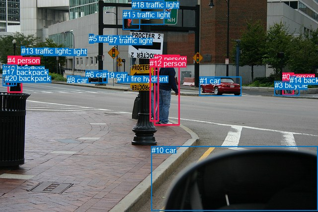
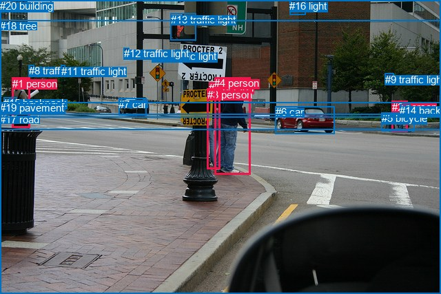

# 图片 1396：2381002.jpg

随机样本序号：302。图片 SHA256：`b6dbcc5c9e52f51480c4974ae6b15003ce25cd98fb936e2f26694fb7058fdbcb`。

红色框表示人，蓝色框表示其他物体。两个模式分别保留自身框编号，可依据位置比较对应对象。

## 自动检测框与输出

人的框编号：`[0, 2, 4, 12]`。状态：`ok`。

### 自动检测全部物体框

| 编号 | 类别 | 是否为人 | 检测分数 | 像素坐标 xyxy |
|---|---|---|---|---|
| 0 | person | True | 0.9992 | 568.2, 146.3, 591.3, 191.4 |
| 1 | car | False | 0.9991 | 401.6, 154.4, 485.5, 193.4 |
| 2 | person | True | 0.9988 | 310.3, 110.3, 361.8, 252.2 |
| 3 | bicycle | False | 0.9984 | 552.7, 163.3, 602.1, 192.1 |
| 4 | person | True | 0.9968 | 15.3, 112.6, 44.8, 187.0 |
| 5 | traffic light | False | 0.9926 | 179.0, 68.6, 188.5, 87.4 |
| 6 | car | False | 0.9901 | 172.6, 142.0, 216.3, 167.7 |
| 7 | traffic light | False | 0.9833 | 219.8, 73.0, 228.5, 89.4 |
| 8 | car | False | 0.9642 | 135.1, 152.9, 161.7, 163.6 |
| 9 | traffic light | False | 0.9486 | 87.6, 95.1, 96.3, 112.9 |
| 10 | car | False | 0.9464 | 304.6, 294.4, 640.0, 424.6 |
| 11 | fire hydrant | False | 0.9334 | 236.3, 149.7, 244.1, 165.1 |
| 12 | person | True | 0.9153 | 301.2, 118.7, 319.6, 244.9 |
| 13 | traffic light | False | 0.9151 | 42.5, 93.9, 49.6, 111.6 |
| 14 | backpack | False | 0.9037 | 583.3, 153.0, 595.8, 168.8 |
| 15 | traffic light | False | 0.8442 | 247.7, 20.9, 281.5, 60.0 |
| 16 | handbag | False | 0.6479 | 5.7, 130.1, 33.4, 172.8 |
| 17 | backpack | False | 0.6099 | 5.5, 136.9, 27.7, 174.0 |
| 18 | traffic light | False | 0.5771 | 265.8, 0.9, 330.9, 49.9 |
| 19 | car | False | 0.4090 | 206.2, 142.8, 215.8, 165.7 |
| 20 | backpack | False | 0.3710 | 10.3, 149.3, 23.9, 173.8 |

### 自动检测 Top50 人相关候选

评分物体对：420；人相关物体对：148；输出关系：50。

| 排名 | 主语编号与类别 | 关系 | 宾语编号与类别 | 类型 | 人与人 | 排序分数 | 原始融合 logit |
|---|---|---|---|---|---|---|---|
| 1 | #0 person | riding | #3 bicycle | semantic | False | 0.99720 | 5.8757 |
| 2 | #4 person | carrying | #20 backpack | semantic | False | 0.98915 | 4.5129 |
| 3 | #4 person | carrying | #17 backpack | semantic | False | 0.98675 | 4.3100 |
| 4 | #0 person | on | #3 bicycle | spatial | False | 0.98433 | 4.1403 |
| 5 | #4 person | carrying | #16 handbag | semantic | False | 0.97683 | 3.7416 |
| 6 | #2 person | walking on | #12 person | semantic | True | 0.90636 | 2.2700 |
| 7 | #4 person | in | #16 handbag | spatial | False | 0.90044 | 2.2021 |
| 8 | #0 person | carrying | #14 backpack | semantic | False | 0.88035 | 1.9958 |
| 9 | #4 person | in | #17 backpack | spatial | False | 0.84203 | 1.6734 |
| 10 | #2 person | beside | #12 person | spatial | True | 0.81817 | 1.5040 |
| 11 | #14 backpack | on | #0 person | spatial | False | 0.80175 | 1.3973 |
| 12 | #4 person | in | #20 backpack | spatial | False | 0.79902 | 1.3802 |
| 13 | #0 person | in | #14 backpack | spatial | False | 0.76338 | 1.1713 |
| 14 | #16 handbag | carrying | #4 person | semantic | False | 0.75173 | 1.1078 |
| 15 | #14 backpack | riding | #0 person | semantic | False | 0.73604 | 1.0255 |
| 16 | #12 person | talking to | #2 person | semantic | True | 0.71795 | 0.9343 |
| 17 | #16 handbag | on | #4 person | spatial | False | 0.68438 | 0.7740 |
| 18 | #10 car | in front of | #2 person | spatial | False | 0.67487 | 0.7303 |
| 19 | #12 person | beside | #2 person | spatial | True | 0.66452 | 0.6835 |
| 20 | #17 backpack | carrying | #4 person | semantic | False | 0.66070 | 0.6664 |
| 21 | #17 backpack | on | #4 person | spatial | False | 0.64514 | 0.5978 |
| 22 | #4 person | walking on | #13 traffic light | semantic | False | 0.61431 | 0.4655 |
| 23 | #20 backpack | on | #4 person | spatial | False | 0.56902 | 0.2778 |
| 24 | #20 backpack | carrying | #4 person | semantic | False | 0.47318 | -0.1074 |
| 25 | #4 person | on | #13 traffic light | spatial | False | 0.46607 | -0.1359 |
| 26 | #2 person | walking on | #11 fire hydrant | semantic | False | 0.43289 | -0.2701 |
| 27 | #2 person | looking at | #1 car | semantic | False | 0.42835 | -0.2886 |
| 28 | #12 person | standing on | #11 fire hydrant | semantic | False | 0.42494 | -0.3025 |
| 29 | #10 car | looking at | #2 person | semantic | False | 0.42029 | -0.3216 |
| 30 | #2 person | beside | #10 car | spatial | False | 0.35514 | -0.5965 |
| 31 | #2 person | looking at | #10 car | semantic | False | 0.33867 | -0.6692 |
| 32 | #2 person | beside | #1 car | spatial | False | 0.33537 | -0.6840 |
| 33 | #4 person | riding | #3 bicycle | semantic | False | 0.33187 | -0.6998 |
| 34 | #10 car | in front of | #12 person | spatial | False | 0.28012 | -0.9439 |
| 35 | #4 person | walking on | #8 car | semantic | False | 0.25928 | -1.0497 |
| 36 | #3 bicycle | carrying | #0 person | semantic | False | 0.24009 | -1.1522 |
| 37 | #3 bicycle | on | #0 person | spatial | False | 0.22056 | -1.2624 |
| 38 | #12 person | holding | #15 traffic light | semantic | False | 0.21391 | -1.3015 |
| 39 | #12 person | beside | #10 car | spatial | False | 0.20954 | -1.3277 |
| 40 | #4 person | walking on | #6 car | semantic | False | 0.19651 | -1.4083 |
| 41 | #2 person | walking on | #18 traffic light | semantic | False | 0.19191 | -1.4376 |
| 42 | #12 person | looking at | #10 car | semantic | False | 0.17969 | -1.5184 |
| 43 | #12 person | holding | #18 traffic light | semantic | False | 0.16475 | -1.6233 |
| 44 | #1 car | beside | #2 person | spatial | False | 0.16174 | -1.6453 |
| 45 | #10 car | looking at | #12 person | semantic | False | 0.16095 | -1.6512 |
| 46 | #12 person | looking at | #1 car | semantic | False | 0.15868 | -1.6681 |
| 47 | #12 person | on | #11 fire hydrant | spatial | False | 0.14499 | -1.7745 |
| 48 | #12 person | beside | #1 car | spatial | False | 0.13895 | -1.8240 |
| 49 | #18 traffic light | on | #12 person | spatial | False | 0.12648 | -1.9324 |
| 50 | #2 person | beside | #18 traffic light | spatial | False | 0.12092 | -1.9837 |

### 自动检测逐条人相关 GT 核验

R@50：50.00%；命中 2/4。

| GT 主语编号 | GT 关系 | GT 宾语编号 | 结果阶段 | 匹配预测主语编号 | 匹配预测宾语编号 |
|---|---|---|---|---|---|
| 2 | riding | 5 | hit50 | [0] | [3] |
| 2 | carrying | 14 | hit50 | [0] | [14] |
| 3 | standing on | 19 | endpoint_missing_or_wrong_class | [12] | [] |
| 4 | standing on | 17 | endpoint_missing_or_wrong_class | [2] | [] |

## 真实框与输出

人的框编号：`[0, 1, 2, 3, 4]`。

### 真实框全部物体框

| 编号 | 类别 | 是否为人 | 检测分数 | 像素坐标 xyxy |
|---|---|---|---|---|
| 0 | person | True | GT | 303.0, 119.0, 314.0, 131.0 |
| 1 | person | True | GT | 18.0, 113.0, 44.0, 186.0 |
| 2 | person | True | GT | 569.0, 147.0, 591.0, 192.0 |
| 3 | person | True | GT | 301.0, 129.0, 320.0, 245.0 |
| 4 | person | True | GT | 311.0, 112.0, 363.0, 253.0 |
| 5 | bicycle | False | GT | 554.0, 163.0, 602.0, 191.0 |
| 6 | car | False | GT | 400.0, 154.0, 486.0, 194.0 |
| 7 | car | False | GT | 172.0, 143.0, 212.0, 168.0 |
| 8 | traffic light | False | GT | 42.0, 94.0, 50.0, 110.0 |
| 9 | traffic light | False | GT | 559.0, 107.0, 572.0, 117.0 |
| 10 | traffic light | False | GT | 220.0, 73.0, 230.0, 90.0 |
| 11 | traffic light | False | GT | 89.0, 95.0, 95.0, 106.0 |
| 12 | traffic light | False | GT | 180.0, 69.0, 188.0, 87.0 |
| 13 | traffic light | False | GT | 248.0, 20.0, 285.0, 58.0 |
| 14 | backpack | False | GT | 580.0, 152.0, 595.0, 167.0 |
| 15 | backpack | False | GT | 5.0, 141.0, 24.0, 174.0 |
| 16 | light | False | GT | 420.0, 0.0, 443.0, 22.0 |
| 17 | road | False | GT | 0.0, 165.0, 640.0, 427.0 |
| 18 | tree | False | GT | 0.0, 29.0, 640.0, 189.0 |
| 19 | pavement | False | GT | 0.0, 148.0, 640.0, 427.0 |
| 20 | building | False | GT | 0.0, 0.0, 640.0, 171.0 |

### 真实框 Top50 人相关候选

评分物体对：420；人相关物体对：180；输出关系：50。

| 排名 | 主语编号与类别 | 关系 | 宾语编号与类别 | 类型 | 人与人 | 排序分数 | 原始融合 logit |
|---|---|---|---|---|---|---|---|
| 1 | #2 person | riding | #5 bicycle | semantic | False | 0.99673 | 5.7194 |
| 2 | #1 person | carrying | #15 backpack | semantic | False | 0.99326 | 4.9926 |
| 3 | #1 person | walking on | #17 road | semantic | False | 0.98502 | 4.1857 |
| 4 | #1 person | walking on | #19 pavement | semantic | False | 0.98421 | 4.1324 |
| 5 | #4 person | standing on | #17 road | semantic | False | 0.98330 | 4.0758 |
| 6 | #2 person | on | #5 bicycle | spatial | False | 0.98317 | 4.0677 |
| 7 | #4 person | standing on | #19 pavement | semantic | False | 0.98121 | 3.9555 |
| 8 | #3 person | standing on | #17 road | semantic | False | 0.96703 | 3.3788 |
| 9 | #3 person | standing on | #19 pavement | semantic | False | 0.96679 | 3.3711 |
| 10 | #2 person | wearing | #14 backpack | semantic | False | 0.96667 | 3.3675 |
| 11 | #2 person | crossing | #19 pavement | semantic | False | 0.94687 | 2.8803 |
| 12 | #4 person | on | #17 road | spatial | False | 0.93721 | 2.7030 |
| 13 | #4 person | on | #19 pavement | spatial | False | 0.93719 | 2.7028 |
| 14 | #0 person | on | #3 person | spatial | True | 0.93512 | 2.6682 |
| 15 | #3 person | on | #19 pavement | spatial | False | 0.93415 | 2.6523 |
| 16 | #3 person | holding | #0 person | semantic | True | 0.93348 | 2.6414 |
| 17 | #3 person | on | #17 road | spatial | False | 0.93224 | 2.6216 |
| 18 | #2 person | crossing | #17 road | semantic | False | 0.91990 | 2.4410 |
| 19 | #14 backpack | on | #2 person | spatial | False | 0.89992 | 2.1963 |
| 20 | #4 person | holding | #0 person | semantic | True | 0.89944 | 2.1910 |
| 21 | #15 backpack | carrying | #1 person | semantic | False | 0.89466 | 2.1392 |
| 22 | #4 person | walking on | #3 person | semantic | True | 0.89262 | 2.1178 |
| 23 | #14 backpack | riding | #2 person | semantic | False | 0.88676 | 2.0581 |
| 24 | #1 person | on | #19 pavement | spatial | False | 0.87192 | 1.9180 |
| 25 | #4 person | beside | #3 person | spatial | True | 0.87023 | 1.9030 |
| 26 | #1 person | on | #17 road | spatial | False | 0.86974 | 1.8987 |
| 27 | #2 person | in | #14 backpack | spatial | False | 0.85227 | 1.7526 |
| 28 | #2 person | on | #19 pavement | spatial | False | 0.85006 | 1.7351 |
| 29 | #2 person | on | #17 road | spatial | False | 0.82472 | 1.5486 |
| 30 | #1 person | in | #15 backpack | spatial | False | 0.81756 | 1.4999 |
| 31 | #15 backpack | on | #1 person | spatial | False | 0.78582 | 1.2999 |
| 32 | #3 person | talking to | #4 person | semantic | True | 0.76550 | 1.1831 |
| 33 | #3 person | on | #0 person | spatial | True | 0.76422 | 1.1760 |
| 34 | #3 person | beside | #4 person | spatial | True | 0.72343 | 0.9615 |
| 35 | #4 person | on | #0 person | spatial | True | 0.65317 | 0.6330 |
| 36 | #1 person | walking on | #8 traffic light | semantic | False | 0.47573 | -0.0971 |
| 37 | #0 person | on | #4 person | spatial | True | 0.42802 | -0.2899 |
| 38 | #0 person | standing on | #3 person | semantic | True | 0.40788 | -0.3727 |
| 39 | #1 person | walking on | #18 tree | semantic | False | 0.35814 | -0.5834 |
| 40 | #1 person | walking on | #20 building | semantic | False | 0.31843 | -0.7610 |
| 41 | #1 person | on | #8 traffic light | spatial | False | 0.28100 | -0.9395 |
| 42 | #5 bicycle | carrying | #2 person | semantic | False | 0.21976 | -1.2671 |
| 43 | #4 person | walking on | #20 building | semantic | False | 0.18482 | -1.4841 |
| 44 | #3 person | holding | #13 traffic light | semantic | False | 0.16564 | -1.6168 |
| 45 | #0 person | on | #19 pavement | spatial | False | 0.15708 | -1.6801 |
| 46 | #5 bicycle | in | #2 person | spatial | False | 0.14982 | -1.7360 |
| 47 | #0 person | on | #17 road | spatial | False | 0.14777 | -1.7522 |
| 48 | #0 person | holding | #4 person | semantic | True | 0.13772 | -1.8343 |
| 49 | #4 person | walking on | #18 tree | semantic | False | 0.12299 | -1.9645 |
| 50 | #4 person | in front of | #20 building | spatial | False | 0.11774 | -2.0140 |

### 真实框逐条人相关 GT 核验

R@50：75.00%；命中 3/4。

| GT 主语编号 | GT 关系 | GT 宾语编号 | 结果阶段 | 匹配预测主语编号 | 匹配预测宾语编号 |
|---|---|---|---|---|---|
| 2 | riding | 5 | hit50 | [2] | [5] |
| 2 | carrying | 14 | wrong_predicate | [2] | [14] |
| 3 | standing on | 19 | hit50 | [3] | [19] |
| 4 | standing on | 17 | hit50 | [4] | [17] |

## 全部人相关 GT

| 主语编号与类别 | 关系 | 宾语编号与类别 |
|---|---|---|
| #2 person | riding | #5 bicycle |
| #2 person | carrying | #14 backpack |
| #3 person | standing on | #19 pavement |
| #4 person | standing on | #17 road |

原始记录、全部人相关物体对的两项预测与分项分数见 [逐图证据 JSON](../evidence/cases/1396.json)。全部56类 logits 保留于本机 HOR/output/random500/logits/。

<!-- HOR_COMPLETE_RESULTS -->

## 六组条件的完整输出对照

以下保留同一图片三种框与候选模式、两种谓词输出规则的全部 Top50。框编号各自在所属模式内解释。

### 自动检测框完整枚举：空间与语义各保留一个谓词

| 排名 | 主语编号与类别 | 谓词 | 宾语编号与类别 | 分组 | 排序分数 | predicate logit | pair logit |
|---|---|---|---|---|---|---|---|
| 1 | #0 person | riding | #3 bicycle | semantic | 0.9972010 | 5.3871789 | 0.4885025 |
| 2 | #4 person | carrying | #20 backpack | semantic | 0.9891527 | 4.4043784 | 0.1085482 |
| 3 | #4 person | carrying | #17 backpack | semantic | 0.9867451 | 4.2191710 | 0.0908697 |
| 4 | #0 person | on | #3 bicycle | spatial | 0.9843310 | 3.6517682 | 0.4885025 |
| 5 | #4 person | carrying | #16 handbag | semantic | 0.9768329 | 3.6406465 | 0.1009344 |
| 6 | #2 person | walking on | #12 person | semantic | 0.9063642 | 2.6811757 | -0.4111481 |
| 7 | #4 person | in | #16 handbag | spatial | 0.9004360 | 2.1011448 | 0.1009344 |
| 8 | #0 person | carrying | #14 backpack | semantic | 0.8803515 | 1.9633269 | 0.0324360 |
| 9 | #4 person | in | #17 backpack | spatial | 0.8420260 | 1.5825105 | 0.0908697 |
| 10 | #2 person | beside | #12 person | spatial | 0.8181663 | 1.9151211 | -0.4111481 |
| 11 | #14 backpack | on | #0 person | spatial | 0.8017533 | 1.7181659 | -0.3208776 |
| 12 | #4 person | in | #20 backpack | spatial | 0.7990216 | 1.2716422 | 0.1085482 |
| 13 | #0 person | in | #14 backpack | spatial | 0.7633814 | 1.1388721 | 0.0324360 |
| 14 | #16 handbag | carrying | #4 person | semantic | 0.7517262 | 1.8101411 | -0.7023013 |
| 15 | #14 backpack | riding | #0 person | semantic | 0.7360400 | 1.3463645 | -0.3208776 |
| 16 | #12 person | talking to | #2 person | semantic | 0.7179452 | 1.9564066 | -1.0221149 |
| 17 | #16 handbag | on | #4 person | spatial | 0.6843805 | 1.4762778 | -0.7023013 |
| 18 | #10 car | in front of | #2 person | spatial | 0.6748711 | 1.6387463 | -0.9084463 |
| 19 | #12 person | beside | #2 person | spatial | 0.6645246 | 1.7056384 | -1.0221149 |
| 20 | #17 backpack | carrying | #4 person | semantic | 0.6606965 | 1.3566418 | -0.6902421 |
| 21 | #17 backpack | on | #4 person | spatial | 0.6451426 | 1.2879972 | -0.6902421 |
| 22 | #4 person | walking on | #13 traffic light | semantic | 0.6143147 | 0.8576655 | -0.3921800 |
| 23 | #20 backpack | on | #4 person | spatial | 0.5690177 | 0.9876642 | -0.7098198 |
| 24 | #20 backpack | carrying | #4 person | semantic | 0.4731786 | 0.6024308 | -0.7098198 |
| 25 | #4 person | on | #13 traffic light | spatial | 0.4660664 | 0.2562366 | -0.3921800 |
| 26 | #2 person | walking on | #11 fire hydrant | semantic | 0.4328914 | 0.4424372 | -0.7125010 |
| 27 | #2 person | looking at | #1 car | semantic | 0.4283517 | 0.9806118 | -1.2691910 |
| 28 | #12 person | standing on | #11 fire hydrant | semantic | 0.4249371 | 0.1429172 | -0.4454553 |
| 29 | #10 car | looking at | #2 person | semantic | 0.4202932 | 0.5868764 | -0.9084463 |
| 30 | #2 person | beside | #10 car | spatial | 0.3551376 | 0.5213099 | -1.1178416 |
| 31 | #2 person | looking at | #10 car | semantic | 0.3386717 | 0.4486227 | -1.1178416 |
| 32 | #2 person | beside | #1 car | spatial | 0.3353728 | 0.5852075 | -1.2691910 |
| 33 | #4 person | riding | #3 bicycle | semantic | 0.3318677 | 0.3227730 | -1.0225230 |
| 34 | #10 car | in front of | #12 person | spatial | 0.2801172 | 0.1402531 | -1.0841335 |
| 35 | #4 person | walking on | #8 car | semantic | 0.2592836 | 0.3145456 | -1.3642410 |
| 36 | #3 bicycle | carrying | #0 person | semantic | 0.2400908 | -0.4084563 | -0.7437252 |
| 37 | #3 bicycle | on | #0 person | spatial | 0.2205628 | -0.5186644 | -0.7437252 |
| 38 | #12 person | holding | #15 traffic light | semantic | 0.2139055 | -0.3011417 | -1.0004007 |
| 39 | #12 person | beside | #10 car | spatial | 0.2095441 | 0.0403485 | -1.3680241 |
| 40 | #4 person | walking on | #6 car | semantic | 0.1965072 | 0.1249666 | -1.5332360 |
| 41 | #2 person | walking on | #18 traffic light | semantic | 0.1919129 | -0.2195425 | -1.2180854 |
| 42 | #12 person | looking at | #10 car | semantic | 0.1796917 | -0.1504135 | -1.3680241 |
| 43 | #12 person | holding | #18 traffic light | semantic | 0.1647519 | -0.4048796 | -1.2184082 |
| 44 | #1 car | beside | #2 person | spatial | 0.1617388 | -0.4403262 | -1.2050207 |
| 45 | #10 car | looking at | #12 person | semantic | 0.1609491 | -0.5670500 | -1.0841335 |
| 46 | #12 person | looking at | #1 car | semantic | 0.1586812 | -0.0403986 | -1.6276753 |
| 47 | #12 person | on | #11 fire hydrant | spatial | 0.1449893 | -1.3289990 | -0.4454553 |
| 48 | #12 person | beside | #1 car | spatial | 0.1389509 | -0.1963558 | -1.6276753 |
| 49 | #18 traffic light | on | #12 person | spatial | 0.1264848 | -1.0323305 | -0.9000731 |
| 50 | #2 person | beside | #18 traffic light | spatial | 0.1209232 | -0.7656314 | -1.2180854 |

GT 命中：2/4，R@50=50.00%。

| GT主语 | GT谓词 | GT宾语 | 结果阶段 | 匹配主语框 | 匹配宾语框 |
|---|---|---|---|---|---|
| 2 | riding | 5 | hit50 | [0] | [3] |
| 2 | carrying | 14 | hit50 | [0] | [14] |
| 3 | standing on | 19 | endpoint_missing_or_wrong_class | [12] | [] |
| 4 | standing on | 17 | endpoint_missing_or_wrong_class | [2] | [] |

### 自动检测框完整枚举：每对只保留一个谓词

| 排名 | 主语编号与类别 | 谓词 | 宾语编号与类别 | 分组 | 排序分数 | predicate logit | pair logit |
|---|---|---|---|---|---|---|---|
| 1 | #0 person | riding | #3 bicycle | single | 0.9972010 | 5.3871789 | 0.4885025 |
| 2 | #4 person | carrying | #20 backpack | single | 0.9891527 | 4.4043784 | 0.1085482 |
| 3 | #4 person | carrying | #17 backpack | single | 0.9867451 | 4.2191710 | 0.0908697 |
| 4 | #4 person | carrying | #16 handbag | single | 0.9768329 | 3.6406465 | 0.1009344 |
| 5 | #2 person | walking on | #12 person | single | 0.9063642 | 2.6811757 | -0.4111481 |
| 6 | #0 person | carrying | #14 backpack | single | 0.8803515 | 1.9633269 | 0.0324360 |
| 7 | #14 backpack | on | #0 person | single | 0.8017533 | 1.7181659 | -0.3208776 |
| 8 | #16 handbag | carrying | #4 person | single | 0.7517262 | 1.8101411 | -0.7023013 |
| 9 | #12 person | talking to | #2 person | single | 0.7179452 | 1.9564066 | -1.0221149 |
| 10 | #10 car | in front of | #2 person | single | 0.6748711 | 1.6387463 | -0.9084463 |
| 11 | #17 backpack | carrying | #4 person | single | 0.6606965 | 1.3566418 | -0.6902421 |
| 12 | #4 person | walking on | #13 traffic light | single | 0.6143147 | 0.8576655 | -0.3921800 |
| 13 | #20 backpack | on | #4 person | single | 0.5690177 | 0.9876642 | -0.7098198 |
| 14 | #2 person | walking on | #11 fire hydrant | single | 0.4328914 | 0.4424372 | -0.7125010 |
| 15 | #2 person | looking at | #1 car | single | 0.4283517 | 0.9806118 | -1.2691910 |
| 16 | #12 person | standing on | #11 fire hydrant | single | 0.4249371 | 0.1429172 | -0.4454553 |
| 17 | #2 person | beside | #10 car | single | 0.3551376 | 0.5213099 | -1.1178416 |
| 18 | #4 person | riding | #3 bicycle | single | 0.3318677 | 0.3227730 | -1.0225230 |
| 19 | #10 car | in front of | #12 person | single | 0.2801172 | 0.1402531 | -1.0841335 |
| 20 | #4 person | walking on | #8 car | single | 0.2592836 | 0.3145456 | -1.3642410 |
| 21 | #3 bicycle | carrying | #0 person | single | 0.2400908 | -0.4084563 | -0.7437252 |
| 22 | #12 person | holding | #15 traffic light | single | 0.2139055 | -0.3011417 | -1.0004007 |
| 23 | #12 person | beside | #10 car | single | 0.2095441 | 0.0403485 | -1.3680241 |
| 24 | #4 person | walking on | #6 car | single | 0.1965072 | 0.1249666 | -1.5332360 |
| 25 | #2 person | walking on | #18 traffic light | single | 0.1919129 | -0.2195425 | -1.2180854 |
| 26 | #12 person | holding | #18 traffic light | single | 0.1647519 | -0.4048796 | -1.2184082 |
| 27 | #1 car | beside | #2 person | single | 0.1617388 | -0.4403262 | -1.2050207 |
| 28 | #12 person | looking at | #1 car | single | 0.1586812 | -0.0403986 | -1.6276753 |
| 29 | #18 traffic light | on | #12 person | single | 0.1264848 | -1.0323305 | -0.9000731 |
| 30 | #2 person | wearing | #16 handbag | single | 0.1181824 | -0.5904698 | -1.4192865 |
| 31 | #13 traffic light | in | #4 person | single | 0.1170752 | -1.0863826 | -0.9340405 |
| 32 | #2 person | looking at | #15 traffic light | single | 0.1159483 | -0.9327102 | -1.0986609 |
| 33 | #4 person | looking at | #2 person | single | 0.1041202 | -0.7144341 | -1.4378258 |
| 34 | #4 person | walking on | #11 fire hydrant | single | 0.1009902 | -0.3579988 | -1.8282716 |
| 35 | #4 person | walking on | #19 car | single | 0.0933097 | -0.7235954 | -1.5502818 |
| 36 | #2 person | wearing | #17 backpack | single | 0.0931466 | -0.8077288 | -1.4680772 |
| 37 | #12 person | riding | #3 bicycle | single | 0.0877827 | -0.9585488 | -1.3824655 |
| 38 | #4 person | walking on | #9 traffic light | single | 0.0856704 | -1.1719744 | -1.1957101 |
| 39 | #10 car | in front of | #0 person | single | 0.0823079 | -0.9893012 | -1.4220932 |
| 40 | #2 person | wearing | #20 backpack | single | 0.0745326 | -1.0066314 | -1.5124307 |
| 41 | #18 traffic light | over | #2 person | single | 0.0737041 | -1.3975708 | -1.1335646 |
| 42 | #15 traffic light | on | #12 person | single | 0.0730665 | -1.7158854 | -0.8246261 |
| 43 | #2 person | walking on | #19 car | single | 0.0694362 | -1.2260871 | -1.3692952 |
| 44 | #2 person | looking at | #7 traffic light | single | 0.0612170 | -1.1046619 | -1.6254969 |
| 45 | #2 person | walking on | #6 car | single | 0.0594038 | -1.2125397 | -1.5496161 |
| 46 | #4 person | walking on | #1 car | single | 0.0581705 | -1.1854589 | -1.5989869 |
| 47 | #2 person | riding | #3 bicycle | single | 0.0576559 | -1.5882654 | -1.2056124 |
| 48 | #12 person | wearing | #16 handbag | single | 0.0575148 | -0.8327036 | -1.9637744 |
| 49 | #12 person | standing on | #19 car | single | 0.0531319 | -1.5039439 | -1.3764378 |
| 50 | #12 person | holding | #20 backpack | single | 0.0510903 | -0.9566820 | -1.9650378 |

GT 命中：2/4，R@50=50.00%。

| GT主语 | GT谓词 | GT宾语 | 结果阶段 | 匹配主语框 | 匹配宾语框 |
|---|---|---|---|---|---|
| 2 | riding | 5 | hit50 | [0] | [3] |
| 2 | carrying | 14 | hit50 | [0] | [14] |
| 3 | standing on | 19 | endpoint_missing_or_wrong_class | [12] | [] |
| 4 | standing on | 17 | endpoint_missing_or_wrong_class | [2] | [] |

### 真实框完整枚举：空间与语义各保留一个谓词

| 排名 | 主语编号与类别 | 谓词 | 宾语编号与类别 | 分组 | 排序分数 | predicate logit | pair logit |
|---|---|---|---|---|---|---|---|
| 1 | #2 person | riding | #5 bicycle | semantic | 0.9967291 | 5.2702355 | 0.4491886 |
| 2 | #1 person | carrying | #15 backpack | semantic | 0.9932580 | 4.9017482 | 0.0908861 |
| 3 | #1 person | walking on | #17 road | semantic | 0.9850163 | 4.6010079 | -0.4153122 |
| 4 | #1 person | walking on | #19 pavement | semantic | 0.9842097 | 4.5558782 | -0.4234346 |
| 5 | #4 person | standing on | #17 road | semantic | 0.9833043 | 3.9761367 | 0.0996284 |
| 6 | #2 person | on | #5 bicycle | spatial | 0.9831715 | 3.6185193 | 0.4491886 |
| 7 | #4 person | standing on | #19 pavement | semantic | 0.9812099 | 3.8778043 | 0.0776550 |
| 8 | #3 person | standing on | #17 road | semantic | 0.9670340 | 3.7721276 | -0.3933723 |
| 9 | #3 person | standing on | #19 pavement | semantic | 0.9667877 | 3.7721276 | -0.4010686 |
| 10 | #2 person | wearing | #14 backpack | semantic | 0.9666719 | 3.3325944 | 0.0348665 |
| 11 | #2 person | crossing | #19 pavement | semantic | 0.9468662 | 3.0989847 | -0.2186391 |
| 12 | #4 person | on | #17 road | spatial | 0.9372057 | 2.6034112 | 0.0996284 |
| 13 | #4 person | on | #19 pavement | spatial | 0.9371943 | 2.6251903 | 0.0776550 |
| 14 | #0 person | on | #3 person | spatial | 0.9351223 | 3.2155461 | -0.5473733 |
| 15 | #3 person | on | #19 pavement | spatial | 0.9341521 | 3.0533600 | -0.4010686 |
| 16 | #3 person | holding | #0 person | semantic | 0.9334817 | 3.0253534 | -0.3839094 |
| 17 | #3 person | on | #17 road | spatial | 0.9322379 | 3.0149570 | -0.3933723 |
| 18 | #2 person | crossing | #17 road | semantic | 0.9199021 | 2.6492510 | -0.2082319 |
| 19 | #14 backpack | on | #2 person | spatial | 0.8999171 | 2.4727354 | -0.2764312 |
| 20 | #4 person | holding | #0 person | semantic | 0.8994350 | 2.4552660 | -0.2643029 |
| 21 | #15 backpack | carrying | #1 person | semantic | 0.8946566 | 2.8466244 | -0.7074099 |
| 22 | #4 person | walking on | #3 person | semantic | 0.8926244 | 2.1275048 | -0.0096710 |
| 23 | #14 backpack | riding | #2 person | semantic | 0.8867593 | 2.3344884 | -0.2764312 |
| 24 | #1 person | on | #19 pavement | spatial | 0.8719203 | 2.3414803 | -0.4234346 |
| 25 | #4 person | beside | #3 person | spatial | 0.8702331 | 1.9126921 | -0.0096710 |
| 26 | #1 person | on | #17 road | spatial | 0.8697392 | 2.3139668 | -0.4153122 |
| 27 | #2 person | in | #14 backpack | spatial | 0.8522748 | 1.7176890 | 0.0348665 |
| 28 | #2 person | on | #19 pavement | spatial | 0.8500638 | 1.9537406 | -0.2186391 |
| 29 | #2 person | on | #17 road | spatial | 0.8247153 | 1.7568588 | -0.2082319 |
| 30 | #1 person | in | #15 backpack | spatial | 0.8175644 | 1.4090462 | 0.0908861 |
| 31 | #15 backpack | on | #1 person | spatial | 0.7858198 | 2.0073199 | -0.7074099 |
| 32 | #3 person | talking to | #4 person | semantic | 0.7654995 | 2.1359539 | -0.9528829 |
| 33 | #3 person | on | #0 person | spatial | 0.7642246 | 1.5598917 | -0.3839094 |
| 34 | #3 person | beside | #4 person | spatial | 0.7234308 | 1.9144268 | -0.9528829 |
| 35 | #4 person | on | #0 person | spatial | 0.6531698 | 0.8973050 | -0.2643029 |
| 36 | #1 person | walking on | #8 traffic light | semantic | 0.4757345 | 0.3265600 | -0.4236984 |
| 37 | #0 person | on | #4 person | spatial | 0.4280232 | 0.5878477 | -0.8777686 |
| 38 | #0 person | standing on | #3 person | semantic | 0.4078796 | 0.1746354 | -0.5473733 |
| 39 | #1 person | walking on | #18 tree | semantic | 0.3581394 | 0.6410193 | -1.2244682 |
| 40 | #1 person | walking on | #20 building | semantic | 0.3184271 | 0.4409180 | -1.2019277 |
| 41 | #1 person | on | #8 traffic light | spatial | 0.2809966 | -0.5158253 | -0.4236984 |
| 42 | #5 bicycle | carrying | #2 person | semantic | 0.2197616 | -0.5767703 | -0.6902862 |
| 43 | #4 person | walking on | #20 building | semantic | 0.1848159 | -0.4331641 | -1.0508900 |
| 44 | #3 person | holding | #13 traffic light | semantic | 0.1656430 | -0.4802222 | -1.1366041 |
| 45 | #0 person | on | #19 pavement | spatial | 0.1570795 | -0.6109080 | -1.0692128 |
| 46 | #5 bicycle | in | #2 person | spatial | 0.1498199 | -1.0457282 | -0.6902862 |
| 47 | #0 person | on | #17 road | spatial | 0.1477725 | -0.6189303 | -1.1332490 |
| 48 | #0 person | holding | #4 person | semantic | 0.1377219 | -0.9565728 | -0.8777686 |
| 49 | #4 person | walking on | #18 tree | semantic | 0.1229862 | -0.8213396 | -1.1431105 |
| 50 | #4 person | in front of | #20 building | spatial | 0.1177411 | -0.9631076 | -1.0508900 |

GT 命中：3/4，R@50=75.00%。

| GT主语 | GT谓词 | GT宾语 | 结果阶段 | 匹配主语框 | 匹配宾语框 |
|---|---|---|---|---|---|
| 2 | riding | 5 | hit50 | [2] | [5] |
| 2 | carrying | 14 | wrong_predicate | [2] | [14] |
| 3 | standing on | 19 | hit50 | [3] | [19] |
| 4 | standing on | 17 | hit50 | [4] | [17] |

### 真实框完整枚举：每对只保留一个谓词

| 排名 | 主语编号与类别 | 谓词 | 宾语编号与类别 | 分组 | 排序分数 | predicate logit | pair logit |
|---|---|---|---|---|---|---|---|
| 1 | #2 person | riding | #5 bicycle | single | 0.9967291 | 5.2702355 | 0.4491886 |
| 2 | #1 person | carrying | #15 backpack | single | 0.9932580 | 4.9017482 | 0.0908861 |
| 3 | #1 person | walking on | #17 road | single | 0.9850163 | 4.6010079 | -0.4153122 |
| 4 | #1 person | walking on | #19 pavement | single | 0.9842097 | 4.5558782 | -0.4234346 |
| 5 | #4 person | standing on | #17 road | single | 0.9833043 | 3.9761367 | 0.0996284 |
| 6 | #4 person | standing on | #19 pavement | single | 0.9812099 | 3.8778043 | 0.0776550 |
| 7 | #3 person | standing on | #17 road | single | 0.9670340 | 3.7721276 | -0.3933723 |
| 8 | #3 person | standing on | #19 pavement | single | 0.9667877 | 3.7721276 | -0.4010686 |
| 9 | #2 person | wearing | #14 backpack | single | 0.9666719 | 3.3325944 | 0.0348665 |
| 10 | #2 person | crossing | #19 pavement | single | 0.9468662 | 3.0989847 | -0.2186391 |
| 11 | #0 person | on | #3 person | single | 0.9351223 | 3.2155461 | -0.5473733 |
| 12 | #3 person | holding | #0 person | single | 0.9334817 | 3.0253534 | -0.3839094 |
| 13 | #2 person | crossing | #17 road | single | 0.9199021 | 2.6492510 | -0.2082319 |
| 14 | #14 backpack | on | #2 person | single | 0.8999171 | 2.4727354 | -0.2764312 |
| 15 | #4 person | holding | #0 person | single | 0.8994350 | 2.4552660 | -0.2643029 |
| 16 | #15 backpack | carrying | #1 person | single | 0.8946566 | 2.8466244 | -0.7074099 |
| 17 | #4 person | walking on | #3 person | single | 0.8926244 | 2.1275048 | -0.0096710 |
| 18 | #3 person | talking to | #4 person | single | 0.7654995 | 2.1359539 | -0.9528829 |
| 19 | #1 person | walking on | #8 traffic light | single | 0.4757345 | 0.3265600 | -0.4236984 |
| 20 | #0 person | on | #4 person | single | 0.4280232 | 0.5878477 | -0.8777686 |
| 21 | #1 person | walking on | #18 tree | single | 0.3581394 | 0.6410193 | -1.2244682 |
| 22 | #1 person | walking on | #20 building | single | 0.3184271 | 0.4409180 | -1.2019277 |
| 23 | #5 bicycle | carrying | #2 person | single | 0.2197616 | -0.5767703 | -0.6902862 |
| 24 | #4 person | walking on | #20 building | single | 0.1848159 | -0.4331641 | -1.0508900 |
| 25 | #3 person | holding | #13 traffic light | single | 0.1656430 | -0.4802222 | -1.1366041 |
| 26 | #0 person | on | #19 pavement | single | 0.1570795 | -0.6109080 | -1.0692128 |
| 27 | #0 person | on | #17 road | single | 0.1477725 | -0.6189303 | -1.1332490 |
| 28 | #4 person | walking on | #18 tree | single | 0.1229862 | -0.8213396 | -1.1431105 |
| 29 | #1 person | riding | #5 bicycle | single | 0.1086567 | -1.0874839 | -1.0170529 |
| 30 | #4 person | looking at | #6 car | single | 0.0937590 | -1.0519965 | -1.2165816 |
| 31 | #1 person | walking on | #7 car | single | 0.0732559 | -1.0124657 | -1.5252526 |
| 32 | #4 person | holding | #13 traffic light | single | 0.0700338 | -1.4577134 | -1.1284570 |
| 33 | #8 traffic light | beside | #1 person | single | 0.0616497 | -1.8087528 | -0.9139028 |
| 34 | #6 car | beside | #4 person | single | 0.0588569 | -1.5839357 | -1.1880503 |
| 35 | #1 person | looking at | #4 person | single | 0.0518494 | -1.4879820 | -1.4181881 |
| 36 | #13 traffic light | on | #3 person | single | 0.0504861 | -2.0236039 | -0.9106485 |
| 37 | #4 person | wearing | #15 backpack | single | 0.0453465 | -1.5820508 | -1.4649659 |
| 38 | #13 traffic light | over | #4 person | single | 0.0347450 | -2.1156900 | -1.2086666 |
| 39 | #4 person | looking at | #10 traffic light | single | 0.0333309 | -1.7482898 | -1.6190825 |
| 40 | #1 person | looking at | #11 traffic light | single | 0.0285381 | -2.3301229 | -1.1974378 |
| 41 | #1 person | pushing | #2 person | single | 0.0267589 | -2.2453201 | -1.3484443 |
| 42 | #3 person | in front of | #20 building | single | 0.0247037 | -1.8785961 | -1.7971931 |
| 43 | #4 person | holding | #1 person | single | 0.0223743 | -2.4541233 | -1.3230925 |
| 44 | #7 car | beside | #4 person | single | 0.0219917 | -2.2897213 | -1.5051298 |
| 45 | #9 traffic light | over | #2 person | single | 0.0196235 | -3.1952562 | -0.7159511 |
| 46 | #0 person | on | #13 traffic light | single | 0.0191057 | -3.0251148 | -0.9133617 |
| 47 | #1 person | looking at | #3 person | single | 0.0189810 | -2.1907032 | -1.7544515 |
| 48 | #15 backpack | carrying | #4 person | single | 0.0177718 | -2.3767486 | -1.6354614 |
| 49 | #3 person | looking at | #10 traffic light | single | 0.0173949 | -2.5413718 | -1.4926591 |
| 50 | #2 person | in | #18 tree | single | 0.0171296 | -3.3229294 | -0.7267425 |

GT 命中：3/4，R@50=75.00%。

| GT主语 | GT谓词 | GT宾语 | 结果阶段 | 匹配主语框 | 匹配宾语框 |
|---|---|---|---|---|---|
| 2 | riding | 5 | hit50 | [2] | [5] |
| 2 | carrying | 14 | wrong_predicate | [2] | [14] |
| 3 | standing on | 19 | hit50 | [3] | [19] |
| 4 | standing on | 17 | hit50 | [4] | [17] |

### 真实框400候选：空间与语义各保留一个谓词

| 排名 | 主语编号与类别 | 谓词 | 宾语编号与类别 | 分组 | 排序分数 | predicate logit | pair logit |
|---|---|---|---|---|---|---|---|
| 1 | #2 person | riding | #5 bicycle | semantic | 0.9967300 | 5.2704806 | 0.4491886 |
| 2 | #1 person | carrying | #15 backpack | semantic | 0.9932580 | 4.9017482 | 0.0908861 |
| 3 | #1 person | walking on | #17 road | semantic | 0.9850163 | 4.6010079 | -0.4153122 |
| 4 | #1 person | walking on | #19 pavement | semantic | 0.9842097 | 4.5558782 | -0.4234346 |
| 5 | #2 person | on | #5 bicycle | spatial | 0.9833507 | 3.6294093 | 0.4491886 |
| 6 | #4 person | standing on | #17 road | semantic | 0.9833043 | 3.9761367 | 0.0996284 |
| 7 | #4 person | standing on | #19 pavement | semantic | 0.9812099 | 3.8778043 | 0.0776550 |
| 8 | #3 person | standing on | #17 road | semantic | 0.9672673 | 3.7794709 | -0.3933723 |
| 9 | #3 person | standing on | #19 pavement | semantic | 0.9670227 | 3.7794709 | -0.4010686 |
| 10 | #2 person | wearing | #14 backpack | semantic | 0.9664824 | 3.3267264 | 0.0348665 |
| 11 | #2 person | crossing | #19 pavement | semantic | 0.9468662 | 3.0989847 | -0.2186391 |
| 12 | #4 person | on | #17 road | spatial | 0.9378435 | 2.6143003 | 0.0996284 |
| 13 | #4 person | on | #19 pavement | spatial | 0.9348955 | 2.5867867 | 0.0776550 |
| 14 | #3 person | holding | #0 person | semantic | 0.9331139 | 3.0194449 | -0.3839094 |
| 15 | #0 person | on | #3 person | spatial | 0.9331119 | 3.1828780 | -0.5473733 |
| 16 | #3 person | on | #19 pavement | spatial | 0.9324393 | 3.0258465 | -0.4010686 |
| 17 | #3 person | on | #17 road | spatial | 0.9322379 | 3.0149570 | -0.3933723 |
| 18 | #2 person | crossing | #17 road | semantic | 0.9199048 | 2.6492863 | -0.2082319 |
| 19 | #4 person | holding | #0 person | semantic | 0.8988994 | 2.4493580 | -0.2643029 |
| 20 | #15 backpack | carrying | #1 person | semantic | 0.8946566 | 2.8466244 | -0.7074099 |
| 21 | #14 backpack | on | #2 person | spatial | 0.8943648 | 2.4125528 | -0.2764312 |
| 22 | #4 person | walking on | #3 person | semantic | 0.8926244 | 2.1275048 | -0.0096710 |
| 23 | #14 backpack | riding | #2 person | semantic | 0.8774517 | 2.2449474 | -0.2764312 |
| 24 | #1 person | on | #19 pavement | spatial | 0.8761482 | 2.3798838 | -0.4234346 |
| 25 | #4 person | beside | #3 person | spatial | 0.8702331 | 1.9126921 | -0.0096710 |
| 26 | #1 person | on | #17 road | spatial | 0.8697392 | 2.3139668 | -0.4153122 |
| 27 | #2 person | on | #19 pavement | spatial | 0.8555671 | 1.9975886 | -0.2186391 |
| 28 | #2 person | in | #14 backpack | spatial | 0.8514372 | 1.7110515 | 0.0348665 |
| 29 | #2 person | on | #17 road | spatial | 0.8262839 | 1.7677484 | -0.2082319 |
| 30 | #1 person | in | #15 backpack | spatial | 0.8175644 | 1.4090462 | 0.0908861 |
| 31 | #15 backpack | on | #1 person | spatial | 0.7839814 | 1.9964309 | -0.7074099 |
| 32 | #3 person | talking to | #4 person | semantic | 0.7655219 | 2.1360788 | -0.9528829 |
| 33 | #3 person | on | #0 person | spatial | 0.7607472 | 1.5406899 | -0.3839094 |
| 34 | #3 person | beside | #4 person | spatial | 0.7293879 | 1.9444022 | -0.9528829 |
| 35 | #4 person | on | #0 person | spatial | 0.6488072 | 0.8781028 | -0.2643029 |
| 36 | #1 person | walking on | #8 traffic light | semantic | 0.4678606 | 0.2949634 | -0.4236984 |
| 37 | #0 person | on | #4 person | spatial | 0.4060800 | 0.4975743 | -0.8777686 |
| 38 | #0 person | standing on | #3 person | semantic | 0.4006328 | 0.1445441 | -0.5473733 |
| 39 | #1 person | walking on | #18 tree | semantic | 0.3581394 | 0.6410193 | -1.2244682 |
| 40 | #1 person | walking on | #20 building | semantic | 0.3249931 | 0.4710088 | -1.2019277 |
| 41 | #1 person | on | #8 traffic light | spatial | 0.2760440 | -0.5404720 | -0.4236984 |
| 42 | #5 bicycle | carrying | #2 person | semantic | 0.2195619 | -0.5779352 | -0.6902862 |
| 43 | #4 person | walking on | #20 building | semantic | 0.1763571 | -0.4903359 | -1.0508900 |
| 44 | #0 person | on | #19 pavement | spatial | 0.1682593 | -0.5288014 | -1.0692128 |
| 45 | #3 person | holding | #13 traffic light | semantic | 0.1662052 | -0.4761600 | -1.1366041 |
| 46 | #0 person | on | #17 road | spatial | 0.1569489 | -0.5478582 | -1.1332490 |
| 47 | #5 bicycle | on | #2 person | spatial | 0.1475385 | -1.0637531 | -0.6902862 |
| 48 | #0 person | holding | #4 person | semantic | 0.1303942 | -1.0197093 | -0.8777686 |
| 49 | #0 person | crossing | #19 pavement | semantic | 0.1210318 | -0.9134824 | -1.0692128 |
| 50 | #4 person | walking on | #18 tree | semantic | 0.1197772 | -0.8514311 | -1.1431105 |

GT 命中：3/4，R@50=75.00%。

| GT主语 | GT谓词 | GT宾语 | 结果阶段 | 匹配主语框 | 匹配宾语框 |
|---|---|---|---|---|---|
| 2 | riding | 5 | hit50 | [2] | [5] |
| 2 | carrying | 14 | wrong_predicate | [2] | [14] |
| 3 | standing on | 19 | hit50 | [3] | [19] |
| 4 | standing on | 17 | hit50 | [4] | [17] |

### 真实框400候选：每对只保留一个谓词

| 排名 | 主语编号与类别 | 谓词 | 宾语编号与类别 | 分组 | 排序分数 | predicate logit | pair logit |
|---|---|---|---|---|---|---|---|
| 1 | #2 person | riding | #5 bicycle | single | 0.9967300 | 5.2704806 | 0.4491886 |
| 2 | #1 person | carrying | #15 backpack | single | 0.9932580 | 4.9017482 | 0.0908861 |
| 3 | #1 person | walking on | #17 road | single | 0.9850163 | 4.6010079 | -0.4153122 |
| 4 | #1 person | walking on | #19 pavement | single | 0.9842097 | 4.5558782 | -0.4234346 |
| 5 | #4 person | standing on | #17 road | single | 0.9833043 | 3.9761367 | 0.0996284 |
| 6 | #4 person | standing on | #19 pavement | single | 0.9812099 | 3.8778043 | 0.0776550 |
| 7 | #3 person | standing on | #17 road | single | 0.9672673 | 3.7794709 | -0.3933723 |
| 8 | #3 person | standing on | #19 pavement | single | 0.9670227 | 3.7794709 | -0.4010686 |
| 9 | #2 person | wearing | #14 backpack | single | 0.9664824 | 3.3267264 | 0.0348665 |
| 10 | #2 person | crossing | #19 pavement | single | 0.9468662 | 3.0989847 | -0.2186391 |
| 11 | #3 person | holding | #0 person | single | 0.9331139 | 3.0194449 | -0.3839094 |
| 12 | #0 person | on | #3 person | single | 0.9331119 | 3.1828780 | -0.5473733 |
| 13 | #2 person | crossing | #17 road | single | 0.9199048 | 2.6492863 | -0.2082319 |
| 14 | #4 person | holding | #0 person | single | 0.8988994 | 2.4493580 | -0.2643029 |
| 15 | #15 backpack | carrying | #1 person | single | 0.8946566 | 2.8466244 | -0.7074099 |
| 16 | #14 backpack | on | #2 person | single | 0.8943648 | 2.4125528 | -0.2764312 |
| 17 | #4 person | walking on | #3 person | single | 0.8926244 | 2.1275048 | -0.0096710 |
| 18 | #3 person | talking to | #4 person | single | 0.7655219 | 2.1360788 | -0.9528829 |
| 19 | #1 person | walking on | #8 traffic light | single | 0.4678606 | 0.2949634 | -0.4236984 |
| 20 | #0 person | on | #4 person | single | 0.4060800 | 0.4975743 | -0.8777686 |
| 21 | #1 person | walking on | #18 tree | single | 0.3581394 | 0.6410193 | -1.2244682 |
| 22 | #1 person | walking on | #20 building | single | 0.3249931 | 0.4710088 | -1.2019277 |
| 23 | #5 bicycle | carrying | #2 person | single | 0.2195619 | -0.5779352 | -0.6902862 |
| 24 | #4 person | walking on | #20 building | single | 0.1763571 | -0.4903359 | -1.0508900 |
| 25 | #0 person | on | #19 pavement | single | 0.1682593 | -0.5288014 | -1.0692128 |
| 26 | #3 person | holding | #13 traffic light | single | 0.1662052 | -0.4761600 | -1.1366041 |
| 27 | #0 person | on | #17 road | single | 0.1569489 | -0.5478582 | -1.1332490 |
| 28 | #4 person | walking on | #18 tree | single | 0.1197772 | -0.8514311 | -1.1431105 |
| 29 | #1 person | riding | #5 bicycle | single | 0.1176755 | -0.9975765 | -1.0170529 |
| 30 | #4 person | looking at | #6 car | single | 0.0912188 | -1.0822620 | -1.2165816 |
| 31 | #1 person | walking on | #7 car | single | 0.0752204 | -0.9838798 | -1.5252526 |
| 32 | #4 person | holding | #13 traffic light | single | 0.0697697 | -1.4617755 | -1.1284570 |
| 33 | #8 traffic light | beside | #1 person | single | 0.0607817 | -1.8238561 | -0.9139028 |
| 34 | #6 car | beside | #4 person | single | 0.0588569 | -1.5839357 | -1.1880503 |
| 35 | #1 person | looking at | #4 person | single | 0.0533389 | -1.4580870 | -1.4181881 |
| 36 | #13 traffic light | on | #3 person | single | 0.0491265 | -2.0523341 | -0.9106485 |
| 37 | #4 person | wearing | #15 backpack | single | 0.0453465 | -1.5820508 | -1.4649659 |
| 38 | #13 traffic light | over | #4 person | single | 0.0350737 | -2.1059325 | -1.2086666 |
| 39 | #4 person | looking at | #10 traffic light | single | 0.0338155 | -1.7333534 | -1.6190825 |
| 40 | #1 person | pushing | #2 person | single | 0.0275536 | -2.2152376 | -1.3484443 |
| 41 | #1 person | looking at | #11 traffic light | single | 0.0273270 | -2.3747368 | -1.1974378 |
| 42 | #3 person | in front of | #20 building | single | 0.0250763 | -1.8632441 | -1.7971931 |
| 43 | #4 person | holding | #1 person | single | 0.0223581 | -2.4548619 | -1.3230925 |
| 44 | #7 car | beside | #4 person | single | 0.0219911 | -2.2897501 | -1.5051298 |
| 45 | #9 traffic light | over | #2 person | single | 0.0201064 | -3.1704533 | -0.7159511 |
| 46 | #1 person | looking at | #3 person | single | 0.0189777 | -2.1908774 | -1.7544515 |
| 47 | #0 person | on | #13 traffic light | single | 0.0186368 | -3.0504417 | -0.9133617 |
| 48 | #15 backpack | carrying | #4 person | single | 0.0182695 | -2.3486233 | -1.6354614 |
| 49 | #3 person | looking at | #10 traffic light | single | 0.0176554 | -2.5262389 | -1.4926591 |
| 50 | #2 person | in | #18 tree | single | 0.0174700 | -3.3029056 | -0.7267425 |

GT 命中：3/4，R@50=75.00%。

| GT主语 | GT谓词 | GT宾语 | 结果阶段 | 匹配主语框 | 匹配宾语框 |
|---|---|---|---|---|---|
| 2 | riding | 5 | hit50 | [2] | [5] |
| 2 | carrying | 14 | wrong_predicate | [2] | [14] |
| 3 | standing on | 19 | hit50 | [3] | [19] |
| 4 | standing on | 17 | hit50 | [4] | [17] |
