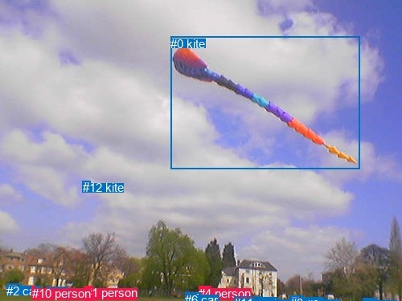
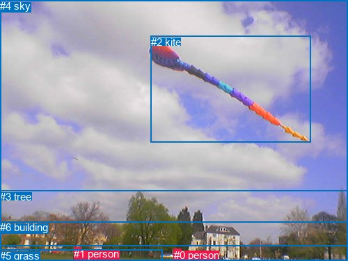

# 图片 1401：2381176.jpg

随机样本序号：206。图片 SHA256：`63901c04b597683789f649524a489ad0d6bcf03929ec3fa334278b8a69fe369d`。

红色框表示人，蓝色框表示其他物体。两个模式分别保留自身框编号，可依据位置比较对应对象。

## 自动检测框与输出

人的框编号：`[1, 4, 10]`。状态：`ok`。

### 自动检测全部物体框

| 编号 | 类别 | 是否为人 | 检测分数 | 像素坐标 xyxy |
|---|---|---|---|---|
| 0 | kite | False | 0.9890 | 212.4, 45.6, 448.0, 210.2 |
| 1 | person | True | 0.9759 | 105.6, 356.0, 115.9, 374.9 |
| 2 | car | False | 0.9460 | 8.3, 353.6, 26.9, 361.9 |
| 3 | car | False | 0.9331 | 360.7, 368.8, 377.7, 374.3 |
| 4 | person | True | 0.8735 | 247.3, 356.9, 262.4, 375.0 |
| 5 | car | False | 0.6882 | 320.9, 370.2, 344.6, 374.8 |
| 6 | car | False | 0.6525 | 230.0, 364.7, 249.5, 370.5 |
| 7 | car | False | 0.6251 | 57.8, 357.6, 84.0, 365.3 |
| 8 | car | False | 0.4873 | 451.3, 371.9, 468.5, 375.0 |
| 9 | car | False | 0.4520 | 381.4, 370.7, 403.0, 375.0 |
| 10 | person | True | 0.4369 | 39.8, 356.6, 43.7, 365.8 |
| 11 | car | False | 0.3596 | 291.4, 369.1, 325.7, 375.0 |
| 12 | kite | False | 0.3545 | 102.6, 225.0, 112.1, 231.0 |

### 自动检测 Top50 人相关候选

评分物体对：156；人相关物体对：66；输出关系：50。

| 排名 | 主语编号与类别 | 关系 | 宾语编号与类别 | 类型 | 人与人 | 排序分数 | 原始融合 logit |
|---|---|---|---|---|---|---|---|
| 1 | #4 person | walking on | #6 car | semantic | False | 0.95816 | 3.1313 |
| 2 | #4 person | on | #6 car | spatial | False | 0.86958 | 1.8972 |
| 3 | #4 person | walking on | #11 car | semantic | False | 0.80485 | 1.4169 |
| 4 | #6 car | parked on | #4 person | semantic | False | 0.79293 | 1.3426 |
| 5 | #1 person | on | #7 car | spatial | False | 0.78258 | 1.2808 |
| 6 | #4 person | flying over | #0 kite | semantic | False | 0.73865 | 1.0390 |
| 7 | #1 person | flying over | #0 kite | semantic | False | 0.71489 | 0.9192 |
| 8 | #1 person | standing on | #7 car | semantic | False | 0.70357 | 0.8644 |
| 9 | #6 car | beside | #4 person | spatial | False | 0.63513 | 0.5543 |
| 10 | #7 car | parked on | #10 person | semantic | False | 0.56794 | 0.2735 |
| 11 | #10 person | on | #2 car | spatial | False | 0.55805 | 0.2333 |
| 12 | #4 person | on | #11 car | spatial | False | 0.54093 | 0.1641 |
| 13 | #4 person | flying over | #12 kite | semantic | False | 0.52297 | 0.0919 |
| 14 | #7 car | beside | #10 person | spatial | False | 0.51297 | 0.0519 |
| 15 | #2 car | on | #10 person | spatial | False | 0.47934 | -0.0827 |
| 16 | #1 person | flying over | #12 kite | semantic | False | 0.45792 | -0.1687 |
| 17 | #10 person | on | #7 car | spatial | False | 0.36719 | -0.5443 |
| 18 | #4 person | walking on | #5 car | semantic | False | 0.35890 | -0.5802 |
| 19 | #2 car | parked on | #10 person | semantic | False | 0.23178 | -1.1983 |
| 20 | #4 person | walking on | #9 car | semantic | False | 0.20746 | -1.3403 |
| 21 | #0 kite | flying over | #4 person | semantic | False | 0.19592 | -1.4120 |
| 22 | #4 person | walking on | #3 car | semantic | False | 0.18833 | -1.4609 |
| 23 | #12 kite | flying over | #1 person | semantic | False | 0.17764 | -1.5325 |
| 24 | #12 kite | flying over | #4 person | semantic | False | 0.16961 | -1.5884 |
| 25 | #4 person | walking on | #8 car | semantic | False | 0.15780 | -1.6747 |
| 26 | #12 kite | flying over | #10 person | semantic | False | 0.15348 | -1.7075 |
| 27 | #4 person | in | #5 car | spatial | False | 0.13845 | -1.8282 |
| 28 | #10 person | standing on | #2 car | semantic | False | 0.13240 | -1.8799 |
| 29 | #10 person | standing on | #7 car | semantic | False | 0.12504 | -1.9455 |
| 30 | #7 car | parked on | #1 person | semantic | False | 0.12377 | -1.9572 |
| 31 | #10 person | looking at | #0 kite | semantic | False | 0.12147 | -1.9786 |
| 32 | #1 person | walking on | #6 car | semantic | False | 0.11890 | -2.0029 |
| 33 | #0 kite | flying over | #1 person | semantic | False | 0.11106 | -2.0800 |
| 34 | #1 person | walking on | #8 car | semantic | False | 0.10962 | -2.0947 |
| 35 | #1 person | walking on | #2 car | semantic | False | 0.10078 | -2.1885 |
| 36 | #1 person | walking on | #9 car | semantic | False | 0.09611 | -2.2412 |
| 37 | #11 car | beside | #4 person | spatial | False | 0.09429 | -2.2623 |
| 38 | #7 car | beside | #1 person | spatial | False | 0.09026 | -2.3104 |
| 39 | #1 person | in | #2 car | spatial | False | 0.08736 | -2.3463 |
| 40 | #1 person | walking on | #10 person | semantic | True | 0.07150 | -2.5638 |
| 41 | #4 person | in | #8 car | spatial | False | 0.06920 | -2.5991 |
| 42 | #0 kite | flying over | #10 person | semantic | False | 0.06514 | -2.6638 |
| 43 | #1 person | walking on | #3 car | semantic | False | 0.06269 | -2.7049 |
| 44 | #1 person | in | #8 car | spatial | False | 0.05998 | -2.7520 |
| 45 | #1 person | in | #10 person | spatial | True | 0.05866 | -2.7756 |
| 46 | #4 person | in | #9 car | spatial | False | 0.05821 | -2.7837 |
| 47 | #1 person | walking on | #11 car | semantic | False | 0.05761 | -2.7947 |
| 48 | #1 person | walking on | #5 car | semantic | False | 0.05430 | -2.8574 |
| 49 | #4 person | in | #3 car | spatial | False | 0.05384 | -2.8664 |
| 50 | #10 person | on | #11 car | spatial | False | 0.05065 | -2.9308 |

### 自动检测逐条人相关 GT 核验

R@50：0.00%；命中 0/1。

| GT 主语编号 | GT 关系 | GT 宾语编号 | 结果阶段 | 匹配预测主语编号 | 匹配预测宾语编号 |
|---|---|---|---|---|---|
| 4 | over | 1 | endpoint_missing_or_wrong_class | [] | [1] |

## 真实框与输出

人的框编号：`[0, 1]`。

### 真实框全部物体框

| 编号 | 类别 | 是否为人 | 检测分数 | 像素坐标 xyxy |
|---|---|---|---|---|
| 0 | person | True | GT | 250.0, 358.0, 261.0, 375.0 |
| 1 | person | True | GT | 106.0, 356.0, 116.0, 375.0 |
| 2 | kite | False | GT | 217.0, 52.0, 447.0, 205.0 |
| 3 | tree | False | GT | 0.0, 274.0, 500.0, 375.0 |
| 4 | sky | False | GT | 0.0, 0.0, 500.0, 353.0 |
| 5 | grass | False | GT | 0.0, 359.0, 234.0, 375.0 |
| 6 | building | False | GT | 0.0, 318.0, 500.0, 375.0 |

### 真实框 Top50 人相关候选

评分物体对：42；人相关物体对：22；输出关系：44。

| 排名 | 主语编号与类别 | 关系 | 宾语编号与类别 | 类型 | 人与人 | 排序分数 | 原始融合 logit |
|---|---|---|---|---|---|---|---|
| 1 | #0 person | in | #6 building | spatial | False | 0.97213 | 3.5519 |
| 2 | #1 person | walking on | #5 grass | semantic | False | 0.96844 | 3.4239 |
| 3 | #0 person | walking on | #5 grass | semantic | False | 0.96052 | 3.1916 |
| 4 | #1 person | on | #5 grass | spatial | False | 0.96025 | 3.1846 |
| 5 | #1 person | walking on | #6 building | semantic | False | 0.95414 | 3.0353 |
| 6 | #0 person | walking on | #6 building | semantic | False | 0.95360 | 3.0229 |
| 7 | #0 person | flying over | #2 kite | semantic | False | 0.95221 | 2.9920 |
| 8 | #1 person | flying over | #2 kite | semantic | False | 0.94642 | 2.8715 |
| 9 | #1 person | in | #6 building | spatial | False | 0.93791 | 2.7151 |
| 10 | #0 person | in | #3 tree | spatial | False | 0.89880 | 2.1840 |
| 11 | #0 person | on | #5 grass | spatial | False | 0.88514 | 2.0420 |
| 12 | #1 person | in | #3 tree | spatial | False | 0.82373 | 1.5418 |
| 13 | #0 person | walking on | #3 tree | semantic | False | 0.73932 | 1.0425 |
| 14 | #1 person | walking on | #3 tree | semantic | False | 0.71920 | 0.9405 |
| 15 | #0 person | wearing | #1 person | semantic | True | 0.35609 | -0.5924 |
| 16 | #1 person | wearing | #0 person | semantic | True | 0.25535 | -1.0703 |
| 17 | #2 kite | flying over | #0 person | semantic | False | 0.22637 | -1.2289 |
| 18 | #6 building | beside | #0 person | spatial | False | 0.21370 | -1.3027 |
| 19 | #0 person | in | #1 person | spatial | True | 0.18450 | -1.4861 |
| 20 | #4 sky | over | #0 person | spatial | False | 0.17108 | -1.5780 |
| 21 | #2 kite | flying over | #1 person | semantic | False | 0.14766 | -1.7530 |
| 22 | #1 person | in | #0 person | spatial | True | 0.14096 | -1.8073 |
| 23 | #0 person | on | #2 kite | spatial | False | 0.13874 | -1.8258 |
| 24 | #2 kite | over | #0 person | spatial | False | 0.12349 | -1.9598 |
| 25 | #3 tree | beside | #0 person | spatial | False | 0.11879 | -2.0039 |
| 26 | #1 person | on | #2 kite | spatial | False | 0.10687 | -2.1232 |
| 27 | #5 grass | beside | #0 person | spatial | False | 0.09788 | -2.2210 |
| 28 | #4 sky | over | #1 person | spatial | False | 0.09176 | -2.2924 |
| 29 | #1 person | in | #4 sky | spatial | False | 0.06682 | -2.6366 |
| 30 | #1 person | looking at | #4 sky | semantic | False | 0.06423 | -2.6789 |
| 31 | #2 kite | over | #1 person | spatial | False | 0.05636 | -2.8179 |
| 32 | #0 person | in | #4 sky | spatial | False | 0.05179 | -2.9075 |
| 33 | #6 building | holding | #0 person | semantic | False | 0.04603 | -3.0313 |
| 34 | #0 person | looking at | #4 sky | semantic | False | 0.04179 | -3.1323 |
| 35 | #6 building | beside | #1 person | spatial | False | 0.03917 | -3.2000 |
| 36 | #5 grass | in | #1 person | spatial | False | 0.03846 | -3.2190 |
| 37 | #3 tree | beside | #1 person | spatial | False | 0.03189 | -3.4129 |
| 38 | #5 grass | holding | #0 person | semantic | False | 0.01779 | -4.0112 |
| 39 | #5 grass | holding | #1 person | semantic | False | 0.01499 | -4.1855 |
| 40 | #3 tree | holding | #0 person | semantic | False | 0.01413 | -4.2451 |
| 41 | #6 building | holding | #1 person | semantic | False | 0.01297 | -4.3321 |
| 42 | #4 sky | flying over | #0 person | semantic | False | 0.00647 | -5.0338 |
| 43 | #3 tree | holding | #1 person | semantic | False | 0.00466 | -5.3630 |
| 44 | #4 sky | flying over | #1 person | semantic | False | 0.00230 | -6.0728 |

### 真实框逐条人相关 GT 核验

R@50：100.00%；命中 1/1。

| GT 主语编号 | GT 关系 | GT 宾语编号 | 结果阶段 | 匹配预测主语编号 | 匹配预测宾语编号 |
|---|---|---|---|---|---|
| 4 | over | 1 | hit50 | [4] | [1] |

## 全部人相关 GT

| 主语编号与类别 | 关系 | 宾语编号与类别 |
|---|---|---|
| #4 sky | over | #1 person |

原始记录、全部人相关物体对的两项预测与分项分数见 [逐图证据 JSON](../evidence/cases/1401.json)。全部56类 logits 保留于本机 HOR/output/random500/logits/。

<!-- HOR_COMPLETE_RESULTS -->

## 六组条件的完整输出对照

以下保留同一图片三种框与候选模式、两种谓词输出规则的全部 Top50。框编号各自在所属模式内解释。

### 自动检测框完整枚举：空间与语义各保留一个谓词

| 排名 | 主语编号与类别 | 谓词 | 宾语编号与类别 | 分组 | 排序分数 | predicate logit | pair logit |
|---|---|---|---|---|---|---|---|
| 1 | #4 person | walking on | #6 car | semantic | 0.9581650 | 3.1656594 | -0.0343721 |
| 2 | #4 person | on | #6 car | spatial | 0.8695792 | 1.9316154 | -0.0343721 |
| 3 | #4 person | walking on | #11 car | semantic | 0.8048538 | 1.9951539 | -0.5782421 |
| 4 | #6 car | parked on | #4 person | semantic | 0.7929252 | 1.4379110 | -0.0952623 |
| 5 | #1 person | on | #7 car | spatial | 0.7825831 | 1.6800518 | -0.3992686 |
| 6 | #4 person | flying over | #0 kite | semantic | 0.7386512 | 1.1611209 | -0.1221512 |
| 7 | #1 person | flying over | #0 kite | semantic | 0.7148868 | 1.0407557 | -0.1215177 |
| 8 | #1 person | standing on | #7 car | semantic | 0.7035725 | 1.2636371 | -0.3992686 |
| 9 | #6 car | beside | #4 person | spatial | 0.6351306 | 0.6495533 | -0.0952623 |
| 10 | #7 car | parked on | #10 person | semantic | 0.5679408 | 0.8966193 | -0.6231650 |
| 11 | #10 person | on | #2 car | spatial | 0.5580497 | 0.8787680 | -0.6455175 |
| 12 | #4 person | on | #11 car | spatial | 0.5409301 | 0.7423296 | -0.5782421 |
| 13 | #4 person | flying over | #12 kite | semantic | 0.5229691 | 0.9495683 | -0.8576271 |
| 14 | #7 car | beside | #10 person | spatial | 0.5129677 | 0.6750474 | -0.6231650 |
| 15 | #2 car | on | #10 person | spatial | 0.4793445 | 0.5093322 | -0.5920010 |
| 16 | #1 person | flying over | #12 kite | semantic | 0.4579237 | 0.2283921 | -0.3970965 |
| 17 | #10 person | on | #7 car | spatial | 0.3671930 | 0.0376320 | -0.5819100 |
| 18 | #4 person | walking on | #5 car | semantic | 0.3588966 | 0.2408857 | -0.8210421 |
| 19 | #2 car | parked on | #10 person | semantic | 0.2317783 | -0.6062961 | -0.5920010 |
| 20 | #4 person | walking on | #9 car | semantic | 0.2074609 | -0.3880062 | -0.9522926 |
| 21 | #0 kite | flying over | #4 person | semantic | 0.1959166 | 0.2307186 | -1.6427326 |
| 22 | #4 person | walking on | #3 car | semantic | 0.1883274 | -0.5896134 | -0.8713014 |
| 23 | #12 kite | flying over | #1 person | semantic | 0.1776354 | -0.0095201 | -1.5229307 |
| 24 | #12 kite | flying over | #4 person | semantic | 0.1696142 | 0.1710424 | -1.7594066 |
| 25 | #4 person | walking on | #8 car | semantic | 0.1578028 | -0.6588135 | -1.0158548 |
| 26 | #12 kite | flying over | #10 person | semantic | 0.1534850 | -0.3987408 | -1.3087845 |
| 27 | #4 person | in | #5 car | spatial | 0.1384492 | -1.0071883 | -0.8210421 |
| 28 | #10 person | standing on | #2 car | semantic | 0.1324037 | -1.2343531 | -0.6455175 |
| 29 | #10 person | standing on | #7 car | semantic | 0.1250448 | -1.3635910 | -0.5819100 |
| 30 | #7 car | parked on | #1 person | semantic | 0.1237715 | -1.1185870 | -0.8386028 |
| 31 | #10 person | looking at | #0 kite | semantic | 0.1214684 | -0.9650676 | -1.0135301 |
| 32 | #1 person | walking on | #6 car | semantic | 0.1188978 | -1.3268559 | -0.6760531 |
| 33 | #0 kite | flying over | #1 person | semantic | 0.1110579 | -0.1608133 | -1.9191675 |
| 34 | #1 person | walking on | #8 car | semantic | 0.1096167 | -1.1899123 | -0.9047496 |
| 35 | #1 person | walking on | #2 car | semantic | 0.1007840 | -1.1778982 | -1.0106449 |
| 36 | #1 person | walking on | #9 car | semantic | 0.0961128 | -1.2531054 | -0.9880766 |
| 37 | #11 car | beside | #4 person | spatial | 0.0942936 | -1.5224085 | -0.7398931 |
| 38 | #7 car | beside | #1 person | spatial | 0.0902621 | -1.4718361 | -0.8386028 |
| 39 | #1 person | in | #2 car | spatial | 0.0873638 | -1.3356118 | -1.0106449 |
| 40 | #1 person | walking on | #10 person | semantic | 0.0715045 | -1.7571440 | -0.8066608 |
| 41 | #4 person | in | #8 car | spatial | 0.0691953 | -1.5832624 | -1.0158548 |
| 42 | #0 kite | flying over | #10 person | semantic | 0.0651445 | -0.8519368 | -1.8118478 |
| 43 | #1 person | walking on | #3 car | semantic | 0.0626868 | -1.7074707 | -0.9973966 |
| 44 | #1 person | in | #8 car | spatial | 0.0599753 | -1.8472235 | -0.9047496 |
| 45 | #1 person | in | #10 person | spatial | 0.0586584 | -1.9689140 | -0.8066608 |
| 46 | #4 person | in | #9 car | spatial | 0.0582113 | -1.8314092 | -0.9522926 |
| 47 | #1 person | walking on | #11 car | semantic | 0.0576132 | -1.7044809 | -1.0901840 |
| 48 | #1 person | walking on | #5 car | semantic | 0.0543024 | -1.6683617 | -1.1889926 |
| 49 | #4 person | in | #3 car | spatial | 0.0538376 | -1.9951403 | -0.8713014 |
| 50 | #10 person | on | #11 car | spatial | 0.0506540 | -1.8681552 | -1.0625999 |

GT 命中：0/1，R@50=0.00%。

| GT主语 | GT谓词 | GT宾语 | 结果阶段 | 匹配主语框 | 匹配宾语框 |
|---|---|---|---|---|---|
| 4 | over | 1 | endpoint_missing_or_wrong_class | [] | [1] |

### 自动检测框完整枚举：每对只保留一个谓词

| 排名 | 主语编号与类别 | 谓词 | 宾语编号与类别 | 分组 | 排序分数 | predicate logit | pair logit |
|---|---|---|---|---|---|---|---|
| 1 | #4 person | walking on | #6 car | single | 0.9581650 | 3.1656594 | -0.0343721 |
| 2 | #4 person | walking on | #11 car | single | 0.8048538 | 1.9951539 | -0.5782421 |
| 3 | #6 car | parked on | #4 person | single | 0.7929252 | 1.4379110 | -0.0952623 |
| 4 | #1 person | on | #7 car | single | 0.7825831 | 1.6800518 | -0.3992686 |
| 5 | #4 person | flying over | #0 kite | single | 0.7386512 | 1.1611209 | -0.1221512 |
| 6 | #1 person | flying over | #0 kite | single | 0.7148868 | 1.0407557 | -0.1215177 |
| 7 | #7 car | parked on | #10 person | single | 0.5679408 | 0.8966193 | -0.6231650 |
| 8 | #10 person | on | #2 car | single | 0.5580497 | 0.8787680 | -0.6455175 |
| 9 | #4 person | flying over | #12 kite | single | 0.5229691 | 0.9495683 | -0.8576271 |
| 10 | #2 car | on | #10 person | single | 0.4793445 | 0.5093322 | -0.5920010 |
| 11 | #1 person | flying over | #12 kite | single | 0.4579237 | 0.2283921 | -0.3970965 |
| 12 | #10 person | on | #7 car | single | 0.3671930 | 0.0376320 | -0.5819100 |
| 13 | #4 person | walking on | #5 car | single | 0.3588966 | 0.2408857 | -0.8210421 |
| 14 | #4 person | walking on | #9 car | single | 0.2074609 | -0.3880062 | -0.9522926 |
| 15 | #0 kite | flying over | #4 person | single | 0.1959166 | 0.2307186 | -1.6427326 |
| 16 | #4 person | walking on | #3 car | single | 0.1883274 | -0.5896134 | -0.8713014 |
| 17 | #12 kite | flying over | #1 person | single | 0.1776354 | -0.0095201 | -1.5229307 |
| 18 | #12 kite | flying over | #4 person | single | 0.1696142 | 0.1710424 | -1.7594066 |
| 19 | #4 person | walking on | #8 car | single | 0.1578028 | -0.6588135 | -1.0158548 |
| 20 | #12 kite | flying over | #10 person | single | 0.1534850 | -0.3987408 | -1.3087845 |
| 21 | #7 car | parked on | #1 person | single | 0.1237715 | -1.1185870 | -0.8386028 |
| 22 | #10 person | looking at | #0 kite | single | 0.1214684 | -0.9650676 | -1.0135301 |
| 23 | #1 person | walking on | #6 car | single | 0.1188978 | -1.3268559 | -0.6760531 |
| 24 | #0 kite | flying over | #1 person | single | 0.1110579 | -0.1608133 | -1.9191675 |
| 25 | #1 person | walking on | #8 car | single | 0.1096167 | -1.1899123 | -0.9047496 |
| 26 | #1 person | walking on | #2 car | single | 0.1007840 | -1.1778982 | -1.0106449 |
| 27 | #1 person | walking on | #9 car | single | 0.0961128 | -1.2531054 | -0.9880766 |
| 28 | #11 car | beside | #4 person | single | 0.0942936 | -1.5224085 | -0.7398931 |
| 29 | #1 person | walking on | #10 person | single | 0.0715045 | -1.7571440 | -0.8066608 |
| 30 | #0 kite | flying over | #10 person | single | 0.0651445 | -0.8519368 | -1.8118478 |
| 31 | #1 person | walking on | #3 car | single | 0.0626868 | -1.7074707 | -0.9973966 |
| 32 | #1 person | walking on | #11 car | single | 0.0576132 | -1.7044809 | -1.0901840 |
| 33 | #1 person | walking on | #5 car | single | 0.0543024 | -1.6683617 | -1.1889926 |
| 34 | #10 person | on | #11 car | single | 0.0506540 | -1.8681552 | -1.0625999 |
| 35 | #1 person | walking on | #4 person | single | 0.0475358 | -2.2672110 | -0.7303587 |
| 36 | #10 person | flying over | #12 kite | single | 0.0413520 | -2.1611209 | -0.9822833 |
| 37 | #10 person | on | #8 car | single | 0.0395265 | -2.0228581 | -1.1675974 |
| 38 | #4 person | walking on | #7 car | single | 0.0379551 | -2.1979761 | -1.0346818 |
| 39 | #4 person | walking on | #1 person | single | 0.0341222 | -2.5756497 | -0.7674403 |
| 40 | #10 person | on | #5 car | single | 0.0338360 | -2.2288847 | -1.1229230 |
| 41 | #10 person | on | #9 car | single | 0.0289519 | -2.3880796 | -1.1246593 |
| 42 | #10 person | on | #3 car | single | 0.0266193 | -2.5179007 | -1.0812380 |
| 43 | #4 person | walking on | #10 person | single | 0.0189974 | -2.6042285 | -1.3400434 |
| 44 | #4 person | walking on | #2 car | single | 0.0176957 | -2.5049233 | -1.5116570 |
| 45 | #11 car | in | #10 person | single | 0.0150769 | -3.0106139 | -1.1687855 |
| 46 | #5 car | in | #10 person | single | 0.0117485 | -3.2010059 | -1.2312045 |
| 47 | #10 person | on | #6 car | single | 0.0107124 | -3.1986246 | -1.3269589 |
| 48 | #5 car | beside | #4 person | single | 0.0101491 | -3.5209758 | -1.0591896 |
| 49 | #7 car | on | #4 person | single | 0.0091722 | -3.4703870 | -1.2119788 |
| 50 | #6 car | in | #1 person | single | 0.0078645 | -4.0552979 | -0.7822028 |

GT 命中：0/1，R@50=0.00%。

| GT主语 | GT谓词 | GT宾语 | 结果阶段 | 匹配主语框 | 匹配宾语框 |
|---|---|---|---|---|---|
| 4 | over | 1 | endpoint_missing_or_wrong_class | [] | [1] |

### 真实框完整枚举：空间与语义各保留一个谓词

| 排名 | 主语编号与类别 | 谓词 | 宾语编号与类别 | 分组 | 排序分数 | predicate logit | pair logit |
|---|---|---|---|---|---|---|---|
| 1 | #0 person | in | #6 building | spatial | 0.9721280 | 3.6435494 | -0.0916843 |
| 2 | #1 person | walking on | #5 grass | semantic | 0.9684419 | 3.6170430 | -0.1931857 |
| 3 | #0 person | walking on | #5 grass | semantic | 0.9605162 | 3.5418077 | -0.3502259 |
| 4 | #1 person | on | #5 grass | spatial | 0.9602508 | 3.3777900 | -0.1931857 |
| 5 | #1 person | walking on | #6 building | semantic | 0.9541441 | 3.2709999 | -0.2356884 |
| 6 | #0 person | walking on | #6 building | semantic | 0.9535959 | 3.1145372 | -0.0916843 |
| 7 | #0 person | flying over | #2 kite | semantic | 0.9522127 | 3.1145639 | -0.1225352 |
| 8 | #1 person | flying over | #2 kite | semantic | 0.9464173 | 2.9945674 | -0.1231084 |
| 9 | #1 person | in | #6 building | spatial | 0.9379115 | 2.9507823 | -0.2356884 |
| 10 | #0 person | in | #3 tree | spatial | 0.8988007 | 2.9200230 | -0.7360544 |
| 11 | #0 person | on | #5 grass | spatial | 0.8851364 | 2.3922215 | -0.3502259 |
| 12 | #1 person | in | #3 tree | spatial | 0.8237328 | 2.4219699 | -0.8801245 |
| 13 | #0 person | walking on | #3 tree | semantic | 0.7393231 | 1.7785077 | -0.7360544 |
| 14 | #1 person | walking on | #3 tree | semantic | 0.7192012 | 1.8206272 | -0.8801245 |
| 15 | #0 person | wearing | #1 person | semantic | 0.3560894 | 0.1830277 | -0.7754056 |
| 16 | #1 person | wearing | #0 person | semantic | 0.2553452 | -0.3440180 | -0.7262865 |
| 17 | #2 kite | flying over | #0 person | semantic | 0.2263714 | 0.4133854 | -1.6423004 |
| 18 | #6 building | beside | #0 person | spatial | 0.2137033 | -0.3389468 | -0.9637985 |
| 19 | #0 person | in | #1 person | spatial | 0.1845013 | -0.7107375 | -0.7754056 |
| 20 | #4 sky | over | #0 person | spatial | 0.1710757 | -0.0704746 | -1.5075483 |
| 21 | #2 kite | flying over | #1 person | semantic | 0.1476634 | 0.1719794 | -1.9250252 |
| 22 | #1 person | in | #0 person | spatial | 0.1409640 | -1.0810201 | -0.7262865 |
| 23 | #0 person | on | #2 kite | spatial | 0.1387351 | -1.7033002 | -0.1225352 |
| 24 | #2 kite | over | #0 person | spatial | 0.1234887 | -0.3174996 | -1.6423004 |
| 25 | #3 tree | beside | #0 person | spatial | 0.1187910 | -1.0045111 | -0.9994179 |
| 26 | #1 person | on | #2 kite | spatial | 0.1068657 | -2.0000563 | -0.1231084 |
| 27 | #5 grass | beside | #0 person | spatial | 0.0978829 | -1.1854923 | -1.0354807 |
| 28 | #4 sky | over | #1 person | spatial | 0.0917557 | -0.5915956 | -1.7007875 |
| 29 | #1 person | in | #4 sky | spatial | 0.0668167 | -1.2491829 | -1.3874655 |
| 30 | #1 person | looking at | #4 sky | semantic | 0.0642296 | -1.2914405 | -1.3874655 |
| 31 | #2 kite | over | #1 person | spatial | 0.0563640 | -0.8928838 | -1.9250252 |
| 32 | #0 person | in | #4 sky | spatial | 0.0517852 | -1.6392055 | -1.2682705 |
| 33 | #6 building | holding | #0 person | semantic | 0.0460327 | -2.0674787 | -0.9637985 |
| 34 | #0 person | looking at | #4 sky | semantic | 0.0417937 | -1.8640459 | -1.2682705 |
| 35 | #6 building | beside | #1 person | spatial | 0.0391661 | -1.9949200 | -1.2050687 |
| 36 | #5 grass | in | #1 person | spatial | 0.0384564 | -2.1073906 | -1.1116251 |
| 37 | #3 tree | beside | #1 person | spatial | 0.0318938 | -2.1933973 | -1.2195334 |
| 38 | #5 grass | holding | #0 person | semantic | 0.0177903 | -2.9756703 | -1.0354807 |
| 39 | #5 grass | holding | #1 person | semantic | 0.0149865 | -3.0738785 | -1.1116251 |
| 40 | #3 tree | holding | #0 person | semantic | 0.0141323 | -3.2456384 | -0.9994179 |
| 41 | #6 building | holding | #1 person | semantic | 0.0129700 | -3.1269922 | -1.2050687 |
| 42 | #4 sky | flying over | #0 person | semantic | 0.0064717 | -3.5262775 | -1.5075483 |
| 43 | #3 tree | holding | #1 person | semantic | 0.0046649 | -4.1434803 | -1.2195334 |
| 44 | #4 sky | flying over | #1 person | semantic | 0.0022995 | -4.3719721 | -1.7007875 |

GT 命中：1/1，R@50=100.00%。

| GT主语 | GT谓词 | GT宾语 | 结果阶段 | 匹配主语框 | 匹配宾语框 |
|---|---|---|---|---|---|
| 4 | over | 1 | hit50 | [4] | [1] |

### 真实框完整枚举：每对只保留一个谓词

| 排名 | 主语编号与类别 | 谓词 | 宾语编号与类别 | 分组 | 排序分数 | predicate logit | pair logit |
|---|---|---|---|---|---|---|---|
| 1 | #0 person | in | #6 building | single | 0.9721280 | 3.6435494 | -0.0916843 |
| 2 | #1 person | walking on | #5 grass | single | 0.9684419 | 3.6170430 | -0.1931857 |
| 3 | #0 person | walking on | #5 grass | single | 0.9605162 | 3.5418077 | -0.3502259 |
| 4 | #1 person | walking on | #6 building | single | 0.9541441 | 3.2709999 | -0.2356884 |
| 5 | #0 person | flying over | #2 kite | single | 0.9522127 | 3.1145639 | -0.1225352 |
| 6 | #1 person | flying over | #2 kite | single | 0.9464173 | 2.9945674 | -0.1231084 |
| 7 | #0 person | in | #3 tree | single | 0.8988007 | 2.9200230 | -0.7360544 |
| 8 | #1 person | in | #3 tree | single | 0.8237328 | 2.4219699 | -0.8801245 |
| 9 | #0 person | wearing | #1 person | single | 0.3560894 | 0.1830277 | -0.7754056 |
| 10 | #1 person | wearing | #0 person | single | 0.2553452 | -0.3440180 | -0.7262865 |
| 11 | #2 kite | flying over | #0 person | single | 0.2263714 | 0.4133854 | -1.6423004 |
| 12 | #6 building | beside | #0 person | single | 0.2137033 | -0.3389468 | -0.9637985 |
| 13 | #4 sky | over | #0 person | single | 0.1710757 | -0.0704746 | -1.5075483 |
| 14 | #2 kite | flying over | #1 person | single | 0.1476634 | 0.1719794 | -1.9250252 |
| 15 | #3 tree | beside | #0 person | single | 0.1187910 | -1.0045111 | -0.9994179 |
| 16 | #5 grass | beside | #0 person | single | 0.0978829 | -1.1854923 | -1.0354807 |
| 17 | #4 sky | over | #1 person | single | 0.0917557 | -0.5915956 | -1.7007875 |
| 18 | #1 person | in | #4 sky | single | 0.0668167 | -1.2491829 | -1.3874655 |
| 19 | #0 person | in | #4 sky | single | 0.0517852 | -1.6392055 | -1.2682705 |
| 20 | #6 building | beside | #1 person | single | 0.0391661 | -1.9949200 | -1.2050687 |
| 21 | #5 grass | in | #1 person | single | 0.0384564 | -2.1073906 | -1.1116251 |
| 22 | #3 tree | beside | #1 person | single | 0.0318938 | -2.1933973 | -1.2195334 |

GT 命中：1/1，R@50=100.00%。

| GT主语 | GT谓词 | GT宾语 | 结果阶段 | 匹配主语框 | 匹配宾语框 |
|---|---|---|---|---|---|
| 4 | over | 1 | hit50 | [4] | [1] |

### 真实框400候选：空间与语义各保留一个谓词

| 排名 | 主语编号与类别 | 谓词 | 宾语编号与类别 | 分组 | 排序分数 | predicate logit | pair logit |
|---|---|---|---|---|---|---|---|
| 1 | #0 person | in | #6 building | spatial | 0.9721280 | 3.6435494 | -0.0916843 |
| 2 | #1 person | walking on | #5 grass | semantic | 0.9701431 | 3.6742139 | -0.1931857 |
| 3 | #0 person | walking on | #5 grass | semantic | 0.9625199 | 3.5959687 | -0.3502259 |
| 4 | #1 person | on | #5 grass | spatial | 0.9602508 | 3.3777900 | -0.1931857 |
| 5 | #1 person | walking on | #6 building | semantic | 0.9541441 | 3.2709999 | -0.2356884 |
| 6 | #0 person | walking on | #6 building | semantic | 0.9537290 | 3.1175475 | -0.0916843 |
| 7 | #0 person | flying over | #2 kite | semantic | 0.9522141 | 3.1145940 | -0.1225352 |
| 8 | #1 person | flying over | #2 kite | semantic | 0.9464173 | 2.9945674 | -0.1231084 |
| 9 | #1 person | in | #6 building | spatial | 0.9381045 | 2.9541011 | -0.2356884 |
| 10 | #0 person | in | #3 tree | spatial | 0.8988007 | 2.9200230 | -0.7360544 |
| 11 | #0 person | on | #5 grass | spatial | 0.8895196 | 2.4360700 | -0.3502259 |
| 12 | #1 person | in | #3 tree | spatial | 0.8237328 | 2.4219699 | -0.8801245 |
| 13 | #0 person | walking on | #3 tree | semantic | 0.7393231 | 1.7785077 | -0.7360544 |
| 14 | #1 person | walking on | #3 tree | semantic | 0.7198088 | 1.8236380 | -0.8801245 |
| 15 | #0 person | wearing | #1 person | semantic | 0.3623403 | 0.2101846 | -0.7754056 |
| 16 | #1 person | wearing | #0 person | semantic | 0.2605432 | -0.3168607 | -0.7262865 |
| 17 | #2 kite | flying over | #0 person | semantic | 0.2263714 | 0.4133854 | -1.6423004 |
| 18 | #6 building | beside | #0 person | spatial | 0.2087095 | -0.3689232 | -0.9637985 |
| 19 | #0 person | in | #1 person | spatial | 0.1845013 | -0.7107375 | -0.7754056 |
| 20 | #4 sky | over | #0 person | spatial | 0.1746216 | -0.0456719 | -1.5075483 |
| 21 | #2 kite | flying over | #1 person | semantic | 0.1514870 | 0.2020397 | -1.9250252 |
| 22 | #1 person | in | #0 person | spatial | 0.1415678 | -1.0760422 | -0.7262865 |
| 23 | #0 person | on | #2 kite | spatial | 0.1398863 | -1.6936991 | -0.1225352 |
| 24 | #2 kite | over | #0 person | spatial | 0.1234887 | -0.3174996 | -1.6423004 |
| 25 | #3 tree | beside | #0 person | spatial | 0.1203720 | -0.9894943 | -0.9994179 |
| 26 | #1 person | on | #2 kite | spatial | 0.1059527 | -2.0096574 | -0.1231084 |
| 27 | #4 sky | over | #1 person | spatial | 0.0964341 | -0.5367012 | -1.7007875 |
| 28 | #5 grass | beside | #0 person | spatial | 0.0952552 | -1.2156124 | -1.0354807 |
| 29 | #1 person | in | #4 sky | spatial | 0.0651666 | -1.2759557 | -1.3874655 |
| 30 | #1 person | looking at | #4 sky | semantic | 0.0633105 | -1.3068347 | -1.3874655 |
| 31 | #2 kite | over | #1 person | spatial | 0.0565048 | -0.8902397 | -1.9250252 |
| 32 | #0 person | in | #4 sky | spatial | 0.0532411 | -1.6099441 | -1.2682705 |
| 33 | #6 building | holding | #0 person | semantic | 0.0454405 | -2.0810471 | -0.9637985 |
| 34 | #0 person | looking at | #4 sky | semantic | 0.0430084 | -1.8341289 | -1.2682705 |
| 35 | #6 building | beside | #1 person | spatial | 0.0386028 | -2.0099945 | -1.2050687 |
| 36 | #5 grass | in | #1 person | spatial | 0.0384564 | -2.1073906 | -1.1116251 |
| 37 | #3 tree | beside | #1 person | spatial | 0.0318908 | -2.1934948 | -1.2195334 |
| 38 | #5 grass | holding | #0 person | semantic | 0.0174690 | -2.9942241 | -1.0354807 |
| 39 | #5 grass | holding | #1 person | semantic | 0.0152158 | -3.0584638 | -1.1116251 |
| 40 | #3 tree | holding | #0 person | semantic | 0.0141323 | -3.2456384 | -0.9994179 |
| 41 | #6 building | holding | #1 person | semantic | 0.0129464 | -3.1288390 | -1.2050687 |
| 42 | #4 sky | flying over | #0 person | semantic | 0.0065691 | -3.5112321 | -1.5075483 |
| 43 | #3 tree | holding | #1 person | semantic | 0.0046686 | -4.1426730 | -1.2195334 |
| 44 | #4 sky | flying over | #1 person | semantic | 0.0023696 | -4.3418808 | -1.7007875 |

GT 命中：1/1，R@50=100.00%。

| GT主语 | GT谓词 | GT宾语 | 结果阶段 | 匹配主语框 | 匹配宾语框 |
|---|---|---|---|---|---|
| 4 | over | 1 | hit50 | [4] | [1] |

### 真实框400候选：每对只保留一个谓词

| 排名 | 主语编号与类别 | 谓词 | 宾语编号与类别 | 分组 | 排序分数 | predicate logit | pair logit |
|---|---|---|---|---|---|---|---|
| 1 | #0 person | in | #6 building | single | 0.9721280 | 3.6435494 | -0.0916843 |
| 2 | #1 person | walking on | #5 grass | single | 0.9701431 | 3.6742139 | -0.1931857 |
| 3 | #0 person | walking on | #5 grass | single | 0.9625199 | 3.5959687 | -0.3502259 |
| 4 | #1 person | walking on | #6 building | single | 0.9541441 | 3.2709999 | -0.2356884 |
| 5 | #0 person | flying over | #2 kite | single | 0.9522141 | 3.1145940 | -0.1225352 |
| 6 | #1 person | flying over | #2 kite | single | 0.9464173 | 2.9945674 | -0.1231084 |
| 7 | #0 person | in | #3 tree | single | 0.8988007 | 2.9200230 | -0.7360544 |
| 8 | #1 person | in | #3 tree | single | 0.8237328 | 2.4219699 | -0.8801245 |
| 9 | #0 person | wearing | #1 person | single | 0.3623403 | 0.2101846 | -0.7754056 |
| 10 | #1 person | wearing | #0 person | single | 0.2605432 | -0.3168607 | -0.7262865 |
| 11 | #2 kite | flying over | #0 person | single | 0.2263714 | 0.4133854 | -1.6423004 |
| 12 | #6 building | beside | #0 person | single | 0.2087095 | -0.3689232 | -0.9637985 |
| 13 | #4 sky | over | #0 person | single | 0.1746216 | -0.0456719 | -1.5075483 |
| 14 | #2 kite | flying over | #1 person | single | 0.1514870 | 0.2020397 | -1.9250252 |
| 15 | #3 tree | beside | #0 person | single | 0.1203720 | -0.9894943 | -0.9994179 |
| 16 | #4 sky | over | #1 person | single | 0.0964341 | -0.5367012 | -1.7007875 |
| 17 | #5 grass | beside | #0 person | single | 0.0952552 | -1.2156124 | -1.0354807 |
| 18 | #1 person | in | #4 sky | single | 0.0651666 | -1.2759557 | -1.3874655 |
| 19 | #0 person | in | #4 sky | single | 0.0532411 | -1.6099441 | -1.2682705 |
| 20 | #6 building | beside | #1 person | single | 0.0386028 | -2.0099945 | -1.2050687 |
| 21 | #5 grass | in | #1 person | single | 0.0384564 | -2.1073906 | -1.1116251 |
| 22 | #3 tree | beside | #1 person | single | 0.0318908 | -2.1934948 | -1.2195334 |

GT 命中：1/1，R@50=100.00%。

| GT主语 | GT谓词 | GT宾语 | 结果阶段 | 匹配主语框 | 匹配宾语框 |
|---|---|---|---|---|---|
| 4 | over | 1 | hit50 | [4] | [1] |
