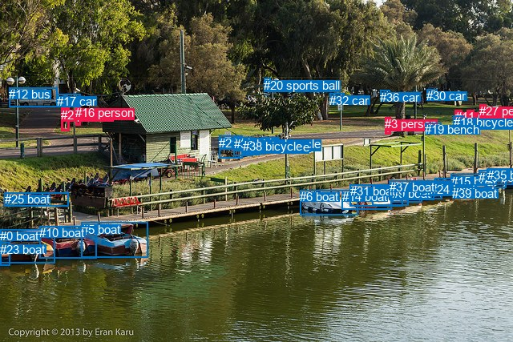
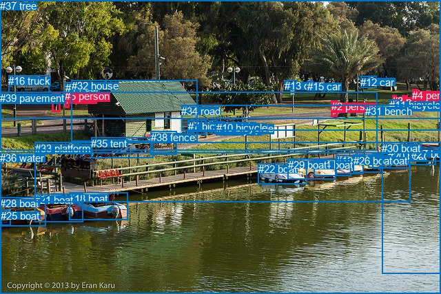

# 图片 1402：2381308.jpg

随机样本序号：88。图片 SHA256：`1b37954bebee5b6bf285d5bb47e47f7bf99fa7ef9e7c57d70638bc3332b9eb99`。

红色框表示人，蓝色框表示其他物体。两个模式分别保留自身框编号，可依据位置比较对应对象。

## 自动检测框与输出

人的框编号：`[1, 2, 3, 11, 16, 27]`。状态：`ok`。

### 自动检测全部物体框

| 编号 | 类别 | 是否为人 | 检测分数 | 像素坐标 xyxy |
|---|---|---|---|---|
| 0 | boat | False | 0.9944 | 0.0, 286.4, 68.9, 328.2 |
| 1 | person | True | 0.9881 | 582.3, 137.7, 591.2, 161.9 |
| 2 | person | True | 0.9846 | 76.4, 134.7, 86.9, 163.4 |
| 3 | person | True | 0.9814 | 480.2, 146.2, 487.9, 167.8 |
| 4 | boat | False | 0.9705 | 464.7, 231.0, 509.2, 256.4 |
| 5 | boat | False | 0.9684 | 101.5, 277.7, 184.3, 321.2 |
| 6 | boat | False | 0.9673 | 374.5, 237.0, 446.5, 268.3 |
| 7 | boat | False | 0.9634 | 542.8, 222.8, 609.7, 239.9 |
| 8 | boat | False | 0.9583 | 513.7, 227.2, 551.6, 248.3 |
| 9 | boat | False | 0.9471 | 489.5, 233.5, 526.6, 252.0 |
| 10 | boat | False | 0.9417 | 49.5, 282.2, 120.6, 322.4 |
| 11 | person | True | 0.9372 | 567.7, 137.1, 576.3, 154.2 |
| 12 | bus | False | 0.9269 | 11.3, 109.1, 71.7, 133.8 |
| 13 | boat | False | 0.9203 | 522.0, 226.4, 563.8, 244.9 |
| 14 | boat | False | 0.9170 | 426.8, 237.4, 488.5, 261.5 |
| 15 | boat | False | 0.8796 | 562.6, 217.9, 631.4, 235.0 |
| 16 | person | True | 0.8746 | 94.1, 132.1, 100.3, 157.0 |
| 17 | car | False | 0.8557 | 70.7, 117.8, 100.7, 133.4 |
| 18 | bicycle | False | 0.8433 | 565.7, 144.2, 578.1, 162.0 |
| 19 | bench | False | 0.8405 | 530.3, 153.1, 550.1, 167.7 |
| 20 | sports ball | False | 0.8022 | 329.5, 98.0, 337.3, 105.2 |
| 21 | bicycle | False | 0.7730 | 273.4, 169.9, 302.2, 197.8 |
| 22 | boat | False | 0.7677 | 561.2, 230.3, 606.1, 241.7 |
| 23 | boat | False | 0.7570 | 0.0, 302.6, 12.5, 331.3 |
| 24 | boat | False | 0.7395 | 537.3, 228.3, 567.7, 244.0 |
| 25 | boat | False | 0.7031 | 5.8, 240.0, 85.2, 257.8 |
| 26 | boat | False | 0.6917 | 597.0, 213.0, 639.5, 230.3 |
| 27 | person | True | 0.6852 | 598.2, 130.1, 606.1, 141.2 |
| 28 | bicycle | False | 0.6549 | 313.9, 172.4, 330.7, 192.5 |
| 29 | bicycle | False | 0.6434 | 326.1, 171.1, 348.9, 191.4 |
| 30 | car | False | 0.6336 | 532.0, 111.0, 546.0, 119.2 |
| 31 | boat | False | 0.6254 | 436.7, 230.3, 502.8, 257.5 |
| 32 | car | False | 0.6150 | 411.5, 116.7, 429.8, 127.0 |
| 33 | bicycle | False | 0.6050 | 311.7, 175.0, 323.2, 193.3 |
| 34 | bicycle | False | 0.5956 | 291.7, 171.1, 315.6, 194.3 |
| 35 | boat | False | 0.5454 | 607.7, 210.0, 639.8, 221.3 |
| 36 | car | False | 0.5433 | 474.1, 112.8, 486.6, 126.4 |
| 37 | boat | False | 0.5352 | 485.9, 225.2, 541.1, 249.1 |
| 38 | bicycle | False | 0.5333 | 303.1, 174.3, 320.4, 193.4 |
| 39 | boat | False | 0.4807 | 564.4, 233.3, 597.8, 244.1 |

### 自动检测 Top50 人相关候选

评分物体对：1560；人相关物体对：438；输出关系：50。

| 排名 | 主语编号与类别 | 关系 | 宾语编号与类别 | 类型 | 人与人 | 排序分数 | 原始融合 logit |
|---|---|---|---|---|---|---|---|
| 1 | #11 person | riding | #18 bicycle | semantic | False | 0.98969 | 4.5641 |
| 2 | #16 person | walking on | #17 car | semantic | False | 0.97440 | 3.6394 |
| 3 | #2 person | walking on | #17 car | semantic | False | 0.97208 | 3.5499 |
| 4 | #11 person | on | #18 bicycle | spatial | False | 0.95424 | 3.0375 |
| 5 | #1 person | walking on | #18 bicycle | semantic | False | 0.94172 | 2.7825 |
| 6 | #1 person | walking on | #27 person | semantic | True | 0.93431 | 2.6549 |
| 7 | #2 person | walking on | #16 person | semantic | True | 0.92168 | 2.4654 |
| 8 | #2 person | walking on | #12 bus | semantic | False | 0.91533 | 2.3805 |
| 9 | #17 car | parked on | #16 person | semantic | False | 0.89700 | 2.1644 |
| 10 | #18 bicycle | walking on | #11 person | semantic | False | 0.88917 | 2.0823 |
| 11 | #16 person | walking on | #2 person | semantic | True | 0.88626 | 2.0531 |
| 12 | #17 car | beside | #2 person | spatial | False | 0.88370 | 2.0280 |
| 13 | #1 person | walking on | #11 person | semantic | True | 0.88268 | 2.0181 |
| 14 | #11 person | walking on | #1 person | semantic | True | 0.88116 | 2.0034 |
| 15 | #17 car | beside | #16 person | spatial | False | 0.86368 | 1.8462 |
| 16 | #17 car | parked on | #2 person | semantic | False | 0.85906 | 1.8075 |
| 17 | #16 person | walking on | #12 bus | semantic | False | 0.79092 | 1.3305 |
| 18 | #27 person | walking on | #1 person | semantic | True | 0.77802 | 1.2541 |
| 19 | #18 bicycle | walking on | #1 person | semantic | False | 0.77011 | 1.2089 |
| 20 | #27 person | walking on | #18 bicycle | semantic | False | 0.76830 | 1.1987 |
| 21 | #16 person | on | #17 car | spatial | False | 0.74283 | 1.0607 |
| 22 | #27 person | walking on | #30 car | semantic | False | 0.72757 | 0.9823 |
| 23 | #11 person | walking on | #27 person | semantic | True | 0.70684 | 0.8801 |
| 24 | #11 person | walking on | #19 bench | semantic | False | 0.70568 | 0.8745 |
| 25 | #2 person | in | #17 car | spatial | False | 0.68665 | 0.7845 |
| 26 | #18 bicycle | on | #11 person | spatial | False | 0.68226 | 0.7642 |
| 27 | #1 person | on | #18 bicycle | spatial | False | 0.68157 | 0.7610 |
| 28 | #2 person | beside | #16 person | spatial | True | 0.64864 | 0.6131 |
| 29 | #16 person | walking on | #25 boat | semantic | False | 0.64274 | 0.5873 |
| 30 | #2 person | walking on | #25 boat | semantic | False | 0.63155 | 0.5389 |
| 31 | #1 person | walking on | #19 bench | semantic | False | 0.62356 | 0.5047 |
| 32 | #27 person | walking on | #36 car | semantic | False | 0.62205 | 0.4983 |
| 33 | #27 person | walking on | #11 person | semantic | True | 0.60696 | 0.4346 |
| 34 | #16 person | beside | #2 person | spatial | True | 0.60689 | 0.4343 |
| 35 | #18 bicycle | walking on | #27 person | semantic | False | 0.57652 | 0.3085 |
| 36 | #11 person | walking on | #30 car | semantic | False | 0.55650 | 0.2270 |
| 37 | #2 person | beside | #12 bus | spatial | False | 0.53923 | 0.1573 |
| 38 | #1 person | walking on | #30 car | semantic | False | 0.52805 | 0.1123 |
| 39 | #27 person | walking on | #19 bench | semantic | False | 0.52345 | 0.0939 |
| 40 | #11 person | beside | #1 person | spatial | True | 0.50563 | 0.0225 |
| 41 | #1 person | beside | #27 person | spatial | True | 0.48220 | -0.0712 |
| 42 | #18 bicycle | beside | #1 person | spatial | False | 0.48092 | -0.0764 |
| 43 | #1 person | walking on | #36 car | semantic | False | 0.46258 | -0.1499 |
| 44 | #3 person | walking on | #36 car | semantic | False | 0.44385 | -0.2256 |
| 45 | #30 car | driving | #27 person | semantic | False | 0.44155 | -0.2349 |
| 46 | #1 person | beside | #11 person | spatial | True | 0.41532 | -0.3420 |
| 47 | #30 car | parked on | #11 person | semantic | False | 0.40236 | -0.3956 |
| 48 | #3 person | walking on | #19 bench | semantic | False | 0.38844 | -0.4539 |
| 49 | #12 bus | driving on | #2 person | semantic | False | 0.37581 | -0.5074 |
| 50 | #27 person | beside | #1 person | spatial | True | 0.33693 | -0.6770 |

### 自动检测逐条人相关 GT 核验

本图没有人相关 GT，R@50 无分母；预测候选继续展示。

## 真实框与输出

人的框编号：`[0, 1, 2, 3, 4, 5]`。

### 真实框全部物体框

| 编号 | 类别 | 是否为人 | 检测分数 | 像素坐标 xyxy |
|---|---|---|---|---|
| 0 | person | True | GT | 583.0, 139.0, 591.0, 162.0 |
| 1 | person | True | GT | 76.0, 134.0, 88.0, 163.0 |
| 2 | person | True | GT | 481.0, 146.0, 490.0, 169.0 |
| 3 | person | True | GT | 569.0, 138.0, 576.0, 154.0 |
| 4 | person | True | GT | 598.0, 130.0, 606.0, 140.0 |
| 5 | person | True | GT | 94.0, 131.0, 101.0, 157.0 |
| 6 | bicycle | False | GT | 305.0, 175.0, 315.0, 195.0 |
| 7 | bicycle | False | GT | 273.0, 175.0, 300.0, 196.0 |
| 8 | bicycle | False | GT | 314.0, 180.0, 322.0, 193.0 |
| 9 | bicycle | False | GT | 331.0, 178.0, 353.0, 192.0 |
| 10 | bicycle | False | GT | 314.0, 177.0, 327.0, 194.0 |
| 11 | bicycle | False | GT | 565.0, 144.0, 580.0, 160.0 |
| 12 | car | False | GT | 523.0, 111.0, 546.0, 128.0 |
| 13 | car | False | GT | 413.0, 116.0, 430.0, 125.0 |
| 14 | car | False | GT | 95.0, 119.0, 103.0, 132.0 |
| 15 | car | False | GT | 446.0, 117.0, 454.0, 123.0 |
| 16 | truck | False | GT | 12.0, 109.0, 71.0, 134.0 |
| 17 | boat | False | GT | 541.0, 222.0, 595.0, 244.0 |
| 18 | boat | False | GT | 100.0, 280.0, 185.0, 320.0 |
| 19 | boat | False | GT | 488.0, 225.0, 528.0, 252.0 |
| 20 | boat | False | GT | 563.0, 218.0, 632.0, 239.0 |
| 21 | boat | False | GT | 50.0, 282.0, 120.0, 323.0 |
| 22 | boat | False | GT | 375.0, 237.0, 446.0, 267.0 |
| 23 | boat | False | GT | 535.0, 225.0, 567.0, 243.0 |
| 24 | boat | False | GT | 456.0, 231.0, 509.0, 255.0 |
| 25 | boat | False | GT | 1.0, 305.0, 15.0, 328.0 |
| 26 | boat | False | GT | 513.0, 225.0, 553.0, 251.0 |
| 27 | boat | False | GT | 597.0, 215.0, 640.0, 235.0 |
| 28 | boat | False | GT | 0.0, 287.0, 67.0, 328.0 |
| 29 | boat | False | GT | 418.0, 231.0, 488.0, 261.0 |
| 30 | boat | False | GT | 554.0, 207.0, 640.0, 397.0 |
| 31 | bench | False | GT | 530.0, 153.0, 555.0, 168.0 |
| 32 | house | False | GT | 104.0, 116.0, 286.0, 206.0 |
| 33 | platform | False | GT | 51.0, 207.0, 595.0, 294.0 |
| 34 | road | False | GT | 263.0, 153.0, 640.0, 190.0 |
| 35 | tent | False | GT | 132.0, 200.0, 222.0, 230.0 |
| 36 | water | False | GT | 0.0, 221.0, 640.0, 427.0 |
| 37 | tree | False | GT | 0.0, 0.0, 640.0, 172.0 |
| 38 | fence | False | GT | 219.0, 191.0, 256.0, 225.0 |
| 39 | pavement | False | GT | 0.0, 134.0, 547.0, 219.0 |

### 真实框 Top50 人相关候选

评分物体对：1560；人相关物体对：438；输出关系：50。

| 排名 | 主语编号与类别 | 关系 | 宾语编号与类别 | 类型 | 人与人 | 排序分数 | 原始融合 logit |
|---|---|---|---|---|---|---|---|
| 1 | #0 person | walking on | #34 road | semantic | False | 0.99271 | 4.9139 |
| 2 | #1 person | walking on | #39 pavement | semantic | False | 0.99230 | 4.8589 |
| 3 | #4 person | walking on | #34 road | semantic | False | 0.99102 | 4.7034 |
| 4 | #3 person | riding | #11 bicycle | semantic | False | 0.98989 | 4.5840 |
| 5 | #2 person | walking on | #34 road | semantic | False | 0.98981 | 4.5762 |
| 6 | #5 person | walking on | #39 pavement | semantic | False | 0.98953 | 4.5489 |
| 7 | #3 person | walking on | #34 road | semantic | False | 0.98890 | 4.4895 |
| 8 | #4 person | walking on | #39 pavement | semantic | False | 0.97585 | 3.6988 |
| 9 | #2 person | walking on | #39 pavement | semantic | False | 0.97334 | 3.5975 |
| 10 | #3 person | on | #11 bicycle | spatial | False | 0.96444 | 3.3003 |
| 11 | #0 person | walking on | #39 pavement | semantic | False | 0.96407 | 3.2897 |
| 12 | #3 person | walking on | #39 pavement | semantic | False | 0.95851 | 3.1400 |
| 13 | #2 person | on | #34 road | spatial | False | 0.95350 | 3.0207 |
| 14 | #0 person | on | #34 road | spatial | False | 0.93636 | 2.6888 |
| 15 | #3 person | on | #34 road | spatial | False | 0.92263 | 2.4786 |
| 16 | #5 person | walking on | #14 car | semantic | False | 0.91762 | 2.4104 |
| 17 | #1 person | on | #39 pavement | spatial | False | 0.91127 | 2.3292 |
| 18 | #5 person | on | #39 pavement | spatial | False | 0.90363 | 2.2383 |
| 19 | #5 person | walking on | #32 house | semantic | False | 0.90125 | 2.2112 |
| 20 | #1 person | walking on | #32 house | semantic | False | 0.89400 | 2.1323 |
| 21 | #4 person | on | #34 road | spatial | False | 0.89164 | 2.1076 |
| 22 | #2 person | on | #39 pavement | spatial | False | 0.82535 | 1.5530 |
| 23 | #14 car | on | #5 person | spatial | False | 0.80561 | 1.4217 |
| 24 | #3 person | on | #39 pavement | spatial | False | 0.79201 | 1.3371 |
| 25 | #4 person | on | #39 pavement | spatial | False | 0.78836 | 1.3151 |
| 26 | #0 person | on | #39 pavement | spatial | False | 0.78334 | 1.2852 |
| 27 | #1 person | walking on | #5 person | semantic | True | 0.76875 | 1.2013 |
| 28 | #1 person | walking on | #36 water | semantic | False | 0.73855 | 1.0385 |
| 29 | #5 person | walking on | #1 person | semantic | True | 0.69836 | 0.8395 |
| 30 | #0 person | walking on | #11 bicycle | semantic | False | 0.69317 | 0.8150 |
| 31 | #1 person | walking on | #16 truck | semantic | False | 0.69233 | 0.8110 |
| 32 | #5 person | on | #14 car | spatial | False | 0.68787 | 0.7902 |
| 33 | #2 person | looking at | #36 water | semantic | False | 0.67849 | 0.7468 |
| 34 | #0 person | walking on | #4 person | semantic | True | 0.66619 | 0.6910 |
| 35 | #1 person | walking on | #37 tree | semantic | False | 0.65983 | 0.6625 |
| 36 | #1 person | walking on | #14 car | semantic | False | 0.64088 | 0.5792 |
| 37 | #1 person | walking on | #34 road | semantic | False | 0.64042 | 0.5772 |
| 38 | #5 person | walking on | #34 road | semantic | False | 0.63967 | 0.5739 |
| 39 | #11 bicycle | walking on | #3 person | semantic | False | 0.61740 | 0.4785 |
| 40 | #11 bicycle | leaning on | #3 person | spatial | False | 0.60676 | 0.4337 |
| 41 | #1 person | beside | #32 house | spatial | False | 0.60393 | 0.4219 |
| 42 | #5 person | walking on | #37 tree | semantic | False | 0.59331 | 0.3777 |
| 43 | #5 person | beside | #32 house | spatial | False | 0.58087 | 0.3264 |
| 44 | #5 person | walking on | #36 water | semantic | False | 0.56780 | 0.2729 |
| 45 | #2 person | walking on | #33 platform | semantic | False | 0.54791 | 0.1922 |
| 46 | #4 person | walking on | #37 tree | semantic | False | 0.50245 | 0.0098 |
| 47 | #5 person | walking on | #16 truck | semantic | False | 0.49987 | -0.0005 |
| 48 | #1 person | beside | #36 water | spatial | False | 0.49490 | -0.0204 |
| 49 | #0 person | walking on | #36 water | semantic | False | 0.46091 | -0.1567 |
| 50 | #1 person | beside | #5 person | spatial | True | 0.44926 | -0.2036 |

### 真实框逐条人相关 GT 核验

本图没有人相关 GT，R@50 无分母；预测候选继续展示。

## 全部人相关 GT

| 主语编号与类别 | 关系 | 宾语编号与类别 |
|---|---|---|

原始记录、全部人相关物体对的两项预测与分项分数见 [逐图证据 JSON](../evidence/cases/1402.json)。全部56类 logits 保留于本机 HOR/output/random500/logits/。

<!-- HOR_COMPLETE_RESULTS -->

## 六组条件的完整输出对照

以下保留同一图片三种框与候选模式、两种谓词输出规则的全部 Top50。框编号各自在所属模式内解释。

### 自动检测框完整枚举：空间与语义各保留一个谓词

| 排名 | 主语编号与类别 | 谓词 | 宾语编号与类别 | 分组 | 排序分数 | predicate logit | pair logit |
|---|---|---|---|---|---|---|---|
| 1 | #11 person | riding | #18 bicycle | semantic | 0.9896882 | 4.6074958 | -0.0433964 |
| 2 | #16 person | walking on | #17 car | semantic | 0.9744042 | 3.9480042 | -0.3086030 |
| 3 | #2 person | walking on | #17 car | semantic | 0.9720752 | 3.9299426 | -0.3800268 |
| 4 | #11 person | on | #18 bicycle | spatial | 0.9542388 | 3.0808735 | -0.0433964 |
| 5 | #1 person | walking on | #18 bicycle | semantic | 0.9417235 | 2.8767338 | -0.0942217 |
| 6 | #1 person | walking on | #27 person | semantic | 0.9343131 | 2.8947692 | -0.2398560 |
| 7 | #2 person | walking on | #16 person | semantic | 0.9216793 | 2.6480322 | -0.1826473 |
| 8 | #2 person | walking on | #12 bus | semantic | 0.9153284 | 2.8376245 | -0.4571218 |
| 9 | #17 car | parked on | #16 person | semantic | 0.8970022 | 2.6114540 | -0.4471033 |
| 10 | #18 bicycle | walking on | #11 person | semantic | 0.8891691 | 2.3982706 | -0.3159887 |
| 11 | #16 person | walking on | #2 person | semantic | 0.8862572 | 2.3230634 | -0.2699956 |
| 12 | #17 car | beside | #2 person | spatial | 0.8837019 | 2.5906377 | -0.5626748 |
| 13 | #1 person | walking on | #11 person | semantic | 0.8826829 | 2.2267404 | -0.2086550 |
| 14 | #11 person | walking on | #1 person | semantic | 0.8811584 | 2.0868211 | -0.0833759 |
| 15 | #17 car | beside | #16 person | spatial | 0.8636829 | 2.2933249 | -0.4471033 |
| 16 | #17 car | parked on | #2 person | semantic | 0.8590615 | 2.3701911 | -0.5626748 |
| 17 | #16 person | walking on | #12 bus | semantic | 0.7909228 | 1.7393155 | -0.4088188 |
| 18 | #27 person | walking on | #1 person | semantic | 0.7780173 | 1.3105116 | -0.0563622 |
| 19 | #18 bicycle | walking on | #1 person | semantic | 0.7701098 | 1.4533997 | -0.2444679 |
| 20 | #27 person | walking on | #18 bicycle | semantic | 0.7682981 | 1.2412834 | -0.0425570 |
| 21 | #16 person | on | #17 car | spatial | 0.7428337 | 1.3693519 | -0.3086030 |
| 22 | #27 person | walking on | #30 car | semantic | 0.7275671 | 1.4278383 | -0.4455245 |
| 23 | #11 person | walking on | #27 person | semantic | 0.7068354 | 1.0742559 | -0.1941922 |
| 24 | #11 person | walking on | #19 bench | semantic | 0.7056752 | 1.1600413 | -0.2855701 |
| 25 | #2 person | in | #17 car | spatial | 0.6866546 | 1.1645522 | -0.3800268 |
| 26 | #18 bicycle | on | #11 person | spatial | 0.6822607 | 1.0801692 | -0.3159887 |
| 27 | #1 person | on | #18 bicycle | spatial | 0.6815709 | 0.8552222 | -0.0942217 |
| 28 | #2 person | beside | #16 person | spatial | 0.6486437 | 0.7957301 | -0.1826473 |
| 29 | #16 person | walking on | #25 boat | semantic | 0.6427408 | 1.0081778 | -0.4208976 |
| 30 | #2 person | walking on | #25 boat | semantic | 0.6315455 | 0.8908091 | -0.3519564 |
| 31 | #1 person | walking on | #19 bench | semantic | 0.6235585 | 0.8516021 | -0.3469220 |
| 32 | #27 person | walking on | #36 car | semantic | 0.6220506 | 1.2503014 | -0.7520399 |
| 33 | #27 person | walking on | #11 person | semantic | 0.6069621 | 0.5596938 | -0.1251337 |
| 34 | #16 person | beside | #2 person | spatial | 0.6068942 | 0.7042713 | -0.2699956 |
| 35 | #18 bicycle | walking on | #27 person | semantic | 0.5765188 | 0.6665115 | -0.3580126 |
| 36 | #11 person | walking on | #30 car | semantic | 0.5565000 | 0.7974272 | -0.5704579 |
| 37 | #2 person | beside | #12 bus | spatial | 0.5392320 | 0.6143732 | -0.4571218 |
| 38 | #1 person | walking on | #30 car | semantic | 0.5280468 | 0.7266941 | -0.6143888 |
| 39 | #27 person | walking on | #19 bench | semantic | 0.5234533 | 0.4844866 | -0.3906046 |
| 40 | #11 person | beside | #1 person | spatial | 0.5056348 | 0.1059160 | -0.0833759 |
| 41 | #1 person | beside | #27 person | spatial | 0.4821970 | 0.1686139 | -0.2398560 |
| 42 | #18 bicycle | beside | #1 person | spatial | 0.4809158 | 0.1680937 | -0.2444679 |
| 43 | #1 person | walking on | #36 car | semantic | 0.4625836 | 0.7041154 | -0.8540612 |
| 44 | #3 person | walking on | #36 car | semantic | 0.4438491 | 0.4363880 | -0.6619428 |
| 45 | #30 car | driving | #27 person | semantic | 0.4415480 | 0.4482002 | -0.6830821 |
| 46 | #1 person | beside | #11 person | spatial | 0.4153250 | -0.1333399 | -0.2086550 |
| 47 | #30 car | parked on | #11 person | semantic | 0.4023593 | 0.3513551 | -0.7469993 |
| 48 | #3 person | walking on | #19 bench | semantic | 0.3884427 | -0.0827036 | -0.3711593 |
| 49 | #12 bus | driving on | #2 person | semantic | 0.3758127 | 0.2966208 | -0.8039803 |
| 50 | #27 person | beside | #1 person | spatial | 0.3369331 | -0.6206293 | -0.0563622 |

没有人相关 GT，本条件的召回率无分母。

### 自动检测框完整枚举：每对只保留一个谓词

| 排名 | 主语编号与类别 | 谓词 | 宾语编号与类别 | 分组 | 排序分数 | predicate logit | pair logit |
|---|---|---|---|---|---|---|---|
| 1 | #11 person | riding | #18 bicycle | single | 0.9896882 | 4.6074958 | -0.0433964 |
| 2 | #16 person | walking on | #17 car | single | 0.9744042 | 3.9480042 | -0.3086030 |
| 3 | #2 person | walking on | #17 car | single | 0.9720752 | 3.9299426 | -0.3800268 |
| 4 | #1 person | walking on | #18 bicycle | single | 0.9417235 | 2.8767338 | -0.0942217 |
| 5 | #1 person | walking on | #27 person | single | 0.9343131 | 2.8947692 | -0.2398560 |
| 6 | #2 person | walking on | #16 person | single | 0.9216793 | 2.6480322 | -0.1826473 |
| 7 | #2 person | walking on | #12 bus | single | 0.9153284 | 2.8376245 | -0.4571218 |
| 8 | #17 car | parked on | #16 person | single | 0.8970022 | 2.6114540 | -0.4471033 |
| 9 | #18 bicycle | walking on | #11 person | single | 0.8891691 | 2.3982706 | -0.3159887 |
| 10 | #16 person | walking on | #2 person | single | 0.8862572 | 2.3230634 | -0.2699956 |
| 11 | #17 car | beside | #2 person | single | 0.8837019 | 2.5906377 | -0.5626748 |
| 12 | #1 person | walking on | #11 person | single | 0.8826829 | 2.2267404 | -0.2086550 |
| 13 | #11 person | walking on | #1 person | single | 0.8811584 | 2.0868211 | -0.0833759 |
| 14 | #16 person | walking on | #12 bus | single | 0.7909228 | 1.7393155 | -0.4088188 |
| 15 | #27 person | walking on | #1 person | single | 0.7780173 | 1.3105116 | -0.0563622 |
| 16 | #18 bicycle | walking on | #1 person | single | 0.7701098 | 1.4533997 | -0.2444679 |
| 17 | #27 person | walking on | #18 bicycle | single | 0.7682981 | 1.2412834 | -0.0425570 |
| 18 | #27 person | walking on | #30 car | single | 0.7275671 | 1.4278383 | -0.4455245 |
| 19 | #11 person | walking on | #27 person | single | 0.7068354 | 1.0742559 | -0.1941922 |
| 20 | #11 person | walking on | #19 bench | single | 0.7056752 | 1.1600413 | -0.2855701 |
| 21 | #16 person | walking on | #25 boat | single | 0.6427408 | 1.0081778 | -0.4208976 |
| 22 | #2 person | walking on | #25 boat | single | 0.6315455 | 0.8908091 | -0.3519564 |
| 23 | #1 person | walking on | #19 bench | single | 0.6235585 | 0.8516021 | -0.3469220 |
| 24 | #27 person | walking on | #36 car | single | 0.6220506 | 1.2503014 | -0.7520399 |
| 25 | #27 person | walking on | #11 person | single | 0.6069621 | 0.5596938 | -0.1251337 |
| 26 | #18 bicycle | walking on | #27 person | single | 0.5765188 | 0.6665115 | -0.3580126 |
| 27 | #11 person | walking on | #30 car | single | 0.5565000 | 0.7974272 | -0.5704579 |
| 28 | #1 person | walking on | #30 car | single | 0.5280468 | 0.7266941 | -0.6143888 |
| 29 | #27 person | walking on | #19 bench | single | 0.5234533 | 0.4844866 | -0.3906046 |
| 30 | #1 person | walking on | #36 car | single | 0.4625836 | 0.7041154 | -0.8540612 |
| 31 | #3 person | walking on | #36 car | single | 0.4438491 | 0.4363880 | -0.6619428 |
| 32 | #30 car | driving | #27 person | single | 0.4415480 | 0.4482002 | -0.6830821 |
| 33 | #30 car | parked on | #11 person | single | 0.4023593 | 0.3513551 | -0.7469993 |
| 34 | #3 person | walking on | #19 bench | single | 0.3884427 | -0.0827036 | -0.3711593 |
| 35 | #12 bus | driving on | #2 person | single | 0.3758127 | 0.2966208 | -0.8039803 |
| 36 | #1 person | walking on | #15 boat | single | 0.3350565 | 0.0512505 | -0.7366531 |
| 37 | #11 person | walking on | #36 car | single | 0.3258510 | 0.0639338 | -0.7909449 |
| 38 | #1 person | walking on | #26 boat | single | 0.3254243 | 0.0316825 | -0.7606363 |
| 39 | #1 person | walking on | #35 boat | single | 0.3234870 | 0.0151381 | -0.7529306 |
| 40 | #11 person | walking on | #35 boat | single | 0.3157078 | -0.0284858 | -0.7450820 |
| 41 | #12 bus | driving | #16 person | single | 0.3051368 | -0.1235051 | -0.6994495 |
| 42 | #1 person | walking on | #3 person | single | 0.2980067 | -0.4588928 | -0.3979150 |
| 43 | #11 person | walking on | #26 boat | single | 0.2854637 | -0.1639037 | -0.7536153 |
| 44 | #27 person | walking on | #35 boat | single | 0.2813881 | -0.3068199 | -0.6307667 |
| 45 | #11 person | walking on | #15 boat | single | 0.2807488 | -0.2150545 | -0.7256960 |
| 46 | #30 car | parked on | #1 person | single | 0.2721686 | -0.2807822 | -0.7028655 |
| 47 | #27 person | walking on | #26 boat | single | 0.2660855 | -0.3760338 | -0.6385410 |
| 48 | #27 person | walking on | #3 person | single | 0.2428729 | -0.7545230 | -0.3824696 |
| 49 | #1 person | walking on | #7 boat | single | 0.2419952 | -0.3203673 | -0.8214042 |
| 50 | #27 person | walking on | #15 boat | single | 0.2344654 | -0.5565672 | -0.6266994 |

没有人相关 GT，本条件的召回率无分母。

### 真实框完整枚举：空间与语义各保留一个谓词

| 排名 | 主语编号与类别 | 谓词 | 宾语编号与类别 | 分组 | 排序分数 | predicate logit | pair logit |
|---|---|---|---|---|---|---|---|
| 1 | #0 person | walking on | #34 road | semantic | 0.9927094 | 4.7092757 | 0.2045831 |
| 2 | #1 person | walking on | #39 pavement | semantic | 0.9923010 | 4.5768962 | 0.2820410 |
| 3 | #4 person | walking on | #34 road | semantic | 0.9910171 | 4.4836268 | 0.2197845 |
| 4 | #3 person | riding | #11 bicycle | semantic | 0.9898897 | 4.6701217 | -0.0860812 |
| 5 | #2 person | walking on | #34 road | semantic | 0.9898105 | 4.4174228 | 0.1587319 |
| 6 | #5 person | walking on | #39 pavement | semantic | 0.9895320 | 4.3030791 | 0.2458250 |
| 7 | #3 person | walking on | #34 road | semantic | 0.9888983 | 4.2488894 | 0.2406098 |
| 8 | #4 person | walking on | #39 pavement | semantic | 0.9758455 | 3.8396821 | -0.1408501 |
| 9 | #2 person | walking on | #39 pavement | semantic | 0.9733371 | 3.7794995 | -0.1820461 |
| 10 | #3 person | on | #11 bicycle | spatial | 0.9644385 | 3.3863626 | -0.0860812 |
| 11 | #0 person | walking on | #39 pavement | semantic | 0.9640725 | 3.3672252 | -0.0775598 |
| 12 | #3 person | walking on | #39 pavement | semantic | 0.9585135 | 3.1987205 | -0.0587066 |
| 13 | #2 person | on | #34 road | spatial | 0.9534986 | 2.8619232 | 0.1587319 |
| 14 | #0 person | on | #34 road | spatial | 0.9363617 | 2.4842038 | 0.2045831 |
| 15 | #3 person | on | #34 road | spatial | 0.9226307 | 2.2380295 | 0.2406098 |
| 16 | #5 person | walking on | #14 car | semantic | 0.9176180 | 2.8496952 | -0.4392811 |
| 17 | #1 person | on | #39 pavement | spatial | 0.9112677 | 2.0471711 | 0.2820410 |
| 18 | #5 person | on | #39 pavement | spatial | 0.9036329 | 1.9924335 | 0.2458250 |
| 19 | #5 person | walking on | #32 house | semantic | 0.9012483 | 2.6871967 | -0.4760251 |
| 20 | #1 person | walking on | #32 house | semantic | 0.8939996 | 2.7232952 | -0.5910317 |
| 21 | #4 person | on | #34 road | spatial | 0.8916405 | 1.8878241 | 0.2197845 |
| 22 | #2 person | on | #39 pavement | spatial | 0.8253515 | 1.7350798 | -0.1820461 |
| 23 | #14 car | on | #5 person | spatial | 0.8056082 | 1.9697852 | -0.5480633 |
| 24 | #3 person | on | #39 pavement | spatial | 0.7920056 | 1.3957639 | -0.0587066 |
| 25 | #4 person | on | #39 pavement | spatial | 0.7883646 | 1.4559460 | -0.1408501 |
| 26 | #0 person | on | #39 pavement | spatial | 0.7833413 | 1.3628054 | -0.0775598 |
| 27 | #1 person | walking on | #5 person | semantic | 0.7687502 | 1.3902345 | -0.1889669 |
| 28 | #1 person | walking on | #36 water | semantic | 0.7385511 | 1.3421636 | -0.3037123 |
| 29 | #5 person | walking on | #1 person | semantic | 0.6983608 | 1.0953574 | -0.2558532 |
| 30 | #0 person | walking on | #11 bicycle | semantic | 0.6931720 | 0.9313679 | -0.1163768 |
| 31 | #1 person | walking on | #16 truck | semantic | 0.6923315 | 1.2728939 | -0.4618521 |
| 32 | #5 person | on | #14 car | spatial | 0.6878712 | 1.2294664 | -0.4392811 |
| 33 | #2 person | looking at | #36 water | semantic | 0.6784859 | 1.1502428 | -0.4034203 |
| 34 | #0 person | walking on | #4 person | semantic | 0.6661938 | 0.9343638 | -0.2433441 |
| 35 | #1 person | walking on | #37 tree | semantic | 0.6598278 | 1.3240590 | -0.6615320 |
| 36 | #1 person | walking on | #14 car | semantic | 0.6408785 | 1.1435256 | -0.5643464 |
| 37 | #1 person | walking on | #34 road | semantic | 0.6404182 | 0.7674198 | -0.1902400 |
| 38 | #5 person | walking on | #34 road | semantic | 0.6396703 | 0.7734408 | -0.1995077 |
| 39 | #11 bicycle | walking on | #3 person | semantic | 0.6174016 | 0.7237115 | -0.2451779 |
| 40 | #11 bicycle | leaning on | #3 person | spatial | 0.6067608 | 0.6788945 | -0.2451779 |
| 41 | #1 person | beside | #32 house | spatial | 0.6039311 | 1.0129037 | -0.5910317 |
| 42 | #5 person | walking on | #37 tree | semantic | 0.5933079 | 0.9720097 | -0.5943527 |
| 43 | #5 person | beside | #32 house | spatial | 0.5808722 | 0.8023801 | -0.4760251 |
| 44 | #5 person | walking on | #36 water | semantic | 0.5678003 | 0.6229982 | -0.3501161 |
| 45 | #2 person | walking on | #33 platform | semantic | 0.5479069 | 0.8065424 | -0.6143253 |
| 46 | #4 person | walking on | #37 tree | semantic | 0.5024469 | 0.4845285 | -0.4747410 |
| 47 | #5 person | walking on | #16 truck | semantic | 0.4998678 | 0.4092932 | -0.4098220 |
| 48 | #1 person | beside | #36 water | spatial | 0.4949001 | 0.2833118 | -0.3037123 |
| 49 | #0 person | walking on | #36 water | semantic | 0.4609127 | 0.3912716 | -0.5479406 |
| 50 | #1 person | beside | #5 person | spatial | 0.4492634 | -0.0146804 | -0.1889669 |

没有人相关 GT，本条件的召回率无分母。

### 真实框完整枚举：每对只保留一个谓词

| 排名 | 主语编号与类别 | 谓词 | 宾语编号与类别 | 分组 | 排序分数 | predicate logit | pair logit |
|---|---|---|---|---|---|---|---|
| 1 | #0 person | walking on | #34 road | single | 0.9927094 | 4.7092757 | 0.2045831 |
| 2 | #1 person | walking on | #39 pavement | single | 0.9923010 | 4.5768962 | 0.2820410 |
| 3 | #4 person | walking on | #34 road | single | 0.9910171 | 4.4836268 | 0.2197845 |
| 4 | #3 person | riding | #11 bicycle | single | 0.9898897 | 4.6701217 | -0.0860812 |
| 5 | #2 person | walking on | #34 road | single | 0.9898105 | 4.4174228 | 0.1587319 |
| 6 | #5 person | walking on | #39 pavement | single | 0.9895320 | 4.3030791 | 0.2458250 |
| 7 | #3 person | walking on | #34 road | single | 0.9888983 | 4.2488894 | 0.2406098 |
| 8 | #4 person | walking on | #39 pavement | single | 0.9758455 | 3.8396821 | -0.1408501 |
| 9 | #2 person | walking on | #39 pavement | single | 0.9733371 | 3.7794995 | -0.1820461 |
| 10 | #0 person | walking on | #39 pavement | single | 0.9640725 | 3.3672252 | -0.0775598 |
| 11 | #3 person | walking on | #39 pavement | single | 0.9585135 | 3.1987205 | -0.0587066 |
| 12 | #5 person | walking on | #14 car | single | 0.9176180 | 2.8496952 | -0.4392811 |
| 13 | #5 person | walking on | #32 house | single | 0.9012483 | 2.6871967 | -0.4760251 |
| 14 | #1 person | walking on | #32 house | single | 0.8939996 | 2.7232952 | -0.5910317 |
| 15 | #14 car | on | #5 person | single | 0.8056082 | 1.9697852 | -0.5480633 |
| 16 | #1 person | walking on | #5 person | single | 0.7687502 | 1.3902345 | -0.1889669 |
| 17 | #1 person | walking on | #36 water | single | 0.7385511 | 1.3421636 | -0.3037123 |
| 18 | #5 person | walking on | #1 person | single | 0.6983608 | 1.0953574 | -0.2558532 |
| 19 | #0 person | walking on | #11 bicycle | single | 0.6931720 | 0.9313679 | -0.1163768 |
| 20 | #1 person | walking on | #16 truck | single | 0.6923315 | 1.2728939 | -0.4618521 |
| 21 | #2 person | looking at | #36 water | single | 0.6784859 | 1.1502428 | -0.4034203 |
| 22 | #0 person | walking on | #4 person | single | 0.6661938 | 0.9343638 | -0.2433441 |
| 23 | #1 person | walking on | #37 tree | single | 0.6598278 | 1.3240590 | -0.6615320 |
| 24 | #1 person | walking on | #14 car | single | 0.6408785 | 1.1435256 | -0.5643464 |
| 25 | #1 person | walking on | #34 road | single | 0.6404182 | 0.7674198 | -0.1902400 |
| 26 | #5 person | walking on | #34 road | single | 0.6396703 | 0.7734408 | -0.1995077 |
| 27 | #11 bicycle | walking on | #3 person | single | 0.6174016 | 0.7237115 | -0.2451779 |
| 28 | #5 person | walking on | #37 tree | single | 0.5933079 | 0.9720097 | -0.5943527 |
| 29 | #5 person | walking on | #36 water | single | 0.5678003 | 0.6229982 | -0.3501161 |
| 30 | #2 person | walking on | #33 platform | single | 0.5479069 | 0.8065424 | -0.6143253 |
| 31 | #4 person | walking on | #37 tree | single | 0.5024469 | 0.4845285 | -0.4747410 |
| 32 | #5 person | walking on | #16 truck | single | 0.4998678 | 0.4092932 | -0.4098220 |
| 33 | #0 person | walking on | #36 water | single | 0.4609127 | 0.3912716 | -0.5479406 |
| 34 | #3 person | walking on | #0 person | single | 0.4376569 | -0.1293526 | -0.1213242 |
| 35 | #0 person | walking on | #37 tree | single | 0.4333085 | 0.3430619 | -0.6114272 |
| 36 | #4 person | looking at | #36 water | single | 0.4211919 | 0.1036730 | -0.4215555 |
| 37 | #4 person | walking on | #0 person | single | 0.4209257 | -0.2451735 | -0.0738010 |
| 38 | #4 person | walking on | #11 bicycle | single | 0.4026183 | -0.3309183 | -0.0636492 |
| 39 | #0 person | walking on | #3 person | single | 0.3331492 | -0.5145040 | -0.1794719 |
| 40 | #3 person | looking at | #36 water | single | 0.3260081 | -0.2146716 | -0.5116241 |
| 41 | #5 person | walking on | #33 platform | single | 0.3091971 | -0.0766406 | -0.7272351 |
| 42 | #0 person | walking on | #33 platform | single | 0.2960079 | -0.0736437 | -0.7927374 |
| 43 | #1 person | walking on | #33 platform | single | 0.2931795 | -0.1503701 | -0.7296214 |
| 44 | #3 person | walking on | #37 tree | single | 0.2924454 | -0.2963667 | -0.5871700 |
| 45 | #0 person | looking at | #30 boat | single | 0.2869905 | -0.3983564 | -0.5116891 |
| 46 | #3 person | walking on | #31 bench | single | 0.2843421 | -0.6468825 | -0.2761416 |
| 47 | #3 person | looking at | #30 boat | single | 0.2824521 | -0.4291449 | -0.5031856 |
| 48 | #4 person | walking on | #33 platform | single | 0.2782353 | -0.0480409 | -0.9051909 |
| 49 | #4 person | looking at | #30 boat | single | 0.2598495 | -0.6821856 | -0.3645653 |
| 50 | #11 bicycle | beside | #0 person | single | 0.2436270 | -0.9146421 | -0.2182543 |

没有人相关 GT，本条件的召回率无分母。

### 真实框400候选：空间与语义各保留一个谓词

| 排名 | 主语编号与类别 | 谓词 | 宾语编号与类别 | 分组 | 排序分数 | predicate logit | pair logit |
|---|---|---|---|---|---|---|---|
| 1 | #3 person | riding | #11 bicycle | semantic | 0.9828054 | 4.1318994 | -0.0860812 |
| 2 | #5 person | walking on | #32 house | semantic | 0.9583123 | 3.6109939 | -0.4760251 |
| 3 | #1 person | walking on | #32 house | semantic | 0.9501565 | 3.5387692 | -0.5910317 |
| 4 | #2 person | walking on | #34 road | semantic | 0.9319630 | 2.4585090 | 0.1587319 |
| 5 | #3 person | on | #11 bicycle | spatial | 0.9296620 | 2.6675906 | -0.0860812 |
| 6 | #5 person | walking on | #14 car | semantic | 0.8517535 | 2.1877012 | -0.4392811 |
| 7 | #1 person | beside | #32 house | spatial | 0.7744653 | 1.8247309 | -0.5910317 |
| 8 | #5 person | beside | #32 house | spatial | 0.7404399 | 1.5242815 | -0.4760251 |
| 9 | #14 car | on | #5 person | spatial | 0.7394544 | 1.5911980 | -0.5480633 |
| 10 | #11 bicycle | leaning on | #3 person | spatial | 0.6392099 | 0.8171144 | -0.2451779 |
| 11 | #2 person | on | #34 road | spatial | 0.6153276 | 0.3110309 | 0.1587319 |
| 12 | #1 person | walking on | #16 truck | semantic | 0.5926037 | 0.8365917 | -0.4618521 |
| 13 | #11 bicycle | walking on | #3 person | semantic | 0.5676845 | 0.5175881 | -0.2451779 |
| 14 | #1 person | walking on | #5 person | semantic | 0.5503976 | 0.3912444 | -0.1889669 |
| 15 | #5 person | on | #14 car | spatial | 0.5195665 | 0.5175872 | -0.4392811 |
| 16 | #5 person | walking on | #1 person | semantic | 0.4725675 | 0.1460128 | -0.2558532 |
| 17 | #0 person | walking on | #11 bicycle | semantic | 0.4578600 | -0.0525842 | -0.1163768 |
| 18 | #14 car | standing on | #5 person | semantic | 0.4498844 | 0.3469257 | -0.5480633 |
| 19 | #0 person | walking on | #4 person | semantic | 0.3554083 | -0.3520055 | -0.2433441 |
| 20 | #1 person | walking on | #14 car | semantic | 0.3501404 | -0.0540757 | -0.5643464 |
| 21 | #1 person | beside | #5 person | spatial | 0.2541012 | -0.8878903 | -0.1889669 |
| 22 | #2 person | walking on | #31 bench | semantic | 0.2535183 | -0.7251005 | -0.3548344 |
| 23 | #3 person | walking on | #0 person | semantic | 0.2322744 | -1.0741885 | -0.1213242 |
| 24 | #0 person | walking on | #31 bench | semantic | 0.2238218 | -0.9237113 | -0.3198208 |
| 25 | #3 person | walking on | #31 bench | semantic | 0.2171091 | -1.0064516 | -0.2761416 |
| 26 | #1 person | beside | #16 truck | spatial | 0.1941051 | -0.9617016 | -0.4618521 |
| 27 | #0 person | walking on | #3 person | semantic | 0.1908139 | -1.2652588 | -0.1794719 |
| 28 | #0 person | on | #11 bicycle | spatial | 0.1698556 | -1.4702744 | -0.1163768 |
| 29 | #4 person | walking on | #0 person | semantic | 0.1672370 | -1.5315363 | -0.0738010 |
| 30 | #5 person | beside | #1 person | spatial | 0.1624543 | -1.3842261 | -0.2558532 |
| 31 | #1 person | walking on | #37 tree | semantic | 0.1228300 | -1.3043678 | -0.6615320 |
| 32 | #11 bicycle | beside | #0 person | spatial | 0.1200775 | -1.7734425 | -0.2182543 |
| 33 | #11 bicycle | walking on | #0 person | semantic | 0.1051748 | -1.9227502 | -0.2182543 |
| 34 | #1 person | beside | #14 car | spatial | 0.0995274 | -1.6381404 | -0.5643464 |
| 35 | #0 person | walking on | #34 road | semantic | 0.0993834 | -2.4086773 | 0.2045831 |
| 36 | #1 person | walking on | #39 pavement | semantic | 0.0927872 | -2.5621095 | 0.2820410 |
| 37 | #3 person | beside | #0 person | spatial | 0.0874085 | -2.2243721 | -0.1213242 |
| 38 | #2 person | beside | #31 bench | spatial | 0.0856325 | -2.0133340 | -0.3548344 |
| 39 | #0 person | on | #4 person | spatial | 0.0840729 | -2.1449089 | -0.2433441 |
| 40 | #3 person | on | #31 bench | spatial | 0.0776881 | -2.1980395 | -0.2761416 |
| 41 | #5 person | walking on | #37 tree | semantic | 0.0763495 | -1.8986595 | -0.5943527 |
| 42 | #16 truck | parked on | #1 person | semantic | 0.0748572 | -1.7207761 | -0.7935895 |
| 43 | #0 person | on | #31 bench | spatial | 0.0660168 | -2.3297288 | -0.3198208 |
| 44 | #5 person | walking on | #39 pavement | semantic | 0.0640953 | -2.9269676 | 0.2458250 |
| 45 | #0 person | on | #3 person | spatial | 0.0514298 | -2.7352653 | -0.1794719 |
| 46 | #16 truck | beside | #1 person | spatial | 0.0484368 | -2.1842570 | -0.7935895 |
| 47 | #4 person | on | #0 person | spatial | 0.0476956 | -2.9202440 | -0.0738010 |
| 48 | #14 car | beside | #1 person | spatial | 0.0430033 | -2.4111557 | -0.6913674 |
| 49 | #31 bench | beside | #3 person | spatial | 0.0378952 | -2.6174576 | -0.6168424 |
| 50 | #31 bench | beside | #0 person | spatial | 0.0358768 | -2.6781898 | -0.6129388 |

没有人相关 GT，本条件的召回率无分母。

### 真实框400候选：每对只保留一个谓词

| 排名 | 主语编号与类别 | 谓词 | 宾语编号与类别 | 分组 | 排序分数 | predicate logit | pair logit |
|---|---|---|---|---|---|---|---|
| 1 | #3 person | riding | #11 bicycle | single | 0.9828054 | 4.1318994 | -0.0860812 |
| 2 | #5 person | walking on | #32 house | single | 0.9583123 | 3.6109939 | -0.4760251 |
| 3 | #1 person | walking on | #32 house | single | 0.9501565 | 3.5387692 | -0.5910317 |
| 4 | #2 person | walking on | #34 road | single | 0.9319630 | 2.4585090 | 0.1587319 |
| 5 | #5 person | walking on | #14 car | single | 0.8517535 | 2.1877012 | -0.4392811 |
| 6 | #14 car | on | #5 person | single | 0.7394544 | 1.5911980 | -0.5480633 |
| 7 | #11 bicycle | leaning on | #3 person | single | 0.6392099 | 0.8171144 | -0.2451779 |
| 8 | #1 person | walking on | #16 truck | single | 0.5926037 | 0.8365917 | -0.4618521 |
| 9 | #1 person | walking on | #5 person | single | 0.5503976 | 0.3912444 | -0.1889669 |
| 10 | #5 person | walking on | #1 person | single | 0.4725675 | 0.1460128 | -0.2558532 |
| 11 | #0 person | walking on | #11 bicycle | single | 0.4578600 | -0.0525842 | -0.1163768 |
| 12 | #0 person | walking on | #4 person | single | 0.3554083 | -0.3520055 | -0.2433441 |
| 13 | #1 person | walking on | #14 car | single | 0.3501404 | -0.0540757 | -0.5643464 |
| 14 | #2 person | walking on | #31 bench | single | 0.2535183 | -0.7251005 | -0.3548344 |
| 15 | #3 person | walking on | #0 person | single | 0.2322744 | -1.0741885 | -0.1213242 |
| 16 | #0 person | walking on | #31 bench | single | 0.2238218 | -0.9237113 | -0.3198208 |
| 17 | #3 person | walking on | #31 bench | single | 0.2171091 | -1.0064516 | -0.2761416 |
| 18 | #0 person | walking on | #3 person | single | 0.1908139 | -1.2652588 | -0.1794719 |
| 19 | #4 person | walking on | #0 person | single | 0.1672370 | -1.5315363 | -0.0738010 |
| 20 | #1 person | walking on | #37 tree | single | 0.1228300 | -1.3043678 | -0.6615320 |
| 21 | #11 bicycle | beside | #0 person | single | 0.1200775 | -1.7734425 | -0.2182543 |
| 22 | #0 person | walking on | #34 road | single | 0.0993834 | -2.4086773 | 0.2045831 |
| 23 | #1 person | walking on | #39 pavement | single | 0.0927872 | -2.5621095 | 0.2820410 |
| 24 | #5 person | walking on | #37 tree | single | 0.0763495 | -1.8986595 | -0.5943527 |
| 25 | #16 truck | parked on | #1 person | single | 0.0748572 | -1.7207761 | -0.7935895 |
| 26 | #5 person | walking on | #39 pavement | single | 0.0640953 | -2.9269676 | 0.2458250 |
| 27 | #14 car | beside | #1 person | single | 0.0430033 | -2.4111557 | -0.6913674 |
| 28 | #31 bench | beside | #3 person | single | 0.0378952 | -2.6174576 | -0.6168424 |
| 29 | #31 bench | beside | #0 person | single | 0.0358768 | -2.6781898 | -0.6129388 |
| 30 | #31 bench | beside | #2 person | single | 0.0275656 | -3.1432450 | -0.4199872 |
| 31 | #32 house | beside | #1 person | single | 0.0264155 | -2.2861938 | -1.3208380 |
| 32 | #3 person | walking on | #34 road | single | 0.0239228 | -3.9493208 | 0.2406098 |
| 33 | #0 person | walking on | #37 tree | single | 0.0221592 | -3.1756663 | -0.6114272 |
| 34 | #1 person | walking on | #34 road | single | 0.0213975 | -3.6326101 | -0.1902400 |
| 35 | #0 person | walking on | #39 pavement | single | 0.0171142 | -3.9730251 | -0.0775598 |
| 36 | #4 person | walking on | #37 tree | single | 0.0162113 | -3.6309583 | -0.4747410 |
| 37 | #5 person | walking on | #34 road | single | 0.0148622 | -3.9944525 | -0.1995077 |
| 38 | #3 person | walking on | #39 pavement | single | 0.0100292 | -4.5334649 | -0.0587066 |
| 39 | #3 person | walking on | #37 tree | single | 0.0091064 | -4.1024599 | -0.5871700 |
| 40 | #2 person | walking on | #39 pavement | single | 0.0085014 | -4.5769448 | -0.1820461 |
| 41 | #1 person | walking on | #36 water | single | 0.0066559 | -4.7018657 | -0.3037123 |
| 42 | #2 person | walking on | #37 tree | single | 0.0047948 | -4.6656380 | -0.6697717 |
| 43 | #5 person | looking at | #36 water | single | 0.0044860 | -5.0521889 | -0.3501161 |
| 44 | #0 person | walking on | #20 boat | single | 0.0025476 | -5.2187562 | -0.7512994 |

没有人相关 GT，本条件的召回率无分母。
