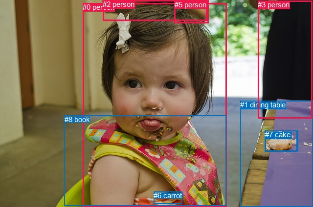
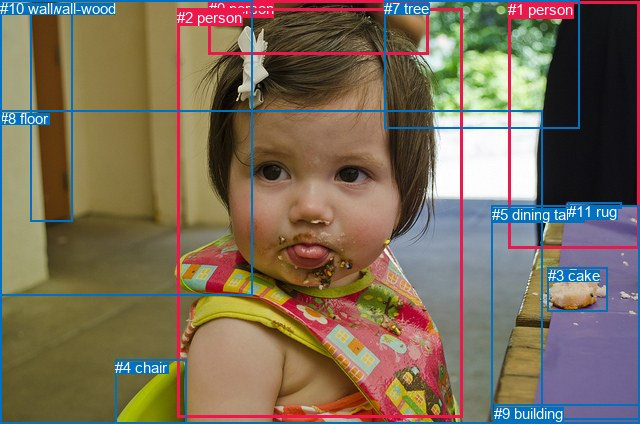

# 图片 1415：2382040.jpg

随机样本序号：332。图片 SHA256：`02dbd84a164a6d7eea5545fac90f5d3f2ec837cce5e3251fdc6bb7ef044db0eb`。

红色框表示人，蓝色框表示其他物体。两个模式分别保留自身框编号，可依据位置比较对应对象。

## 自动检测框与输出

人的框编号：`[0, 2, 3, 5]`。状态：`ok`。

### 自动检测全部物体框

| 编号 | 类别 | 是否为人 | 检测分数 | 像素坐标 xyxy |
|---|---|---|---|---|
| 0 | person | True | 0.9983 | 169.1, 6.0, 463.1, 424.0 |
| 1 | dining table | False | 0.9654 | 491.0, 206.4, 640.0, 424.0 |
| 2 | person | True | 0.9527 | 210.4, 0.0, 423.5, 42.1 |
| 3 | person | True | 0.8970 | 527.2, 1.3, 638.7, 243.0 |
| 4 | pizza | False | 0.7521 | 541.4, 267.1, 609.1, 309.8 |
| 5 | person | True | 0.7086 | 356.9, 0.6, 426.8, 47.3 |
| 6 | carrot | False | 0.5828 | 314.3, 392.2, 372.9, 417.6 |
| 7 | cake | False | 0.4117 | 542.4, 267.3, 607.6, 310.2 |
| 8 | book | False | 0.4086 | 131.8, 236.1, 462.4, 421.4 |

### 自动检测 Top50 人相关候选

评分物体对：72；人相关物体对：52；输出关系：50。

| 排名 | 主语编号与类别 | 关系 | 宾语编号与类别 | 类型 | 人与人 | 排序分数 | 原始融合 logit |
|---|---|---|---|---|---|---|---|
| 1 | #0 person | wearing | #8 book | semantic | False | 0.99216 | 4.8404 |
| 2 | #0 person | eating | #7 cake | semantic | False | 0.98723 | 4.3480 |
| 3 | #0 person | eating | #4 pizza | semantic | False | 0.98720 | 4.3457 |
| 4 | #0 person | wearing | #6 carrot | semantic | False | 0.97314 | 3.5898 |
| 5 | #2 person | holding | #5 person | semantic | True | 0.96966 | 3.4645 |
| 6 | #0 person | in | #8 book | spatial | False | 0.94586 | 2.8604 |
| 7 | #5 person | on | #2 person | spatial | True | 0.94100 | 2.7695 |
| 8 | #8 book | on | #0 person | spatial | False | 0.91404 | 2.3640 |
| 9 | #2 person | on | #5 person | spatial | True | 0.89083 | 2.0993 |
| 10 | #3 person | standing on | #1 dining table | semantic | False | 0.88583 | 2.0488 |
| 11 | #5 person | holding | #2 person | semantic | True | 0.87076 | 1.9077 |
| 12 | #0 person | beside | #1 dining table | spatial | False | 0.86269 | 1.8378 |
| 13 | #3 person | beside | #1 dining table | spatial | False | 0.84702 | 1.7114 |
| 14 | #6 carrot | on | #0 person | spatial | False | 0.83501 | 1.6216 |
| 15 | #0 person | looking at | #1 dining table | semantic | False | 0.77075 | 1.2126 |
| 16 | #3 person | looking at | #0 person | semantic | True | 0.75725 | 1.1377 |
| 17 | #3 person | beside | #0 person | spatial | True | 0.68762 | 0.7890 |
| 18 | #0 person | in | #6 carrot | spatial | False | 0.67940 | 0.7510 |
| 19 | #0 person | wearing | #3 person | semantic | True | 0.65746 | 0.6520 |
| 20 | #0 person | wearing | #2 person | semantic | True | 0.64963 | 0.6174 |
| 21 | #0 person | in | #7 cake | spatial | False | 0.55846 | 0.2349 |
| 22 | #0 person | in | #4 pizza | spatial | False | 0.55837 | 0.2345 |
| 23 | #2 person | on | #0 person | spatial | True | 0.54334 | 0.1738 |
| 24 | #3 person | wearing | #5 person | semantic | True | 0.49310 | -0.0276 |
| 25 | #1 dining table | beside | #0 person | spatial | False | 0.47648 | -0.0941 |
| 26 | #2 person | holding | #0 person | semantic | True | 0.44341 | -0.2273 |
| 27 | #0 person | in | #2 person | spatial | True | 0.39553 | -0.4241 |
| 28 | #8 book | wearing | #0 person | semantic | False | 0.38232 | -0.4797 |
| 29 | #5 person | holding | #0 person | semantic | True | 0.32882 | -0.7135 |
| 30 | #6 carrot | wearing | #0 person | semantic | False | 0.31163 | -0.7925 |
| 31 | #5 person | on | #0 person | spatial | True | 0.30818 | -0.8086 |
| 32 | #0 person | wearing | #5 person | semantic | True | 0.27717 | -0.9585 |
| 33 | #3 person | in | #5 person | spatial | True | 0.24892 | -1.1044 |
| 34 | #3 person | wearing | #2 person | semantic | True | 0.20014 | -1.3854 |
| 35 | #0 person | in | #5 person | spatial | True | 0.19679 | -1.4065 |
| 36 | #0 person | in | #3 person | spatial | True | 0.19121 | -1.4421 |
| 37 | #2 person | wearing | #3 person | semantic | True | 0.13933 | -1.8209 |
| 38 | #3 person | in | #2 person | spatial | True | 0.08162 | -2.4206 |
| 39 | #1 dining table | beside | #3 person | spatial | False | 0.08095 | -2.4294 |
| 40 | #1 dining table | looking at | #0 person | semantic | False | 0.08053 | -2.4351 |
| 41 | #2 person | beside | #1 dining table | spatial | False | 0.07694 | -2.4846 |
| 42 | #5 person | beside | #1 dining table | spatial | False | 0.07259 | -2.5476 |
| 43 | #5 person | wearing | #3 person | semantic | True | 0.07078 | -2.5747 |
| 44 | #7 cake | beside | #0 person | spatial | False | 0.06874 | -2.6061 |
| 45 | #4 pizza | beside | #0 person | spatial | False | 0.06760 | -2.6241 |
| 46 | #3 person | cooking | #7 cake | semantic | False | 0.04359 | -3.0882 |
| 47 | #3 person | cooking | #4 pizza | semantic | False | 0.04342 | -3.0925 |
| 48 | #3 person | wearing | #8 book | semantic | False | 0.04250 | -3.1148 |
| 49 | #2 person | wearing | #8 book | semantic | False | 0.04146 | -3.1407 |
| 50 | #5 person | on | #3 person | spatial | True | 0.03168 | -3.4200 |

### 自动检测逐条人相关 GT 核验

R@50：0.00%；命中 0/3。

| GT 主语编号 | GT 关系 | GT 宾语编号 | 结果阶段 | 匹配预测主语编号 | 匹配预测宾语编号 |
|---|---|---|---|---|---|
| 2 | in front of | 0 | wrong_predicate | [0] | [2] |
| 2 | sitting on | 4 | endpoint_missing_or_wrong_class | [0] | [] |
| 5 | in front of | 1 | wrong_predicate | [1] | [3] |

## 真实框与输出

人的框编号：`[0, 1, 2]`。

### 真实框全部物体框

| 编号 | 类别 | 是否为人 | 检测分数 | 像素坐标 xyxy |
|---|---|---|---|---|
| 0 | person | True | GT | 209.0, 0.0, 429.0, 54.0 |
| 1 | person | True | GT | 508.0, 1.0, 640.0, 248.0 |
| 2 | person | True | GT | 177.0, 9.0, 462.0, 417.0 |
| 3 | cake | False | GT | 548.0, 267.0, 608.0, 311.0 |
| 4 | chair | False | GT | 115.0, 359.0, 186.0, 424.0 |
| 5 | dining table | False | GT | 492.0, 206.0, 640.0, 419.0 |
| 6 | wall-wood | False | GT | 31.0, 0.0, 73.0, 222.0 |
| 7 | tree | False | GT | 384.0, 0.0, 579.0, 128.0 |
| 8 | floor | False | GT | 0.0, 110.0, 543.0, 424.0 |
| 9 | building | False | GT | 494.0, 405.0, 640.0, 424.0 |
| 10 | wall | False | GT | 0.0, 0.0, 253.0, 296.0 |
| 11 | rug | False | GT | 568.0, 203.0, 621.0, 209.0 |

### 真实框 Top50 人相关候选

评分物体对：132；人相关物体对：60；输出关系：50。

| 排名 | 主语编号与类别 | 关系 | 宾语编号与类别 | 类型 | 人与人 | 排序分数 | 原始融合 logit |
|---|---|---|---|---|---|---|---|
| 1 | #2 person | eating | #3 cake | semantic | False | 0.98624 | 4.2720 |
| 2 | #2 person | wearing | #4 chair | semantic | False | 0.97314 | 3.5899 |
| 3 | #2 person | in | #8 floor | spatial | False | 0.96803 | 3.4105 |
| 4 | #1 person | standing on | #8 floor | semantic | False | 0.93962 | 2.7448 |
| 5 | #1 person | wearing | #11 rug | semantic | False | 0.93031 | 2.5915 |
| 6 | #1 person | looking at | #2 person | semantic | True | 0.91839 | 2.4207 |
| 7 | #1 person | standing on | #5 dining table | semantic | False | 0.90123 | 2.2110 |
| 8 | #2 person | looking at | #5 dining table | semantic | False | 0.89422 | 2.1346 |
| 9 | #0 person | on | #2 person | spatial | True | 0.88714 | 2.0618 |
| 10 | #1 person | beside | #5 dining table | spatial | False | 0.86040 | 1.8186 |
| 11 | #4 chair | carrying | #2 person | semantic | False | 0.85490 | 1.7735 |
| 12 | #4 chair | attached to | #2 person | spatial | False | 0.85479 | 1.7727 |
| 13 | #1 person | on | #11 rug | spatial | False | 0.82831 | 1.5737 |
| 14 | #2 person | in | #4 chair | spatial | False | 0.80920 | 1.4448 |
| 15 | #2 person | wearing | #8 floor | semantic | False | 0.80767 | 1.4350 |
| 16 | #2 person | on | #5 dining table | spatial | False | 0.80158 | 1.3962 |
| 17 | #1 person | beside | #2 person | spatial | True | 0.77786 | 1.2532 |
| 18 | #1 person | on | #8 floor | spatial | False | 0.73908 | 1.0412 |
| 19 | #0 person | holding | #2 person | semantic | True | 0.72510 | 0.9699 |
| 20 | #8 floor | beside | #2 person | spatial | False | 0.68926 | 0.7967 |
| 21 | #2 person | wearing | #0 person | semantic | True | 0.67858 | 0.7473 |
| 22 | #2 person | in | #3 cake | spatial | False | 0.67131 | 0.7141 |
| 23 | #2 person | in | #0 person | spatial | True | 0.63601 | 0.5581 |
| 24 | #10 wall | beside | #2 person | spatial | False | 0.54087 | 0.1638 |
| 25 | #7 tree | beside | #2 person | spatial | False | 0.52525 | 0.1011 |
| 26 | #1 person | beside | #7 tree | spatial | False | 0.50090 | 0.0036 |
| 27 | #2 person | looking at | #9 building | semantic | False | 0.48250 | -0.0700 |
| 28 | #1 person | standing on | #7 tree | semantic | False | 0.42564 | -0.2997 |
| 29 | #2 person | wearing | #1 person | semantic | True | 0.42288 | -0.3110 |
| 30 | #2 person | looking at | #11 rug | semantic | False | 0.37938 | -0.4922 |
| 31 | #5 dining table | beside | #2 person | spatial | False | 0.37761 | -0.4997 |
| 32 | #2 person | in | #9 building | spatial | False | 0.35880 | -0.5806 |
| 33 | #7 tree | looking at | #2 person | semantic | False | 0.35160 | -0.6120 |
| 34 | #0 person | in | #7 tree | spatial | False | 0.32801 | -0.7172 |
| 35 | #8 floor | holding | #2 person | semantic | False | 0.32587 | -0.7269 |
| 36 | #11 rug | on | #1 person | spatial | False | 0.30537 | -0.8219 |
| 37 | #1 person | cooking | #3 cake | semantic | False | 0.26040 | -1.0439 |
| 38 | #0 person | on | #8 floor | spatial | False | 0.25359 | -1.0795 |
| 39 | #2 person | in | #11 rug | spatial | False | 0.25043 | -1.0963 |
| 40 | #7 tree | beside | #1 person | spatial | False | 0.24982 | -1.0996 |
| 41 | #0 person | holding | #7 tree | semantic | False | 0.24646 | -1.1176 |
| 42 | #6 wall-wood | beside | #2 person | spatial | False | 0.21569 | -1.2909 |
| 43 | #2 person | looking at | #10 wall | semantic | False | 0.14886 | -1.7435 |
| 44 | #2 person | in front of | #10 wall | spatial | False | 0.13360 | -1.8695 |
| 45 | #2 person | in | #1 person | spatial | True | 0.13307 | -1.8741 |
| 46 | #3 cake | beside | #2 person | spatial | False | 0.13190 | -1.8843 |
| 47 | #7 tree | looking at | #1 person | semantic | False | 0.11990 | -1.9934 |
| 48 | #1 person | beside | #10 wall | spatial | False | 0.11418 | -2.0487 |
| 49 | #7 tree | in | #0 person | spatial | False | 0.09916 | -2.2066 |
| 50 | #1 person | wearing | #0 person | semantic | True | 0.09406 | -2.2650 |

### 真实框逐条人相关 GT 核验

R@50：0.00%；命中 0/3。

| GT 主语编号 | GT 关系 | GT 宾语编号 | 结果阶段 | 匹配预测主语编号 | 匹配预测宾语编号 |
|---|---|---|---|---|---|
| 2 | in front of | 0 | wrong_predicate | [2] | [0] |
| 2 | sitting on | 4 | wrong_predicate | [2] | [4] |
| 5 | in front of | 1 | wrong_predicate | [5] | [1] |

## 全部人相关 GT

| 主语编号与类别 | 关系 | 宾语编号与类别 |
|---|---|---|
| #2 person | in front of | #0 person |
| #2 person | sitting on | #4 chair |
| #5 dining table | in front of | #1 person |

原始记录、全部人相关物体对的两项预测与分项分数见 [逐图证据 JSON](../evidence/cases/1415.json)。全部56类 logits 保留于本机 HOR/output/random500/logits/。

<!-- HOR_COMPLETE_RESULTS -->

## 六组条件的完整输出对照

以下保留同一图片三种框与候选模式、两种谓词输出规则的全部 Top50。框编号各自在所属模式内解释。

### 自动检测框完整枚举：空间与语义各保留一个谓词

| 排名 | 主语编号与类别 | 谓词 | 宾语编号与类别 | 分组 | 排序分数 | predicate logit | pair logit |
|---|---|---|---|---|---|---|---|
| 1 | #0 person | wearing | #8 book | semantic | 0.9921581 | 4.5085549 | 0.3318335 |
| 2 | #0 person | eating | #7 cake | semantic | 0.9872322 | 4.4792943 | -0.1313145 |
| 3 | #0 person | eating | #4 pizza | semantic | 0.9872033 | 4.4773631 | -0.1316743 |
| 4 | #0 person | wearing | #6 carrot | semantic | 0.9731387 | 3.6336532 | -0.0438110 |
| 5 | #2 person | holding | #5 person | semantic | 0.9696615 | 3.5138192 | -0.0492861 |
| 6 | #0 person | in | #8 book | spatial | 0.9458563 | 2.5286145 | 0.3318335 |
| 7 | #5 person | on | #2 person | spatial | 0.9410029 | 2.9541950 | -0.1847371 |
| 8 | #8 book | on | #0 person | spatial | 0.9140384 | 2.9014845 | -0.5375138 |
| 9 | #2 person | on | #5 person | spatial | 0.8908333 | 2.1485672 | -0.0492861 |
| 10 | #3 person | standing on | #1 dining table | semantic | 0.8858259 | 2.6343765 | -0.5855813 |
| 11 | #5 person | holding | #2 person | semantic | 0.8707558 | 2.0923948 | -0.1847371 |
| 12 | #0 person | beside | #1 dining table | spatial | 0.8626881 | 2.1536536 | -0.3158554 |
| 13 | #3 person | beside | #1 dining table | spatial | 0.8470198 | 2.2969971 | -0.5855813 |
| 14 | #6 carrot | on | #0 person | spatial | 0.8350111 | 2.2833252 | -0.6617587 |
| 15 | #0 person | looking at | #1 dining table | semantic | 0.7707525 | 1.5284209 | -0.3158554 |
| 16 | #3 person | looking at | #0 person | semantic | 0.7572480 | 1.7755346 | -0.6378840 |
| 17 | #3 person | beside | #0 person | spatial | 0.6876190 | 1.4268956 | -0.6378840 |
| 18 | #0 person | in | #6 carrot | spatial | 0.6793977 | 0.7948160 | -0.0438110 |
| 19 | #0 person | wearing | #3 person | semantic | 0.6574590 | 1.7215858 | -1.0695951 |
| 20 | #0 person | wearing | #2 person | semantic | 0.6496286 | 1.1460204 | -0.5286133 |
| 21 | #0 person | in | #7 cake | spatial | 0.5584561 | 0.3662128 | -0.1313145 |
| 22 | #0 person | in | #4 pizza | spatial | 0.5583673 | 0.3662128 | -0.1316743 |
| 23 | #2 person | on | #0 person | spatial | 0.5433431 | 0.5348477 | -0.3610394 |
| 24 | #3 person | wearing | #5 person | semantic | 0.4930978 | 0.9383154 | -0.9659261 |
| 25 | #1 dining table | beside | #0 person | spatial | 0.4764834 | 0.5009475 | -0.5950835 |
| 26 | #2 person | holding | #0 person | semantic | 0.4434134 | 0.1337190 | -0.3610394 |
| 27 | #0 person | in | #2 person | spatial | 0.3955277 | 0.1044784 | -0.5286133 |
| 28 | #8 book | wearing | #0 person | semantic | 0.3823168 | 0.0577879 | -0.5375138 |
| 29 | #5 person | holding | #0 person | semantic | 0.3288233 | -0.3366828 | -0.3768292 |
| 30 | #6 carrot | wearing | #0 person | semantic | 0.3116330 | -0.1307373 | -0.6617587 |
| 31 | #5 person | on | #0 person | spatial | 0.3081809 | -0.4318085 | -0.3768292 |
| 32 | #0 person | wearing | #5 person | semantic | 0.2771707 | -0.2735300 | -0.6850092 |
| 33 | #3 person | in | #5 person | spatial | 0.2489194 | -0.1384578 | -0.9659261 |
| 34 | #3 person | wearing | #2 person | semantic | 0.2001406 | -0.2697716 | -1.1156446 |
| 35 | #0 person | in | #5 person | spatial | 0.1967879 | -0.7214832 | -0.6850092 |
| 36 | #0 person | in | #3 person | spatial | 0.1912134 | -0.3725500 | -1.0695951 |
| 37 | #2 person | wearing | #3 person | semantic | 0.1393272 | -0.6595273 | -1.1613622 |
| 38 | #3 person | in | #2 person | spatial | 0.0816169 | -1.3049335 | -1.1156446 |
| 39 | #1 dining table | beside | #3 person | spatial | 0.0809550 | -1.0544441 | -1.3749981 |
| 40 | #1 dining table | looking at | #0 person | semantic | 0.0805321 | -1.8400557 | -0.5950835 |
| 41 | #2 person | beside | #1 dining table | spatial | 0.0769413 | -1.3740485 | -1.1106014 |
| 42 | #5 person | beside | #1 dining table | spatial | 0.0725905 | -1.2851336 | -1.2624271 |
| 43 | #5 person | wearing | #3 person | semantic | 0.0707833 | -1.4680755 | -1.1066437 |
| 44 | #7 cake | beside | #0 person | spatial | 0.0687444 | -1.7565899 | -0.8495486 |
| 45 | #4 pizza | beside | #0 person | spatial | 0.0676036 | -1.7715631 | -0.8525336 |
| 46 | #3 person | cooking | #7 cake | semantic | 0.0435947 | -1.9444871 | -1.1437585 |
| 47 | #3 person | cooking | #4 pizza | semantic | 0.0434170 | -1.9444742 | -1.1480420 |
| 48 | #3 person | wearing | #8 book | semantic | 0.0425004 | -1.3793166 | -1.7354944 |
| 49 | #2 person | wearing | #8 book | semantic | 0.0414592 | -1.5549302 | -1.5857712 |
| 50 | #5 person | on | #3 person | spatial | 0.0316753 | -2.3133874 | -1.1066437 |

GT 命中：0/3，R@50=0.00%。

| GT主语 | GT谓词 | GT宾语 | 结果阶段 | 匹配主语框 | 匹配宾语框 |
|---|---|---|---|---|---|
| 2 | in front of | 0 | wrong_predicate | [0] | [2] |
| 2 | sitting on | 4 | endpoint_missing_or_wrong_class | [0] | [] |
| 5 | in front of | 1 | wrong_predicate | [1] | [3] |

### 自动检测框完整枚举：每对只保留一个谓词

| 排名 | 主语编号与类别 | 谓词 | 宾语编号与类别 | 分组 | 排序分数 | predicate logit | pair logit |
|---|---|---|---|---|---|---|---|
| 1 | #0 person | wearing | #8 book | single | 0.9921581 | 4.5085549 | 0.3318335 |
| 2 | #0 person | eating | #7 cake | single | 0.9872322 | 4.4792943 | -0.1313145 |
| 3 | #0 person | eating | #4 pizza | single | 0.9872033 | 4.4773631 | -0.1316743 |
| 4 | #0 person | wearing | #6 carrot | single | 0.9731387 | 3.6336532 | -0.0438110 |
| 5 | #2 person | holding | #5 person | single | 0.9696615 | 3.5138192 | -0.0492861 |
| 6 | #5 person | on | #2 person | single | 0.9410029 | 2.9541950 | -0.1847371 |
| 7 | #8 book | on | #0 person | single | 0.9140384 | 2.9014845 | -0.5375138 |
| 8 | #3 person | standing on | #1 dining table | single | 0.8858259 | 2.6343765 | -0.5855813 |
| 9 | #0 person | beside | #1 dining table | single | 0.8626881 | 2.1536536 | -0.3158554 |
| 10 | #6 carrot | on | #0 person | single | 0.8350111 | 2.2833252 | -0.6617587 |
| 11 | #3 person | looking at | #0 person | single | 0.7572480 | 1.7755346 | -0.6378840 |
| 12 | #0 person | wearing | #3 person | single | 0.6574590 | 1.7215858 | -1.0695951 |
| 13 | #0 person | wearing | #2 person | single | 0.6496286 | 1.1460204 | -0.5286133 |
| 14 | #2 person | on | #0 person | single | 0.5433431 | 0.5348477 | -0.3610394 |
| 15 | #3 person | wearing | #5 person | single | 0.4930978 | 0.9383154 | -0.9659261 |
| 16 | #1 dining table | beside | #0 person | single | 0.4764834 | 0.5009475 | -0.5950835 |
| 17 | #5 person | holding | #0 person | single | 0.3288233 | -0.3366828 | -0.3768292 |
| 18 | #0 person | wearing | #5 person | single | 0.2771707 | -0.2735300 | -0.6850092 |
| 19 | #3 person | wearing | #2 person | single | 0.2001406 | -0.2697716 | -1.1156446 |
| 20 | #2 person | wearing | #3 person | single | 0.1393272 | -0.6595273 | -1.1613622 |
| 21 | #1 dining table | beside | #3 person | single | 0.0809550 | -1.0544441 | -1.3749981 |
| 22 | #2 person | beside | #1 dining table | single | 0.0769413 | -1.3740485 | -1.1106014 |
| 23 | #5 person | beside | #1 dining table | single | 0.0725905 | -1.2851336 | -1.2624271 |
| 24 | #5 person | wearing | #3 person | single | 0.0707833 | -1.4680755 | -1.1066437 |
| 25 | #7 cake | beside | #0 person | single | 0.0687444 | -1.7565899 | -0.8495486 |
| 26 | #4 pizza | beside | #0 person | single | 0.0676036 | -1.7715631 | -0.8525336 |
| 27 | #3 person | cooking | #7 cake | single | 0.0435947 | -1.9444871 | -1.1437585 |
| 28 | #3 person | cooking | #4 pizza | single | 0.0434170 | -1.9444742 | -1.1480420 |
| 29 | #3 person | wearing | #8 book | single | 0.0425004 | -1.3793166 | -1.7354944 |
| 30 | #2 person | wearing | #8 book | single | 0.0414592 | -1.5549302 | -1.5857712 |
| 31 | #3 person | wearing | #6 carrot | single | 0.0259093 | -2.2880859 | -1.3388163 |
| 32 | #5 person | picking | #7 cake | single | 0.0188451 | -2.3501875 | -1.6022916 |
| 33 | #5 person | picking | #4 pizza | single | 0.0183925 | -2.3652093 | -1.6120398 |
| 34 | #2 person | eating | #7 cake | single | 0.0164466 | -2.6179771 | -1.4730756 |
| 35 | #2 person | eating | #4 pizza | single | 0.0160812 | -2.6325402 | -1.4813497 |
| 36 | #6 carrot | on | #3 person | single | 0.0152025 | -2.3626304 | -1.8083435 |
| 37 | #2 person | wearing | #6 carrot | single | 0.0119386 | -2.8254914 | -1.5904768 |
| 38 | #5 person | wearing | #8 book | single | 0.0104090 | -2.3380542 | -2.2165630 |
| 39 | #5 person | wearing | #6 carrot | single | 0.0085995 | -2.5219116 | -2.2255080 |
| 40 | #6 carrot | on | #2 person | single | 0.0064721 | -2.8002563 | -2.2334981 |
| 41 | #8 book | on | #3 person | single | 0.0062738 | -3.4189367 | -1.6461353 |
| 42 | #8 book | on | #2 person | single | 0.0041343 | -3.6147327 | -1.8695590 |
| 43 | #1 dining table | beside | #2 person | single | 0.0040259 | -3.2179527 | -2.2930276 |
| 44 | #4 pizza | in | #3 person | single | 0.0035768 | -4.1063995 | -1.5233048 |
| 45 | #7 cake | in | #3 person | single | 0.0035501 | -4.1155820 | -1.5216508 |
| 46 | #6 carrot | on | #5 person | single | 0.0034544 | -3.0455766 | -2.6190581 |
| 47 | #1 dining table | beside | #5 person | single | 0.0034039 | -3.3763943 | -2.3030300 |
| 48 | #8 book | on | #5 person | single | 0.0012193 | -4.5681314 | -2.1401114 |
| 49 | #4 pizza | in | #5 person | single | 0.0008258 | -4.5998092 | -2.4985485 |
| 50 | #7 cake | in | #5 person | single | 0.0008184 | -4.6144676 | -2.4929109 |

GT 命中：0/3，R@50=0.00%。

| GT主语 | GT谓词 | GT宾语 | 结果阶段 | 匹配主语框 | 匹配宾语框 |
|---|---|---|---|---|---|
| 2 | in front of | 0 | wrong_predicate | [0] | [2] |
| 2 | sitting on | 4 | endpoint_missing_or_wrong_class | [0] | [] |
| 5 | in front of | 1 | wrong_predicate | [1] | [3] |

### 真实框完整枚举：空间与语义各保留一个谓词

| 排名 | 主语编号与类别 | 谓词 | 宾语编号与类别 | 分组 | 排序分数 | predicate logit | pair logit |
|---|---|---|---|---|---|---|---|
| 1 | #2 person | eating | #3 cake | semantic | 0.9862384 | 4.4635243 | -0.1915155 |
| 2 | #2 person | wearing | #4 chair | semantic | 0.9731393 | 3.8963513 | -0.3064856 |
| 3 | #2 person | in | #8 floor | spatial | 0.9680299 | 3.7745175 | -0.3640561 |
| 4 | #1 person | standing on | #8 floor | semantic | 0.9396204 | 3.5458875 | -0.8010631 |
| 5 | #1 person | wearing | #11 rug | semantic | 0.9303131 | 3.0459871 | -0.4544786 |
| 6 | #1 person | looking at | #2 person | semantic | 0.9183893 | 2.9890552 | -0.5683949 |
| 7 | #1 person | standing on | #5 dining table | semantic | 0.9012322 | 2.7796326 | -0.5686414 |
| 8 | #2 person | looking at | #5 dining table | semantic | 0.8942237 | 2.5361834 | -0.4015542 |
| 9 | #0 person | on | #2 person | spatial | 0.8871389 | 2.3896151 | -0.3277710 |
| 10 | #1 person | beside | #5 dining table | spatial | 0.8604016 | 2.3872709 | -0.5686414 |
| 11 | #4 chair | carrying | #2 person | semantic | 0.8548976 | 2.3467231 | -0.5731812 |
| 12 | #4 chair | attached to | #2 person | spatial | 0.8547921 | 2.3458729 | -0.5731812 |
| 13 | #1 person | on | #11 rug | spatial | 0.8283139 | 2.0282025 | -0.4544786 |
| 14 | #2 person | in | #4 chair | spatial | 0.8092024 | 1.7513213 | -0.3064856 |
| 15 | #2 person | wearing | #8 floor | semantic | 0.8076715 | 1.7990069 | -0.3640561 |
| 16 | #2 person | on | #5 dining table | spatial | 0.8015848 | 1.7977829 | -0.4015542 |
| 17 | #1 person | beside | #2 person | spatial | 0.7778557 | 1.8216085 | -0.5683949 |
| 18 | #1 person | on | #8 floor | spatial | 0.7390767 | 1.8422384 | -0.8010631 |
| 19 | #0 person | holding | #2 person | semantic | 0.7250966 | 1.2976561 | -0.3277710 |
| 20 | #8 floor | beside | #2 person | spatial | 0.6892612 | 1.3076286 | -0.5109609 |
| 21 | #2 person | wearing | #0 person | semantic | 0.6785809 | 1.2368999 | -0.4896421 |
| 22 | #2 person | in | #3 cake | spatial | 0.6713140 | 0.9056497 | -0.1915155 |
| 23 | #2 person | in | #0 person | spatial | 0.6360050 | 1.0477085 | -0.4896421 |
| 24 | #10 wall | beside | #2 person | spatial | 0.5408692 | 0.4657969 | -0.3019544 |
| 25 | #7 tree | beside | #2 person | spatial | 0.5252525 | 0.6802812 | -0.5791851 |
| 26 | #1 person | beside | #7 tree | spatial | 0.5008976 | 1.2211137 | -1.2175230 |
| 27 | #2 person | looking at | #9 building | semantic | 0.4825043 | 0.5402908 | -0.6103020 |
| 28 | #1 person | standing on | #7 tree | semantic | 0.4256364 | 0.9178457 | -1.2175230 |
| 29 | #2 person | wearing | #1 person | semantic | 0.4228777 | 0.8157682 | -1.1267396 |
| 30 | #2 person | looking at | #11 rug | semantic | 0.3793785 | 0.1873231 | -0.6795099 |
| 31 | #5 dining table | beside | #2 person | spatial | 0.3776104 | 0.1384068 | -0.6381099 |
| 32 | #2 person | in | #9 building | spatial | 0.3587953 | 0.0297050 | -0.6103020 |
| 33 | #7 tree | looking at | #2 person | semantic | 0.3515978 | -0.0328379 | -0.5791851 |
| 34 | #0 person | in | #7 tree | spatial | 0.3280101 | 0.2680068 | -0.9852059 |
| 35 | #8 floor | holding | #2 person | semantic | 0.3258668 | -0.2159781 | -0.5109609 |
| 36 | #11 rug | on | #1 person | spatial | 0.3053656 | 0.1502643 | -0.9721403 |
| 37 | #1 person | cooking | #3 cake | semantic | 0.2604037 | 0.0561357 | -1.1000072 |
| 38 | #0 person | on | #8 floor | spatial | 0.2535935 | -0.2496395 | -0.8298981 |
| 39 | #2 person | in | #11 rug | spatial | 0.2504307 | -0.4168067 | -0.6795099 |
| 40 | #7 tree | beside | #1 person | spatial | 0.2498197 | 0.0186782 | -1.1182522 |
| 41 | #0 person | holding | #7 tree | semantic | 0.2464609 | -0.1323714 | -0.9852059 |
| 42 | #6 wall-wood | beside | #2 person | spatial | 0.2156922 | -0.6473341 | -0.6436152 |
| 43 | #2 person | looking at | #10 wall | semantic | 0.1488649 | -0.4957118 | -1.2478199 |
| 44 | #2 person | in front of | #10 wall | spatial | 0.1336027 | -0.6216536 | -1.2478199 |
| 45 | #2 person | in | #1 person | spatial | 0.1330674 | -0.7473655 | -1.1267396 |
| 46 | #3 cake | beside | #2 person | spatial | 0.1318977 | -1.0038171 | -0.8804660 |
| 47 | #7 tree | looking at | #1 person | semantic | 0.1199029 | -0.8750980 | -1.1182522 |
| 48 | #1 person | beside | #10 wall | spatial | 0.1141840 | -0.5277205 | -1.5209779 |
| 49 | #7 tree | in | #0 person | spatial | 0.0991596 | -0.9385369 | -1.2680604 |
| 50 | #1 person | wearing | #0 person | semantic | 0.0940632 | -1.2258420 | -1.0391613 |

GT 命中：0/3，R@50=0.00%。

| GT主语 | GT谓词 | GT宾语 | 结果阶段 | 匹配主语框 | 匹配宾语框 |
|---|---|---|---|---|---|
| 2 | in front of | 0 | wrong_predicate | [2] | [0] |
| 2 | sitting on | 4 | wrong_predicate | [2] | [4] |
| 5 | in front of | 1 | wrong_predicate | [5] | [1] |

### 真实框完整枚举：每对只保留一个谓词

| 排名 | 主语编号与类别 | 谓词 | 宾语编号与类别 | 分组 | 排序分数 | predicate logit | pair logit |
|---|---|---|---|---|---|---|---|
| 1 | #2 person | eating | #3 cake | single | 0.9862384 | 4.4635243 | -0.1915155 |
| 2 | #2 person | wearing | #4 chair | single | 0.9731393 | 3.8963513 | -0.3064856 |
| 3 | #2 person | in | #8 floor | single | 0.9680299 | 3.7745175 | -0.3640561 |
| 4 | #1 person | standing on | #8 floor | single | 0.9396204 | 3.5458875 | -0.8010631 |
| 5 | #1 person | wearing | #11 rug | single | 0.9303131 | 3.0459871 | -0.4544786 |
| 6 | #1 person | looking at | #2 person | single | 0.9183893 | 2.9890552 | -0.5683949 |
| 7 | #1 person | standing on | #5 dining table | single | 0.9012322 | 2.7796326 | -0.5686414 |
| 8 | #2 person | looking at | #5 dining table | single | 0.8942237 | 2.5361834 | -0.4015542 |
| 9 | #0 person | on | #2 person | single | 0.8871389 | 2.3896151 | -0.3277710 |
| 10 | #4 chair | carrying | #2 person | single | 0.8548976 | 2.3467231 | -0.5731812 |
| 11 | #8 floor | beside | #2 person | single | 0.6892612 | 1.3076286 | -0.5109609 |
| 12 | #2 person | wearing | #0 person | single | 0.6785809 | 1.2368999 | -0.4896421 |
| 13 | #10 wall | beside | #2 person | single | 0.5408692 | 0.4657969 | -0.3019544 |
| 14 | #7 tree | beside | #2 person | single | 0.5252525 | 0.6802812 | -0.5791851 |
| 15 | #1 person | beside | #7 tree | single | 0.5008976 | 1.2211137 | -1.2175230 |
| 16 | #2 person | looking at | #9 building | single | 0.4825043 | 0.5402908 | -0.6103020 |
| 17 | #2 person | wearing | #1 person | single | 0.4228777 | 0.8157682 | -1.1267396 |
| 18 | #2 person | looking at | #11 rug | single | 0.3793785 | 0.1873231 | -0.6795099 |
| 19 | #5 dining table | beside | #2 person | single | 0.3776104 | 0.1384068 | -0.6381099 |
| 20 | #0 person | in | #7 tree | single | 0.3280101 | 0.2680068 | -0.9852059 |
| 21 | #11 rug | on | #1 person | single | 0.3053656 | 0.1502643 | -0.9721403 |
| 22 | #1 person | cooking | #3 cake | single | 0.2604037 | 0.0561357 | -1.1000072 |
| 23 | #0 person | on | #8 floor | single | 0.2535935 | -0.2496395 | -0.8298981 |
| 24 | #7 tree | beside | #1 person | single | 0.2498197 | 0.0186782 | -1.1182522 |
| 25 | #6 wall-wood | beside | #2 person | single | 0.2156922 | -0.6473341 | -0.6436152 |
| 26 | #2 person | looking at | #10 wall | single | 0.1488649 | -0.4957118 | -1.2478199 |
| 27 | #3 cake | beside | #2 person | single | 0.1318977 | -1.0038171 | -0.8804660 |
| 28 | #1 person | beside | #10 wall | single | 0.1141840 | -0.5277205 | -1.5209779 |
| 29 | #7 tree | in | #0 person | single | 0.0991596 | -0.9385369 | -1.2680604 |
| 30 | #1 person | wearing | #0 person | single | 0.0940632 | -1.2258420 | -1.0391613 |
| 31 | #0 person | beside | #10 wall | single | 0.0838328 | -1.5791576 | -0.8122175 |
| 32 | #2 person | looking at | #7 tree | single | 0.0796845 | -0.9632916 | -1.4833500 |
| 33 | #0 person | on | #5 dining table | single | 0.0668845 | -1.5735383 | -1.0620226 |
| 34 | #2 person | looking at | #6 wall-wood | single | 0.0641366 | -1.3552294 | -1.3252256 |
| 35 | #0 person | wearing | #1 person | single | 0.0558446 | -1.6486230 | -1.1790957 |
| 36 | #5 dining table | beside | #1 person | single | 0.0503349 | -1.5659628 | -1.3714472 |
| 37 | #1 person | wearing | #4 chair | single | 0.0448255 | -1.7721884 | -1.2869275 |
| 38 | #11 rug | beside | #2 person | single | 0.0390057 | -2.4352188 | -0.7690430 |
| 39 | #0 person | eating | #3 cake | single | 0.0349818 | -1.9414871 | -1.3758311 |
| 40 | #9 building | beside | #2 person | single | 0.0319751 | -2.5832570 | -0.8270435 |
| 41 | #1 person | on | #9 building | single | 0.0235932 | -2.7386179 | -0.9843049 |
| 42 | #0 person | wearing | #4 chair | single | 0.0184628 | -2.7893023 | -1.1840621 |
| 43 | #4 chair | beside | #1 person | single | 0.0173095 | -2.4545000 | -1.5845413 |
| 44 | #10 wall | beside | #1 person | single | 0.0164852 | -2.1872931 | -1.9013762 |
| 45 | #1 person | beside | #6 wall-wood | single | 0.0160897 | -2.5261862 | -1.5871694 |
| 46 | #0 person | beside | #6 wall-wood | single | 0.0119465 | -3.4611402 | -0.9541618 |
| 47 | #8 floor | in | #1 person | single | 0.0100646 | -2.9869781 | -1.6016407 |
| 48 | #10 wall | beside | #0 person | single | 0.0082521 | -3.1700344 | -1.6189616 |
| 49 | #4 chair | on | #0 person | single | 0.0081231 | -2.9573014 | -1.8475891 |
| 50 | #8 floor | in | #0 person | single | 0.0074484 | -3.0852954 | -1.8069890 |

GT 命中：0/3，R@50=0.00%。

| GT主语 | GT谓词 | GT宾语 | 结果阶段 | 匹配主语框 | 匹配宾语框 |
|---|---|---|---|---|---|
| 2 | in front of | 0 | wrong_predicate | [2] | [0] |
| 2 | sitting on | 4 | wrong_predicate | [2] | [4] |
| 5 | in front of | 1 | wrong_predicate | [5] | [1] |

### 真实框400候选：空间与语义各保留一个谓词

| 排名 | 主语编号与类别 | 谓词 | 宾语编号与类别 | 分组 | 排序分数 | predicate logit | pair logit |
|---|---|---|---|---|---|---|---|
| 1 | #2 person | eating | #3 cake | semantic | 0.9869822 | 4.5198445 | -0.1915155 |
| 2 | #2 person | wearing | #4 chair | semantic | 0.9731393 | 3.8963513 | -0.3064856 |
| 3 | #2 person | in | #8 floor | spatial | 0.9680299 | 3.7745175 | -0.3640561 |
| 4 | #1 person | standing on | #8 floor | semantic | 0.9396204 | 3.5458875 | -0.8010631 |
| 5 | #1 person | wearing | #11 rug | semantic | 0.9333892 | 3.0944343 | -0.4544786 |
| 6 | #1 person | looking at | #2 person | semantic | 0.9138184 | 2.9295702 | -0.5683949 |
| 7 | #1 person | standing on | #5 dining table | semantic | 0.9012322 | 2.7796326 | -0.5686414 |
| 8 | #2 person | looking at | #5 dining table | semantic | 0.8970364 | 2.5662751 | -0.4015542 |
| 9 | #0 person | on | #2 person | spatial | 0.8871389 | 2.3896151 | -0.3277710 |
| 10 | #1 person | beside | #5 dining table | spatial | 0.8604016 | 2.3872709 | -0.5686414 |
| 11 | #4 chair | carrying | #2 person | semantic | 0.8551864 | 2.3490534 | -0.5731812 |
| 12 | #4 chair | attached to | #2 person | spatial | 0.8547921 | 2.3458729 | -0.5731812 |
| 13 | #1 person | on | #11 rug | spatial | 0.8283139 | 2.0282025 | -0.4544786 |
| 14 | #2 person | in | #4 chair | spatial | 0.8092024 | 1.7513213 | -0.3064856 |
| 15 | #2 person | wearing | #8 floor | semantic | 0.8076715 | 1.7990069 | -0.3640561 |
| 16 | #2 person | on | #5 dining table | spatial | 0.8046210 | 1.8169847 | -0.4015542 |
| 17 | #1 person | beside | #2 person | spatial | 0.7726227 | 1.7915750 | -0.5683949 |
| 18 | #1 person | on | #8 floor | spatial | 0.7369713 | 1.8313489 | -0.8010631 |
| 19 | #0 person | holding | #2 person | semantic | 0.7250966 | 1.2976561 | -0.3277710 |
| 20 | #2 person | wearing | #0 person | semantic | 0.6890550 | 1.2853470 | -0.4896421 |
| 21 | #8 floor | beside | #2 person | spatial | 0.6827673 | 1.2774796 | -0.5109609 |
| 22 | #2 person | in | #3 cake | spatial | 0.6713140 | 0.9056497 | -0.1915155 |
| 23 | #2 person | in | #0 person | spatial | 0.6360050 | 1.0477085 | -0.4896421 |
| 24 | #10 wall | beside | #2 person | spatial | 0.5408692 | 0.4657969 | -0.3019544 |
| 25 | #7 tree | beside | #2 person | spatial | 0.5252380 | 0.6802230 | -0.5791851 |
| 26 | #1 person | beside | #7 tree | spatial | 0.5008976 | 1.2211137 | -1.2175230 |
| 27 | #2 person | looking at | #9 building | semantic | 0.4826785 | 0.5409880 | -0.6103020 |
| 28 | #1 person | standing on | #7 tree | semantic | 0.4312066 | 0.9405928 | -1.2175230 |
| 29 | #2 person | wearing | #1 person | semantic | 0.4228777 | 0.8157682 | -1.1267396 |
| 30 | #5 dining table | beside | #2 person | spatial | 0.3776240 | 0.1384645 | -0.6381099 |
| 31 | #2 person | looking at | #11 rug | semantic | 0.3723197 | 0.1572318 | -0.6795099 |
| 32 | #2 person | in | #9 building | spatial | 0.3587953 | 0.0297050 | -0.6103020 |
| 33 | #7 tree | looking at | #2 person | semantic | 0.3449264 | -0.0622315 | -0.5791851 |
| 34 | #8 floor | holding | #2 person | semantic | 0.3245701 | -0.2218866 | -0.5109609 |
| 35 | #0 person | in | #7 tree | spatial | 0.3224987 | 0.2428937 | -0.9852059 |
| 36 | #11 rug | on | #1 person | spatial | 0.3030607 | 0.1393752 | -0.9721403 |
| 37 | #1 person | cooking | #3 cake | semantic | 0.2662407 | 0.0862269 | -1.1000072 |
| 38 | #0 person | on | #8 floor | spatial | 0.2541092 | -0.2469168 | -0.8298981 |
| 39 | #7 tree | beside | #1 person | spatial | 0.2498305 | 0.0187359 | -1.1182522 |
| 40 | #2 person | in | #11 rug | spatial | 0.2498082 | -0.4201255 | -0.6795099 |
| 41 | #0 person | holding | #7 tree | semantic | 0.2370543 | -0.1836915 | -0.9852059 |
| 42 | #6 wall-wood | beside | #2 person | spatial | 0.2156848 | -0.6473775 | -0.6436152 |
| 43 | #2 person | looking at | #10 wall | semantic | 0.1489091 | -0.4953628 | -1.2478199 |
| 44 | #2 person | in front of | #10 wall | spatial | 0.1335982 | -0.6216917 | -1.2478199 |
| 45 | #2 person | in | #1 person | spatial | 0.1328761 | -0.7490249 | -1.1267396 |
| 46 | #3 cake | beside | #2 person | spatial | 0.1301877 | -1.0188339 | -0.8804660 |
| 47 | #7 tree | looking at | #1 person | semantic | 0.1198661 | -0.8754468 | -1.1182522 |
| 48 | #1 person | beside | #10 wall | spatial | 0.1172646 | -0.4976149 | -1.5209779 |
| 49 | #7 tree | in | #0 person | spatial | 0.1015769 | -0.9117644 | -1.2680604 |
| 50 | #1 person | wearing | #0 person | semantic | 0.0940632 | -1.2258420 | -1.0391613 |

GT 命中：0/3，R@50=0.00%。

| GT主语 | GT谓词 | GT宾语 | 结果阶段 | 匹配主语框 | 匹配宾语框 |
|---|---|---|---|---|---|
| 2 | in front of | 0 | wrong_predicate | [2] | [0] |
| 2 | sitting on | 4 | wrong_predicate | [2] | [4] |
| 5 | in front of | 1 | wrong_predicate | [5] | [1] |

### 真实框400候选：每对只保留一个谓词

| 排名 | 主语编号与类别 | 谓词 | 宾语编号与类别 | 分组 | 排序分数 | predicate logit | pair logit |
|---|---|---|---|---|---|---|---|
| 1 | #2 person | eating | #3 cake | single | 0.9869822 | 4.5198445 | -0.1915155 |
| 2 | #2 person | wearing | #4 chair | single | 0.9731393 | 3.8963513 | -0.3064856 |
| 3 | #2 person | in | #8 floor | single | 0.9680299 | 3.7745175 | -0.3640561 |
| 4 | #1 person | standing on | #8 floor | single | 0.9396204 | 3.5458875 | -0.8010631 |
| 5 | #1 person | wearing | #11 rug | single | 0.9333892 | 3.0944343 | -0.4544786 |
| 6 | #1 person | looking at | #2 person | single | 0.9138184 | 2.9295702 | -0.5683949 |
| 7 | #1 person | standing on | #5 dining table | single | 0.9012322 | 2.7796326 | -0.5686414 |
| 8 | #2 person | looking at | #5 dining table | single | 0.8970364 | 2.5662751 | -0.4015542 |
| 9 | #0 person | on | #2 person | single | 0.8871389 | 2.3896151 | -0.3277710 |
| 10 | #4 chair | carrying | #2 person | single | 0.8551864 | 2.3490534 | -0.5731812 |
| 11 | #2 person | wearing | #0 person | single | 0.6890550 | 1.2853470 | -0.4896421 |
| 12 | #8 floor | beside | #2 person | single | 0.6827673 | 1.2774796 | -0.5109609 |
| 13 | #10 wall | beside | #2 person | single | 0.5408692 | 0.4657969 | -0.3019544 |
| 14 | #7 tree | beside | #2 person | single | 0.5252380 | 0.6802230 | -0.5791851 |
| 15 | #1 person | beside | #7 tree | single | 0.5008976 | 1.2211137 | -1.2175230 |
| 16 | #2 person | looking at | #9 building | single | 0.4826785 | 0.5409880 | -0.6103020 |
| 17 | #2 person | wearing | #1 person | single | 0.4228777 | 0.8157682 | -1.1267396 |
| 18 | #5 dining table | beside | #2 person | single | 0.3776240 | 0.1384645 | -0.6381099 |
| 19 | #2 person | looking at | #11 rug | single | 0.3723197 | 0.1572318 | -0.6795099 |
| 20 | #0 person | in | #7 tree | single | 0.3224987 | 0.2428937 | -0.9852059 |
| 21 | #11 rug | on | #1 person | single | 0.3030607 | 0.1393752 | -0.9721403 |
| 22 | #1 person | cooking | #3 cake | single | 0.2662407 | 0.0862269 | -1.1000072 |
| 23 | #0 person | on | #8 floor | single | 0.2541092 | -0.2469168 | -0.8298981 |
| 24 | #7 tree | beside | #1 person | single | 0.2498305 | 0.0187359 | -1.1182522 |
| 25 | #6 wall-wood | beside | #2 person | single | 0.2156848 | -0.6473775 | -0.6436152 |
| 26 | #2 person | looking at | #10 wall | single | 0.1489091 | -0.4953628 | -1.2478199 |
| 27 | #3 cake | beside | #2 person | single | 0.1301877 | -1.0188339 | -0.8804660 |
| 28 | #1 person | beside | #10 wall | single | 0.1172646 | -0.4976149 | -1.5209779 |
| 29 | #7 tree | in | #0 person | single | 0.1015769 | -0.9117644 | -1.2680604 |
| 30 | #1 person | wearing | #0 person | single | 0.0940632 | -1.2258420 | -1.0391613 |
| 31 | #0 person | beside | #10 wall | single | 0.0838270 | -1.5792320 | -0.8122175 |
| 32 | #2 person | looking at | #7 tree | single | 0.0796973 | -0.9631174 | -1.4833500 |
| 33 | #0 person | on | #5 dining table | single | 0.0670547 | -1.5708158 | -1.0620226 |
| 34 | #2 person | looking at | #6 wall-wood | single | 0.0659773 | -1.3249638 | -1.3252256 |
| 35 | #0 person | wearing | #1 person | single | 0.0552094 | -1.6607347 | -1.1790957 |
| 36 | #5 dining table | beside | #1 person | single | 0.0503336 | -1.5659916 | -1.3714472 |
| 37 | #1 person | wearing | #4 chair | single | 0.0454105 | -1.7586098 | -1.2869275 |
| 38 | #11 rug | beside | #2 person | single | 0.0384458 | -2.4502573 | -0.7690430 |
| 39 | #0 person | picking | #3 cake | single | 0.0339089 | -1.9737480 | -1.3758311 |
| 40 | #9 building | beside | #2 person | single | 0.0319741 | -2.5832896 | -0.8270435 |
| 41 | #1 person | on | #9 building | single | 0.0239025 | -2.7252741 | -0.9843049 |
| 42 | #0 person | wearing | #4 chair | single | 0.0173467 | -2.8527946 | -1.1840621 |
| 43 | #4 chair | beside | #1 person | single | 0.0173085 | -2.4545579 | -1.5845413 |
| 44 | #10 wall | beside | #1 person | single | 0.0164852 | -2.1872931 | -1.9013762 |
| 45 | #1 person | beside | #6 wall-wood | single | 0.0160897 | -2.5261862 | -1.5871694 |
| 46 | #0 person | beside | #6 wall-wood | single | 0.0119471 | -3.4610825 | -0.9541618 |
| 47 | #8 floor | in | #1 person | single | 0.0100687 | -2.9865632 | -1.6016407 |
| 48 | #4 chair | on | #0 person | single | 0.0082452 | -2.9422560 | -1.8475891 |
| 49 | #10 wall | beside | #0 person | single | 0.0081304 | -3.1850224 | -1.6189616 |
| 50 | #8 floor | in | #0 person | single | 0.0073501 | -3.0986817 | -1.8069890 |

GT 命中：0/3，R@50=0.00%。

| GT主语 | GT谓词 | GT宾语 | 结果阶段 | 匹配主语框 | 匹配宾语框 |
|---|---|---|---|---|---|
| 2 | in front of | 0 | wrong_predicate | [2] | [0] |
| 2 | sitting on | 4 | wrong_predicate | [2] | [4] |
| 5 | in front of | 1 | wrong_predicate | [5] | [1] |
