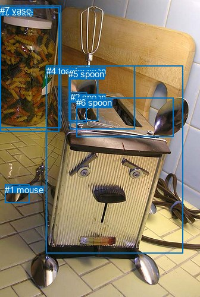
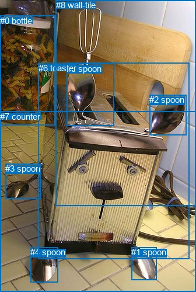

# 图片 1424：2382392.jpg

随机样本序号：431。图片 SHA256：`fdb9a021ab591319d13ff2c999e7faa3c2ea95cbcd090bb58ea724c7cb263373`。

红色框表示人，蓝色框表示其他物体。两个模式分别保留自身框编号，可依据位置比较对应对象。

## 自动检测框与输出

人的框编号：`[]`。状态：`no_person`。

### 自动检测全部物体框

| 编号 | 类别 | 是否为人 | 检测分数 | 像素坐标 xyxy |
|---|---|---|---|---|
| 0 | bottle | False | 0.8347 | 0.0, 12.2, 99.9, 221.8 |
| 1 | mouse | False | 0.8340 | 8.3, 310.5, 49.2, 341.6 |
| 2 | spoon | False | 0.8143 | 117.7, 155.4, 145.5, 206.4 |
| 3 | spoon | False | 0.7406 | 117.8, 110.6, 226.9, 217.6 |
| 4 | toaster | False | 0.6988 | 77.6, 110.8, 307.1, 426.7 |
| 5 | spoon | False | 0.5704 | 115.1, 116.1, 164.7, 203.5 |
| 6 | spoon | False | 0.3939 | 128.3, 164.3, 291.9, 230.4 |
| 7 | vase | False | 0.3876 | 0.2, 9.2, 102.2, 215.7 |

### 自动检测 Top50 人相关候选

评分物体对：0；人相关物体对：0；输出关系：0。

| 排名 | 主语编号与类别 | 关系 | 宾语编号与类别 | 类型 | 人与人 | 排序分数 | 原始融合 logit |
|---|---|---|---|---|---|---|---|

### 自动检测逐条人相关 GT 核验

本图没有人相关 GT，R@50 无分母；预测候选继续展示。

## 真实框与输出

人的框编号：`[]`。

### 真实框全部物体框

| 编号 | 类别 | 是否为人 | 检测分数 | 像素坐标 xyxy |
|---|---|---|---|---|
| 0 | bottle | False | GT | 0.0, 27.0, 94.0, 214.0 |
| 1 | spoon | False | GT | 225.0, 423.0, 268.0, 479.0 |
| 2 | spoon | False | GT | 256.0, 162.0, 319.0, 231.0 |
| 3 | spoon | False | GT | 9.0, 280.0, 70.0, 340.0 |
| 4 | spoon | False | GT | 52.0, 423.0, 99.0, 483.0 |
| 5 | spoon | False | GT | 114.0, 109.0, 196.0, 216.0 |
| 6 | toaster | False | GT | 66.0, 108.0, 325.0, 443.0 |
| 7 | counter | False | GT | 0.0, 191.0, 336.0, 500.0 |
| 8 | wall-tile | False | GT | 96.0, 0.0, 336.0, 353.0 |

### 真实框 Top50 人相关候选

评分物体对：0；人相关物体对：0；输出关系：0。

| 排名 | 主语编号与类别 | 关系 | 宾语编号与类别 | 类型 | 人与人 | 排序分数 | 原始融合 logit |
|---|---|---|---|---|---|---|---|

### 真实框逐条人相关 GT 核验

本图没有人相关 GT，R@50 无分母；预测候选继续展示。

## 全部人相关 GT

| 主语编号与类别 | 关系 | 宾语编号与类别 |
|---|---|---|

原始记录、全部人相关物体对的两项预测与分项分数见 [逐图证据 JSON](../evidence/cases/1424.json)。全部56类 logits 保留于本机 HOR/output/random500/logits/。

<!-- HOR_COMPLETE_RESULTS -->

## 六组条件的完整输出对照

以下保留同一图片三种框与候选模式、两种谓词输出规则的全部 Top50。框编号各自在所属模式内解释。

### 自动检测框完整枚举：空间与语义各保留一个谓词

| 排名 | 主语编号与类别 | 谓词 | 宾语编号与类别 | 分组 | 排序分数 | predicate logit | pair logit |
|---|---|---|---|---|---|---|---|

没有人相关 GT，本条件的召回率无分母。

### 自动检测框完整枚举：每对只保留一个谓词

| 排名 | 主语编号与类别 | 谓词 | 宾语编号与类别 | 分组 | 排序分数 | predicate logit | pair logit |
|---|---|---|---|---|---|---|---|

没有人相关 GT，本条件的召回率无分母。

### 真实框完整枚举：空间与语义各保留一个谓词

| 排名 | 主语编号与类别 | 谓词 | 宾语编号与类别 | 分组 | 排序分数 | predicate logit | pair logit |
|---|---|---|---|---|---|---|---|

没有人相关 GT，本条件的召回率无分母。

### 真实框完整枚举：每对只保留一个谓词

| 排名 | 主语编号与类别 | 谓词 | 宾语编号与类别 | 分组 | 排序分数 | predicate logit | pair logit |
|---|---|---|---|---|---|---|---|

没有人相关 GT，本条件的召回率无分母。

### 真实框400候选：空间与语义各保留一个谓词

| 排名 | 主语编号与类别 | 谓词 | 宾语编号与类别 | 分组 | 排序分数 | predicate logit | pair logit |
|---|---|---|---|---|---|---|---|

没有人相关 GT，本条件的召回率无分母。

### 真实框400候选：每对只保留一个谓词

| 排名 | 主语编号与类别 | 谓词 | 宾语编号与类别 | 分组 | 排序分数 | predicate logit | pair logit |
|---|---|---|---|---|---|---|---|

没有人相关 GT，本条件的召回率无分母。
