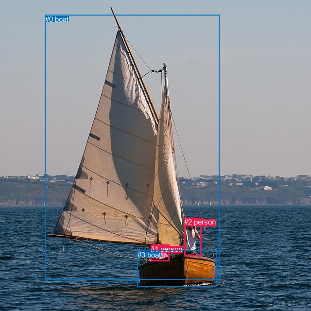
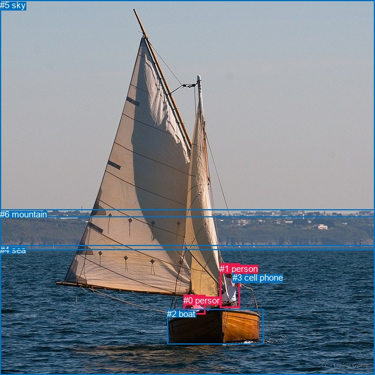

# 图片 1427：2382463.jpg

随机样本序号：304。图片 SHA256：`2517edbb93dfb8671bd14bef8485e42f5c5e2ece488e08bcc2fe651ec708a918`。

红色框表示人，蓝色框表示其他物体。两个模式分别保留自身框编号，可依据位置比较对应对象。

## 自动检测框与输出

人的框编号：`[1, 2]`。状态：`ok`。

### 自动检测全部物体框

| 编号 | 类别 | 是否为人 | 检测分数 | 像素坐标 xyxy |
|---|---|---|---|---|
| 0 | boat | False | 0.9942 | 92.6, 30.7, 451.4, 575.6 |
| 1 | person | True | 0.9935 | 310.2, 503.9, 348.7, 537.9 |
| 2 | person | True | 0.9928 | 379.3, 448.1, 414.0, 527.5 |
| 3 | boat | False | 0.4827 | 282.9, 515.8, 445.7, 590.8 |

### 自动检测 Top50 人相关候选

评分物体对：12；人相关物体对：10；输出关系：20。

| 排名 | 主语编号与类别 | 关系 | 宾语编号与类别 | 类型 | 人与人 | 排序分数 | 原始融合 logit |
|---|---|---|---|---|---|---|---|
| 1 | #2 person | riding | #0 boat | semantic | False | 0.97675 | 3.7381 |
| 2 | #2 person | riding | #3 boat | semantic | False | 0.97418 | 3.6304 |
| 3 | #1 person | riding | #0 boat | semantic | False | 0.96656 | 3.3641 |
| 4 | #1 person | riding | #3 boat | semantic | False | 0.95514 | 3.0583 |
| 5 | #2 person | beside | #1 person | spatial | True | 0.95488 | 3.0523 |
| 6 | #2 person | on | #0 boat | spatial | False | 0.85312 | 1.7593 |
| 7 | #1 person | beside | #2 person | spatial | True | 0.74118 | 1.0521 |
| 8 | #2 person | on | #3 boat | spatial | False | 0.60701 | 0.4348 |
| 9 | #1 person | on | #0 boat | spatial | False | 0.44851 | -0.2067 |
| 10 | #1 person | on | #3 boat | spatial | False | 0.43304 | -0.2694 |
| 11 | #2 person | wearing | #1 person | semantic | True | 0.35039 | -0.6173 |
| 12 | #1 person | looking at | #2 person | semantic | True | 0.05633 | -2.8185 |
| 13 | #0 boat | carrying | #1 person | semantic | False | 0.00857 | -4.7510 |
| 14 | #0 boat | over | #1 person | spatial | False | 0.00592 | -5.1239 |
| 15 | #0 boat | beside | #2 person | spatial | False | 0.00451 | -5.3963 |
| 16 | #0 boat | carrying | #2 person | semantic | False | 0.00421 | -5.4664 |
| 17 | #3 boat | carrying | #1 person | semantic | False | 0.00224 | -6.1000 |
| 18 | #3 boat | carrying | #2 person | semantic | False | 0.00211 | -6.1612 |
| 19 | #3 boat | beside | #2 person | spatial | False | 0.00068 | -7.2984 |
| 20 | #3 boat | beside | #1 person | spatial | False | 0.00037 | -7.9093 |

### 自动检测逐条人相关 GT 核验

R@50：0.00%；命中 0/5。

| GT 主语编号 | GT 关系 | GT 宾语编号 | 结果阶段 | 匹配预测主语编号 | 匹配预测宾语编号 |
|---|---|---|---|---|---|
| 0 | sitting on | 2 | wrong_predicate | [1] | [3] |
| 1 | standing on | 2 | wrong_predicate | [2] | [3] |
| 1 | driving | 2 | wrong_predicate | [2] | [3] |
| 1 | holding | 3 | endpoint_missing_or_wrong_class | [2] | [] |
| 1 | wearing | 4 | endpoint_missing_or_wrong_class | [2] | [] |

## 真实框与输出

人的框编号：`[0, 1]`。

### 真实框全部物体框

| 编号 | 类别 | 是否为人 | 检测分数 | 像素坐标 xyxy |
|---|---|---|---|---|
| 0 | person | True | GT | 313.0, 504.0, 350.0, 537.0 |
| 1 | person | True | GT | 375.0, 450.0, 409.0, 526.0 |
| 2 | boat | False | GT | 285.0, 527.0, 449.0, 588.0 |
| 3 | cell phone | False | GT | 397.0, 465.0, 400.0, 468.0 |
| 4 | sea | False | GT | 0.0, 418.0, 640.0, 640.0 |
| 5 | sky | False | GT | 0.0, 0.0, 640.0, 370.0 |
| 6 | mountain | False | GT | 0.0, 357.0, 640.0, 426.0 |

### 真实框 Top50 人相关候选

评分物体对：42；人相关物体对：22；输出关系：44。

| 排名 | 主语编号与类别 | 关系 | 宾语编号与类别 | 类型 | 人与人 | 排序分数 | 原始融合 logit |
|---|---|---|---|---|---|---|---|
| 1 | #1 person | wearing | #3 cell phone | semantic | False | 0.98853 | 4.4566 |
| 2 | #1 person | on | #2 boat | spatial | False | 0.96512 | 3.3203 |
| 3 | #0 person | riding | #2 boat | semantic | False | 0.95107 | 2.9672 |
| 4 | #0 person | on | #2 boat | spatial | False | 0.94772 | 2.8975 |
| 5 | #1 person | riding | #2 boat | semantic | False | 0.93065 | 2.5968 |
| 6 | #0 person | wearing | #3 cell phone | semantic | False | 0.89405 | 2.1328 |
| 7 | #1 person | in | #4 sea | spatial | False | 0.88422 | 2.0330 |
| 8 | #3 cell phone | on | #1 person | spatial | False | 0.87722 | 1.9664 |
| 9 | #0 person | in | #4 sea | spatial | False | 0.82114 | 1.5241 |
| 10 | #1 person | wearing | #0 person | semantic | True | 0.78612 | 1.3017 |
| 11 | #1 person | in | #3 cell phone | spatial | False | 0.76121 | 1.1593 |
| 12 | #0 person | beside | #1 person | spatial | True | 0.73079 | 0.9986 |
| 13 | #1 person | beside | #0 person | spatial | True | 0.70707 | 0.8812 |
| 14 | #1 person | riding | #4 sea | semantic | False | 0.67407 | 0.7267 |
| 15 | #0 person | sitting on | #4 sea | semantic | False | 0.62566 | 0.5136 |
| 16 | #3 cell phone | on | #0 person | spatial | False | 0.58125 | 0.3279 |
| 17 | #3 cell phone | wearing | #1 person | semantic | False | 0.33256 | -0.6966 |
| 18 | #5 sky | over | #1 person | spatial | False | 0.25780 | -1.0574 |
| 19 | #0 person | in | #3 cell phone | spatial | False | 0.21869 | -1.2733 |
| 20 | #0 person | looking at | #1 person | semantic | True | 0.18572 | -1.4780 |
| 21 | #1 person | looking at | #5 sky | semantic | False | 0.16908 | -1.5922 |
| 22 | #3 cell phone | wearing | #0 person | semantic | False | 0.14625 | -1.7643 |
| 23 | #1 person | in | #6 mountain | spatial | False | 0.14302 | -1.7904 |
| 24 | #4 sea | beside | #1 person | spatial | False | 0.12033 | -1.9894 |
| 25 | #0 person | in | #5 sky | spatial | False | 0.11287 | -2.0617 |
| 26 | #1 person | in | #5 sky | spatial | False | 0.10569 | -2.1355 |
| 27 | #1 person | looking at | #6 mountain | semantic | False | 0.09388 | -2.2671 |
| 28 | #2 boat | holding | #1 person | semantic | False | 0.07694 | -2.4847 |
| 29 | #0 person | in | #6 mountain | spatial | False | 0.07651 | -2.4908 |
| 30 | #0 person | sitting on | #6 mountain | semantic | False | 0.07246 | -2.5495 |
| 31 | #2 boat | beside | #1 person | spatial | False | 0.05712 | -2.8037 |
| 32 | #2 boat | carrying | #0 person | semantic | False | 0.04167 | -3.1353 |
| 33 | #0 person | looking at | #5 sky | semantic | False | 0.04054 | -3.1640 |
| 34 | #4 sea | beside | #0 person | spatial | False | 0.02722 | -3.5762 |
| 35 | #5 sky | over | #0 person | spatial | False | 0.02676 | -3.5936 |
| 36 | #2 boat | in | #0 person | spatial | False | 0.02602 | -3.6224 |
| 37 | #4 sea | holding | #1 person | semantic | False | 0.02275 | -3.7602 |
| 38 | #6 mountain | beside | #1 person | spatial | False | 0.01848 | -3.9723 |
| 39 | #5 sky | flying over | #1 person | semantic | False | 0.00740 | -4.8983 |
| 40 | #4 sea | holding | #0 person | semantic | False | 0.00619 | -5.0787 |
| 41 | #6 mountain | looking at | #1 person | semantic | False | 0.00379 | -5.5712 |
| 42 | #6 mountain | beside | #0 person | spatial | False | 0.00356 | -5.6352 |
| 43 | #5 sky | holding | #0 person | semantic | False | 0.00107 | -6.8414 |
| 44 | #6 mountain | holding | #0 person | semantic | False | 0.00083 | -7.0950 |

### 真实框逐条人相关 GT 核验

R@50：0.00%；命中 0/5。

| GT 主语编号 | GT 关系 | GT 宾语编号 | 结果阶段 | 匹配预测主语编号 | 匹配预测宾语编号 |
|---|---|---|---|---|---|
| 0 | sitting on | 2 | wrong_predicate | [0] | [2] |
| 1 | standing on | 2 | wrong_predicate | [1] | [2] |
| 1 | driving | 2 | wrong_predicate | [1] | [2] |
| 1 | holding | 3 | wrong_predicate | [1] | [3] |
| 1 | wearing | 4 | wrong_predicate | [1] | [4] |

## 全部人相关 GT

| 主语编号与类别 | 关系 | 宾语编号与类别 |
|---|---|---|
| #0 person | sitting on | #2 boat |
| #1 person | standing on | #2 boat |
| #1 person | driving | #2 boat |
| #1 person | holding | #3 cell phone |
| #1 person | wearing | #4 sea |

原始记录、全部人相关物体对的两项预测与分项分数见 [逐图证据 JSON](../evidence/cases/1427.json)。全部56类 logits 保留于本机 HOR/output/random500/logits/。

<!-- HOR_COMPLETE_RESULTS -->

## 六组条件的完整输出对照

以下保留同一图片三种框与候选模式、两种谓词输出规则的全部 Top50。框编号各自在所属模式内解释。

### 自动检测框完整枚举：空间与语义各保留一个谓词

| 排名 | 主语编号与类别 | 谓词 | 宾语编号与类别 | 分组 | 排序分数 | predicate logit | pair logit |
|---|---|---|---|---|---|---|---|
| 1 | #2 person | riding | #0 boat | semantic | 0.9767531 | 3.3524585 | 0.3856021 |
| 2 | #2 person | riding | #3 boat | semantic | 0.9741793 | 3.5146804 | 0.1157369 |
| 3 | #1 person | riding | #0 boat | semantic | 0.9665623 | 3.0486150 | 0.3154472 |
| 4 | #1 person | riding | #3 boat | semantic | 0.9551390 | 3.1721563 | -0.1138683 |
| 5 | #2 person | beside | #1 person | spatial | 0.9548811 | 3.2826352 | -0.2303518 |
| 6 | #2 person | on | #0 boat | spatial | 0.8531180 | 1.3736663 | 0.3856021 |
| 7 | #1 person | beside | #2 person | spatial | 0.7411827 | 1.8347421 | -0.7826173 |
| 8 | #2 person | on | #3 boat | spatial | 0.6070103 | 0.3190255 | 0.1157369 |
| 9 | #1 person | on | #0 boat | spatial | 0.4485102 | -0.5221391 | 0.3154472 |
| 10 | #1 person | on | #3 boat | spatial | 0.4330449 | -0.1555705 | -0.1138683 |
| 11 | #2 person | wearing | #1 person | semantic | 0.3503875 | -0.3869843 | -0.2303518 |
| 12 | #1 person | looking at | #2 person | semantic | 0.0563311 | -2.0359106 | -0.7826173 |
| 13 | #0 boat | carrying | #1 person | semantic | 0.0085689 | -3.4271340 | -1.3238782 |
| 14 | #0 boat | over | #1 person | spatial | 0.0059174 | -3.8000493 | -1.3238782 |
| 15 | #0 boat | beside | #2 person | spatial | 0.0045129 | -4.2231703 | -1.1731162 |
| 16 | #0 boat | carrying | #2 person | semantic | 0.0042087 | -4.2932725 | -1.1731162 |
| 17 | #3 boat | carrying | #1 person | semantic | 0.0022378 | -4.4420233 | -1.6579963 |
| 18 | #3 boat | carrying | #2 person | semantic | 0.0021052 | -4.6791286 | -1.4820855 |
| 19 | #3 boat | beside | #2 person | spatial | 0.0006762 | -5.8162718 | -1.4820855 |
| 20 | #3 boat | beside | #1 person | spatial | 0.0003672 | -6.2512650 | -1.6579963 |

GT 命中：0/5，R@50=0.00%。

| GT主语 | GT谓词 | GT宾语 | 结果阶段 | 匹配主语框 | 匹配宾语框 |
|---|---|---|---|---|---|
| 0 | sitting on | 2 | wrong_predicate | [1] | [3] |
| 1 | standing on | 2 | wrong_predicate | [2] | [3] |
| 1 | driving | 2 | wrong_predicate | [2] | [3] |
| 1 | holding | 3 | endpoint_missing_or_wrong_class | [2] | [] |
| 1 | wearing | 4 | endpoint_missing_or_wrong_class | [2] | [] |

### 自动检测框完整枚举：每对只保留一个谓词

| 排名 | 主语编号与类别 | 谓词 | 宾语编号与类别 | 分组 | 排序分数 | predicate logit | pair logit |
|---|---|---|---|---|---|---|---|
| 1 | #2 person | riding | #0 boat | single | 0.9767531 | 3.3524585 | 0.3856021 |
| 2 | #2 person | riding | #3 boat | single | 0.9741793 | 3.5146804 | 0.1157369 |
| 3 | #1 person | riding | #0 boat | single | 0.9665623 | 3.0486150 | 0.3154472 |
| 4 | #1 person | riding | #3 boat | single | 0.9551390 | 3.1721563 | -0.1138683 |
| 5 | #2 person | beside | #1 person | single | 0.9548811 | 3.2826352 | -0.2303518 |
| 6 | #1 person | beside | #2 person | single | 0.7411827 | 1.8347421 | -0.7826173 |
| 7 | #0 boat | carrying | #1 person | single | 0.0085689 | -3.4271340 | -1.3238782 |
| 8 | #0 boat | beside | #2 person | single | 0.0045129 | -4.2231703 | -1.1731162 |
| 9 | #3 boat | carrying | #1 person | single | 0.0022378 | -4.4420233 | -1.6579963 |
| 10 | #3 boat | carrying | #2 person | single | 0.0021052 | -4.6791286 | -1.4820855 |

GT 命中：0/5，R@50=0.00%。

| GT主语 | GT谓词 | GT宾语 | 结果阶段 | 匹配主语框 | 匹配宾语框 |
|---|---|---|---|---|---|
| 0 | sitting on | 2 | wrong_predicate | [1] | [3] |
| 1 | standing on | 2 | wrong_predicate | [2] | [3] |
| 1 | driving | 2 | wrong_predicate | [2] | [3] |
| 1 | holding | 3 | endpoint_missing_or_wrong_class | [2] | [] |
| 1 | wearing | 4 | endpoint_missing_or_wrong_class | [2] | [] |

### 真实框完整枚举：空间与语义各保留一个谓词

| 排名 | 主语编号与类别 | 谓词 | 宾语编号与类别 | 分组 | 排序分数 | predicate logit | pair logit |
|---|---|---|---|---|---|---|---|
| 1 | #1 person | wearing | #3 cell phone | semantic | 0.9885318 | 4.2706866 | 0.1859574 |
| 2 | #1 person | on | #2 boat | spatial | 0.9651196 | 3.2408004 | 0.0795253 |
| 3 | #0 person | riding | #2 boat | semantic | 0.9510693 | 3.1241913 | -0.1570101 |
| 4 | #0 person | on | #2 boat | spatial | 0.9477231 | 3.0545182 | -0.1570101 |
| 5 | #1 person | riding | #2 boat | semantic | 0.9306527 | 2.5172353 | 0.0795253 |
| 6 | #0 person | wearing | #3 cell phone | semantic | 0.8940516 | 2.6266508 | -0.4938391 |
| 7 | #1 person | in | #4 sea | spatial | 0.8842203 | 2.8589501 | -0.8259333 |
| 8 | #3 cell phone | on | #1 person | spatial | 0.8772242 | 2.3861971 | -0.4197949 |
| 9 | #0 person | in | #4 sea | spatial | 0.8211434 | 2.5845881 | -1.0604749 |
| 10 | #1 person | wearing | #0 person | semantic | 0.7861159 | 1.5196028 | -0.2179332 |
| 11 | #1 person | in | #3 cell phone | spatial | 0.7612087 | 0.9733601 | 0.1859574 |
| 12 | #0 person | beside | #1 person | spatial | 0.7307907 | 1.7870069 | -0.7883688 |
| 13 | #1 person | beside | #0 person | spatial | 0.7070701 | 1.0991297 | -0.2179332 |
| 14 | #1 person | riding | #4 sea | semantic | 0.6740744 | 1.5526047 | -0.8259333 |
| 15 | #0 person | sitting on | #4 sea | semantic | 0.6256557 | 1.5740991 | -1.0604749 |
| 16 | #3 cell phone | on | #0 person | spatial | 0.5812520 | 0.9696207 | -0.6417058 |
| 17 | #3 cell phone | wearing | #1 person | semantic | 0.3325611 | -0.2768292 | -0.4197949 |
| 18 | #5 sky | over | #1 person | spatial | 0.2578003 | 0.5255504 | -1.5829833 |
| 19 | #0 person | in | #3 cell phone | spatial | 0.2186930 | -0.7794600 | -0.4938391 |
| 20 | #0 person | looking at | #1 person | semantic | 0.1857222 | -0.6896811 | -0.7883688 |
| 21 | #1 person | looking at | #5 sky | semantic | 0.1690799 | 0.1816363 | -1.7737983 |
| 22 | #3 cell phone | wearing | #0 person | semantic | 0.1462493 | -1.1226208 | -0.6417058 |
| 23 | #1 person | in | #6 mountain | spatial | 0.1430227 | 0.3171201 | -2.1075284 |
| 24 | #4 sea | beside | #1 person | spatial | 0.1203250 | -0.6156960 | -1.3736601 |
| 25 | #0 person | in | #5 sky | spatial | 0.1128734 | -0.0457559 | -2.0159652 |
| 26 | #1 person | in | #5 sky | spatial | 0.1056919 | -0.3617239 | -1.7737983 |
| 27 | #1 person | looking at | #6 mountain | semantic | 0.0938833 | -0.1595869 | -2.1075284 |
| 28 | #2 boat | holding | #1 person | semantic | 0.0769403 | -1.0206773 | -1.4639869 |
| 29 | #0 person | in | #6 mountain | spatial | 0.0765089 | -0.1846976 | -2.3060565 |
| 30 | #0 person | sitting on | #6 mountain | semantic | 0.0724613 | -0.2434249 | -2.3060565 |
| 31 | #2 boat | beside | #1 person | spatial | 0.0571239 | -1.3397262 | -1.4639869 |
| 32 | #2 boat | carrying | #0 person | semantic | 0.0416741 | -1.5056870 | -1.6296211 |
| 33 | #0 person | looking at | #5 sky | semantic | 0.0405420 | -1.1480656 | -2.0159652 |
| 34 | #4 sea | beside | #0 person | spatial | 0.0272192 | -2.0149460 | -1.5612915 |
| 35 | #5 sky | over | #0 person | spatial | 0.0267643 | -1.8145516 | -1.7790058 |
| 36 | #2 boat | in | #0 person | spatial | 0.0260233 | -1.9927726 | -1.6296211 |
| 37 | #4 sea | holding | #1 person | semantic | 0.0227500 | -2.3865156 | -1.3736601 |
| 38 | #6 mountain | beside | #1 person | spatial | 0.0184825 | -2.3486602 | -1.6236168 |
| 39 | #5 sky | flying over | #1 person | semantic | 0.0074041 | -3.3153009 | -1.5829833 |
| 40 | #4 sea | holding | #0 person | semantic | 0.0061893 | -3.5174274 | -1.5612915 |
| 41 | #6 mountain | looking at | #1 person | semantic | 0.0037915 | -3.9475839 | -1.6236168 |
| 42 | #6 mountain | beside | #0 person | spatial | 0.0035574 | -3.5974760 | -2.0376873 |
| 43 | #5 sky | holding | #0 person | semantic | 0.0010675 | -5.0623856 | -1.7790058 |
| 44 | #6 mountain | holding | #0 person | semantic | 0.0008286 | -5.0572667 | -2.0376873 |

GT 命中：0/5，R@50=0.00%。

| GT主语 | GT谓词 | GT宾语 | 结果阶段 | 匹配主语框 | 匹配宾语框 |
|---|---|---|---|---|---|
| 0 | sitting on | 2 | wrong_predicate | [0] | [2] |
| 1 | standing on | 2 | wrong_predicate | [1] | [2] |
| 1 | driving | 2 | wrong_predicate | [1] | [2] |
| 1 | holding | 3 | wrong_predicate | [1] | [3] |
| 1 | wearing | 4 | wrong_predicate | [1] | [4] |

### 真实框完整枚举：每对只保留一个谓词

| 排名 | 主语编号与类别 | 谓词 | 宾语编号与类别 | 分组 | 排序分数 | predicate logit | pair logit |
|---|---|---|---|---|---|---|---|
| 1 | #1 person | wearing | #3 cell phone | single | 0.9885318 | 4.2706866 | 0.1859574 |
| 2 | #1 person | on | #2 boat | single | 0.9651196 | 3.2408004 | 0.0795253 |
| 3 | #0 person | riding | #2 boat | single | 0.9510693 | 3.1241913 | -0.1570101 |
| 4 | #0 person | wearing | #3 cell phone | single | 0.8940516 | 2.6266508 | -0.4938391 |
| 5 | #1 person | in | #4 sea | single | 0.8842203 | 2.8589501 | -0.8259333 |
| 6 | #3 cell phone | on | #1 person | single | 0.8772242 | 2.3861971 | -0.4197949 |
| 7 | #0 person | in | #4 sea | single | 0.8211434 | 2.5845881 | -1.0604749 |
| 8 | #1 person | wearing | #0 person | single | 0.7861159 | 1.5196028 | -0.2179332 |
| 9 | #0 person | beside | #1 person | single | 0.7307907 | 1.7870069 | -0.7883688 |
| 10 | #3 cell phone | on | #0 person | single | 0.5812520 | 0.9696207 | -0.6417058 |
| 11 | #5 sky | over | #1 person | single | 0.2578003 | 0.5255504 | -1.5829833 |
| 12 | #1 person | looking at | #5 sky | single | 0.1690799 | 0.1816363 | -1.7737983 |
| 13 | #1 person | in | #6 mountain | single | 0.1430227 | 0.3171201 | -2.1075284 |
| 14 | #4 sea | beside | #1 person | single | 0.1203250 | -0.6156960 | -1.3736601 |
| 15 | #0 person | in | #5 sky | single | 0.1128734 | -0.0457559 | -2.0159652 |
| 16 | #2 boat | holding | #1 person | single | 0.0769403 | -1.0206773 | -1.4639869 |
| 17 | #0 person | in | #6 mountain | single | 0.0765089 | -0.1846976 | -2.3060565 |
| 18 | #2 boat | carrying | #0 person | single | 0.0416741 | -1.5056870 | -1.6296211 |
| 19 | #4 sea | beside | #0 person | single | 0.0272192 | -2.0149460 | -1.5612915 |
| 20 | #5 sky | over | #0 person | single | 0.0267643 | -1.8145516 | -1.7790058 |
| 21 | #6 mountain | beside | #1 person | single | 0.0184825 | -2.3486602 | -1.6236168 |
| 22 | #6 mountain | beside | #0 person | single | 0.0035574 | -3.5974760 | -2.0376873 |

GT 命中：0/5，R@50=0.00%。

| GT主语 | GT谓词 | GT宾语 | 结果阶段 | 匹配主语框 | 匹配宾语框 |
|---|---|---|---|---|---|
| 0 | sitting on | 2 | wrong_predicate | [0] | [2] |
| 1 | standing on | 2 | wrong_predicate | [1] | [2] |
| 1 | driving | 2 | wrong_predicate | [1] | [2] |
| 1 | holding | 3 | wrong_predicate | [1] | [3] |
| 1 | wearing | 4 | wrong_predicate | [1] | [4] |

### 真实框400候选：空间与语义各保留一个谓词

| 排名 | 主语编号与类别 | 谓词 | 宾语编号与类别 | 分组 | 排序分数 | predicate logit | pair logit |
|---|---|---|---|---|---|---|---|
| 1 | #1 person | wearing | #3 cell phone | semantic | 0.9879694 | 4.2222381 | 0.1859574 |
| 2 | #1 person | on | #2 boat | spatial | 0.9647511 | 3.2299099 | 0.0795253 |
| 3 | #0 person | riding | #2 boat | semantic | 0.9510693 | 3.1241913 | -0.1570101 |
| 4 | #0 person | on | #2 boat | spatial | 0.9463431 | 3.0270052 | -0.1570101 |
| 5 | #1 person | riding | #2 boat | semantic | 0.9306685 | 2.5174794 | 0.0795253 |
| 6 | #0 person | wearing | #3 cell phone | semantic | 0.8946062 | 2.6325188 | -0.4938391 |
| 7 | #1 person | in | #4 sea | spatial | 0.8842203 | 2.8589501 | -0.8259333 |
| 8 | #3 cell phone | on | #1 person | spatial | 0.8772242 | 2.3861971 | -0.4197949 |
| 9 | #0 person | in | #4 sea | spatial | 0.8201665 | 2.5779510 | -1.0604749 |
| 10 | #1 person | wearing | #0 person | semantic | 0.7830134 | 1.5012474 | -0.2179332 |
| 11 | #1 person | in | #3 cell phone | spatial | 0.7612087 | 0.9733601 | 0.1859574 |
| 12 | #0 person | beside | #1 person | spatial | 0.7366583 | 1.8170404 | -0.7883688 |
| 13 | #1 person | beside | #0 person | spatial | 0.7070819 | 1.0991869 | -0.2179332 |
| 14 | #1 person | riding | #4 sea | semantic | 0.6805443 | 1.5822072 | -0.8259333 |
| 15 | #0 person | sitting on | #4 sea | semantic | 0.6207098 | 1.5530367 | -1.0604749 |
| 16 | #3 cell phone | on | #0 person | spatial | 0.5825767 | 0.9750657 | -0.6417058 |
| 17 | #3 cell phone | wearing | #1 person | semantic | 0.3325611 | -0.2768292 | -0.4197949 |
| 18 | #5 sky | over | #1 person | spatial | 0.2583066 | 0.5281944 | -1.5829833 |
| 19 | #0 person | in | #3 cell phone | spatial | 0.2238781 | -0.7493687 | -0.4938391 |
| 20 | #0 person | looking at | #1 person | semantic | 0.1858276 | -0.6889839 | -0.7883688 |
| 21 | #1 person | looking at | #5 sky | semantic | 0.1649904 | 0.1522427 | -1.7737983 |
| 22 | #3 cell phone | wearing | #0 person | semantic | 0.1477681 | -1.1105092 | -0.6417058 |
| 23 | #1 person | in | #6 mountain | spatial | 0.1463356 | 0.3438931 | -2.1075284 |
| 24 | #4 sea | beside | #1 person | spatial | 0.1203311 | -0.6156383 | -1.3736601 |
| 25 | #0 person | in | #5 sky | spatial | 0.1152433 | -0.0223022 | -2.0159652 |
| 26 | #1 person | in | #5 sky | spatial | 0.1079293 | -0.3382702 | -1.7737983 |
| 27 | #1 person | looking at | #6 mountain | semantic | 0.0939427 | -0.1588893 | -2.1075284 |
| 28 | #2 boat | holding | #1 person | semantic | 0.0789973 | -0.9920630 | -1.4639869 |
| 29 | #0 person | in | #6 mountain | spatial | 0.0784221 | -0.1579251 | -2.3060565 |
| 30 | #0 person | sitting on | #6 mountain | semantic | 0.0731723 | -0.2328939 | -2.3060565 |
| 31 | #2 boat | beside | #1 person | spatial | 0.0571264 | -1.3396800 | -1.4639869 |
| 32 | #0 person | looking at | #5 sky | semantic | 0.0411313 | -1.1330199 | -2.0159652 |
| 33 | #2 boat | carrying | #0 person | semantic | 0.0411232 | -1.5195677 | -1.6296211 |
| 34 | #4 sea | beside | #0 person | spatial | 0.0284376 | -1.9699032 | -1.5612915 |
| 35 | #5 sky | over | #0 person | spatial | 0.0270544 | -1.8034723 | -1.7790058 |
| 36 | #2 boat | in | #0 person | spatial | 0.0267106 | -1.9660001 | -1.6296211 |
| 37 | #4 sea | holding | #1 person | semantic | 0.0227418 | -2.3868847 | -1.3736601 |
| 38 | #6 mountain | beside | #1 person | spatial | 0.0187595 | -2.3334992 | -1.6236168 |
| 39 | #5 sky | flying over | #1 person | semantic | 0.0076281 | -3.2852714 | -1.5829833 |
| 40 | #4 sea | holding | #0 person | semantic | 0.0063828 | -3.4864604 | -1.5612915 |
| 41 | #6 mountain | looking at | #1 person | semantic | 0.0039634 | -3.9030571 | -1.6236168 |
| 42 | #6 mountain | beside | #0 person | spatial | 0.0036109 | -3.5824881 | -2.0376873 |
| 43 | #5 sky | holding | #0 person | semantic | 0.0010808 | -5.0499849 | -1.7790058 |
| 44 | #6 mountain | holding | #0 person | semantic | 0.0008324 | -5.0527325 | -2.0376873 |

GT 命中：0/5，R@50=0.00%。

| GT主语 | GT谓词 | GT宾语 | 结果阶段 | 匹配主语框 | 匹配宾语框 |
|---|---|---|---|---|---|
| 0 | sitting on | 2 | wrong_predicate | [0] | [2] |
| 1 | standing on | 2 | wrong_predicate | [1] | [2] |
| 1 | driving | 2 | wrong_predicate | [1] | [2] |
| 1 | holding | 3 | wrong_predicate | [1] | [3] |
| 1 | wearing | 4 | wrong_predicate | [1] | [4] |

### 真实框400候选：每对只保留一个谓词

| 排名 | 主语编号与类别 | 谓词 | 宾语编号与类别 | 分组 | 排序分数 | predicate logit | pair logit |
|---|---|---|---|---|---|---|---|
| 1 | #1 person | wearing | #3 cell phone | single | 0.9879694 | 4.2222381 | 0.1859574 |
| 2 | #1 person | on | #2 boat | single | 0.9647511 | 3.2299099 | 0.0795253 |
| 3 | #0 person | riding | #2 boat | single | 0.9510693 | 3.1241913 | -0.1570101 |
| 4 | #0 person | wearing | #3 cell phone | single | 0.8946062 | 2.6325188 | -0.4938391 |
| 5 | #1 person | in | #4 sea | single | 0.8842203 | 2.8589501 | -0.8259333 |
| 6 | #3 cell phone | on | #1 person | single | 0.8772242 | 2.3861971 | -0.4197949 |
| 7 | #0 person | in | #4 sea | single | 0.8201665 | 2.5779510 | -1.0604749 |
| 8 | #1 person | wearing | #0 person | single | 0.7830134 | 1.5012474 | -0.2179332 |
| 9 | #0 person | beside | #1 person | single | 0.7366583 | 1.8170404 | -0.7883688 |
| 10 | #3 cell phone | on | #0 person | single | 0.5825767 | 0.9750657 | -0.6417058 |
| 11 | #5 sky | over | #1 person | single | 0.2583066 | 0.5281944 | -1.5829833 |
| 12 | #1 person | looking at | #5 sky | single | 0.1649904 | 0.1522427 | -1.7737983 |
| 13 | #1 person | in | #6 mountain | single | 0.1463356 | 0.3438931 | -2.1075284 |
| 14 | #4 sea | beside | #1 person | single | 0.1203311 | -0.6156383 | -1.3736601 |
| 15 | #0 person | in | #5 sky | single | 0.1152433 | -0.0223022 | -2.0159652 |
| 16 | #2 boat | holding | #1 person | single | 0.0789973 | -0.9920630 | -1.4639869 |
| 17 | #0 person | in | #6 mountain | single | 0.0784221 | -0.1579251 | -2.3060565 |
| 18 | #2 boat | carrying | #0 person | single | 0.0411232 | -1.5195677 | -1.6296211 |
| 19 | #4 sea | beside | #0 person | single | 0.0284376 | -1.9699032 | -1.5612915 |
| 20 | #5 sky | over | #0 person | single | 0.0270544 | -1.8034723 | -1.7790058 |
| 21 | #6 mountain | beside | #1 person | single | 0.0187595 | -2.3334992 | -1.6236168 |
| 22 | #6 mountain | beside | #0 person | single | 0.0036109 | -3.5824881 | -2.0376873 |

GT 命中：0/5，R@50=0.00%。

| GT主语 | GT谓词 | GT宾语 | 结果阶段 | 匹配主语框 | 匹配宾语框 |
|---|---|---|---|---|---|
| 0 | sitting on | 2 | wrong_predicate | [0] | [2] |
| 1 | standing on | 2 | wrong_predicate | [1] | [2] |
| 1 | driving | 2 | wrong_predicate | [1] | [2] |
| 1 | holding | 3 | wrong_predicate | [1] | [3] |
| 1 | wearing | 4 | wrong_predicate | [1] | [4] |
