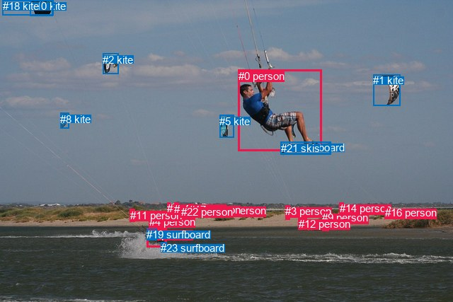
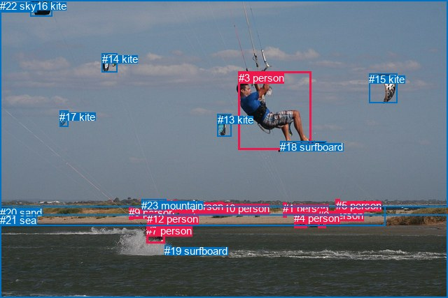

# 图片 1442：2383041.jpg

随机样本序号：144。图片 SHA256：`dd176904794ace8e9b688f97eae16bcfe3c1e898d6c1ebc7d2fe96b0997b5ef2`。

红色框表示人，蓝色框表示其他物体。两个模式分别保留自身框编号，可依据位置比较对应对象。

## 自动检测框与输出

人的框编号：`[0, 3, 4, 6, 7, 9, 11, 12, 13, 14, 15, 16, 17, 22]`。状态：`ok`。

### 自动检测全部物体框

| 编号 | 类别 | 是否为人 | 检测分数 | 像素坐标 xyxy |
|---|---|---|---|---|
| 0 | person | True | 0.9995 | 337.0, 98.8, 454.1, 213.5 |
| 1 | kite | False | 0.9988 | 527.2, 105.3, 565.4, 149.4 |
| 2 | kite | False | 0.9944 | 145.4, 75.9, 168.0, 104.6 |
| 3 | person | True | 0.9909 | 403.1, 290.5, 409.6, 310.9 |
| 4 | person | True | 0.9899 | 210.8, 305.0, 225.4, 331.9 |
| 5 | kite | False | 0.9888 | 310.2, 162.6, 330.9, 194.7 |
| 6 | person | True | 0.9872 | 310.8, 289.2, 318.4, 305.1 |
| 7 | person | True | 0.9860 | 207.8, 322.9, 235.3, 349.3 |
| 8 | kite | False | 0.9854 | 85.3, 159.7, 97.3, 181.2 |
| 9 | person | True | 0.9837 | 455.4, 299.4, 464.6, 326.1 |
| 10 | kite | False | 0.9723 | 42.4, 0.3, 74.3, 22.2 |
| 11 | person | True | 0.9649 | 183.9, 295.8, 190.4, 313.8 |
| 12 | person | True | 0.9390 | 421.7, 307.9, 433.6, 324.1 |
| 13 | person | True | 0.9076 | 236.4, 286.0, 241.0, 296.5 |
| 14 | person | True | 0.8948 | 479.5, 286.3, 485.8, 298.2 |
| 15 | person | True | 0.8557 | 246.4, 286.7, 252.3, 296.3 |
| 16 | person | True | 0.8246 | 543.7, 292.3, 547.3, 300.4 |
| 17 | person | True | 0.8210 | 266.8, 288.2, 272.4, 297.4 |
| 18 | kite | False | 0.7339 | 3.6, 0.1, 75.7, 21.9 |
| 19 | surfboard | False | 0.6455 | 207.1, 323.3, 221.4, 339.5 |
| 20 | surfboard | False | 0.6128 | 396.9, 200.4, 466.5, 218.0 |
| 21 | skis | False | 0.4422 | 396.7, 200.5, 467.5, 218.4 |
| 22 | person | True | 0.4382 | 256.0, 290.7, 261.7, 297.1 |
| 23 | surfboard | False | 0.3880 | 227.3, 342.4, 235.1, 349.6 |

### 自动检测 Top50 人相关候选

评分物体对：552；人相关物体对：462；输出关系：50。

| 排名 | 主语编号与类别 | 关系 | 宾语编号与类别 | 类型 | 人与人 | 排序分数 | 原始融合 logit |
|---|---|---|---|---|---|---|---|
| 1 | #4 person | riding | #19 surfboard | semantic | False | 0.98692 | 4.3238 |
| 2 | #4 person | riding | #7 person | semantic | True | 0.98686 | 4.3188 |
| 3 | #0 person | riding | #21 skis | semantic | False | 0.97832 | 3.8094 |
| 4 | #0 person | riding | #20 surfboard | semantic | False | 0.97692 | 3.7455 |
| 5 | #0 person | on | #20 surfboard | spatial | False | 0.97122 | 3.5190 |
| 6 | #0 person | on | #21 skis | spatial | False | 0.97104 | 3.5124 |
| 7 | #19 surfboard | riding | #7 person | semantic | False | 0.96453 | 3.3030 |
| 8 | #4 person | on | #7 person | spatial | True | 0.94905 | 2.9246 |
| 9 | #7 person | pulling | #2 kite | semantic | False | 0.94648 | 2.8727 |
| 10 | #7 person | pulling | #5 kite | semantic | False | 0.94045 | 2.7595 |
| 11 | #4 person | on | #19 surfboard | spatial | False | 0.93865 | 2.7278 |
| 12 | #0 person | flying over | #1 kite | semantic | False | 0.91858 | 2.4232 |
| 13 | #19 surfboard | on | #7 person | spatial | False | 0.90335 | 2.2350 |
| 14 | #7 person | wearing | #19 surfboard | semantic | False | 0.90022 | 2.1997 |
| 15 | #4 person | pulling | #5 kite | semantic | False | 0.89944 | 2.1910 |
| 16 | #4 person | pulling | #2 kite | semantic | False | 0.88023 | 1.9946 |
| 17 | #0 person | flying over | #2 kite | semantic | False | 0.87538 | 1.9494 |
| 18 | #9 person | holding | #14 person | semantic | True | 0.87105 | 1.9102 |
| 19 | #7 person | on | #23 surfboard | spatial | False | 0.86603 | 1.8663 |
| 20 | #0 person | holding | #5 kite | semantic | False | 0.85664 | 1.7877 |
| 21 | #4 person | riding | #23 surfboard | semantic | False | 0.83646 | 1.6321 |
| 22 | #7 person | pulling | #10 kite | semantic | False | 0.83623 | 1.6304 |
| 23 | #7 person | pulling | #8 kite | semantic | False | 0.83458 | 1.6185 |
| 24 | #7 person | wearing | #23 surfboard | semantic | False | 0.81340 | 1.4723 |
| 25 | #7 person | in | #19 surfboard | spatial | False | 0.78179 | 1.2761 |
| 26 | #14 person | on | #16 person | spatial | True | 0.77522 | 1.2380 |
| 27 | #14 person | playing | #16 person | semantic | True | 0.77394 | 1.2307 |
| 28 | #0 person | flying over | #10 kite | semantic | False | 0.76995 | 1.2080 |
| 29 | #0 person | flying over | #8 kite | semantic | False | 0.75974 | 1.1512 |
| 30 | #4 person | on | #23 surfboard | spatial | False | 0.73735 | 1.0322 |
| 31 | #6 person | looking at | #0 person | semantic | True | 0.71193 | 0.9048 |
| 32 | #4 person | pulling | #8 kite | semantic | False | 0.71077 | 0.8991 |
| 33 | #23 surfboard | on | #7 person | spatial | False | 0.70911 | 0.8911 |
| 34 | #11 person | holding | #5 kite | semantic | False | 0.66897 | 0.7035 |
| 35 | #7 person | pulling | #1 kite | semantic | False | 0.64144 | 0.5816 |
| 36 | #4 person | holding | #1 kite | semantic | False | 0.60158 | 0.4121 |
| 37 | #4 person | pulling | #10 kite | semantic | False | 0.59891 | 0.4009 |
| 38 | #12 person | looking at | #0 person | semantic | True | 0.59647 | 0.3908 |
| 39 | #2 kite | pulling | #7 person | semantic | False | 0.59285 | 0.3758 |
| 40 | #3 person | looking at | #0 person | semantic | True | 0.57876 | 0.3177 |
| 41 | #9 person | in | #14 person | spatial | True | 0.55677 | 0.2281 |
| 42 | #9 person | looking at | #0 person | semantic | True | 0.54860 | 0.1950 |
| 43 | #0 person | flying over | #18 kite | semantic | False | 0.54059 | 0.1627 |
| 44 | #13 person | flying over | #5 kite | semantic | False | 0.50816 | 0.0326 |
| 45 | #15 person | standing on | #22 person | semantic | True | 0.50686 | 0.0274 |
| 46 | #11 person | flying over | #2 kite | semantic | False | 0.49509 | -0.0196 |
| 47 | #0 person | on | #5 kite | spatial | False | 0.49336 | -0.0266 |
| 48 | #17 person | looking at | #0 person | semantic | True | 0.48869 | -0.0453 |
| 49 | #15 person | flying over | #5 kite | semantic | False | 0.47848 | -0.0861 |
| 50 | #11 person | flying over | #8 kite | semantic | False | 0.46979 | -0.1210 |

### 自动检测逐条人相关 GT 核验

R@50：25.00%；命中 1/4。

| GT 主语编号 | GT 关系 | GT 宾语编号 | 结果阶段 | 匹配预测主语编号 | 匹配预测宾语编号 |
|---|---|---|---|---|---|
| 3 | on | 18 | hit50 | [0] | [20] |
| 3 | wearing | 18 | wrong_predicate | [0] | [20] |
| 3 | flying over | 21 | endpoint_missing_or_wrong_class | [0] | [] |
| 4 | pulling | 13 | endpoint_missing_or_wrong_class | [] | [5] |

## 真实框与输出

人的框编号：`[0, 1, 2, 3, 4, 5, 6, 7, 8, 9, 10, 11, 12]`。

### 真实框全部物体框

| 编号 | 类别 | 是否为人 | 检测分数 | 像素坐标 xyxy |
|---|---|---|---|---|
| 0 | person | True | GT | 256.0, 291.0, 261.0, 297.0 |
| 1 | person | True | GT | 404.0, 290.0, 409.0, 311.0 |
| 2 | person | True | GT | 454.0, 300.0, 465.0, 327.0 |
| 3 | person | True | GT | 341.0, 103.0, 445.0, 215.0 |
| 4 | person | True | GT | 420.0, 304.0, 438.0, 327.0 |
| 5 | person | True | GT | 480.0, 286.0, 486.0, 299.0 |
| 6 | person | True | GT | 235.0, 287.0, 242.0, 296.0 |
| 7 | person | True | GT | 209.0, 322.0, 235.0, 349.0 |
| 8 | person | True | GT | 267.0, 288.0, 272.0, 298.0 |
| 9 | person | True | GT | 184.0, 296.0, 190.0, 314.0 |
| 10 | person | True | GT | 312.0, 290.0, 318.0, 306.0 |
| 11 | person | True | GT | 246.0, 287.0, 253.0, 296.0 |
| 12 | person | True | GT | 210.0, 305.0, 225.0, 330.0 |
| 13 | kite | False | GT | 311.0, 163.0, 331.0, 195.0 |
| 14 | kite | False | GT | 146.0, 76.0, 168.0, 103.0 |
| 15 | kite | False | GT | 527.0, 105.0, 567.0, 147.0 |
| 16 | kite | False | GT | 44.0, 0.0, 75.0, 23.0 |
| 17 | kite | False | GT | 85.0, 159.0, 97.0, 182.0 |
| 18 | surfboard | False | GT | 400.0, 202.0, 465.0, 215.0 |
| 19 | surfboard | False | GT | 235.0, 351.0, 244.0, 356.0 |
| 20 | sand | False | GT | 0.0, 296.0, 551.0, 324.0 |
| 21 | sea | False | GT | 0.0, 307.0, 640.0, 427.0 |
| 22 | sky | False | GT | 0.0, 0.0, 640.0, 297.0 |
| 23 | mountain | False | GT | 202.0, 286.0, 237.0, 301.0 |

### 真实框 Top50 人相关候选

评分物体对：552；人相关物体对：442；输出关系：50。

| 排名 | 主语编号与类别 | 关系 | 宾语编号与类别 | 类型 | 人与人 | 排序分数 | 原始融合 logit |
|---|---|---|---|---|---|---|---|
| 1 | #12 person | riding | #7 person | semantic | True | 0.99393 | 5.0981 |
| 2 | #10 person | standing on | #20 sand | semantic | False | 0.98601 | 4.2554 |
| 3 | #3 person | riding | #18 surfboard | semantic | False | 0.98436 | 4.1421 |
| 4 | #5 person | on | #20 sand | spatial | False | 0.97860 | 3.8228 |
| 5 | #8 person | standing on | #20 sand | semantic | False | 0.97598 | 3.7045 |
| 6 | #7 person | in | #21 sea | spatial | False | 0.97373 | 3.6129 |
| 7 | #12 person | riding | #21 sea | semantic | False | 0.96777 | 3.4021 |
| 8 | #0 person | standing on | #20 sand | semantic | False | 0.96767 | 3.3990 |
| 9 | #3 person | on | #18 surfboard | spatial | False | 0.96558 | 3.3342 |
| 10 | #4 person | standing on | #20 sand | semantic | False | 0.96524 | 3.3240 |
| 11 | #7 person | pulling | #14 kite | semantic | False | 0.96252 | 3.2457 |
| 12 | #12 person | on | #7 person | spatial | True | 0.96116 | 3.2086 |
| 13 | #7 person | pulling | #13 kite | semantic | False | 0.96010 | 3.1806 |
| 14 | #1 person | standing on | #20 sand | semantic | False | 0.95558 | 3.0685 |
| 15 | #7 person | riding | #21 sea | semantic | False | 0.95367 | 3.0245 |
| 16 | #2 person | standing on | #21 sea | semantic | False | 0.95330 | 3.0162 |
| 17 | #4 person | in | #21 sea | spatial | False | 0.95252 | 2.9987 |
| 18 | #3 person | in | #22 sky | spatial | False | 0.95237 | 2.9955 |
| 19 | #1 person | standing on | #21 sea | semantic | False | 0.95174 | 2.9816 |
| 20 | #4 person | standing on | #21 sea | semantic | False | 0.95132 | 2.9727 |
| 21 | #2 person | standing on | #20 sand | semantic | False | 0.94696 | 2.8823 |
| 22 | #5 person | beside | #21 sea | spatial | False | 0.94646 | 2.8723 |
| 23 | #2 person | on | #21 sea | spatial | False | 0.94504 | 2.8446 |
| 24 | #7 person | pulling | #19 surfboard | semantic | False | 0.93895 | 2.7330 |
| 25 | #3 person | holding | #13 kite | semantic | False | 0.93829 | 2.7217 |
| 26 | #12 person | riding | #19 surfboard | semantic | False | 0.93807 | 2.7178 |
| 27 | #5 person | standing on | #20 sand | semantic | False | 0.93528 | 2.6707 |
| 28 | #9 person | standing on | #20 sand | semantic | False | 0.93331 | 2.6386 |
| 29 | #12 person | pulling | #13 kite | semantic | False | 0.92978 | 2.5833 |
| 30 | #12 person | in | #21 sea | spatial | False | 0.92845 | 2.5632 |
| 31 | #11 person | standing on | #20 sand | semantic | False | 0.92707 | 2.5426 |
| 32 | #8 person | on | #20 sand | spatial | False | 0.92659 | 2.5354 |
| 33 | #3 person | flying over | #14 kite | semantic | False | 0.92309 | 2.4851 |
| 34 | #3 person | holding | #15 kite | semantic | False | 0.92248 | 2.4766 |
| 35 | #8 person | beside | #21 sea | spatial | False | 0.92238 | 2.4751 |
| 36 | #12 person | pulling | #14 kite | semantic | False | 0.91748 | 2.4085 |
| 37 | #6 person | standing on | #20 sand | semantic | False | 0.91658 | 2.3967 |
| 38 | #7 person | pulling | #17 kite | semantic | False | 0.90975 | 2.3105 |
| 39 | #10 person | on | #20 sand | spatial | False | 0.90479 | 2.2516 |
| 40 | #7 person | on | #19 surfboard | spatial | False | 0.88393 | 2.0302 |
| 41 | #4 person | on | #20 sand | spatial | False | 0.88047 | 1.9968 |
| 42 | #8 person | looking at | #21 sea | semantic | False | 0.88041 | 1.9963 |
| 43 | #0 person | on | #20 sand | spatial | False | 0.87776 | 1.9714 |
| 44 | #9 person | on | #21 sea | spatial | False | 0.87691 | 1.9635 |
| 45 | #9 person | standing on | #21 sea | semantic | False | 0.87534 | 1.9490 |
| 46 | #3 person | pulling | #17 kite | semantic | False | 0.86975 | 1.8988 |
| 47 | #10 person | beside | #21 sea | spatial | False | 0.86932 | 1.8950 |
| 48 | #10 person | looking at | #21 sea | semantic | False | 0.86642 | 1.8696 |
| 49 | #3 person | flying over | #22 sky | semantic | False | 0.85963 | 1.8122 |
| 50 | #0 person | beside | #21 sea | spatial | False | 0.85871 | 1.8046 |

### 真实框逐条人相关 GT 核验

R@50：25.00%；命中 1/4。

| GT 主语编号 | GT 关系 | GT 宾语编号 | 结果阶段 | 匹配预测主语编号 | 匹配预测宾语编号 |
|---|---|---|---|---|---|
| 3 | on | 18 | hit50 | [3] | [18] |
| 3 | wearing | 18 | wrong_predicate | [3] | [18] |
| 3 | flying over | 21 | rank_below50 | [3] | [21] |
| 4 | pulling | 13 | wrong_predicate | [4] | [13] |

## 全部人相关 GT

| 主语编号与类别 | 关系 | 宾语编号与类别 |
|---|---|---|
| #3 person | on | #18 surfboard |
| #3 person | wearing | #18 surfboard |
| #3 person | flying over | #21 sea |
| #4 person | pulling | #13 kite |

原始记录、全部人相关物体对的两项预测与分项分数见 [逐图证据 JSON](../evidence/cases/1442.json)。全部56类 logits 保留于本机 HOR/output/random500/logits/。

<!-- HOR_COMPLETE_RESULTS -->

## 六组条件的完整输出对照

以下保留同一图片三种框与候选模式、两种谓词输出规则的全部 Top50。框编号各自在所属模式内解释。

### 自动检测框完整枚举：空间与语义各保留一个谓词

| 排名 | 主语编号与类别 | 谓词 | 宾语编号与类别 | 分组 | 排序分数 | predicate logit | pair logit |
|---|---|---|---|---|---|---|---|
| 1 | #4 person | riding | #19 surfboard | semantic | 0.9869233 | 4.5456023 | -0.2218428 |
| 2 | #4 person | riding | #7 person | semantic | 0.9868590 | 4.4871297 | -0.1683455 |
| 3 | #0 person | riding | #21 skis | semantic | 0.9783199 | 3.5887914 | 0.2206528 |
| 4 | #0 person | riding | #20 surfboard | semantic | 0.9769209 | 3.5290971 | 0.2163804 |
| 5 | #0 person | on | #20 surfboard | spatial | 0.9712247 | 3.3026633 | 0.2163804 |
| 6 | #0 person | on | #21 skis | spatial | 0.9710392 | 3.2917733 | 0.2206528 |
| 7 | #19 surfboard | riding | #7 person | semantic | 0.9645311 | 3.7118440 | -0.4088582 |
| 8 | #4 person | on | #7 person | spatial | 0.9490480 | 3.0929217 | -0.1683455 |
| 9 | #7 person | pulling | #2 kite | semantic | 0.9464827 | 3.2460227 | -0.3732754 |
| 10 | #7 person | pulling | #5 kite | semantic | 0.9404480 | 2.8850336 | -0.1255281 |
| 11 | #4 person | on | #19 surfboard | spatial | 0.9386459 | 2.9496188 | -0.2218428 |
| 12 | #0 person | flying over | #1 kite | semantic | 0.9185779 | 2.6639323 | -0.2407521 |
| 13 | #19 surfboard | on | #7 person | spatial | 0.9033473 | 2.6438413 | -0.4088582 |
| 14 | #7 person | wearing | #19 surfboard | semantic | 0.9002211 | 2.8054032 | -0.6057194 |
| 15 | #4 person | pulling | #5 kite | semantic | 0.8994403 | 2.2232022 | -0.0321803 |
| 16 | #4 person | pulling | #2 kite | semantic | 0.8802338 | 2.1329255 | -0.1382791 |
| 17 | #0 person | flying over | #2 kite | semantic | 0.8753797 | 2.0630898 | -0.1137030 |
| 18 | #9 person | holding | #14 person | semantic | 0.8710458 | 2.1340141 | -0.2237769 |
| 19 | #7 person | on | #23 surfboard | spatial | 0.8660299 | 2.1803961 | -0.3140933 |
| 20 | #0 person | holding | #5 kite | semantic | 0.8566448 | 1.6979656 | 0.0897324 |
| 21 | #4 person | riding | #23 surfboard | semantic | 0.8364608 | 1.6113210 | 0.0208055 |
| 22 | #7 person | pulling | #10 kite | semantic | 0.8362286 | 2.4035640 | -0.7731336 |
| 23 | #7 person | pulling | #8 kite | semantic | 0.8345832 | 2.2531624 | -0.6346978 |
| 24 | #7 person | wearing | #23 surfboard | semantic | 0.8134037 | 1.7863736 | -0.3140933 |
| 25 | #7 person | in | #19 surfboard | spatial | 0.7817931 | 1.8818655 | -0.6057194 |
| 26 | #14 person | on | #16 person | spatial | 0.7752235 | 1.1741786 | 0.0638660 |
| 27 | #14 person | playing | #16 person | semantic | 0.7739375 | 1.1668134 | 0.0638660 |
| 28 | #0 person | flying over | #10 kite | semantic | 0.7699513 | 1.4324489 | -0.2244125 |
| 29 | #0 person | flying over | #8 kite | semantic | 0.7597383 | 1.5229530 | -0.3717078 |
| 30 | #4 person | on | #23 surfboard | spatial | 0.7373514 | 1.0114417 | 0.0208055 |
| 31 | #6 person | looking at | #0 person | semantic | 0.7119260 | 1.9183211 | -1.0135643 |
| 32 | #4 person | pulling | #8 kite | semantic | 0.7107694 | 1.4108119 | -0.5116880 |
| 33 | #23 surfboard | on | #7 person | spatial | 0.7091084 | 1.6728702 | -0.7818124 |
| 34 | #11 person | holding | #5 kite | semantic | 0.6689728 | 1.1540675 | -0.4505245 |
| 35 | #7 person | pulling | #1 kite | semantic | 0.6414440 | 1.0797925 | -0.4981557 |
| 36 | #4 person | holding | #1 kite | semantic | 0.6015832 | 0.7837353 | -0.3716689 |
| 37 | #4 person | pulling | #10 kite | semantic | 0.5989078 | 1.1700754 | -0.7691593 |
| 38 | #12 person | looking at | #0 person | semantic | 0.5964695 | 1.2690816 | -0.8783058 |
| 39 | #2 kite | pulling | #7 person | semantic | 0.5928512 | 1.7113466 | -1.3355818 |
| 40 | #3 person | looking at | #0 person | semantic | 0.5787572 | 1.2018180 | -0.8841442 |
| 41 | #9 person | in | #14 person | spatial | 0.5567731 | 0.4518528 | -0.2237769 |
| 42 | #9 person | looking at | #0 person | semantic | 0.5486034 | 1.0899291 | -0.8948998 |
| 43 | #0 person | flying over | #18 kite | semantic | 0.5405920 | 0.7703333 | -0.6076074 |
| 44 | #13 person | flying over | #5 kite | semantic | 0.5081573 | 0.3813281 | -0.3486959 |
| 45 | #15 person | standing on | #22 person | semantic | 0.5068598 | 0.1572080 | -0.1297670 |
| 46 | #11 person | flying over | #2 kite | semantic | 0.4950897 | 0.1999512 | -0.2195930 |
| 47 | #0 person | on | #5 kite | spatial | 0.4933587 | -0.1162992 | 0.0897324 |
| 48 | #17 person | looking at | #0 person | semantic | 0.4886884 | 1.0715823 | -1.1168363 |
| 49 | #15 person | flying over | #5 kite | semantic | 0.4784801 | 0.3212075 | -0.4073403 |
| 50 | #11 person | flying over | #8 kite | semantic | 0.4697943 | 0.3804069 | -0.5013767 |

GT 命中：1/4，R@50=25.00%。

| GT主语 | GT谓词 | GT宾语 | 结果阶段 | 匹配主语框 | 匹配宾语框 |
|---|---|---|---|---|---|
| 3 | on | 18 | hit50 | [0] | [20] |
| 3 | wearing | 18 | wrong_predicate | [0] | [20] |
| 3 | flying over | 21 | endpoint_missing_or_wrong_class | [0] | [] |
| 4 | pulling | 13 | endpoint_missing_or_wrong_class | [] | [5] |

### 自动检测框完整枚举：每对只保留一个谓词

| 排名 | 主语编号与类别 | 谓词 | 宾语编号与类别 | 分组 | 排序分数 | predicate logit | pair logit |
|---|---|---|---|---|---|---|---|
| 1 | #4 person | riding | #19 surfboard | single | 0.9869233 | 4.5456023 | -0.2218428 |
| 2 | #4 person | riding | #7 person | single | 0.9868590 | 4.4871297 | -0.1683455 |
| 3 | #0 person | riding | #21 skis | single | 0.9783199 | 3.5887914 | 0.2206528 |
| 4 | #0 person | riding | #20 surfboard | single | 0.9769209 | 3.5290971 | 0.2163804 |
| 5 | #19 surfboard | riding | #7 person | single | 0.9645311 | 3.7118440 | -0.4088582 |
| 6 | #7 person | pulling | #2 kite | single | 0.9464827 | 3.2460227 | -0.3732754 |
| 7 | #7 person | pulling | #5 kite | single | 0.9404480 | 2.8850336 | -0.1255281 |
| 8 | #0 person | flying over | #1 kite | single | 0.9185779 | 2.6639323 | -0.2407521 |
| 9 | #7 person | wearing | #19 surfboard | single | 0.9002211 | 2.8054032 | -0.6057194 |
| 10 | #4 person | pulling | #5 kite | single | 0.8994403 | 2.2232022 | -0.0321803 |
| 11 | #4 person | pulling | #2 kite | single | 0.8802338 | 2.1329255 | -0.1382791 |
| 12 | #0 person | flying over | #2 kite | single | 0.8753797 | 2.0630898 | -0.1137030 |
| 13 | #9 person | holding | #14 person | single | 0.8710458 | 2.1340141 | -0.2237769 |
| 14 | #7 person | on | #23 surfboard | single | 0.8660299 | 2.1803961 | -0.3140933 |
| 15 | #0 person | holding | #5 kite | single | 0.8566448 | 1.6979656 | 0.0897324 |
| 16 | #4 person | riding | #23 surfboard | single | 0.8364608 | 1.6113210 | 0.0208055 |
| 17 | #7 person | pulling | #10 kite | single | 0.8362286 | 2.4035640 | -0.7731336 |
| 18 | #7 person | pulling | #8 kite | single | 0.8345832 | 2.2531624 | -0.6346978 |
| 19 | #14 person | on | #16 person | single | 0.7752235 | 1.1741786 | 0.0638660 |
| 20 | #0 person | flying over | #10 kite | single | 0.7699513 | 1.4324489 | -0.2244125 |
| 21 | #0 person | flying over | #8 kite | single | 0.7597383 | 1.5229530 | -0.3717078 |
| 22 | #6 person | looking at | #0 person | single | 0.7119260 | 1.9183211 | -1.0135643 |
| 23 | #4 person | pulling | #8 kite | single | 0.7107694 | 1.4108119 | -0.5116880 |
| 24 | #23 surfboard | on | #7 person | single | 0.7091084 | 1.6728702 | -0.7818124 |
| 25 | #11 person | holding | #5 kite | single | 0.6689728 | 1.1540675 | -0.4505245 |
| 26 | #7 person | pulling | #1 kite | single | 0.6414440 | 1.0797925 | -0.4981557 |
| 27 | #4 person | holding | #1 kite | single | 0.6015832 | 0.7837353 | -0.3716689 |
| 28 | #4 person | pulling | #10 kite | single | 0.5989078 | 1.1700754 | -0.7691593 |
| 29 | #12 person | looking at | #0 person | single | 0.5964695 | 1.2690816 | -0.8783058 |
| 30 | #2 kite | pulling | #7 person | single | 0.5928512 | 1.7113466 | -1.3355818 |
| 31 | #3 person | looking at | #0 person | single | 0.5787572 | 1.2018180 | -0.8841442 |
| 32 | #9 person | looking at | #0 person | single | 0.5486034 | 1.0899291 | -0.8948998 |
| 33 | #0 person | flying over | #18 kite | single | 0.5405920 | 0.7703333 | -0.6076074 |
| 34 | #13 person | flying over | #5 kite | single | 0.5081573 | 0.3813281 | -0.3486959 |
| 35 | #15 person | standing on | #22 person | single | 0.5068598 | 0.1572080 | -0.1297670 |
| 36 | #11 person | flying over | #2 kite | single | 0.4950897 | 0.1999512 | -0.2195930 |
| 37 | #17 person | looking at | #0 person | single | 0.4886884 | 1.0715823 | -1.1168363 |
| 38 | #15 person | flying over | #5 kite | single | 0.4784801 | 0.3212075 | -0.4073403 |
| 39 | #11 person | flying over | #8 kite | single | 0.4697943 | 0.3804069 | -0.5013767 |
| 40 | #15 person | looking at | #0 person | single | 0.4654305 | 0.9256587 | -1.0641576 |
| 41 | #22 person | flying over | #5 kite | single | 0.4644534 | 0.2913003 | -0.4337270 |
| 42 | #13 person | looking at | #0 person | single | 0.4619700 | 0.8640819 | -1.0164964 |
| 43 | #7 person | pulling | #18 kite | single | 0.4493377 | 0.9894834 | -1.1928303 |
| 44 | #11 person | holding | #1 kite | single | 0.4478985 | 0.3729725 | -0.5821379 |
| 45 | #11 person | looking at | #0 person | single | 0.4441744 | 0.7523665 | -0.9766039 |
| 46 | #22 person | looking at | #0 person | single | 0.4416407 | 0.8640819 | -1.0985879 |
| 47 | #12 person | flying over | #2 kite | single | 0.4197842 | 0.2292595 | -0.5529188 |
| 48 | #17 person | flying over | #5 kite | single | 0.4191655 | 0.1710119 | -0.4972121 |
| 49 | #12 person | flying over | #8 kite | single | 0.4096107 | 0.1395464 | -0.5051215 |
| 50 | #4 person | looking at | #0 person | single | 0.4020640 | 0.4250236 | -0.8218960 |

GT 命中：0/4，R@50=0.00%。

| GT主语 | GT谓词 | GT宾语 | 结果阶段 | 匹配主语框 | 匹配宾语框 |
|---|---|---|---|---|---|
| 3 | on | 18 | wrong_predicate | [0] | [20] |
| 3 | wearing | 18 | wrong_predicate | [0] | [20] |
| 3 | flying over | 21 | endpoint_missing_or_wrong_class | [0] | [] |
| 4 | pulling | 13 | endpoint_missing_or_wrong_class | [] | [5] |

### 真实框完整枚举：空间与语义各保留一个谓词

| 排名 | 主语编号与类别 | 谓词 | 宾语编号与类别 | 分组 | 排序分数 | predicate logit | pair logit |
|---|---|---|---|---|---|---|---|
| 1 | #12 person | riding | #7 person | semantic | 0.9939286 | 5.2660813 | -0.1680158 |
| 2 | #10 person | standing on | #20 sand | semantic | 0.9860107 | 3.9995980 | 0.2557755 |
| 3 | #3 person | riding | #18 surfboard | semantic | 0.9843598 | 3.8848166 | 0.2573300 |
| 4 | #5 person | on | #20 sand | spatial | 0.9786019 | 3.3691592 | 0.4536667 |
| 5 | #8 person | standing on | #20 sand | semantic | 0.9759784 | 3.5489440 | 0.1555475 |
| 6 | #7 person | in | #21 sea | spatial | 0.9737349 | 3.6957583 | -0.0828632 |
| 7 | #12 person | riding | #21 sea | semantic | 0.9677685 | 3.5907464 | -0.1886951 |
| 8 | #0 person | standing on | #20 sand | semantic | 0.9676733 | 3.3477931 | 0.0512072 |
| 9 | #3 person | on | #18 surfboard | spatial | 0.9655820 | 3.0768204 | 0.2573300 |
| 10 | #4 person | standing on | #20 sand | semantic | 0.9652420 | 3.5195680 | -0.1956018 |
| 11 | #7 person | pulling | #14 kite | semantic | 0.9625176 | 3.6069760 | -0.3612965 |
| 12 | #12 person | on | #7 person | spatial | 0.9611572 | 3.3766303 | -0.1680158 |
| 13 | #7 person | pulling | #13 kite | semantic | 0.9600996 | 3.3061061 | -0.1254563 |
| 14 | #1 person | standing on | #20 sand | semantic | 0.9555761 | 2.9734387 | 0.0950980 |
| 15 | #7 person | riding | #21 sea | semantic | 0.9536674 | 3.1073313 | -0.0828632 |
| 16 | #2 person | standing on | #21 sea | semantic | 0.9532999 | 2.9497786 | 0.0664051 |
| 17 | #4 person | in | #21 sea | spatial | 0.9525172 | 2.8775272 | 0.1212131 |
| 18 | #3 person | in | #22 sky | spatial | 0.9523689 | 3.6962037 | -0.7007372 |
| 19 | #1 person | standing on | #21 sea | semantic | 0.9517380 | 2.8528752 | 0.1287701 |
| 20 | #4 person | standing on | #21 sea | semantic | 0.9513236 | 2.8514462 | 0.1212131 |
| 21 | #2 person | standing on | #20 sand | semantic | 0.9469621 | 3.0087309 | -0.1264783 |
| 22 | #5 person | beside | #21 sea | spatial | 0.9464580 | 2.7274685 | 0.1447922 |
| 23 | #2 person | on | #21 sea | spatial | 0.9450403 | 2.7782235 | 0.0664051 |
| 24 | #7 person | pulling | #19 surfboard | semantic | 0.9389465 | 2.9755249 | -0.2425163 |
| 25 | #3 person | holding | #13 kite | semantic | 0.9382938 | 2.5936961 | 0.1279812 |
| 26 | #12 person | riding | #19 surfboard | semantic | 0.9380707 | 2.6848316 | 0.0329999 |
| 27 | #5 person | standing on | #20 sand | semantic | 0.9352775 | 2.2170687 | 0.4536667 |
| 28 | #9 person | standing on | #20 sand | semantic | 0.9333069 | 2.8398142 | -0.2011826 |
| 29 | #12 person | pulling | #13 kite | semantic | 0.9297807 | 2.6443481 | -0.0610222 |
| 30 | #12 person | in | #21 sea | spatial | 0.9284530 | 2.7518606 | -0.1886951 |
| 31 | #11 person | standing on | #20 sand | semantic | 0.9270739 | 2.5199265 | 0.0226607 |
| 32 | #8 person | on | #20 sand | spatial | 0.9265887 | 2.3798838 | 0.1555475 |
| 33 | #3 person | flying over | #14 kite | semantic | 0.9230939 | 2.6040106 | -0.1188662 |
| 34 | #3 person | holding | #15 kite | semantic | 0.9224831 | 2.7398911 | -0.2633186 |
| 35 | #8 person | beside | #21 sea | spatial | 0.9223801 | 2.3900461 | 0.0850880 |
| 36 | #12 person | pulling | #14 kite | semantic | 0.9174765 | 2.5541320 | -0.1455883 |
| 37 | #6 person | standing on | #20 sand | semantic | 0.9165787 | 2.4832053 | -0.0864609 |
| 38 | #7 person | pulling | #17 kite | semantic | 0.9097470 | 2.9450974 | -0.6345479 |
| 39 | #10 person | on | #20 sand | spatial | 0.9047907 | 1.9958510 | 0.2557755 |
| 40 | #7 person | on | #19 surfboard | spatial | 0.8839266 | 2.2726679 | -0.2425163 |
| 41 | #4 person | on | #20 sand | spatial | 0.8804651 | 2.1924438 | -0.1956018 |
| 42 | #8 person | looking at | #21 sea | semantic | 0.8804110 | 1.9112401 | 0.0850880 |
| 43 | #0 person | on | #20 sand | spatial | 0.8777626 | 1.9202032 | 0.0512072 |
| 44 | #9 person | on | #21 sea | spatial | 0.8769137 | 2.0497203 | -0.0861976 |
| 45 | #9 person | standing on | #21 sea | semantic | 0.8753391 | 2.0352111 | -0.0861976 |
| 46 | #3 person | pulling | #17 kite | semantic | 0.8697540 | 2.2830515 | -0.3842666 |
| 47 | #10 person | beside | #21 sea | spatial | 0.8693234 | 1.7588239 | 0.1361653 |
| 48 | #10 person | looking at | #21 sea | semantic | 0.8664173 | 1.7334814 | 0.1361653 |
| 49 | #3 person | flying over | #22 sky | semantic | 0.8596296 | 2.5129542 | -0.7007372 |
| 50 | #0 person | beside | #21 sea | spatial | 0.8587128 | 1.7575521 | 0.0470873 |

GT 命中：1/4，R@50=25.00%。

| GT主语 | GT谓词 | GT宾语 | 结果阶段 | 匹配主语框 | 匹配宾语框 |
|---|---|---|---|---|---|
| 3 | on | 18 | hit50 | [3] | [18] |
| 3 | wearing | 18 | wrong_predicate | [3] | [18] |
| 3 | flying over | 21 | rank_below50 | [3] | [21] |
| 4 | pulling | 13 | wrong_predicate | [4] | [13] |

### 真实框完整枚举：每对只保留一个谓词

| 排名 | 主语编号与类别 | 谓词 | 宾语编号与类别 | 分组 | 排序分数 | predicate logit | pair logit |
|---|---|---|---|---|---|---|---|
| 1 | #12 person | riding | #7 person | single | 0.9939286 | 5.2660813 | -0.1680158 |
| 2 | #10 person | standing on | #20 sand | single | 0.9860107 | 3.9995980 | 0.2557755 |
| 3 | #3 person | riding | #18 surfboard | single | 0.9843598 | 3.8848166 | 0.2573300 |
| 4 | #5 person | on | #20 sand | single | 0.9786019 | 3.3691592 | 0.4536667 |
| 5 | #8 person | standing on | #20 sand | single | 0.9759784 | 3.5489440 | 0.1555475 |
| 6 | #7 person | in | #21 sea | single | 0.9737349 | 3.6957583 | -0.0828632 |
| 7 | #12 person | riding | #21 sea | single | 0.9677685 | 3.5907464 | -0.1886951 |
| 8 | #0 person | standing on | #20 sand | single | 0.9676733 | 3.3477931 | 0.0512072 |
| 9 | #4 person | standing on | #20 sand | single | 0.9652420 | 3.5195680 | -0.1956018 |
| 10 | #7 person | pulling | #14 kite | single | 0.9625176 | 3.6069760 | -0.3612965 |
| 11 | #7 person | pulling | #13 kite | single | 0.9600996 | 3.3061061 | -0.1254563 |
| 12 | #1 person | standing on | #20 sand | single | 0.9555761 | 2.9734387 | 0.0950980 |
| 13 | #2 person | standing on | #21 sea | single | 0.9532999 | 2.9497786 | 0.0664051 |
| 14 | #4 person | in | #21 sea | single | 0.9525172 | 2.8775272 | 0.1212131 |
| 15 | #3 person | in | #22 sky | single | 0.9523689 | 3.6962037 | -0.7007372 |
| 16 | #1 person | standing on | #21 sea | single | 0.9517380 | 2.8528752 | 0.1287701 |
| 17 | #2 person | standing on | #20 sand | single | 0.9469621 | 3.0087309 | -0.1264783 |
| 18 | #5 person | beside | #21 sea | single | 0.9464580 | 2.7274685 | 0.1447922 |
| 19 | #7 person | pulling | #19 surfboard | single | 0.9389465 | 2.9755249 | -0.2425163 |
| 20 | #3 person | holding | #13 kite | single | 0.9382938 | 2.5936961 | 0.1279812 |
| 21 | #12 person | riding | #19 surfboard | single | 0.9380707 | 2.6848316 | 0.0329999 |
| 22 | #9 person | standing on | #20 sand | single | 0.9333069 | 2.8398142 | -0.2011826 |
| 23 | #12 person | pulling | #13 kite | single | 0.9297807 | 2.6443481 | -0.0610222 |
| 24 | #11 person | standing on | #20 sand | single | 0.9270739 | 2.5199265 | 0.0226607 |
| 25 | #3 person | flying over | #14 kite | single | 0.9230939 | 2.6040106 | -0.1188662 |
| 26 | #3 person | holding | #15 kite | single | 0.9224831 | 2.7398911 | -0.2633186 |
| 27 | #8 person | beside | #21 sea | single | 0.9223801 | 2.3900461 | 0.0850880 |
| 28 | #12 person | pulling | #14 kite | single | 0.9174765 | 2.5541320 | -0.1455883 |
| 29 | #6 person | standing on | #20 sand | single | 0.9165787 | 2.4832053 | -0.0864609 |
| 30 | #7 person | pulling | #17 kite | single | 0.9097470 | 2.9450974 | -0.6345479 |
| 31 | #9 person | on | #21 sea | single | 0.8769137 | 2.0497203 | -0.0861976 |
| 32 | #3 person | pulling | #17 kite | single | 0.8697540 | 2.2830515 | -0.3842666 |
| 33 | #10 person | beside | #21 sea | single | 0.8693234 | 1.7588239 | 0.1361653 |
| 34 | #0 person | beside | #21 sea | single | 0.8587128 | 1.7575521 | 0.0470873 |
| 35 | #11 person | beside | #21 sea | single | 0.8565152 | 1.7273450 | 0.0592978 |
| 36 | #3 person | flying over | #16 kite | single | 0.8551378 | 2.0329680 | -0.2574888 |
| 37 | #3 person | over | #21 sea | single | 0.8370405 | 2.0452271 | -0.4088567 |
| 38 | #12 person | pulling | #17 kite | single | 0.8288072 | 2.1027923 | -0.5255952 |
| 39 | #7 person | pulling | #16 kite | single | 0.8206083 | 2.3131967 | -0.7927222 |
| 40 | #6 person | beside | #21 sea | single | 0.8165324 | 1.4560037 | 0.0370251 |
| 41 | #4 person | looking at | #3 person | single | 0.8091123 | 2.2732491 | -0.8289971 |
| 42 | #7 person | pulling | #15 kite | single | 0.7596465 | 1.6513085 | -0.5005660 |
| 43 | #14 kite | pulling | #7 person | single | 0.7313126 | 2.3429494 | -1.3416567 |
| 44 | #2 person | looking at | #3 person | single | 0.7255625 | 1.8253670 | -0.8531433 |
| 45 | #1 person | looking at | #3 person | single | 0.7071065 | 1.7234797 | -0.8421075 |
| 46 | #10 person | looking at | #3 person | single | 0.7067361 | 1.8588357 | -0.9792516 |
| 47 | #6 person | standing on | #23 mountain | single | 0.6824288 | 0.8360472 | -0.0710908 |
| 48 | #12 person | on | #20 sand | single | 0.6331481 | 1.4986362 | -0.9528903 |
| 49 | #7 person | on | #20 sand | single | 0.5852813 | 1.4923224 | -1.1478305 |
| 50 | #9 person | holding | #13 kite | single | 0.5599980 | 0.6934667 | -0.4523130 |

GT 命中：0/4，R@50=0.00%。

| GT主语 | GT谓词 | GT宾语 | 结果阶段 | 匹配主语框 | 匹配宾语框 |
|---|---|---|---|---|---|
| 3 | on | 18 | wrong_predicate | [3] | [18] |
| 3 | wearing | 18 | wrong_predicate | [3] | [18] |
| 3 | flying over | 21 | wrong_predicate | [3] | [21] |
| 4 | pulling | 13 | wrong_predicate | [4] | [13] |

### 真实框400候选：空间与语义各保留一个谓词

| 排名 | 主语编号与类别 | 谓词 | 宾语编号与类别 | 分组 | 排序分数 | predicate logit | pair logit |
|---|---|---|---|---|---|---|---|
| 1 | #12 person | riding | #7 person | semantic | 0.9939315 | 5.2665706 | -0.1680158 |
| 2 | #10 person | standing on | #20 sand | semantic | 0.9858066 | 3.9849095 | 0.2557755 |
| 3 | #3 person | riding | #18 surfboard | semantic | 0.9852386 | 3.9435334 | 0.2573300 |
| 4 | #7 person | in | #21 sea | spatial | 0.9733932 | 3.6824841 | -0.0828632 |
| 5 | #12 person | riding | #21 sea | semantic | 0.9728972 | 3.7693381 | -0.1886951 |
| 6 | #4 person | standing on | #20 sand | semantic | 0.9718776 | 3.7382646 | -0.1956018 |
| 7 | #5 person | on | #20 sand | spatial | 0.9701815 | 3.0286851 | 0.4536667 |
| 8 | #7 person | pulling | #13 kite | semantic | 0.9683661 | 3.5468364 | -0.1254563 |
| 9 | #3 person | on | #18 surfboard | spatial | 0.9629361 | 3.0000134 | 0.2573300 |
| 10 | #12 person | on | #7 person | spatial | 0.9609643 | 3.3714757 | -0.1680158 |
| 11 | #1 person | standing on | #20 sand | semantic | 0.9595683 | 3.0717711 | 0.0950980 |
| 12 | #2 person | standing on | #21 sea | semantic | 0.9587240 | 3.0789165 | 0.0664051 |
| 13 | #7 person | riding | #21 sea | semantic | 0.9586369 | 3.2259860 | -0.0828632 |
| 14 | #7 person | pulling | #14 kite | semantic | 0.9579267 | 3.4866538 | -0.3612965 |
| 15 | #2 person | standing on | #20 sand | semantic | 0.9578308 | 3.2494612 | -0.1264783 |
| 16 | #4 person | standing on | #21 sea | semantic | 0.9575677 | 2.9952726 | 0.1212131 |
| 17 | #1 person | standing on | #21 sea | semantic | 0.9573354 | 2.9820137 | 0.1287701 |
| 18 | #7 person | pulling | #19 surfboard | semantic | 0.9553812 | 3.3064713 | -0.2425163 |
| 19 | #3 person | in | #22 sky | spatial | 0.9538715 | 3.7298360 | -0.7007372 |
| 20 | #3 person | holding | #13 kite | semantic | 0.9504308 | 2.8255634 | 0.1279812 |
| 21 | #4 person | in | #21 sea | spatial | 0.9484150 | 2.7903500 | 0.1212131 |
| 22 | #5 person | beside | #21 sea | spatial | 0.9464698 | 2.7276998 | 0.1447922 |
| 23 | #5 person | lying on | #20 sand | semantic | 0.9453744 | 2.3974128 | 0.4536667 |
| 24 | #9 person | standing on | #20 sand | semantic | 0.9391729 | 2.9381471 | -0.2011826 |
| 25 | #3 person | holding | #15 kite | semantic | 0.9382114 | 2.9835753 | -0.2633186 |
| 26 | #2 person | on | #21 sea | spatial | 0.9371389 | 2.6355004 | 0.0664051 |
| 27 | #12 person | pulling | #13 kite | semantic | 0.9317220 | 2.6744685 | -0.0610222 |
| 28 | #12 person | in | #21 sea | spatial | 0.9248134 | 2.6983151 | -0.1886951 |
| 29 | #3 person | holding | #14 kite | semantic | 0.9236957 | 2.6125193 | -0.1188662 |
| 30 | #12 person | pulling | #14 kite | semantic | 0.9151714 | 2.5240664 | -0.1455883 |
| 31 | #12 person | riding | #19 surfboard | semantic | 0.9009212 | 2.1745024 | 0.0329999 |
| 32 | #8 person | beside | #21 sea | spatial | 0.8950376 | 2.0581751 | 0.0850880 |
| 33 | #3 person | pulling | #17 kite | semantic | 0.8918173 | 2.4937057 | -0.3842666 |
| 34 | #9 person | standing on | #21 sea | semantic | 0.8770872 | 2.0513287 | -0.0861976 |
| 35 | #4 person | on | #20 sand | spatial | 0.8763011 | 2.1534610 | -0.1956018 |
| 36 | #3 person | flying over | #22 sky | semantic | 0.8701645 | 2.6031508 | -0.7007372 |
| 37 | #10 person | looking at | #21 sea | semantic | 0.8700985 | 1.7656651 | 0.1361653 |
| 38 | #9 person | on | #21 sea | spatial | 0.8606620 | 1.9069972 | -0.0861976 |
| 39 | #10 person | on | #20 sand | spatial | 0.8600523 | 1.5599489 | 0.2557755 |
| 40 | #10 person | beside | #21 sea | spatial | 0.8587220 | 1.6685505 | 0.1361653 |
| 41 | #7 person | pulling | #17 kite | semantic | 0.8543325 | 2.4035416 | -0.6345479 |
| 42 | #7 person | on | #19 surfboard | spatial | 0.8541642 | 2.0101590 | -0.2425163 |
| 43 | #8 person | looking at | #21 sea | semantic | 0.8494620 | 1.6452994 | 0.0850880 |
| 44 | #3 person | over | #21 sea | spatial | 0.8450839 | 2.1054091 | -0.4088567 |
| 45 | #3 person | flying over | #16 kite | semantic | 0.8436352 | 1.9430170 | -0.2574888 |
| 46 | #3 person | flying over | #21 sea | semantic | 0.8403997 | 2.0700622 | -0.4088567 |
| 47 | #1 person | on | #21 sea | spatial | 0.8363222 | 1.5023441 | 0.1287701 |
| 48 | #4 person | looking at | #3 person | semantic | 0.8227185 | 2.3638721 | -0.8289971 |
| 49 | #2 person | on | #20 sand | spatial | 0.8223069 | 1.6585345 | -0.1264783 |
| 50 | #12 person | pulling | #17 kite | semantic | 0.8016603 | 1.9222989 | -0.5255952 |

GT 命中：2/4，R@50=50.00%。

| GT主语 | GT谓词 | GT宾语 | 结果阶段 | 匹配主语框 | 匹配宾语框 |
|---|---|---|---|---|---|
| 3 | on | 18 | hit50 | [3] | [18] |
| 3 | wearing | 18 | wrong_predicate | [3] | [18] |
| 3 | flying over | 21 | hit50 | [3] | [21] |
| 4 | pulling | 13 | wrong_predicate | [4] | [13] |

### 真实框400候选：每对只保留一个谓词

| 排名 | 主语编号与类别 | 谓词 | 宾语编号与类别 | 分组 | 排序分数 | predicate logit | pair logit |
|---|---|---|---|---|---|---|---|
| 1 | #12 person | riding | #7 person | single | 0.9939315 | 5.2665706 | -0.1680158 |
| 2 | #10 person | standing on | #20 sand | single | 0.9858066 | 3.9849095 | 0.2557755 |
| 3 | #3 person | riding | #18 surfboard | single | 0.9852386 | 3.9435334 | 0.2573300 |
| 4 | #7 person | in | #21 sea | single | 0.9733932 | 3.6824841 | -0.0828632 |
| 5 | #12 person | riding | #21 sea | single | 0.9728972 | 3.7693381 | -0.1886951 |
| 6 | #4 person | standing on | #20 sand | single | 0.9718776 | 3.7382646 | -0.1956018 |
| 7 | #5 person | on | #20 sand | single | 0.9701815 | 3.0286851 | 0.4536667 |
| 8 | #7 person | pulling | #13 kite | single | 0.9683661 | 3.5468364 | -0.1254563 |
| 9 | #1 person | standing on | #20 sand | single | 0.9595683 | 3.0717711 | 0.0950980 |
| 10 | #2 person | standing on | #21 sea | single | 0.9587240 | 3.0789165 | 0.0664051 |
| 11 | #7 person | pulling | #14 kite | single | 0.9579267 | 3.4866538 | -0.3612965 |
| 12 | #2 person | standing on | #20 sand | single | 0.9578308 | 3.2494612 | -0.1264783 |
| 13 | #4 person | standing on | #21 sea | single | 0.9575677 | 2.9952726 | 0.1212131 |
| 14 | #1 person | standing on | #21 sea | single | 0.9573354 | 2.9820137 | 0.1287701 |
| 15 | #7 person | pulling | #19 surfboard | single | 0.9553812 | 3.3064713 | -0.2425163 |
| 16 | #3 person | in | #22 sky | single | 0.9538715 | 3.7298360 | -0.7007372 |
| 17 | #3 person | holding | #13 kite | single | 0.9504308 | 2.8255634 | 0.1279812 |
| 18 | #5 person | beside | #21 sea | single | 0.9464698 | 2.7276998 | 0.1447922 |
| 19 | #9 person | standing on | #20 sand | single | 0.9391729 | 2.9381471 | -0.2011826 |
| 20 | #3 person | holding | #15 kite | single | 0.9382114 | 2.9835753 | -0.2633186 |
| 21 | #12 person | pulling | #13 kite | single | 0.9317220 | 2.6744685 | -0.0610222 |
| 22 | #3 person | holding | #14 kite | single | 0.9236957 | 2.6125193 | -0.1188662 |
| 23 | #12 person | pulling | #14 kite | single | 0.9151714 | 2.5240664 | -0.1455883 |
| 24 | #12 person | riding | #19 surfboard | single | 0.9009212 | 2.1745024 | 0.0329999 |
| 25 | #8 person | beside | #21 sea | single | 0.8950376 | 2.0581751 | 0.0850880 |
| 26 | #3 person | pulling | #17 kite | single | 0.8918173 | 2.4937057 | -0.3842666 |
| 27 | #9 person | standing on | #21 sea | single | 0.8770872 | 2.0513287 | -0.0861976 |
| 28 | #10 person | looking at | #21 sea | single | 0.8700985 | 1.7656651 | 0.1361653 |
| 29 | #7 person | pulling | #17 kite | single | 0.8543325 | 2.4035416 | -0.6345479 |
| 30 | #3 person | over | #21 sea | single | 0.8450839 | 2.1054091 | -0.4088567 |
| 31 | #3 person | flying over | #16 kite | single | 0.8436352 | 1.9430170 | -0.2574888 |
| 32 | #4 person | looking at | #3 person | single | 0.8227185 | 2.3638721 | -0.8289971 |
| 33 | #12 person | pulling | #17 kite | single | 0.8016603 | 1.9222989 | -0.5255952 |
| 34 | #11 person | beside | #21 sea | single | 0.7916354 | 1.2755136 | 0.0592978 |
| 35 | #14 kite | pulling | #7 person | single | 0.7811035 | 2.6137652 | -1.3416567 |
| 36 | #2 person | looking at | #3 person | single | 0.7655872 | 2.0367026 | -0.8531433 |
| 37 | #0 person | beside | #21 sea | single | 0.7524732 | 1.0647593 | 0.0470873 |
| 38 | #6 person | beside | #21 sea | single | 0.7332705 | 0.9742541 | 0.0370251 |
| 39 | #1 person | looking at | #3 person | single | 0.7314685 | 1.8441935 | -0.8421075 |
| 40 | #10 person | looking at | #3 person | single | 0.7130765 | 1.8896246 | -0.9792516 |
| 41 | #6 person | standing on | #23 mountain | single | 0.6925098 | 0.8829699 | -0.0710908 |
| 42 | #5 person | in | #22 sky | single | 0.5822984 | 1.4568238 | -1.1246080 |
| 43 | #12 person | on | #20 sand | single | 0.5708292 | 1.2381253 | -0.9528903 |
| 44 | #9 person | holding | #13 kite | single | 0.5644515 | 0.7115612 | -0.4523130 |
| 45 | #3 person | pulling | #7 person | single | 0.5616060 | 1.1094747 | -0.8617919 |
| 46 | #7 person | on | #20 sand | single | 0.5603911 | 1.3905797 | -1.1478305 |
| 47 | #10 person | looking at | #7 person | single | 0.5450609 | 0.9875846 | -0.8068503 |
| 48 | #19 surfboard | attached to | #7 person | single | 0.5383668 | 0.9951196 | -0.8413501 |
| 49 | #8 person | looking at | #3 person | single | 0.5364079 | 1.2300577 | -1.0841677 |
| 50 | #6 person | standing on | #20 sand | single | 0.5350961 | 0.2270765 | -0.0864609 |

GT 命中：0/4，R@50=0.00%。

| GT主语 | GT谓词 | GT宾语 | 结果阶段 | 匹配主语框 | 匹配宾语框 |
|---|---|---|---|---|---|
| 3 | on | 18 | wrong_predicate | [3] | [18] |
| 3 | wearing | 18 | wrong_predicate | [3] | [18] |
| 3 | flying over | 21 | wrong_predicate | [3] | [21] |
| 4 | pulling | 13 | wrong_predicate | [4] | [13] |
