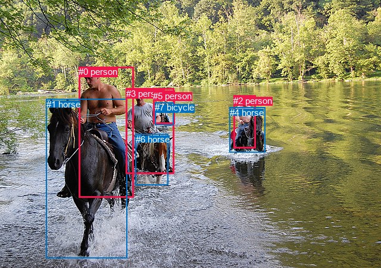
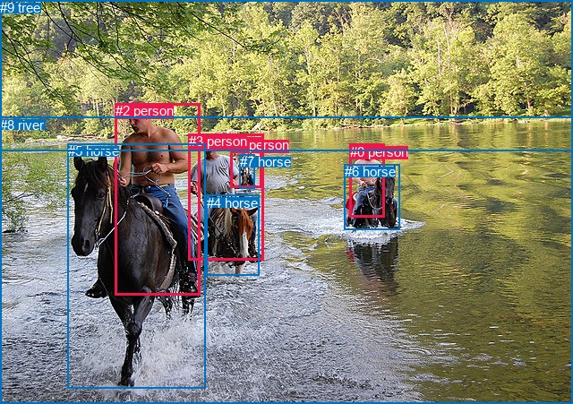

# 图片 1445：2383111.jpg

随机样本序号：63。图片 SHA256：`b69d698c609263408bf76aa99d43deb0d9e6172c820e6c7fd31c402db1551fb2`。

红色框表示人，蓝色框表示其他物体。两个模式分别保留自身框编号，可依据位置比较对应对象。

## 自动检测框与输出

人的框编号：`[0, 2, 3, 5]`。状态：`ok`。

### 自动检测全部物体框

| 编号 | 类别 | 是否为人 | 检测分数 | 像素坐标 xyxy |
|---|---|---|---|---|
| 0 | person | True | 0.9987 | 132.4, 112.0, 224.4, 332.7 |
| 1 | horse | False | 0.9977 | 77.7, 166.9, 213.5, 434.2 |
| 2 | person | True | 0.9968 | 392.1, 160.9, 429.4, 249.8 |
| 3 | person | True | 0.9955 | 211.7, 148.6, 292.8, 292.5 |
| 4 | horse | False | 0.9940 | 386.0, 180.6, 445.3, 256.0 |
| 5 | person | True | 0.9902 | 257.3, 152.6, 293.2, 208.7 |
| 6 | horse | False | 0.9496 | 227.6, 225.8, 282.6, 311.9 |
| 7 | bicycle | False | 0.6259 | 260.5, 172.4, 291.8, 210.4 |

### 自动检测 Top50 人相关候选

评分物体对：56；人相关物体对：44；输出关系：50。

| 排名 | 主语编号与类别 | 关系 | 宾语编号与类别 | 类型 | 人与人 | 排序分数 | 原始融合 logit |
|---|---|---|---|---|---|---|---|
| 1 | #3 person | riding | #6 horse | semantic | False | 0.99663 | 5.6892 |
| 2 | #2 person | riding | #4 horse | semantic | False | 0.99475 | 5.2449 |
| 3 | #5 person | riding | #7 bicycle | semantic | False | 0.99457 | 5.2108 |
| 4 | #0 person | riding | #1 horse | semantic | False | 0.99289 | 4.9394 |
| 5 | #0 person | riding | #6 horse | semantic | False | 0.98616 | 4.2660 |
| 6 | #3 person | holding | #7 bicycle | semantic | False | 0.97848 | 3.8170 |
| 7 | #0 person | on | #1 horse | spatial | False | 0.97696 | 3.7470 |
| 8 | #3 person | on | #6 horse | spatial | False | 0.97517 | 3.6705 |
| 9 | #2 person | on | #4 horse | spatial | False | 0.95231 | 2.9943 |
| 10 | #5 person | in | #7 bicycle | spatial | False | 0.92720 | 2.5444 |
| 11 | #5 person | riding | #6 horse | semantic | False | 0.91581 | 2.3867 |
| 12 | #3 person | riding | #1 horse | semantic | False | 0.87383 | 1.9353 |
| 13 | #0 person | on | #6 horse | spatial | False | 0.82002 | 1.5165 |
| 14 | #3 person | holding | #5 person | semantic | True | 0.80859 | 1.4409 |
| 15 | #3 person | in | #7 bicycle | spatial | False | 0.77109 | 1.2145 |
| 16 | #0 person | holding | #3 person | semantic | True | 0.62133 | 0.4952 |
| 17 | #0 person | riding | #7 bicycle | semantic | False | 0.58313 | 0.3356 |
| 18 | #3 person | riding | #4 horse | semantic | False | 0.54137 | 0.1659 |
| 19 | #3 person | in | #5 person | spatial | True | 0.47074 | -0.1172 |
| 20 | #0 person | riding | #4 horse | semantic | False | 0.45723 | -0.1715 |
| 21 | #3 person | on | #1 horse | spatial | False | 0.43358 | -0.2672 |
| 22 | #0 person | beside | #3 person | spatial | True | 0.27514 | -0.9687 |
| 23 | #1 horse | carrying | #0 person | semantic | False | 0.21329 | -1.3052 |
| 24 | #7 bicycle | on | #5 person | spatial | False | 0.20488 | -1.3561 |
| 25 | #2 person | riding | #6 horse | semantic | False | 0.19735 | -1.4029 |
| 26 | #3 person | beside | #0 person | spatial | True | 0.18011 | -1.5156 |
| 27 | #3 person | running on | #0 person | semantic | True | 0.17596 | -1.5440 |
| 28 | #5 person | riding | #3 person | semantic | True | 0.16813 | -1.5990 |
| 29 | #5 person | looking at | #0 person | semantic | True | 0.15833 | -1.6707 |
| 30 | #0 person | in front of | #5 person | spatial | True | 0.14538 | -1.7713 |
| 31 | #5 person | on | #6 horse | spatial | False | 0.13156 | -1.8872 |
| 32 | #0 person | in | #7 bicycle | spatial | False | 0.10746 | -2.1169 |
| 33 | #2 person | riding | #7 bicycle | semantic | False | 0.09897 | -2.2087 |
| 34 | #1 horse | in | #0 person | spatial | False | 0.09814 | -2.2180 |
| 35 | #0 person | holding | #5 person | semantic | True | 0.08764 | -2.3428 |
| 36 | #6 horse | in | #3 person | spatial | False | 0.07546 | -2.5057 |
| 37 | #6 horse | carrying | #3 person | semantic | False | 0.07441 | -2.5209 |
| 38 | #5 person | riding | #4 horse | semantic | False | 0.06901 | -2.6020 |
| 39 | #4 horse | in | #2 person | spatial | False | 0.06827 | -2.6136 |
| 40 | #7 bicycle | holding | #5 person | semantic | False | 0.05811 | -2.7855 |
| 41 | #5 person | on | #3 person | spatial | True | 0.05273 | -2.8884 |
| 42 | #0 person | looking at | #2 person | semantic | True | 0.05093 | -2.9250 |
| 43 | #3 person | on | #4 horse | spatial | False | 0.04128 | -3.1451 |
| 44 | #3 person | looking at | #2 person | semantic | True | 0.04034 | -3.1693 |
| 45 | #5 person | beside | #0 person | spatial | True | 0.03416 | -3.3419 |
| 46 | #2 person | riding | #1 horse | semantic | False | 0.03275 | -3.3855 |
| 47 | #5 person | looking at | #1 horse | semantic | False | 0.03113 | -3.4381 |
| 48 | #7 bicycle | carrying | #3 person | semantic | False | 0.03001 | -3.4758 |
| 49 | #2 person | looking at | #0 person | semantic | True | 0.02984 | -3.4816 |
| 50 | #0 person | on | #4 horse | spatial | False | 0.02861 | -3.5249 |

### 自动检测逐条人相关 GT 核验

R@50：75.00%；命中 3/4。

| GT 主语编号 | GT 关系 | GT 宾语编号 | 结果阶段 | 匹配预测主语编号 | 匹配预测宾语编号 |
|---|---|---|---|---|---|
| 0 | riding | 6 | hit50 | [2] | [4] |
| 1 | riding | 7 | endpoint_missing_or_wrong_class | [5] | [] |
| 2 | riding | 5 | hit50 | [0] | [1] |
| 3 | riding | 4 | hit50 | [3] | [6] |

## 真实框与输出

人的框编号：`[0, 1, 2, 3]`。

### 真实框全部物体框

| 编号 | 类别 | 是否为人 | 检测分数 | 像素坐标 xyxy |
|---|---|---|---|---|
| 0 | person | True | GT | 391.0, 161.0, 430.0, 243.0 |
| 1 | person | True | GT | 258.0, 153.0, 293.0, 209.0 |
| 2 | person | True | GT | 129.0, 115.0, 224.0, 329.0 |
| 3 | person | True | GT | 211.0, 149.0, 294.0, 290.0 |
| 4 | horse | False | GT | 231.0, 218.0, 290.0, 308.0 |
| 5 | horse | False | GT | 76.0, 160.0, 229.0, 433.0 |
| 6 | horse | False | GT | 385.0, 183.0, 447.0, 256.0 |
| 7 | horse | False | GT | 268.0, 172.0, 285.0, 210.0 |
| 8 | river | False | GT | 0.0, 131.0, 640.0, 451.0 |
| 9 | tree | False | GT | 0.0, 0.0, 640.0, 168.0 |

### 真实框 Top50 人相关候选

评分物体对：90；人相关物体对：60；输出关系：50。

| 排名 | 主语编号与类别 | 关系 | 宾语编号与类别 | 类型 | 人与人 | 排序分数 | 原始融合 logit |
|---|---|---|---|---|---|---|---|
| 1 | #0 person | riding | #6 horse | semantic | False | 0.99751 | 5.9912 |
| 2 | #3 person | riding | #4 horse | semantic | False | 0.99734 | 5.9276 |
| 3 | #2 person | riding | #5 horse | semantic | False | 0.99624 | 5.5808 |
| 4 | #1 person | riding | #7 horse | semantic | False | 0.99284 | 4.9317 |
| 5 | #0 person | on | #6 horse | spatial | False | 0.98217 | 4.0089 |
| 6 | #3 person | holding | #7 horse | semantic | False | 0.98212 | 4.0060 |
| 7 | #2 person | on | #5 horse | spatial | False | 0.97996 | 3.8896 |
| 8 | #3 person | in | #8 river | spatial | False | 0.97898 | 3.8409 |
| 9 | #2 person | riding | #4 horse | semantic | False | 0.97703 | 3.7501 |
| 10 | #1 person | in | #8 river | spatial | False | 0.97527 | 3.6748 |
| 11 | #0 person | in | #8 river | spatial | False | 0.97472 | 3.6522 |
| 12 | #3 person | on | #4 horse | spatial | False | 0.97305 | 3.5865 |
| 13 | #3 person | riding | #5 horse | semantic | False | 0.97254 | 3.5672 |
| 14 | #3 person | running on | #8 river | semantic | False | 0.94649 | 2.8728 |
| 15 | #1 person | on | #7 horse | spatial | False | 0.93960 | 2.7444 |
| 16 | #3 person | holding | #1 person | semantic | True | 0.92640 | 2.5327 |
| 17 | #1 person | running on | #8 river | semantic | False | 0.91688 | 2.4007 |
| 18 | #1 person | riding | #4 horse | semantic | False | 0.91433 | 2.3677 |
| 19 | #0 person | running on | #8 river | semantic | False | 0.90351 | 2.2369 |
| 20 | #2 person | in | #8 river | spatial | False | 0.88882 | 2.0787 |
| 21 | #2 person | riding | #8 river | semantic | False | 0.81934 | 1.5119 |
| 22 | #3 person | on | #7 horse | spatial | False | 0.73442 | 1.0172 |
| 23 | #3 person | on | #5 horse | spatial | False | 0.72272 | 0.9580 |
| 24 | #2 person | on | #4 horse | spatial | False | 0.71426 | 0.9162 |
| 25 | #2 person | holding | #3 person | semantic | True | 0.61668 | 0.4755 |
| 26 | #7 horse | on | #1 person | spatial | False | 0.51000 | 0.0400 |
| 27 | #3 person | riding | #6 horse | semantic | False | 0.48404 | -0.0639 |
| 28 | #3 person | in | #1 person | spatial | True | 0.42056 | -0.3205 |
| 29 | #5 horse | carrying | #2 person | semantic | False | 0.37465 | -0.5123 |
| 30 | #2 person | riding | #6 horse | semantic | False | 0.31863 | -0.7601 |
| 31 | #3 person | beside | #2 person | spatial | True | 0.31339 | -0.7843 |
| 32 | #1 person | looking at | #3 person | semantic | True | 0.29853 | -0.8543 |
| 33 | #7 horse | holding | #1 person | semantic | False | 0.27655 | -0.9617 |
| 34 | #0 person | riding | #4 horse | semantic | False | 0.24723 | -1.1134 |
| 35 | #2 person | beside | #3 person | spatial | True | 0.23899 | -1.1582 |
| 36 | #1 person | on | #4 horse | spatial | False | 0.18740 | -1.4670 |
| 37 | #3 person | holding | #2 person | semantic | True | 0.18302 | -1.4960 |
| 38 | #1 person | looking at | #2 person | semantic | True | 0.17975 | -1.5180 |
| 39 | #6 horse | in | #0 person | spatial | False | 0.16124 | -1.6491 |
| 40 | #1 person | beside | #3 person | spatial | True | 0.15526 | -1.6939 |
| 41 | #0 person | looking at | #2 person | semantic | True | 0.15186 | -1.7201 |
| 42 | #0 person | riding | #5 horse | semantic | False | 0.14583 | -1.7677 |
| 43 | #6 horse | carrying | #0 person | semantic | False | 0.14434 | -1.7797 |
| 44 | #5 horse | in | #2 person | spatial | False | 0.13156 | -1.8872 |
| 45 | #1 person | in front of | #9 tree | spatial | False | 0.12332 | -1.9613 |
| 46 | #3 person | in front of | #9 tree | spatial | False | 0.11177 | -2.0728 |
| 47 | #4 horse | carrying | #3 person | semantic | False | 0.09234 | -2.2854 |
| 48 | #9 tree | beside | #1 person | spatial | False | 0.08984 | -2.3156 |
| 49 | #2 person | in front of | #9 tree | spatial | False | 0.08765 | -2.3427 |
| 50 | #2 person | riding | #7 horse | semantic | False | 0.08615 | -2.3616 |

### 真实框逐条人相关 GT 核验

R@50：100.00%；命中 4/4。

| GT 主语编号 | GT 关系 | GT 宾语编号 | 结果阶段 | 匹配预测主语编号 | 匹配预测宾语编号 |
|---|---|---|---|---|---|
| 0 | riding | 6 | hit50 | [0] | [6] |
| 1 | riding | 7 | hit50 | [1] | [7] |
| 2 | riding | 5 | hit50 | [2] | [5] |
| 3 | riding | 4 | hit50 | [3] | [4] |

## 全部人相关 GT

| 主语编号与类别 | 关系 | 宾语编号与类别 |
|---|---|---|
| #0 person | riding | #6 horse |
| #1 person | riding | #7 horse |
| #2 person | riding | #5 horse |
| #3 person | riding | #4 horse |

原始记录、全部人相关物体对的两项预测与分项分数见 [逐图证据 JSON](../evidence/cases/1445.json)。全部56类 logits 保留于本机 HOR/output/random500/logits/。

<!-- HOR_COMPLETE_RESULTS -->

## 六组条件的完整输出对照

以下保留同一图片三种框与候选模式、两种谓词输出规则的全部 Top50。框编号各自在所属模式内解释。

### 自动检测框完整枚举：空间与语义各保留一个谓词

| 排名 | 主语编号与类别 | 谓词 | 宾语编号与类别 | 分组 | 排序分数 | predicate logit | pair logit |
|---|---|---|---|---|---|---|---|
| 1 | #3 person | riding | #6 horse | semantic | 0.9966291 | 5.5053458 | 0.1838565 |
| 2 | #2 person | riding | #4 horse | semantic | 0.9947532 | 5.0248628 | 0.2200352 |
| 3 | #5 person | riding | #7 bicycle | semantic | 0.9945721 | 4.8438268 | 0.3669307 |
| 4 | #0 person | riding | #1 horse | semantic | 0.9928919 | 4.5478015 | 0.3915811 |
| 5 | #0 person | riding | #6 horse | semantic | 0.9861568 | 4.3682303 | -0.1022098 |
| 6 | #3 person | holding | #7 bicycle | semantic | 0.9784787 | 3.9302869 | -0.1133326 |
| 7 | #0 person | on | #1 horse | spatial | 0.9769554 | 3.3554301 | 0.3915811 |
| 8 | #3 person | on | #6 horse | spatial | 0.9751696 | 3.4866862 | 0.1838565 |
| 9 | #2 person | on | #4 horse | spatial | 0.9523142 | 2.7742267 | 0.2200352 |
| 10 | #5 person | in | #7 bicycle | spatial | 0.9271969 | 2.1774759 | 0.3669307 |
| 11 | #5 person | riding | #6 horse | semantic | 0.9158067 | 2.2853374 | 0.1013521 |
| 12 | #3 person | riding | #1 horse | semantic | 0.8738329 | 2.2630658 | -0.3277835 |
| 13 | #0 person | on | #6 horse | spatial | 0.8200228 | 1.6187115 | -0.1022098 |
| 14 | #3 person | holding | #5 person | semantic | 0.8085932 | 2.3203397 | -0.8794446 |
| 15 | #3 person | in | #7 bicycle | spatial | 0.7710916 | 1.3278179 | -0.1133326 |
| 16 | #0 person | holding | #3 person | semantic | 0.6213344 | 1.5329475 | -1.0377315 |
| 17 | #0 person | riding | #7 bicycle | semantic | 0.5831317 | 1.1919985 | -0.8563558 |
| 18 | #3 person | riding | #4 horse | semantic | 0.5413717 | 0.6972213 | -0.5313552 |
| 19 | #3 person | in | #5 person | spatial | 0.4707414 | 0.7622762 | -0.8794446 |
| 20 | #0 person | riding | #4 horse | semantic | 0.4572264 | 0.2796092 | -0.4511229 |
| 21 | #3 person | on | #1 horse | spatial | 0.4335842 | 0.0605412 | -0.3277835 |
| 22 | #0 person | beside | #3 person | spatial | 0.2751351 | 0.0690084 | -1.0377315 |
| 23 | #1 horse | carrying | #0 person | semantic | 0.2132924 | -0.6381011 | -0.6670916 |
| 24 | #7 bicycle | on | #5 person | spatial | 0.2048759 | -0.2526798 | -1.1034138 |
| 25 | #2 person | riding | #6 horse | semantic | 0.1973529 | -0.8008657 | -0.6020559 |
| 26 | #3 person | beside | #0 person | spatial | 0.1801057 | -0.4685502 | -1.0470811 |
| 27 | #3 person | running on | #0 person | semantic | 0.1759582 | -0.4968939 | -1.0470811 |
| 28 | #5 person | riding | #3 person | semantic | 0.1681264 | -0.7355518 | -0.8634127 |
| 29 | #5 person | looking at | #0 person | semantic | 0.1583279 | -0.5876198 | -1.0831028 |
| 30 | #0 person | in front of | #5 person | spatial | 0.1453807 | -0.4496498 | -1.3216507 |
| 31 | #5 person | on | #6 horse | spatial | 0.1315633 | -1.9885590 | 0.1013521 |
| 32 | #0 person | in | #7 bicycle | spatial | 0.1074620 | -1.2605760 | -0.8563558 |
| 33 | #2 person | riding | #7 bicycle | semantic | 0.0989691 | -1.4011028 | -0.8076293 |
| 34 | #1 horse | in | #0 person | spatial | 0.0981433 | -1.5509353 | -0.6670916 |
| 35 | #0 person | holding | #5 person | semantic | 0.0876432 | -1.0211062 | -1.3216507 |
| 36 | #6 horse | in | #3 person | spatial | 0.0754620 | -1.4901977 | -1.0154668 |
| 37 | #6 horse | carrying | #3 person | semantic | 0.0744079 | -1.5054047 | -1.0154668 |
| 38 | #5 person | riding | #4 horse | semantic | 0.0690124 | -2.0765674 | -0.5253923 |
| 39 | #4 horse | in | #2 person | spatial | 0.0682686 | -1.8786607 | -0.7349342 |
| 40 | #7 bicycle | holding | #5 person | semantic | 0.0581147 | -1.6820509 | -1.1034138 |
| 41 | #5 person | on | #3 person | spatial | 0.0527319 | -2.0249498 | -0.8634127 |
| 42 | #0 person | looking at | #2 person | semantic | 0.0509304 | -2.0442560 | -0.8807670 |
| 43 | #3 person | on | #4 horse | spatial | 0.0412849 | -2.6137419 | -0.5313552 |
| 44 | #3 person | looking at | #2 person | semantic | 0.0403382 | -1.9806201 | -1.1886624 |
| 45 | #5 person | beside | #0 person | spatial | 0.0341616 | -2.2587912 | -1.0831028 |
| 46 | #2 person | riding | #1 horse | semantic | 0.0327525 | -2.6873903 | -0.6980864 |
| 47 | #5 person | looking at | #1 horse | semantic | 0.0311254 | -2.7287283 | -0.7093817 |
| 48 | #7 bicycle | carrying | #3 person | semantic | 0.0300088 | -2.3590274 | -1.1167693 |
| 49 | #2 person | looking at | #0 person | semantic | 0.0298404 | -2.2993343 | -1.1822639 |
| 50 | #0 person | on | #4 horse | spatial | 0.0286130 | -3.0737412 | -0.4511229 |

GT 命中：3/4，R@50=75.00%。

| GT主语 | GT谓词 | GT宾语 | 结果阶段 | 匹配主语框 | 匹配宾语框 |
|---|---|---|---|---|---|
| 0 | riding | 6 | hit50 | [2] | [4] |
| 1 | riding | 7 | endpoint_missing_or_wrong_class | [5] | [] |
| 2 | riding | 5 | hit50 | [0] | [1] |
| 3 | riding | 4 | hit50 | [3] | [6] |

### 自动检测框完整枚举：每对只保留一个谓词

| 排名 | 主语编号与类别 | 谓词 | 宾语编号与类别 | 分组 | 排序分数 | predicate logit | pair logit |
|---|---|---|---|---|---|---|---|
| 1 | #3 person | riding | #6 horse | single | 0.9966291 | 5.5053458 | 0.1838565 |
| 2 | #2 person | riding | #4 horse | single | 0.9947532 | 5.0248628 | 0.2200352 |
| 3 | #5 person | riding | #7 bicycle | single | 0.9945721 | 4.8438268 | 0.3669307 |
| 4 | #0 person | riding | #1 horse | single | 0.9928919 | 4.5478015 | 0.3915811 |
| 5 | #0 person | riding | #6 horse | single | 0.9861568 | 4.3682303 | -0.1022098 |
| 6 | #3 person | holding | #7 bicycle | single | 0.9784787 | 3.9302869 | -0.1133326 |
| 7 | #5 person | riding | #6 horse | single | 0.9158067 | 2.2853374 | 0.1013521 |
| 8 | #3 person | riding | #1 horse | single | 0.8738329 | 2.2630658 | -0.3277835 |
| 9 | #3 person | holding | #5 person | single | 0.8085932 | 2.3203397 | -0.8794446 |
| 10 | #0 person | holding | #3 person | single | 0.6213344 | 1.5329475 | -1.0377315 |
| 11 | #0 person | riding | #7 bicycle | single | 0.5831317 | 1.1919985 | -0.8563558 |
| 12 | #3 person | riding | #4 horse | single | 0.5413717 | 0.6972213 | -0.5313552 |
| 13 | #0 person | riding | #4 horse | single | 0.4572264 | 0.2796092 | -0.4511229 |
| 14 | #1 horse | carrying | #0 person | single | 0.2132924 | -0.6381011 | -0.6670916 |
| 15 | #7 bicycle | on | #5 person | single | 0.2048759 | -0.2526798 | -1.1034138 |
| 16 | #2 person | riding | #6 horse | single | 0.1973529 | -0.8008657 | -0.6020559 |
| 17 | #3 person | beside | #0 person | single | 0.1801057 | -0.4685502 | -1.0470811 |
| 18 | #5 person | riding | #3 person | single | 0.1681264 | -0.7355518 | -0.8634127 |
| 19 | #5 person | looking at | #0 person | single | 0.1583279 | -0.5876198 | -1.0831028 |
| 20 | #0 person | in front of | #5 person | single | 0.1453807 | -0.4496498 | -1.3216507 |
| 21 | #2 person | riding | #7 bicycle | single | 0.0989691 | -1.4011028 | -0.8076293 |
| 22 | #6 horse | in | #3 person | single | 0.0754620 | -1.4901977 | -1.0154668 |
| 23 | #5 person | riding | #4 horse | single | 0.0690124 | -2.0765674 | -0.5253923 |
| 24 | #4 horse | in | #2 person | single | 0.0682686 | -1.8786607 | -0.7349342 |
| 25 | #0 person | looking at | #2 person | single | 0.0509304 | -2.0442560 | -0.8807670 |
| 26 | #3 person | looking at | #2 person | single | 0.0403382 | -1.9806201 | -1.1886624 |
| 27 | #2 person | riding | #1 horse | single | 0.0327525 | -2.6873903 | -0.6980864 |
| 28 | #5 person | looking at | #1 horse | single | 0.0311254 | -2.7287283 | -0.7093817 |
| 29 | #7 bicycle | carrying | #3 person | single | 0.0300088 | -2.3590274 | -1.1167693 |
| 30 | #2 person | looking at | #0 person | single | 0.0298404 | -2.2993343 | -1.1822639 |
| 31 | #2 person | beside | #3 person | single | 0.0279741 | -2.1433127 | -1.4047894 |
| 32 | #6 horse | running on | #5 person | single | 0.0274572 | -2.2511060 | -1.3161778 |
| 33 | #5 person | looking at | #2 person | single | 0.0260188 | -2.5026953 | -1.1198782 |
| 34 | #1 horse | in front of | #5 person | single | 0.0172250 | -2.4694037 | -1.5746136 |
| 35 | #1 horse | in | #3 person | single | 0.0168526 | -2.9996557 | -1.0665988 |
| 36 | #6 horse | beside | #0 person | single | 0.0166098 | -2.9719787 | -1.1090354 |
| 37 | #7 bicycle | beside | #0 person | single | 0.0090848 | -3.4043117 | -1.2877147 |
| 38 | #4 horse | beside | #3 person | single | 0.0074053 | -3.4366002 | -1.4615257 |
| 39 | #1 horse | in front of | #2 person | single | 0.0060952 | -3.9420726 | -1.1520624 |
| 40 | #2 person | riding | #5 person | single | 0.0055795 | -3.7003126 | -1.4827398 |
| 41 | #4 horse | in front of | #5 person | single | 0.0053006 | -3.4673338 | -1.7672793 |
| 42 | #6 horse | beside | #2 person | single | 0.0050648 | -3.9555180 | -1.3248429 |
| 43 | #4 horse | beside | #0 person | single | 0.0033833 | -4.3923383 | -1.2931874 |
| 44 | #7 bicycle | beside | #2 person | single | 0.0014633 | -5.1019230 | -1.4236652 |

GT 命中：3/4，R@50=75.00%。

| GT主语 | GT谓词 | GT宾语 | 结果阶段 | 匹配主语框 | 匹配宾语框 |
|---|---|---|---|---|---|
| 0 | riding | 6 | hit50 | [2] | [4] |
| 1 | riding | 7 | endpoint_missing_or_wrong_class | [5] | [] |
| 2 | riding | 5 | hit50 | [0] | [1] |
| 3 | riding | 4 | hit50 | [3] | [6] |

### 真实框完整枚举：空间与语义各保留一个谓词

| 排名 | 主语编号与类别 | 谓词 | 宾语编号与类别 | 分组 | 排序分数 | predicate logit | pair logit |
|---|---|---|---|---|---|---|---|
| 1 | #0 person | riding | #6 horse | semantic | 0.9975055 | 5.6288877 | 0.3622894 |
| 2 | #3 person | riding | #4 horse | semantic | 0.9973423 | 5.8060136 | 0.1216092 |
| 3 | #2 person | riding | #5 horse | semantic | 0.9962444 | 5.2058988 | 0.3748597 |
| 4 | #1 person | riding | #7 horse | semantic | 0.9928376 | 4.5534215 | 0.3782953 |
| 5 | #0 person | on | #6 horse | spatial | 0.9821703 | 3.6466117 | 0.3622894 |
| 6 | #3 person | holding | #7 horse | semantic | 0.9821192 | 4.0979190 | -0.0919368 |
| 7 | #2 person | on | #5 horse | spatial | 0.9799572 | 3.5147777 | 0.3748597 |
| 8 | #3 person | in | #8 river | spatial | 0.9789765 | 4.0351605 | -0.1942938 |
| 9 | #2 person | riding | #4 horse | semantic | 0.9770253 | 3.9459767 | -0.1958591 |
| 10 | #1 person | in | #8 river | spatial | 0.9752736 | 3.5324521 | 0.1423943 |
| 11 | #0 person | in | #8 river | spatial | 0.9747204 | 3.6877847 | -0.0356326 |
| 12 | #3 person | on | #4 horse | spatial | 0.9730516 | 3.4649062 | 0.1216092 |
| 13 | #3 person | riding | #5 horse | semantic | 0.9725395 | 3.8796859 | -0.3125199 |
| 14 | #3 person | running on | #8 river | semantic | 0.9464850 | 3.0670886 | -0.1942938 |
| 15 | #1 person | on | #7 horse | spatial | 0.9395959 | 2.3660984 | 0.3782953 |
| 16 | #3 person | holding | #1 person | semantic | 0.9264036 | 3.3650107 | -0.8322969 |
| 17 | #1 person | running on | #8 river | semantic | 0.9168776 | 2.2582664 | 0.1423943 |
| 18 | #1 person | riding | #4 horse | semantic | 0.9143317 | 2.3511405 | 0.0165701 |
| 19 | #0 person | running on | #8 river | semantic | 0.9035102 | 2.2724833 | -0.0356326 |
| 20 | #2 person | in | #8 river | spatial | 0.8888183 | 2.5646758 | -0.4859494 |
| 21 | #2 person | riding | #8 river | semantic | 0.8193449 | 1.9978647 | -0.4859494 |
| 22 | #3 person | on | #7 horse | spatial | 0.7344201 | 1.1091022 | -0.0919368 |
| 23 | #3 person | on | #5 horse | spatial | 0.7227182 | 1.2705050 | -0.3125199 |
| 24 | #2 person | on | #4 horse | spatial | 0.7142603 | 1.1120257 | -0.1958591 |
| 25 | #2 person | holding | #3 person | semantic | 0.6166807 | 1.5211301 | -1.0456470 |
| 26 | #7 horse | on | #1 person | spatial | 0.5100031 | 1.1234951 | -1.0834774 |
| 27 | #3 person | riding | #6 horse | semantic | 0.4840387 | 0.4242010 | -0.4880677 |
| 28 | #3 person | in | #1 person | spatial | 0.4205578 | 0.5118132 | -0.8322969 |
| 29 | #5 horse | carrying | #2 person | semantic | 0.3746541 | 0.1704679 | -0.6827695 |
| 30 | #2 person | riding | #6 horse | semantic | 0.3186330 | -0.3212385 | -0.4388224 |
| 31 | #3 person | beside | #2 person | spatial | 0.3133944 | 0.2533650 | -1.0376627 |
| 32 | #1 person | looking at | #3 person | semantic | 0.2985333 | 0.0109587 | -0.8652506 |
| 33 | #7 horse | holding | #1 person | semantic | 0.2765469 | 0.1218219 | -1.0834774 |
| 34 | #0 person | riding | #4 horse | semantic | 0.2472347 | -0.5307775 | -0.5826378 |
| 35 | #2 person | beside | #3 person | spatial | 0.2389857 | -0.1126013 | -1.0456470 |
| 36 | #1 person | on | #4 horse | spatial | 0.1873971 | -1.4835825 | 0.0165701 |
| 37 | #3 person | holding | #2 person | semantic | 0.1830202 | -0.4583549 | -1.0376627 |
| 38 | #1 person | looking at | #2 person | semantic | 0.1797518 | -0.4183373 | -1.0996926 |
| 39 | #6 horse | in | #0 person | spatial | 0.1612358 | -0.9386377 | -0.7104238 |
| 40 | #1 person | beside | #3 person | spatial | 0.1552583 | -0.8286905 | -0.8652506 |
| 41 | #0 person | looking at | #2 person | semantic | 0.1518625 | -0.5722146 | -1.1478529 |
| 42 | #0 person | riding | #5 horse | semantic | 0.1458279 | -1.1040387 | -0.6636666 |
| 43 | #6 horse | carrying | #0 person | semantic | 0.1443396 | -1.0692813 | -0.7104238 |
| 44 | #5 horse | in | #2 person | spatial | 0.1315621 | -1.2044480 | -0.6827695 |
| 45 | #1 person | in front of | #9 tree | spatial | 0.1233219 | -0.9670570 | -0.9942845 |
| 46 | #3 person | in front of | #9 tree | spatial | 0.1117736 | -0.5032463 | -1.5695052 |
| 47 | #4 horse | carrying | #3 person | semantic | 0.0923369 | -1.2620704 | -1.0233588 |
| 48 | #9 tree | beside | #1 person | spatial | 0.0898410 | -1.3868825 | -0.9286960 |
| 49 | #2 person | in front of | #9 tree | spatial | 0.0876501 | -0.7510221 | -1.5916482 |
| 50 | #2 person | riding | #7 horse | semantic | 0.0861481 | -1.5063176 | -0.8552825 |

GT 命中：4/4，R@50=100.00%。

| GT主语 | GT谓词 | GT宾语 | 结果阶段 | 匹配主语框 | 匹配宾语框 |
|---|---|---|---|---|---|
| 0 | riding | 6 | hit50 | [0] | [6] |
| 1 | riding | 7 | hit50 | [1] | [7] |
| 2 | riding | 5 | hit50 | [2] | [5] |
| 3 | riding | 4 | hit50 | [3] | [4] |

### 真实框完整枚举：每对只保留一个谓词

| 排名 | 主语编号与类别 | 谓词 | 宾语编号与类别 | 分组 | 排序分数 | predicate logit | pair logit |
|---|---|---|---|---|---|---|---|
| 1 | #0 person | riding | #6 horse | single | 0.9975055 | 5.6288877 | 0.3622894 |
| 2 | #3 person | riding | #4 horse | single | 0.9973423 | 5.8060136 | 0.1216092 |
| 3 | #2 person | riding | #5 horse | single | 0.9962444 | 5.2058988 | 0.3748597 |
| 4 | #1 person | riding | #7 horse | single | 0.9928376 | 4.5534215 | 0.3782953 |
| 5 | #3 person | holding | #7 horse | single | 0.9821192 | 4.0979190 | -0.0919368 |
| 6 | #3 person | in | #8 river | single | 0.9789765 | 4.0351605 | -0.1942938 |
| 7 | #2 person | riding | #4 horse | single | 0.9770253 | 3.9459767 | -0.1958591 |
| 8 | #1 person | in | #8 river | single | 0.9752736 | 3.5324521 | 0.1423943 |
| 9 | #0 person | in | #8 river | single | 0.9747204 | 3.6877847 | -0.0356326 |
| 10 | #3 person | riding | #5 horse | single | 0.9725395 | 3.8796859 | -0.3125199 |
| 11 | #3 person | holding | #1 person | single | 0.9264036 | 3.3650107 | -0.8322969 |
| 12 | #1 person | riding | #4 horse | single | 0.9143317 | 2.3511405 | 0.0165701 |
| 13 | #2 person | in | #8 river | single | 0.8888183 | 2.5646758 | -0.4859494 |
| 14 | #2 person | holding | #3 person | single | 0.6166807 | 1.5211301 | -1.0456470 |
| 15 | #7 horse | on | #1 person | single | 0.5100031 | 1.1234951 | -1.0834774 |
| 16 | #3 person | riding | #6 horse | single | 0.4840387 | 0.4242010 | -0.4880677 |
| 17 | #5 horse | carrying | #2 person | single | 0.3746541 | 0.1704679 | -0.6827695 |
| 18 | #2 person | riding | #6 horse | single | 0.3186330 | -0.3212385 | -0.4388224 |
| 19 | #3 person | beside | #2 person | single | 0.3133944 | 0.2533650 | -1.0376627 |
| 20 | #1 person | looking at | #3 person | single | 0.2985333 | 0.0109587 | -0.8652506 |
| 21 | #0 person | riding | #4 horse | single | 0.2472347 | -0.5307775 | -0.5826378 |
| 22 | #1 person | looking at | #2 person | single | 0.1797518 | -0.4183373 | -1.0996926 |
| 23 | #6 horse | in | #0 person | single | 0.1612358 | -0.9386377 | -0.7104238 |
| 24 | #0 person | looking at | #2 person | single | 0.1518625 | -0.5722146 | -1.1478529 |
| 25 | #0 person | riding | #5 horse | single | 0.1458279 | -1.1040387 | -0.6636666 |
| 26 | #1 person | in front of | #9 tree | single | 0.1233219 | -0.9670570 | -0.9942845 |
| 27 | #3 person | in front of | #9 tree | single | 0.1117736 | -0.5032463 | -1.5695052 |
| 28 | #4 horse | carrying | #3 person | single | 0.0923369 | -1.2620704 | -1.0233588 |
| 29 | #9 tree | beside | #1 person | single | 0.0898410 | -1.3868825 | -0.9286960 |
| 30 | #2 person | in front of | #9 tree | single | 0.0876501 | -0.7510221 | -1.5916482 |
| 31 | #2 person | riding | #7 horse | single | 0.0861481 | -1.5063176 | -0.8552825 |
| 32 | #2 person | holding | #1 person | single | 0.0845103 | -1.0641091 | -1.3184763 |
| 33 | #0 person | looking at | #3 person | single | 0.0835755 | -1.0317001 | -1.3630294 |
| 34 | #1 person | riding | #5 horse | single | 0.0816409 | -1.7149227 | -0.7053358 |
| 35 | #2 person | looking at | #0 person | single | 0.0806008 | -1.4515936 | -0.9826186 |
| 36 | #1 person | looking at | #0 person | single | 0.0805151 | -1.2014070 | -1.2339625 |
| 37 | #3 person | looking at | #0 person | single | 0.0803081 | -1.1628397 | -1.2753278 |
| 38 | #8 river | beside | #2 person | single | 0.0770569 | -1.2659247 | -1.2170984 |
| 39 | #7 horse | on | #3 person | single | 0.0765819 | -1.3540370 | -1.1356847 |
| 40 | #9 tree | beside | #3 person | single | 0.0735153 | -1.5694106 | -0.9644935 |
| 41 | #1 person | riding | #6 horse | single | 0.0653735 | -2.1204824 | -0.5395480 |
| 42 | #8 river | beside | #3 person | single | 0.0653605 | -1.3389192 | -1.3213229 |
| 43 | #5 horse | beside | #3 person | single | 0.0498740 | -1.8570988 | -1.0899951 |
| 44 | #6 horse | beside | #3 person | single | 0.0425745 | -1.6434531 | -1.4695401 |
| 45 | #9 tree | beside | #2 person | single | 0.0422459 | -2.1278043 | -0.9932803 |
| 46 | #0 person | in front of | #9 tree | single | 0.0299460 | -1.8300538 | -1.6479027 |
| 47 | #8 river | beside | #1 person | single | 0.0247631 | -2.1988690 | -1.4744569 |
| 48 | #4 horse | beside | #0 person | single | 0.0220136 | -2.4263172 | -1.3675177 |
| 49 | #0 person | riding | #7 horse | single | 0.0219476 | -3.0206022 | -0.7763031 |
| 50 | #8 river | beside | #0 person | single | 0.0218227 | -2.4381244 | -1.3646146 |

GT 命中：4/4，R@50=100.00%。

| GT主语 | GT谓词 | GT宾语 | 结果阶段 | 匹配主语框 | 匹配宾语框 |
|---|---|---|---|---|---|
| 0 | riding | 6 | hit50 | [0] | [6] |
| 1 | riding | 7 | hit50 | [1] | [7] |
| 2 | riding | 5 | hit50 | [2] | [5] |
| 3 | riding | 4 | hit50 | [3] | [4] |

### 真实框400候选：空间与语义各保留一个谓词

| 排名 | 主语编号与类别 | 谓词 | 宾语编号与类别 | 分组 | 排序分数 | predicate logit | pair logit |
|---|---|---|---|---|---|---|---|
| 1 | #0 person | riding | #6 horse | semantic | 0.9975055 | 5.6288877 | 0.3622894 |
| 2 | #3 person | riding | #4 horse | semantic | 0.9973423 | 5.8060136 | 0.1216092 |
| 3 | #2 person | riding | #5 horse | semantic | 0.9962444 | 5.2058988 | 0.3748597 |
| 4 | #1 person | riding | #7 horse | semantic | 0.9928358 | 4.5531774 | 0.3782953 |
| 5 | #0 person | on | #6 horse | spatial | 0.9821703 | 3.6466117 | 0.3622894 |
| 6 | #3 person | holding | #7 horse | semantic | 0.9820151 | 4.0920100 | -0.0919368 |
| 7 | #2 person | on | #5 horse | spatial | 0.9799572 | 3.5147777 | 0.3748597 |
| 8 | #3 person | in | #8 river | spatial | 0.9789765 | 4.0351605 | -0.1942938 |
| 9 | #2 person | riding | #4 horse | semantic | 0.9756407 | 3.8860383 | -0.1958591 |
| 10 | #0 person | in | #8 river | spatial | 0.9745563 | 3.6811471 | -0.0356326 |
| 11 | #1 person | in | #8 river | spatial | 0.9741168 | 3.4855447 | 0.1423943 |
| 12 | #3 person | on | #4 horse | spatial | 0.9730516 | 3.4649062 | 0.1216092 |
| 13 | #3 person | riding | #5 horse | semantic | 0.9725395 | 3.8796859 | -0.3125199 |
| 14 | #3 person | running on | #8 river | semantic | 0.9464850 | 3.0670886 | -0.1942938 |
| 15 | #1 person | on | #7 horse | spatial | 0.9395959 | 2.3660984 | 0.3782953 |
| 16 | #3 person | holding | #1 person | semantic | 0.9259997 | 3.3591018 | -0.8322969 |
| 17 | #1 person | running on | #8 river | semantic | 0.9167264 | 2.2562823 | 0.1423943 |
| 18 | #1 person | riding | #4 horse | semantic | 0.9143125 | 2.3508959 | 0.0165701 |
| 19 | #0 person | running on | #8 river | semantic | 0.9035102 | 2.2724833 | -0.0356326 |
| 20 | #2 person | in | #8 river | spatial | 0.8940004 | 2.6182208 | -0.4859494 |
| 21 | #2 person | riding | #8 river | semantic | 0.8237562 | 2.0279560 | -0.4859494 |
| 22 | #3 person | on | #7 horse | spatial | 0.7365386 | 1.1199918 | -0.0919368 |
| 23 | #3 person | on | #5 horse | spatial | 0.7227182 | 1.2705050 | -0.3125199 |
| 24 | #2 person | on | #4 horse | spatial | 0.7080797 | 1.0819349 | -0.1958591 |
| 25 | #2 person | holding | #3 person | semantic | 0.6138836 | 1.5093136 | -1.0456470 |
| 26 | #7 horse | on | #1 person | spatial | 0.5100031 | 1.1234951 | -1.0834774 |
| 27 | #3 person | riding | #6 horse | semantic | 0.4765581 | 0.3942313 | -0.4880677 |
| 28 | #3 person | in | #1 person | spatial | 0.4140478 | 0.4850402 | -0.8322969 |
| 29 | #5 horse | carrying | #2 person | semantic | 0.3681730 | 0.1427069 | -0.6827695 |
| 30 | #3 person | beside | #2 person | spatial | 0.3331128 | 0.3435230 | -1.0376627 |
| 31 | #2 person | riding | #6 horse | semantic | 0.3121885 | -0.3510852 | -0.4388224 |
| 32 | #1 person | looking at | #3 person | semantic | 0.2924868 | -0.0180860 | -0.8652506 |
| 33 | #7 horse | holding | #1 person | semantic | 0.2817099 | 0.1474819 | -1.0834774 |
| 34 | #0 person | riding | #4 horse | semantic | 0.2417667 | -0.5603800 | -0.5826378 |
| 35 | #2 person | beside | #3 person | spatial | 0.2389739 | -0.1126661 | -1.0456470 |
| 36 | #1 person | on | #4 horse | spatial | 0.1878120 | -1.4808602 | 0.0165701 |
| 37 | #3 person | holding | #2 person | semantic | 0.1875626 | -0.4282637 | -1.0376627 |
| 38 | #1 person | looking at | #2 person | semantic | 0.1797004 | -0.4186859 | -1.0996926 |
| 39 | #6 horse | in | #0 person | spatial | 0.1619102 | -0.9336596 | -0.7104238 |
| 40 | #1 person | beside | #3 person | spatial | 0.1552583 | -0.8286905 | -0.8652506 |
| 41 | #0 person | looking at | #2 person | semantic | 0.1519018 | -0.5719094 | -1.1478529 |
| 42 | #0 person | riding | #5 horse | semantic | 0.1495774 | -1.0742531 | -0.6636666 |
| 43 | #6 horse | carrying | #0 person | semantic | 0.1478755 | -1.0409379 | -0.7104238 |
| 44 | #5 horse | in | #2 person | spatial | 0.1315073 | -1.2049277 | -0.6827695 |
| 45 | #1 person | in front of | #9 tree | spatial | 0.1201216 | -0.9969950 | -0.9942845 |
| 46 | #3 person | in front of | #9 tree | spatial | 0.1118040 | -0.5029402 | -1.5695052 |
| 47 | #4 horse | carrying | #3 person | semantic | 0.0900841 | -1.2892492 | -1.0233588 |
| 48 | #9 tree | beside | #1 person | spatial | 0.0898398 | -1.3868968 | -0.9286960 |
| 49 | #2 person | riding | #7 horse | semantic | 0.0873498 | -1.4911499 | -0.8552825 |
| 50 | #2 person | in front of | #9 tree | spatial | 0.0852616 | -0.7812662 | -1.5916482 |

GT 命中：4/4，R@50=100.00%。

| GT主语 | GT谓词 | GT宾语 | 结果阶段 | 匹配主语框 | 匹配宾语框 |
|---|---|---|---|---|---|
| 0 | riding | 6 | hit50 | [0] | [6] |
| 1 | riding | 7 | hit50 | [1] | [7] |
| 2 | riding | 5 | hit50 | [2] | [5] |
| 3 | riding | 4 | hit50 | [3] | [4] |

### 真实框400候选：每对只保留一个谓词

| 排名 | 主语编号与类别 | 谓词 | 宾语编号与类别 | 分组 | 排序分数 | predicate logit | pair logit |
|---|---|---|---|---|---|---|---|
| 1 | #0 person | riding | #6 horse | single | 0.9975055 | 5.6288877 | 0.3622894 |
| 2 | #3 person | riding | #4 horse | single | 0.9973423 | 5.8060136 | 0.1216092 |
| 3 | #2 person | riding | #5 horse | single | 0.9962444 | 5.2058988 | 0.3748597 |
| 4 | #1 person | riding | #7 horse | single | 0.9928358 | 4.5531774 | 0.3782953 |
| 5 | #3 person | holding | #7 horse | single | 0.9820151 | 4.0920100 | -0.0919368 |
| 6 | #3 person | in | #8 river | single | 0.9789765 | 4.0351605 | -0.1942938 |
| 7 | #2 person | riding | #4 horse | single | 0.9756407 | 3.8860383 | -0.1958591 |
| 8 | #0 person | in | #8 river | single | 0.9745563 | 3.6811471 | -0.0356326 |
| 9 | #1 person | in | #8 river | single | 0.9741168 | 3.4855447 | 0.1423943 |
| 10 | #3 person | riding | #5 horse | single | 0.9725395 | 3.8796859 | -0.3125199 |
| 11 | #3 person | holding | #1 person | single | 0.9259997 | 3.3591018 | -0.8322969 |
| 12 | #1 person | riding | #4 horse | single | 0.9143125 | 2.3508959 | 0.0165701 |
| 13 | #2 person | in | #8 river | single | 0.8940004 | 2.6182208 | -0.4859494 |
| 14 | #2 person | holding | #3 person | single | 0.6138836 | 1.5093136 | -1.0456470 |
| 15 | #7 horse | on | #1 person | single | 0.5100031 | 1.1234951 | -1.0834774 |
| 16 | #3 person | riding | #6 horse | single | 0.4765581 | 0.3942313 | -0.4880677 |
| 17 | #5 horse | carrying | #2 person | single | 0.3681730 | 0.1427069 | -0.6827695 |
| 18 | #3 person | beside | #2 person | single | 0.3331128 | 0.3435230 | -1.0376627 |
| 19 | #2 person | riding | #6 horse | single | 0.3121885 | -0.3510852 | -0.4388224 |
| 20 | #1 person | looking at | #3 person | single | 0.2924868 | -0.0180860 | -0.8652506 |
| 21 | #0 person | riding | #4 horse | single | 0.2417667 | -0.5603800 | -0.5826378 |
| 22 | #1 person | looking at | #2 person | single | 0.1797004 | -0.4186859 | -1.0996926 |
| 23 | #6 horse | in | #0 person | single | 0.1619102 | -0.9336596 | -0.7104238 |
| 24 | #0 person | looking at | #2 person | single | 0.1519018 | -0.5719094 | -1.1478529 |
| 25 | #0 person | riding | #5 horse | single | 0.1495774 | -1.0742531 | -0.6636666 |
| 26 | #1 person | in front of | #9 tree | single | 0.1201216 | -0.9969950 | -0.9942845 |
| 27 | #3 person | in front of | #9 tree | single | 0.1118040 | -0.5029402 | -1.5695052 |
| 28 | #4 horse | carrying | #3 person | single | 0.0900841 | -1.2892492 | -1.0233588 |
| 29 | #9 tree | beside | #1 person | single | 0.0898398 | -1.3868968 | -0.9286960 |
| 30 | #2 person | riding | #7 horse | single | 0.0873498 | -1.4911499 | -0.8552825 |
| 31 | #2 person | in front of | #9 tree | single | 0.0852616 | -0.7812662 | -1.5916482 |
| 32 | #0 person | looking at | #3 person | single | 0.0835988 | -1.0313950 | -1.3630294 |
| 33 | #2 person | holding | #1 person | single | 0.0823584 | -1.0922501 | -1.3184763 |
| 34 | #1 person | riding | #5 horse | single | 0.0805289 | -1.7298460 | -0.7053358 |
| 35 | #1 person | looking at | #0 person | single | 0.0794337 | -1.2161040 | -1.2339625 |
| 36 | #2 person | looking at | #0 person | single | 0.0784185 | -1.4814126 | -0.9826186 |
| 37 | #3 person | looking at | #0 person | single | 0.0781229 | -1.1928003 | -1.2753278 |
| 38 | #8 river | beside | #2 person | single | 0.0770636 | -1.2658308 | -1.2170984 |
| 39 | #7 horse | on | #3 person | single | 0.0767746 | -1.3513145 | -1.1356847 |
| 40 | #9 tree | beside | #3 person | single | 0.0724893 | -1.5845718 | -0.9644935 |
| 41 | #8 river | beside | #3 person | single | 0.0653599 | -1.3389304 | -1.3213229 |
| 42 | #1 person | riding | #6 horse | single | 0.0644639 | -2.1354671 | -0.5395480 |
| 43 | #5 horse | beside | #3 person | single | 0.0491686 | -1.8720865 | -1.0899951 |
| 44 | #6 horse | beside | #3 person | single | 0.0431944 | -1.6283495 | -1.4695401 |
| 45 | #9 tree | beside | #2 person | single | 0.0410472 | -2.1578379 | -0.9932803 |
| 46 | #0 person | in front of | #9 tree | single | 0.0299415 | -1.8302071 | -1.6479027 |
| 47 | #8 river | beside | #1 person | single | 0.0255017 | -2.1687200 | -1.4744569 |
| 48 | #8 river | beside | #0 person | single | 0.0224725 | -2.4081199 | -1.3646146 |
| 49 | #4 horse | beside | #0 person | single | 0.0223399 | -2.4112716 | -1.3675177 |
| 50 | #0 person | riding | #7 horse | single | 0.0219437 | -3.0207853 | -0.7763031 |

GT 命中：4/4，R@50=100.00%。

| GT主语 | GT谓词 | GT宾语 | 结果阶段 | 匹配主语框 | 匹配宾语框 |
|---|---|---|---|---|---|
| 0 | riding | 6 | hit50 | [0] | [6] |
| 1 | riding | 7 | hit50 | [1] | [7] |
| 2 | riding | 5 | hit50 | [2] | [5] |
| 3 | riding | 4 | hit50 | [3] | [4] |
