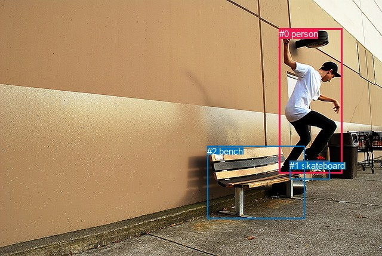
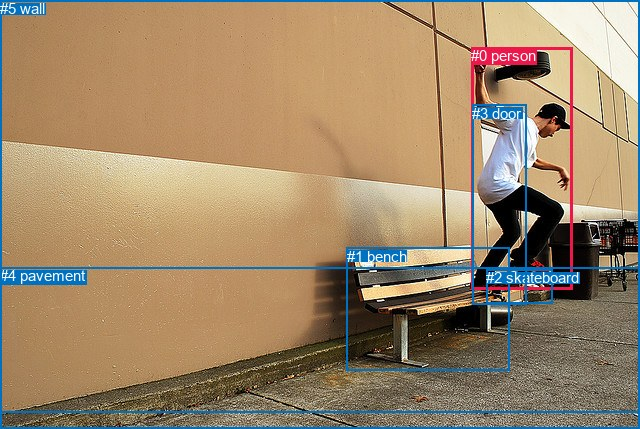

# 图片 1449：2383257.jpg

随机样本序号：382。图片 SHA256：`745fc379c0e51a1bb4aff3bfed40b4d126bdae452b817b6d704982d4652e331f`。

红色框表示人，蓝色框表示其他物体。两个模式分别保留自身框编号，可依据位置比较对应对象。

## 自动检测框与输出

人的框编号：`[0]`。状态：`ok`。

### 自动检测全部物体框

| 编号 | 类别 | 是否为人 | 检测分数 | 像素坐标 xyxy |
|---|---|---|---|---|
| 0 | person | True | 0.9996 | 467.6, 48.0, 573.9, 290.6 |
| 1 | skateboard | False | 0.9978 | 485.2, 269.1, 552.3, 300.1 |
| 2 | bench | False | 0.9964 | 347.4, 244.6, 510.6, 366.5 |

### 自动检测 Top50 人相关候选

评分物体对：6；人相关物体对：4；输出关系：8。

| 排名 | 主语编号与类别 | 关系 | 宾语编号与类别 | 类型 | 人与人 | 排序分数 | 原始融合 logit |
|---|---|---|---|---|---|---|---|
| 1 | #0 person | riding | #1 skateboard | semantic | False | 0.96808 | 3.4119 |
| 2 | #0 person | on | #2 bench | spatial | False | 0.95685 | 3.0990 |
| 3 | #0 person | on | #1 skateboard | spatial | False | 0.93628 | 2.6874 |
| 4 | #0 person | jumping over | #2 bench | semantic | False | 0.92466 | 2.5074 |
| 5 | #2 bench | beside | #0 person | spatial | False | 0.42972 | -0.2830 |
| 6 | #1 skateboard | on | #0 person | spatial | False | 0.38853 | -0.4535 |
| 7 | #2 bench | holding | #0 person | semantic | False | 0.22119 | -1.2588 |
| 8 | #1 skateboard | climbing | #0 person | semantic | False | 0.20712 | -1.3424 |

### 自动检测逐条人相关 GT 核验

R@50：0.00%；命中 0/4。

| GT 主语编号 | GT 关系 | GT 宾语编号 | 结果阶段 | 匹配预测主语编号 | 匹配预测宾语编号 |
|---|---|---|---|---|---|
| 0 | standing on | 1 | wrong_predicate | [0] | [2] |
| 0 | playing | 2 | wrong_predicate | [0] | [1] |
| 3 | beside | 0 | endpoint_missing_or_wrong_class | [] | [0] |
| 5 | beside | 0 | endpoint_missing_or_wrong_class | [] | [0] |

## 真实框与输出

人的框编号：`[0]`。

### 真实框全部物体框

| 编号 | 类别 | 是否为人 | 检测分数 | 像素坐标 xyxy |
|---|---|---|---|---|
| 0 | person | True | GT | 471.0, 47.0, 572.0, 290.0 |
| 1 | bench | False | GT | 347.0, 248.0, 510.0, 371.0 |
| 2 | skateboard | False | GT | 486.0, 269.0, 552.0, 303.0 |
| 3 | door | False | GT | 472.0, 105.0, 526.0, 305.0 |
| 4 | pavement | False | GT | 0.0, 267.0, 640.0, 429.0 |
| 5 | wall | False | GT | 0.0, 0.0, 640.0, 413.0 |

### 真实框 Top50 人相关候选

评分物体对：30；人相关物体对：10；输出关系：20。

| 排名 | 主语编号与类别 | 关系 | 宾语编号与类别 | 类型 | 人与人 | 排序分数 | 原始融合 logit |
|---|---|---|---|---|---|---|---|
| 1 | #0 person | wearing | #3 door | semantic | False | 0.97685 | 3.7422 |
| 2 | #0 person | on | #2 skateboard | spatial | False | 0.96528 | 3.3252 |
| 3 | #0 person | jumping over | #1 bench | semantic | False | 0.95336 | 3.0175 |
| 4 | #0 person | on | #1 bench | spatial | False | 0.95217 | 2.9910 |
| 5 | #0 person | riding | #2 skateboard | semantic | False | 0.93536 | 2.6721 |
| 6 | #0 person | in | #3 door | spatial | False | 0.92319 | 2.4864 |
| 7 | #0 person | playing | #5 wall | semantic | False | 0.90279 | 2.2286 |
| 8 | #0 person | on | #4 pavement | spatial | False | 0.89841 | 2.1796 |
| 9 | #3 door | on | #0 person | spatial | False | 0.81060 | 1.4539 |
| 10 | #0 person | standing on | #4 pavement | semantic | False | 0.80104 | 1.3928 |
| 11 | #0 person | on | #5 wall | spatial | False | 0.78777 | 1.3115 |
| 12 | #3 door | wearing | #0 person | semantic | False | 0.62405 | 0.5068 |
| 13 | #2 skateboard | on | #0 person | spatial | False | 0.59434 | 0.3819 |
| 14 | #5 wall | beside | #0 person | spatial | False | 0.44916 | -0.2041 |
| 15 | #1 bench | beside | #0 person | spatial | False | 0.20252 | -1.3706 |
| 16 | #1 bench | holding | #0 person | semantic | False | 0.19769 | -1.4008 |
| 17 | #2 skateboard | holding | #0 person | semantic | False | 0.15879 | -1.6673 |
| 18 | #4 pavement | beside | #0 person | spatial | False | 0.10459 | -2.1473 |
| 19 | #4 pavement | holding | #0 person | semantic | False | 0.10443 | -2.1490 |
| 20 | #5 wall | holding | #0 person | semantic | False | 0.05844 | -2.7795 |

### 真实框逐条人相关 GT 核验

R@50：25.00%；命中 1/4。

| GT 主语编号 | GT 关系 | GT 宾语编号 | 结果阶段 | 匹配预测主语编号 | 匹配预测宾语编号 |
|---|---|---|---|---|---|
| 0 | standing on | 1 | wrong_predicate | [0] | [1] |
| 0 | playing | 2 | wrong_predicate | [0] | [2] |
| 3 | beside | 0 | wrong_predicate | [3] | [0] |
| 5 | beside | 0 | hit50 | [5] | [0] |

## 全部人相关 GT

| 主语编号与类别 | 关系 | 宾语编号与类别 |
|---|---|---|
| #0 person | standing on | #1 bench |
| #0 person | playing | #2 skateboard |
| #3 door | beside | #0 person |
| #5 wall | beside | #0 person |

原始记录、全部人相关物体对的两项预测与分项分数见 [逐图证据 JSON](../evidence/cases/1449.json)。全部56类 logits 保留于本机 HOR/output/random500/logits/。

<!-- HOR_COMPLETE_RESULTS -->

## 六组条件的完整输出对照

以下保留同一图片三种框与候选模式、两种谓词输出规则的全部 Top50。框编号各自在所属模式内解释。

### 自动检测框完整枚举：空间与语义各保留一个谓词

| 排名 | 主语编号与类别 | 谓词 | 宾语编号与类别 | 分组 | 排序分数 | predicate logit | pair logit |
|---|---|---|---|---|---|---|---|
| 1 | #0 person | riding | #1 skateboard | semantic | 0.9680751 | 3.3421960 | 0.0697290 |
| 2 | #0 person | on | #2 bench | spatial | 0.9568532 | 3.2327495 | -0.1337087 |
| 3 | #0 person | on | #1 skateboard | spatial | 0.9362819 | 2.6177182 | 0.0697290 |
| 4 | #0 person | jumping over | #2 bench | semantic | 0.9246599 | 2.6411223 | -0.1337087 |
| 5 | #2 bench | beside | #0 person | spatial | 0.4297221 | 0.5846004 | -0.8675855 |
| 6 | #1 skateboard | on | #0 person | spatial | 0.3885262 | 0.1666274 | -0.6201391 |
| 7 | #2 bench | holding | #0 person | semantic | 0.2211888 | -0.3911662 | -0.8675855 |
| 8 | #1 skateboard | climbing | #0 person | semantic | 0.2071204 | -0.7222321 | -0.6201391 |

GT 命中：0/4，R@50=0.00%。

| GT主语 | GT谓词 | GT宾语 | 结果阶段 | 匹配主语框 | 匹配宾语框 |
|---|---|---|---|---|---|
| 0 | standing on | 1 | wrong_predicate | [0] | [2] |
| 0 | playing | 2 | wrong_predicate | [0] | [1] |
| 3 | beside | 0 | endpoint_missing_or_wrong_class | [] | [0] |
| 5 | beside | 0 | endpoint_missing_or_wrong_class | [] | [0] |

### 自动检测框完整枚举：每对只保留一个谓词

| 排名 | 主语编号与类别 | 谓词 | 宾语编号与类别 | 分组 | 排序分数 | predicate logit | pair logit |
|---|---|---|---|---|---|---|---|
| 1 | #0 person | riding | #1 skateboard | single | 0.9680751 | 3.3421960 | 0.0697290 |
| 2 | #0 person | on | #2 bench | single | 0.9568532 | 3.2327495 | -0.1337087 |
| 3 | #2 bench | beside | #0 person | single | 0.4297221 | 0.5846004 | -0.8675855 |
| 4 | #1 skateboard | on | #0 person | single | 0.3885262 | 0.1666274 | -0.6201391 |

GT 命中：0/4，R@50=0.00%。

| GT主语 | GT谓词 | GT宾语 | 结果阶段 | 匹配主语框 | 匹配宾语框 |
|---|---|---|---|---|---|
| 0 | standing on | 1 | wrong_predicate | [0] | [2] |
| 0 | playing | 2 | wrong_predicate | [0] | [1] |
| 3 | beside | 0 | endpoint_missing_or_wrong_class | [] | [0] |
| 5 | beside | 0 | endpoint_missing_or_wrong_class | [] | [0] |

### 真实框完整枚举：空间与语义各保留一个谓词

| 排名 | 主语编号与类别 | 谓词 | 宾语编号与类别 | 分组 | 排序分数 | predicate logit | pair logit |
|---|---|---|---|---|---|---|---|
| 1 | #0 person | wearing | #3 door | semantic | 0.9768478 | 3.8333077 | -0.0910694 |
| 2 | #0 person | on | #2 skateboard | spatial | 0.9652845 | 3.2579460 | 0.0672892 |
| 3 | #0 person | jumping over | #1 bench | semantic | 0.9533574 | 3.1222177 | -0.1047423 |
| 4 | #0 person | on | #1 bench | spatial | 0.9521667 | 3.0957603 | -0.1047423 |
| 5 | #0 person | riding | #2 skateboard | semantic | 0.9353607 | 2.6048207 | 0.0672892 |
| 6 | #0 person | in | #3 door | spatial | 0.9231854 | 2.5775051 | -0.0910694 |
| 7 | #0 person | playing | #5 wall | semantic | 0.9027916 | 2.6584325 | -0.4297980 |
| 8 | #0 person | on | #4 pavement | spatial | 0.8984066 | 2.6315036 | -0.4518586 |
| 9 | #3 door | on | #0 person | spatial | 0.8105953 | 2.1655092 | -0.7116267 |
| 10 | #0 person | standing on | #4 pavement | semantic | 0.8010389 | 1.8446593 | -0.4518586 |
| 11 | #0 person | on | #5 wall | spatial | 0.7877705 | 1.7413359 | -0.4297980 |
| 12 | #3 door | wearing | #0 person | semantic | 0.6240494 | 1.2183986 | -0.7116267 |
| 13 | #2 skateboard | on | #0 person | spatial | 0.5943414 | 1.0277762 | -0.6458344 |
| 14 | #5 wall | beside | #0 person | spatial | 0.4491553 | 0.7339001 | -0.9379842 |
| 15 | #1 bench | beside | #0 person | spatial | 0.2025197 | -0.4915428 | -0.8790771 |
| 16 | #1 bench | holding | #0 person | semantic | 0.1976926 | -0.5217013 | -0.8790771 |
| 17 | #2 skateboard | holding | #0 person | semantic | 0.1587885 | -1.0214355 | -0.6458344 |
| 18 | #4 pavement | beside | #0 person | spatial | 0.1045852 | -1.1427696 | -1.0045152 |
| 19 | #4 pavement | holding | #0 person | semantic | 0.1044293 | -1.1444352 | -1.0045152 |
| 20 | #5 wall | holding | #0 person | semantic | 0.0584419 | -1.8415196 | -0.9379842 |

GT 命中：1/4，R@50=25.00%。

| GT主语 | GT谓词 | GT宾语 | 结果阶段 | 匹配主语框 | 匹配宾语框 |
|---|---|---|---|---|---|
| 0 | standing on | 1 | wrong_predicate | [0] | [1] |
| 0 | playing | 2 | wrong_predicate | [0] | [2] |
| 3 | beside | 0 | wrong_predicate | [3] | [0] |
| 5 | beside | 0 | hit50 | [5] | [0] |

### 真实框完整枚举：每对只保留一个谓词

| 排名 | 主语编号与类别 | 谓词 | 宾语编号与类别 | 分组 | 排序分数 | predicate logit | pair logit |
|---|---|---|---|---|---|---|---|
| 1 | #0 person | wearing | #3 door | single | 0.9768478 | 3.8333077 | -0.0910694 |
| 2 | #0 person | on | #2 skateboard | single | 0.9652845 | 3.2579460 | 0.0672892 |
| 3 | #0 person | jumping over | #1 bench | single | 0.9533574 | 3.1222177 | -0.1047423 |
| 4 | #0 person | playing | #5 wall | single | 0.9027916 | 2.6584325 | -0.4297980 |
| 5 | #0 person | on | #4 pavement | single | 0.8984066 | 2.6315036 | -0.4518586 |
| 6 | #3 door | on | #0 person | single | 0.8105953 | 2.1655092 | -0.7116267 |
| 7 | #2 skateboard | on | #0 person | single | 0.5943414 | 1.0277762 | -0.6458344 |
| 8 | #5 wall | beside | #0 person | single | 0.4491553 | 0.7339001 | -0.9379842 |
| 9 | #1 bench | beside | #0 person | single | 0.2025197 | -0.4915428 | -0.8790771 |
| 10 | #4 pavement | beside | #0 person | single | 0.1045852 | -1.1427696 | -1.0045152 |

GT 命中：1/4，R@50=25.00%。

| GT主语 | GT谓词 | GT宾语 | 结果阶段 | 匹配主语框 | 匹配宾语框 |
|---|---|---|---|---|---|
| 0 | standing on | 1 | wrong_predicate | [0] | [1] |
| 0 | playing | 2 | wrong_predicate | [0] | [2] |
| 3 | beside | 0 | wrong_predicate | [3] | [0] |
| 5 | beside | 0 | hit50 | [5] | [0] |

### 真实框400候选：空间与语义各保留一个谓词

| 排名 | 主语编号与类别 | 谓词 | 宾语编号与类别 | 分组 | 排序分数 | predicate logit | pair logit |
|---|---|---|---|---|---|---|---|
| 1 | #0 person | wearing | #3 door | semantic | 0.9768478 | 3.8333077 | -0.0910694 |
| 2 | #0 person | on | #2 skateboard | spatial | 0.9652845 | 3.2579460 | 0.0672892 |
| 3 | #0 person | jumping over | #1 bench | semantic | 0.9533574 | 3.1222177 | -0.1047423 |
| 4 | #0 person | on | #1 bench | spatial | 0.9521667 | 3.0957603 | -0.1047423 |
| 5 | #0 person | riding | #2 skateboard | semantic | 0.9353607 | 2.6048207 | 0.0672892 |
| 6 | #0 person | in | #3 door | spatial | 0.9231854 | 2.5775051 | -0.0910694 |
| 7 | #0 person | playing | #5 wall | semantic | 0.9071331 | 2.7089200 | -0.4297980 |
| 8 | #0 person | on | #4 pavement | spatial | 0.8984066 | 2.6315036 | -0.4518586 |
| 9 | #3 door | on | #0 person | spatial | 0.8164210 | 2.2039123 | -0.7116267 |
| 10 | #0 person | standing on | #4 pavement | semantic | 0.7998660 | 1.8373156 | -0.4518586 |
| 11 | #0 person | on | #5 wall | spatial | 0.7895854 | 1.7522259 | -0.4297980 |
| 12 | #3 door | wearing | #0 person | semantic | 0.6297152 | 1.2426219 | -0.7116267 |
| 13 | #2 skateboard | on | #0 person | spatial | 0.5930280 | 1.0223317 | -0.6458344 |
| 14 | #5 wall | beside | #0 person | spatial | 0.4491409 | 0.7338419 | -0.9379842 |
| 15 | #1 bench | beside | #0 person | spatial | 0.2025103 | -0.4916010 | -0.8790771 |
| 16 | #1 bench | holding | #0 person | semantic | 0.1974585 | -0.5231781 | -0.8790771 |
| 17 | #2 skateboard | holding | #0 person | semantic | 0.1550036 | -1.0500498 | -0.6458344 |
| 18 | #4 pavement | holding | #0 person | semantic | 0.1043215 | -1.1455894 | -1.0045152 |
| 19 | #4 pavement | beside | #0 person | spatial | 0.1018033 | -1.1728320 | -1.0045152 |
| 20 | #5 wall | holding | #0 person | semantic | 0.0584419 | -1.8415196 | -0.9379842 |

GT 命中：1/4，R@50=25.00%。

| GT主语 | GT谓词 | GT宾语 | 结果阶段 | 匹配主语框 | 匹配宾语框 |
|---|---|---|---|---|---|
| 0 | standing on | 1 | wrong_predicate | [0] | [1] |
| 0 | playing | 2 | wrong_predicate | [0] | [2] |
| 3 | beside | 0 | wrong_predicate | [3] | [0] |
| 5 | beside | 0 | hit50 | [5] | [0] |

### 真实框400候选：每对只保留一个谓词

| 排名 | 主语编号与类别 | 谓词 | 宾语编号与类别 | 分组 | 排序分数 | predicate logit | pair logit |
|---|---|---|---|---|---|---|---|
| 1 | #0 person | wearing | #3 door | single | 0.9768478 | 3.8333077 | -0.0910694 |
| 2 | #0 person | on | #2 skateboard | single | 0.9652845 | 3.2579460 | 0.0672892 |
| 3 | #0 person | jumping over | #1 bench | single | 0.9533574 | 3.1222177 | -0.1047423 |
| 4 | #0 person | playing | #5 wall | single | 0.9071331 | 2.7089200 | -0.4297980 |
| 5 | #0 person | on | #4 pavement | single | 0.8984066 | 2.6315036 | -0.4518586 |
| 6 | #3 door | on | #0 person | single | 0.8164210 | 2.2039123 | -0.7116267 |
| 7 | #2 skateboard | on | #0 person | single | 0.5930280 | 1.0223317 | -0.6458344 |
| 8 | #5 wall | beside | #0 person | single | 0.4491409 | 0.7338419 | -0.9379842 |
| 9 | #1 bench | beside | #0 person | single | 0.2025103 | -0.4916010 | -0.8790771 |
| 10 | #4 pavement | holding | #0 person | single | 0.1043215 | -1.1455894 | -1.0045152 |

GT 命中：1/4，R@50=25.00%。

| GT主语 | GT谓词 | GT宾语 | 结果阶段 | 匹配主语框 | 匹配宾语框 |
|---|---|---|---|---|---|
| 0 | standing on | 1 | wrong_predicate | [0] | [1] |
| 0 | playing | 2 | wrong_predicate | [0] | [2] |
| 3 | beside | 0 | wrong_predicate | [3] | [0] |
| 5 | beside | 0 | hit50 | [5] | [0] |
