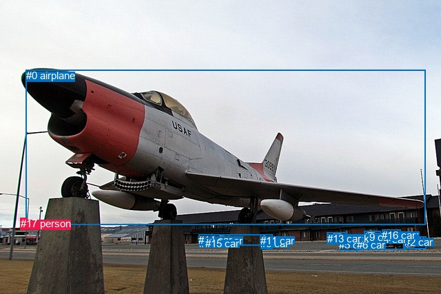
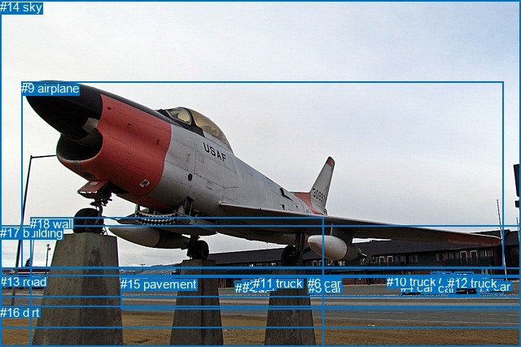

# 图片 1464：2384207.jpg

随机样本序号：442。图片 SHA256：`94f8f85c762d5fd6f766dc85bebb0daaabdc1dfffe2c0d8b8b4f1e72b54dcc43`。

红色框表示人，蓝色框表示其他物体。两个模式分别保留自身框编号，可依据位置比较对应对象。

## 自动检测框与输出

人的框编号：`[17]`。状态：`ok`。

### 自动检测全部物体框

| 编号 | 类别 | 是否为人 | 检测分数 | 像素坐标 xyxy |
|---|---|---|---|---|
| 0 | airplane | False | 0.9993 | 37.8, 101.3, 618.0, 326.3 |
| 1 | car | False | 0.9896 | 289.0, 344.8, 304.5, 356.4 |
| 2 | car | False | 0.9892 | 587.1, 343.4, 618.5, 361.5 |
| 3 | car | False | 0.9776 | 378.4, 345.0, 395.5, 361.9 |
| 4 | car | False | 0.9747 | 549.4, 339.4, 586.5, 362.3 |
| 5 | car | False | 0.9716 | 492.5, 347.0, 522.2, 363.5 |
| 6 | car | False | 0.9712 | 517.8, 346.6, 548.3, 362.5 |
| 7 | car | False | 0.9653 | 299.4, 343.7, 314.2, 354.4 |
| 8 | car | False | 0.9620 | 310.9, 340.9, 332.3, 355.5 |
| 9 | car | False | 0.9524 | 528.0, 336.0, 552.7, 349.8 |
| 10 | truck | False | 0.9339 | 474.9, 337.7, 503.9, 354.2 |
| 11 | car | False | 0.5859 | 377.5, 340.7, 385.6, 351.4 |
| 12 | car | False | 0.5780 | 558.3, 333.2, 577.6, 340.2 |
| 13 | car | False | 0.5157 | 475.1, 337.7, 503.1, 353.2 |
| 14 | car | False | 0.4990 | 288.1, 340.3, 395.8, 356.3 |
| 15 | car | False | 0.4144 | 297.5, 345.2, 308.9, 355.4 |
| 16 | car | False | 0.3864 | 554.2, 333.4, 581.5, 344.1 |
| 17 | person | True | 0.3547 | 29.8, 316.5, 38.3, 330.5 |

### 自动检测 Top50 人相关候选

评分物体对：306；人相关物体对：34；输出关系：50。

| 排名 | 主语编号与类别 | 关系 | 宾语编号与类别 | 类型 | 人与人 | 排序分数 | 原始融合 logit |
|---|---|---|---|---|---|---|---|
| 1 | #17 person | looking at | #0 airplane | semantic | False | 0.80200 | 1.3988 |
| 2 | #17 person | beside | #0 airplane | spatial | False | 0.58634 | 0.3488 |
| 3 | #0 airplane | flying over | #17 person | semantic | False | 0.51626 | 0.0651 |
| 4 | #0 airplane | in front of | #17 person | spatial | False | 0.45801 | -0.1684 |
| 5 | #17 person | guiding | #3 car | semantic | False | 0.24825 | -1.1080 |
| 6 | #17 person | guiding | #1 car | semantic | False | 0.20640 | -1.3468 |
| 7 | #17 person | guiding | #14 car | semantic | False | 0.19486 | -1.4187 |
| 8 | #17 person | guiding | #5 car | semantic | False | 0.19083 | -1.4446 |
| 9 | #17 person | guiding | #6 car | semantic | False | 0.17756 | -1.5330 |
| 10 | #17 person | guiding | #7 car | semantic | False | 0.17536 | -1.5481 |
| 11 | #17 person | guiding | #15 car | semantic | False | 0.17305 | -1.5641 |
| 12 | #17 person | guiding | #11 car | semantic | False | 0.16635 | -1.6117 |
| 13 | #2 car | parked on | #17 person | semantic | False | 0.16405 | -1.6284 |
| 14 | #17 person | guiding | #8 car | semantic | False | 0.15741 | -1.6776 |
| 15 | #17 person | guiding | #9 car | semantic | False | 0.15622 | -1.6866 |
| 16 | #17 person | guiding | #4 car | semantic | False | 0.14731 | -1.7559 |
| 17 | #5 car | parked on | #17 person | semantic | False | 0.14578 | -1.7681 |
| 18 | #17 person | guiding | #2 car | semantic | False | 0.14499 | -1.7744 |
| 19 | #17 person | guiding | #16 car | semantic | False | 0.13509 | -1.8567 |
| 20 | #4 car | parked on | #17 person | semantic | False | 0.13366 | -1.8690 |
| 21 | #10 truck | parked on | #17 person | semantic | False | 0.13284 | -1.8761 |
| 22 | #17 person | guiding | #10 truck | semantic | False | 0.13139 | -1.8887 |
| 23 | #8 car | parked on | #17 person | semantic | False | 0.12986 | -1.9022 |
| 24 | #6 car | parked on | #17 person | semantic | False | 0.12781 | -1.9204 |
| 25 | #17 person | guiding | #13 car | semantic | False | 0.12711 | -1.9267 |
| 26 | #13 car | parked on | #17 person | semantic | False | 0.12499 | -1.9460 |
| 27 | #17 person | guiding | #12 car | semantic | False | 0.11542 | -2.0365 |
| 28 | #14 car | parked on | #17 person | semantic | False | 0.10553 | -2.1372 |
| 29 | #16 car | parked on | #17 person | semantic | False | 0.09186 | -2.2912 |
| 30 | #9 car | parked on | #17 person | semantic | False | 0.08760 | -2.3433 |
| 31 | #7 car | parked on | #17 person | semantic | False | 0.08294 | -2.4030 |
| 32 | #12 car | parked on | #17 person | semantic | False | 0.07920 | -2.4532 |
| 33 | #1 car | parked on | #17 person | semantic | False | 0.07419 | -2.5240 |
| 34 | #3 car | parked on | #17 person | semantic | False | 0.07385 | -2.5289 |
| 35 | #15 car | parked on | #17 person | semantic | False | 0.06150 | -2.7253 |
| 36 | #10 truck | in | #17 person | spatial | False | 0.04564 | -3.0402 |
| 37 | #13 car | in | #17 person | spatial | False | 0.04482 | -3.0592 |
| 38 | #11 car | parked on | #17 person | semantic | False | 0.04206 | -3.1257 |
| 39 | #12 car | in | #17 person | spatial | False | 0.03648 | -3.2739 |
| 40 | #16 car | in | #17 person | spatial | False | 0.03062 | -3.4550 |
| 41 | #5 car | in | #17 person | spatial | False | 0.02838 | -3.5331 |
| 42 | #4 car | in | #17 person | spatial | False | 0.02747 | -3.5667 |
| 43 | #8 car | in | #17 person | spatial | False | 0.02653 | -3.6026 |
| 44 | #17 person | beside | #14 car | spatial | False | 0.02634 | -3.6101 |
| 45 | #2 car | in | #17 person | spatial | False | 0.02410 | -3.7010 |
| 46 | #6 car | in | #17 person | spatial | False | 0.02342 | -3.7304 |
| 47 | #9 car | in | #17 person | spatial | False | 0.02269 | -3.7630 |
| 48 | #11 car | in | #17 person | spatial | False | 0.02232 | -3.7797 |
| 49 | #14 car | in | #17 person | spatial | False | 0.02167 | -3.8099 |
| 50 | #3 car | in | #17 person | spatial | False | 0.02164 | -3.8112 |

### 自动检测逐条人相关 GT 核验

本图没有人相关 GT，R@50 无分母；预测候选继续展示。

## 真实框与输出

人的框编号：`[]`。

### 真实框全部物体框

| 编号 | 类别 | 是否为人 | 检测分数 | 像素坐标 xyxy |
|---|---|---|---|---|
| 0 | car | False | GT | 289.0, 346.0, 304.0, 356.0 |
| 1 | car | False | GT | 586.0, 344.0, 618.0, 362.0 |
| 2 | car | False | GT | 298.0, 344.0, 315.0, 356.0 |
| 3 | car | False | GT | 518.0, 346.0, 548.0, 362.0 |
| 4 | car | False | GT | 492.0, 345.0, 522.0, 365.0 |
| 5 | car | False | GT | 379.0, 346.0, 396.0, 362.0 |
| 6 | car | False | GT | 378.0, 340.0, 384.0, 349.0 |
| 7 | car | False | GT | 529.0, 335.0, 554.0, 349.0 |
| 8 | car | False | GT | 559.0, 334.0, 582.0, 343.0 |
| 9 | airplane | False | GT | 26.0, 100.0, 618.0, 329.0 |
| 10 | truck | False | GT | 475.0, 338.0, 504.0, 354.0 |
| 11 | truck | False | GT | 311.0, 340.0, 333.0, 356.0 |
| 12 | truck | False | GT | 550.0, 340.0, 588.0, 363.0 |
| 13 | road | False | GT | 0.0, 338.0, 640.0, 403.0 |
| 14 | sky | False | GT | 0.0, 0.0, 640.0, 331.0 |
| 15 | pavement | False | GT | 148.0, 341.0, 640.0, 381.0 |
| 16 | dirt | False | GT | 0.0, 376.0, 640.0, 427.0 |
| 17 | building | False | GT | 0.0, 278.0, 640.0, 366.0 |
| 18 | wall | False | GT | 37.0, 267.0, 397.0, 427.0 |

### 真实框 Top50 人相关候选

评分物体对：0；人相关物体对：0；输出关系：0。

| 排名 | 主语编号与类别 | 关系 | 宾语编号与类别 | 类型 | 人与人 | 排序分数 | 原始融合 logit |
|---|---|---|---|---|---|---|---|

### 真实框逐条人相关 GT 核验

本图没有人相关 GT，R@50 无分母；预测候选继续展示。

## 全部人相关 GT

| 主语编号与类别 | 关系 | 宾语编号与类别 |
|---|---|---|

原始记录、全部人相关物体对的两项预测与分项分数见 [逐图证据 JSON](../evidence/cases/1464.json)。全部56类 logits 保留于本机 HOR/output/random500/logits/。

<!-- HOR_COMPLETE_RESULTS -->

## 六组条件的完整输出对照

以下保留同一图片三种框与候选模式、两种谓词输出规则的全部 Top50。框编号各自在所属模式内解释。

### 自动检测框完整枚举：空间与语义各保留一个谓词

| 排名 | 主语编号与类别 | 谓词 | 宾语编号与类别 | 分组 | 排序分数 | predicate logit | pair logit |
|---|---|---|---|---|---|---|---|
| 1 | #17 person | looking at | #0 airplane | semantic | 0.8019986 | 1.8461766 | -0.4473437 |
| 2 | #17 person | beside | #0 airplane | spatial | 0.5863385 | 0.7961931 | -0.4473437 |
| 3 | #0 airplane | flying over | #17 person | semantic | 0.5162607 | 1.5878038 | -1.5227382 |
| 4 | #0 airplane | in front of | #17 person | spatial | 0.4580084 | 1.3543754 | -1.5227382 |
| 5 | #17 person | guiding | #3 car | semantic | 0.2482480 | -0.0530634 | -1.0549152 |
| 6 | #17 person | guiding | #1 car | semantic | 0.2064015 | 0.0059142 | -1.3526685 |
| 7 | #17 person | guiding | #14 car | semantic | 0.1948619 | -0.2298870 | -1.1888360 |
| 8 | #17 person | guiding | #5 car | semantic | 0.1908332 | -0.1119485 | -1.3326571 |
| 9 | #17 person | guiding | #6 car | semantic | 0.1775613 | -0.0821509 | -1.4508072 |
| 10 | #17 person | guiding | #7 car | semantic | 0.1753559 | -0.1737156 | -1.3744187 |
| 11 | #17 person | guiding | #15 car | semantic | 0.1730543 | -0.2038212 | -1.3603127 |
| 12 | #17 person | guiding | #11 car | semantic | 0.1663536 | -0.5623493 | -1.0493445 |
| 13 | #2 car | parked on | #17 person | semantic | 0.1640483 | -0.3675375 | -1.2608722 |
| 14 | #17 person | guiding | #8 car | semantic | 0.1574080 | -0.3233256 | -1.3543161 |
| 15 | #17 person | guiding | #9 car | semantic | 0.1562239 | -0.2312522 | -1.4553447 |
| 16 | #17 person | guiding | #4 car | semantic | 0.1473081 | -0.2607298 | -1.4951422 |
| 17 | #5 car | parked on | #17 person | semantic | 0.1457759 | -0.6380420 | -1.1300812 |
| 18 | #17 person | guiding | #2 car | semantic | 0.1449909 | -0.3213754 | -1.4530661 |
| 19 | #17 person | guiding | #16 car | semantic | 0.1350896 | -0.4091902 | -1.4474974 |
| 20 | #4 car | parked on | #17 person | semantic | 0.1336614 | -0.6378055 | -1.2311604 |
| 21 | #10 truck | parked on | #17 person | semantic | 0.1328414 | -0.8930705 | -0.9829957 |
| 22 | #17 person | guiding | #10 truck | semantic | 0.1313897 | -0.7091210 | -1.1796057 |
| 23 | #8 car | parked on | #17 person | semantic | 0.1298615 | -0.6685128 | -1.2336707 |
| 24 | #6 car | parked on | #17 person | semantic | 0.1278141 | -0.7284646 | -1.1919614 |
| 25 | #17 person | guiding | #13 car | semantic | 0.1271125 | -0.7389321 | -1.1878018 |
| 26 | #13 car | parked on | #17 person | semantic | 0.1249894 | -0.9682529 | -0.9777545 |
| 27 | #17 person | guiding | #12 car | semantic | 0.1154249 | -0.6180577 | -1.4184299 |
| 28 | #14 car | parked on | #17 person | semantic | 0.1055333 | -0.9238899 | -1.2133111 |
| 29 | #16 car | parked on | #17 person | semantic | 0.0918567 | -1.1185641 | -1.1726085 |
| 30 | #9 car | parked on | #17 person | semantic | 0.0876005 | -1.1943069 | -1.1489849 |
| 31 | #7 car | parked on | #17 person | semantic | 0.0829418 | -1.1649210 | -1.2381103 |
| 32 | #12 car | parked on | #17 person | semantic | 0.0792022 | -1.2988448 | -1.1543919 |
| 33 | #1 car | parked on | #17 person | semantic | 0.0741903 | -1.2700891 | -1.2539457 |
| 34 | #3 car | parked on | #17 person | semantic | 0.0738540 | -1.4049931 | -1.1239488 |
| 35 | #15 car | parked on | #17 person | semantic | 0.0614960 | -1.4807160 | -1.2445991 |
| 36 | #10 truck | in | #17 person | spatial | 0.0456424 | -2.0572045 | -0.9829957 |
| 37 | #13 car | in | #17 person | spatial | 0.0448201 | -2.0814881 | -0.9777545 |
| 38 | #11 car | parked on | #17 person | semantic | 0.0420610 | -2.0363855 | -1.0892788 |
| 39 | #12 car | in | #17 person | spatial | 0.0364781 | -2.1194918 | -1.1543919 |
| 40 | #16 car | in | #17 person | spatial | 0.0306200 | -2.2823935 | -1.1726085 |
| 41 | #5 car | in | #17 person | spatial | 0.0283846 | -2.4030313 | -1.1300812 |
| 42 | #4 car | in | #17 person | spatial | 0.0274741 | -2.3354933 | -1.2311604 |
| 43 | #8 car | in | #17 person | spatial | 0.0265291 | -2.3689537 | -1.2336707 |
| 44 | #17 person | beside | #14 car | spatial | 0.0263377 | -2.4212284 | -1.1888360 |
| 45 | #2 car | in | #17 person | spatial | 0.0241043 | -2.4400940 | -1.2608722 |
| 46 | #6 car | in | #17 person | spatial | 0.0234214 | -2.5384421 | -1.1919614 |
| 47 | #9 car | in | #17 person | spatial | 0.0226876 | -2.6140039 | -1.1489849 |
| 48 | #11 car | in | #17 person | spatial | 0.0223194 | -2.6904464 | -1.0892788 |
| 49 | #14 car | in | #17 person | spatial | 0.0216695 | -2.5966313 | -1.2133111 |
| 50 | #3 car | in | #17 person | spatial | 0.0216431 | -2.6872392 | -1.1239488 |

没有人相关 GT，本条件的召回率无分母。

### 自动检测框完整枚举：每对只保留一个谓词

| 排名 | 主语编号与类别 | 谓词 | 宾语编号与类别 | 分组 | 排序分数 | predicate logit | pair logit |
|---|---|---|---|---|---|---|---|
| 1 | #17 person | looking at | #0 airplane | single | 0.8019986 | 1.8461766 | -0.4473437 |
| 2 | #0 airplane | flying over | #17 person | single | 0.5162607 | 1.5878038 | -1.5227382 |
| 3 | #17 person | guiding | #3 car | single | 0.2482480 | -0.0530634 | -1.0549152 |
| 4 | #17 person | guiding | #1 car | single | 0.2064015 | 0.0059142 | -1.3526685 |
| 5 | #17 person | guiding | #14 car | single | 0.1948619 | -0.2298870 | -1.1888360 |
| 6 | #17 person | guiding | #5 car | single | 0.1908332 | -0.1119485 | -1.3326571 |
| 7 | #17 person | guiding | #6 car | single | 0.1775613 | -0.0821509 | -1.4508072 |
| 8 | #17 person | guiding | #7 car | single | 0.1753559 | -0.1737156 | -1.3744187 |
| 9 | #17 person | guiding | #15 car | single | 0.1730543 | -0.2038212 | -1.3603127 |
| 10 | #17 person | guiding | #11 car | single | 0.1663536 | -0.5623493 | -1.0493445 |
| 11 | #2 car | parked on | #17 person | single | 0.1640483 | -0.3675375 | -1.2608722 |
| 12 | #17 person | guiding | #8 car | single | 0.1574080 | -0.3233256 | -1.3543161 |
| 13 | #17 person | guiding | #9 car | single | 0.1562239 | -0.2312522 | -1.4553447 |
| 14 | #17 person | guiding | #4 car | single | 0.1473081 | -0.2607298 | -1.4951422 |
| 15 | #5 car | parked on | #17 person | single | 0.1457759 | -0.6380420 | -1.1300812 |
| 16 | #17 person | guiding | #2 car | single | 0.1449909 | -0.3213754 | -1.4530661 |
| 17 | #17 person | guiding | #16 car | single | 0.1350896 | -0.4091902 | -1.4474974 |
| 18 | #4 car | parked on | #17 person | single | 0.1336614 | -0.6378055 | -1.2311604 |
| 19 | #10 truck | parked on | #17 person | single | 0.1328414 | -0.8930705 | -0.9829957 |
| 20 | #17 person | guiding | #10 truck | single | 0.1313897 | -0.7091210 | -1.1796057 |
| 21 | #8 car | parked on | #17 person | single | 0.1298615 | -0.6685128 | -1.2336707 |
| 22 | #6 car | parked on | #17 person | single | 0.1278141 | -0.7284646 | -1.1919614 |
| 23 | #17 person | guiding | #13 car | single | 0.1271125 | -0.7389321 | -1.1878018 |
| 24 | #13 car | parked on | #17 person | single | 0.1249894 | -0.9682529 | -0.9777545 |
| 25 | #17 person | guiding | #12 car | single | 0.1154249 | -0.6180577 | -1.4184299 |
| 26 | #14 car | parked on | #17 person | single | 0.1055333 | -0.9238899 | -1.2133111 |
| 27 | #16 car | parked on | #17 person | single | 0.0918567 | -1.1185641 | -1.1726085 |
| 28 | #9 car | parked on | #17 person | single | 0.0876005 | -1.1943069 | -1.1489849 |
| 29 | #7 car | parked on | #17 person | single | 0.0829418 | -1.1649210 | -1.2381103 |
| 30 | #12 car | parked on | #17 person | single | 0.0792022 | -1.2988448 | -1.1543919 |
| 31 | #1 car | parked on | #17 person | single | 0.0741903 | -1.2700891 | -1.2539457 |
| 32 | #3 car | parked on | #17 person | single | 0.0738540 | -1.4049931 | -1.1239488 |
| 33 | #15 car | parked on | #17 person | single | 0.0614960 | -1.4807160 | -1.2445991 |
| 34 | #11 car | parked on | #17 person | single | 0.0420610 | -2.0363855 | -1.0892788 |

没有人相关 GT，本条件的召回率无分母。

### 真实框完整枚举：空间与语义各保留一个谓词

| 排名 | 主语编号与类别 | 谓词 | 宾语编号与类别 | 分组 | 排序分数 | predicate logit | pair logit |
|---|---|---|---|---|---|---|---|

没有人相关 GT，本条件的召回率无分母。

### 真实框完整枚举：每对只保留一个谓词

| 排名 | 主语编号与类别 | 谓词 | 宾语编号与类别 | 分组 | 排序分数 | predicate logit | pair logit |
|---|---|---|---|---|---|---|---|

没有人相关 GT，本条件的召回率无分母。

### 真实框400候选：空间与语义各保留一个谓词

| 排名 | 主语编号与类别 | 谓词 | 宾语编号与类别 | 分组 | 排序分数 | predicate logit | pair logit |
|---|---|---|---|---|---|---|---|

没有人相关 GT，本条件的召回率无分母。

### 真实框400候选：每对只保留一个谓词

| 排名 | 主语编号与类别 | 谓词 | 宾语编号与类别 | 分组 | 排序分数 | predicate logit | pair logit |
|---|---|---|---|---|---|---|---|

没有人相关 GT，本条件的召回率无分母。
