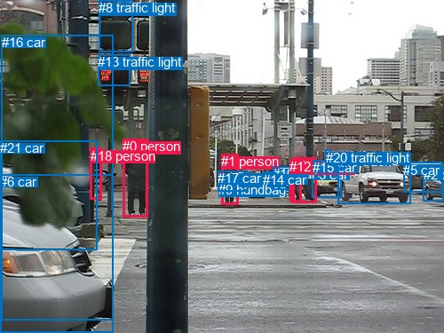
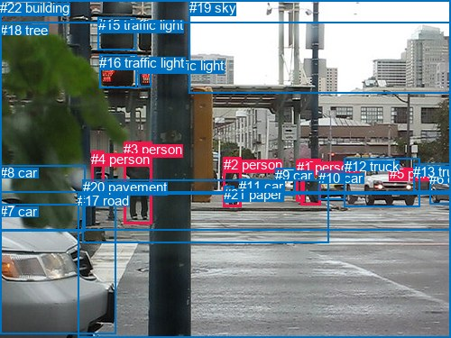

# 图片 1466：2384291.jpg

随机样本序号：16。图片 SHA256：`e6dfa7707e0369473b6ac5d90377963b4d92042f0fe68b238cb01ee3d93c8118`。

红色框表示人，蓝色框表示其他物体。两个模式分别保留自身框编号，可依据位置比较对应对象。

## 自动检测框与输出

人的框编号：`[0, 1, 4, 12, 18]`。状态：`ok`。

### 自动检测全部物体框

| 编号 | 类别 | 是否为人 | 检测分数 | 像素坐标 xyxy |
|---|---|---|---|---|
| 0 | person | True | 0.9991 | 138.2, 156.2, 166.2, 244.3 |
| 1 | person | True | 0.9986 | 249.5, 173.2, 268.8, 230.8 |
| 2 | car | False | 0.9964 | 476.9, 188.1, 499.9, 226.3 |
| 3 | car | False | 0.9924 | 351.2, 188.2, 384.7, 222.3 |
| 4 | person | True | 0.9823 | 329.0, 177.6, 356.8, 228.7 |
| 5 | car | False | 0.9743 | 454.1, 182.7, 499.0, 216.3 |
| 6 | car | False | 0.9702 | 0.0, 196.2, 127.4, 375.0 |
| 7 | car | False | 0.9662 | 265.5, 192.8, 279.4, 213.0 |
| 8 | traffic light | False | 0.9072 | 111.1, 0.5, 149.2, 58.6 |
| 9 | handbag | False | 0.8780 | 246.0, 204.5, 256.6, 221.4 |
| 10 | car | False | 0.8492 | 307.2, 187.1, 326.2, 213.5 |
| 11 | car | False | 0.8056 | 381.0, 172.5, 462.5, 229.1 |
| 12 | person | True | 0.7762 | 326.2, 179.3, 339.6, 227.8 |
| 13 | traffic light | False | 0.7757 | 110.3, 61.2, 146.5, 96.5 |
| 14 | car | False | 0.7613 | 296.5, 193.8, 309.4, 206.0 |
| 15 | car | False | 0.7383 | 352.4, 180.2, 385.9, 190.3 |
| 16 | car | False | 0.5205 | 1.5, 39.4, 127.2, 361.0 |
| 17 | car | False | 0.4998 | 245.4, 192.4, 279.4, 215.4 |
| 18 | person | True | 0.4751 | 101.6, 166.8, 114.2, 224.5 |
| 19 | truck | False | 0.4382 | 380.4, 172.9, 462.5, 229.5 |
| 20 | traffic light | False | 0.4098 | 366.9, 169.0, 372.2, 174.0 |
| 21 | car | False | 0.3828 | 0.0, 158.0, 110.0, 281.4 |

### 自动检测 Top50 人相关候选

评分物体对：462；人相关物体对：190；输出关系：50。

| 排名 | 主语编号与类别 | 关系 | 宾语编号与类别 | 类型 | 人与人 | 排序分数 | 原始融合 logit |
|---|---|---|---|---|---|---|---|
| 1 | #1 person | carrying | #9 handbag | semantic | False | 0.98427 | 4.1366 |
| 2 | #1 person | pushing | #17 car | semantic | False | 0.97051 | 3.4939 |
| 3 | #4 person | walking on | #3 car | semantic | False | 0.94663 | 2.8756 |
| 4 | #18 person | walking on | #6 car | semantic | False | 0.93964 | 2.7453 |
| 5 | #18 person | beside | #6 car | spatial | False | 0.91696 | 2.4017 |
| 6 | #1 person | walking on | #7 car | semantic | False | 0.90787 | 2.2879 |
| 7 | #0 person | talking to | #18 person | semantic | True | 0.89562 | 2.1495 |
| 8 | #1 person | on | #9 handbag | spatial | False | 0.88107 | 2.0026 |
| 9 | #12 person | walking on | #4 person | semantic | True | 0.85302 | 1.7585 |
| 10 | #1 person | beside | #17 car | spatial | False | 0.85035 | 1.7373 |
| 11 | #4 person | beside | #3 car | spatial | False | 0.84073 | 1.6637 |
| 12 | #12 person | walking on | #10 car | semantic | False | 0.83895 | 1.6505 |
| 13 | #18 person | looking at | #0 person | semantic | True | 0.80884 | 1.4425 |
| 14 | #18 person | walking on | #16 car | semantic | False | 0.78020 | 1.2668 |
| 15 | #18 person | walking on | #21 car | semantic | False | 0.77020 | 1.2095 |
| 16 | #0 person | beside | #18 person | spatial | True | 0.76430 | 1.1764 |
| 17 | #4 person | walking on | #10 car | semantic | False | 0.76097 | 1.1580 |
| 18 | #18 person | leaning on | #16 car | spatial | False | 0.75754 | 1.1393 |
| 19 | #4 person | walking on | #15 car | semantic | False | 0.75754 | 1.1392 |
| 20 | #1 person | beside | #7 car | spatial | False | 0.74367 | 1.0651 |
| 21 | #4 person | talking to | #12 person | semantic | True | 0.72710 | 0.9799 |
| 22 | #12 person | walking on | #3 car | semantic | False | 0.68356 | 0.7702 |
| 23 | #12 person | walking on | #9 handbag | semantic | False | 0.64249 | 0.5862 |
| 24 | #18 person | beside | #21 car | spatial | False | 0.63726 | 0.5635 |
| 25 | #4 person | beside | #15 car | spatial | False | 0.62997 | 0.5321 |
| 26 | #12 person | beside | #10 car | spatial | False | 0.62358 | 0.5048 |
| 27 | #0 person | looking at | #13 traffic light | semantic | False | 0.61413 | 0.4647 |
| 28 | #18 person | looking at | #13 traffic light | semantic | False | 0.60395 | 0.4219 |
| 29 | #12 person | beside | #4 person | spatial | True | 0.60371 | 0.4209 |
| 30 | #18 person | beside | #0 person | spatial | True | 0.54293 | 0.1721 |
| 31 | #4 person | looking at | #19 truck | semantic | False | 0.48157 | -0.0738 |
| 32 | #4 person | beside | #10 car | spatial | False | 0.47808 | -0.0877 |
| 33 | #4 person | looking at | #11 car | semantic | False | 0.47805 | -0.0879 |
| 34 | #0 person | talking to | #1 person | semantic | True | 0.46866 | -0.1255 |
| 35 | #4 person | walking on | #9 handbag | semantic | False | 0.45214 | -0.1920 |
| 36 | #4 person | beside | #12 person | spatial | True | 0.44874 | -0.2058 |
| 37 | #0 person | beside | #6 car | spatial | False | 0.43819 | -0.2485 |
| 38 | #12 person | beside | #3 car | spatial | False | 0.43170 | -0.2749 |
| 39 | #12 person | walking on | #14 car | semantic | False | 0.39606 | -0.4219 |
| 40 | #4 person | walking on | #17 car | semantic | False | 0.38361 | -0.4742 |
| 41 | #0 person | walking on | #9 handbag | semantic | False | 0.37259 | -0.5211 |
| 42 | #18 person | walking on | #9 handbag | semantic | False | 0.36306 | -0.5621 |
| 43 | #0 person | talking to | #4 person | semantic | True | 0.36185 | -0.5673 |
| 44 | #9 handbag | on | #1 person | spatial | False | 0.36066 | -0.5725 |
| 45 | #0 person | talking to | #12 person | semantic | True | 0.35429 | -0.6002 |
| 46 | #12 person | walking on | #17 car | semantic | False | 0.34759 | -0.6296 |
| 47 | #0 person | walking on | #17 car | semantic | False | 0.33779 | -0.6731 |
| 48 | #12 person | walking on | #7 car | semantic | False | 0.33360 | -0.6919 |
| 49 | #12 person | walking on | #15 car | semantic | False | 0.32803 | -0.7171 |
| 50 | #4 person | beside | #19 truck | spatial | False | 0.32421 | -0.7345 |

### 自动检测逐条人相关 GT 核验

R@50：33.33%；命中 2/6。

| GT 主语编号 | GT 关系 | GT 宾语编号 | 结果阶段 | 匹配预测主语编号 | 匹配预测宾语编号 |
|---|---|---|---|---|---|
| 0 | beside | 1 | hit50 | [4] | [12] |
| 0 | on | 20 | endpoint_missing_or_wrong_class | [4] | [] |
| 1 | beside | 0 | hit50 | [12] | [4] |
| 2 | holding | 21 | endpoint_missing_or_wrong_class | [1] | [] |
| 3 | walking on | 20 | endpoint_missing_or_wrong_class | [0] | [] |
| 4 | on | 20 | endpoint_missing_or_wrong_class | [18] | [] |

## 真实框与输出

人的框编号：`[0, 1, 2, 3, 4, 5]`。

### 真实框全部物体框

| 编号 | 类别 | 是否为人 | 检测分数 | 像素坐标 xyxy |
|---|---|---|---|---|
| 0 | person | True | GT | 333.0, 176.0, 355.0, 228.0 |
| 1 | person | True | GT | 329.0, 177.0, 338.0, 223.0 |
| 2 | person | True | GT | 248.0, 174.0, 268.0, 230.0 |
| 3 | person | True | GT | 137.0, 157.0, 168.0, 248.0 |
| 4 | person | True | GT | 101.0, 168.0, 115.0, 227.0 |
| 5 | person | True | GT | 432.0, 184.0, 439.0, 193.0 |
| 6 | car | False | GT | 476.0, 190.0, 500.0, 227.0 |
| 7 | car | False | GT | 0.0, 226.0, 129.0, 371.0 |
| 8 | car | False | GT | 0.0, 183.0, 95.0, 256.0 |
| 9 | car | False | GT | 305.0, 186.0, 327.0, 216.0 |
| 10 | car | False | GT | 353.0, 189.0, 382.0, 221.0 |
| 11 | car | False | GT | 265.0, 198.0, 280.0, 214.0 |
| 12 | truck | False | GT | 382.0, 176.0, 466.0, 230.0 |
| 13 | truck | False | GT | 458.0, 182.0, 499.0, 213.0 |
| 14 | traffic light | False | GT | 154.0, 64.0, 168.0, 96.0 |
| 15 | traffic light | False | GT | 109.0, 19.0, 151.0, 55.0 |
| 16 | traffic light | False | GT | 110.0, 61.0, 151.0, 98.0 |
| 17 | road | False | GT | 86.0, 214.0, 500.0, 375.0 |
| 18 | tree | False | GT | 0.0, 25.0, 500.0, 256.0 |
| 19 | sky | False | GT | 210.0, 0.0, 500.0, 104.0 |
| 20 | pavement | False | GT | 92.0, 199.0, 365.0, 269.0 |
| 21 | paper | False | GT | 248.0, 207.0, 259.0, 225.0 |
| 22 | building | False | GT | 0.0, 0.0, 500.0, 213.0 |

### 真实框 Top50 人相关候选

评分物体对：506；人相关物体对：234；输出关系：50。

| 排名 | 主语编号与类别 | 关系 | 宾语编号与类别 | 类型 | 人与人 | 排序分数 | 原始融合 logit |
|---|---|---|---|---|---|---|---|
| 1 | #2 person | wearing | #21 paper | semantic | False | 0.99448 | 5.1942 |
| 2 | #0 person | crossing | #17 road | semantic | False | 0.99429 | 5.1601 |
| 3 | #2 person | crossing | #17 road | semantic | False | 0.99370 | 5.0614 |
| 4 | #1 person | crossing | #17 road | semantic | False | 0.98959 | 4.5543 |
| 5 | #2 person | walking on | #20 pavement | semantic | False | 0.98701 | 4.3305 |
| 6 | #3 person | standing on | #20 pavement | semantic | False | 0.98596 | 4.2515 |
| 7 | #0 person | walking on | #20 pavement | semantic | False | 0.98064 | 3.9248 |
| 8 | #5 person | on | #12 truck | spatial | False | 0.96657 | 3.3644 |
| 9 | #3 person | standing on | #17 road | semantic | False | 0.96448 | 3.3014 |
| 10 | #4 person | standing on | #20 pavement | semantic | False | 0.96201 | 3.2317 |
| 11 | #1 person | walking on | #20 pavement | semantic | False | 0.95617 | 3.0827 |
| 12 | #2 person | in | #21 paper | spatial | False | 0.93767 | 2.7109 |
| 13 | #2 person | on | #20 pavement | spatial | False | 0.93596 | 2.6820 |
| 14 | #2 person | pushing | #11 car | semantic | False | 0.91859 | 2.4234 |
| 15 | #3 person | on | #20 pavement | spatial | False | 0.91482 | 2.3739 |
| 16 | #2 person | on | #17 road | spatial | False | 0.91331 | 2.3547 |
| 17 | #0 person | on | #17 road | spatial | False | 0.90085 | 2.2067 |
| 18 | #0 person | on | #20 pavement | spatial | False | 0.88632 | 2.0537 |
| 19 | #0 person | walking on | #10 car | semantic | False | 0.87519 | 1.9477 |
| 20 | #3 person | on | #17 road | spatial | False | 0.85035 | 1.7374 |
| 21 | #1 person | walking on | #0 person | semantic | True | 0.84510 | 1.6967 |
| 22 | #1 person | on | #17 road | spatial | False | 0.82267 | 1.5345 |
| 23 | #4 person | on | #20 pavement | spatial | False | 0.81224 | 1.4646 |
| 24 | #0 person | beside | #10 car | spatial | False | 0.80943 | 1.4463 |
| 25 | #3 person | talking to | #4 person | semantic | True | 0.77709 | 1.2488 |
| 26 | #0 person | talking to | #1 person | semantic | True | 0.77568 | 1.2407 |
| 27 | #4 person | standing on | #17 road | semantic | False | 0.77317 | 1.2263 |
| 28 | #1 person | on | #20 pavement | spatial | False | 0.74460 | 1.0700 |
| 29 | #2 person | walking on | #18 tree | semantic | False | 0.73773 | 1.0342 |
| 30 | #3 person | in | #18 tree | spatial | False | 0.72015 | 0.9452 |
| 31 | #2 person | in | #18 tree | spatial | False | 0.70759 | 0.8837 |
| 32 | #1 person | beside | #0 person | spatial | True | 0.70200 | 0.8569 |
| 33 | #0 person | beside | #1 person | spatial | True | 0.69046 | 0.8023 |
| 34 | #2 person | beside | #11 car | spatial | False | 0.65404 | 0.6368 |
| 35 | #12 truck | in | #5 person | spatial | False | 0.62780 | 0.5228 |
| 36 | #3 person | standing on | #18 tree | semantic | False | 0.61932 | 0.4867 |
| 37 | #4 person | in | #18 tree | spatial | False | 0.60379 | 0.4213 |
| 38 | #3 person | beside | #4 person | spatial | True | 0.59040 | 0.3656 |
| 39 | #4 person | on | #17 road | spatial | False | 0.56435 | 0.2588 |
| 40 | #4 person | looking at | #3 person | semantic | True | 0.56222 | 0.2502 |
| 41 | #1 person | walking on | #9 car | semantic | False | 0.53996 | 0.1602 |
| 42 | #4 person | walking on | #18 tree | semantic | False | 0.53199 | 0.1281 |
| 43 | #0 person | walking on | #18 tree | semantic | False | 0.51685 | 0.0674 |
| 44 | #5 person | standing on | #12 truck | semantic | False | 0.50254 | 0.0102 |
| 45 | #21 paper | on | #2 person | spatial | False | 0.46482 | -0.1409 |
| 46 | #4 person | beside | #7 car | spatial | False | 0.44949 | -0.2027 |
| 47 | #1 person | beside | #9 car | spatial | False | 0.40524 | -0.3837 |
| 48 | #4 person | beside | #3 person | spatial | True | 0.39780 | -0.4146 |
| 49 | #0 person | in | #18 tree | spatial | False | 0.39722 | -0.4171 |
| 50 | #0 person | walking on | #9 car | semantic | False | 0.36985 | -0.5329 |

### 真实框逐条人相关 GT 核验

R@50：66.67%；命中 4/6。

| GT 主语编号 | GT 关系 | GT 宾语编号 | 结果阶段 | 匹配预测主语编号 | 匹配预测宾语编号 |
|---|---|---|---|---|---|
| 0 | beside | 1 | hit50 | [0] | [1] |
| 0 | on | 20 | hit50 | [0] | [20] |
| 1 | beside | 0 | hit50 | [1] | [0] |
| 2 | holding | 21 | wrong_predicate | [2] | [21] |
| 3 | walking on | 20 | wrong_predicate | [3] | [20] |
| 4 | on | 20 | hit50 | [4] | [20] |

## 全部人相关 GT

| 主语编号与类别 | 关系 | 宾语编号与类别 |
|---|---|---|
| #0 person | beside | #1 person |
| #0 person | on | #20 pavement |
| #1 person | beside | #0 person |
| #2 person | holding | #21 paper |
| #3 person | walking on | #20 pavement |
| #4 person | on | #20 pavement |

原始记录、全部人相关物体对的两项预测与分项分数见 [逐图证据 JSON](../evidence/cases/1466.json)。全部56类 logits 保留于本机 HOR/output/random500/logits/。

<!-- HOR_COMPLETE_RESULTS -->

## 六组条件的完整输出对照

以下保留同一图片三种框与候选模式、两种谓词输出规则的全部 Top50。框编号各自在所属模式内解释。

### 自动检测框完整枚举：空间与语义各保留一个谓词

| 排名 | 主语编号与类别 | 谓词 | 宾语编号与类别 | 分组 | 排序分数 | predicate logit | pair logit |
|---|---|---|---|---|---|---|---|
| 1 | #1 person | carrying | #9 handbag | semantic | 0.9842744 | 3.5925145 | 0.5441054 |
| 2 | #1 person | pushing | #17 car | semantic | 0.9705127 | 3.4858890 | 0.0079736 |
| 3 | #4 person | walking on | #3 car | semantic | 0.9466268 | 2.9429379 | -0.0673429 |
| 4 | #18 person | walking on | #6 car | semantic | 0.9396446 | 3.4514642 | -0.7062124 |
| 5 | #18 person | beside | #6 car | spatial | 0.9169559 | 3.1078997 | -0.7062124 |
| 6 | #1 person | walking on | #7 car | semantic | 0.9078718 | 2.3802357 | -0.0923145 |
| 7 | #0 person | talking to | #18 person | semantic | 0.8956222 | 2.6109109 | -0.4614089 |
| 8 | #1 person | on | #9 handbag | spatial | 0.8810669 | 1.4584670 | 0.5441054 |
| 9 | #12 person | walking on | #4 person | semantic | 0.8530232 | 2.2267685 | -0.4682561 |
| 10 | #1 person | beside | #17 car | spatial | 0.8503492 | 1.7293692 | 0.0079736 |
| 11 | #4 person | beside | #3 car | spatial | 0.8407345 | 1.7310457 | -0.0673429 |
| 12 | #12 person | walking on | #10 car | semantic | 0.8389544 | 1.4625010 | 0.1879679 |
| 13 | #18 person | looking at | #0 person | semantic | 0.8088427 | 2.1254735 | -0.6829658 |
| 14 | #18 person | walking on | #16 car | semantic | 0.7802005 | 2.0191407 | -0.7523051 |
| 15 | #18 person | walking on | #21 car | semantic | 0.7702049 | 2.1906424 | -0.9811741 |
| 16 | #0 person | beside | #18 person | spatial | 0.7643025 | 1.6378231 | -0.4614089 |
| 17 | #4 person | walking on | #10 car | semantic | 0.7609674 | 0.9599810 | 0.1980095 |
| 18 | #18 person | leaning on | #16 car | spatial | 0.7575442 | 1.8915672 | -0.7523051 |
| 19 | #4 person | walking on | #15 car | semantic | 0.7575417 | 1.3722410 | -0.2329925 |
| 20 | #1 person | beside | #7 car | spatial | 0.7436730 | 1.1574616 | -0.0923145 |
| 21 | #4 person | talking to | #12 person | semantic | 0.7270954 | 1.2922730 | -0.3123378 |
| 22 | #12 person | walking on | #3 car | semantic | 0.6835644 | 0.9088306 | -0.1386297 |
| 23 | #12 person | walking on | #9 handbag | semantic | 0.6424916 | 0.7524228 | -0.1662280 |
| 24 | #18 person | beside | #21 car | spatial | 0.6372582 | 1.5446577 | -0.9811741 |
| 25 | #4 person | beside | #15 car | spatial | 0.6299722 | 0.7650900 | -0.2329925 |
| 26 | #12 person | beside | #10 car | spatial | 0.6235826 | 0.3168149 | 0.1879679 |
| 27 | #0 person | looking at | #13 traffic light | semantic | 0.6141329 | 1.4907680 | -1.0260496 |
| 28 | #18 person | looking at | #13 traffic light | semantic | 0.6039454 | 1.4980893 | -1.0761578 |
| 29 | #12 person | beside | #4 person | spatial | 0.6037055 | 0.8891850 | -0.4682561 |
| 30 | #18 person | beside | #0 person | spatial | 0.5429285 | 0.8551035 | -0.6829658 |
| 31 | #4 person | looking at | #19 truck | semantic | 0.4815688 | 0.9456391 | -1.0193976 |
| 32 | #4 person | beside | #10 car | spatial | 0.4780832 | -0.2857327 | 0.1980095 |
| 33 | #4 person | looking at | #11 car | semantic | 0.4780504 | 0.9452906 | -1.0331457 |
| 34 | #0 person | talking to | #1 person | semantic | 0.4686628 | 0.9668970 | -1.0924104 |
| 35 | #4 person | walking on | #9 handbag | semantic | 0.4521391 | 0.0121694 | -0.2042007 |
| 36 | #4 person | beside | #12 person | spatial | 0.4487414 | 0.1065807 | -0.3123378 |
| 37 | #0 person | beside | #6 car | spatial | 0.4381857 | 0.9443364 | -1.1928649 |
| 38 | #12 person | beside | #3 car | spatial | 0.4317001 | -0.1362886 | -0.1386297 |
| 39 | #12 person | walking on | #14 car | semantic | 0.3960584 | -0.2586794 | -0.1632362 |
| 40 | #4 person | walking on | #17 car | semantic | 0.3836123 | 0.1505561 | -0.6247998 |
| 41 | #0 person | walking on | #9 handbag | semantic | 0.3725904 | -0.2315569 | -0.2895629 |
| 42 | #18 person | walking on | #9 handbag | semantic | 0.3630589 | 0.3521771 | -0.9142894 |
| 43 | #0 person | talking to | #4 person | semantic | 0.3618486 | 0.9331794 | -1.5005292 |
| 44 | #9 handbag | on | #1 person | spatial | 0.3606587 | 0.3597445 | -0.9322506 |
| 45 | #0 person | talking to | #12 person | semantic | 0.3542915 | 0.7814722 | -1.3817003 |
| 46 | #12 person | walking on | #17 car | semantic | 0.3475911 | -0.0179353 | -0.6117094 |
| 47 | #0 person | walking on | #17 car | semantic | 0.3377924 | 0.2047458 | -0.8778933 |
| 48 | #12 person | walking on | #7 car | semantic | 0.3336031 | -0.0856581 | -0.6062754 |
| 49 | #12 person | walking on | #15 car | semantic | 0.3280258 | -0.4286900 | -0.2884375 |
| 50 | #4 person | beside | #19 truck | spatial | 0.3242090 | 0.2849021 | -1.0193976 |

GT 命中：2/6，R@50=33.33%。

| GT主语 | GT谓词 | GT宾语 | 结果阶段 | 匹配主语框 | 匹配宾语框 |
|---|---|---|---|---|---|
| 0 | beside | 1 | hit50 | [4] | [12] |
| 0 | on | 20 | endpoint_missing_or_wrong_class | [4] | [] |
| 1 | beside | 0 | hit50 | [12] | [4] |
| 2 | holding | 21 | endpoint_missing_or_wrong_class | [1] | [] |
| 3 | walking on | 20 | endpoint_missing_or_wrong_class | [0] | [] |
| 4 | on | 20 | endpoint_missing_or_wrong_class | [18] | [] |

### 自动检测框完整枚举：每对只保留一个谓词

| 排名 | 主语编号与类别 | 谓词 | 宾语编号与类别 | 分组 | 排序分数 | predicate logit | pair logit |
|---|---|---|---|---|---|---|---|
| 1 | #1 person | carrying | #9 handbag | single | 0.9842744 | 3.5925145 | 0.5441054 |
| 2 | #1 person | pushing | #17 car | single | 0.9705127 | 3.4858890 | 0.0079736 |
| 3 | #4 person | walking on | #3 car | single | 0.9466268 | 2.9429379 | -0.0673429 |
| 4 | #18 person | walking on | #6 car | single | 0.9396446 | 3.4514642 | -0.7062124 |
| 5 | #1 person | walking on | #7 car | single | 0.9078718 | 2.3802357 | -0.0923145 |
| 6 | #0 person | talking to | #18 person | single | 0.8956222 | 2.6109109 | -0.4614089 |
| 7 | #12 person | walking on | #4 person | single | 0.8530232 | 2.2267685 | -0.4682561 |
| 8 | #12 person | walking on | #10 car | single | 0.8389544 | 1.4625010 | 0.1879679 |
| 9 | #18 person | looking at | #0 person | single | 0.8088427 | 2.1254735 | -0.6829658 |
| 10 | #18 person | walking on | #16 car | single | 0.7802005 | 2.0191407 | -0.7523051 |
| 11 | #18 person | walking on | #21 car | single | 0.7702049 | 2.1906424 | -0.9811741 |
| 12 | #4 person | walking on | #10 car | single | 0.7609674 | 0.9599810 | 0.1980095 |
| 13 | #4 person | walking on | #15 car | single | 0.7575417 | 1.3722410 | -0.2329925 |
| 14 | #4 person | talking to | #12 person | single | 0.7270954 | 1.2922730 | -0.3123378 |
| 15 | #12 person | walking on | #3 car | single | 0.6835644 | 0.9088306 | -0.1386297 |
| 16 | #12 person | walking on | #9 handbag | single | 0.6424916 | 0.7524228 | -0.1662280 |
| 17 | #0 person | looking at | #13 traffic light | single | 0.6141329 | 1.4907680 | -1.0260496 |
| 18 | #18 person | looking at | #13 traffic light | single | 0.6039454 | 1.4980893 | -1.0761578 |
| 19 | #4 person | looking at | #19 truck | single | 0.4815688 | 0.9456391 | -1.0193976 |
| 20 | #4 person | looking at | #11 car | single | 0.4780504 | 0.9452906 | -1.0331457 |
| 21 | #0 person | talking to | #1 person | single | 0.4686628 | 0.9668970 | -1.0924104 |
| 22 | #4 person | walking on | #9 handbag | single | 0.4521391 | 0.0121694 | -0.2042007 |
| 23 | #0 person | beside | #6 car | single | 0.4381857 | 0.9443364 | -1.1928649 |
| 24 | #12 person | walking on | #14 car | single | 0.3960584 | -0.2586794 | -0.1632362 |
| 25 | #4 person | walking on | #17 car | single | 0.3836123 | 0.1505561 | -0.6247998 |
| 26 | #0 person | walking on | #9 handbag | single | 0.3725904 | -0.2315569 | -0.2895629 |
| 27 | #18 person | walking on | #9 handbag | single | 0.3630589 | 0.3521771 | -0.9142894 |
| 28 | #0 person | talking to | #4 person | single | 0.3618486 | 0.9331794 | -1.5005292 |
| 29 | #9 handbag | on | #1 person | single | 0.3606587 | 0.3597445 | -0.9322506 |
| 30 | #0 person | talking to | #12 person | single | 0.3542915 | 0.7814722 | -1.3817003 |
| 31 | #12 person | walking on | #17 car | single | 0.3475911 | -0.0179353 | -0.6117094 |
| 32 | #0 person | walking on | #17 car | single | 0.3377924 | 0.2047458 | -0.8778933 |
| 33 | #12 person | walking on | #7 car | single | 0.3336031 | -0.0856581 | -0.6062754 |
| 34 | #12 person | walking on | #15 car | single | 0.3280258 | -0.4286900 | -0.2884375 |
| 35 | #4 person | walking on | #7 car | single | 0.3211724 | -0.1368227 | -0.6115662 |
| 36 | #18 person | walking on | #17 car | single | 0.3205631 | 0.2859597 | -1.0371450 |
| 37 | #4 person | walking on | #14 car | single | 0.3187280 | -0.6047215 | -0.1549019 |
| 38 | #0 person | looking at | #8 traffic light | single | 0.2796513 | 0.6261411 | -1.5723327 |
| 39 | #18 person | looking at | #19 truck | single | 0.2749698 | -0.1236997 | -0.8458523 |
| 40 | #18 person | looking at | #11 car | single | 0.2736866 | -0.1236997 | -0.8522980 |
| 41 | #18 person | walking on | #7 car | single | 0.2722109 | 0.0482264 | -1.0316607 |
| 42 | #18 person | looking at | #1 person | single | 0.2651515 | 0.1834879 | -1.2028508 |
| 43 | #1 person | talking to | #12 person | single | 0.2536576 | -0.0612078 | -1.0179915 |
| 44 | #1 person | walking on | #14 car | single | 0.2517770 | -0.9688132 | -0.1203440 |
| 45 | #0 person | walking on | #7 car | single | 0.2507817 | -0.0359850 | -1.0584625 |
| 46 | #4 person | walking on | #1 person | single | 0.2378018 | -0.2541776 | -0.9105917 |
| 47 | #4 person | looking at | #20 traffic light | single | 0.2362595 | -0.5121193 | -0.6611781 |
| 48 | #10 car | beside | #12 person | single | 0.2149799 | -0.6471028 | -0.6480621 |
| 49 | #12 person | walking on | #1 person | single | 0.2075902 | -0.4467530 | -0.8927595 |
| 50 | #1 person | talking to | #4 person | single | 0.1980059 | -0.2086005 | -1.1902041 |

GT 命中：0/6，R@50=0.00%。

| GT主语 | GT谓词 | GT宾语 | 结果阶段 | 匹配主语框 | 匹配宾语框 |
|---|---|---|---|---|---|
| 0 | beside | 1 | wrong_predicate | [4] | [12] |
| 0 | on | 20 | endpoint_missing_or_wrong_class | [4] | [] |
| 1 | beside | 0 | wrong_predicate | [12] | [4] |
| 2 | holding | 21 | endpoint_missing_or_wrong_class | [1] | [] |
| 3 | walking on | 20 | endpoint_missing_or_wrong_class | [0] | [] |
| 4 | on | 20 | endpoint_missing_or_wrong_class | [18] | [] |

### 真实框完整枚举：空间与语义各保留一个谓词

| 排名 | 主语编号与类别 | 谓词 | 宾语编号与类别 | 分组 | 排序分数 | predicate logit | pair logit |
|---|---|---|---|---|---|---|---|
| 1 | #2 person | wearing | #21 paper | semantic | 0.9944822 | 4.6537490 | 0.5404849 |
| 2 | #0 person | crossing | #17 road | semantic | 0.9942918 | 5.2028842 | -0.0427709 |
| 3 | #2 person | crossing | #17 road | semantic | 0.9937029 | 5.0220532 | 0.0393057 |
| 4 | #1 person | crossing | #17 road | semantic | 0.9895872 | 4.7218509 | -0.1675940 |
| 5 | #2 person | walking on | #20 pavement | semantic | 0.9870098 | 4.0352817 | 0.2952059 |
| 6 | #3 person | standing on | #20 pavement | semantic | 0.9859573 | 4.2242103 | 0.0272992 |
| 7 | #0 person | walking on | #20 pavement | semantic | 0.9806358 | 3.8577447 | 0.0670328 |
| 8 | #5 person | on | #12 truck | spatial | 0.9665728 | 3.4362350 | -0.0718497 |
| 9 | #3 person | standing on | #17 road | semantic | 0.9644753 | 3.4887614 | -0.1874037 |
| 10 | #4 person | standing on | #20 pavement | semantic | 0.9620082 | 3.3155580 | -0.0839055 |
| 11 | #1 person | walking on | #20 pavement | semantic | 0.9561723 | 3.1235414 | -0.0408670 |
| 12 | #2 person | in | #21 paper | spatial | 0.9376655 | 2.1703930 | 0.5404849 |
| 13 | #2 person | on | #20 pavement | spatial | 0.9359551 | 2.3867764 | 0.2952059 |
| 14 | #2 person | pushing | #11 car | semantic | 0.9185936 | 2.4629612 | -0.0395714 |
| 15 | #3 person | on | #20 pavement | spatial | 0.9148179 | 2.3466358 | 0.0272992 |
| 16 | #2 person | on | #17 road | spatial | 0.9133087 | 2.3154144 | 0.0393057 |
| 17 | #0 person | on | #17 road | spatial | 0.9008520 | 2.2494984 | -0.0427709 |
| 18 | #0 person | on | #20 pavement | spatial | 0.8863242 | 1.9866991 | 0.0670328 |
| 19 | #0 person | walking on | #10 car | semantic | 0.8751937 | 1.9920735 | -0.0443914 |
| 20 | #3 person | on | #17 road | spatial | 0.8503534 | 1.9247794 | -0.1874037 |
| 21 | #1 person | walking on | #0 person | semantic | 0.8450969 | 2.1816249 | -0.4849733 |
| 22 | #1 person | on | #17 road | spatial | 0.8226677 | 1.7021213 | -0.1675940 |
| 23 | #4 person | on | #20 pavement | spatial | 0.8122357 | 1.5485082 | -0.0839055 |
| 24 | #0 person | beside | #10 car | spatial | 0.8094329 | 1.4907207 | -0.0443914 |
| 25 | #3 person | talking to | #4 person | semantic | 0.7770856 | 1.6809583 | -0.4321958 |
| 26 | #0 person | talking to | #1 person | semantic | 0.7756811 | 1.4473562 | -0.2066834 |
| 27 | #4 person | standing on | #17 road | semantic | 0.7731748 | 1.5716949 | -0.3453697 |
| 28 | #1 person | on | #20 pavement | spatial | 0.7446024 | 1.1108961 | -0.0408670 |
| 29 | #2 person | walking on | #18 tree | semantic | 0.7377252 | 1.4444661 | -0.4102875 |
| 30 | #3 person | in | #18 tree | spatial | 0.7201465 | 1.5371413 | -0.5919532 |
| 31 | #2 person | in | #18 tree | spatial | 0.7075874 | 1.2939830 | -0.4102875 |
| 32 | #1 person | beside | #0 person | spatial | 0.7020026 | 1.3418255 | -0.4849733 |
| 33 | #0 person | beside | #1 person | spatial | 0.6904638 | 1.0089717 | -0.2066834 |
| 34 | #2 person | beside | #11 car | spatial | 0.6540378 | 0.6764069 | -0.0395714 |
| 35 | #12 truck | in | #5 person | spatial | 0.6278001 | 1.0651922 | -0.5424014 |
| 36 | #3 person | standing on | #18 tree | semantic | 0.6193171 | 1.0786037 | -0.5919532 |
| 37 | #4 person | in | #18 tree | spatial | 0.6037909 | 1.0094419 | -0.5881560 |
| 38 | #3 person | beside | #4 person | spatial | 0.5903993 | 0.7978120 | -0.4321958 |
| 39 | #4 person | on | #17 road | spatial | 0.5643514 | 0.6042109 | -0.3453697 |
| 40 | #4 person | looking at | #3 person | semantic | 0.5622182 | 0.9809604 | -0.7307909 |
| 41 | #1 person | walking on | #9 car | semantic | 0.5399562 | 0.1384997 | 0.0216663 |
| 42 | #4 person | walking on | #18 tree | semantic | 0.5319878 | 0.7162824 | -0.5881560 |
| 43 | #0 person | walking on | #18 tree | semantic | 0.5168518 | 0.7373424 | -0.6699095 |
| 44 | #5 person | standing on | #12 truck | semantic | 0.5025424 | 0.0820193 | -0.0718497 |
| 45 | #21 paper | on | #2 person | spatial | 0.4648234 | 0.7735791 | -0.9145186 |
| 46 | #4 person | beside | #7 car | spatial | 0.4494938 | 0.6740646 | -0.8767807 |
| 47 | #1 person | beside | #9 car | spatial | 0.4052397 | -0.4053459 | 0.0216663 |
| 48 | #4 person | beside | #3 person | spatial | 0.3977998 | 0.3161497 | -0.7307909 |
| 49 | #0 person | in | #18 tree | spatial | 0.3972206 | 0.2528501 | -0.6699095 |
| 50 | #0 person | walking on | #9 car | semantic | 0.3698477 | -0.5942130 | 0.0613425 |

GT 命中：4/6，R@50=66.67%。

| GT主语 | GT谓词 | GT宾语 | 结果阶段 | 匹配主语框 | 匹配宾语框 |
|---|---|---|---|---|---|
| 0 | beside | 1 | hit50 | [0] | [1] |
| 0 | on | 20 | hit50 | [0] | [20] |
| 1 | beside | 0 | hit50 | [1] | [0] |
| 2 | holding | 21 | wrong_predicate | [2] | [21] |
| 3 | walking on | 20 | wrong_predicate | [3] | [20] |
| 4 | on | 20 | hit50 | [4] | [20] |

### 真实框完整枚举：每对只保留一个谓词

| 排名 | 主语编号与类别 | 谓词 | 宾语编号与类别 | 分组 | 排序分数 | predicate logit | pair logit |
|---|---|---|---|---|---|---|---|
| 1 | #2 person | wearing | #21 paper | single | 0.9944822 | 4.6537490 | 0.5404849 |
| 2 | #0 person | crossing | #17 road | single | 0.9942918 | 5.2028842 | -0.0427709 |
| 3 | #2 person | crossing | #17 road | single | 0.9937029 | 5.0220532 | 0.0393057 |
| 4 | #1 person | crossing | #17 road | single | 0.9895872 | 4.7218509 | -0.1675940 |
| 5 | #2 person | walking on | #20 pavement | single | 0.9870098 | 4.0352817 | 0.2952059 |
| 6 | #3 person | standing on | #20 pavement | single | 0.9859573 | 4.2242103 | 0.0272992 |
| 7 | #0 person | walking on | #20 pavement | single | 0.9806358 | 3.8577447 | 0.0670328 |
| 8 | #5 person | on | #12 truck | single | 0.9665728 | 3.4362350 | -0.0718497 |
| 9 | #3 person | standing on | #17 road | single | 0.9644753 | 3.4887614 | -0.1874037 |
| 10 | #4 person | standing on | #20 pavement | single | 0.9620082 | 3.3155580 | -0.0839055 |
| 11 | #1 person | walking on | #20 pavement | single | 0.9561723 | 3.1235414 | -0.0408670 |
| 12 | #2 person | pushing | #11 car | single | 0.9185936 | 2.4629612 | -0.0395714 |
| 13 | #0 person | walking on | #10 car | single | 0.8751937 | 1.9920735 | -0.0443914 |
| 14 | #1 person | walking on | #0 person | single | 0.8450969 | 2.1816249 | -0.4849733 |
| 15 | #3 person | talking to | #4 person | single | 0.7770856 | 1.6809583 | -0.4321958 |
| 16 | #0 person | talking to | #1 person | single | 0.7756811 | 1.4473562 | -0.2066834 |
| 17 | #4 person | standing on | #17 road | single | 0.7731748 | 1.5716949 | -0.3453697 |
| 18 | #2 person | walking on | #18 tree | single | 0.7377252 | 1.4444661 | -0.4102875 |
| 19 | #3 person | in | #18 tree | single | 0.7201465 | 1.5371413 | -0.5919532 |
| 20 | #12 truck | in | #5 person | single | 0.6278001 | 1.0651922 | -0.5424014 |
| 21 | #4 person | in | #18 tree | single | 0.6037909 | 1.0094419 | -0.5881560 |
| 22 | #4 person | looking at | #3 person | single | 0.5622182 | 0.9809604 | -0.7307909 |
| 23 | #1 person | walking on | #9 car | single | 0.5399562 | 0.1384997 | 0.0216663 |
| 24 | #0 person | walking on | #18 tree | single | 0.5168518 | 0.7373424 | -0.6699095 |
| 25 | #21 paper | on | #2 person | single | 0.4648234 | 0.7735791 | -0.9145186 |
| 26 | #4 person | beside | #7 car | single | 0.4494938 | 0.6740646 | -0.8767807 |
| 27 | #0 person | walking on | #9 car | single | 0.3698477 | -0.5942130 | 0.0613425 |
| 28 | #3 person | looking at | #16 traffic light | single | 0.3589970 | 0.4319963 | -1.0117161 |
| 29 | #1 person | walking on | #18 tree | single | 0.3551481 | 0.1716437 | -0.7681296 |
| 30 | #3 person | talking to | #2 person | single | 0.3262788 | 0.3356061 | -1.0606701 |
| 31 | #3 person | looking at | #14 traffic light | single | 0.3235594 | 0.3144207 | -1.0518824 |
| 32 | #5 person | driving on | #17 road | single | 0.2974724 | -0.5468602 | -0.3125031 |
| 33 | #1 person | walking on | #10 car | single | 0.2900586 | -0.7521815 | -0.1429180 |
| 34 | #1 person | walking on | #21 paper | single | 0.2865124 | -0.7159996 | -0.1963837 |
| 35 | #4 person | in | #22 building | single | 0.2849189 | -0.0819173 | -0.8382742 |
| 36 | #3 person | talking to | #0 person | single | 0.2458105 | 0.3594446 | -1.4805273 |
| 37 | #4 person | looking at | #16 traffic light | single | 0.2197233 | -0.1560574 | -1.1112224 |
| 38 | #3 person | talking to | #1 person | single | 0.1945075 | -0.1521063 | -1.2688768 |
| 39 | #0 person | looking at | #12 truck | single | 0.1642871 | -0.6001048 | -1.0265646 |
| 40 | #2 person | in | #22 building | single | 0.1572028 | -0.8700371 | -0.8091527 |
| 41 | #10 car | beside | #0 person | single | 0.1492155 | -0.7392848 | -1.0014827 |
| 42 | #9 car | beside | #0 person | single | 0.1466884 | -1.0988977 | -0.6619166 |
| 43 | #2 person | talking to | #0 person | single | 0.1339338 | -0.6574678 | -1.2091480 |
| 44 | #0 person | wearing | #21 paper | single | 0.1327735 | -1.6945117 | -0.1821434 |
| 45 | #2 person | talking to | #1 person | single | 0.1292661 | -0.9604437 | -0.9470198 |
| 46 | #3 person | wearing | #21 paper | single | 0.1288085 | -1.6467435 | -0.2647914 |
| 47 | #3 person | looking at | #22 building | single | 0.1249251 | -1.0020328 | -0.9445626 |
| 48 | #11 car | beside | #2 person | single | 0.1220113 | -1.1447229 | -0.8287975 |
| 49 | #1 person | walking on | #2 person | single | 0.1217289 | -1.0846624 | -0.8914964 |
| 50 | #9 car | beside | #1 person | single | 0.1207430 | -1.5198219 | -0.4655908 |

GT 命中：0/6，R@50=0.00%。

| GT主语 | GT谓词 | GT宾语 | 结果阶段 | 匹配主语框 | 匹配宾语框 |
|---|---|---|---|---|---|
| 0 | beside | 1 | wrong_predicate | [0] | [1] |
| 0 | on | 20 | wrong_predicate | [0] | [20] |
| 1 | beside | 0 | wrong_predicate | [1] | [0] |
| 2 | holding | 21 | wrong_predicate | [2] | [21] |
| 3 | walking on | 20 | wrong_predicate | [3] | [20] |
| 4 | on | 20 | wrong_predicate | [4] | [20] |

### 真实框400候选：空间与语义各保留一个谓词

| 排名 | 主语编号与类别 | 谓词 | 宾语编号与类别 | 分组 | 排序分数 | predicate logit | pair logit |
|---|---|---|---|---|---|---|---|
| 1 | #2 person | wearing | #21 paper | semantic | 0.9947417 | 4.7021956 | 0.5404849 |
| 2 | #0 person | crossing | #17 road | semantic | 0.9946222 | 5.2628541 | -0.0427709 |
| 3 | #2 person | crossing | #17 road | semantic | 0.9940673 | 5.0820212 | 0.0393057 |
| 4 | #1 person | crossing | #17 road | semantic | 0.9907545 | 4.8419309 | -0.1675940 |
| 5 | #2 person | walking on | #20 pavement | semantic | 0.9869713 | 4.0322719 | 0.2952059 |
| 6 | #3 person | standing on | #20 pavement | semantic | 0.9868622 | 4.2917380 | 0.0272992 |
| 7 | #0 person | walking on | #20 pavement | semantic | 0.9794593 | 3.7975631 | 0.0670328 |
| 8 | #3 person | standing on | #17 road | semantic | 0.9662419 | 3.5415998 | -0.1874037 |
| 9 | #5 person | on | #12 truck | spatial | 0.9653094 | 3.3978305 | -0.0718497 |
| 10 | #4 person | standing on | #20 pavement | semantic | 0.9622757 | 3.3229022 | -0.0839055 |
| 11 | #1 person | walking on | #20 pavement | semantic | 0.9509826 | 3.0061865 | -0.0408670 |
| 12 | #2 person | on | #20 pavement | spatial | 0.9339508 | 2.3538179 | 0.2952059 |
| 13 | #2 person | in | #21 paper | spatial | 0.9334241 | 2.1000319 | 0.5404849 |
| 14 | #2 person | pushing | #11 car | semantic | 0.9185910 | 2.4629264 | -0.0395714 |
| 15 | #2 person | on | #17 road | spatial | 0.9154401 | 2.3426390 | 0.0393057 |
| 16 | #3 person | on | #20 pavement | spatial | 0.9126494 | 2.3191223 | 0.0272992 |
| 17 | #0 person | on | #17 road | spatial | 0.9018204 | 2.2603874 | -0.0427709 |
| 18 | #0 person | on | #20 pavement | spatial | 0.8771846 | 1.8990030 | 0.0670328 |
| 19 | #0 person | pushing | #10 car | semantic | 0.8637730 | 1.8913789 | -0.0443914 |
| 20 | #1 person | walking on | #0 person | semantic | 0.8489953 | 2.2117162 | -0.4849733 |
| 21 | #3 person | on | #17 road | spatial | 0.8468184 | 1.8972659 | -0.1874037 |
| 22 | #1 person | on | #17 road | spatial | 0.8266045 | 1.7293453 | -0.1675940 |
| 23 | #4 person | on | #20 pavement | spatial | 0.7984937 | 1.4608121 | -0.0839055 |
| 24 | #0 person | beside | #10 car | spatial | 0.7950425 | 1.3999844 | -0.0443914 |
| 25 | #3 person | talking to | #4 person | semantic | 0.7922285 | 1.7706065 | -0.4321958 |
| 26 | #2 person | walking on | #18 tree | semantic | 0.7764013 | 1.6551042 | -0.4102875 |
| 27 | #0 person | holding | #1 person | semantic | 0.7666249 | 1.3960342 | -0.2066834 |
| 28 | #4 person | standing on | #17 road | semantic | 0.7652256 | 1.5269156 | -0.3453697 |
| 29 | #2 person | in | #18 tree | spatial | 0.7363906 | 1.4375796 | -0.4102875 |
| 30 | #3 person | in | #18 tree | spatial | 0.7340613 | 1.6072798 | -0.5919532 |
| 31 | #1 person | on | #20 pavement | spatial | 0.7193726 | 0.9822187 | -0.0408670 |
| 32 | #1 person | beside | #0 person | spatial | 0.6891749 | 1.2812381 | -0.4849733 |
| 33 | #0 person | beside | #1 person | spatial | 0.6773929 | 0.9484997 | -0.2066834 |
| 34 | #3 person | standing on | #18 tree | semantic | 0.6455812 | 1.1916246 | -0.5919532 |
| 35 | #4 person | in | #18 tree | spatial | 0.6352776 | 1.1430817 | -0.5881560 |
| 36 | #2 person | beside | #11 car | spatial | 0.6332568 | 0.5857854 | -0.0395714 |
| 37 | #12 truck | in | #5 person | spatial | 0.6072664 | 0.9782376 | -0.5424014 |
| 38 | #0 person | walking on | #18 tree | semantic | 0.5903311 | 1.0352440 | -0.6699095 |
| 39 | #3 person | beside | #4 person | spatial | 0.5757562 | 0.7375717 | -0.4321958 |
| 40 | #4 person | walking on | #18 tree | semantic | 0.5684603 | 0.8637280 | -0.5881560 |
| 41 | #4 person | on | #17 road | spatial | 0.5372723 | 0.4947357 | -0.3453697 |
| 42 | #4 person | looking at | #3 person | semantic | 0.5328394 | 0.8623381 | -0.7307909 |
| 43 | #1 person | walking on | #9 car | semantic | 0.5197207 | 0.0572577 | 0.0216663 |
| 44 | #5 person | standing on | #12 truck | semantic | 0.5023637 | 0.0813046 | -0.0718497 |
| 45 | #1 person | walking on | #18 tree | semantic | 0.4682756 | 0.6410613 | -0.7681296 |
| 46 | #0 person | in | #18 tree | spatial | 0.4680472 | 0.5419240 | -0.6699095 |
| 47 | #4 person | beside | #7 car | spatial | 0.4644124 | 0.7341890 | -0.8767807 |
| 48 | #21 paper | on | #2 person | spatial | 0.4229689 | 0.6039209 | -0.9145186 |
| 49 | #3 person | talking to | #14 traffic light | semantic | 0.3947398 | 0.6244507 | -1.0518824 |
| 50 | #1 person | beside | #9 car | spatial | 0.3764753 | -0.5262022 | 0.0216663 |

GT 命中：4/6，R@50=66.67%。

| GT主语 | GT谓词 | GT宾语 | 结果阶段 | 匹配主语框 | 匹配宾语框 |
|---|---|---|---|---|---|
| 0 | beside | 1 | hit50 | [0] | [1] |
| 0 | on | 20 | hit50 | [0] | [20] |
| 1 | beside | 0 | hit50 | [1] | [0] |
| 2 | holding | 21 | wrong_predicate | [2] | [21] |
| 3 | walking on | 20 | wrong_predicate | [3] | [20] |
| 4 | on | 20 | hit50 | [4] | [20] |

### 真实框400候选：每对只保留一个谓词

| 排名 | 主语编号与类别 | 谓词 | 宾语编号与类别 | 分组 | 排序分数 | predicate logit | pair logit |
|---|---|---|---|---|---|---|---|
| 1 | #2 person | wearing | #21 paper | single | 0.9947417 | 4.7021956 | 0.5404849 |
| 2 | #0 person | crossing | #17 road | single | 0.9946222 | 5.2628541 | -0.0427709 |
| 3 | #2 person | crossing | #17 road | single | 0.9940673 | 5.0820212 | 0.0393057 |
| 4 | #1 person | crossing | #17 road | single | 0.9907545 | 4.8419309 | -0.1675940 |
| 5 | #2 person | walking on | #20 pavement | single | 0.9869713 | 4.0322719 | 0.2952059 |
| 6 | #3 person | standing on | #20 pavement | single | 0.9868622 | 4.2917380 | 0.0272992 |
| 7 | #0 person | walking on | #20 pavement | single | 0.9794593 | 3.7975631 | 0.0670328 |
| 8 | #3 person | standing on | #17 road | single | 0.9662419 | 3.5415998 | -0.1874037 |
| 9 | #5 person | on | #12 truck | single | 0.9653094 | 3.3978305 | -0.0718497 |
| 10 | #4 person | standing on | #20 pavement | single | 0.9622757 | 3.3229022 | -0.0839055 |
| 11 | #1 person | walking on | #20 pavement | single | 0.9509826 | 3.0061865 | -0.0408670 |
| 12 | #2 person | pushing | #11 car | single | 0.9185910 | 2.4629264 | -0.0395714 |
| 13 | #0 person | pushing | #10 car | single | 0.8637730 | 1.8913789 | -0.0443914 |
| 14 | #1 person | walking on | #0 person | single | 0.8489953 | 2.2117162 | -0.4849733 |
| 15 | #3 person | talking to | #4 person | single | 0.7922285 | 1.7706065 | -0.4321958 |
| 16 | #2 person | walking on | #18 tree | single | 0.7764013 | 1.6551042 | -0.4102875 |
| 17 | #0 person | holding | #1 person | single | 0.7666249 | 1.3960342 | -0.2066834 |
| 18 | #4 person | standing on | #17 road | single | 0.7652256 | 1.5269156 | -0.3453697 |
| 19 | #3 person | in | #18 tree | single | 0.7340613 | 1.6072798 | -0.5919532 |
| 20 | #4 person | in | #18 tree | single | 0.6352776 | 1.1430817 | -0.5881560 |
| 21 | #12 truck | in | #5 person | single | 0.6072664 | 0.9782376 | -0.5424014 |
| 22 | #0 person | walking on | #18 tree | single | 0.5903311 | 1.0352440 | -0.6699095 |
| 23 | #4 person | looking at | #3 person | single | 0.5328394 | 0.8623381 | -0.7307909 |
| 24 | #1 person | walking on | #9 car | single | 0.5197207 | 0.0572577 | 0.0216663 |
| 25 | #1 person | walking on | #18 tree | single | 0.4682756 | 0.6410613 | -0.7681296 |
| 26 | #4 person | beside | #7 car | single | 0.4644124 | 0.7341890 | -0.8767807 |
| 27 | #21 paper | on | #2 person | single | 0.4229689 | 0.6039209 | -0.9145186 |
| 28 | #3 person | talking to | #14 traffic light | single | 0.3947398 | 0.6244507 | -1.0518824 |
| 29 | #0 person | walking on | #9 car | single | 0.3709007 | -0.5896974 | 0.0613425 |
| 30 | #3 person | looking at | #16 traffic light | single | 0.3590371 | 0.4321704 | -1.0117161 |
| 31 | #3 person | talking to | #2 person | single | 0.3532693 | 0.4559708 | -1.0606701 |
| 32 | #4 person | in | #22 building | single | 0.3404681 | 0.1770654 | -0.8382742 |
| 33 | #3 person | talking to | #0 person | single | 0.2807418 | 0.5397420 | -1.4805273 |
| 34 | #1 person | walking on | #10 car | single | 0.2574836 | -0.9161708 | -0.1429180 |
| 35 | #1 person | walking on | #21 paper | single | 0.2215033 | -1.0605435 | -0.1963837 |
| 36 | #3 person | talking to | #1 person | single | 0.2191777 | -0.0015879 | -1.2688768 |
| 37 | #4 person | looking at | #16 traffic light | single | 0.2099261 | -0.2141485 | -1.1112224 |
| 38 | #2 person | in | #22 building | single | 0.1759705 | -0.7347376 | -0.8091527 |
| 39 | #0 person | looking at | #12 truck | single | 0.1728922 | -0.5387020 | -1.0265646 |
| 40 | #2 person | talking to | #0 person | single | 0.1523422 | -0.5071993 | -1.2091480 |
| 41 | #10 car | beside | #0 person | single | 0.1491894 | -0.7394903 | -1.0014827 |
| 42 | #2 person | talking to | #1 person | single | 0.1471459 | -0.8101439 | -0.9470198 |
| 43 | #3 person | looking at | #22 building | single | 0.1336256 | -0.9247129 | -0.9445626 |
| 44 | #9 car | beside | #0 person | single | 0.1322007 | -1.2197225 | -0.6619166 |
| 45 | #1 person | walking on | #2 person | single | 0.1308568 | -1.0019081 | -0.8914964 |
| 46 | #4 person | looking at | #8 car | single | 0.1287303 | -0.6688290 | -1.2434030 |
| 47 | #0 person | wearing | #21 paper | single | 0.1253098 | -1.7609377 | -0.1821434 |
| 48 | #3 person | beside | #7 car | single | 0.1249183 | -0.6507092 | -1.2959480 |
| 49 | #0 person | walking on | #2 person | single | 0.1192480 | -1.0861819 | -0.9133886 |
| 50 | #11 car | beside | #2 person | single | 0.1172378 | -1.1900542 | -0.8287975 |

GT 命中：0/6，R@50=0.00%。

| GT主语 | GT谓词 | GT宾语 | 结果阶段 | 匹配主语框 | 匹配宾语框 |
|---|---|---|---|---|---|
| 0 | beside | 1 | wrong_predicate | [0] | [1] |
| 0 | on | 20 | wrong_predicate | [0] | [20] |
| 1 | beside | 0 | wrong_predicate | [1] | [0] |
| 2 | holding | 21 | wrong_predicate | [2] | [21] |
| 3 | walking on | 20 | wrong_predicate | [3] | [20] |
| 4 | on | 20 | wrong_predicate | [4] | [20] |
