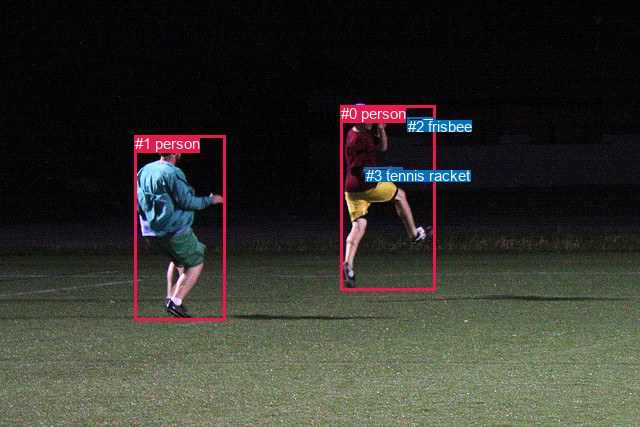
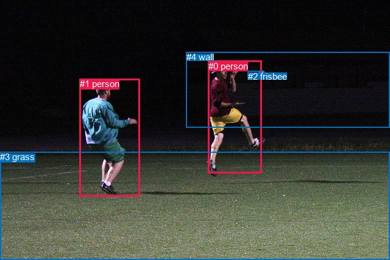

# 图片 1476：2384904.jpg

随机样本序号：213。图片 SHA256：`73cb06724bec6c23521243b750b1c4a5766b44a352bca0e7dbbe6e4692455fc9`。

红色框表示人，蓝色框表示其他物体。两个模式分别保留自身框编号，可依据位置比较对应对象。

## 自动检测框与输出

人的框编号：`[0, 1]`。状态：`ok`。

### 自动检测全部物体框

| 编号 | 类别 | 是否为人 | 检测分数 | 像素坐标 xyxy |
|---|---|---|---|---|
| 0 | person | True | 0.9998 | 341.0, 105.0, 435.4, 290.5 |
| 1 | person | True | 0.9998 | 134.7, 135.1, 225.7, 320.5 |
| 2 | frisbee | False | 0.9994 | 407.7, 117.5, 434.7, 130.0 |
| 3 | tennis racket | False | 0.4576 | 365.7, 167.3, 402.6, 174.4 |

### 自动检测 Top50 人相关候选

评分物体对：12；人相关物体对：10；输出关系：20。

| 排名 | 主语编号与类别 | 关系 | 宾语编号与类别 | 类型 | 人与人 | 排序分数 | 原始融合 logit |
|---|---|---|---|---|---|---|---|
| 1 | #0 person | catching | #2 frisbee | semantic | False | 0.99802 | 6.2210 |
| 2 | #0 person | holding | #3 tennis racket | semantic | False | 0.99237 | 4.8675 |
| 3 | #1 person | catching | #2 frisbee | semantic | False | 0.95933 | 3.1608 |
| 4 | #1 person | playing with | #0 person | semantic | True | 0.94529 | 2.8494 |
| 5 | #3 tennis racket | on | #0 person | spatial | False | 0.83878 | 1.6491 |
| 6 | #2 frisbee | flying over | #0 person | semantic | False | 0.78069 | 1.2697 |
| 7 | #0 person | in | #3 tennis racket | spatial | False | 0.71639 | 0.9266 |
| 8 | #0 person | running on | #1 person | semantic | True | 0.67659 | 0.7381 |
| 9 | #0 person | beside | #1 person | spatial | True | 0.65516 | 0.6418 |
| 10 | #1 person | beside | #0 person | spatial | True | 0.64627 | 0.6027 |
| 11 | #0 person | beside | #2 frisbee | spatial | False | 0.62473 | 0.5097 |
| 12 | #1 person | holding | #3 tennis racket | semantic | False | 0.61776 | 0.4801 |
| 13 | #2 frisbee | over | #0 person | spatial | False | 0.40484 | -0.3853 |
| 14 | #3 tennis racket | holding | #0 person | semantic | False | 0.18539 | -1.4802 |
| 15 | #1 person | in | #2 frisbee | spatial | False | 0.15930 | -1.6635 |
| 16 | #1 person | beside | #3 tennis racket | spatial | False | 0.06404 | -2.6821 |
| 17 | #2 frisbee | flying over | #1 person | semantic | False | 0.04888 | -2.9683 |
| 18 | #3 tennis racket | beside | #1 person | spatial | False | 0.00860 | -4.7479 |
| 19 | #2 frisbee | over | #1 person | spatial | False | 0.00384 | -5.5584 |
| 20 | #3 tennis racket | holding | #1 person | semantic | False | 0.00214 | -6.1448 |

### 自动检测逐条人相关 GT 核验

R@50：33.33%；命中 1/3。

| GT 主语编号 | GT 关系 | GT 宾语编号 | 结果阶段 | 匹配预测主语编号 | 匹配预测宾语编号 |
|---|---|---|---|---|---|
| 0 | catching | 2 | hit50 | [0] | [2] |
| 0 | playing with | 2 | wrong_predicate | [0] | [2] |
| 1 | chasing | 0 | wrong_predicate | [1] | [0] |

## 真实框与输出

人的框编号：`[0, 1]`。

### 真实框全部物体框

| 编号 | 类别 | 是否为人 | 检测分数 | 像素坐标 xyxy |
|---|---|---|---|---|
| 0 | person | True | GT | 342.0, 100.0, 430.0, 284.0 |
| 1 | person | True | GT | 131.0, 129.0, 230.0, 322.0 |
| 2 | frisbee | False | GT | 407.0, 117.0, 434.0, 129.0 |
| 3 | grass | False | GT | 0.0, 249.0, 640.0, 427.0 |
| 4 | wall | False | GT | 306.0, 85.0, 640.0, 209.0 |

### 真实框 Top50 人相关候选

评分物体对：20；人相关物体对：14；输出关系：28。

| 排名 | 主语编号与类别 | 关系 | 宾语编号与类别 | 类型 | 人与人 | 排序分数 | 原始融合 logit |
|---|---|---|---|---|---|---|---|
| 1 | #0 person | catching | #2 frisbee | semantic | False | 0.99753 | 5.9999 |
| 2 | #1 person | playing | #2 frisbee | semantic | False | 0.98615 | 4.2654 |
| 3 | #1 person | playing with | #0 person | semantic | True | 0.97504 | 3.6651 |
| 4 | #1 person | on | #3 grass | spatial | False | 0.96867 | 3.4312 |
| 5 | #1 person | running on | #3 grass | semantic | False | 0.96860 | 3.4291 |
| 6 | #0 person | running on | #3 grass | semantic | False | 0.96633 | 3.3570 |
| 7 | #0 person | on | #3 grass | spatial | False | 0.95133 | 2.9728 |
| 8 | #0 person | playing | #4 wall | semantic | False | 0.93960 | 2.7444 |
| 9 | #1 person | playing | #4 wall | semantic | False | 0.88961 | 2.0868 |
| 10 | #0 person | playing with | #1 person | semantic | True | 0.84534 | 1.6985 |
| 11 | #0 person | in | #4 wall | spatial | False | 0.81316 | 1.4707 |
| 12 | #0 person | in | #2 frisbee | spatial | False | 0.80180 | 1.3976 |
| 13 | #2 frisbee | in | #0 person | spatial | False | 0.54319 | 0.1732 |
| 14 | #1 person | in | #4 wall | spatial | False | 0.48352 | -0.0660 |
| 15 | #2 frisbee | flying over | #0 person | semantic | False | 0.46897 | -0.1243 |
| 16 | #1 person | beside | #0 person | spatial | True | 0.34957 | -0.6209 |
| 17 | #4 wall | beside | #0 person | spatial | False | 0.31566 | -0.7738 |
| 18 | #0 person | beside | #1 person | spatial | True | 0.30364 | -0.8300 |
| 19 | #1 person | on | #2 frisbee | spatial | False | 0.30024 | -0.8461 |
| 20 | #4 wall | looking at | #0 person | semantic | False | 0.19842 | -1.3962 |
| 21 | #3 grass | in | #0 person | spatial | False | 0.18148 | -1.5063 |
| 22 | #3 grass | in | #1 person | spatial | False | 0.15500 | -1.6959 |
| 23 | #3 grass | holding | #0 person | semantic | False | 0.12332 | -1.9614 |
| 24 | #3 grass | holding | #1 person | semantic | False | 0.10033 | -2.1936 |
| 25 | #2 frisbee | flying over | #1 person | semantic | False | 0.08121 | -2.4260 |
| 26 | #4 wall | beside | #1 person | spatial | False | 0.06307 | -2.6984 |
| 27 | #2 frisbee | in | #1 person | spatial | False | 0.04122 | -3.1467 |
| 28 | #4 wall | looking at | #1 person | semantic | False | 0.03208 | -3.4070 |

### 真实框逐条人相关 GT 核验

R@50：33.33%；命中 1/3。

| GT 主语编号 | GT 关系 | GT 宾语编号 | 结果阶段 | 匹配预测主语编号 | 匹配预测宾语编号 |
|---|---|---|---|---|---|
| 0 | catching | 2 | hit50 | [0] | [2] |
| 0 | playing with | 2 | wrong_predicate | [0] | [2] |
| 1 | chasing | 0 | wrong_predicate | [1] | [0] |

## 全部人相关 GT

| 主语编号与类别 | 关系 | 宾语编号与类别 |
|---|---|---|
| #0 person | catching | #2 frisbee |
| #0 person | playing with | #2 frisbee |
| #1 person | chasing | #0 person |

原始记录、全部人相关物体对的两项预测与分项分数见 [逐图证据 JSON](../evidence/cases/1476.json)。全部56类 logits 保留于本机 HOR/output/random500/logits/。

<!-- HOR_COMPLETE_RESULTS -->

## 六组条件的完整输出对照

以下保留同一图片三种框与候选模式、两种谓词输出规则的全部 Top50。框编号各自在所属模式内解释。

### 自动检测框完整枚举：空间与语义各保留一个谓词

| 排名 | 主语编号与类别 | 谓词 | 宾语编号与类别 | 分组 | 排序分数 | predicate logit | pair logit |
|---|---|---|---|---|---|---|---|
| 1 | #0 person | catching | #2 frisbee | semantic | 0.9980167 | 5.5779090 | 0.6430851 |
| 2 | #0 person | holding | #3 tennis racket | semantic | 0.9923665 | 4.6052079 | 0.2623370 |
| 3 | #1 person | catching | #2 frisbee | semantic | 0.9593320 | 2.8832955 | 0.2774997 |
| 4 | #1 person | playing with | #0 person | semantic | 0.9452856 | 3.1387439 | -0.2893841 |
| 5 | #3 tennis racket | on | #0 person | spatial | 0.8387756 | 2.1827126 | -0.5335670 |
| 6 | #2 frisbee | flying over | #0 person | semantic | 0.7806879 | 1.9159203 | -0.6462406 |
| 7 | #0 person | in | #3 tennis racket | spatial | 0.7163869 | 0.6642723 | 0.2623370 |
| 8 | #0 person | running on | #1 person | semantic | 0.6765891 | 1.5506215 | -0.8124810 |
| 9 | #0 person | beside | #1 person | spatial | 0.6551574 | 1.4542685 | -0.8124810 |
| 10 | #1 person | beside | #0 person | spatial | 0.6462720 | 0.8920765 | -0.2893841 |
| 11 | #0 person | beside | #2 frisbee | spatial | 0.6247332 | -0.1333976 | 0.6430851 |
| 12 | #1 person | holding | #3 tennis racket | semantic | 0.6177624 | 1.4614968 | -0.9814353 |
| 13 | #2 frisbee | over | #0 person | spatial | 0.4048404 | 0.2609038 | -0.6462406 |
| 14 | #3 tennis racket | holding | #0 person | semantic | 0.1853944 | -0.9466517 | -0.5335670 |
| 15 | #1 person | in | #2 frisbee | spatial | 0.1592983 | -1.9409580 | 0.2774997 |
| 16 | #1 person | beside | #3 tennis racket | spatial | 0.0640383 | -1.7006578 | -0.9814353 |
| 17 | #2 frisbee | flying over | #1 person | semantic | 0.0488801 | -1.5305409 | -1.4377297 |
| 18 | #3 tennis racket | beside | #1 person | spatial | 0.0085953 | -3.3839693 | -1.3639337 |
| 19 | #2 frisbee | over | #1 person | spatial | 0.0038401 | -4.1206732 | -1.4377297 |
| 20 | #3 tennis racket | holding | #1 person | semantic | 0.0021400 | -4.7808518 | -1.3639337 |

GT 命中：1/3，R@50=33.33%。

| GT主语 | GT谓词 | GT宾语 | 结果阶段 | 匹配主语框 | 匹配宾语框 |
|---|---|---|---|---|---|
| 0 | catching | 2 | hit50 | [0] | [2] |
| 0 | playing with | 2 | wrong_predicate | [0] | [2] |
| 1 | chasing | 0 | wrong_predicate | [1] | [0] |

### 自动检测框完整枚举：每对只保留一个谓词

| 排名 | 主语编号与类别 | 谓词 | 宾语编号与类别 | 分组 | 排序分数 | predicate logit | pair logit |
|---|---|---|---|---|---|---|---|
| 1 | #0 person | catching | #2 frisbee | single | 0.9980167 | 5.5779090 | 0.6430851 |
| 2 | #0 person | holding | #3 tennis racket | single | 0.9923665 | 4.6052079 | 0.2623370 |
| 3 | #1 person | catching | #2 frisbee | single | 0.9593320 | 2.8832955 | 0.2774997 |
| 4 | #1 person | playing with | #0 person | single | 0.9452856 | 3.1387439 | -0.2893841 |
| 5 | #3 tennis racket | on | #0 person | single | 0.8387756 | 2.1827126 | -0.5335670 |
| 6 | #2 frisbee | flying over | #0 person | single | 0.7806879 | 1.9159203 | -0.6462406 |
| 7 | #0 person | running on | #1 person | single | 0.6765891 | 1.5506215 | -0.8124810 |
| 8 | #1 person | holding | #3 tennis racket | single | 0.6177624 | 1.4614968 | -0.9814353 |
| 9 | #2 frisbee | flying over | #1 person | single | 0.0488801 | -1.5305409 | -1.4377297 |
| 10 | #3 tennis racket | beside | #1 person | single | 0.0085953 | -3.3839693 | -1.3639337 |

GT 命中：1/3，R@50=33.33%。

| GT主语 | GT谓词 | GT宾语 | 结果阶段 | 匹配主语框 | 匹配宾语框 |
|---|---|---|---|---|---|
| 0 | catching | 2 | hit50 | [0] | [2] |
| 0 | playing with | 2 | wrong_predicate | [0] | [2] |
| 1 | chasing | 0 | wrong_predicate | [1] | [0] |

### 真实框完整枚举：空间与语义各保留一个谓词

| 排名 | 主语编号与类别 | 谓词 | 宾语编号与类别 | 分组 | 排序分数 | predicate logit | pair logit |
|---|---|---|---|---|---|---|---|
| 1 | #0 person | catching | #2 frisbee | semantic | 0.9975271 | 5.3718619 | 0.6280179 |
| 2 | #1 person | playing | #2 frisbee | semantic | 0.9861487 | 4.0026622 | 0.2627698 |
| 3 | #1 person | playing with | #0 person | semantic | 0.9750364 | 3.9492230 | -0.2841662 |
| 4 | #1 person | on | #3 grass | spatial | 0.9686666 | 3.1479487 | 0.2832867 |
| 5 | #1 person | running on | #3 grass | semantic | 0.9686015 | 3.1458039 | 0.2832867 |
| 6 | #0 person | running on | #3 grass | semantic | 0.9663342 | 3.4169526 | -0.0599255 |
| 7 | #0 person | on | #3 grass | spatial | 0.9513307 | 3.0327392 | -0.0599255 |
| 8 | #0 person | playing | #4 wall | semantic | 0.9395967 | 3.4545236 | -0.7101177 |
| 9 | #1 person | playing | #4 wall | semantic | 0.8896125 | 3.0477886 | -0.9609997 |
| 10 | #0 person | playing with | #1 person | semantic | 0.8453390 | 2.5183749 | -0.8198729 |
| 11 | #0 person | in | #4 wall | spatial | 0.8131603 | 2.1807947 | -0.7101177 |
| 12 | #0 person | in | #2 frisbee | spatial | 0.8018026 | 0.7695813 | 0.6280179 |
| 13 | #2 frisbee | in | #0 person | spatial | 0.5431859 | 0.8313222 | -0.6581472 |
| 14 | #1 person | in | #4 wall | spatial | 0.4835176 | 0.8950462 | -0.9609997 |
| 15 | #2 frisbee | flying over | #0 person | semantic | 0.4689714 | 0.5338731 | -0.6581472 |
| 16 | #1 person | beside | #0 person | spatial | 0.3495731 | -0.3367500 | -0.2841662 |
| 17 | #4 wall | beside | #0 person | spatial | 0.3156636 | 0.1357756 | -0.9095480 |
| 18 | #0 person | beside | #1 person | spatial | 0.3036422 | -0.0101409 | -0.8198729 |
| 19 | #1 person | on | #2 frisbee | spatial | 0.3002414 | -1.1089182 | 0.2627698 |
| 20 | #4 wall | looking at | #0 person | semantic | 0.1984206 | -0.4866471 | -0.9095480 |
| 21 | #3 grass | in | #0 person | spatial | 0.1814819 | -0.4809761 | -1.0253637 |
| 22 | #3 grass | in | #1 person | spatial | 0.1550034 | -0.6651659 | -1.0307198 |
| 23 | #3 grass | holding | #0 person | semantic | 0.1233204 | -0.9359925 | -1.0253637 |
| 24 | #3 grass | holding | #1 person | semantic | 0.1003268 | -1.1628795 | -1.0307198 |
| 25 | #2 frisbee | flying over | #1 person | semantic | 0.0812080 | -0.9861498 | -1.4398966 |
| 26 | #4 wall | beside | #1 person | spatial | 0.0630704 | -1.3224497 | -1.3759072 |
| 27 | #2 frisbee | in | #1 person | spatial | 0.0412211 | -1.7068148 | -1.4398966 |
| 28 | #4 wall | looking at | #1 person | semantic | 0.0320767 | -2.0311165 | -1.3759072 |

GT 命中：1/3，R@50=33.33%。

| GT主语 | GT谓词 | GT宾语 | 结果阶段 | 匹配主语框 | 匹配宾语框 |
|---|---|---|---|---|---|
| 0 | catching | 2 | hit50 | [0] | [2] |
| 0 | playing with | 2 | wrong_predicate | [0] | [2] |
| 1 | chasing | 0 | wrong_predicate | [1] | [0] |

### 真实框完整枚举：每对只保留一个谓词

| 排名 | 主语编号与类别 | 谓词 | 宾语编号与类别 | 分组 | 排序分数 | predicate logit | pair logit |
|---|---|---|---|---|---|---|---|
| 1 | #0 person | catching | #2 frisbee | single | 0.9975271 | 5.3718619 | 0.6280179 |
| 2 | #1 person | playing | #2 frisbee | single | 0.9861487 | 4.0026622 | 0.2627698 |
| 3 | #1 person | playing with | #0 person | single | 0.9750364 | 3.9492230 | -0.2841662 |
| 4 | #1 person | on | #3 grass | single | 0.9686666 | 3.1479487 | 0.2832867 |
| 5 | #0 person | running on | #3 grass | single | 0.9663342 | 3.4169526 | -0.0599255 |
| 6 | #0 person | playing | #4 wall | single | 0.9395967 | 3.4545236 | -0.7101177 |
| 7 | #1 person | playing | #4 wall | single | 0.8896125 | 3.0477886 | -0.9609997 |
| 8 | #0 person | playing with | #1 person | single | 0.8453390 | 2.5183749 | -0.8198729 |
| 9 | #2 frisbee | in | #0 person | single | 0.5431859 | 0.8313222 | -0.6581472 |
| 10 | #4 wall | beside | #0 person | single | 0.3156636 | 0.1357756 | -0.9095480 |
| 11 | #3 grass | in | #0 person | single | 0.1814819 | -0.4809761 | -1.0253637 |
| 12 | #3 grass | in | #1 person | single | 0.1550034 | -0.6651659 | -1.0307198 |
| 13 | #2 frisbee | flying over | #1 person | single | 0.0812080 | -0.9861498 | -1.4398966 |
| 14 | #4 wall | beside | #1 person | single | 0.0630704 | -1.3224497 | -1.3759072 |

GT 命中：1/3，R@50=33.33%。

| GT主语 | GT谓词 | GT宾语 | 结果阶段 | 匹配主语框 | 匹配宾语框 |
|---|---|---|---|---|---|
| 0 | catching | 2 | hit50 | [0] | [2] |
| 0 | playing with | 2 | wrong_predicate | [0] | [2] |
| 1 | chasing | 0 | wrong_predicate | [1] | [0] |

### 真实框400候选：空间与语义各保留一个谓词

| 排名 | 主语编号与类别 | 谓词 | 宾语编号与类别 | 分组 | 排序分数 | predicate logit | pair logit |
|---|---|---|---|---|---|---|---|
| 1 | #0 person | catching | #2 frisbee | semantic | 0.9975271 | 5.3718619 | 0.6280179 |
| 2 | #1 person | playing | #2 frisbee | semantic | 0.9854419 | 3.9521747 | 0.2627698 |
| 3 | #1 person | playing with | #0 person | semantic | 0.9736063 | 3.8920484 | -0.2841662 |
| 4 | #1 person | on | #3 grass | spatial | 0.9686666 | 3.1479487 | 0.2832867 |
| 5 | #1 person | running on | #3 grass | semantic | 0.9686617 | 3.1477880 | 0.2832867 |
| 6 | #0 person | running on | #3 grass | semantic | 0.9662696 | 3.4149680 | -0.0599255 |
| 7 | #0 person | on | #3 grass | spatial | 0.9518325 | 3.0436287 | -0.0599255 |
| 8 | #0 person | playing | #4 wall | semantic | 0.9395967 | 3.4545236 | -0.7101177 |
| 9 | #1 person | playing | #4 wall | semantic | 0.8845562 | 2.9973016 | -0.9609997 |
| 10 | #0 person | playing with | #1 person | semantic | 0.8454044 | 2.5188756 | -0.8198729 |
| 11 | #0 person | in | #4 wall | spatial | 0.8131603 | 2.1807947 | -0.7101177 |
| 12 | #0 person | in | #2 frisbee | spatial | 0.8023295 | 0.7729001 | 0.6280179 |
| 13 | #2 frisbee | in | #0 person | spatial | 0.5489994 | 0.8547759 | -0.6581472 |
| 14 | #1 person | in | #4 wall | spatial | 0.4760071 | 0.8649545 | -0.9609997 |
| 15 | #2 frisbee | flying over | #0 person | semantic | 0.4689791 | 0.5339041 | -0.6581472 |
| 16 | #1 person | beside | #0 person | spatial | 0.3495731 | -0.3367500 | -0.2841662 |
| 17 | #4 wall | beside | #0 person | spatial | 0.3156699 | 0.1358047 | -0.9095480 |
| 18 | #0 person | beside | #1 person | spatial | 0.3036422 | -0.0101409 | -0.8198729 |
| 19 | #1 person | on | #2 frisbee | spatial | 0.3002414 | -1.1089182 | 0.2627698 |
| 20 | #4 wall | looking at | #0 person | semantic | 0.2031936 | -0.4569044 | -0.9095480 |
| 21 | #3 grass | in | #0 person | spatial | 0.1809894 | -0.4842949 | -1.0253637 |
| 22 | #3 grass | in | #1 person | spatial | 0.1517426 | -0.6902790 | -1.0307198 |
| 23 | #3 grass | holding | #0 person | semantic | 0.1202600 | -0.9646065 | -1.0253637 |
| 24 | #3 grass | holding | #1 person | semantic | 0.0979364 | -1.1896470 | -1.0307198 |
| 25 | #2 frisbee | flying over | #1 person | semantic | 0.0779076 | -1.0312250 | -1.4398966 |
| 26 | #4 wall | beside | #1 person | spatial | 0.0630704 | -1.3224497 | -1.3759072 |
| 27 | #2 frisbee | in | #1 person | spatial | 0.0402319 | -1.7321351 | -1.4398966 |
| 28 | #4 wall | looking at | #1 person | semantic | 0.0325416 | -2.0162454 | -1.3759072 |

GT 命中：1/3，R@50=33.33%。

| GT主语 | GT谓词 | GT宾语 | 结果阶段 | 匹配主语框 | 匹配宾语框 |
|---|---|---|---|---|---|
| 0 | catching | 2 | hit50 | [0] | [2] |
| 0 | playing with | 2 | wrong_predicate | [0] | [2] |
| 1 | chasing | 0 | wrong_predicate | [1] | [0] |

### 真实框400候选：每对只保留一个谓词

| 排名 | 主语编号与类别 | 谓词 | 宾语编号与类别 | 分组 | 排序分数 | predicate logit | pair logit |
|---|---|---|---|---|---|---|---|
| 1 | #0 person | catching | #2 frisbee | single | 0.9975271 | 5.3718619 | 0.6280179 |
| 2 | #1 person | playing | #2 frisbee | single | 0.9854419 | 3.9521747 | 0.2627698 |
| 3 | #1 person | playing with | #0 person | single | 0.9736063 | 3.8920484 | -0.2841662 |
| 4 | #1 person | on | #3 grass | single | 0.9686666 | 3.1479487 | 0.2832867 |
| 5 | #0 person | running on | #3 grass | single | 0.9662696 | 3.4149680 | -0.0599255 |
| 6 | #0 person | playing | #4 wall | single | 0.9395967 | 3.4545236 | -0.7101177 |
| 7 | #1 person | playing | #4 wall | single | 0.8845562 | 2.9973016 | -0.9609997 |
| 8 | #0 person | playing with | #1 person | single | 0.8454044 | 2.5188756 | -0.8198729 |
| 9 | #2 frisbee | in | #0 person | single | 0.5489994 | 0.8547759 | -0.6581472 |
| 10 | #4 wall | beside | #0 person | single | 0.3156699 | 0.1358047 | -0.9095480 |
| 11 | #3 grass | in | #0 person | single | 0.1809894 | -0.4842949 | -1.0253637 |
| 12 | #3 grass | in | #1 person | single | 0.1517426 | -0.6902790 | -1.0307198 |
| 13 | #2 frisbee | flying over | #1 person | single | 0.0779076 | -1.0312250 | -1.4398966 |
| 14 | #4 wall | beside | #1 person | single | 0.0630704 | -1.3224497 | -1.3759072 |

GT 命中：1/3，R@50=33.33%。

| GT主语 | GT谓词 | GT宾语 | 结果阶段 | 匹配主语框 | 匹配宾语框 |
|---|---|---|---|---|---|
| 0 | catching | 2 | hit50 | [0] | [2] |
| 0 | playing with | 2 | wrong_predicate | [0] | [2] |
| 1 | chasing | 0 | wrong_predicate | [1] | [0] |
