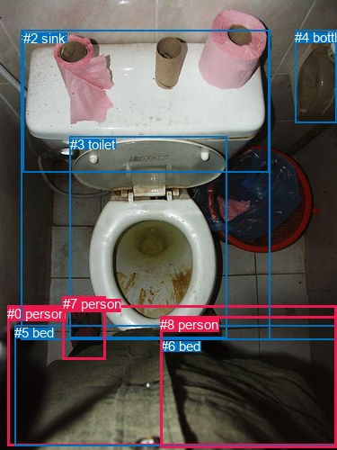
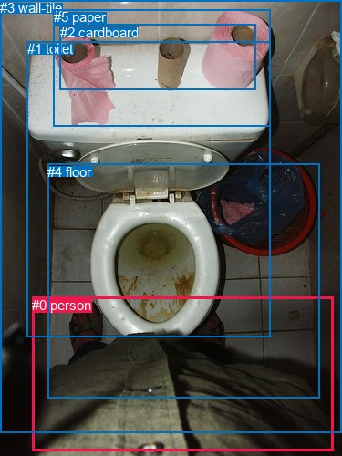

# 图片 1478：2385010.jpg

随机样本序号：434。图片 SHA256：`402631b41db79b13209719c1f21fc4f55ef34c57b17829cb22c01b80273bae75`。

红色框表示人，蓝色框表示其他物体。两个模式分别保留自身框编号，可依据位置比较对应对象。

## 自动检测框与输出

人的框编号：`[0, 7, 8]`。状态：`ok`。

### 自动检测全部物体框

| 编号 | 类别 | 是否为人 | 检测分数 | 像素坐标 xyxy |
|---|---|---|---|---|
| 0 | person | True | 0.9797 | 8.4, 339.7, 375.0, 495.9 |
| 1 | toilet | False | 0.9669 | 23.6, 33.4, 300.8, 377.3 |
| 2 | sink | False | 0.8829 | 25.9, 33.6, 299.2, 191.5 |
| 3 | toilet | False | 0.6047 | 77.8, 151.6, 252.8, 375.2 |
| 4 | bottle | False | 0.5556 | 328.3, 33.1, 375.0, 136.3 |
| 5 | bed | False | 0.5038 | 16.3, 361.3, 374.0, 495.6 |
| 6 | bed | False | 0.4667 | 179.4, 376.1, 373.1, 496.2 |
| 7 | person | True | 0.4620 | 69.9, 329.0, 118.0, 399.5 |
| 8 | person | True | 0.3902 | 178.0, 351.9, 374.8, 497.0 |

### 自动检测 Top50 人相关候选

评分物体对：72；人相关物体对：42；输出关系：50。

| 排名 | 主语编号与类别 | 关系 | 宾语编号与类别 | 类型 | 人与人 | 排序分数 | 原始融合 logit |
|---|---|---|---|---|---|---|---|
| 1 | #0 person | wearing | #5 bed | semantic | False | 0.98860 | 4.4626 |
| 2 | #0 person | wearing | #8 person | semantic | True | 0.96591 | 3.3441 |
| 3 | #8 person | wearing | #6 bed | semantic | False | 0.95931 | 3.1602 |
| 4 | #5 bed | on | #0 person | spatial | False | 0.94117 | 2.7724 |
| 5 | #0 person | wearing | #6 bed | semantic | False | 0.93944 | 2.7416 |
| 6 | #6 bed | on | #8 person | spatial | False | 0.93534 | 2.6718 |
| 7 | #0 person | in | #5 bed | spatial | False | 0.92167 | 2.4653 |
| 8 | #8 person | on | #0 person | spatial | True | 0.87666 | 1.9611 |
| 9 | #6 bed | on | #0 person | spatial | False | 0.87259 | 1.9241 |
| 10 | #8 person | in | #6 bed | spatial | False | 0.84991 | 1.7339 |
| 11 | #5 bed | wearing | #8 person | semantic | False | 0.82074 | 1.5214 |
| 12 | #8 person | on | #5 bed | spatial | False | 0.81015 | 1.4510 |
| 13 | #5 bed | wearing | #0 person | semantic | False | 0.79620 | 1.3627 |
| 14 | #0 person | in | #8 person | spatial | True | 0.75719 | 1.1373 |
| 15 | #0 person | in | #6 bed | spatial | False | 0.65507 | 0.6414 |
| 16 | #7 person | on | #1 toilet | spatial | False | 0.64191 | 0.5837 |
| 17 | #7 person | on | #3 toilet | spatial | False | 0.60101 | 0.4097 |
| 18 | #0 person | looking at | #3 toilet | semantic | False | 0.58438 | 0.3408 |
| 19 | #0 person | beside | #3 toilet | spatial | False | 0.51386 | 0.0554 |
| 20 | #0 person | wearing | #7 person | semantic | True | 0.48765 | -0.0494 |
| 21 | #8 person | wearing | #5 bed | semantic | False | 0.47613 | -0.0955 |
| 22 | #6 bed | wearing | #8 person | semantic | False | 0.47260 | -0.1097 |
| 23 | #5 bed | in | #8 person | spatial | False | 0.44739 | -0.2112 |
| 24 | #8 person | wearing | #0 person | semantic | True | 0.42278 | -0.3114 |
| 25 | #0 person | in | #1 toilet | spatial | False | 0.34856 | -0.6254 |
| 26 | #7 person | on | #0 person | spatial | True | 0.33258 | -0.6965 |
| 27 | #0 person | looking at | #1 toilet | semantic | False | 0.25568 | -1.0686 |
| 28 | #6 bed | wearing | #0 person | semantic | False | 0.25159 | -1.0901 |
| 29 | #7 person | looking at | #3 toilet | semantic | False | 0.19742 | -1.4025 |
| 30 | #8 person | in | #3 toilet | spatial | False | 0.18989 | -1.4507 |
| 31 | #8 person | on | #1 toilet | spatial | False | 0.15039 | -1.7316 |
| 32 | #7 person | wearing | #0 person | semantic | True | 0.14062 | -1.8102 |
| 33 | #7 person | on | #5 bed | spatial | False | 0.13622 | -1.8471 |
| 34 | #7 person | standing on | #1 toilet | semantic | False | 0.11459 | -2.0447 |
| 35 | #8 person | looking at | #3 toilet | semantic | False | 0.10580 | -2.1344 |
| 36 | #3 toilet | on | #0 person | spatial | False | 0.10257 | -2.1690 |
| 37 | #1 toilet | wearing | #7 person | semantic | False | 0.10206 | -2.1746 |
| 38 | #5 bed | wearing | #7 person | semantic | False | 0.08422 | -2.3864 |
| 39 | #0 person | in | #7 person | spatial | True | 0.08020 | -2.4397 |
| 40 | #7 person | wearing | #5 bed | semantic | False | 0.06329 | -2.6946 |
| 41 | #1 toilet | wearing | #0 person | semantic | False | 0.05426 | -2.8581 |
| 42 | #1 toilet | in | #0 person | spatial | False | 0.05354 | -2.8722 |
| 43 | #4 bottle | beside | #0 person | spatial | False | 0.05141 | -2.9152 |
| 44 | #8 person | looking at | #1 toilet | semantic | False | 0.05014 | -2.9415 |
| 45 | #0 person | on | #2 sink | spatial | False | 0.04394 | -3.0799 |
| 46 | #4 bottle | on | #8 person | spatial | False | 0.03848 | -3.2184 |
| 47 | #3 toilet | on | #8 person | spatial | False | 0.03565 | -3.2977 |
| 48 | #1 toilet | in | #7 person | spatial | False | 0.02982 | -3.4824 |
| 49 | #3 toilet | on | #7 person | spatial | False | 0.02689 | -3.5886 |
| 50 | #0 person | sitting on | #2 sink | semantic | False | 0.02606 | -3.6208 |

### 自动检测逐条人相关 GT 核验

R@50：0.00%；命中 0/1。

| GT 主语编号 | GT 关系 | GT 宾语编号 | 结果阶段 | 匹配预测主语编号 | 匹配预测宾语编号 |
|---|---|---|---|---|---|
| 0 | standing on | 4 | endpoint_missing_or_wrong_class | [0] | [] |

## 真实框与输出

人的框编号：`[0]`。

### 真实框全部物体框

| 编号 | 类别 | 是否为人 | 检测分数 | 像素坐标 xyxy |
|---|---|---|---|---|
| 0 | person | True | GT | 35.0, 326.0, 366.0, 495.0 |
| 1 | toilet | False | GT | 30.0, 45.0, 296.0, 369.0 |
| 2 | cardboard | False | GT | 66.0, 27.0, 281.0, 98.0 |
| 3 | wall-tile | False | GT | 0.0, 0.0, 375.0, 475.0 |
| 4 | floor | False | GT | 52.0, 180.0, 350.0, 436.0 |
| 5 | paper | False | GT | 59.0, 10.0, 297.0, 139.0 |

### 真实框 Top50 人相关候选

评分物体对：30；人相关物体对：10；输出关系：20。

| 排名 | 主语编号与类别 | 关系 | 宾语编号与类别 | 类型 | 人与人 | 排序分数 | 原始融合 logit |
|---|---|---|---|---|---|---|---|
| 1 | #0 person | in | #3 wall-tile | spatial | False | 0.96873 | 3.4333 |
| 2 | #0 person | on | #4 floor | spatial | False | 0.94328 | 2.8112 |
| 3 | #0 person | on | #1 toilet | spatial | False | 0.87095 | 1.9093 |
| 4 | #0 person | standing on | #4 floor | semantic | False | 0.70209 | 0.8573 |
| 5 | #0 person | looking at | #1 toilet | semantic | False | 0.68291 | 0.7672 |
| 6 | #4 floor | wearing | #0 person | semantic | False | 0.61091 | 0.4511 |
| 7 | #0 person | standing on | #3 wall-tile | semantic | False | 0.33334 | -0.6931 |
| 8 | #4 floor | in | #0 person | spatial | False | 0.30091 | -0.8429 |
| 9 | #0 person | in | #5 paper | spatial | False | 0.12035 | -1.9891 |
| 10 | #1 toilet | in | #0 person | spatial | False | 0.10913 | -2.0996 |
| 11 | #1 toilet | wearing | #0 person | semantic | False | 0.07146 | -2.5644 |
| 12 | #0 person | in | #2 cardboard | spatial | False | 0.06929 | -2.5976 |
| 13 | #3 wall-tile | in | #0 person | spatial | False | 0.06654 | -2.6411 |
| 14 | #0 person | looking at | #5 paper | semantic | False | 0.04101 | -3.1521 |
| 15 | #5 paper | on | #0 person | spatial | False | 0.02691 | -3.5881 |
| 16 | #2 cardboard | on | #0 person | spatial | False | 0.02662 | -3.5990 |
| 17 | #3 wall-tile | holding | #0 person | semantic | False | 0.02429 | -3.6930 |
| 18 | #0 person | looking at | #2 cardboard | semantic | False | 0.01588 | -4.1264 |
| 19 | #5 paper | holding | #0 person | semantic | False | 0.00679 | -4.9855 |
| 20 | #2 cardboard | wearing | #0 person | semantic | False | 0.00562 | -5.1762 |

### 真实框逐条人相关 GT 核验

R@50：100.00%；命中 1/1。

| GT 主语编号 | GT 关系 | GT 宾语编号 | 结果阶段 | 匹配预测主语编号 | 匹配预测宾语编号 |
|---|---|---|---|---|---|
| 0 | standing on | 4 | hit50 | [0] | [4] |

## 全部人相关 GT

| 主语编号与类别 | 关系 | 宾语编号与类别 |
|---|---|---|
| #0 person | standing on | #4 floor |

原始记录、全部人相关物体对的两项预测与分项分数见 [逐图证据 JSON](../evidence/cases/1478.json)。全部56类 logits 保留于本机 HOR/output/random500/logits/。

<!-- HOR_COMPLETE_RESULTS -->

## 六组条件的完整输出对照

以下保留同一图片三种框与候选模式、两种谓词输出规则的全部 Top50。框编号各自在所属模式内解释。

### 自动检测框完整枚举：空间与语义各保留一个谓词

| 排名 | 主语编号与类别 | 谓词 | 宾语编号与类别 | 分组 | 排序分数 | predicate logit | pair logit |
|---|---|---|---|---|---|---|---|
| 1 | #0 person | wearing | #5 bed | semantic | 0.9885995 | 4.1312127 | 0.3314219 |
| 2 | #0 person | wearing | #8 person | semantic | 0.9659125 | 3.2826452 | 0.0614966 |
| 3 | #8 person | wearing | #6 bed | semantic | 0.9593074 | 3.2077198 | -0.0475551 |
| 4 | #5 bed | on | #0 person | spatial | 0.9411669 | 2.5942588 | 0.1781567 |
| 5 | #0 person | wearing | #6 bed | semantic | 0.9394395 | 2.6308699 | 0.1107710 |
| 6 | #6 bed | on | #8 person | spatial | 0.9353433 | 2.9163713 | -0.2445491 |
| 7 | #0 person | in | #5 bed | spatial | 0.9216737 | 2.1338868 | 0.3314219 |
| 8 | #8 person | on | #0 person | spatial | 0.8766559 | 1.8594413 | 0.1016954 |
| 9 | #6 bed | on | #0 person | spatial | 0.8725942 | 1.9471374 | -0.0230436 |
| 10 | #8 person | in | #6 bed | spatial | 0.8499051 | 1.7814126 | -0.0475551 |
| 11 | #5 bed | wearing | #8 person | semantic | 0.8207372 | 1.6501999 | -0.1288499 |
| 12 | #8 person | on | #5 bed | spatial | 0.8101465 | 1.3834262 | 0.0675359 |
| 13 | #5 bed | wearing | #0 person | semantic | 0.7961992 | 1.1845493 | 0.1781567 |
| 14 | #0 person | in | #8 person | spatial | 0.7571860 | 1.0758166 | 0.0614966 |
| 15 | #0 person | in | #6 bed | spatial | 0.6550705 | 0.5306320 | 0.1107710 |
| 16 | #7 person | on | #1 toilet | spatial | 0.6419139 | 1.4114909 | -0.8278101 |
| 17 | #7 person | on | #3 toilet | spatial | 0.6010121 | 1.4410028 | -1.0313189 |
| 18 | #0 person | looking at | #3 toilet | semantic | 0.5843813 | 0.5428400 | -0.2020546 |
| 19 | #0 person | beside | #3 toilet | spatial | 0.5138577 | 0.2574997 | -0.2020546 |
| 20 | #0 person | wearing | #7 person | semantic | 0.4876452 | 0.0554366 | -0.1048657 |
| 21 | #8 person | wearing | #5 bed | semantic | 0.4761313 | -0.1630836 | 0.0675359 |
| 22 | #6 bed | wearing | #8 person | semantic | 0.4725957 | 0.1348219 | -0.2445491 |
| 23 | #5 bed | in | #8 person | spatial | 0.4473923 | -0.0823627 | -0.1288499 |
| 24 | #8 person | wearing | #0 person | semantic | 0.4227807 | -0.4130640 | 0.1016954 |
| 25 | #0 person | in | #1 toilet | spatial | 0.3485561 | -0.1092367 | -0.5161554 |
| 26 | #7 person | on | #0 person | spatial | 0.3325796 | 0.1711750 | -0.8677157 |
| 27 | #0 person | looking at | #1 toilet | semantic | 0.2556764 | -0.5524077 | -0.5161554 |
| 28 | #6 bed | wearing | #0 person | semantic | 0.2515922 | -1.0670946 | -0.0230436 |
| 29 | #7 person | looking at | #3 toilet | semantic | 0.1974226 | -0.3711629 | -1.0313189 |
| 30 | #8 person | in | #3 toilet | spatial | 0.1898903 | -0.6074820 | -0.8432412 |
| 31 | #8 person | on | #1 toilet | spatial | 0.1503888 | -0.7880378 | -0.9435174 |
| 32 | #7 person | wearing | #0 person | semantic | 0.1406182 | -0.9424493 | -0.8677157 |
| 33 | #7 person | on | #5 bed | spatial | 0.1362181 | -0.8768635 | -0.9701991 |
| 34 | #7 person | standing on | #1 toilet | semantic | 0.1145874 | -1.2169061 | -0.8278101 |
| 35 | #8 person | looking at | #3 toilet | semantic | 0.1057981 | -1.2911577 | -0.8432412 |
| 36 | #3 toilet | on | #0 person | spatial | 0.1025730 | -0.8972232 | -1.2717338 |
| 37 | #1 toilet | wearing | #7 person | semantic | 0.1020565 | -0.7681568 | -1.4064233 |
| 38 | #5 bed | wearing | #7 person | semantic | 0.0842173 | -2.0334926 | -0.3528856 |
| 39 | #0 person | in | #7 person | spatial | 0.0801970 | -2.3348076 | -0.1048657 |
| 40 | #7 person | wearing | #5 bed | semantic | 0.0632901 | -1.7244456 | -0.9701991 |
| 41 | #1 toilet | wearing | #0 person | semantic | 0.0542619 | -1.5136611 | -1.3444822 |
| 42 | #1 toilet | in | #0 person | spatial | 0.0535437 | -1.5277445 | -1.3444822 |
| 43 | #4 bottle | beside | #0 person | spatial | 0.0514070 | -1.4010460 | -1.5141591 |
| 44 | #8 person | looking at | #1 toilet | semantic | 0.0501386 | -1.9980075 | -0.9435174 |
| 45 | #0 person | on | #2 sink | spatial | 0.0439435 | -2.2355886 | -0.8443241 |
| 46 | #4 bottle | on | #8 person | spatial | 0.0384791 | -1.5217693 | -1.6966306 |
| 47 | #3 toilet | on | #8 person | spatial | 0.0356498 | -1.9392381 | -1.3584738 |
| 48 | #1 toilet | in | #7 person | spatial | 0.0298173 | -2.0759740 | -1.4064233 |
| 49 | #3 toilet | on | #7 person | spatial | 0.0268944 | -1.8525553 | -1.7360208 |
| 50 | #0 person | sitting on | #2 sink | semantic | 0.0260636 | -2.7764835 | -0.8443241 |

GT 命中：0/1，R@50=0.00%。

| GT主语 | GT谓词 | GT宾语 | 结果阶段 | 匹配主语框 | 匹配宾语框 |
|---|---|---|---|---|---|
| 0 | standing on | 4 | endpoint_missing_or_wrong_class | [0] | [] |

### 自动检测框完整枚举：每对只保留一个谓词

| 排名 | 主语编号与类别 | 谓词 | 宾语编号与类别 | 分组 | 排序分数 | predicate logit | pair logit |
|---|---|---|---|---|---|---|---|
| 1 | #0 person | wearing | #5 bed | single | 0.9885995 | 4.1312127 | 0.3314219 |
| 2 | #0 person | wearing | #8 person | single | 0.9659125 | 3.2826452 | 0.0614966 |
| 3 | #8 person | wearing | #6 bed | single | 0.9593074 | 3.2077198 | -0.0475551 |
| 4 | #5 bed | on | #0 person | single | 0.9411669 | 2.5942588 | 0.1781567 |
| 5 | #0 person | wearing | #6 bed | single | 0.9394395 | 2.6308699 | 0.1107710 |
| 6 | #6 bed | on | #8 person | single | 0.9353433 | 2.9163713 | -0.2445491 |
| 7 | #8 person | on | #0 person | single | 0.8766559 | 1.8594413 | 0.1016954 |
| 8 | #6 bed | on | #0 person | single | 0.8725942 | 1.9471374 | -0.0230436 |
| 9 | #5 bed | wearing | #8 person | single | 0.8207372 | 1.6501999 | -0.1288499 |
| 10 | #8 person | on | #5 bed | single | 0.8101465 | 1.3834262 | 0.0675359 |
| 11 | #7 person | on | #1 toilet | single | 0.6419139 | 1.4114909 | -0.8278101 |
| 12 | #7 person | on | #3 toilet | single | 0.6010121 | 1.4410028 | -1.0313189 |
| 13 | #0 person | looking at | #3 toilet | single | 0.5843813 | 0.5428400 | -0.2020546 |
| 14 | #0 person | wearing | #7 person | single | 0.4876452 | 0.0554366 | -0.1048657 |
| 15 | #0 person | in | #1 toilet | single | 0.3485561 | -0.1092367 | -0.5161554 |
| 16 | #7 person | on | #0 person | single | 0.3325796 | 0.1711750 | -0.8677157 |
| 17 | #8 person | in | #3 toilet | single | 0.1898903 | -0.6074820 | -0.8432412 |
| 18 | #8 person | on | #1 toilet | single | 0.1503888 | -0.7880378 | -0.9435174 |
| 19 | #7 person | on | #5 bed | single | 0.1362181 | -0.8768635 | -0.9701991 |
| 20 | #3 toilet | on | #0 person | single | 0.1025730 | -0.8972232 | -1.2717338 |
| 21 | #1 toilet | wearing | #7 person | single | 0.1020565 | -0.7681568 | -1.4064233 |
| 22 | #5 bed | wearing | #7 person | single | 0.0842173 | -2.0334926 | -0.3528856 |
| 23 | #1 toilet | wearing | #0 person | single | 0.0542619 | -1.5136611 | -1.3444822 |
| 24 | #4 bottle | beside | #0 person | single | 0.0514070 | -1.4010460 | -1.5141591 |
| 25 | #0 person | on | #2 sink | single | 0.0439435 | -2.2355886 | -0.8443241 |
| 26 | #4 bottle | on | #8 person | single | 0.0384791 | -1.5217693 | -1.6966306 |
| 27 | #3 toilet | on | #8 person | single | 0.0356498 | -1.9392381 | -1.3584738 |
| 28 | #3 toilet | on | #7 person | single | 0.0268944 | -1.8525553 | -1.7360208 |
| 29 | #1 toilet | in | #8 person | single | 0.0256452 | -2.0833805 | -1.5540372 |
| 30 | #8 person | wearing | #7 person | single | 0.0236920 | -2.9238153 | -0.7948246 |
| 31 | #8 person | on | #2 sink | single | 0.0225495 | -2.4574935 | -1.3117433 |
| 32 | #2 sink | on | #0 person | single | 0.0221993 | -1.9948592 | -1.7903875 |
| 33 | #7 person | on | #2 sink | single | 0.0219193 | -2.4565670 | -1.3416569 |
| 34 | #7 person | on | #8 person | single | 0.0184908 | -2.7062714 | -1.2655473 |
| 35 | #7 person | on | #6 bed | single | 0.0103924 | -3.1442490 | -1.4119802 |
| 36 | #0 person | in | #4 bottle | single | 0.0103139 | -2.9404750 | -1.6234213 |
| 37 | #2 sink | on | #8 person | single | 0.0080769 | -2.8102915 | -2.0003452 |
| 38 | #6 bed | wearing | #7 person | single | 0.0061377 | -3.9824014 | -1.1047449 |
| 39 | #8 person | in | #4 bottle | single | 0.0054543 | -3.4035707 | -1.8023070 |
| 40 | #4 bottle | in | #7 person | single | 0.0036736 | -3.6216259 | -1.9812858 |
| 41 | #2 sink | over | #7 person | single | 0.0024689 | -4.2101707 | -1.7913386 |
| 42 | #7 person | in | #4 bottle | single | 0.0024545 | -3.8985281 | -2.1088281 |

GT 命中：0/1，R@50=0.00%。

| GT主语 | GT谓词 | GT宾语 | 结果阶段 | 匹配主语框 | 匹配宾语框 |
|---|---|---|---|---|---|
| 0 | standing on | 4 | endpoint_missing_or_wrong_class | [0] | [] |

### 真实框完整枚举：空间与语义各保留一个谓词

| 排名 | 主语编号与类别 | 谓词 | 宾语编号与类别 | 分组 | 排序分数 | predicate logit | pair logit |
|---|---|---|---|---|---|---|---|
| 1 | #0 person | in | #3 wall-tile | spatial | 0.9687283 | 3.5793595 | -0.1460869 |
| 2 | #0 person | on | #4 floor | spatial | 0.9432765 | 3.2224388 | -0.4112688 |
| 3 | #0 person | on | #1 toilet | spatial | 0.8709451 | 2.4102364 | -0.5008956 |
| 4 | #0 person | standing on | #4 floor | semantic | 0.7020901 | 1.2685394 | -0.4112688 |
| 5 | #0 person | looking at | #1 toilet | semantic | 0.6829070 | 1.2680593 | -0.5008956 |
| 6 | #4 floor | wearing | #0 person | semantic | 0.6109118 | 1.4293289 | -0.9781820 |
| 7 | #0 person | standing on | #3 wall-tile | semantic | 0.3333381 | -0.5470386 | -0.1460869 |
| 8 | #4 floor | in | #0 person | spatial | 0.3009149 | 0.1352372 | -0.9781820 |
| 9 | #0 person | in | #5 paper | spatial | 0.1203548 | -0.9194944 | -1.0695800 |
| 10 | #1 toilet | in | #0 person | spatial | 0.1091335 | -0.8037837 | -1.2958393 |
| 11 | #1 toilet | wearing | #0 person | semantic | 0.0714646 | -1.2685666 | -1.2958393 |
| 12 | #0 person | in | #2 cardboard | spatial | 0.0692916 | -1.3827014 | -1.2149214 |
| 13 | #3 wall-tile | in | #0 person | spatial | 0.0665389 | -1.3632443 | -1.2778674 |
| 14 | #0 person | looking at | #5 paper | semantic | 0.0410083 | -2.0825286 | -1.0695800 |
| 15 | #5 paper | on | #0 person | spatial | 0.0269061 | -1.7440650 | -1.8440609 |
| 16 | #2 cardboard | on | #0 person | spatial | 0.0266238 | -1.8347805 | -1.7641842 |
| 17 | #3 wall-tile | holding | #0 person | semantic | 0.0242925 | -2.4151297 | -1.2778674 |
| 18 | #0 person | looking at | #2 cardboard | semantic | 0.0158848 | -2.9114599 | -1.2149214 |
| 19 | #5 paper | holding | #0 person | semantic | 0.0067903 | -3.1413918 | -1.8440609 |
| 20 | #2 cardboard | wearing | #0 person | semantic | 0.0056179 | -3.4119778 | -1.7641842 |

GT 命中：1/1，R@50=100.00%。

| GT主语 | GT谓词 | GT宾语 | 结果阶段 | 匹配主语框 | 匹配宾语框 |
|---|---|---|---|---|---|
| 0 | standing on | 4 | hit50 | [0] | [4] |

### 真实框完整枚举：每对只保留一个谓词

| 排名 | 主语编号与类别 | 谓词 | 宾语编号与类别 | 分组 | 排序分数 | predicate logit | pair logit |
|---|---|---|---|---|---|---|---|
| 1 | #0 person | in | #3 wall-tile | single | 0.9687283 | 3.5793595 | -0.1460869 |
| 2 | #0 person | on | #4 floor | single | 0.9432765 | 3.2224388 | -0.4112688 |
| 3 | #0 person | on | #1 toilet | single | 0.8709451 | 2.4102364 | -0.5008956 |
| 4 | #4 floor | wearing | #0 person | single | 0.6109118 | 1.4293289 | -0.9781820 |
| 5 | #0 person | in | #5 paper | single | 0.1203548 | -0.9194944 | -1.0695800 |
| 6 | #1 toilet | in | #0 person | single | 0.1091335 | -0.8037837 | -1.2958393 |
| 7 | #0 person | in | #2 cardboard | single | 0.0692916 | -1.3827014 | -1.2149214 |
| 8 | #3 wall-tile | in | #0 person | single | 0.0665389 | -1.3632443 | -1.2778674 |
| 9 | #5 paper | on | #0 person | single | 0.0269061 | -1.7440650 | -1.8440609 |
| 10 | #2 cardboard | on | #0 person | single | 0.0266238 | -1.8347805 | -1.7641842 |

GT 命中：0/1，R@50=0.00%。

| GT主语 | GT谓词 | GT宾语 | 结果阶段 | 匹配主语框 | 匹配宾语框 |
|---|---|---|---|---|---|
| 0 | standing on | 4 | wrong_predicate | [0] | [4] |

### 真实框400候选：空间与语义各保留一个谓词

| 排名 | 主语编号与类别 | 谓词 | 宾语编号与类别 | 分组 | 排序分数 | predicate logit | pair logit |
|---|---|---|---|---|---|---|---|
| 1 | #0 person | in | #3 wall-tile | spatial | 0.9685267 | 3.5727220 | -0.1460869 |
| 2 | #0 person | on | #4 floor | spatial | 0.9438563 | 3.2333279 | -0.4112688 |
| 3 | #0 person | on | #1 toilet | spatial | 0.8709451 | 2.4102364 | -0.5008956 |
| 4 | #0 person | standing on | #4 floor | semantic | 0.6973106 | 1.2457924 | -0.4112688 |
| 5 | #0 person | looking at | #1 toilet | semantic | 0.6829070 | 1.2680593 | -0.5008956 |
| 6 | #4 floor | wearing | #0 person | semantic | 0.6109118 | 1.4293289 | -0.9781820 |
| 7 | #0 person | standing on | #3 wall-tile | semantic | 0.3283025 | -0.5697856 | -0.1460869 |
| 8 | #4 floor | in | #0 person | spatial | 0.2960042 | 0.1117835 | -0.9781820 |
| 9 | #0 person | in | #5 paper | spatial | 0.1207066 | -0.9161756 | -1.0695800 |
| 10 | #1 toilet | in | #0 person | spatial | 0.1089723 | -0.8054430 | -1.2958393 |
| 11 | #1 toilet | wearing | #0 person | semantic | 0.0712702 | -1.2715006 | -1.2958393 |
| 12 | #0 person | in | #2 cardboard | spatial | 0.0696671 | -1.3768938 | -1.2149214 |
| 13 | #3 wall-tile | in | #0 person | spatial | 0.0674796 | -1.3481989 | -1.2778674 |
| 14 | #0 person | looking at | #5 paper | semantic | 0.0421940 | -2.0527864 | -1.0695800 |
| 15 | #5 paper | on | #0 person | spatial | 0.0275044 | -1.7214603 | -1.8440609 |
| 16 | #2 cardboard | on | #0 person | spatial | 0.0267741 | -1.8289952 | -1.7641842 |
| 17 | #3 wall-tile | holding | #0 person | semantic | 0.0246295 | -2.4010072 | -1.2778674 |
| 18 | #0 person | looking at | #2 cardboard | semantic | 0.0165961 | -2.8669333 | -1.2149214 |
| 19 | #5 paper | holding | #0 person | semantic | 0.0068824 | -3.1278231 | -1.8440609 |
| 20 | #2 cardboard | wearing | #0 person | semantic | 0.0056179 | -3.4119778 | -1.7641842 |

GT 命中：1/1，R@50=100.00%。

| GT主语 | GT谓词 | GT宾语 | 结果阶段 | 匹配主语框 | 匹配宾语框 |
|---|---|---|---|---|---|
| 0 | standing on | 4 | hit50 | [0] | [4] |

### 真实框400候选：每对只保留一个谓词

| 排名 | 主语编号与类别 | 谓词 | 宾语编号与类别 | 分组 | 排序分数 | predicate logit | pair logit |
|---|---|---|---|---|---|---|---|
| 1 | #0 person | in | #3 wall-tile | single | 0.9685267 | 3.5727220 | -0.1460869 |
| 2 | #0 person | on | #4 floor | single | 0.9438563 | 3.2333279 | -0.4112688 |
| 3 | #0 person | on | #1 toilet | single | 0.8709451 | 2.4102364 | -0.5008956 |
| 4 | #4 floor | wearing | #0 person | single | 0.6109118 | 1.4293289 | -0.9781820 |
| 5 | #0 person | in | #5 paper | single | 0.1207066 | -0.9161756 | -1.0695800 |
| 6 | #1 toilet | in | #0 person | single | 0.1089723 | -0.8054430 | -1.2958393 |
| 7 | #0 person | in | #2 cardboard | single | 0.0696671 | -1.3768938 | -1.2149214 |
| 8 | #3 wall-tile | in | #0 person | single | 0.0674796 | -1.3481989 | -1.2778674 |
| 9 | #5 paper | on | #0 person | single | 0.0275044 | -1.7214603 | -1.8440609 |
| 10 | #2 cardboard | on | #0 person | single | 0.0267741 | -1.8289952 | -1.7641842 |

GT 命中：0/1，R@50=0.00%。

| GT主语 | GT谓词 | GT宾语 | 结果阶段 | 匹配主语框 | 匹配宾语框 |
|---|---|---|---|---|---|
| 0 | standing on | 4 | wrong_predicate | [0] | [4] |
