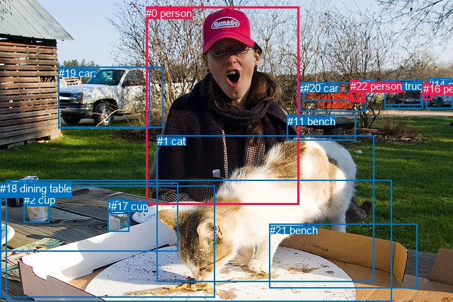
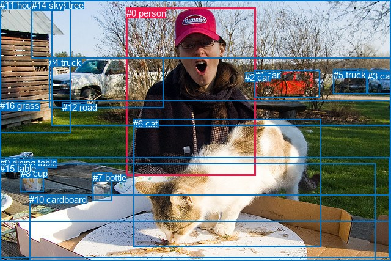

# 图片 1479：2385026.jpg

随机样本序号：232。图片 SHA256：`842bf70b9f111af1b4ad64b8451d74a2032737e6a68d224665e441413dcd7b02`。

红色框表示人，蓝色框表示其他物体。两个模式分别保留自身框编号，可依据位置比较对应对象。

## 自动检测框与输出

人的框编号：`[0, 9, 12, 16, 22]`。状态：`ok`。

### 自动检测全部物体框

| 编号 | 类别 | 是否为人 | 检测分数 | 像素坐标 xyxy |
|---|---|---|---|---|
| 0 | person | True | 0.9981 | 206.1, 9.5, 422.8, 289.5 |
| 1 | cat | False | 0.9942 | 221.5, 191.1, 528.6, 398.6 |
| 2 | cup | False | 0.9727 | 33.9, 274.4, 69.6, 314.2 |
| 3 | car | False | 0.9668 | 602.2, 116.3, 640.0, 153.8 |
| 4 | car | False | 0.9415 | 423.9, 116.6, 516.0, 157.3 |
| 5 | bottle | False | 0.8437 | 152.8, 281.1, 182.8, 327.3 |
| 6 | truck | False | 0.8365 | 82.5, 94.9, 230.4, 180.7 |
| 7 | dining table | False | 0.8287 | 8.7, 255.0, 553.1, 427.0 |
| 8 | car | False | 0.7146 | 543.6, 113.9, 595.7, 148.9 |
| 9 | person | True | 0.7086 | 504.4, 113.1, 515.0, 144.1 |
| 10 | dining table | False | 0.6655 | 0.0, 262.1, 303.6, 420.5 |
| 11 | bench | False | 0.6472 | 405.5, 162.9, 502.4, 198.9 |
| 12 | person | True | 0.6139 | 594.5, 117.1, 602.9, 128.9 |
| 13 | truck | False | 0.5422 | 543.8, 113.1, 598.0, 153.3 |
| 14 | car | False | 0.5065 | 605.1, 110.9, 637.4, 119.5 |
| 15 | car | False | 0.4787 | 508.3, 112.7, 529.3, 128.7 |
| 16 | person | True | 0.4296 | 597.9, 117.0, 610.1, 141.2 |
| 17 | cup | False | 0.4221 | 156.8, 282.9, 176.1, 302.8 |
| 18 | dining table | False | 0.4048 | 0.0, 258.5, 251.5, 355.6 |
| 19 | car | False | 0.3961 | 82.9, 94.7, 211.9, 181.4 |
| 20 | car | False | 0.3939 | 429.1, 116.3, 495.3, 142.8 |
| 21 | bench | False | 0.3706 | 380.7, 317.0, 589.5, 407.4 |
| 22 | person | True | 0.3648 | 494.6, 113.0, 506.9, 143.6 |

### 自动检测 Top50 人相关候选

评分物体对：506；人相关物体对：200；输出关系：50。

| 排名 | 主语编号与类别 | 关系 | 宾语编号与类别 | 类型 | 人与人 | 排序分数 | 原始融合 logit |
|---|---|---|---|---|---|---|---|
| 1 | #0 person | eating | #7 dining table | semantic | False | 0.96244 | 3.2434 |
| 2 | #0 person | looking at | #1 cat | semantic | False | 0.95298 | 3.0091 |
| 3 | #0 person | eating | #10 dining table | semantic | False | 0.95278 | 3.0045 |
| 4 | #22 person | on | #4 car | spatial | False | 0.93993 | 2.7504 |
| 5 | #9 person | on | #4 car | spatial | False | 0.93264 | 2.6279 |
| 6 | #12 person | on | #16 person | spatial | True | 0.90026 | 2.2001 |
| 7 | #9 person | on | #15 car | spatial | False | 0.88911 | 2.0816 |
| 8 | #0 person | eating | #18 dining table | semantic | False | 0.84409 | 1.6890 |
| 9 | #9 person | looking at | #4 car | semantic | False | 0.84181 | 1.6718 |
| 10 | #22 person | parked on | #4 car | semantic | False | 0.83046 | 1.5889 |
| 11 | #22 person | parked on | #9 person | semantic | True | 0.82505 | 1.5509 |
| 12 | #16 person | parked on | #3 car | semantic | False | 0.82003 | 1.5166 |
| 13 | #0 person | beside | #1 cat | spatial | False | 0.81632 | 1.4916 |
| 14 | #0 person | in | #7 dining table | spatial | False | 0.81184 | 1.4620 |
| 15 | #1 cat | looking at | #0 person | semantic | False | 0.79968 | 1.3843 |
| 16 | #9 person | parked on | #15 car | semantic | False | 0.79353 | 1.3463 |
| 17 | #1 cat | in front of | #0 person | spatial | False | 0.75352 | 1.1175 |
| 18 | #0 person | beside | #18 dining table | spatial | False | 0.74320 | 1.0627 |
| 19 | #16 person | on | #3 car | spatial | False | 0.72564 | 0.9726 |
| 20 | #0 person | in | #10 dining table | spatial | False | 0.72525 | 0.9707 |
| 21 | #12 person | on | #13 truck | spatial | False | 0.72403 | 0.9646 |
| 22 | #22 person | parked on | #20 car | semantic | False | 0.72177 | 0.9532 |
| 23 | #12 person | parked on | #13 truck | semantic | False | 0.70191 | 0.8564 |
| 24 | #16 person | wearing | #12 person | semantic | True | 0.69642 | 0.8303 |
| 25 | #15 car | on | #9 person | spatial | False | 0.66879 | 0.7027 |
| 26 | #9 person | on | #22 person | spatial | True | 0.66365 | 0.6796 |
| 27 | #12 person | parked on | #3 car | semantic | False | 0.66148 | 0.6699 |
| 28 | #16 person | in | #12 person | spatial | True | 0.62527 | 0.5120 |
| 29 | #16 person | on | #14 car | spatial | False | 0.61542 | 0.4702 |
| 30 | #16 person | parked on | #14 car | semantic | False | 0.61074 | 0.4504 |
| 31 | #15 car | parked on | #9 person | semantic | False | 0.60619 | 0.4313 |
| 32 | #9 person | parked on | #22 person | semantic | True | 0.60566 | 0.4291 |
| 33 | #22 person | on | #9 person | spatial | True | 0.59910 | 0.4017 |
| 34 | #12 person | parked on | #16 person | semantic | True | 0.59617 | 0.3896 |
| 35 | #22 person | on | #20 car | spatial | False | 0.57481 | 0.3015 |
| 36 | #4 car | in | #22 person | spatial | False | 0.57258 | 0.2924 |
| 37 | #12 person | on | #3 car | spatial | False | 0.55400 | 0.2168 |
| 38 | #4 car | in | #9 person | spatial | False | 0.53906 | 0.1566 |
| 39 | #12 person | parked on | #8 car | semantic | False | 0.51198 | 0.0479 |
| 40 | #22 person | parked on | #15 car | semantic | False | 0.49302 | -0.0279 |
| 41 | #22 person | on | #15 car | spatial | False | 0.47298 | -0.1082 |
| 42 | #12 person | on | #8 car | spatial | False | 0.45495 | -0.1807 |
| 43 | #6 truck | beside | #0 person | spatial | False | 0.34406 | -0.6453 |
| 44 | #12 person | on | #14 car | spatial | False | 0.34118 | -0.6580 |
| 45 | #12 person | parked on | #14 car | semantic | False | 0.33927 | -0.6665 |
| 46 | #0 person | beside | #11 bench | spatial | False | 0.32908 | -0.7124 |
| 47 | #20 car | parked on | #22 person | semantic | False | 0.29499 | -0.8713 |
| 48 | #11 bench | beside | #0 person | spatial | False | 0.29415 | -0.8753 |
| 49 | #19 car | beside | #0 person | spatial | False | 0.27444 | -0.9722 |
| 50 | #22 person | looking at | #0 person | semantic | True | 0.25292 | -1.0831 |

### 自动检测逐条人相关 GT 核验

R@50：100.00%；命中 2/2。

| GT 主语编号 | GT 关系 | GT 宾语编号 | 结果阶段 | 匹配预测主语编号 | 匹配预测宾语编号 |
|---|---|---|---|---|---|
| 0 | looking at | 6 | hit50 | [0] | [1] |
| 6 | in front of | 0 | hit50 | [1] | [0] |

## 真实框与输出

人的框编号：`[0]`。

### 真实框全部物体框

| 编号 | 类别 | 是否为人 | 检测分数 | 像素坐标 xyxy |
|---|---|---|---|---|
| 0 | person | True | GT | 207.0, 13.0, 419.0, 287.0 |
| 1 | car | False | GT | 417.0, 114.0, 523.0, 159.0 |
| 2 | car | False | GT | 401.0, 118.0, 419.0, 133.0 |
| 3 | car | False | GT | 602.0, 116.0, 640.0, 154.0 |
| 4 | truck | False | GT | 80.0, 94.0, 267.0, 177.0 |
| 5 | truck | False | GT | 546.0, 114.0, 601.0, 154.0 |
| 6 | cat | False | GT | 218.0, 194.0, 525.0, 403.0 |
| 7 | bottle | False | GT | 152.0, 282.0, 184.0, 328.0 |
| 8 | cup | False | GT | 34.0, 275.0, 71.0, 314.0 |
| 9 | dining table | False | GT | 0.0, 258.0, 638.0, 422.0 |
| 10 | cardboard | False | GT | 48.0, 318.0, 640.0, 427.0 |
| 11 | house | False | GT | 0.0, 0.0, 115.0, 218.0 |
| 12 | road | False | GT | 102.0, 167.0, 142.0, 178.0 |
| 13 | tree | False | GT | 84.0, 0.0, 640.0, 206.0 |
| 14 | sky | False | GT | 52.0, 0.0, 640.0, 95.0 |
| 15 | table | False | GT | 0.0, 267.0, 614.0, 427.0 |
| 16 | grass | False | GT | 0.0, 164.0, 640.0, 362.0 |

### 真实框 Top50 人相关候选

评分物体对：272；人相关物体对：32；输出关系：50。

| 排名 | 主语编号与类别 | 关系 | 宾语编号与类别 | 类型 | 人与人 | 排序分数 | 原始融合 logit |
|---|---|---|---|---|---|---|---|
| 1 | #0 person | looking at | #6 cat | semantic | False | 0.95904 | 3.1533 |
| 2 | #0 person | standing on | #9 dining table | semantic | False | 0.88731 | 2.0636 |
| 3 | #0 person | in | #16 grass | spatial | False | 0.85719 | 1.7921 |
| 4 | #0 person | beside | #6 cat | spatial | False | 0.85264 | 1.7554 |
| 5 | #0 person | in | #9 dining table | spatial | False | 0.83904 | 1.6511 |
| 6 | #6 cat | looking at | #0 person | semantic | False | 0.83070 | 1.5906 |
| 7 | #0 person | standing on | #15 table | semantic | False | 0.82006 | 1.5167 |
| 8 | #6 cat | in front of | #0 person | spatial | False | 0.78400 | 1.2891 |
| 9 | #4 truck | beside | #0 person | spatial | False | 0.77318 | 1.2264 |
| 10 | #0 person | in | #15 table | spatial | False | 0.76141 | 1.1604 |
| 11 | #0 person | wearing | #2 car | semantic | False | 0.72505 | 0.9696 |
| 12 | #0 person | standing on | #16 grass | semantic | False | 0.71076 | 0.8991 |
| 13 | #11 house | beside | #0 person | spatial | False | 0.61641 | 0.4743 |
| 14 | #14 sky | over | #0 person | spatial | False | 0.60000 | 0.4055 |
| 15 | #2 car | on back of | #0 person | spatial | False | 0.53363 | 0.1347 |
| 16 | #4 truck | parked on | #0 person | semantic | False | 0.52383 | 0.0954 |
| 17 | #0 person | eating | #10 cardboard | semantic | False | 0.42834 | -0.2886 |
| 18 | #1 car | beside | #0 person | spatial | False | 0.40534 | -0.3833 |
| 19 | #13 tree | beside | #0 person | spatial | False | 0.40069 | -0.4026 |
| 20 | #0 person | in | #2 car | spatial | False | 0.36460 | -0.5555 |
| 21 | #0 person | beside | #4 truck | spatial | False | 0.32110 | -0.7487 |
| 22 | #16 grass | beside | #0 person | spatial | False | 0.29855 | -0.8542 |
| 23 | #0 person | in | #13 tree | spatial | False | 0.27203 | -0.9844 |
| 24 | #0 person | beside | #11 house | spatial | False | 0.25497 | -1.0723 |
| 25 | #0 person | wearing | #4 truck | semantic | False | 0.24542 | -1.1232 |
| 26 | #0 person | in | #10 cardboard | spatial | False | 0.17278 | -1.5661 |
| 27 | #2 car | looking at | #0 person | semantic | False | 0.16753 | -1.6032 |
| 28 | #0 person | looking at | #13 tree | semantic | False | 0.16082 | -1.6522 |
| 29 | #1 car | looking at | #0 person | semantic | False | 0.14227 | -1.7965 |
| 30 | #15 table | in front of | #0 person | spatial | False | 0.13800 | -1.8320 |
| 31 | #11 house | looking at | #0 person | semantic | False | 0.11139 | -2.0767 |
| 32 | #9 dining table | in front of | #0 person | spatial | False | 0.10289 | -2.1655 |
| 33 | #10 cardboard | in front of | #0 person | spatial | False | 0.09339 | -2.2730 |
| 34 | #0 person | standing on | #11 house | semantic | False | 0.09159 | -2.2944 |
| 35 | #5 truck | beside | #0 person | spatial | False | 0.08375 | -2.3924 |
| 36 | #3 car | beside | #0 person | spatial | False | 0.06943 | -2.5955 |
| 37 | #0 person | in | #14 sky | spatial | False | 0.06887 | -2.6042 |
| 38 | #13 tree | looking at | #0 person | semantic | False | 0.06767 | -2.6230 |
| 39 | #0 person | in front of | #1 car | spatial | False | 0.06456 | -2.6735 |
| 40 | #0 person | wearing | #14 sky | semantic | False | 0.05756 | -2.7956 |
| 41 | #16 grass | looking at | #0 person | semantic | False | 0.05490 | -2.8458 |
| 42 | #0 person | wearing | #1 car | semantic | False | 0.04911 | -2.9634 |
| 43 | #14 sky | holding | #0 person | semantic | False | 0.03384 | -3.3516 |
| 44 | #3 car | parked on | #0 person | semantic | False | 0.03295 | -3.3792 |
| 45 | #5 truck | parked on | #0 person | semantic | False | 0.02869 | -3.5222 |
| 46 | #7 bottle | beside | #0 person | spatial | False | 0.02463 | -3.6791 |
| 47 | #0 person | in front of | #5 truck | spatial | False | 0.01939 | -3.9236 |
| 48 | #9 dining table | holding | #0 person | semantic | False | 0.01876 | -3.9573 |
| 49 | #8 cup | beside | #0 person | spatial | False | 0.01806 | -3.9960 |
| 50 | #15 table | holding | #0 person | semantic | False | 0.01646 | -4.0903 |

### 真实框逐条人相关 GT 核验

R@50：100.00%；命中 2/2。

| GT 主语编号 | GT 关系 | GT 宾语编号 | 结果阶段 | 匹配预测主语编号 | 匹配预测宾语编号 |
|---|---|---|---|---|---|
| 0 | looking at | 6 | hit50 | [0] | [6] |
| 6 | in front of | 0 | hit50 | [6] | [0] |

## 全部人相关 GT

| 主语编号与类别 | 关系 | 宾语编号与类别 |
|---|---|---|
| #0 person | looking at | #6 cat |
| #6 cat | in front of | #0 person |

原始记录、全部人相关物体对的两项预测与分项分数见 [逐图证据 JSON](../evidence/cases/1479.json)。全部56类 logits 保留于本机 HOR/output/random500/logits/。

<!-- HOR_COMPLETE_RESULTS -->

## 六组条件的完整输出对照

以下保留同一图片三种框与候选模式、两种谓词输出规则的全部 Top50。框编号各自在所属模式内解释。

### 自动检测框完整枚举：空间与语义各保留一个谓词

| 排名 | 主语编号与类别 | 谓词 | 宾语编号与类别 | 分组 | 排序分数 | predicate logit | pair logit |
|---|---|---|---|---|---|---|---|
| 1 | #0 person | eating | #7 dining table | semantic | 0.9624364 | 3.5588546 | -0.3154228 |
| 2 | #0 person | looking at | #1 cat | semantic | 0.9529837 | 3.1268516 | -0.1177466 |
| 3 | #0 person | eating | #10 dining table | semantic | 0.9527776 | 3.5141215 | -0.5096098 |
| 4 | #22 person | on | #4 car | spatial | 0.9399335 | 3.0522022 | -0.3018453 |
| 5 | #9 person | on | #4 car | spatial | 0.9326354 | 2.9587717 | -0.3308768 |
| 6 | #12 person | on | #16 person | spatial | 0.9002570 | 2.3472147 | -0.1471319 |
| 7 | #9 person | on | #15 car | spatial | 0.8891054 | 2.4749947 | -0.3933598 |
| 8 | #0 person | eating | #18 dining table | semantic | 0.8440927 | 2.2596216 | -0.5706211 |
| 9 | #9 person | looking at | #4 car | semantic | 0.8418145 | 2.0026679 | -0.3308768 |
| 10 | #22 person | parked on | #4 car | semantic | 0.8304589 | 1.8907290 | -0.3018453 |
| 11 | #22 person | parked on | #9 person | semantic | 0.8250469 | 1.9193249 | -0.3684026 |
| 12 | #16 person | parked on | #3 car | semantic | 0.8200324 | 1.5582452 | -0.0416784 |
| 13 | #0 person | beside | #1 cat | spatial | 0.8163189 | 1.6093507 | -0.1177466 |
| 14 | #0 person | in | #7 dining table | spatial | 0.8118389 | 1.7774262 | -0.3154228 |
| 15 | #1 cat | looking at | #0 person | semantic | 0.7996821 | 2.1009607 | -0.7166518 |
| 16 | #9 person | parked on | #15 car | semantic | 0.7935295 | 1.7396927 | -0.3933598 |
| 17 | #1 cat | in front of | #0 person | spatial | 0.7535245 | 1.8341508 | -0.7166518 |
| 18 | #0 person | beside | #18 dining table | spatial | 0.7432046 | 1.6333127 | -0.5706211 |
| 19 | #16 person | on | #3 car | spatial | 0.7256435 | 1.0143089 | -0.0416784 |
| 20 | #0 person | in | #10 dining table | spatial | 0.7252526 | 1.4802775 | -0.5096098 |
| 21 | #12 person | on | #13 truck | spatial | 0.7240345 | 1.2756886 | -0.3111250 |
| 22 | #22 person | parked on | #20 car | semantic | 0.7217662 | 1.3178358 | -0.3645964 |
| 23 | #12 person | parked on | #13 truck | semantic | 0.7019094 | 1.1675320 | -0.3111250 |
| 24 | #16 person | wearing | #12 person | semantic | 0.6964245 | 1.0056505 | -0.1753213 |
| 25 | #15 car | on | #9 person | spatial | 0.6687878 | 1.0779376 | -0.3752298 |
| 26 | #9 person | on | #22 person | spatial | 0.6636482 | 1.0575495 | -0.3779548 |
| 27 | #12 person | parked on | #3 car | semantic | 0.6614825 | 0.7156830 | -0.0457757 |
| 28 | #16 person | in | #12 person | spatial | 0.6252658 | 0.6872811 | -0.1753213 |
| 29 | #16 person | on | #14 car | spatial | 0.6154201 | 0.5852985 | -0.1151451 |
| 30 | #16 person | parked on | #14 car | semantic | 0.6107438 | 0.5655847 | -0.1151451 |
| 31 | #15 car | parked on | #9 person | semantic | 0.6061947 | 0.8065743 | -0.3752298 |
| 32 | #9 person | parked on | #22 person | semantic | 0.6056641 | 0.8070774 | -0.3779548 |
| 33 | #22 person | on | #9 person | spatial | 0.5990964 | 0.7701039 | -0.3684026 |
| 34 | #12 person | parked on | #16 person | semantic | 0.5961747 | 0.5366831 | -0.1471319 |
| 35 | #22 person | on | #20 car | spatial | 0.5748105 | 0.6661019 | -0.3645964 |
| 36 | #4 car | in | #22 person | spatial | 0.5725817 | 0.6675911 | -0.3751987 |
| 37 | #12 person | on | #3 car | spatial | 0.5539965 | 0.2626071 | -0.0457757 |
| 38 | #4 car | in | #9 person | spatial | 0.5390638 | 0.5472260 | -0.3906515 |
| 39 | #12 person | parked on | #8 car | semantic | 0.5119770 | 0.3850379 | -0.3371207 |
| 40 | #22 person | parked on | #15 car | semantic | 0.4930243 | 0.3858309 | -0.4137356 |
| 41 | #22 person | on | #15 car | spatial | 0.4729818 | 0.3055573 | -0.4137356 |
| 42 | #12 person | on | #8 car | spatial | 0.4549506 | 0.1564331 | -0.3371207 |
| 43 | #6 truck | beside | #0 person | spatial | 0.3440558 | -0.3790355 | -0.2662366 |
| 44 | #12 person | on | #14 car | spatial | 0.3411845 | -0.5389671 | -0.1190531 |
| 45 | #12 person | parked on | #14 car | semantic | 0.3392705 | -0.5474939 | -0.1190531 |
| 46 | #0 person | beside | #11 bench | spatial | 0.3290781 | 0.0702300 | -0.7825876 |
| 47 | #20 car | parked on | #22 person | semantic | 0.2949902 | -0.5180888 | -0.3531806 |
| 48 | #11 bench | beside | #0 person | spatial | 0.2941520 | -0.5279083 | -0.3473952 |
| 49 | #19 car | beside | #0 person | spatial | 0.2744401 | -0.6798105 | -0.2923999 |
| 50 | #22 person | looking at | #0 person | semantic | 0.2529179 | -0.4459877 | -0.6371226 |

GT 命中：2/2，R@50=100.00%。

| GT主语 | GT谓词 | GT宾语 | 结果阶段 | 匹配主语框 | 匹配宾语框 |
|---|---|---|---|---|---|
| 0 | looking at | 6 | hit50 | [0] | [1] |
| 6 | in front of | 0 | hit50 | [1] | [0] |

### 自动检测框完整枚举：每对只保留一个谓词

| 排名 | 主语编号与类别 | 谓词 | 宾语编号与类别 | 分组 | 排序分数 | predicate logit | pair logit |
|---|---|---|---|---|---|---|---|
| 1 | #0 person | eating | #7 dining table | single | 0.9624364 | 3.5588546 | -0.3154228 |
| 2 | #0 person | looking at | #1 cat | single | 0.9529837 | 3.1268516 | -0.1177466 |
| 3 | #0 person | eating | #10 dining table | single | 0.9527776 | 3.5141215 | -0.5096098 |
| 4 | #22 person | on | #4 car | single | 0.9399335 | 3.0522022 | -0.3018453 |
| 5 | #9 person | on | #4 car | single | 0.9326354 | 2.9587717 | -0.3308768 |
| 6 | #12 person | on | #16 person | single | 0.9002570 | 2.3472147 | -0.1471319 |
| 7 | #9 person | on | #15 car | single | 0.8891054 | 2.4749947 | -0.3933598 |
| 8 | #0 person | eating | #18 dining table | single | 0.8440927 | 2.2596216 | -0.5706211 |
| 9 | #22 person | parked on | #9 person | single | 0.8250469 | 1.9193249 | -0.3684026 |
| 10 | #16 person | parked on | #3 car | single | 0.8200324 | 1.5582452 | -0.0416784 |
| 11 | #1 cat | looking at | #0 person | single | 0.7996821 | 2.1009607 | -0.7166518 |
| 12 | #12 person | on | #13 truck | single | 0.7240345 | 1.2756886 | -0.3111250 |
| 13 | #22 person | parked on | #20 car | single | 0.7217662 | 1.3178358 | -0.3645964 |
| 14 | #16 person | wearing | #12 person | single | 0.6964245 | 1.0056505 | -0.1753213 |
| 15 | #15 car | on | #9 person | single | 0.6687878 | 1.0779376 | -0.3752298 |
| 16 | #9 person | on | #22 person | single | 0.6636482 | 1.0575495 | -0.3779548 |
| 17 | #12 person | parked on | #3 car | single | 0.6614825 | 0.7156830 | -0.0457757 |
| 18 | #16 person | on | #14 car | single | 0.6154201 | 0.5852985 | -0.1151451 |
| 19 | #4 car | in | #22 person | single | 0.5725817 | 0.6675911 | -0.3751987 |
| 20 | #4 car | in | #9 person | single | 0.5390638 | 0.5472260 | -0.3906515 |
| 21 | #12 person | parked on | #8 car | single | 0.5119770 | 0.3850379 | -0.3371207 |
| 22 | #22 person | parked on | #15 car | single | 0.4930243 | 0.3858309 | -0.4137356 |
| 23 | #6 truck | beside | #0 person | single | 0.3440558 | -0.3790355 | -0.2662366 |
| 24 | #12 person | on | #14 car | single | 0.3411845 | -0.5389671 | -0.1190531 |
| 25 | #0 person | beside | #11 bench | single | 0.3290781 | 0.0702300 | -0.7825876 |
| 26 | #20 car | parked on | #22 person | single | 0.2949902 | -0.5180888 | -0.3531806 |
| 27 | #11 bench | beside | #0 person | single | 0.2941520 | -0.5279083 | -0.3473952 |
| 28 | #19 car | beside | #0 person | single | 0.2744401 | -0.6798105 | -0.2923999 |
| 29 | #22 person | looking at | #0 person | single | 0.2529179 | -0.4459877 | -0.6371226 |
| 30 | #9 person | parked on | #20 car | single | 0.2219047 | -0.8627429 | -0.3918581 |
| 31 | #22 person | on | #11 bench | single | 0.2041148 | -1.2512450 | -0.1095274 |
| 32 | #16 person | parked on | #13 truck | single | 0.2037892 | -1.0593195 | -0.3034582 |
| 33 | #9 person | looking at | #0 person | single | 0.2021683 | -0.7182040 | -0.6545935 |
| 34 | #7 dining table | in front of | #0 person | single | 0.1707516 | -0.6902218 | -0.8900878 |
| 35 | #16 person | parked on | #8 car | single | 0.1653278 | -1.2849543 | -0.3341545 |
| 36 | #13 truck | parked on | #12 person | single | 0.1651024 | -1.3603384 | -0.2604051 |
| 37 | #0 person | wearing | #6 truck | single | 0.1521377 | -0.3013663 | -1.4165660 |
| 38 | #8 car | parked on | #12 person | single | 0.1412693 | -1.5561302 | -0.2486573 |
| 39 | #15 car | parked on | #22 person | single | 0.1410372 | -1.4048197 | -0.4018819 |
| 40 | #4 car | beside | #0 person | single | 0.1373155 | -1.2941656 | -0.5436019 |
| 41 | #9 person | on | #11 bench | single | 0.1340353 | -1.7207181 | -0.1450224 |
| 42 | #0 person | wearing | #21 bench | single | 0.1338770 | -0.7982476 | -1.0688579 |
| 43 | #14 car | on | #16 person | single | 0.1338309 | -1.7198243 | -0.1476786 |
| 44 | #3 car | in | #16 person | single | 0.1326247 | -1.7190020 | -0.1589463 |
| 45 | #9 person | looking at | #1 cat | single | 0.1265137 | -0.5696650 | -1.3624766 |
| 46 | #22 person | looking at | #1 cat | single | 0.1117667 | -0.7208188 | -1.3520025 |
| 47 | #16 person | parked on | #11 bench | single | 0.1026545 | -1.3904791 | -0.7775930 |
| 48 | #9 person | parked on | #13 truck | single | 0.1003082 | -1.6299400 | -0.5638645 |
| 49 | #9 person | parked on | #8 car | single | 0.0982712 | -1.6299438 | -0.5866393 |
| 50 | #3 car | parked on | #12 person | single | 0.0973504 | -2.0372853 | -0.1897324 |

GT 命中：1/2，R@50=50.00%。

| GT主语 | GT谓词 | GT宾语 | 结果阶段 | 匹配主语框 | 匹配宾语框 |
|---|---|---|---|---|---|
| 0 | looking at | 6 | hit50 | [0] | [1] |
| 6 | in front of | 0 | wrong_predicate | [1] | [0] |

### 真实框完整枚举：空间与语义各保留一个谓词

| 排名 | 主语编号与类别 | 谓词 | 宾语编号与类别 | 分组 | 排序分数 | predicate logit | pair logit |
|---|---|---|---|---|---|---|---|
| 1 | #0 person | looking at | #6 cat | semantic | 0.9590397 | 3.2479148 | -0.0945850 |
| 2 | #0 person | standing on | #9 dining table | semantic | 0.8873147 | 2.3377519 | -0.2741506 |
| 3 | #0 person | in | #16 grass | spatial | 0.8571887 | 2.1858735 | -0.3937397 |
| 4 | #0 person | beside | #6 cat | spatial | 0.8526374 | 1.8500228 | -0.0945850 |
| 5 | #0 person | in | #9 dining table | spatial | 0.8390370 | 1.9252310 | -0.2741506 |
| 6 | #6 cat | looking at | #0 person | semantic | 0.8306984 | 2.3164797 | -0.7258951 |
| 7 | #0 person | standing on | #15 table | semantic | 0.8200586 | 1.9531946 | -0.4364500 |
| 8 | #6 cat | in front of | #0 person | spatial | 0.7839964 | 2.0150046 | -0.7258951 |
| 9 | #4 truck | beside | #0 person | spatial | 0.7731802 | 1.4564080 | -0.2300516 |
| 10 | #0 person | in | #15 table | spatial | 0.7614106 | 1.5968785 | -0.4364500 |
| 11 | #0 person | wearing | #2 car | semantic | 0.7250472 | 1.6634398 | -0.6938026 |
| 12 | #0 person | standing on | #16 grass | semantic | 0.7107593 | 1.2928147 | -0.3937397 |
| 13 | #11 house | beside | #0 person | spatial | 0.6164111 | 1.0646143 | -0.5902714 |
| 14 | #14 sky | over | #0 person | spatial | 0.6000004 | 0.9801941 | -0.5747275 |
| 15 | #2 car | on back of | #0 person | spatial | 0.5336258 | 0.4131875 | -0.2784811 |
| 16 | #4 truck | parked on | #0 person | semantic | 0.5238315 | 0.3254499 | -0.2300516 |
| 17 | #0 person | eating | #10 cardboard | semantic | 0.4283353 | 0.5154562 | -0.8041025 |
| 18 | #1 car | beside | #0 person | spatial | 0.4053364 | 0.1654916 | -0.5487700 |
| 19 | #13 tree | beside | #0 person | spatial | 0.4006865 | 0.0415988 | -0.4442042 |
| 20 | #0 person | in | #2 car | spatial | 0.3645964 | 0.1383333 | -0.6938026 |
| 21 | #0 person | beside | #4 truck | spatial | 0.3211015 | 0.6118436 | -1.3605578 |
| 22 | #16 grass | beside | #0 person | spatial | 0.2985460 | -0.1947074 | -0.6595238 |
| 23 | #0 person | in | #13 tree | spatial | 0.2720287 | -0.3097167 | -0.6746372 |
| 24 | #0 person | beside | #11 house | spatial | 0.2549717 | 0.2257895 | -1.2980592 |
| 25 | #0 person | wearing | #4 truck | semantic | 0.2454153 | 0.2373419 | -1.3605578 |
| 26 | #0 person | in | #10 cardboard | spatial | 0.1727762 | -0.7619758 | -0.8041025 |
| 27 | #2 car | looking at | #0 person | semantic | 0.1675342 | -1.3247237 | -0.2784811 |
| 28 | #0 person | looking at | #13 tree | semantic | 0.1608177 | -0.9775198 | -0.6746372 |
| 29 | #1 car | looking at | #0 person | semantic | 0.1422749 | -1.2477524 | -0.5487700 |
| 30 | #15 table | in front of | #0 person | spatial | 0.1379986 | -0.9607775 | -0.8712359 |
| 31 | #11 house | looking at | #0 person | semantic | 0.1113859 | -1.4863906 | -0.5902714 |
| 32 | #9 dining table | in front of | #0 person | spatial | 0.1028909 | -1.2404819 | -0.9250267 |
| 33 | #10 cardboard | in front of | #0 person | spatial | 0.0933865 | -1.3671625 | -0.9058072 |
| 34 | #0 person | standing on | #11 house | semantic | 0.0915893 | -0.9963226 | -1.2980592 |
| 35 | #5 truck | beside | #0 person | spatial | 0.0837545 | -1.5979838 | -0.7944105 |
| 36 | #3 car | beside | #0 person | spatial | 0.0694285 | -1.8391330 | -0.7563679 |
| 37 | #0 person | in | #14 sky | spatial | 0.0688669 | -1.6007669 | -1.0034591 |
| 38 | #13 tree | looking at | #0 person | semantic | 0.0676701 | -2.1788380 | -0.4442042 |
| 39 | #0 person | in front of | #1 car | spatial | 0.0645569 | -1.2980964 | -1.3753775 |
| 40 | #0 person | wearing | #14 sky | semantic | 0.0575616 | -1.7921565 | -1.0034591 |
| 41 | #16 grass | looking at | #0 person | semantic | 0.0548987 | -2.1862793 | -0.6595238 |
| 42 | #0 person | wearing | #1 car | semantic | 0.0491050 | -1.5880644 | -1.3753775 |
| 43 | #14 sky | holding | #0 person | semantic | 0.0338439 | -2.7768385 | -0.5747275 |
| 44 | #3 car | parked on | #0 person | semantic | 0.0329522 | -2.6228235 | -0.7563679 |
| 45 | #5 truck | parked on | #0 person | semantic | 0.0286862 | -2.7278225 | -0.7944105 |
| 46 | #7 bottle | beside | #0 person | spatial | 0.0246251 | -2.5731592 | -1.1058972 |
| 47 | #0 person | in front of | #5 truck | spatial | 0.0193874 | -2.4523208 | -1.4712328 |
| 48 | #9 dining table | holding | #0 person | semantic | 0.0187557 | -3.0322945 | -0.9250267 |
| 49 | #8 cup | beside | #0 person | spatial | 0.0180576 | -2.8724236 | -1.1235430 |
| 50 | #15 table | holding | #0 person | semantic | 0.0164594 | -3.2190251 | -0.8712359 |

GT 命中：2/2，R@50=100.00%。

| GT主语 | GT谓词 | GT宾语 | 结果阶段 | 匹配主语框 | 匹配宾语框 |
|---|---|---|---|---|---|
| 0 | looking at | 6 | hit50 | [0] | [6] |
| 6 | in front of | 0 | hit50 | [6] | [0] |

### 真实框完整枚举：每对只保留一个谓词

| 排名 | 主语编号与类别 | 谓词 | 宾语编号与类别 | 分组 | 排序分数 | predicate logit | pair logit |
|---|---|---|---|---|---|---|---|
| 1 | #0 person | looking at | #6 cat | single | 0.9590397 | 3.2479148 | -0.0945850 |
| 2 | #0 person | standing on | #9 dining table | single | 0.8873147 | 2.3377519 | -0.2741506 |
| 3 | #0 person | in | #16 grass | single | 0.8571887 | 2.1858735 | -0.3937397 |
| 4 | #6 cat | looking at | #0 person | single | 0.8306984 | 2.3164797 | -0.7258951 |
| 5 | #0 person | standing on | #15 table | single | 0.8200586 | 1.9531946 | -0.4364500 |
| 6 | #4 truck | beside | #0 person | single | 0.7731802 | 1.4564080 | -0.2300516 |
| 7 | #0 person | wearing | #2 car | single | 0.7250472 | 1.6634398 | -0.6938026 |
| 8 | #11 house | beside | #0 person | single | 0.6164111 | 1.0646143 | -0.5902714 |
| 9 | #14 sky | over | #0 person | single | 0.6000004 | 0.9801941 | -0.5747275 |
| 10 | #2 car | on back of | #0 person | single | 0.5336258 | 0.4131875 | -0.2784811 |
| 11 | #0 person | eating | #10 cardboard | single | 0.4283353 | 0.5154562 | -0.8041025 |
| 12 | #1 car | beside | #0 person | single | 0.4053364 | 0.1654916 | -0.5487700 |
| 13 | #13 tree | beside | #0 person | single | 0.4006865 | 0.0415988 | -0.4442042 |
| 14 | #0 person | beside | #4 truck | single | 0.3211015 | 0.6118436 | -1.3605578 |
| 15 | #16 grass | beside | #0 person | single | 0.2985460 | -0.1947074 | -0.6595238 |
| 16 | #0 person | in | #13 tree | single | 0.2720287 | -0.3097167 | -0.6746372 |
| 17 | #0 person | beside | #11 house | single | 0.2549717 | 0.2257895 | -1.2980592 |
| 18 | #15 table | in front of | #0 person | single | 0.1379986 | -0.9607775 | -0.8712359 |
| 19 | #9 dining table | in front of | #0 person | single | 0.1028909 | -1.2404819 | -0.9250267 |
| 20 | #10 cardboard | in front of | #0 person | single | 0.0933865 | -1.3671625 | -0.9058072 |
| 21 | #5 truck | beside | #0 person | single | 0.0837545 | -1.5979838 | -0.7944105 |
| 22 | #3 car | beside | #0 person | single | 0.0694285 | -1.8391330 | -0.7563679 |
| 23 | #0 person | in | #14 sky | single | 0.0688669 | -1.6007669 | -1.0034591 |
| 24 | #0 person | in front of | #1 car | single | 0.0645569 | -1.2980964 | -1.3753775 |
| 25 | #7 bottle | beside | #0 person | single | 0.0246251 | -2.5731592 | -1.1058972 |
| 26 | #0 person | in front of | #5 truck | single | 0.0193874 | -2.4523208 | -1.4712328 |
| 27 | #8 cup | beside | #0 person | single | 0.0180576 | -2.8724236 | -1.1235430 |
| 28 | #0 person | in front of | #3 car | single | 0.0141406 | -2.7096281 | -1.5348375 |
| 29 | #12 road | beside | #0 person | single | 0.0140162 | -3.5837603 | -0.6696655 |
| 30 | #0 person | eating | #8 cup | single | 0.0090276 | -3.0615411 | -1.6368592 |
| 31 | #0 person | wearing | #7 bottle | single | 0.0057434 | -3.3039081 | -1.8500283 |
| 32 | #0 person | wearing | #12 road | single | 0.0035491 | -4.2761364 | -1.3613691 |

GT 命中：1/2，R@50=50.00%。

| GT主语 | GT谓词 | GT宾语 | 结果阶段 | 匹配主语框 | 匹配宾语框 |
|---|---|---|---|---|---|
| 0 | looking at | 6 | hit50 | [0] | [6] |
| 6 | in front of | 0 | wrong_predicate | [6] | [0] |

### 真实框400候选：空间与语义各保留一个谓词

| 排名 | 主语编号与类别 | 谓词 | 宾语编号与类别 | 分组 | 排序分数 | predicate logit | pair logit |
|---|---|---|---|---|---|---|---|
| 1 | #0 person | looking at | #6 cat | semantic | 0.9590397 | 3.2479148 | -0.0945850 |
| 2 | #0 person | standing on | #9 dining table | semantic | 0.8873147 | 2.3377519 | -0.2741506 |
| 3 | #0 person | in | #16 grass | spatial | 0.8571887 | 2.1858735 | -0.3937397 |
| 4 | #0 person | beside | #6 cat | spatial | 0.8526374 | 1.8500228 | -0.0945850 |
| 5 | #0 person | in | #9 dining table | spatial | 0.8390370 | 1.9252310 | -0.2741506 |
| 6 | #6 cat | looking at | #0 person | semantic | 0.8306984 | 2.3164797 | -0.7258951 |
| 7 | #0 person | standing on | #15 table | semantic | 0.8195162 | 1.9495230 | -0.4364500 |
| 8 | #6 cat | in front of | #0 person | spatial | 0.7840483 | 2.0153108 | -0.7258951 |
| 9 | #4 truck | beside | #0 person | spatial | 0.7678906 | 1.4264903 | -0.2300516 |
| 10 | #0 person | in | #15 table | spatial | 0.7614106 | 1.5968785 | -0.4364500 |
| 11 | #0 person | wearing | #2 car | semantic | 0.7250472 | 1.6634398 | -0.6938026 |
| 12 | #0 person | standing on | #16 grass | semantic | 0.7169061 | 1.3229060 | -0.3937397 |
| 13 | #11 house | beside | #0 person | spatial | 0.6164317 | 1.0647011 | -0.5902714 |
| 14 | #14 sky | over | #0 person | spatial | 0.6000004 | 0.9801941 | -0.5747275 |
| 15 | #2 car | on back of | #0 person | spatial | 0.5334500 | 0.4124813 | -0.2784811 |
| 16 | #4 truck | parked on | #0 person | semantic | 0.5238354 | 0.3254652 | -0.2300516 |
| 17 | #0 person | eating | #10 cardboard | semantic | 0.4212187 | 0.4863300 | -0.8041025 |
| 18 | #1 car | beside | #0 person | spatial | 0.4053434 | 0.1655202 | -0.5487700 |
| 19 | #13 tree | beside | #0 person | spatial | 0.3934791 | 0.0114932 | -0.4442042 |
| 20 | #0 person | in | #2 car | spatial | 0.3645964 | 0.1383333 | -0.6938026 |
| 21 | #0 person | beside | #4 truck | spatial | 0.3145930 | 0.5818248 | -1.3605578 |
| 22 | #16 grass | beside | #0 person | spatial | 0.2861152 | -0.2548032 | -0.6595238 |
| 23 | #0 person | in | #13 tree | spatial | 0.2713720 | -0.3130355 | -0.6746372 |
| 24 | #0 person | beside | #11 house | spatial | 0.2607132 | 0.2557940 | -1.2980592 |
| 25 | #0 person | wearing | #4 truck | semantic | 0.2454153 | 0.2373419 | -1.3605578 |
| 26 | #0 person | in | #10 cardboard | spatial | 0.1685176 | -0.7920671 | -0.8041025 |
| 27 | #2 car | looking at | #0 person | semantic | 0.1654945 | -1.3394206 | -0.2784811 |
| 28 | #0 person | looking at | #13 tree | semantic | 0.1588440 | -0.9922171 | -0.6746372 |
| 29 | #1 car | looking at | #0 person | semantic | 0.1422749 | -1.2477524 | -0.5487700 |
| 30 | #15 table | in front of | #0 person | spatial | 0.1380168 | -0.9606242 | -0.8712359 |
| 31 | #11 house | looking at | #0 person | semantic | 0.1128490 | -1.4716935 | -0.5902714 |
| 32 | #9 dining table | in front of | #0 person | spatial | 0.1028485 | -1.2409413 | -0.9250267 |
| 33 | #10 cardboard | in front of | #0 person | spatial | 0.0946419 | -1.3524230 | -0.9058072 |
| 34 | #0 person | standing on | #11 house | semantic | 0.0915893 | -0.9963226 | -1.2980592 |
| 35 | #5 truck | beside | #0 person | spatial | 0.0837590 | -1.5979259 | -0.7944105 |
| 36 | #3 car | beside | #0 person | spatial | 0.0694285 | -1.8391330 | -0.7563679 |
| 37 | #0 person | in | #14 sky | spatial | 0.0688669 | -1.6007669 | -1.0034591 |
| 38 | #13 tree | looking at | #0 person | semantic | 0.0658176 | -2.2085807 | -0.4442042 |
| 39 | #0 person | in front of | #1 car | spatial | 0.0636725 | -1.3128355 | -1.3753775 |
| 40 | #0 person | wearing | #14 sky | semantic | 0.0575616 | -1.7921565 | -1.0034591 |
| 41 | #16 grass | looking at | #0 person | semantic | 0.0518670 | -2.2462876 | -0.6595238 |
| 42 | #0 person | wearing | #1 car | semantic | 0.0489682 | -1.5909984 | -1.3753775 |
| 43 | #14 sky | holding | #0 person | semantic | 0.0337234 | -2.7805314 | -0.5747275 |
| 44 | #3 car | parked on | #0 person | semantic | 0.0324764 | -2.6378589 | -0.7563679 |
| 45 | #5 truck | parked on | #0 person | semantic | 0.0291081 | -2.7127867 | -0.7944105 |
| 46 | #7 bottle | beside | #0 person | spatial | 0.0242676 | -2.5881472 | -1.1058972 |
| 47 | #0 person | in front of | #5 truck | spatial | 0.0191092 | -2.4670601 | -1.4712328 |
| 48 | #9 dining table | holding | #0 person | semantic | 0.0186744 | -3.0367260 | -0.9250267 |
| 49 | #8 cup | beside | #0 person | spatial | 0.0181915 | -2.8649008 | -1.1235430 |
| 50 | #15 table | holding | #0 person | semantic | 0.0164117 | -3.2219791 | -0.8712359 |

GT 命中：2/2，R@50=100.00%。

| GT主语 | GT谓词 | GT宾语 | 结果阶段 | 匹配主语框 | 匹配宾语框 |
|---|---|---|---|---|---|
| 0 | looking at | 6 | hit50 | [0] | [6] |
| 6 | in front of | 0 | hit50 | [6] | [0] |

### 真实框400候选：每对只保留一个谓词

| 排名 | 主语编号与类别 | 谓词 | 宾语编号与类别 | 分组 | 排序分数 | predicate logit | pair logit |
|---|---|---|---|---|---|---|---|
| 1 | #0 person | looking at | #6 cat | single | 0.9590397 | 3.2479148 | -0.0945850 |
| 2 | #0 person | standing on | #9 dining table | single | 0.8873147 | 2.3377519 | -0.2741506 |
| 3 | #0 person | in | #16 grass | single | 0.8571887 | 2.1858735 | -0.3937397 |
| 4 | #6 cat | looking at | #0 person | single | 0.8306984 | 2.3164797 | -0.7258951 |
| 5 | #0 person | standing on | #15 table | single | 0.8195162 | 1.9495230 | -0.4364500 |
| 6 | #4 truck | beside | #0 person | single | 0.7678906 | 1.4264903 | -0.2300516 |
| 7 | #0 person | wearing | #2 car | single | 0.7250472 | 1.6634398 | -0.6938026 |
| 8 | #11 house | beside | #0 person | single | 0.6164317 | 1.0647011 | -0.5902714 |
| 9 | #14 sky | over | #0 person | single | 0.6000004 | 0.9801941 | -0.5747275 |
| 10 | #2 car | on back of | #0 person | single | 0.5334500 | 0.4124813 | -0.2784811 |
| 11 | #0 person | eating | #10 cardboard | single | 0.4212187 | 0.4863300 | -0.8041025 |
| 12 | #1 car | beside | #0 person | single | 0.4053434 | 0.1655202 | -0.5487700 |
| 13 | #13 tree | beside | #0 person | single | 0.3934791 | 0.0114932 | -0.4442042 |
| 14 | #0 person | beside | #4 truck | single | 0.3145930 | 0.5818248 | -1.3605578 |
| 15 | #16 grass | beside | #0 person | single | 0.2861152 | -0.2548032 | -0.6595238 |
| 16 | #0 person | in | #13 tree | single | 0.2713720 | -0.3130355 | -0.6746372 |
| 17 | #0 person | beside | #11 house | single | 0.2607132 | 0.2557940 | -1.2980592 |
| 18 | #15 table | in front of | #0 person | single | 0.1380168 | -0.9606242 | -0.8712359 |
| 19 | #9 dining table | in front of | #0 person | single | 0.1028485 | -1.2409413 | -0.9250267 |
| 20 | #10 cardboard | in front of | #0 person | single | 0.0946419 | -1.3524230 | -0.9058072 |
| 21 | #5 truck | beside | #0 person | single | 0.0837590 | -1.5979259 | -0.7944105 |
| 22 | #3 car | beside | #0 person | single | 0.0694285 | -1.8391330 | -0.7563679 |
| 23 | #0 person | in | #14 sky | single | 0.0688669 | -1.6007669 | -1.0034591 |
| 24 | #0 person | in front of | #1 car | single | 0.0636725 | -1.3128355 | -1.3753775 |
| 25 | #7 bottle | beside | #0 person | single | 0.0242676 | -2.5881472 | -1.1058972 |
| 26 | #0 person | in front of | #5 truck | single | 0.0191092 | -2.4670601 | -1.4712328 |
| 27 | #8 cup | beside | #0 person | single | 0.0181915 | -2.8649008 | -1.1235430 |
| 28 | #0 person | in front of | #3 car | single | 0.0141406 | -2.7096281 | -1.5348375 |
| 29 | #12 road | beside | #0 person | single | 0.0141193 | -3.5763245 | -0.6696655 |
| 30 | #0 person | eating | #8 cup | single | 0.0089004 | -3.0758626 | -1.6368592 |
| 31 | #0 person | wearing | #7 bottle | single | 0.0055609 | -3.3363879 | -1.8500283 |
| 32 | #0 person | wearing | #12 road | single | 0.0035436 | -4.2776971 | -1.3613691 |

GT 命中：1/2，R@50=50.00%。

| GT主语 | GT谓词 | GT宾语 | 结果阶段 | 匹配主语框 | 匹配宾语框 |
|---|---|---|---|---|---|
| 0 | looking at | 6 | hit50 | [0] | [6] |
| 6 | in front of | 0 | wrong_predicate | [6] | [0] |
