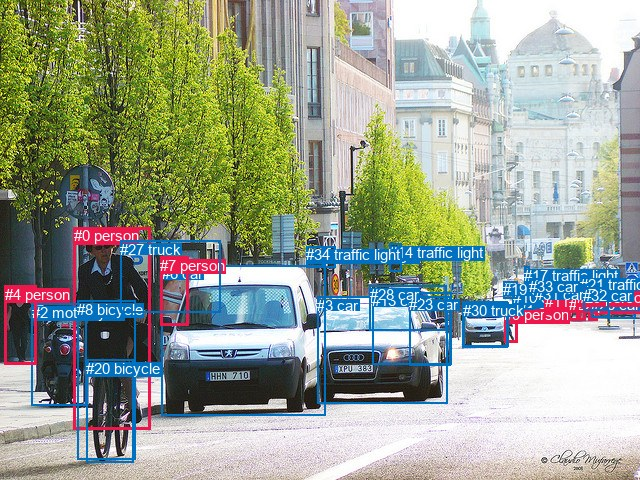
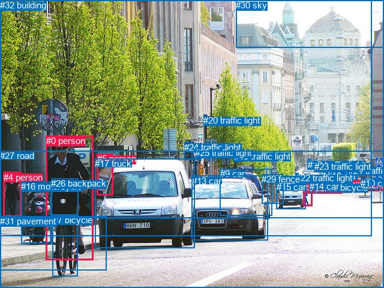

# 图片 1492：2385610.jpg

随机样本序号：353。图片 SHA256：`914e39f9c79ced1a519f1003c410b3ed7bfbc8315df4e0e0c35ac421079e9c6d`。

红色框表示人，蓝色框表示其他物体。两个模式分别保留自身框编号，可依据位置比较对应对象。

## 自动检测框与输出

人的框编号：`[0, 4, 7, 9, 11, 16, 22, 25, 29]`。状态：`ok`。

### 自动检测全部物体框

| 编号 | 类别 | 是否为人 | 检测分数 | 像素坐标 xyxy |
|---|---|---|---|---|
| 0 | person | True | 0.9957 | 73.9, 227.1, 150.3, 429.8 |
| 1 | car | False | 0.9954 | 517.6, 301.6, 546.9, 321.6 |
| 2 | motorcycle | False | 0.9930 | 31.7, 303.8, 86.1, 405.3 |
| 3 | car | False | 0.9909 | 317.2, 296.9, 447.4, 403.7 |
| 4 | person | True | 0.9899 | 4.5, 285.7, 36.7, 364.4 |
| 5 | car | False | 0.9827 | 607.1, 296.9, 635.6, 318.8 |
| 6 | car | False | 0.9783 | 161.7, 265.5, 325.1, 415.8 |
| 7 | person | True | 0.9770 | 160.4, 256.5, 188.9, 325.5 |
| 8 | bicycle | False | 0.9675 | 77.2, 300.7, 135.2, 459.5 |
| 9 | person | True | 0.9558 | 504.4, 306.2, 517.6, 342.6 |
| 10 | car | False | 0.9474 | 512.7, 289.4, 534.2, 309.4 |
| 11 | person | True | 0.9411 | 544.6, 292.8, 552.9, 314.4 |
| 12 | traffic light | False | 0.9271 | 324.7, 246.4, 335.0, 267.2 |
| 13 | car | False | 0.8846 | 372.2, 292.4, 451.4, 364.0 |
| 14 | traffic light | False | 0.8637 | 389.2, 243.9, 401.3, 271.0 |
| 15 | car | False | 0.8595 | 544.7, 286.0, 558.3, 296.8 |
| 16 | person | True | 0.8403 | 588.2, 296.0, 598.0, 320.5 |
| 17 | traffic light | False | 0.8034 | 524.2, 266.7, 530.0, 273.6 |
| 18 | car | False | 0.8021 | 463.2, 302.4, 508.5, 347.0 |
| 19 | car | False | 0.8011 | 503.4, 281.2, 517.7, 298.4 |
| 20 | bicycle | False | 0.7729 | 86.3, 359.6, 133.1, 462.5 |
| 21 | traffic light | False | 0.7323 | 580.3, 275.7, 587.4, 287.6 |
| 22 | person | True | 0.6744 | 568.8, 295.9, 580.6, 320.3 |
| 23 | car | False | 0.6054 | 409.2, 296.5, 450.7, 365.5 |
| 24 | car | False | 0.6008 | 536.2, 281.5, 550.6, 295.0 |
| 25 | person | True | 0.5563 | 576.2, 288.2, 585.8, 320.1 |
| 26 | car | False | 0.5126 | 591.3, 296.1, 609.7, 317.4 |
| 27 | truck | False | 0.4994 | 120.2, 240.7, 220.8, 312.3 |
| 28 | car | False | 0.4854 | 369.8, 285.7, 446.7, 331.0 |
| 29 | person | True | 0.4827 | 576.8, 289.2, 585.5, 306.1 |
| 30 | truck | False | 0.4486 | 462.5, 301.6, 507.5, 347.1 |
| 31 | car | False | 0.4479 | 534.9, 286.0, 546.6, 296.3 |
| 32 | car | False | 0.3883 | 583.2, 287.5, 608.1, 310.0 |
| 33 | car | False | 0.3663 | 529.1, 278.3, 541.6, 286.1 |
| 34 | traffic light | False | 0.3526 | 306.3, 246.1, 323.0, 267.3 |

### 自动检测 Top50 人相关候选

评分物体对：1190；人相关物体对：540；输出关系：50。

| 排名 | 主语编号与类别 | 关系 | 宾语编号与类别 | 类型 | 人与人 | 排序分数 | 原始融合 logit |
|---|---|---|---|---|---|---|---|
| 1 | #0 person | riding | #8 bicycle | semantic | False | 0.99715 | 5.8590 |
| 2 | #0 person | riding | #20 bicycle | semantic | False | 0.99634 | 5.6061 |
| 3 | #0 person | on | #8 bicycle | spatial | False | 0.98070 | 3.9283 |
| 4 | #0 person | riding | #2 motorcycle | semantic | False | 0.97642 | 3.7234 |
| 5 | #0 person | on | #20 bicycle | spatial | False | 0.97251 | 3.5661 |
| 6 | #25 person | wearing | #29 person | semantic | True | 0.97218 | 3.5539 |
| 7 | #4 person | walking on | #2 motorcycle | semantic | False | 0.96103 | 3.2052 |
| 8 | #7 person | standing on | #27 truck | semantic | False | 0.95157 | 2.9780 |
| 9 | #4 person | beside | #2 motorcycle | spatial | False | 0.93518 | 2.6692 |
| 10 | #7 person | in | #27 truck | spatial | False | 0.93306 | 2.6347 |
| 11 | #25 person | pushing | #22 person | semantic | True | 0.92126 | 2.4596 |
| 12 | #21 traffic light | on | #29 person | spatial | False | 0.92108 | 2.4571 |
| 13 | #11 person | walking on | #15 car | semantic | False | 0.91283 | 2.3487 |
| 14 | #25 person | in | #29 person | spatial | True | 0.91051 | 2.3198 |
| 15 | #11 person | walking on | #1 car | semantic | False | 0.90710 | 2.2787 |
| 16 | #25 person | walking on | #32 car | semantic | False | 0.88929 | 2.0835 |
| 17 | #11 person | walking on | #24 car | semantic | False | 0.86474 | 1.8552 |
| 18 | #11 person | walking on | #31 car | semantic | False | 0.85778 | 1.7969 |
| 19 | #21 traffic light | riding | #29 person | semantic | False | 0.85717 | 1.7920 |
| 20 | #29 person | pushing | #22 person | semantic | True | 0.84029 | 1.6604 |
| 21 | #21 traffic light | on | #25 person | spatial | False | 0.82507 | 1.5511 |
| 22 | #16 person | walking on | #32 car | semantic | False | 0.81777 | 1.5013 |
| 23 | #0 person | on | #2 motorcycle | spatial | False | 0.79476 | 1.3539 |
| 24 | #22 person | pushing | #29 person | semantic | True | 0.79324 | 1.3445 |
| 25 | #21 traffic light | on | #22 person | spatial | False | 0.78136 | 1.2736 |
| 26 | #21 traffic light | on | #16 person | spatial | False | 0.78059 | 1.2691 |
| 27 | #16 person | pushing | #26 car | semantic | False | 0.77341 | 1.2276 |
| 28 | #25 person | walking on | #26 car | semantic | False | 0.77138 | 1.2161 |
| 29 | #25 person | walking on | #16 person | semantic | True | 0.74666 | 1.0809 |
| 30 | #29 person | pushing | #32 car | semantic | False | 0.72959 | 0.9925 |
| 31 | #9 person | walking on | #10 car | semantic | False | 0.72005 | 0.9447 |
| 32 | #29 person | riding | #25 person | semantic | True | 0.70735 | 0.8825 |
| 33 | #9 person | walking on | #18 car | semantic | False | 0.70341 | 0.8636 |
| 34 | #29 person | on | #25 person | spatial | True | 0.69763 | 0.8360 |
| 35 | #9 person | walking on | #30 truck | semantic | False | 0.68714 | 0.7868 |
| 36 | #22 person | walking on | #32 car | semantic | False | 0.68573 | 0.7802 |
| 37 | #9 person | walking on | #1 car | semantic | False | 0.68185 | 0.7623 |
| 38 | #11 person | on | #1 car | spatial | False | 0.67701 | 0.7401 |
| 39 | #7 person | beside | #6 car | spatial | False | 0.66654 | 0.6926 |
| 40 | #7 person | looking at | #6 car | semantic | False | 0.63903 | 0.5711 |
| 41 | #11 person | on | #15 car | spatial | False | 0.63213 | 0.5414 |
| 42 | #2 motorcycle | parked on | #4 person | semantic | False | 0.62358 | 0.5048 |
| 43 | #29 person | on | #22 person | spatial | True | 0.61690 | 0.4764 |
| 44 | #22 person | walking on | #25 person | semantic | True | 0.59829 | 0.3983 |
| 45 | #25 person | on | #22 person | spatial | True | 0.59569 | 0.3875 |
| 46 | #19 car | riding | #9 person | semantic | False | 0.59418 | 0.3813 |
| 47 | #29 person | walking on | #16 person | semantic | True | 0.58301 | 0.3351 |
| 48 | #19 car | on | #9 person | spatial | False | 0.57868 | 0.3174 |
| 49 | #16 person | on | #32 car | spatial | False | 0.57159 | 0.2884 |
| 50 | #16 person | on | #26 car | spatial | False | 0.56345 | 0.2552 |

### 自动检测逐条人相关 GT 核验

R@50：20.00%；命中 1/5。

| GT 主语编号 | GT 关系 | GT 宾语编号 | 结果阶段 | 匹配预测主语编号 | 匹配预测宾语编号 |
|---|---|---|---|---|---|
| 0 | riding | 7 | hit50 | [0] | [20] |
| 3 | beside | 15 | rank_below50 | [9] | [18] |
| 3 | crossing | 27 | endpoint_missing_or_wrong_class | [9] | [] |
| 4 | walking on | 31 | endpoint_missing_or_wrong_class | [4] | [] |
| 15 | beside | 3 | rank_below50 | [18] | [9] |

## 真实框与输出

人的框编号：`[0, 1, 2, 3, 4, 5]`。

### 真实框全部物体框

| 编号 | 类别 | 是否为人 | 检测分数 | 像素坐标 xyxy |
|---|---|---|---|---|
| 0 | person | True | GT | 77.0, 226.0, 156.0, 433.0 |
| 1 | person | True | GT | 568.0, 298.0, 583.0, 321.0 |
| 2 | person | True | GT | 591.0, 300.0, 598.0, 320.0 |
| 3 | person | True | GT | 505.0, 305.0, 520.0, 343.0 |
| 4 | person | True | GT | 6.0, 287.0, 36.0, 362.0 |
| 5 | person | True | GT | 162.0, 256.0, 189.0, 325.0 |
| 6 | bicycle | False | GT | 547.0, 304.0, 552.0, 315.0 |
| 7 | bicycle | False | GT | 88.0, 358.0, 130.0, 461.0 |
| 8 | car | False | GT | 552.0, 273.0, 567.0, 285.0 |
| 9 | car | False | GT | 367.0, 281.0, 454.0, 359.0 |
| 10 | car | False | GT | 601.0, 297.0, 633.0, 316.0 |
| 11 | car | False | GT | 535.0, 279.0, 549.0, 295.0 |
| 12 | car | False | GT | 545.0, 285.0, 558.0, 300.0 |
| 13 | car | False | GT | 320.0, 293.0, 447.0, 401.0 |
| 14 | car | False | GT | 516.0, 302.0, 546.0, 320.0 |
| 15 | car | False | GT | 461.0, 303.0, 509.0, 348.0 |
| 16 | motorcycle | False | GT | 35.0, 302.0, 85.0, 405.0 |
| 17 | truck | False | GT | 158.0, 264.0, 324.0, 413.0 |
| 18 | traffic light | False | GT | 513.0, 266.0, 519.0, 274.0 |
| 19 | traffic light | False | GT | 390.0, 252.0, 401.0, 270.0 |
| 20 | traffic light | False | GT | 339.0, 192.0, 345.0, 209.0 |
| 21 | traffic light | False | GT | 581.0, 276.0, 586.0, 287.0 |
| 22 | traffic light | False | GT | 493.0, 288.0, 497.0, 296.0 |
| 23 | traffic light | False | GT | 524.0, 269.0, 529.0, 273.0 |
| 24 | traffic light | False | GT | 307.0, 237.0, 320.0, 267.0 |
| 25 | traffic light | False | GT | 325.0, 246.0, 334.0, 266.0 |
| 26 | backpack | False | GT | 85.0, 297.0, 130.0, 359.0 |
| 27 | road | False | GT | 0.0, 251.0, 640.0, 480.0 |
| 28 | tree | False | GT | 0.0, 0.0, 619.0, 394.0 |
| 29 | fence | False | GT | 436.0, 290.0, 472.0, 340.0 |
| 30 | sky | False | GT | 393.0, 0.0, 640.0, 79.0 |
| 31 | pavement | False | GT | 0.0, 360.0, 177.0, 450.0 |
| 32 | building | False | GT | 0.0, 0.0, 640.0, 364.0 |

### 真实框 Top50 人相关候选

评分物体对：1056；人相关物体对：354；输出关系：50。

| 排名 | 主语编号与类别 | 关系 | 宾语编号与类别 | 类型 | 人与人 | 排序分数 | 原始融合 logit |
|---|---|---|---|---|---|---|---|
| 1 | #0 person | riding | #7 bicycle | semantic | False | 0.99742 | 5.9593 |
| 2 | #3 person | crossing | #27 road | semantic | False | 0.99539 | 5.3755 |
| 3 | #0 person | riding | #31 pavement | semantic | False | 0.99103 | 4.7054 |
| 4 | #0 person | wearing | #26 backpack | semantic | False | 0.99052 | 4.6492 |
| 5 | #4 person | walking on | #31 pavement | semantic | False | 0.98623 | 4.2713 |
| 6 | #4 person | crossing | #27 road | semantic | False | 0.98123 | 3.9567 |
| 7 | #4 person | pushing | #16 motorcycle | semantic | False | 0.98033 | 3.9090 |
| 8 | #5 person | crossing | #27 road | semantic | False | 0.97948 | 3.8656 |
| 9 | #0 person | crossing | #27 road | semantic | False | 0.97613 | 3.7108 |
| 10 | #0 person | riding | #16 motorcycle | semantic | False | 0.97443 | 3.6404 |
| 11 | #0 person | on | #7 bicycle | spatial | False | 0.97415 | 3.6294 |
| 12 | #0 person | on | #31 pavement | spatial | False | 0.96135 | 3.2137 |
| 13 | #1 person | crossing | #27 road | semantic | False | 0.95521 | 3.0600 |
| 14 | #3 person | on | #27 road | spatial | False | 0.93226 | 2.6219 |
| 15 | #4 person | on | #31 pavement | spatial | False | 0.92538 | 2.5177 |
| 16 | #0 person | in | #26 backpack | spatial | False | 0.92217 | 2.4722 |
| 17 | #2 person | on | #27 road | spatial | False | 0.89111 | 2.1022 |
| 18 | #4 person | beside | #16 motorcycle | spatial | False | 0.89004 | 2.0912 |
| 19 | #21 traffic light | on | #1 person | spatial | False | 0.88660 | 2.0565 |
| 20 | #0 person | on | #27 road | spatial | False | 0.86824 | 1.8855 |
| 21 | #1 person | on | #27 road | spatial | False | 0.86468 | 1.8548 |
| 22 | #3 person | pushing | #14 car | semantic | False | 0.86318 | 1.8420 |
| 23 | #5 person | leaning on | #17 truck | spatial | False | 0.82470 | 1.5485 |
| 24 | #21 traffic light | on | #2 person | spatial | False | 0.80422 | 1.4129 |
| 25 | #2 person | walking on | #27 road | semantic | False | 0.78927 | 1.3206 |
| 26 | #3 person | crossing | #15 car | semantic | False | 0.73192 | 1.0044 |
| 27 | #4 person | on | #27 road | spatial | False | 0.70438 | 0.8682 |
| 28 | #0 person | on | #16 motorcycle | spatial | False | 0.69793 | 0.8375 |
| 29 | #26 backpack | on | #0 person | spatial | False | 0.69331 | 0.8156 |
| 30 | #5 person | in | #32 building | spatial | False | 0.69072 | 0.8035 |
| 31 | #4 person | walking on | #32 building | semantic | False | 0.69025 | 0.8013 |
| 32 | #5 person | standing on | #17 truck | semantic | False | 0.67047 | 0.7103 |
| 33 | #3 person | on | #14 car | spatial | False | 0.66503 | 0.6858 |
| 34 | #5 person | on | #27 road | spatial | False | 0.64967 | 0.6176 |
| 35 | #21 traffic light | riding | #1 person | semantic | False | 0.62397 | 0.5064 |
| 36 | #5 person | walking on | #32 building | semantic | False | 0.58702 | 0.3517 |
| 37 | #4 person | in | #32 building | spatial | False | 0.55429 | 0.2180 |
| 38 | #5 person | in | #28 tree | spatial | False | 0.55188 | 0.2083 |
| 39 | #3 person | beside | #15 car | spatial | False | 0.54089 | 0.1639 |
| 40 | #4 person | walking on | #28 tree | semantic | False | 0.53687 | 0.1478 |
| 41 | #8 car | on | #1 person | spatial | False | 0.51906 | 0.0763 |
| 42 | #4 person | in | #28 tree | spatial | False | 0.51705 | 0.0682 |
| 43 | #2 person | on | #10 car | spatial | False | 0.49220 | -0.0312 |
| 44 | #2 person | walking on | #10 car | semantic | False | 0.42337 | -0.3089 |
| 45 | #4 person | looking at | #0 person | semantic | True | 0.41369 | -0.3487 |
| 46 | #21 traffic light | standing on | #2 person | semantic | False | 0.39749 | -0.4160 |
| 47 | #26 backpack | carrying | #0 person | semantic | False | 0.33925 | -0.6666 |
| 48 | #5 person | walking on | #28 tree | semantic | False | 0.33542 | -0.6838 |
| 49 | #5 person | looking at | #0 person | semantic | True | 0.27322 | -0.9784 |
| 50 | #5 person | walking on | #31 pavement | semantic | False | 0.26951 | -0.9971 |

### 真实框逐条人相关 GT 核验

R@50：80.00%；命中 4/5。

| GT 主语编号 | GT 关系 | GT 宾语编号 | 结果阶段 | 匹配预测主语编号 | 匹配预测宾语编号 |
|---|---|---|---|---|---|
| 0 | riding | 7 | hit50 | [0] | [7] |
| 3 | beside | 15 | hit50 | [3] | [15] |
| 3 | crossing | 27 | hit50 | [3] | [27] |
| 4 | walking on | 31 | hit50 | [4] | [31] |
| 15 | beside | 3 | rank_below50 | [15] | [3] |

## 全部人相关 GT

| 主语编号与类别 | 关系 | 宾语编号与类别 |
|---|---|---|
| #0 person | riding | #7 bicycle |
| #3 person | beside | #15 car |
| #3 person | crossing | #27 road |
| #4 person | walking on | #31 pavement |
| #15 car | beside | #3 person |

原始记录、全部人相关物体对的两项预测与分项分数见 [逐图证据 JSON](../evidence/cases/1492.json)。全部56类 logits 保留于本机 HOR/output/random500/logits/。

<!-- HOR_COMPLETE_RESULTS -->

## 六组条件的完整输出对照

以下保留同一图片三种框与候选模式、两种谓词输出规则的全部 Top50。框编号各自在所属模式内解释。

### 自动检测框完整枚举：空间与语义各保留一个谓词

| 排名 | 主语编号与类别 | 谓词 | 宾语编号与类别 | 分组 | 排序分数 | predicate logit | pair logit |
|---|---|---|---|---|---|---|---|
| 1 | #0 person | riding | #8 bicycle | semantic | 0.9971541 | 5.3810706 | 0.4779465 |
| 2 | #0 person | riding | #20 bicycle | semantic | 0.9963382 | 5.2602172 | 0.3459321 |
| 3 | #0 person | on | #8 bicycle | spatial | 0.9807017 | 3.4503093 | 0.4779465 |
| 4 | #0 person | riding | #2 motorcycle | semantic | 0.9764188 | 3.9384017 | -0.2149618 |
| 5 | #0 person | on | #20 bicycle | spatial | 0.9725114 | 3.2201796 | 0.3459321 |
| 6 | #25 person | wearing | #29 person | semantic | 0.9721829 | 3.9726348 | -0.4187429 |
| 7 | #4 person | walking on | #2 motorcycle | semantic | 0.9610295 | 3.1656318 | 0.0395675 |
| 8 | #7 person | standing on | #27 truck | semantic | 0.9515719 | 2.7345352 | 0.2434999 |
| 9 | #4 person | beside | #2 motorcycle | spatial | 0.9351838 | 2.6296201 | 0.0395675 |
| 10 | #7 person | in | #27 truck | spatial | 0.9330624 | 2.3912106 | 0.2434999 |
| 11 | #25 person | pushing | #22 person | semantic | 0.9212583 | 2.7942567 | -0.3346894 |
| 12 | #21 traffic light | on | #29 person | spatial | 0.9210755 | 2.7306685 | -0.2736181 |
| 13 | #11 person | walking on | #15 car | semantic | 0.9128342 | 2.7293439 | -0.3806030 |
| 14 | #25 person | in | #29 person | spatial | 0.9105071 | 2.7385855 | -0.4187429 |
| 15 | #11 person | walking on | #1 car | semantic | 0.9071011 | 2.6059823 | -0.3272405 |
| 16 | #25 person | walking on | #32 car | semantic | 0.8892887 | 2.5186772 | -0.4351812 |
| 17 | #11 person | walking on | #24 car | semantic | 0.8647403 | 2.1696668 | -0.3144338 |
| 18 | #11 person | walking on | #31 car | semantic | 0.8577756 | 2.1124945 | -0.3155578 |
| 19 | #21 traffic light | riding | #29 person | semantic | 0.8571727 | 2.0656219 | -0.2736181 |
| 20 | #29 person | pushing | #22 person | semantic | 0.8402879 | 1.9219947 | -0.2616228 |
| 21 | #21 traffic light | on | #25 person | spatial | 0.8250746 | 1.8067307 | -0.2556161 |
| 22 | #16 person | walking on | #32 car | semantic | 0.8177729 | 2.0011191 | -0.4997880 |
| 23 | #0 person | on | #2 motorcycle | spatial | 0.7947630 | 1.5688400 | -0.2149618 |
| 24 | #22 person | pushing | #29 person | semantic | 0.7932352 | 1.8314934 | -0.4869551 |
| 25 | #21 traffic light | on | #22 person | spatial | 0.7813576 | 1.5227323 | -0.2491370 |
| 26 | #21 traffic light | on | #16 person | spatial | 0.7805920 | 1.4785938 | -0.2094744 |
| 27 | #16 person | pushing | #26 car | semantic | 0.7734058 | 1.6210294 | -0.3933861 |
| 28 | #25 person | walking on | #26 car | semantic | 0.7713803 | 1.5738482 | -0.3577265 |
| 29 | #25 person | walking on | #16 person | semantic | 0.7466640 | 1.4203820 | -0.3394833 |
| 30 | #29 person | pushing | #32 car | semantic | 0.7295906 | 1.3502145 | -0.3576680 |
| 31 | #9 person | walking on | #10 car | semantic | 0.7200508 | 1.4865851 | -0.5418714 |
| 32 | #29 person | riding | #25 person | semantic | 0.7073460 | 1.1934648 | -0.3109358 |
| 33 | #9 person | walking on | #18 car | semantic | 0.7034125 | 1.2969780 | -0.4333767 |
| 34 | #29 person | on | #25 person | spatial | 0.6976320 | 1.1469827 | -0.3109358 |
| 35 | #9 person | walking on | #30 truck | semantic | 0.6871355 | 1.2398057 | -0.4530444 |
| 36 | #22 person | walking on | #32 car | semantic | 0.6857306 | 1.2849636 | -0.5047292 |
| 37 | #9 person | walking on | #1 car | semantic | 0.6818501 | 1.2187743 | -0.4564870 |
| 38 | #11 person | on | #1 car | spatial | 0.6770109 | 1.0673094 | -0.3272405 |
| 39 | #7 person | beside | #6 car | spatial | 0.6665375 | 1.6094084 | -0.9168423 |
| 40 | #7 person | looking at | #6 car | semantic | 0.6390255 | 1.4879794 | -0.9168423 |
| 41 | #11 person | on | #15 car | spatial | 0.6321327 | 0.9219799 | -0.3806030 |
| 42 | #2 motorcycle | parked on | #4 person | semantic | 0.6235790 | 1.7387781 | -1.2340108 |
| 43 | #29 person | on | #22 person | spatial | 0.6168954 | 0.7380142 | -0.2616228 |
| 44 | #22 person | walking on | #25 person | semantic | 0.5982875 | 0.8561182 | -0.4577836 |
| 45 | #25 person | on | #22 person | spatial | 0.5956906 | 0.7222304 | -0.3346894 |
| 46 | #19 car | riding | #9 person | semantic | 0.5941828 | 0.7445393 | -0.3632550 |
| 47 | #29 person | walking on | #16 person | semantic | 0.5830072 | 0.6019111 | -0.2667805 |
| 48 | #19 car | on | #9 person | spatial | 0.5786798 | 0.6806111 | -0.3632550 |
| 49 | #16 person | on | #32 car | spatial | 0.5715946 | 0.7881479 | -0.4997880 |
| 50 | #16 person | on | #26 car | spatial | 0.5634547 | 0.6485810 | -0.3933861 |

GT 命中：1/5，R@50=20.00%。

| GT主语 | GT谓词 | GT宾语 | 结果阶段 | 匹配主语框 | 匹配宾语框 |
|---|---|---|---|---|---|
| 0 | riding | 7 | hit50 | [0] | [20] |
| 3 | beside | 15 | rank_below50 | [9] | [18] |
| 3 | crossing | 27 | endpoint_missing_or_wrong_class | [9] | [] |
| 4 | walking on | 31 | endpoint_missing_or_wrong_class | [4] | [] |
| 15 | beside | 3 | rank_below50 | [18] | [9] |

### 自动检测框完整枚举：每对只保留一个谓词

| 排名 | 主语编号与类别 | 谓词 | 宾语编号与类别 | 分组 | 排序分数 | predicate logit | pair logit |
|---|---|---|---|---|---|---|---|
| 1 | #0 person | riding | #8 bicycle | single | 0.9971541 | 5.3810706 | 0.4779465 |
| 2 | #0 person | riding | #20 bicycle | single | 0.9963382 | 5.2602172 | 0.3459321 |
| 3 | #0 person | riding | #2 motorcycle | single | 0.9764188 | 3.9384017 | -0.2149618 |
| 4 | #25 person | wearing | #29 person | single | 0.9721829 | 3.9726348 | -0.4187429 |
| 5 | #4 person | walking on | #2 motorcycle | single | 0.9610295 | 3.1656318 | 0.0395675 |
| 6 | #7 person | standing on | #27 truck | single | 0.9515719 | 2.7345352 | 0.2434999 |
| 7 | #25 person | pushing | #22 person | single | 0.9212583 | 2.7942567 | -0.3346894 |
| 8 | #21 traffic light | on | #29 person | single | 0.9210755 | 2.7306685 | -0.2736181 |
| 9 | #11 person | walking on | #15 car | single | 0.9128342 | 2.7293439 | -0.3806030 |
| 10 | #11 person | walking on | #1 car | single | 0.9071011 | 2.6059823 | -0.3272405 |
| 11 | #25 person | walking on | #32 car | single | 0.8892887 | 2.5186772 | -0.4351812 |
| 12 | #11 person | walking on | #24 car | single | 0.8647403 | 2.1696668 | -0.3144338 |
| 13 | #11 person | walking on | #31 car | single | 0.8577756 | 2.1124945 | -0.3155578 |
| 14 | #29 person | pushing | #22 person | single | 0.8402879 | 1.9219947 | -0.2616228 |
| 15 | #21 traffic light | on | #25 person | single | 0.8250746 | 1.8067307 | -0.2556161 |
| 16 | #16 person | walking on | #32 car | single | 0.8177729 | 2.0011191 | -0.4997880 |
| 17 | #22 person | pushing | #29 person | single | 0.7932352 | 1.8314934 | -0.4869551 |
| 18 | #21 traffic light | on | #22 person | single | 0.7813576 | 1.5227323 | -0.2491370 |
| 19 | #21 traffic light | on | #16 person | single | 0.7805920 | 1.4785938 | -0.2094744 |
| 20 | #16 person | pushing | #26 car | single | 0.7734058 | 1.6210294 | -0.3933861 |
| 21 | #25 person | walking on | #26 car | single | 0.7713803 | 1.5738482 | -0.3577265 |
| 22 | #25 person | walking on | #16 person | single | 0.7466640 | 1.4203820 | -0.3394833 |
| 23 | #29 person | pushing | #32 car | single | 0.7295906 | 1.3502145 | -0.3576680 |
| 24 | #9 person | walking on | #10 car | single | 0.7200508 | 1.4865851 | -0.5418714 |
| 25 | #29 person | riding | #25 person | single | 0.7073460 | 1.1934648 | -0.3109358 |
| 26 | #9 person | walking on | #18 car | single | 0.7034125 | 1.2969780 | -0.4333767 |
| 27 | #9 person | walking on | #30 truck | single | 0.6871355 | 1.2398057 | -0.4530444 |
| 28 | #22 person | walking on | #32 car | single | 0.6857306 | 1.2849636 | -0.5047292 |
| 29 | #9 person | walking on | #1 car | single | 0.6818501 | 1.2187743 | -0.4564870 |
| 30 | #7 person | beside | #6 car | single | 0.6665375 | 1.6094084 | -0.9168423 |
| 31 | #2 motorcycle | parked on | #4 person | single | 0.6235790 | 1.7387781 | -1.2340108 |
| 32 | #22 person | walking on | #25 person | single | 0.5982875 | 0.8561182 | -0.4577836 |
| 33 | #19 car | riding | #9 person | single | 0.5941828 | 0.7445393 | -0.3632550 |
| 34 | #29 person | walking on | #16 person | single | 0.5830072 | 0.6019111 | -0.2667805 |
| 35 | #22 person | walking on | #26 car | single | 0.5603274 | 0.6711106 | -0.4286200 |
| 36 | #25 person | walking on | #21 traffic light | single | 0.5534739 | 0.6109700 | -0.3962530 |
| 37 | #29 person | walking on | #26 car | single | 0.5309693 | 0.4123454 | -0.2883095 |
| 38 | #22 person | walking on | #16 person | single | 0.5097488 | 0.4484296 | -0.4094295 |
| 39 | #24 car | pushing | #11 person | single | 0.4633259 | 0.2671442 | -0.4141045 |
| 40 | #15 car | pushing | #11 person | single | 0.4608452 | 0.1769295 | -0.3338701 |
| 41 | #10 car | on | #9 person | single | 0.4566469 | 0.0897923 | -0.2636412 |
| 42 | #7 person | riding | #8 bicycle | single | 0.4413938 | 0.9148240 | -1.1503313 |
| 43 | #29 person | walking on | #21 traffic light | single | 0.4370203 | 0.0482678 | -0.3015319 |
| 44 | #4 person | looking at | #0 person | single | 0.4237214 | 0.8588519 | -1.1663669 |
| 45 | #31 car | pushing | #11 person | single | 0.4105819 | 0.0264268 | -0.3879872 |
| 46 | #4 person | walking on | #27 truck | single | 0.4072043 | 0.6094089 | -0.9849435 |
| 47 | #11 person | walking on | #22 person | single | 0.4029362 | -0.0149527 | -0.3782932 |
| 48 | #11 person | walking on | #33 car | single | 0.3999164 | -0.0600548 | -0.3457589 |
| 49 | #16 person | walking on | #5 car | single | 0.3856026 | 0.0076122 | -0.4734470 |
| 50 | #25 person | walking on | #5 car | single | 0.3792430 | -0.0284858 | -0.4642766 |

GT 命中：1/5，R@50=20.00%。

| GT主语 | GT谓词 | GT宾语 | 结果阶段 | 匹配主语框 | 匹配宾语框 |
|---|---|---|---|---|---|
| 0 | riding | 7 | hit50 | [0] | [20] |
| 3 | beside | 15 | wrong_predicate | [9] | [18] |
| 3 | crossing | 27 | endpoint_missing_or_wrong_class | [9] | [] |
| 4 | walking on | 31 | endpoint_missing_or_wrong_class | [4] | [] |
| 15 | beside | 3 | wrong_predicate | [18] | [9] |

### 真实框完整枚举：空间与语义各保留一个谓词

| 排名 | 主语编号与类别 | 谓词 | 宾语编号与类别 | 分组 | 排序分数 | predicate logit | pair logit |
|---|---|---|---|---|---|---|---|
| 1 | #0 person | riding | #7 bicycle | semantic | 0.9974248 | 5.5603967 | 0.3988707 |
| 2 | #3 person | crossing | #27 road | semantic | 0.9953928 | 5.2601523 | 0.1153655 |
| 3 | #0 person | riding | #31 pavement | semantic | 0.9910349 | 4.7273717 | -0.0219649 |
| 4 | #0 person | wearing | #26 backpack | semantic | 0.9905214 | 4.2765536 | 0.3726451 |
| 5 | #4 person | walking on | #31 pavement | semantic | 0.9862283 | 3.9540257 | 0.3172486 |
| 6 | #4 person | crossing | #27 road | semantic | 0.9812334 | 4.0635390 | -0.1068113 |
| 7 | #4 person | pushing | #16 motorcycle | semantic | 0.9803336 | 3.9072480 | 0.0017318 |
| 8 | #5 person | crossing | #27 road | semantic | 0.9794797 | 4.4227862 | -0.5571773 |
| 9 | #0 person | crossing | #27 road | semantic | 0.9761255 | 3.8775887 | -0.1668066 |
| 10 | #0 person | riding | #16 motorcycle | semantic | 0.9744285 | 3.8765082 | -0.2361362 |
| 11 | #0 person | on | #7 bicycle | spatial | 0.9741527 | 3.2304897 | 0.3988707 |
| 12 | #0 person | on | #31 pavement | spatial | 0.9613459 | 3.2356448 | -0.0219649 |
| 13 | #1 person | crossing | #27 road | semantic | 0.9552125 | 3.1641436 | -0.1041408 |
| 14 | #3 person | on | #27 road | spatial | 0.9322596 | 2.5065622 | 0.1153655 |
| 15 | #4 person | on | #31 pavement | spatial | 0.9253764 | 2.2004948 | 0.3172486 |
| 16 | #0 person | in | #26 backpack | spatial | 0.9221720 | 2.0995865 | 0.3726451 |
| 17 | #2 person | on | #27 road | spatial | 0.8911131 | 2.2050705 | -0.1029086 |
| 18 | #4 person | beside | #16 motorcycle | spatial | 0.8900405 | 2.0894227 | 0.0017318 |
| 19 | #21 traffic light | on | #1 person | spatial | 0.8866031 | 2.3036566 | -0.2471527 |
| 20 | #0 person | on | #27 road | spatial | 0.8682439 | 2.0523267 | -0.1668066 |
| 21 | #1 person | on | #27 road | spatial | 0.8646844 | 1.9588957 | -0.1041408 |
| 22 | #3 person | pushing | #14 car | semantic | 0.8631815 | 2.2830429 | -0.4410732 |
| 23 | #5 person | leaning on | #17 truck | spatial | 0.8246976 | 2.4519973 | -0.9034927 |
| 24 | #21 traffic light | on | #2 person | spatial | 0.8042226 | 1.5975113 | -0.1846133 |
| 25 | #2 person | walking on | #27 road | semantic | 0.7892737 | 1.4234619 | -0.1029086 |
| 26 | #3 person | crossing | #15 car | semantic | 0.7319233 | 1.4275222 | -0.4231193 |
| 27 | #4 person | on | #27 road | spatial | 0.7043764 | 0.9750371 | -0.1068113 |
| 28 | #0 person | on | #16 motorcycle | spatial | 0.6979296 | 1.0735941 | -0.2361362 |
| 29 | #26 backpack | on | #0 person | spatial | 0.6933112 | 1.4889050 | -0.6732596 |
| 30 | #5 person | in | #32 building | spatial | 0.6907203 | 1.5743151 | -0.7708259 |
| 31 | #4 person | walking on | #32 building | semantic | 0.6902479 | 1.1585922 | -0.3573138 |
| 32 | #5 person | standing on | #17 truck | semantic | 0.6704723 | 1.6138148 | -0.9034927 |
| 33 | #3 person | on | #14 car | spatial | 0.6650345 | 1.1268845 | -0.4410732 |
| 34 | #5 person | on | #27 road | spatial | 0.6496747 | 1.1747866 | -0.5571773 |
| 35 | #21 traffic light | riding | #1 person | semantic | 0.6239686 | 0.7535801 | -0.2471527 |
| 36 | #5 person | walking on | #32 building | semantic | 0.5870185 | 1.1224794 | -0.7708259 |
| 37 | #4 person | in | #32 building | spatial | 0.5542903 | 0.5753345 | -0.3573138 |
| 38 | #5 person | in | #28 tree | spatial | 0.5518795 | 0.9824462 | -0.7741787 |
| 39 | #3 person | beside | #15 car | spatial | 0.5408930 | 0.5870576 | -0.4231193 |
| 40 | #4 person | walking on | #28 tree | semantic | 0.5368716 | 0.5778542 | -0.4300998 |
| 41 | #8 car | on | #1 person | spatial | 0.5190622 | 0.3904152 | -0.3141294 |
| 42 | #4 person | in | #28 tree | spatial | 0.5170522 | 0.4983354 | -0.4300998 |
| 43 | #2 person | on | #10 car | spatial | 0.4921992 | 0.4628782 | -0.4940841 |
| 44 | #2 person | walking on | #10 car | semantic | 0.4233747 | 0.1851492 | -0.4940841 |
| 45 | #4 person | looking at | #0 person | semantic | 0.4136881 | 0.8336420 | -1.1823816 |
| 46 | #21 traffic light | standing on | #2 person | semantic | 0.3974859 | -0.2313385 | -0.1846133 |
| 47 | #26 backpack | carrying | #0 person | semantic | 0.3392521 | 0.0066309 | -0.6732596 |
| 48 | #5 person | walking on | #28 tree | semantic | 0.3354157 | 0.0903878 | -0.7741787 |
| 49 | #5 person | looking at | #0 person | semantic | 0.2732151 | 0.2027712 | -1.1811421 |
| 50 | #5 person | walking on | #31 pavement | semantic | 0.2695144 | -0.0616016 | -0.9354860 |

GT 命中：4/5，R@50=80.00%。

| GT主语 | GT谓词 | GT宾语 | 结果阶段 | 匹配主语框 | 匹配宾语框 |
|---|---|---|---|---|---|
| 0 | riding | 7 | hit50 | [0] | [7] |
| 3 | beside | 15 | hit50 | [3] | [15] |
| 3 | crossing | 27 | hit50 | [3] | [27] |
| 4 | walking on | 31 | hit50 | [4] | [31] |
| 15 | beside | 3 | rank_below50 | [15] | [3] |

### 真实框完整枚举：每对只保留一个谓词

| 排名 | 主语编号与类别 | 谓词 | 宾语编号与类别 | 分组 | 排序分数 | predicate logit | pair logit |
|---|---|---|---|---|---|---|---|
| 1 | #0 person | riding | #7 bicycle | single | 0.9974248 | 5.5603967 | 0.3988707 |
| 2 | #3 person | crossing | #27 road | single | 0.9953928 | 5.2601523 | 0.1153655 |
| 3 | #0 person | riding | #31 pavement | single | 0.9910349 | 4.7273717 | -0.0219649 |
| 4 | #0 person | wearing | #26 backpack | single | 0.9905214 | 4.2765536 | 0.3726451 |
| 5 | #4 person | walking on | #31 pavement | single | 0.9862283 | 3.9540257 | 0.3172486 |
| 6 | #4 person | crossing | #27 road | single | 0.9812334 | 4.0635390 | -0.1068113 |
| 7 | #4 person | pushing | #16 motorcycle | single | 0.9803336 | 3.9072480 | 0.0017318 |
| 8 | #5 person | crossing | #27 road | single | 0.9794797 | 4.4227862 | -0.5571773 |
| 9 | #0 person | crossing | #27 road | single | 0.9761255 | 3.8775887 | -0.1668066 |
| 10 | #0 person | riding | #16 motorcycle | single | 0.9744285 | 3.8765082 | -0.2361362 |
| 11 | #1 person | crossing | #27 road | single | 0.9552125 | 3.1641436 | -0.1041408 |
| 12 | #2 person | on | #27 road | single | 0.8911131 | 2.2050705 | -0.1029086 |
| 13 | #21 traffic light | on | #1 person | single | 0.8866031 | 2.3036566 | -0.2471527 |
| 14 | #3 person | pushing | #14 car | single | 0.8631815 | 2.2830429 | -0.4410732 |
| 15 | #5 person | leaning on | #17 truck | single | 0.8246976 | 2.4519973 | -0.9034927 |
| 16 | #21 traffic light | on | #2 person | single | 0.8042226 | 1.5975113 | -0.1846133 |
| 17 | #3 person | crossing | #15 car | single | 0.7319233 | 1.4275222 | -0.4231193 |
| 18 | #26 backpack | on | #0 person | single | 0.6933112 | 1.4889050 | -0.6732596 |
| 19 | #5 person | in | #32 building | single | 0.6907203 | 1.5743151 | -0.7708259 |
| 20 | #4 person | walking on | #32 building | single | 0.6902479 | 1.1585922 | -0.3573138 |
| 21 | #5 person | in | #28 tree | single | 0.5518795 | 0.9824462 | -0.7741787 |
| 22 | #4 person | walking on | #28 tree | single | 0.5368716 | 0.5778542 | -0.4300998 |
| 23 | #8 car | on | #1 person | single | 0.5190622 | 0.3904152 | -0.3141294 |
| 24 | #2 person | on | #10 car | single | 0.4921992 | 0.4628782 | -0.4940841 |
| 25 | #4 person | looking at | #0 person | single | 0.4136881 | 0.8336420 | -1.1823816 |
| 26 | #5 person | looking at | #0 person | single | 0.2732151 | 0.2027712 | -1.1811421 |
| 27 | #5 person | walking on | #31 pavement | single | 0.2695144 | -0.0616016 | -0.9354860 |
| 28 | #5 person | riding | #7 bicycle | single | 0.2513140 | 0.2577038 | -1.3493204 |
| 29 | #12 car | pushing | #1 person | single | 0.2351988 | -0.8762438 | -0.3029408 |
| 30 | #16 motorcycle | beside | #0 person | single | 0.2339761 | 0.0443163 | -1.2303106 |
| 31 | #1 person | pushing | #2 person | single | 0.2262848 | -0.8461440 | -0.3832652 |
| 32 | #1 person | walking on | #10 car | single | 0.2133717 | -0.7807677 | -0.5239525 |
| 33 | #7 bicycle | riding | #0 person | single | 0.2109728 | -0.3521848 | -0.9668868 |
| 34 | #0 person | beside | #17 truck | single | 0.2052234 | -0.2272277 | -1.1267345 |
| 35 | #5 person | riding | #16 motorcycle | single | 0.2047924 | -0.5831409 | -0.7734656 |
| 36 | #2 person | on | #1 person | single | 0.1845924 | -1.0167480 | -0.4687897 |
| 37 | #22 traffic light | on | #3 person | single | 0.1774891 | -1.1863744 | -0.3470783 |
| 38 | #14 car | on | #3 person | single | 0.1638705 | -1.3742521 | -0.2554549 |
| 39 | #2 person | on | #21 traffic light | single | 0.1489881 | -1.2093434 | -0.5332162 |
| 40 | #0 person | in | #28 tree | single | 0.1467775 | -0.7022183 | -1.0578841 |
| 41 | #5 person | wearing | #26 backpack | single | 0.1422791 | -0.9186130 | -0.8778753 |
| 42 | #0 person | wearing | #5 person | single | 0.1378005 | -0.8789680 | -0.9547119 |
| 43 | #16 motorcycle | beside | #4 person | single | 0.1319478 | -0.6443701 | -1.2394753 |
| 44 | #4 person | wearing | #26 backpack | single | 0.1246068 | -0.8165302 | -1.1329794 |
| 45 | #1 person | on | #21 traffic light | single | 0.1213634 | -1.4922128 | -0.4873690 |
| 46 | #18 traffic light | on | #3 person | single | 0.1199653 | -1.4853566 | -0.5074018 |
| 47 | #15 car | beside | #3 person | single | 0.1173867 | -1.6102321 | -0.4071810 |
| 48 | #3 person | walking on | #32 building | single | 0.1155167 | -1.2546942 | -0.7808946 |
| 49 | #4 person | looking at | #5 person | single | 0.1091617 | -1.0842996 | -1.0150335 |
| 50 | #10 car | on | #2 person | single | 0.1058059 | -1.8478925 | -0.2864240 |

GT 命中：4/5，R@50=80.00%。

| GT主语 | GT谓词 | GT宾语 | 结果阶段 | 匹配主语框 | 匹配宾语框 |
|---|---|---|---|---|---|
| 0 | riding | 7 | hit50 | [0] | [7] |
| 3 | beside | 15 | wrong_predicate | [3] | [15] |
| 3 | crossing | 27 | hit50 | [3] | [27] |
| 4 | walking on | 31 | hit50 | [4] | [31] |
| 15 | beside | 3 | hit50 | [15] | [3] |

### 真实框400候选：空间与语义各保留一个谓词

| 排名 | 主语编号与类别 | 谓词 | 宾语编号与类别 | 分组 | 排序分数 | predicate logit | pair logit |
|---|---|---|---|---|---|---|---|
| 1 | #0 person | riding | #7 bicycle | semantic | 0.9974229 | 5.5596642 | 0.3988707 |
| 2 | #3 person | crossing | #27 road | semantic | 0.9944804 | 5.0785384 | 0.1153655 |
| 3 | #0 person | wearing | #26 backpack | semantic | 0.9903548 | 4.2589507 | 0.3726451 |
| 4 | #0 person | riding | #31 pavement | semantic | 0.9899046 | 4.6074958 | -0.0219649 |
| 5 | #4 person | walking on | #31 pavement | semantic | 0.9883736 | 4.1255422 | 0.3172486 |
| 6 | #5 person | crossing | #27 road | semantic | 0.9872028 | 4.9028249 | -0.5571773 |
| 7 | #4 person | crossing | #27 road | semantic | 0.9842715 | 4.2432342 | -0.1068113 |
| 8 | #0 person | crossing | #27 road | semantic | 0.9821944 | 4.1770797 | -0.1668066 |
| 9 | #4 person | pushing | #16 motorcycle | semantic | 0.9751137 | 3.6665063 | 0.0017318 |
| 10 | #0 person | on | #7 bicycle | spatial | 0.9737308 | 3.2138653 | 0.3988707 |
| 11 | #0 person | on | #31 pavement | spatial | 0.9572771 | 3.1313248 | -0.0219649 |
| 12 | #0 person | riding | #16 motorcycle | semantic | 0.9517108 | 3.2171888 | -0.2361362 |
| 13 | #4 person | on | #31 pavement | spatial | 0.9073651 | 1.9646306 | 0.3172486 |
| 14 | #0 person | in | #26 backpack | spatial | 0.9064742 | 1.8986812 | 0.3726451 |
| 15 | #3 person | on | #27 road | spatial | 0.8883188 | 1.9583173 | 0.1153655 |
| 16 | #4 person | beside | #16 motorcycle | spatial | 0.8776587 | 1.9687109 | 0.0017318 |
| 17 | #1 person | crossing | #27 road | semantic | 0.8685443 | 1.9922900 | -0.1041408 |
| 18 | #0 person | on | #27 road | spatial | 0.8662969 | 2.0354128 | -0.1668066 |
| 19 | #5 person | leaning on | #17 truck | spatial | 0.8567727 | 2.6922331 | -0.9034927 |
| 20 | #4 person | walking on | #32 building | semantic | 0.8420966 | 2.0312247 | -0.3573138 |
| 21 | #21 traffic light | on | #1 person | spatial | 0.8047994 | 1.6637177 | -0.2471527 |
| 22 | #4 person | walking on | #28 tree | semantic | 0.7858730 | 1.7303257 | -0.4300998 |
| 23 | #2 person | on | #27 road | spatial | 0.7707592 | 1.3155117 | -0.1029086 |
| 24 | #5 person | walking on | #32 building | semantic | 0.7571326 | 1.9078484 | -0.7708259 |
| 25 | #5 person | in | #32 building | spatial | 0.7422113 | 1.8283200 | -0.7708259 |
| 26 | #5 person | standing on | #17 truck | semantic | 0.7338204 | 1.9175858 | -0.9034927 |
| 27 | #3 person | pushing | #14 car | semantic | 0.7066445 | 1.3202162 | -0.4410732 |
| 28 | #2 person | standing on | #27 road | semantic | 0.6933758 | 0.9188581 | -0.1029086 |
| 29 | #5 person | in | #28 tree | spatial | 0.6862993 | 1.5570536 | -0.7741787 |
| 30 | #4 person | in | #28 tree | spatial | 0.6754888 | 1.1632166 | -0.4300998 |
| 31 | #4 person | in | #32 building | spatial | 0.6628016 | 1.0331178 | -0.3573138 |
| 32 | #4 person | on | #27 road | spatial | 0.6621864 | 0.7798643 | -0.1068113 |
| 33 | #1 person | on | #27 road | spatial | 0.6533737 | 0.7380428 | -0.1041408 |
| 34 | #5 person | walking on | #31 pavement | semantic | 0.6364763 | 1.4955888 | -0.9354860 |
| 35 | #5 person | on | #27 road | spatial | 0.6311972 | 1.0945334 | -0.5571773 |
| 36 | #26 backpack | on | #0 person | spatial | 0.6297320 | 1.2043266 | -0.6732596 |
| 37 | #5 person | walking on | #28 tree | semantic | 0.6143582 | 1.2398481 | -0.7741787 |
| 38 | #0 person | on | #16 motorcycle | spatial | 0.5644915 | 0.4955468 | -0.2361362 |
| 39 | #21 traffic light | standing on | #1 person | semantic | 0.5620570 | 0.4966674 | -0.2471527 |
| 40 | #3 person | crossing | #15 car | semantic | 0.4959294 | 0.4068365 | -0.4231193 |
| 41 | #3 person | on | #14 car | spatial | 0.4588294 | 0.2760172 | -0.4410732 |
| 42 | #5 person | riding | #7 bicycle | semantic | 0.4223450 | 1.0361662 | -1.3493204 |
| 43 | #4 person | looking at | #0 person | semantic | 0.4004254 | 0.7786889 | -1.1823816 |
| 44 | #0 person | looking at | #30 sky | semantic | 0.3341088 | 0.8789649 | -1.5686246 |
| 45 | #3 person | beside | #15 car | spatial | 0.3235768 | -0.3142629 | -0.4231193 |
| 46 | #8 car | on | #1 person | spatial | 0.3156140 | -0.4598727 | -0.3141294 |
| 47 | #26 backpack | carrying | #0 person | semantic | 0.2939860 | -0.2028432 | -0.6732596 |
| 48 | #2 person | on | #10 car | spatial | 0.2883784 | -0.4091887 | -0.4940841 |
| 49 | #2 person | walking on | #10 car | semantic | 0.2853129 | -0.4241743 | -0.4940841 |
| 50 | #3 person | walking on | #32 building | semantic | 0.2632681 | -0.2481565 | -0.7808946 |

GT 命中：4/5，R@50=80.00%。

| GT主语 | GT谓词 | GT宾语 | 结果阶段 | 匹配主语框 | 匹配宾语框 |
|---|---|---|---|---|---|
| 0 | riding | 7 | hit50 | [0] | [7] |
| 3 | beside | 15 | hit50 | [3] | [15] |
| 3 | crossing | 27 | hit50 | [3] | [27] |
| 4 | walking on | 31 | hit50 | [4] | [31] |
| 15 | beside | 3 | rank_below50 | [15] | [3] |

### 真实框400候选：每对只保留一个谓词

| 排名 | 主语编号与类别 | 谓词 | 宾语编号与类别 | 分组 | 排序分数 | predicate logit | pair logit |
|---|---|---|---|---|---|---|---|
| 1 | #0 person | riding | #7 bicycle | single | 0.9974229 | 5.5596642 | 0.3988707 |
| 2 | #3 person | crossing | #27 road | single | 0.9944804 | 5.0785384 | 0.1153655 |
| 3 | #0 person | wearing | #26 backpack | single | 0.9903548 | 4.2589507 | 0.3726451 |
| 4 | #0 person | riding | #31 pavement | single | 0.9899046 | 4.6074958 | -0.0219649 |
| 5 | #4 person | walking on | #31 pavement | single | 0.9883736 | 4.1255422 | 0.3172486 |
| 6 | #5 person | crossing | #27 road | single | 0.9872028 | 4.9028249 | -0.5571773 |
| 7 | #4 person | crossing | #27 road | single | 0.9842715 | 4.2432342 | -0.1068113 |
| 8 | #0 person | crossing | #27 road | single | 0.9821944 | 4.1770797 | -0.1668066 |
| 9 | #4 person | pushing | #16 motorcycle | single | 0.9751137 | 3.6665063 | 0.0017318 |
| 10 | #0 person | riding | #16 motorcycle | single | 0.9517108 | 3.2171888 | -0.2361362 |
| 11 | #1 person | crossing | #27 road | single | 0.8685443 | 1.9922900 | -0.1041408 |
| 12 | #5 person | leaning on | #17 truck | single | 0.8567727 | 2.6922331 | -0.9034927 |
| 13 | #4 person | walking on | #32 building | single | 0.8420966 | 2.0312247 | -0.3573138 |
| 14 | #21 traffic light | on | #1 person | single | 0.8047994 | 1.6637177 | -0.2471527 |
| 15 | #4 person | walking on | #28 tree | single | 0.7858730 | 1.7303257 | -0.4300998 |
| 16 | #2 person | on | #27 road | single | 0.7707592 | 1.3155117 | -0.1029086 |
| 17 | #5 person | walking on | #32 building | single | 0.7571326 | 1.9078484 | -0.7708259 |
| 18 | #3 person | pushing | #14 car | single | 0.7066445 | 1.3202162 | -0.4410732 |
| 19 | #5 person | in | #28 tree | single | 0.6862993 | 1.5570536 | -0.7741787 |
| 20 | #5 person | walking on | #31 pavement | single | 0.6364763 | 1.4955888 | -0.9354860 |
| 21 | #26 backpack | on | #0 person | single | 0.6297320 | 1.2043266 | -0.6732596 |
| 22 | #3 person | crossing | #15 car | single | 0.4959294 | 0.4068365 | -0.4231193 |
| 23 | #5 person | riding | #7 bicycle | single | 0.4223450 | 1.0361662 | -1.3493204 |
| 24 | #4 person | looking at | #0 person | single | 0.4004254 | 0.7786889 | -1.1823816 |
| 25 | #0 person | looking at | #30 sky | single | 0.3341088 | 0.8789649 | -1.5686246 |
| 26 | #8 car | on | #1 person | single | 0.3156140 | -0.4598727 | -0.3141294 |
| 27 | #2 person | on | #10 car | single | 0.2883784 | -0.4091887 | -0.4940841 |
| 28 | #3 person | walking on | #32 building | single | 0.2632681 | -0.2481565 | -0.7808946 |
| 29 | #0 person | in | #28 tree | single | 0.2367939 | -0.1124539 | -1.0578841 |
| 30 | #2 person | in | #28 tree | single | 0.2303321 | -0.2228632 | -0.9835736 |
| 31 | #5 person | pushing | #16 motorcycle | single | 0.2264402 | -0.4550567 | -0.7734656 |
| 32 | #3 person | in | #28 tree | single | 0.2235498 | -0.3740883 | -0.8710102 |
| 33 | #16 motorcycle | beside | #0 person | single | 0.2232324 | -0.0166173 | -1.2303106 |
| 34 | #5 person | standing on | #9 car | single | 0.2215971 | -0.0141692 | -1.2422144 |
| 35 | #5 person | standing on | #29 fence | single | 0.2183804 | -0.3929100 | -0.8822199 |
| 36 | #1 person | walking on | #32 building | single | 0.2155860 | -0.4828658 | -0.8087113 |
| 37 | #5 person | looking at | #0 person | single | 0.2139369 | -0.1202135 | -1.1811421 |
| 38 | #5 person | standing on | #15 car | single | 0.1921716 | -0.4392180 | -0.9967427 |
| 39 | #0 person | beside | #17 truck | single | 0.1864043 | -0.3468113 | -1.1267345 |
| 40 | #2 person | in | #32 building | single | 0.1801706 | -0.6524372 | -0.8627548 |
| 41 | #1 person | walking on | #28 tree | single | 0.1762795 | -0.6227713 | -0.9189895 |
| 42 | #7 bicycle | riding | #0 person | single | 0.1694075 | -0.6229453 | -0.9668868 |
| 43 | #4 person | wearing | #26 backpack | single | 0.1585396 | -0.5361552 | -1.1329794 |
| 44 | #5 person | wearing | #26 backpack | single | 0.1385565 | -0.9494557 | -0.8778753 |
| 45 | #0 person | in | #32 building | single | 0.1348582 | -0.7271087 | -1.1315612 |
| 46 | #1 person | walking on | #10 car | single | 0.1319348 | -1.3600066 | -0.5239525 |
| 47 | #4 person | looking at | #5 person | single | 0.1268765 | -0.9138296 | -1.0150335 |
| 48 | #0 person | wearing | #5 person | single | 0.1057443 | -1.1802564 | -0.9547119 |
| 49 | #17 truck | beside | #0 person | single | 0.1047203 | -0.5899754 | -1.5558680 |
| 50 | #5 person | standing on | #13 car | single | 0.1037502 | -0.4252443 | -1.7309892 |

GT 命中：3/5，R@50=60.00%。

| GT主语 | GT谓词 | GT宾语 | 结果阶段 | 匹配主语框 | 匹配宾语框 |
|---|---|---|---|---|---|
| 0 | riding | 7 | hit50 | [0] | [7] |
| 3 | beside | 15 | wrong_predicate | [3] | [15] |
| 3 | crossing | 27 | hit50 | [3] | [27] |
| 4 | walking on | 31 | hit50 | [4] | [31] |
| 15 | beside | 3 | rank_below50 | [15] | [3] |
