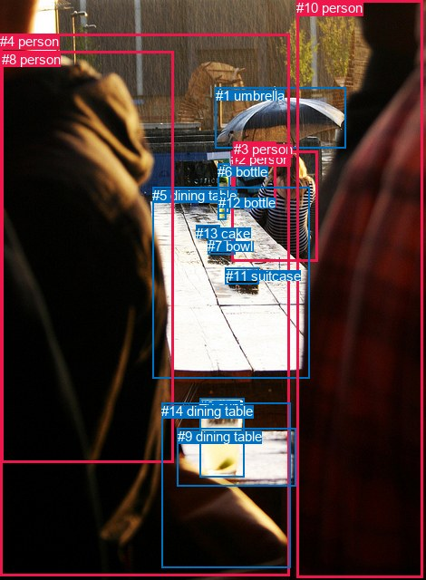
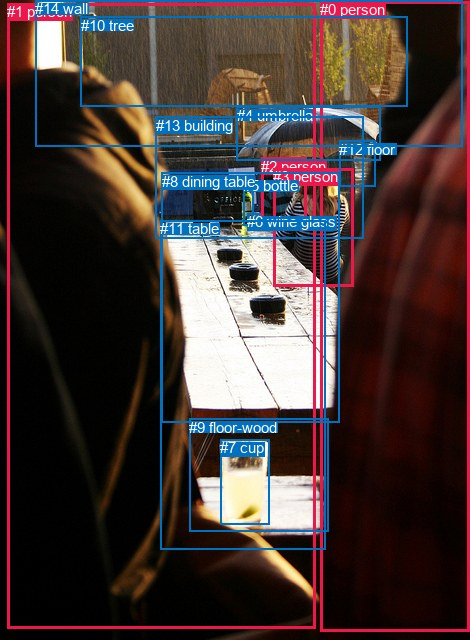

# 图片 1495：2385674.jpg

随机样本序号：377。图片 SHA256：`4400e146316c97048244f429dc0e75979e5d992a9a2586631c8f78345381e433`。

红色框表示人，蓝色框表示其他物体。两个模式分别保留自身框编号，可依据位置比较对应对象。

## 自动检测框与输出

人的框编号：`[2, 3, 4, 8, 10]`。状态：`ok`。

### 自动检测全部物体框

| 编号 | 类别 | 是否为人 | 检测分数 | 像素坐标 xyxy |
|---|---|---|---|---|
| 0 | cup | False | 0.9985 | 220.3, 439.8, 269.9, 526.7 |
| 1 | umbrella | False | 0.9920 | 237.9, 96.7, 381.4, 163.8 |
| 2 | person | True | 0.9902 | 255.4, 166.7, 350.6, 288.9 |
| 3 | person | True | 0.9787 | 257.9, 156.0, 304.2, 228.4 |
| 4 | person | True | 0.9613 | 0.0, 37.3, 319.5, 635.9 |
| 5 | dining table | False | 0.9527 | 168.1, 206.8, 341.3, 417.2 |
| 6 | bottle | False | 0.8249 | 240.3, 180.7, 253.5, 235.2 |
| 7 | bowl | False | 0.6043 | 229.1, 263.0, 259.3, 280.6 |
| 8 | person | True | 0.5725 | 1.8, 56.8, 191.8, 510.1 |
| 9 | dining table | False | 0.5635 | 195.7, 472.6, 326.5, 536.9 |
| 10 | person | True | 0.5416 | 327.2, 0.0, 466.7, 637.4 |
| 11 | suitcase | False | 0.4318 | 248.8, 295.7, 285.6, 314.0 |
| 12 | bottle | False | 0.4065 | 240.8, 215.2, 249.7, 242.3 |
| 13 | cake | False | 0.3976 | 216.3, 248.6, 242.7, 261.4 |
| 14 | dining table | False | 0.3534 | 178.0, 444.6, 320.9, 626.2 |

### 自动检测 Top50 人相关候选

评分物体对：210；人相关物体对：120；输出关系：50。

| 排名 | 主语编号与类别 | 关系 | 宾语编号与类别 | 类型 | 人与人 | 排序分数 | 原始融合 logit |
|---|---|---|---|---|---|---|---|
| 1 | #4 person | wearing | #8 person | semantic | True | 0.98588 | 4.2456 |
| 2 | #3 person | holding | #1 umbrella | semantic | False | 0.94535 | 2.8506 |
| 3 | #2 person | sitting on | #5 dining table | semantic | False | 0.94510 | 2.8457 |
| 4 | #2 person | holding | #1 umbrella | semantic | False | 0.94299 | 2.8059 |
| 5 | #10 person | holding | #1 umbrella | semantic | False | 0.93608 | 2.6841 |
| 6 | #2 person | on | #5 dining table | spatial | False | 0.93551 | 2.6745 |
| 7 | #3 person | sitting on | #5 dining table | semantic | False | 0.89983 | 2.1954 |
| 8 | #3 person | talking to | #2 person | semantic | True | 0.89873 | 2.1832 |
| 9 | #3 person | on | #5 dining table | spatial | False | 0.87263 | 1.9245 |
| 10 | #8 person | on | #4 person | spatial | True | 0.86147 | 1.8276 |
| 11 | #2 person | wearing | #3 person | semantic | True | 0.84302 | 1.6809 |
| 12 | #4 person | in | #8 person | spatial | True | 0.83629 | 1.6308 |
| 13 | #1 umbrella | over | #2 person | spatial | False | 0.80090 | 1.3920 |
| 14 | #2 person | in | #3 person | spatial | True | 0.74813 | 1.0887 |
| 15 | #2 person | sitting on | #14 dining table | semantic | False | 0.72353 | 0.9621 |
| 16 | #4 person | sitting on | #5 dining table | semantic | False | 0.71537 | 0.9216 |
| 17 | #10 person | leaning on | #5 dining table | spatial | False | 0.69259 | 0.8123 |
| 18 | #10 person | wearing | #4 person | semantic | True | 0.68230 | 0.7644 |
| 19 | #10 person | in | #4 person | spatial | True | 0.67373 | 0.7251 |
| 20 | #10 person | wearing | #8 person | semantic | True | 0.65749 | 0.6521 |
| 21 | #3 person | beside | #2 person | spatial | True | 0.61461 | 0.4667 |
| 22 | #10 person | standing on | #5 dining table | semantic | False | 0.60898 | 0.4430 |
| 23 | #2 person | in | #1 umbrella | spatial | False | 0.60829 | 0.4401 |
| 24 | #1 umbrella | over | #3 person | spatial | False | 0.60370 | 0.4209 |
| 25 | #4 person | in | #5 dining table | spatial | False | 0.59408 | 0.3808 |
| 26 | #3 person | in | #1 umbrella | spatial | False | 0.53194 | 0.1279 |
| 27 | #10 person | looking at | #2 person | semantic | True | 0.52809 | 0.1125 |
| 28 | #4 person | holding | #1 umbrella | semantic | False | 0.52710 | 0.1085 |
| 29 | #4 person | sitting on | #14 dining table | semantic | False | 0.49105 | -0.0358 |
| 30 | #3 person | sitting on | #14 dining table | semantic | False | 0.47778 | -0.0889 |
| 31 | #2 person | on | #14 dining table | spatial | False | 0.47667 | -0.0934 |
| 32 | #2 person | sitting on | #9 dining table | semantic | False | 0.47480 | -0.1009 |
| 33 | #10 person | on | #14 dining table | spatial | False | 0.45486 | -0.1811 |
| 34 | #10 person | sitting on | #14 dining table | semantic | False | 0.39503 | -0.4262 |
| 35 | #10 person | in | #8 person | spatial | True | 0.37265 | -0.5208 |
| 36 | #4 person | in | #14 dining table | spatial | False | 0.36761 | -0.5425 |
| 37 | #2 person | looking at | #4 person | semantic | True | 0.31845 | -0.7609 |
| 38 | #2 person | looking at | #7 bowl | semantic | False | 0.31547 | -0.7747 |
| 39 | #2 person | on | #9 dining table | spatial | False | 0.29115 | -0.8898 |
| 40 | #4 person | sitting on | #9 dining table | semantic | False | 0.29094 | -0.8908 |
| 41 | #10 person | in | #1 umbrella | spatial | False | 0.28797 | -0.9053 |
| 42 | #4 person | looking at | #2 person | semantic | True | 0.27157 | -0.9867 |
| 43 | #8 person | wearing | #4 person | semantic | True | 0.26586 | -1.0157 |
| 44 | #2 person | looking at | #10 person | semantic | True | 0.25990 | -1.0465 |
| 45 | #10 person | beside | #2 person | spatial | True | 0.25208 | -1.0875 |
| 46 | #3 person | on | #14 dining table | spatial | False | 0.23882 | -1.1591 |
| 47 | #3 person | looking at | #6 bottle | semantic | False | 0.22270 | -1.2500 |
| 48 | #2 person | looking at | #6 bottle | semantic | False | 0.21506 | -1.2947 |
| 49 | #3 person | sitting on | #9 dining table | semantic | False | 0.21259 | -1.3094 |
| 50 | #10 person | on | #9 dining table | spatial | False | 0.20585 | -1.3501 |

### 自动检测逐条人相关 GT 核验

R@50：16.67%；命中 1/6。

| GT 主语编号 | GT 关系 | GT 宾语编号 | 结果阶段 | 匹配预测主语编号 | 匹配预测宾语编号 |
|---|---|---|---|---|---|
| 1 | beside | 0 | wrong_predicate | [4] | [10] |
| 2 | beside | 3 | hit50 | [3] | [2] |
| 2 | looking at | 3 | wrong_predicate | [3] | [2] |
| 3 | in front of | 2 | wrong_predicate | [2] | [3] |
| 3 | beside | 2 | wrong_predicate | [2] | [3] |
| 3 | looking at | 2 | wrong_predicate | [2] | [3] |

## 真实框与输出

人的框编号：`[0, 1, 2, 3]`。

### 真实框全部物体框

| 编号 | 类别 | 是否为人 | 检测分数 | 像素坐标 xyxy |
|---|---|---|---|---|
| 0 | person | True | GT | 320.0, 1.0, 470.0, 631.0 |
| 1 | person | True | GT | 7.0, 3.0, 315.0, 629.0 |
| 2 | person | True | GT | 261.0, 158.0, 307.0, 230.0 |
| 3 | person | True | GT | 273.0, 168.0, 353.0, 287.0 |
| 4 | umbrella | False | GT | 237.0, 107.0, 381.0, 161.0 |
| 5 | bottle | False | GT | 243.0, 177.0, 253.0, 225.0 |
| 6 | wine glass | False | GT | 247.0, 213.0, 260.0, 226.0 |
| 7 | cup | False | GT | 220.0, 439.0, 269.0, 524.0 |
| 8 | dining table | False | GT | 162.0, 173.0, 340.0, 423.0 |
| 9 | floor-wood | False | GT | 189.0, 419.0, 328.0, 532.0 |
| 10 | tree | False | GT | 81.0, 17.0, 407.0, 107.0 |
| 11 | table | False | GT | 160.0, 220.0, 325.0, 549.0 |
| 12 | floor | False | GT | 339.0, 141.0, 375.0, 187.0 |
| 13 | building | False | GT | 156.0, 117.0, 363.0, 238.0 |
| 14 | wall | False | GT | 35.0, 0.0, 462.0, 147.0 |

### 真实框 Top50 人相关候选

评分物体对：210；人相关物体对：100；输出关系：50。

| 排名 | 主语编号与类别 | 关系 | 宾语编号与类别 | 类型 | 人与人 | 排序分数 | 原始融合 logit |
|---|---|---|---|---|---|---|---|
| 1 | #2 person | talking to | #3 person | semantic | True | 0.94965 | 2.9370 |
| 2 | #3 person | sitting on | #8 dining table | semantic | False | 0.93988 | 2.7494 |
| 3 | #2 person | holding | #4 umbrella | semantic | False | 0.93656 | 2.6921 |
| 4 | #3 person | on | #8 dining table | spatial | False | 0.93596 | 2.6820 |
| 5 | #3 person | sitting on | #11 table | semantic | False | 0.92831 | 2.5611 |
| 6 | #3 person | holding | #4 umbrella | semantic | False | 0.92359 | 2.4921 |
| 7 | #3 person | leaning on | #11 table | spatial | False | 0.92214 | 2.4718 |
| 8 | #1 person | sitting on | #11 table | semantic | False | 0.91445 | 2.3693 |
| 9 | #2 person | sitting on | #8 dining table | semantic | False | 0.91395 | 2.3629 |
| 10 | #2 person | on | #8 dining table | spatial | False | 0.91332 | 2.3549 |
| 11 | #0 person | holding | #4 umbrella | semantic | False | 0.90489 | 2.2528 |
| 12 | #3 person | leaning on | #12 floor | spatial | False | 0.88636 | 2.0541 |
| 13 | #1 person | sitting on | #8 dining table | semantic | False | 0.88067 | 1.9988 |
| 14 | #3 person | talking to | #2 person | semantic | True | 0.87393 | 1.9362 |
| 15 | #2 person | sitting on | #11 table | semantic | False | 0.86335 | 1.8434 |
| 16 | #1 person | in | #11 table | spatial | False | 0.85629 | 1.7848 |
| 17 | #1 person | in | #8 dining table | spatial | False | 0.84554 | 1.7000 |
| 18 | #2 person | on | #11 table | spatial | False | 0.82018 | 1.5176 |
| 19 | #2 person | in | #13 building | spatial | False | 0.79192 | 1.3366 |
| 20 | #4 umbrella | over | #3 person | spatial | False | 0.70768 | 0.8842 |
| 21 | #3 person | looking at | #12 floor | semantic | False | 0.69793 | 0.8375 |
| 22 | #1 person | sitting on | #9 floor-wood | semantic | False | 0.69749 | 0.8354 |
| 23 | #0 person | looking at | #3 person | semantic | True | 0.68605 | 0.7817 |
| 24 | #1 person | in | #9 floor-wood | spatial | False | 0.67570 | 0.7341 |
| 25 | #2 person | sitting on | #13 building | semantic | False | 0.65335 | 0.6338 |
| 26 | #0 person | leaning on | #11 table | spatial | False | 0.64675 | 0.6048 |
| 27 | #2 person | beside | #3 person | spatial | True | 0.64372 | 0.5915 |
| 28 | #3 person | sitting on | #9 floor-wood | semantic | False | 0.64325 | 0.5895 |
| 29 | #3 person | talking to | #1 person | semantic | True | 0.63881 | 0.5702 |
| 30 | #0 person | beside | #8 dining table | spatial | False | 0.63651 | 0.5603 |
| 31 | #1 person | holding | #4 umbrella | semantic | False | 0.62041 | 0.4913 |
| 32 | #3 person | beside | #2 person | spatial | True | 0.60522 | 0.4273 |
| 33 | #2 person | leaning on | #12 floor | spatial | False | 0.58734 | 0.3530 |
| 34 | #3 person | in | #4 umbrella | spatial | False | 0.56599 | 0.2655 |
| 35 | #0 person | standing on | #11 table | semantic | False | 0.56037 | 0.2427 |
| 36 | #2 person | in | #4 umbrella | spatial | False | 0.55594 | 0.2247 |
| 37 | #4 umbrella | over | #2 person | spatial | False | 0.53974 | 0.1593 |
| 38 | #2 person | looking at | #12 floor | semantic | False | 0.53491 | 0.1399 |
| 39 | #0 person | standing on | #8 dining table | semantic | False | 0.52011 | 0.0805 |
| 40 | #0 person | talking to | #1 person | semantic | True | 0.51034 | 0.0414 |
| 41 | #3 person | in | #13 building | spatial | False | 0.48929 | -0.0429 |
| 42 | #1 person | talking to | #3 person | semantic | True | 0.48561 | -0.0576 |
| 43 | #3 person | on | #9 floor-wood | spatial | False | 0.47303 | -0.1080 |
| 44 | #3 person | sitting on | #13 building | semantic | False | 0.45827 | -0.1673 |
| 45 | #1 person | talking to | #0 person | semantic | True | 0.44906 | -0.2045 |
| 46 | #3 person | looking at | #6 wine glass | semantic | False | 0.44511 | -0.2205 |
| 47 | #0 person | in | #1 person | spatial | True | 0.42479 | -0.3031 |
| 48 | #2 person | sitting on | #9 floor-wood | semantic | False | 0.41338 | -0.3500 |
| 49 | #0 person | on | #9 floor-wood | spatial | False | 0.40472 | -0.3858 |
| 50 | #3 person | looking at | #5 bottle | semantic | False | 0.33093 | -0.7040 |

### 真实框逐条人相关 GT 核验

R@50：33.33%；命中 2/6。

| GT 主语编号 | GT 关系 | GT 宾语编号 | 结果阶段 | 匹配预测主语编号 | 匹配预测宾语编号 |
|---|---|---|---|---|---|
| 1 | beside | 0 | wrong_predicate | [1] | [0] |
| 2 | beside | 3 | hit50 | [2] | [3] |
| 2 | looking at | 3 | wrong_predicate | [2] | [3] |
| 3 | in front of | 2 | wrong_predicate | [3] | [2] |
| 3 | beside | 2 | hit50 | [3] | [2] |
| 3 | looking at | 2 | wrong_predicate | [3] | [2] |

## 全部人相关 GT

| 主语编号与类别 | 关系 | 宾语编号与类别 |
|---|---|---|
| #1 person | beside | #0 person |
| #2 person | beside | #3 person |
| #2 person | looking at | #3 person |
| #3 person | in front of | #2 person |
| #3 person | beside | #2 person |
| #3 person | looking at | #2 person |

原始记录、全部人相关物体对的两项预测与分项分数见 [逐图证据 JSON](../evidence/cases/1495.json)。全部56类 logits 保留于本机 HOR/output/random500/logits/。

<!-- HOR_COMPLETE_RESULTS -->

## 六组条件的完整输出对照

以下保留同一图片三种框与候选模式、两种谓词输出规则的全部 Top50。框编号各自在所属模式内解释。

### 自动检测框完整枚举：空间与语义各保留一个谓词

| 排名 | 主语编号与类别 | 谓词 | 宾语编号与类别 | 分组 | 排序分数 | predicate logit | pair logit |
|---|---|---|---|---|---|---|---|
| 1 | #4 person | wearing | #8 person | semantic | 0.9858752 | 4.4864402 | -0.2408439 |
| 2 | #3 person | holding | #1 umbrella | semantic | 0.9453517 | 2.9592624 | -0.1086241 |
| 3 | #2 person | sitting on | #5 dining table | semantic | 0.9450967 | 2.8559890 | -0.0102757 |
| 4 | #2 person | holding | #1 umbrella | semantic | 0.9429935 | 2.6218014 | 0.1840929 |
| 5 | #10 person | holding | #1 umbrella | semantic | 0.9360797 | 3.0426598 | -0.3585956 |
| 6 | #2 person | on | #5 dining table | spatial | 0.9355062 | 2.6847930 | -0.0102757 |
| 7 | #3 person | sitting on | #5 dining table | semantic | 0.8998328 | 2.5670938 | -0.3717251 |
| 8 | #3 person | talking to | #2 person | semantic | 0.8987324 | 2.7880821 | -0.6048632 |
| 9 | #3 person | on | #5 dining table | spatial | 0.8726349 | 2.2961850 | -0.3717251 |
| 10 | #8 person | on | #4 person | spatial | 0.8614706 | 2.4400663 | -0.6125076 |
| 11 | #2 person | wearing | #3 person | semantic | 0.8430209 | 1.6377130 | 0.0431655 |
| 12 | #4 person | in | #8 person | spatial | 0.8362851 | 1.8716865 | -0.2408439 |
| 13 | #1 umbrella | over | #2 person | spatial | 0.8009036 | 2.1424255 | -0.7504745 |
| 14 | #2 person | in | #3 person | spatial | 0.7481308 | 1.0455022 | 0.0431655 |
| 15 | #2 person | sitting on | #14 dining table | semantic | 0.7235349 | 1.5349789 | -0.5729144 |
| 16 | #4 person | sitting on | #5 dining table | semantic | 0.7153714 | 1.5258856 | -0.6042687 |
| 17 | #10 person | leaning on | #5 dining table | spatial | 0.6925928 | 1.7466173 | -0.9343482 |
| 18 | #10 person | wearing | #4 person | semantic | 0.6823012 | 1.2493877 | -0.4850202 |
| 19 | #10 person | in | #4 person | spatial | 0.6737300 | 1.2101240 | -0.4850202 |
| 20 | #10 person | wearing | #8 person | semantic | 0.6574887 | 1.5644364 | -0.9123135 |
| 21 | #3 person | beside | #2 person | spatial | 0.6146070 | 1.0715823 | -0.6048632 |
| 22 | #10 person | standing on | #5 dining table | semantic | 0.6089795 | 1.3773727 | -0.9343482 |
| 23 | #2 person | in | #1 umbrella | spatial | 0.6082876 | 0.2560272 | 0.1840929 |
| 24 | #1 umbrella | over | #3 person | spatial | 0.6037045 | 1.3762937 | -0.9553691 |
| 25 | #4 person | in | #5 dining table | spatial | 0.5940779 | 0.9851179 | -0.6042687 |
| 26 | #3 person | in | #1 umbrella | spatial | 0.5319403 | 0.2365594 | -0.1086241 |
| 27 | #10 person | looking at | #2 person | semantic | 0.5280873 | 1.1236382 | -1.0111705 |
| 28 | #4 person | holding | #1 umbrella | semantic | 0.5271043 | 0.8853316 | -0.7768082 |
| 29 | #4 person | sitting on | #14 dining table | semantic | 0.4910487 | 0.4456210 | -0.4814299 |
| 30 | #3 person | sitting on | #14 dining table | semantic | 0.4777819 | 0.6803904 | -0.7693215 |
| 31 | #2 person | on | #14 dining table | spatial | 0.4766711 | 0.4795308 | -0.5729144 |
| 32 | #2 person | sitting on | #9 dining table | semantic | 0.4747998 | 0.5299187 | -0.6308047 |
| 33 | #10 person | on | #14 dining table | spatial | 0.4548581 | 0.3597445 | -0.5408053 |
| 34 | #10 person | sitting on | #14 dining table | semantic | 0.3950332 | 0.1146016 | -0.5408053 |
| 35 | #10 person | in | #8 person | spatial | 0.3726546 | 0.3914680 | -0.9123135 |
| 36 | #4 person | in | #14 dining table | spatial | 0.3676100 | -0.0610538 | -0.4814299 |
| 37 | #2 person | looking at | #4 person | semantic | 0.3184533 | -0.0132051 | -0.7476841 |
| 38 | #2 person | looking at | #7 bowl | semantic | 0.3154706 | -0.1744690 | -0.6001971 |
| 39 | #2 person | on | #9 dining table | spatial | 0.2911515 | -0.2589936 | -0.6308047 |
| 40 | #4 person | sitting on | #9 dining table | semantic | 0.2909396 | -0.2555227 | -0.6353023 |
| 41 | #10 person | in | #1 umbrella | spatial | 0.2879670 | -0.5466828 | -0.3585956 |
| 42 | #4 person | looking at | #2 person | semantic | 0.2715726 | 0.2772484 | -1.2639071 |
| 43 | #8 person | wearing | #4 person | semantic | 0.2658629 | -0.4032078 | -0.6125076 |
| 44 | #2 person | looking at | #10 person | semantic | 0.2599012 | 0.2174144 | -1.2638963 |
| 45 | #10 person | beside | #2 person | spatial | 0.2520824 | -0.0763664 | -1.0111705 |
| 46 | #3 person | on | #14 dining table | spatial | 0.2388244 | -0.3898144 | -0.7693215 |
| 47 | #3 person | looking at | #6 bottle | semantic | 0.2226954 | -0.5823903 | -0.6676373 |
| 48 | #2 person | looking at | #6 bottle | semantic | 0.2150551 | -0.7058926 | -0.5888267 |
| 49 | #3 person | sitting on | #9 dining table | semantic | 0.2125861 | -0.5383291 | -0.7710780 |
| 50 | #10 person | on | #9 dining table | spatial | 0.2058492 | -0.4912672 | -0.8588625 |

GT 命中：1/6，R@50=16.67%。

| GT主语 | GT谓词 | GT宾语 | 结果阶段 | 匹配主语框 | 匹配宾语框 |
|---|---|---|---|---|---|
| 1 | beside | 0 | wrong_predicate | [4] | [10] |
| 2 | beside | 3 | hit50 | [3] | [2] |
| 2 | looking at | 3 | wrong_predicate | [3] | [2] |
| 3 | in front of | 2 | wrong_predicate | [2] | [3] |
| 3 | beside | 2 | wrong_predicate | [2] | [3] |
| 3 | looking at | 2 | wrong_predicate | [2] | [3] |

### 自动检测框完整枚举：每对只保留一个谓词

| 排名 | 主语编号与类别 | 谓词 | 宾语编号与类别 | 分组 | 排序分数 | predicate logit | pair logit |
|---|---|---|---|---|---|---|---|
| 1 | #4 person | wearing | #8 person | single | 0.9858752 | 4.4864402 | -0.2408439 |
| 2 | #3 person | holding | #1 umbrella | single | 0.9453517 | 2.9592624 | -0.1086241 |
| 3 | #2 person | sitting on | #5 dining table | single | 0.9450967 | 2.8559890 | -0.0102757 |
| 4 | #2 person | holding | #1 umbrella | single | 0.9429935 | 2.6218014 | 0.1840929 |
| 5 | #10 person | holding | #1 umbrella | single | 0.9360797 | 3.0426598 | -0.3585956 |
| 6 | #3 person | sitting on | #5 dining table | single | 0.8998328 | 2.5670938 | -0.3717251 |
| 7 | #3 person | talking to | #2 person | single | 0.8987324 | 2.7880821 | -0.6048632 |
| 8 | #8 person | on | #4 person | single | 0.8614706 | 2.4400663 | -0.6125076 |
| 9 | #2 person | wearing | #3 person | single | 0.8430209 | 1.6377130 | 0.0431655 |
| 10 | #1 umbrella | over | #2 person | single | 0.8009036 | 2.1424255 | -0.7504745 |
| 11 | #2 person | sitting on | #14 dining table | single | 0.7235349 | 1.5349789 | -0.5729144 |
| 12 | #4 person | sitting on | #5 dining table | single | 0.7153714 | 1.5258856 | -0.6042687 |
| 13 | #10 person | leaning on | #5 dining table | single | 0.6925928 | 1.7466173 | -0.9343482 |
| 14 | #10 person | wearing | #4 person | single | 0.6823012 | 1.2493877 | -0.4850202 |
| 15 | #10 person | wearing | #8 person | single | 0.6574887 | 1.5644364 | -0.9123135 |
| 16 | #1 umbrella | over | #3 person | single | 0.6037045 | 1.3762937 | -0.9553691 |
| 17 | #10 person | looking at | #2 person | single | 0.5280873 | 1.1236382 | -1.0111705 |
| 18 | #4 person | holding | #1 umbrella | single | 0.5271043 | 0.8853316 | -0.7768082 |
| 19 | #4 person | sitting on | #14 dining table | single | 0.4910487 | 0.4456210 | -0.4814299 |
| 20 | #3 person | sitting on | #14 dining table | single | 0.4777819 | 0.6803904 | -0.7693215 |
| 21 | #2 person | sitting on | #9 dining table | single | 0.4747998 | 0.5299187 | -0.6308047 |
| 22 | #10 person | on | #14 dining table | single | 0.4548581 | 0.3597445 | -0.5408053 |
| 23 | #2 person | looking at | #4 person | single | 0.3184533 | -0.0132051 | -0.7476841 |
| 24 | #2 person | looking at | #7 bowl | single | 0.3154706 | -0.1744690 | -0.6001971 |
| 25 | #4 person | sitting on | #9 dining table | single | 0.2909396 | -0.2555227 | -0.6353023 |
| 26 | #4 person | looking at | #2 person | single | 0.2715726 | 0.2772484 | -1.2639071 |
| 27 | #2 person | looking at | #10 person | single | 0.2599012 | 0.2174144 | -1.2638963 |
| 28 | #3 person | looking at | #6 bottle | single | 0.2226954 | -0.5823903 | -0.6676373 |
| 29 | #2 person | looking at | #6 bottle | single | 0.2150551 | -0.7058926 | -0.5888267 |
| 30 | #3 person | sitting on | #9 dining table | single | 0.2125861 | -0.5383291 | -0.7710780 |
| 31 | #10 person | on | #9 dining table | single | 0.2058492 | -0.4912672 | -0.8588625 |
| 32 | #2 person | looking at | #12 bottle | single | 0.2046805 | -0.7568364 | -0.6004574 |
| 33 | #4 person | talking to | #10 person | single | 0.1847028 | -0.6479011 | -0.8369036 |
| 34 | #2 person | looking at | #13 cake | single | 0.1688145 | -0.9215212 | -0.6725311 |
| 35 | #2 person | looking at | #11 suitcase | single | 0.1516342 | -1.1420958 | -0.5797451 |
| 36 | #3 person | looking at | #7 bowl | single | 0.1461644 | -0.6997261 | -1.0652804 |
| 37 | #3 person | looking at | #12 bottle | single | 0.1391482 | -1.0525193 | -0.7698635 |
| 38 | #3 person | looking at | #13 cake | single | 0.1223379 | -0.9257591 | -1.0447161 |
| 39 | #2 person | wearing | #8 person | single | 0.0982348 | -1.0492833 | -1.1677104 |
| 40 | #4 person | wearing | #3 person | single | 0.0885529 | -1.2731609 | -1.0582727 |
| 41 | #10 person | looking at | #3 person | single | 0.0836821 | -1.3973484 | -0.9959894 |
| 42 | #8 person | on | #10 person | single | 0.0835120 | -1.1502624 | -1.2452965 |
| 43 | #1 umbrella | holding | #10 person | single | 0.0631111 | -1.3651450 | -1.3325226 |
| 44 | #1 umbrella | in | #4 person | single | 0.0618630 | -1.5021608 | -1.2168128 |
| 45 | #0 cup | in | #4 person | single | 0.0579472 | -1.6219947 | -1.1665347 |
| 46 | #14 dining table | in | #4 person | single | 0.0555538 | -1.7148685 | -1.1183774 |
| 47 | #3 person | looking at | #4 person | single | 0.0539581 | -1.6395605 | -1.2245181 |
| 48 | #5 dining table | in | #4 person | single | 0.0513559 | -1.6747682 | -1.2414854 |
| 49 | #10 person | looking at | #11 suitcase | single | 0.0506887 | -1.5378144 | -1.3922199 |
| 50 | #10 person | looking at | #0 cup | single | 0.0491347 | -1.7044387 | -1.2583675 |

GT 命中：0/6，R@50=0.00%。

| GT主语 | GT谓词 | GT宾语 | 结果阶段 | 匹配主语框 | 匹配宾语框 |
|---|---|---|---|---|---|
| 1 | beside | 0 | wrong_predicate | [4] | [10] |
| 2 | beside | 3 | wrong_predicate | [3] | [2] |
| 2 | looking at | 3 | wrong_predicate | [3] | [2] |
| 3 | in front of | 2 | wrong_predicate | [2] | [3] |
| 3 | beside | 2 | wrong_predicate | [2] | [3] |
| 3 | looking at | 2 | wrong_predicate | [2] | [3] |

### 真实框完整枚举：空间与语义各保留一个谓词

| 排名 | 主语编号与类别 | 谓词 | 宾语编号与类别 | 分组 | 排序分数 | predicate logit | pair logit |
|---|---|---|---|---|---|---|---|
| 1 | #2 person | talking to | #3 person | semantic | 0.9496461 | 3.4479632 | -0.5109499 |
| 2 | #3 person | sitting on | #8 dining table | semantic | 0.9398776 | 2.8289180 | -0.0795504 |
| 3 | #2 person | holding | #4 umbrella | semantic | 0.9365593 | 2.7539830 | -0.0618752 |
| 4 | #3 person | on | #8 dining table | spatial | 0.9359590 | 2.7616000 | -0.0795504 |
| 5 | #3 person | sitting on | #11 table | semantic | 0.9283134 | 2.7085533 | -0.1474864 |
| 6 | #3 person | holding | #4 umbrella | semantic | 0.9235870 | 2.3321562 | 0.1599551 |
| 7 | #3 person | leaning on | #11 table | spatial | 0.9221442 | 2.6193309 | -0.1474864 |
| 8 | #1 person | sitting on | #11 table | semantic | 0.9144533 | 2.6964402 | -0.3271748 |
| 9 | #2 person | sitting on | #8 dining table | semantic | 0.9139505 | 2.6664286 | -0.3035751 |
| 10 | #2 person | on | #8 dining table | spatial | 0.9133201 | 2.6584382 | -0.3035751 |
| 11 | #0 person | holding | #4 umbrella | semantic | 0.9048886 | 2.6007023 | -0.3479395 |
| 12 | #3 person | leaning on | #12 floor | spatial | 0.8863621 | 2.1663437 | -0.1122350 |
| 13 | #1 person | sitting on | #8 dining table | semantic | 0.8806731 | 2.4406567 | -0.4418373 |
| 14 | #3 person | talking to | #2 person | semantic | 0.8739317 | 1.9823713 | -0.0461928 |
| 15 | #2 person | sitting on | #11 table | semantic | 0.8633454 | 2.2992926 | -0.4559341 |
| 16 | #1 person | in | #11 table | spatial | 0.8562905 | 2.1119909 | -0.3271748 |
| 17 | #1 person | in | #8 dining table | spatial | 0.8455377 | 2.1418600 | -0.4418373 |
| 18 | #2 person | on | #11 table | spatial | 0.8201787 | 1.9734931 | -0.4559341 |
| 19 | #2 person | in | #13 building | spatial | 0.7919223 | 1.7261071 | -0.3895556 |
| 20 | #4 umbrella | over | #3 person | spatial | 0.7076820 | 1.7158608 | -0.8317083 |
| 21 | #3 person | looking at | #12 floor | semantic | 0.6979342 | 0.9497147 | -0.1122350 |
| 22 | #1 person | sitting on | #9 floor-wood | semantic | 0.6974902 | 1.4145498 | -0.5791750 |
| 23 | #0 person | looking at | #3 person | semantic | 0.6860460 | 1.7244172 | -0.9427192 |
| 24 | #1 person | in | #9 floor-wood | spatial | 0.6756983 | 1.3132477 | -0.5791750 |
| 25 | #2 person | sitting on | #13 building | semantic | 0.6533489 | 1.0233479 | -0.3895556 |
| 26 | #0 person | leaning on | #11 table | spatial | 0.6467546 | 1.4210520 | -0.8162481 |
| 27 | #2 person | beside | #3 person | spatial | 0.6437169 | 1.1024833 | -0.5109499 |
| 28 | #3 person | sitting on | #9 floor-wood | semantic | 0.6432536 | 1.2400751 | -0.6505615 |
| 29 | #3 person | talking to | #1 person | semantic | 0.6388073 | 1.5984378 | -1.0282466 |
| 30 | #0 person | beside | #8 dining table | spatial | 0.6365143 | 1.5195398 | -0.9592727 |
| 31 | #1 person | holding | #4 umbrella | semantic | 0.6204090 | 1.1286368 | -0.6373522 |
| 32 | #3 person | beside | #2 person | spatial | 0.6052206 | 0.4734588 | -0.0461928 |
| 33 | #2 person | leaning on | #12 floor | spatial | 0.5873392 | 0.5508776 | -0.1979010 |
| 34 | #3 person | in | #4 umbrella | spatial | 0.5659942 | 0.1055708 | 0.1599551 |
| 35 | #0 person | standing on | #11 table | semantic | 0.5603703 | 1.0589132 | -0.8162481 |
| 36 | #2 person | in | #4 umbrella | spatial | 0.5559368 | 0.2865629 | -0.0618752 |
| 37 | #4 umbrella | over | #2 person | spatial | 0.5397415 | 1.1123972 | -0.9530951 |
| 38 | #2 person | looking at | #12 floor | semantic | 0.5349126 | 0.3377790 | -0.1979010 |
| 39 | #0 person | standing on | #8 dining table | semantic | 0.5201057 | 1.0397387 | -0.9592727 |
| 40 | #0 person | talking to | #1 person | semantic | 0.5103383 | 0.7682633 | -0.7269042 |
| 41 | #3 person | in | #13 building | spatial | 0.4892890 | 0.5549765 | -0.5978271 |
| 42 | #1 person | talking to | #3 person | semantic | 0.4856135 | 1.0339570 | -1.0915190 |
| 43 | #3 person | on | #9 floor-wood | spatial | 0.4730310 | 0.5425806 | -0.6505615 |
| 44 | #3 person | sitting on | #13 building | semantic | 0.4582704 | 0.4305196 | -0.5978271 |
| 45 | #1 person | talking to | #0 person | semantic | 0.4490583 | 0.6999521 | -0.9044285 |
| 46 | #3 person | looking at | #6 wine glass | semantic | 0.4451063 | 0.4221263 | -0.6425898 |
| 47 | #0 person | in | #1 person | spatial | 0.4247903 | 0.4237652 | -0.7269042 |
| 48 | #2 person | sitting on | #9 floor-wood | semantic | 0.4133817 | 0.4637270 | -0.8137298 |
| 49 | #0 person | on | #9 floor-wood | spatial | 0.4047211 | 0.4147725 | -0.8006043 |
| 50 | #3 person | looking at | #5 bottle | semantic | 0.3309256 | -0.0400500 | -0.6639519 |

GT 命中：2/6，R@50=33.33%。

| GT主语 | GT谓词 | GT宾语 | 结果阶段 | 匹配主语框 | 匹配宾语框 |
|---|---|---|---|---|---|
| 1 | beside | 0 | wrong_predicate | [1] | [0] |
| 2 | beside | 3 | hit50 | [2] | [3] |
| 2 | looking at | 3 | wrong_predicate | [2] | [3] |
| 3 | in front of | 2 | wrong_predicate | [3] | [2] |
| 3 | beside | 2 | hit50 | [3] | [2] |
| 3 | looking at | 2 | wrong_predicate | [3] | [2] |

### 真实框完整枚举：每对只保留一个谓词

| 排名 | 主语编号与类别 | 谓词 | 宾语编号与类别 | 分组 | 排序分数 | predicate logit | pair logit |
|---|---|---|---|---|---|---|---|
| 1 | #2 person | talking to | #3 person | single | 0.9496461 | 3.4479632 | -0.5109499 |
| 2 | #3 person | sitting on | #8 dining table | single | 0.9398776 | 2.8289180 | -0.0795504 |
| 3 | #2 person | holding | #4 umbrella | single | 0.9365593 | 2.7539830 | -0.0618752 |
| 4 | #3 person | sitting on | #11 table | single | 0.9283134 | 2.7085533 | -0.1474864 |
| 5 | #3 person | holding | #4 umbrella | single | 0.9235870 | 2.3321562 | 0.1599551 |
| 6 | #1 person | sitting on | #11 table | single | 0.9144533 | 2.6964402 | -0.3271748 |
| 7 | #2 person | sitting on | #8 dining table | single | 0.9139505 | 2.6664286 | -0.3035751 |
| 8 | #0 person | holding | #4 umbrella | single | 0.9048886 | 2.6007023 | -0.3479395 |
| 9 | #3 person | leaning on | #12 floor | single | 0.8863621 | 2.1663437 | -0.1122350 |
| 10 | #1 person | sitting on | #8 dining table | single | 0.8806731 | 2.4406567 | -0.4418373 |
| 11 | #3 person | talking to | #2 person | single | 0.8739317 | 1.9823713 | -0.0461928 |
| 12 | #2 person | sitting on | #11 table | single | 0.8633454 | 2.2992926 | -0.4559341 |
| 13 | #2 person | in | #13 building | single | 0.7919223 | 1.7261071 | -0.3895556 |
| 14 | #4 umbrella | over | #3 person | single | 0.7076820 | 1.7158608 | -0.8317083 |
| 15 | #1 person | sitting on | #9 floor-wood | single | 0.6974902 | 1.4145498 | -0.5791750 |
| 16 | #0 person | looking at | #3 person | single | 0.6860460 | 1.7244172 | -0.9427192 |
| 17 | #0 person | leaning on | #11 table | single | 0.6467546 | 1.4210520 | -0.8162481 |
| 18 | #3 person | sitting on | #9 floor-wood | single | 0.6432536 | 1.2400751 | -0.6505615 |
| 19 | #3 person | talking to | #1 person | single | 0.6388073 | 1.5984378 | -1.0282466 |
| 20 | #0 person | beside | #8 dining table | single | 0.6365143 | 1.5195398 | -0.9592727 |
| 21 | #1 person | holding | #4 umbrella | single | 0.6204090 | 1.1286368 | -0.6373522 |
| 22 | #2 person | leaning on | #12 floor | single | 0.5873392 | 0.5508776 | -0.1979010 |
| 23 | #4 umbrella | over | #2 person | single | 0.5397415 | 1.1123972 | -0.9530951 |
| 24 | #0 person | talking to | #1 person | single | 0.5103383 | 0.7682633 | -0.7269042 |
| 25 | #3 person | in | #13 building | single | 0.4892890 | 0.5549765 | -0.5978271 |
| 26 | #1 person | talking to | #3 person | single | 0.4856135 | 1.0339570 | -1.0915190 |
| 27 | #1 person | talking to | #0 person | single | 0.4490583 | 0.6999521 | -0.9044285 |
| 28 | #3 person | looking at | #6 wine glass | single | 0.4451063 | 0.4221263 | -0.6425898 |
| 29 | #2 person | sitting on | #9 floor-wood | single | 0.4133817 | 0.4637270 | -0.8137298 |
| 30 | #0 person | on | #9 floor-wood | single | 0.4047211 | 0.4147725 | -0.8006043 |
| 31 | #3 person | looking at | #5 bottle | single | 0.3309256 | -0.0400500 | -0.6639519 |
| 32 | #2 person | looking at | #5 bottle | single | 0.3236980 | -0.1240487 | -0.6127802 |
| 33 | #3 person | talking to | #0 person | single | 0.3184011 | 0.4291306 | -1.1902599 |
| 34 | #1 person | looking at | #2 person | single | 0.2935918 | 0.0813603 | -0.9593634 |
| 35 | #2 person | looking at | #6 wine glass | single | 0.2927354 | -0.2325602 | -0.6495756 |
| 36 | #2 person | talking to | #1 person | single | 0.2492465 | 0.1827111 | -1.2853462 |
| 37 | #0 person | on | #12 floor | single | 0.2145912 | -0.2636266 | -1.0338427 |
| 38 | #0 person | looking at | #2 person | single | 0.1648835 | -0.6564527 | -0.9658792 |
| 39 | #1 person | looking at | #13 building | single | 0.1540426 | -0.7281401 | -0.9750996 |
| 40 | #12 floor | beside | #3 person | single | 0.1479220 | -0.7383306 | -1.0126622 |
| 41 | #1 person | looking at | #5 bottle | single | 0.1417485 | -0.5283089 | -1.2725335 |
| 42 | #13 building | over | #3 person | single | 0.1377131 | -0.6976740 | -1.1367418 |
| 43 | #1 person | looking at | #7 cup | single | 0.1275049 | -0.9917595 | -0.9314431 |
| 44 | #0 person | looking at | #7 cup | single | 0.1093625 | -0.8587894 | -1.2384797 |
| 45 | #1 person | looking at | #6 wine glass | single | 0.0984592 | -0.8178909 | -1.3965716 |
| 46 | #11 table | in | #1 person | single | 0.0895990 | -1.3017161 | -1.0168250 |
| 47 | #2 person | looking at | #0 person | single | 0.0866616 | -0.8648248 | -1.4902711 |
| 48 | #2 person | in | #14 wall | single | 0.0862169 | -1.5526855 | -0.8080416 |
| 49 | #7 cup | in | #1 person | single | 0.0858028 | -1.3184309 | -1.0475643 |
| 50 | #12 floor | on | #0 person | single | 0.0828884 | -1.2224927 | -1.1812415 |

GT 命中：0/6，R@50=0.00%。

| GT主语 | GT谓词 | GT宾语 | 结果阶段 | 匹配主语框 | 匹配宾语框 |
|---|---|---|---|---|---|
| 1 | beside | 0 | wrong_predicate | [1] | [0] |
| 2 | beside | 3 | wrong_predicate | [2] | [3] |
| 2 | looking at | 3 | wrong_predicate | [2] | [3] |
| 3 | in front of | 2 | wrong_predicate | [3] | [2] |
| 3 | beside | 2 | wrong_predicate | [3] | [2] |
| 3 | looking at | 2 | wrong_predicate | [3] | [2] |

### 真实框400候选：空间与语义各保留一个谓词

| 排名 | 主语编号与类别 | 谓词 | 宾语编号与类别 | 分组 | 排序分数 | predicate logit | pair logit |
|---|---|---|---|---|---|---|---|
| 1 | #2 person | talking to | #3 person | semantic | 0.9496521 | 3.4480891 | -0.5109499 |
| 2 | #3 person | sitting on | #8 dining table | semantic | 0.9398776 | 2.8289180 | -0.0795504 |
| 3 | #2 person | holding | #4 umbrella | semantic | 0.9365593 | 2.7539830 | -0.0618752 |
| 4 | #3 person | on | #8 dining table | spatial | 0.9359590 | 2.7616000 | -0.0795504 |
| 5 | #3 person | sitting on | #11 table | semantic | 0.9283134 | 2.7085533 | -0.1474864 |
| 6 | #3 person | holding | #4 umbrella | semantic | 0.9252762 | 2.3563390 | 0.1599551 |
| 7 | #3 person | leaning on | #11 table | spatial | 0.9221442 | 2.6193309 | -0.1474864 |
| 8 | #2 person | sitting on | #8 dining table | semantic | 0.9155926 | 2.6874909 | -0.3035751 |
| 9 | #1 person | sitting on | #11 table | semantic | 0.9144533 | 2.6964402 | -0.3271748 |
| 10 | #2 person | on | #8 dining table | spatial | 0.9141782 | 2.6693273 | -0.3035751 |
| 11 | #0 person | holding | #4 umbrella | semantic | 0.9048886 | 2.6007023 | -0.3479395 |
| 12 | #3 person | leaning on | #12 floor | spatial | 0.8863621 | 2.1663437 | -0.1122350 |
| 13 | #1 person | sitting on | #8 dining table | semantic | 0.8806731 | 2.4406567 | -0.4418373 |
| 14 | #3 person | talking to | #2 person | semantic | 0.8706071 | 1.9525304 | -0.0461928 |
| 15 | #2 person | sitting on | #11 table | semantic | 0.8633454 | 2.2992926 | -0.4559341 |
| 16 | #1 person | in | #11 table | spatial | 0.8562905 | 2.1119909 | -0.3271748 |
| 17 | #1 person | in | #8 dining table | spatial | 0.8455377 | 2.1418600 | -0.4418373 |
| 18 | #2 person | on | #11 table | spatial | 0.8201787 | 1.9734931 | -0.4559341 |
| 19 | #2 person | in | #13 building | spatial | 0.7880310 | 1.7026534 | -0.3895556 |
| 20 | #4 umbrella | over | #3 person | spatial | 0.7127864 | 1.7406640 | -0.8317083 |
| 21 | #1 person | sitting on | #9 floor-wood | semantic | 0.6993918 | 1.4235787 | -0.5791750 |
| 22 | #3 person | looking at | #12 floor | semantic | 0.6979342 | 0.9497147 | -0.1122350 |
| 23 | #0 person | looking at | #3 person | semantic | 0.6860460 | 1.7244172 | -0.9427192 |
| 24 | #1 person | in | #9 floor-wood | spatial | 0.6811769 | 1.3383608 | -0.5791750 |
| 25 | #0 person | leaning on | #11 table | spatial | 0.6467546 | 1.4210520 | -0.8162481 |
| 26 | #2 person | sitting on | #13 building | semantic | 0.6465026 | 0.9932566 | -0.3895556 |
| 27 | #2 person | beside | #3 person | spatial | 0.6437301 | 1.1025410 | -0.5109499 |
| 28 | #3 person | talking to | #1 person | semantic | 0.6388073 | 1.5984378 | -1.0282466 |
| 29 | #3 person | sitting on | #9 floor-wood | semantic | 0.6384056 | 1.2190123 | -0.6505615 |
| 30 | #0 person | beside | #8 dining table | spatial | 0.6365010 | 1.5194821 | -0.9592727 |
| 31 | #1 person | holding | #4 umbrella | semantic | 0.6211044 | 1.1315908 | -0.6373522 |
| 32 | #3 person | beside | #2 person | spatial | 0.6052068 | 0.4734011 | -0.0461928 |
| 33 | #2 person | leaning on | #12 floor | spatial | 0.5874590 | 0.5513721 | -0.1979010 |
| 34 | #3 person | in | #4 umbrella | spatial | 0.5676240 | 0.1122084 | 0.1599551 |
| 35 | #2 person | in | #4 umbrella | spatial | 0.5559368 | 0.2865629 | -0.0618752 |
| 36 | #0 person | standing on | #11 table | semantic | 0.5547591 | 1.0361667 | -0.8162481 |
| 37 | #2 person | looking at | #12 floor | semantic | 0.5349126 | 0.3377790 | -0.1979010 |
| 38 | #4 umbrella | over | #2 person | spatial | 0.5342323 | 1.0902390 | -0.9530951 |
| 39 | #0 person | standing on | #8 dining table | semantic | 0.5219384 | 1.0470829 | -0.9592727 |
| 40 | #0 person | talking to | #1 person | semantic | 0.5102758 | 0.7680130 | -0.7269042 |
| 41 | #1 person | talking to | #3 person | semantic | 0.4856135 | 1.0339570 | -1.0915190 |
| 42 | #3 person | in | #13 building | spatial | 0.4834299 | 0.5315228 | -0.5978271 |
| 43 | #3 person | on | #9 floor-wood | spatial | 0.4668916 | 0.5179338 | -0.6505615 |
| 44 | #3 person | sitting on | #13 building | semantic | 0.4508099 | 0.4004283 | -0.5978271 |
| 45 | #3 person | looking at | #6 wine glass | semantic | 0.4450202 | 0.4217777 | -0.6425898 |
| 46 | #1 person | talking to | #0 person | semantic | 0.4416563 | 0.6699858 | -0.9044285 |
| 47 | #2 person | sitting on | #9 floor-wood | semantic | 0.4184985 | 0.4847894 | -0.8137298 |
| 48 | #0 person | in | #1 person | spatial | 0.4182622 | 0.3969927 | -0.7269042 |
| 49 | #0 person | on | #9 floor-wood | spatial | 0.3987974 | 0.3901258 | -0.8006043 |
| 50 | #3 person | looking at | #5 bottle | semantic | 0.3310026 | -0.0397019 | -0.6639519 |

GT 命中：2/6，R@50=33.33%。

| GT主语 | GT谓词 | GT宾语 | 结果阶段 | 匹配主语框 | 匹配宾语框 |
|---|---|---|---|---|---|
| 1 | beside | 0 | wrong_predicate | [1] | [0] |
| 2 | beside | 3 | hit50 | [2] | [3] |
| 2 | looking at | 3 | wrong_predicate | [2] | [3] |
| 3 | in front of | 2 | wrong_predicate | [3] | [2] |
| 3 | beside | 2 | hit50 | [3] | [2] |
| 3 | looking at | 2 | wrong_predicate | [3] | [2] |

### 真实框400候选：每对只保留一个谓词

| 排名 | 主语编号与类别 | 谓词 | 宾语编号与类别 | 分组 | 排序分数 | predicate logit | pair logit |
|---|---|---|---|---|---|---|---|
| 1 | #2 person | talking to | #3 person | single | 0.9496521 | 3.4480891 | -0.5109499 |
| 2 | #3 person | sitting on | #8 dining table | single | 0.9398776 | 2.8289180 | -0.0795504 |
| 3 | #2 person | holding | #4 umbrella | single | 0.9365593 | 2.7539830 | -0.0618752 |
| 4 | #3 person | sitting on | #11 table | single | 0.9283134 | 2.7085533 | -0.1474864 |
| 5 | #3 person | holding | #4 umbrella | single | 0.9252762 | 2.3563390 | 0.1599551 |
| 6 | #2 person | sitting on | #8 dining table | single | 0.9155926 | 2.6874909 | -0.3035751 |
| 7 | #1 person | sitting on | #11 table | single | 0.9144533 | 2.6964402 | -0.3271748 |
| 8 | #0 person | holding | #4 umbrella | single | 0.9048886 | 2.6007023 | -0.3479395 |
| 9 | #3 person | leaning on | #12 floor | single | 0.8863621 | 2.1663437 | -0.1122350 |
| 10 | #1 person | sitting on | #8 dining table | single | 0.8806731 | 2.4406567 | -0.4418373 |
| 11 | #3 person | talking to | #2 person | single | 0.8706071 | 1.9525304 | -0.0461928 |
| 12 | #2 person | sitting on | #11 table | single | 0.8633454 | 2.2992926 | -0.4559341 |
| 13 | #2 person | in | #13 building | single | 0.7880310 | 1.7026534 | -0.3895556 |
| 14 | #4 umbrella | over | #3 person | single | 0.7127864 | 1.7406640 | -0.8317083 |
| 15 | #1 person | sitting on | #9 floor-wood | single | 0.6993918 | 1.4235787 | -0.5791750 |
| 16 | #0 person | looking at | #3 person | single | 0.6860460 | 1.7244172 | -0.9427192 |
| 17 | #0 person | leaning on | #11 table | single | 0.6467546 | 1.4210520 | -0.8162481 |
| 18 | #3 person | talking to | #1 person | single | 0.6388073 | 1.5984378 | -1.0282466 |
| 19 | #3 person | sitting on | #9 floor-wood | single | 0.6384056 | 1.2190123 | -0.6505615 |
| 20 | #0 person | beside | #8 dining table | single | 0.6365010 | 1.5194821 | -0.9592727 |
| 21 | #1 person | holding | #4 umbrella | single | 0.6211044 | 1.1315908 | -0.6373522 |
| 22 | #2 person | leaning on | #12 floor | single | 0.5874590 | 0.5513721 | -0.1979010 |
| 23 | #4 umbrella | over | #2 person | single | 0.5342323 | 1.0902390 | -0.9530951 |
| 24 | #0 person | talking to | #1 person | single | 0.5102758 | 0.7680130 | -0.7269042 |
| 25 | #1 person | talking to | #3 person | single | 0.4856135 | 1.0339570 | -1.0915190 |
| 26 | #3 person | in | #13 building | single | 0.4834299 | 0.5315228 | -0.5978271 |
| 27 | #3 person | looking at | #6 wine glass | single | 0.4450202 | 0.4217777 | -0.6425898 |
| 28 | #1 person | talking to | #0 person | single | 0.4416563 | 0.6699858 | -0.9044285 |
| 29 | #2 person | sitting on | #9 floor-wood | single | 0.4184985 | 0.4847894 | -0.8137298 |
| 30 | #0 person | on | #9 floor-wood | single | 0.3987974 | 0.3901258 | -0.8006043 |
| 31 | #3 person | looking at | #5 bottle | single | 0.3310026 | -0.0397019 | -0.6639519 |
| 32 | #2 person | looking at | #5 bottle | single | 0.3237744 | -0.1236997 | -0.6127802 |
| 33 | #3 person | talking to | #0 person | single | 0.3184011 | 0.4291306 | -1.1902599 |
| 34 | #1 person | looking at | #2 person | single | 0.2936641 | 0.0817089 | -0.9593634 |
| 35 | #2 person | looking at | #6 wine glass | single | 0.2928077 | -0.2322111 | -0.6495756 |
| 36 | #2 person | talking to | #1 person | single | 0.2548839 | 0.2126145 | -1.2853462 |
| 37 | #0 person | on | #12 floor | single | 0.2155103 | -0.2581820 | -1.0338427 |
| 38 | #0 person | looking at | #2 person | single | 0.1649796 | -0.6557550 | -0.9658792 |
| 39 | #1 person | looking at | #13 building | single | 0.1540426 | -0.7281401 | -0.9750996 |
| 40 | #12 floor | beside | #3 person | single | 0.1479184 | -0.7383595 | -1.0126622 |
| 41 | #1 person | looking at | #5 bottle | single | 0.1417273 | -0.5284834 | -1.2725335 |
| 42 | #13 building | over | #3 person | single | 0.1381847 | -0.6937084 | -1.1367418 |
| 43 | #1 person | looking at | #7 cup | single | 0.1258500 | -1.0067179 | -0.9314431 |
| 44 | #0 person | looking at | #7 cup | single | 0.1122586 | -0.8293955 | -1.2384797 |
| 45 | #1 person | looking at | #6 wine glass | single | 0.0958505 | -0.8476331 | -1.3965716 |
| 46 | #7 cup | in | #1 person | single | 0.0876604 | -1.2949774 | -1.0475643 |
| 47 | #11 table | in | #1 person | single | 0.0875384 | -1.3272440 | -1.0168250 |
| 48 | #2 person | looking at | #0 person | single | 0.0866754 | -0.8646505 | -1.4902711 |
| 49 | #2 person | in | #14 wall | single | 0.0861189 | -1.5539300 | -0.8080416 |
| 50 | #12 floor | on | #0 person | single | 0.0828884 | -1.2224927 | -1.1812415 |

GT 命中：0/6，R@50=0.00%。

| GT主语 | GT谓词 | GT宾语 | 结果阶段 | 匹配主语框 | 匹配宾语框 |
|---|---|---|---|---|---|
| 1 | beside | 0 | wrong_predicate | [1] | [0] |
| 2 | beside | 3 | wrong_predicate | [2] | [3] |
| 2 | looking at | 3 | wrong_predicate | [2] | [3] |
| 3 | in front of | 2 | wrong_predicate | [3] | [2] |
| 3 | beside | 2 | wrong_predicate | [3] | [2] |
| 3 | looking at | 2 | wrong_predicate | [3] | [2] |
