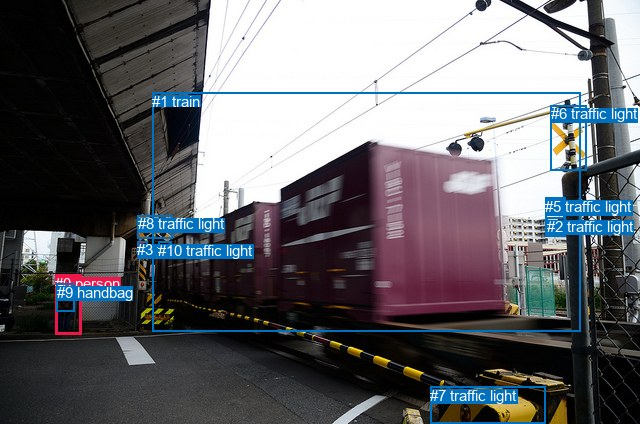
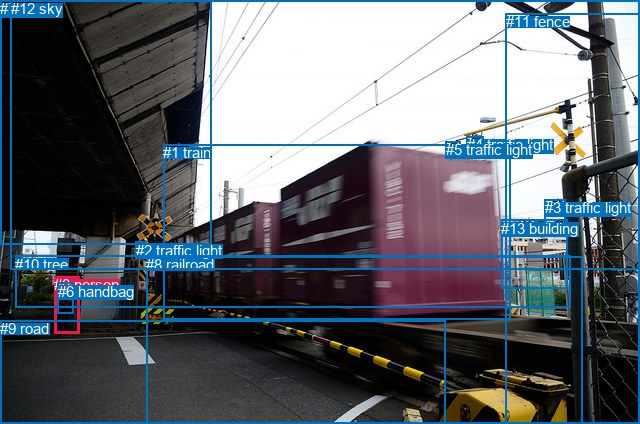

# 图片 1496：2385703.jpg

随机样本序号：394。图片 SHA256：`a24e909fbe59df668c41b2aba50e2f88a316e0d9e28881236454fd1c1b7b44d8`。

红色框表示人，蓝色框表示其他物体。两个模式分别保留自身框编号，可依据位置比较对应对象。

## 自动检测框与输出

人的框编号：`[0]`。状态：`ok`。

### 自动检测全部物体框

| 编号 | 类别 | 是否为人 | 检测分数 | 像素坐标 xyxy |
|---|---|---|---|---|
| 0 | person | True | 0.9987 | 55.2, 275.0, 81.2, 335.0 |
| 1 | train | False | 0.9904 | 152.2, 92.5, 580.4, 331.5 |
| 2 | traffic light | False | 0.8917 | 546.6, 217.8, 565.2, 236.0 |
| 3 | traffic light | False | 0.8494 | 137.3, 241.2, 147.3, 251.5 |
| 4 | traffic light | False | 0.8265 | 545.2, 198.8, 564.8, 218.5 |
| 5 | traffic light | False | 0.7936 | 545.1, 197.6, 566.0, 236.8 |
| 6 | traffic light | False | 0.7436 | 550.6, 105.2, 587.0, 170.5 |
| 7 | traffic light | False | 0.7337 | 430.4, 386.7, 545.1, 424.0 |
| 8 | traffic light | False | 0.6827 | 138.0, 215.3, 172.7, 238.8 |
| 9 | handbag | False | 0.5054 | 56.8, 283.6, 74.6, 311.2 |
| 10 | traffic light | False | 0.4236 | 158.5, 242.0, 171.2, 254.2 |

### 自动检测 Top50 人相关候选

评分物体对：110；人相关物体对：20；输出关系：40。

| 排名 | 主语编号与类别 | 关系 | 宾语编号与类别 | 类型 | 人与人 | 排序分数 | 原始融合 logit |
|---|---|---|---|---|---|---|---|
| 1 | #0 person | wearing | #9 handbag | semantic | False | 0.99460 | 5.2156 |
| 2 | #0 person | looking at | #1 train | semantic | False | 0.97533 | 3.6773 |
| 3 | #0 person | in | #9 handbag | spatial | False | 0.97518 | 3.6709 |
| 4 | #0 person | beside | #1 train | spatial | False | 0.93900 | 2.7339 |
| 5 | #9 handbag | on | #0 person | spatial | False | 0.83952 | 1.6547 |
| 6 | #1 train | pulling | #0 person | semantic | False | 0.70741 | 0.8829 |
| 7 | #1 train | beside | #0 person | spatial | False | 0.42300 | -0.3105 |
| 8 | #9 handbag | wearing | #0 person | semantic | False | 0.33292 | -0.6950 |
| 9 | #0 person | looking at | #3 traffic light | semantic | False | 0.05106 | -2.9224 |
| 10 | #0 person | looking at | #8 traffic light | semantic | False | 0.03611 | -3.2844 |
| 11 | #0 person | looking at | #10 traffic light | semantic | False | 0.02700 | -3.5847 |
| 12 | #0 person | beside | #8 traffic light | spatial | False | 0.01795 | -4.0019 |
| 13 | #0 person | standing on | #7 traffic light | semantic | False | 0.01412 | -4.2457 |
| 14 | #0 person | looking at | #2 traffic light | semantic | False | 0.01179 | -4.4284 |
| 15 | #0 person | looking at | #5 traffic light | semantic | False | 0.00945 | -4.6527 |
| 16 | #0 person | beside | #3 traffic light | spatial | False | 0.00902 | -4.6991 |
| 17 | #0 person | looking at | #4 traffic light | semantic | False | 0.00781 | -4.8451 |
| 18 | #0 person | on | #7 traffic light | spatial | False | 0.00688 | -4.9727 |
| 19 | #0 person | standing on | #6 traffic light | semantic | False | 0.00533 | -5.2284 |
| 20 | #8 traffic light | over | #0 person | spatial | False | 0.00433 | -5.4390 |
| 21 | #3 traffic light | on | #0 person | spatial | False | 0.00373 | -5.5873 |
| 22 | #0 person | beside | #10 traffic light | spatial | False | 0.00343 | -5.6716 |
| 23 | #10 traffic light | on | #0 person | spatial | False | 0.00296 | -5.8183 |
| 24 | #7 traffic light | in front of | #0 person | spatial | False | 0.00236 | -6.0482 |
| 25 | #0 person | on | #2 traffic light | spatial | False | 0.00219 | -6.1197 |
| 26 | #0 person | on | #5 traffic light | spatial | False | 0.00204 | -6.1916 |
| 27 | #0 person | on | #6 traffic light | spatial | False | 0.00176 | -6.3408 |
| 28 | #0 person | on | #4 traffic light | spatial | False | 0.00163 | -6.4169 |
| 29 | #3 traffic light | holding | #0 person | semantic | False | 0.00157 | -6.4558 |
| 30 | #8 traffic light | holding | #0 person | semantic | False | 0.00131 | -6.6348 |
| 31 | #5 traffic light | attached to | #0 person | spatial | False | 0.00127 | -6.6682 |
| 32 | #10 traffic light | holding | #0 person | semantic | False | 0.00117 | -6.7455 |
| 33 | #2 traffic light | attached to | #0 person | spatial | False | 0.00116 | -6.7622 |
| 34 | #6 traffic light | holding | #0 person | semantic | False | 0.00114 | -6.7785 |
| 35 | #4 traffic light | attached to | #0 person | spatial | False | 0.00113 | -6.7851 |
| 36 | #6 traffic light | attached to | #0 person | spatial | False | 0.00109 | -6.8219 |
| 37 | #7 traffic light | holding | #0 person | semantic | False | 0.00088 | -7.0352 |
| 38 | #5 traffic light | holding | #0 person | semantic | False | 0.00079 | -7.1436 |
| 39 | #4 traffic light | holding | #0 person | semantic | False | 0.00066 | -7.3301 |
| 40 | #2 traffic light | holding | #0 person | semantic | False | 0.00063 | -7.3623 |

### 自动检测逐条人相关 GT 核验

R@50：0.00%；命中 0/1。

| GT 主语编号 | GT 关系 | GT 宾语编号 | 结果阶段 | 匹配预测主语编号 | 匹配预测宾语编号 |
|---|---|---|---|---|---|
| 0 | carrying | 6 | wrong_predicate | [0] | [9] |

## 真实框与输出

人的框编号：`[0]`。

### 真实框全部物体框

| 编号 | 类别 | 是否为人 | 检测分数 | 像素坐标 xyxy |
|---|---|---|---|---|
| 0 | person | True | GT | 54.0, 276.0, 79.0, 333.0 |
| 1 | train | False | GT | 163.0, 144.0, 510.0, 319.0 |
| 2 | traffic light | False | GT | 136.0, 242.0, 147.0, 253.0 |
| 3 | traffic light | False | GT | 545.0, 199.0, 566.0, 236.0 |
| 4 | traffic light | False | GT | 467.0, 136.0, 484.0, 152.0 |
| 5 | traffic light | False | GT | 446.0, 141.0, 461.0, 157.0 |
| 6 | handbag | False | GT | 58.0, 283.0, 74.0, 314.0 |
| 7 | bridge | False | GT | 0.0, 0.0, 211.0, 244.0 |
| 8 | railroad | False | GT | 146.0, 256.0, 582.0, 424.0 |
| 9 | road | False | GT | 0.0, 320.0, 446.0, 424.0 |
| 10 | tree | False | GT | 15.0, 256.0, 570.0, 308.0 |
| 11 | fence | False | GT | 506.0, 13.0, 640.0, 424.0 |
| 12 | sky | False | GT | 11.0, 0.0, 640.0, 269.0 |
| 13 | building | False | GT | 501.0, 220.0, 567.0, 289.0 |

### 真实框 Top50 人相关候选

评分物体对：182；人相关物体对：26；输出关系：50。

| 排名 | 主语编号与类别 | 关系 | 宾语编号与类别 | 类型 | 人与人 | 排序分数 | 原始融合 logit |
|---|---|---|---|---|---|---|---|
| 1 | #0 person | wearing | #6 handbag | semantic | False | 0.99377 | 5.0724 |
| 2 | #0 person | standing on | #9 road | semantic | False | 0.97575 | 3.6949 |
| 3 | #0 person | in | #6 handbag | spatial | False | 0.96519 | 3.3224 |
| 4 | #0 person | looking at | #1 train | semantic | False | 0.94460 | 2.8361 |
| 5 | #0 person | on | #9 road | spatial | False | 0.93134 | 2.6074 |
| 6 | #0 person | beside | #1 train | spatial | False | 0.90134 | 2.2122 |
| 7 | #0 person | beside | #8 railroad | spatial | False | 0.90043 | 2.2020 |
| 8 | #6 handbag | on | #0 person | spatial | False | 0.89516 | 2.1445 |
| 9 | #0 person | looking at | #8 railroad | semantic | False | 0.86635 | 1.8691 |
| 10 | #0 person | standing on | #7 bridge | semantic | False | 0.52367 | 0.0948 |
| 11 | #0 person | standing on | #10 tree | semantic | False | 0.43465 | -0.2629 |
| 12 | #0 person | beside | #7 bridge | spatial | False | 0.41991 | -0.3231 |
| 13 | #6 handbag | wearing | #0 person | semantic | False | 0.41970 | -0.3240 |
| 14 | #0 person | in | #10 tree | spatial | False | 0.40999 | -0.3640 |
| 15 | #7 bridge | over | #0 person | spatial | False | 0.24031 | -1.1510 |
| 16 | #0 person | looking at | #2 traffic light | semantic | False | 0.14217 | -1.7974 |
| 17 | #0 person | standing on | #11 fence | semantic | False | 0.12669 | -1.9305 |
| 18 | #0 person | beside | #11 fence | spatial | False | 0.06313 | -2.6974 |
| 19 | #2 traffic light | beside | #0 person | spatial | False | 0.04713 | -3.0065 |
| 20 | #10 tree | beside | #0 person | spatial | False | 0.04198 | -3.1277 |
| 21 | #0 person | beside | #2 traffic light | spatial | False | 0.04184 | -3.1311 |
| 22 | #0 person | looking at | #12 sky | semantic | False | 0.03795 | -3.2328 |
| 23 | #0 person | looking at | #13 building | semantic | False | 0.03391 | -3.3495 |
| 24 | #1 train | beside | #0 person | spatial | False | 0.03124 | -3.4344 |
| 25 | #12 sky | over | #0 person | spatial | False | 0.02929 | -3.5007 |
| 26 | #1 train | pulling | #0 person | semantic | False | 0.01686 | -4.0655 |
| 27 | #0 person | in | #12 sky | spatial | False | 0.01681 | -4.0688 |
| 28 | #0 person | looking at | #3 traffic light | semantic | False | 0.01662 | -4.0805 |
| 29 | #9 road | in | #0 person | spatial | False | 0.01336 | -4.3017 |
| 30 | #0 person | in | #13 building | spatial | False | 0.01184 | -4.4247 |
| 31 | #2 traffic light | holding | #0 person | semantic | False | 0.00964 | -4.6322 |
| 32 | #7 bridge | holding | #0 person | semantic | False | 0.00876 | -4.7283 |
| 33 | #10 tree | looking at | #0 person | semantic | False | 0.00755 | -4.8783 |
| 34 | #13 building | beside | #0 person | spatial | False | 0.00718 | -4.9299 |
| 35 | #9 road | holding | #0 person | semantic | False | 0.00559 | -5.1812 |
| 36 | #3 traffic light | beside | #0 person | spatial | False | 0.00502 | -5.2899 |
| 37 | #0 person | looking at | #5 traffic light | semantic | False | 0.00416 | -5.4788 |
| 38 | #11 fence | beside | #0 person | spatial | False | 0.00415 | -5.4802 |
| 39 | #0 person | holding | #4 traffic light | semantic | False | 0.00351 | -5.6491 |
| 40 | #8 railroad | beside | #0 person | spatial | False | 0.00292 | -5.8339 |
| 41 | #0 person | on | #3 traffic light | spatial | False | 0.00289 | -5.8447 |
| 42 | #3 traffic light | holding | #0 person | semantic | False | 0.00282 | -5.8680 |
| 43 | #4 traffic light | over | #0 person | spatial | False | 0.00249 | -5.9929 |
| 44 | #5 traffic light | on | #0 person | spatial | False | 0.00232 | -6.0651 |
| 45 | #12 sky | holding | #0 person | semantic | False | 0.00202 | -6.2003 |
| 46 | #13 building | looking at | #0 person | semantic | False | 0.00182 | -6.3066 |
| 47 | #0 person | in | #4 traffic light | spatial | False | 0.00168 | -6.3875 |
| 48 | #0 person | in | #5 traffic light | spatial | False | 0.00161 | -6.4316 |
| 49 | #11 fence | holding | #0 person | semantic | False | 0.00152 | -6.4886 |
| 50 | #8 railroad | holding | #0 person | semantic | False | 0.00126 | -6.6784 |

### 真实框逐条人相关 GT 核验

R@50：0.00%；命中 0/1。

| GT 主语编号 | GT 关系 | GT 宾语编号 | 结果阶段 | 匹配预测主语编号 | 匹配预测宾语编号 |
|---|---|---|---|---|---|
| 0 | carrying | 6 | wrong_predicate | [0] | [6] |

## 全部人相关 GT

| 主语编号与类别 | 关系 | 宾语编号与类别 |
|---|---|---|
| #0 person | carrying | #6 handbag |

原始记录、全部人相关物体对的两项预测与分项分数见 [逐图证据 JSON](../evidence/cases/1496.json)。全部56类 logits 保留于本机 HOR/output/random500/logits/。

<!-- HOR_COMPLETE_RESULTS -->

## 六组条件的完整输出对照

以下保留同一图片三种框与候选模式、两种谓词输出规则的全部 Top50。框编号各自在所属模式内解释。

### 自动检测框完整枚举：空间与语义各保留一个谓词

| 排名 | 主语编号与类别 | 谓词 | 宾语编号与类别 | 分组 | 排序分数 | predicate logit | pair logit |
|---|---|---|---|---|---|---|---|
| 1 | #0 person | wearing | #9 handbag | semantic | 0.9945984 | 4.5452657 | 0.6703789 |
| 2 | #0 person | looking at | #1 train | semantic | 0.9753339 | 3.9352412 | -0.2578918 |
| 3 | #0 person | in | #9 handbag | spatial | 0.9751793 | 3.0005636 | 0.6703789 |
| 4 | #0 person | beside | #1 train | spatial | 0.9389988 | 2.9918132 | -0.2578918 |
| 5 | #9 handbag | on | #0 person | spatial | 0.8395248 | 2.1021986 | -0.4475020 |
| 6 | #1 train | pulling | #0 person | semantic | 0.7074131 | 2.3430095 | -1.4601566 |
| 7 | #1 train | beside | #0 person | spatial | 0.4229994 | 1.1496840 | -1.4601566 |
| 8 | #9 handbag | wearing | #0 person | semantic | 0.3329236 | -0.2474895 | -0.4475020 |
| 9 | #0 person | looking at | #3 traffic light | semantic | 0.0510586 | -1.8759983 | -1.0463755 |
| 10 | #0 person | looking at | #8 traffic light | semantic | 0.0361110 | -2.0341237 | -1.2502563 |
| 11 | #0 person | looking at | #10 traffic light | semantic | 0.0269963 | -2.4033792 | -1.1813076 |
| 12 | #0 person | beside | #8 traffic light | spatial | 0.0179533 | -2.7516105 | -1.2502563 |
| 13 | #0 person | standing on | #7 traffic light | semantic | 0.0141232 | -2.5718968 | -1.6738191 |
| 14 | #0 person | looking at | #2 traffic light | semantic | 0.0117924 | -3.0307846 | -1.3976498 |
| 15 | #0 person | looking at | #5 traffic light | semantic | 0.0094455 | -3.1734567 | -1.4792734 |
| 16 | #0 person | beside | #3 traffic light | spatial | 0.0090212 | -3.6527433 | -1.0463755 |
| 17 | #0 person | looking at | #4 traffic light | semantic | 0.0078057 | -3.3079085 | -1.5371548 |
| 18 | #0 person | on | #7 traffic light | spatial | 0.0068767 | -3.2988899 | -1.6738191 |
| 19 | #0 person | standing on | #6 traffic light | semantic | 0.0053336 | -3.3908281 | -1.8375450 |
| 20 | #8 traffic light | over | #0 person | spatial | 0.0043251 | -4.1691961 | -1.2697957 |
| 21 | #3 traffic light | on | #0 person | spatial | 0.0037310 | -4.4536967 | -1.1336348 |
| 22 | #0 person | beside | #10 traffic light | spatial | 0.0034304 | -4.4903369 | -1.1813076 |
| 23 | #10 traffic light | on | #0 person | spatial | 0.0029639 | -4.5852408 | -1.2330434 |
| 24 | #7 traffic light | in front of | #0 person | spatial | 0.0023564 | -4.1036015 | -1.9446433 |
| 25 | #0 person | on | #2 traffic light | spatial | 0.0021943 | -4.7220602 | -1.3976498 |
| 26 | #0 person | on | #5 traffic light | spatial | 0.0020425 | -4.7122822 | -1.4792734 |
| 27 | #0 person | on | #6 traffic light | spatial | 0.0017598 | -4.5032635 | -1.8375450 |
| 28 | #0 person | on | #4 traffic light | spatial | 0.0016310 | -4.8797793 | -1.5371548 |
| 29 | #3 traffic light | holding | #0 person | semantic | 0.0015688 | -5.3222136 | -1.1336348 |
| 30 | #8 traffic light | holding | #0 person | semantic | 0.0013121 | -5.3650146 | -1.2697957 |
| 31 | #5 traffic light | attached to | #0 person | spatial | 0.0012690 | -5.0464878 | -1.6217530 |
| 32 | #10 traffic light | holding | #0 person | semantic | 0.0011748 | -5.5124464 | -1.2330434 |
| 33 | #2 traffic light | attached to | #0 person | spatial | 0.0011553 | -5.1484270 | -1.6137818 |
| 34 | #6 traffic light | holding | #0 person | semantic | 0.0011367 | -4.9701867 | -1.8082948 |
| 35 | #4 traffic light | attached to | #0 person | spatial | 0.0011292 | -5.1393299 | -1.6457540 |
| 36 | #6 traffic light | attached to | #0 person | spatial | 0.0010884 | -5.0136189 | -1.8082948 |
| 37 | #7 traffic light | holding | #0 person | semantic | 0.0008796 | -5.0905609 | -1.9446433 |
| 38 | #5 traffic light | holding | #0 person | semantic | 0.0007893 | -5.5218577 | -1.6217530 |
| 39 | #4 traffic light | holding | #0 person | semantic | 0.0006551 | -5.6843367 | -1.6457540 |
| 40 | #2 traffic light | holding | #0 person | semantic | 0.0006343 | -5.7485027 | -1.6137818 |

GT 命中：0/1，R@50=0.00%。

| GT主语 | GT谓词 | GT宾语 | 结果阶段 | 匹配主语框 | 匹配宾语框 |
|---|---|---|---|---|---|
| 0 | carrying | 6 | wrong_predicate | [0] | [9] |

### 自动检测框完整枚举：每对只保留一个谓词

| 排名 | 主语编号与类别 | 谓词 | 宾语编号与类别 | 分组 | 排序分数 | predicate logit | pair logit |
|---|---|---|---|---|---|---|---|
| 1 | #0 person | wearing | #9 handbag | single | 0.9945984 | 4.5452657 | 0.6703789 |
| 2 | #0 person | looking at | #1 train | single | 0.9753339 | 3.9352412 | -0.2578918 |
| 3 | #9 handbag | on | #0 person | single | 0.8395248 | 2.1021986 | -0.4475020 |
| 4 | #1 train | pulling | #0 person | single | 0.7074131 | 2.3430095 | -1.4601566 |
| 5 | #0 person | looking at | #3 traffic light | single | 0.0510586 | -1.8759983 | -1.0463755 |
| 6 | #0 person | looking at | #8 traffic light | single | 0.0361110 | -2.0341237 | -1.2502563 |
| 7 | #0 person | looking at | #10 traffic light | single | 0.0269963 | -2.4033792 | -1.1813076 |
| 8 | #0 person | standing on | #7 traffic light | single | 0.0141232 | -2.5718968 | -1.6738191 |
| 9 | #0 person | looking at | #2 traffic light | single | 0.0117924 | -3.0307846 | -1.3976498 |
| 10 | #0 person | looking at | #5 traffic light | single | 0.0094455 | -3.1734567 | -1.4792734 |
| 11 | #0 person | looking at | #4 traffic light | single | 0.0078057 | -3.3079085 | -1.5371548 |
| 12 | #0 person | standing on | #6 traffic light | single | 0.0053336 | -3.3908281 | -1.8375450 |
| 13 | #8 traffic light | over | #0 person | single | 0.0043251 | -4.1691961 | -1.2697957 |
| 14 | #3 traffic light | on | #0 person | single | 0.0037310 | -4.4536967 | -1.1336348 |
| 15 | #10 traffic light | on | #0 person | single | 0.0029639 | -4.5852408 | -1.2330434 |
| 16 | #7 traffic light | in front of | #0 person | single | 0.0023564 | -4.1036015 | -1.9446433 |
| 17 | #5 traffic light | attached to | #0 person | single | 0.0012690 | -5.0464878 | -1.6217530 |
| 18 | #2 traffic light | attached to | #0 person | single | 0.0011553 | -5.1484270 | -1.6137818 |
| 19 | #6 traffic light | holding | #0 person | single | 0.0011367 | -4.9701867 | -1.8082948 |
| 20 | #4 traffic light | attached to | #0 person | single | 0.0011292 | -5.1393299 | -1.6457540 |

GT 命中：0/1，R@50=0.00%。

| GT主语 | GT谓词 | GT宾语 | 结果阶段 | 匹配主语框 | 匹配宾语框 |
|---|---|---|---|---|---|
| 0 | carrying | 6 | wrong_predicate | [0] | [9] |

### 真实框完整枚举：空间与语义各保留一个谓词

| 排名 | 主语编号与类别 | 谓词 | 宾语编号与类别 | 分组 | 排序分数 | predicate logit | pair logit |
|---|---|---|---|---|---|---|---|
| 1 | #0 person | wearing | #6 handbag | semantic | 0.9937714 | 4.5026870 | 0.5696713 |
| 2 | #0 person | standing on | #9 road | semantic | 0.9757527 | 3.8043628 | -0.1094588 |
| 3 | #0 person | in | #6 handbag | spatial | 0.9651901 | 2.7527504 | 0.5696713 |
| 4 | #0 person | looking at | #1 train | semantic | 0.9445975 | 3.1668139 | -0.3306796 |
| 5 | #0 person | on | #9 road | spatial | 0.9313379 | 2.7168832 | -0.1094588 |
| 6 | #0 person | beside | #1 train | spatial | 0.9013392 | 2.5428734 | -0.3306796 |
| 7 | #0 person | beside | #8 railroad | spatial | 0.9004308 | 2.6032872 | -0.4012671 |
| 8 | #6 handbag | on | #0 person | spatial | 0.8951576 | 2.5234761 | -0.3789343 |
| 9 | #0 person | looking at | #8 railroad | semantic | 0.8663523 | 2.2703519 | -0.4012671 |
| 10 | #0 person | standing on | #7 bridge | semantic | 0.5236734 | 0.6172314 | -0.5224673 |
| 11 | #0 person | standing on | #10 tree | semantic | 0.4346507 | 0.1774936 | -0.4403944 |
| 12 | #0 person | beside | #7 bridge | spatial | 0.4199141 | 0.1993413 | -0.5224673 |
| 13 | #6 handbag | wearing | #0 person | semantic | 0.4196994 | 0.0549269 | -0.3789343 |
| 14 | #0 person | in | #10 tree | spatial | 0.4099906 | 0.0763903 | -0.4403944 |
| 15 | #7 bridge | over | #0 person | spatial | 0.2403104 | 0.1628180 | -1.3137963 |
| 16 | #0 person | looking at | #2 traffic light | semantic | 0.1421715 | -0.7395580 | -1.0578119 |
| 17 | #0 person | standing on | #11 fence | semantic | 0.1266946 | -0.7063673 | -1.2241385 |
| 18 | #0 person | beside | #11 fence | spatial | 0.0631253 | -1.4732890 | -1.2241385 |
| 19 | #2 traffic light | beside | #0 person | spatial | 0.0471346 | -1.8678944 | -1.1385711 |
| 20 | #10 tree | beside | #0 person | spatial | 0.0419777 | -1.9542525 | -1.1734800 |
| 21 | #0 person | beside | #2 traffic light | spatial | 0.0418423 | -2.0732925 | -1.0578119 |
| 22 | #0 person | looking at | #12 sky | semantic | 0.0379517 | -2.1262169 | -1.1065344 |
| 23 | #0 person | looking at | #13 building | semantic | 0.0339108 | -1.9554853 | -1.3940369 |
| 24 | #1 train | beside | #0 person | spatial | 0.0312362 | -1.9297538 | -1.5046895 |
| 25 | #12 sky | over | #0 person | spatial | 0.0292919 | -2.0607574 | -1.4399590 |
| 26 | #1 train | pulling | #0 person | semantic | 0.0168645 | -2.5608482 | -1.5046895 |
| 27 | #0 person | in | #12 sky | spatial | 0.0168112 | -2.9622188 | -1.1065344 |
| 28 | #0 person | looking at | #3 traffic light | semantic | 0.0166189 | -2.5811892 | -1.4992656 |
| 29 | #9 road | in | #0 person | spatial | 0.0133646 | -2.5486312 | -1.7530596 |
| 30 | #0 person | in | #13 building | spatial | 0.0118363 | -3.0306375 | -1.3940369 |
| 31 | #2 traffic light | holding | #0 person | semantic | 0.0096394 | -3.4936366 | -1.1385711 |
| 32 | #7 bridge | holding | #0 person | semantic | 0.0087642 | -3.4144835 | -1.3137963 |
| 33 | #10 tree | looking at | #0 person | semantic | 0.0075527 | -3.7047882 | -1.1734800 |
| 34 | #13 building | beside | #0 person | spatial | 0.0071756 | -3.2143040 | -1.7155654 |
| 35 | #9 road | holding | #0 person | semantic | 0.0055897 | -3.4281669 | -1.7530596 |
| 36 | #3 traffic light | beside | #0 person | spatial | 0.0050169 | -3.6653259 | -1.6245943 |
| 37 | #0 person | looking at | #5 traffic light | semantic | 0.0041569 | -3.9680855 | -1.5107230 |
| 38 | #11 fence | beside | #0 person | spatial | 0.0041510 | -3.4804125 | -1.9998367 |
| 39 | #0 person | holding | #4 traffic light | semantic | 0.0035083 | -4.0637760 | -1.5853276 |
| 40 | #8 railroad | beside | #0 person | spatial | 0.0029182 | -3.9276702 | -1.9062095 |
| 41 | #0 person | on | #3 traffic light | spatial | 0.0028869 | -4.3454003 | -1.4992656 |
| 42 | #3 traffic light | holding | #0 person | semantic | 0.0028205 | -4.2434278 | -1.6245943 |
| 43 | #4 traffic light | over | #0 person | spatial | 0.0024902 | -4.3003507 | -1.6925311 |
| 44 | #5 traffic light | on | #0 person | spatial | 0.0023171 | -4.3243241 | -1.7407751 |
| 45 | #12 sky | holding | #0 person | semantic | 0.0020248 | -4.7603059 | -1.4399590 |
| 46 | #13 building | looking at | #0 person | semantic | 0.0018210 | -4.5910020 | -1.7155654 |
| 47 | #0 person | in | #4 traffic light | spatial | 0.0016796 | -4.8021903 | -1.5853276 |
| 48 | #0 person | in | #5 traffic light | spatial | 0.0016072 | -4.9209247 | -1.5107230 |
| 49 | #11 fence | holding | #0 person | semantic | 0.0015183 | -4.4887948 | -1.9998367 |
| 50 | #8 railroad | holding | #0 person | semantic | 0.0012562 | -4.7721877 | -1.9062095 |

GT 命中：0/1，R@50=0.00%。

| GT主语 | GT谓词 | GT宾语 | 结果阶段 | 匹配主语框 | 匹配宾语框 |
|---|---|---|---|---|---|
| 0 | carrying | 6 | wrong_predicate | [0] | [6] |

### 真实框完整枚举：每对只保留一个谓词

| 排名 | 主语编号与类别 | 谓词 | 宾语编号与类别 | 分组 | 排序分数 | predicate logit | pair logit |
|---|---|---|---|---|---|---|---|
| 1 | #0 person | wearing | #6 handbag | single | 0.9937714 | 4.5026870 | 0.5696713 |
| 2 | #0 person | standing on | #9 road | single | 0.9757527 | 3.8043628 | -0.1094588 |
| 3 | #0 person | looking at | #1 train | single | 0.9445975 | 3.1668139 | -0.3306796 |
| 4 | #0 person | beside | #8 railroad | single | 0.9004308 | 2.6032872 | -0.4012671 |
| 5 | #6 handbag | on | #0 person | single | 0.8951576 | 2.5234761 | -0.3789343 |
| 6 | #0 person | standing on | #7 bridge | single | 0.5236734 | 0.6172314 | -0.5224673 |
| 7 | #0 person | standing on | #10 tree | single | 0.4346507 | 0.1774936 | -0.4403944 |
| 8 | #7 bridge | over | #0 person | single | 0.2403104 | 0.1628180 | -1.3137963 |
| 9 | #0 person | looking at | #2 traffic light | single | 0.1421715 | -0.7395580 | -1.0578119 |
| 10 | #0 person | standing on | #11 fence | single | 0.1266946 | -0.7063673 | -1.2241385 |
| 11 | #2 traffic light | beside | #0 person | single | 0.0471346 | -1.8678944 | -1.1385711 |
| 12 | #10 tree | beside | #0 person | single | 0.0419777 | -1.9542525 | -1.1734800 |
| 13 | #0 person | looking at | #12 sky | single | 0.0379517 | -2.1262169 | -1.1065344 |
| 14 | #0 person | looking at | #13 building | single | 0.0339108 | -1.9554853 | -1.3940369 |
| 15 | #1 train | beside | #0 person | single | 0.0312362 | -1.9297538 | -1.5046895 |
| 16 | #12 sky | over | #0 person | single | 0.0292919 | -2.0607574 | -1.4399590 |
| 17 | #0 person | looking at | #3 traffic light | single | 0.0166189 | -2.5811892 | -1.4992656 |
| 18 | #9 road | in | #0 person | single | 0.0133646 | -2.5486312 | -1.7530596 |
| 19 | #13 building | beside | #0 person | single | 0.0071756 | -3.2143040 | -1.7155654 |
| 20 | #3 traffic light | beside | #0 person | single | 0.0050169 | -3.6653259 | -1.6245943 |
| 21 | #0 person | looking at | #5 traffic light | single | 0.0041569 | -3.9680855 | -1.5107230 |
| 22 | #11 fence | beside | #0 person | single | 0.0041510 | -3.4804125 | -1.9998367 |
| 23 | #0 person | holding | #4 traffic light | single | 0.0035083 | -4.0637760 | -1.5853276 |
| 24 | #8 railroad | beside | #0 person | single | 0.0029182 | -3.9276702 | -1.9062095 |
| 25 | #4 traffic light | over | #0 person | single | 0.0024902 | -4.3003507 | -1.6925311 |
| 26 | #5 traffic light | on | #0 person | single | 0.0023171 | -4.3243241 | -1.7407751 |

GT 命中：0/1，R@50=0.00%。

| GT主语 | GT谓词 | GT宾语 | 结果阶段 | 匹配主语框 | 匹配宾语框 |
|---|---|---|---|---|---|
| 0 | carrying | 6 | wrong_predicate | [0] | [6] |

### 真实框400候选：空间与语义各保留一个谓词

| 排名 | 主语编号与类别 | 谓词 | 宾语编号与类别 | 分组 | 排序分数 | predicate logit | pair logit |
|---|---|---|---|---|---|---|---|
| 1 | #0 person | wearing | #6 handbag | semantic | 0.9937714 | 4.5026870 | 0.5696713 |
| 2 | #0 person | standing on | #9 road | semantic | 0.9757527 | 3.8043628 | -0.1094588 |
| 3 | #0 person | in | #6 handbag | spatial | 0.9667321 | 2.7996583 | 0.5696713 |
| 4 | #0 person | looking at | #1 train | semantic | 0.9445975 | 3.1668139 | -0.3306796 |
| 5 | #0 person | on | #9 road | spatial | 0.9313379 | 2.7168832 | -0.1094588 |
| 6 | #0 person | beside | #8 railroad | spatial | 0.9030862 | 2.6332631 | -0.4012671 |
| 7 | #0 person | beside | #1 train | spatial | 0.9013495 | 2.5429888 | -0.3306796 |
| 8 | #6 handbag | on | #0 person | spatial | 0.8956676 | 2.5289211 | -0.3789343 |
| 9 | #0 person | looking at | #8 railroad | semantic | 0.8663523 | 2.2703519 | -0.4012671 |
| 10 | #0 person | standing on | #7 bridge | semantic | 0.5311733 | 0.6473222 | -0.5224673 |
| 11 | #0 person | standing on | #10 tree | semantic | 0.4346507 | 0.1774936 | -0.4403944 |
| 12 | #0 person | beside | #7 bridge | spatial | 0.4199282 | 0.1993990 | -0.5224673 |
| 13 | #6 handbag | wearing | #0 person | semantic | 0.4196994 | 0.0549269 | -0.3789343 |
| 14 | #0 person | in | #10 tree | spatial | 0.4091881 | 0.0730715 | -0.4403944 |
| 15 | #7 bridge | over | #0 person | spatial | 0.2448677 | 0.1876211 | -1.3137963 |
| 16 | #0 person | looking at | #2 traffic light | semantic | 0.1385618 | -0.7694747 | -1.0578119 |
| 17 | #0 person | standing on | #11 fence | semantic | 0.1245991 | -0.7254419 | -1.2241385 |
| 18 | #0 person | beside | #11 fence | spatial | 0.0631279 | -1.4732459 | -1.2241385 |
| 19 | #2 traffic light | beside | #0 person | spatial | 0.0471379 | -1.8678219 | -1.1385711 |
| 20 | #10 tree | beside | #0 person | spatial | 0.0425876 | -1.9391911 | -1.1734800 |
| 21 | #0 person | beside | #2 traffic light | spatial | 0.0412440 | -2.0883203 | -1.0578119 |
| 22 | #0 person | looking at | #12 sky | semantic | 0.0384984 | -2.1113458 | -1.1065344 |
| 23 | #0 person | looking at | #13 building | semantic | 0.0339279 | -1.9549627 | -1.3940369 |
| 24 | #1 train | beside | #0 person | spatial | 0.0307841 | -1.9447994 | -1.5046895 |
| 25 | #12 sky | over | #0 person | spatial | 0.0293107 | -2.0600963 | -1.4399590 |
| 26 | #0 person | in | #12 sky | spatial | 0.0170757 | -2.9463434 | -1.1065344 |
| 27 | #0 person | looking at | #3 traffic light | semantic | 0.0163827 | -2.5957446 | -1.4992656 |
| 28 | #1 train | pulling | #0 person | semantic | 0.0163728 | -2.5909345 | -1.5046895 |
| 29 | #9 road | in | #0 person | spatial | 0.0132055 | -2.5607729 | -1.7530596 |
| 30 | #0 person | in | #13 building | spatial | 0.0121536 | -3.0038648 | -1.3940369 |
| 31 | #2 traffic light | holding | #0 person | semantic | 0.0097680 | -3.4802527 | -1.1385711 |
| 32 | #7 bridge | holding | #0 person | semantic | 0.0088565 | -3.4039145 | -1.3137963 |
| 33 | #10 tree | looking at | #0 person | semantic | 0.0076089 | -3.6973131 | -1.1734800 |
| 34 | #13 building | beside | #0 person | spatial | 0.0071760 | -3.2142463 | -1.7155654 |
| 35 | #9 road | holding | #0 person | semantic | 0.0054938 | -3.4455652 | -1.7530596 |
| 36 | #3 traffic light | beside | #0 person | spatial | 0.0051306 | -3.6427865 | -1.6245943 |
| 37 | #11 fence | beside | #0 person | spatial | 0.0042774 | -3.4502923 | -1.9998367 |
| 38 | #0 person | looking at | #5 traffic light | semantic | 0.0042182 | -3.9533887 | -1.5107230 |
| 39 | #0 person | holding | #4 traffic light | semantic | 0.0034714 | -4.0743899 | -1.5853276 |
| 40 | #8 railroad | beside | #0 person | spatial | 0.0029845 | -3.9051306 | -1.9062095 |
| 41 | #0 person | on | #3 traffic light | spatial | 0.0029038 | -4.3395610 | -1.4992656 |
| 42 | #3 traffic light | holding | #0 person | semantic | 0.0028246 | -4.2419505 | -1.6245943 |
| 43 | #4 traffic light | over | #0 person | spatial | 0.0025057 | -4.2941499 | -1.6925311 |
| 44 | #5 traffic light | on | #0 person | spatial | 0.0023522 | -4.3092785 | -1.7407751 |
| 45 | #12 sky | holding | #0 person | semantic | 0.0020187 | -4.7633286 | -1.4399590 |
| 46 | #13 building | looking at | #0 person | semantic | 0.0018109 | -4.5965571 | -1.7155654 |
| 47 | #0 person | in | #4 traffic light | spatial | 0.0016845 | -4.7992582 | -1.5853276 |
| 48 | #0 person | in | #5 traffic light | spatial | 0.0016025 | -4.9238567 | -1.5107230 |
| 49 | #11 fence | holding | #0 person | semantic | 0.0015413 | -4.4737492 | -1.9998367 |
| 50 | #8 railroad | holding | #0 person | semantic | 0.0012772 | -4.7556305 | -1.9062095 |

GT 命中：0/1，R@50=0.00%。

| GT主语 | GT谓词 | GT宾语 | 结果阶段 | 匹配主语框 | 匹配宾语框 |
|---|---|---|---|---|---|
| 0 | carrying | 6 | wrong_predicate | [0] | [6] |

### 真实框400候选：每对只保留一个谓词

| 排名 | 主语编号与类别 | 谓词 | 宾语编号与类别 | 分组 | 排序分数 | predicate logit | pair logit |
|---|---|---|---|---|---|---|---|
| 1 | #0 person | wearing | #6 handbag | single | 0.9937714 | 4.5026870 | 0.5696713 |
| 2 | #0 person | standing on | #9 road | single | 0.9757527 | 3.8043628 | -0.1094588 |
| 3 | #0 person | looking at | #1 train | single | 0.9445975 | 3.1668139 | -0.3306796 |
| 4 | #0 person | beside | #8 railroad | single | 0.9030862 | 2.6332631 | -0.4012671 |
| 5 | #6 handbag | on | #0 person | single | 0.8956676 | 2.5289211 | -0.3789343 |
| 6 | #0 person | standing on | #7 bridge | single | 0.5311733 | 0.6473222 | -0.5224673 |
| 7 | #0 person | standing on | #10 tree | single | 0.4346507 | 0.1774936 | -0.4403944 |
| 8 | #7 bridge | over | #0 person | single | 0.2448677 | 0.1876211 | -1.3137963 |
| 9 | #0 person | looking at | #2 traffic light | single | 0.1385618 | -0.7694747 | -1.0578119 |
| 10 | #0 person | standing on | #11 fence | single | 0.1245991 | -0.7254419 | -1.2241385 |
| 11 | #2 traffic light | beside | #0 person | single | 0.0471379 | -1.8678219 | -1.1385711 |
| 12 | #10 tree | beside | #0 person | single | 0.0425876 | -1.9391911 | -1.1734800 |
| 13 | #0 person | looking at | #12 sky | single | 0.0384984 | -2.1113458 | -1.1065344 |
| 14 | #0 person | looking at | #13 building | single | 0.0339279 | -1.9549627 | -1.3940369 |
| 15 | #1 train | beside | #0 person | single | 0.0307841 | -1.9447994 | -1.5046895 |
| 16 | #12 sky | over | #0 person | single | 0.0293107 | -2.0600963 | -1.4399590 |
| 17 | #0 person | looking at | #3 traffic light | single | 0.0163827 | -2.5957446 | -1.4992656 |
| 18 | #9 road | in | #0 person | single | 0.0132055 | -2.5607729 | -1.7530596 |
| 19 | #13 building | beside | #0 person | single | 0.0071760 | -3.2142463 | -1.7155654 |
| 20 | #3 traffic light | beside | #0 person | single | 0.0051306 | -3.6427865 | -1.6245943 |
| 21 | #11 fence | beside | #0 person | single | 0.0042774 | -3.4502923 | -1.9998367 |
| 22 | #0 person | looking at | #5 traffic light | single | 0.0042182 | -3.9533887 | -1.5107230 |
| 23 | #0 person | holding | #4 traffic light | single | 0.0034714 | -4.0743899 | -1.5853276 |
| 24 | #8 railroad | beside | #0 person | single | 0.0029845 | -3.9051306 | -1.9062095 |
| 25 | #4 traffic light | over | #0 person | single | 0.0025057 | -4.2941499 | -1.6925311 |
| 26 | #5 traffic light | on | #0 person | single | 0.0023522 | -4.3092785 | -1.7407751 |

GT 命中：0/1，R@50=0.00%。

| GT主语 | GT谓词 | GT宾语 | 结果阶段 | 匹配主语框 | 匹配宾语框 |
|---|---|---|---|---|---|
| 0 | carrying | 6 | wrong_predicate | [0] | [6] |
