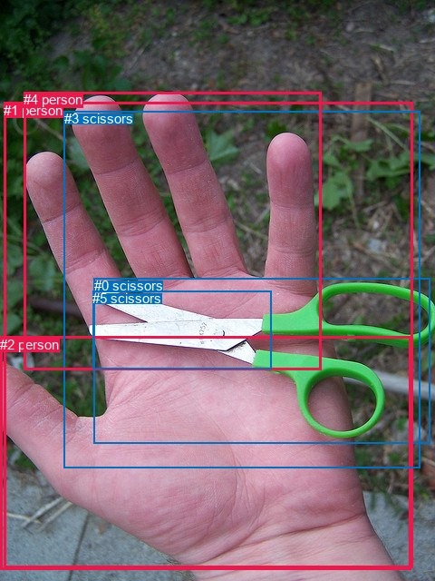
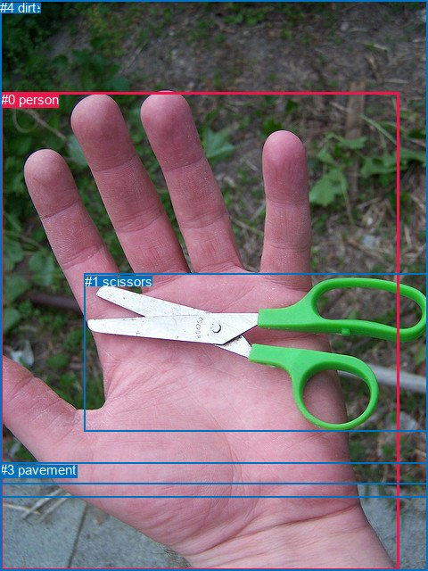

# 图片 1497：2385717.jpg

随机样本序号：82。图片 SHA256：`29a1a65910552343cdd8ab90b70aefd463859b9598fd0abb012c242788f367c0`。

红色框表示人，蓝色框表示其他物体。两个模式分别保留自身框编号，可依据位置比较对应对象。

## 自动检测框与输出

人的框编号：`[1, 2, 4]`。状态：`ok`。

### 自动检测全部物体框

| 编号 | 类别 | 是否为人 | 检测分数 | 像素坐标 xyxy |
|---|---|---|---|---|
| 0 | scissors | False | 0.9980 | 103.6, 306.1, 474.9, 488.1 |
| 1 | person | True | 0.9914 | 4.1, 113.0, 455.5, 625.9 |
| 2 | person | True | 0.9354 | 0.0, 370.9, 453.6, 627.8 |
| 3 | scissors | False | 0.8423 | 70.5, 122.0, 463.1, 516.0 |
| 4 | person | True | 0.6944 | 26.2, 101.5, 354.6, 407.1 |
| 5 | scissors | False | 0.4933 | 102.3, 320.3, 299.2, 406.1 |

### 自动检测 Top50 人相关候选

评分物体对：30；人相关物体对：24；输出关系：48。

| 排名 | 主语编号与类别 | 关系 | 宾语编号与类别 | 类型 | 人与人 | 排序分数 | 原始融合 logit |
|---|---|---|---|---|---|---|---|
| 1 | #1 person | holding | #0 scissors | semantic | False | 0.96957 | 3.4613 |
| 2 | #1 person | holding | #3 scissors | semantic | False | 0.92502 | 2.5126 |
| 3 | #3 scissors | on | #1 person | spatial | False | 0.90779 | 2.2869 |
| 4 | #4 person | on | #1 person | spatial | True | 0.90758 | 2.2844 |
| 5 | #0 scissors | on | #2 person | spatial | False | 0.88873 | 2.0779 |
| 6 | #0 scissors | on | #1 person | spatial | False | 0.87845 | 1.9779 |
| 7 | #1 person | holding | #5 scissors | semantic | False | 0.87581 | 1.9533 |
| 8 | #5 scissors | on | #1 person | spatial | False | 0.85849 | 1.8028 |
| 9 | #2 person | holding | #0 scissors | semantic | False | 0.84961 | 1.7315 |
| 10 | #0 scissors | in | #4 person | spatial | False | 0.84642 | 1.7068 |
| 11 | #3 scissors | in | #4 person | spatial | False | 0.83635 | 1.6314 |
| 12 | #2 person | on | #1 person | spatial | True | 0.81543 | 1.4857 |
| 13 | #4 person | on | #3 scissors | spatial | False | 0.79473 | 1.3537 |
| 14 | #3 scissors | on | #2 person | spatial | False | 0.79196 | 1.3368 |
| 15 | #4 person | holding | #0 scissors | semantic | False | 0.74598 | 1.0773 |
| 16 | #4 person | on | #2 person | spatial | True | 0.74317 | 1.0625 |
| 17 | #5 scissors | on | #4 person | spatial | False | 0.70519 | 0.8721 |
| 18 | #2 person | holding | #3 scissors | semantic | False | 0.70428 | 0.8678 |
| 19 | #1 person | on | #2 person | spatial | True | 0.67952 | 0.7516 |
| 20 | #1 person | in | #3 scissors | spatial | False | 0.67852 | 0.7470 |
| 21 | #0 scissors | lying on | #2 person | semantic | False | 0.66140 | 0.6696 |
| 22 | #5 scissors | on | #2 person | spatial | False | 0.62489 | 0.5104 |
| 23 | #1 person | on | #4 person | spatial | True | 0.60205 | 0.4140 |
| 24 | #1 person | wearing | #2 person | semantic | True | 0.56838 | 0.2753 |
| 25 | #4 person | holding | #3 scissors | semantic | False | 0.56497 | 0.2614 |
| 26 | #4 person | in | #0 scissors | spatial | False | 0.54967 | 0.1993 |
| 27 | #0 scissors | lying on | #1 person | semantic | False | 0.54415 | 0.1771 |
| 28 | #1 person | in | #0 scissors | spatial | False | 0.51218 | 0.0487 |
| 29 | #2 person | holding | #5 scissors | semantic | False | 0.51033 | 0.0413 |
| 30 | #5 scissors | lying on | #1 person | semantic | False | 0.43931 | -0.2440 |
| 31 | #1 person | in | #5 scissors | spatial | False | 0.41910 | -0.3265 |
| 32 | #4 person | crossing | #2 person | semantic | True | 0.36249 | -0.5646 |
| 33 | #1 person | holding | #4 person | semantic | True | 0.35936 | -0.5781 |
| 34 | #2 person | in | #3 scissors | spatial | False | 0.33605 | -0.6809 |
| 35 | #3 scissors | lying on | #1 person | semantic | False | 0.30926 | -0.8036 |
| 36 | #2 person | on | #4 person | spatial | True | 0.27510 | -0.9689 |
| 37 | #4 person | holding | #5 scissors | semantic | False | 0.27107 | -0.9892 |
| 38 | #4 person | on | #5 scissors | spatial | False | 0.25837 | -1.0545 |
| 39 | #2 person | holding | #4 person | semantic | True | 0.25738 | -1.0597 |
| 40 | #3 scissors | holding | #4 person | semantic | False | 0.24756 | -1.1116 |
| 41 | #2 person | on | #0 scissors | spatial | False | 0.24524 | -1.1241 |
| 42 | #2 person | crossing | #1 person | semantic | True | 0.22316 | -1.2473 |
| 43 | #3 scissors | holding | #2 person | semantic | False | 0.21966 | -1.2677 |
| 44 | #0 scissors | lying on | #4 person | semantic | False | 0.21779 | -1.2786 |
| 45 | #4 person | holding | #1 person | semantic | True | 0.21191 | -1.3135 |
| 46 | #5 scissors | lying on | #2 person | semantic | False | 0.16761 | -1.6026 |
| 47 | #5 scissors | lying on | #4 person | semantic | False | 0.12708 | -1.9270 |
| 48 | #2 person | in | #5 scissors | spatial | False | 0.09080 | -2.3040 |

### 自动检测逐条人相关 GT 核验

R@50：50.00%；命中 1/2。

| GT 主语编号 | GT 关系 | GT 宾语编号 | 结果阶段 | 匹配预测主语编号 | 匹配预测宾语编号 |
|---|---|---|---|---|---|
| 0 | holding | 1 | hit50 | [1] | [0] |
| 0 | over | 3 | endpoint_missing_or_wrong_class | [1] | [] |

## 真实框与输出

人的框编号：`[0]`。

### 真实框全部物体框

| 编号 | 类别 | 是否为人 | 检测分数 | 像素坐标 xyxy |
|---|---|---|---|---|
| 0 | person | True | GT | 1.0, 103.0, 447.0, 640.0 |
| 1 | scissors | False | GT | 95.0, 307.0, 479.0, 484.0 |
| 2 | tree | False | GT | 0.0, 0.0, 480.0, 558.0 |
| 3 | pavement | False | GT | 0.0, 518.0, 480.0, 640.0 |
| 4 | dirt | False | GT | 0.0, 0.0, 480.0, 542.0 |

### 真实框 Top50 人相关候选

评分物体对：20；人相关物体对：8；输出关系：16。

| 排名 | 主语编号与类别 | 关系 | 宾语编号与类别 | 类型 | 人与人 | 排序分数 | 原始融合 logit |
|---|---|---|---|---|---|---|---|
| 1 | #0 person | holding | #1 scissors | semantic | False | 0.98935 | 4.5311 |
| 2 | #0 person | on | #3 pavement | spatial | False | 0.94022 | 2.7555 |
| 3 | #1 scissors | on | #0 person | spatial | False | 0.93901 | 2.7341 |
| 4 | #0 person | wearing | #3 pavement | semantic | False | 0.77084 | 1.2131 |
| 5 | #0 person | on | #1 scissors | spatial | False | 0.76421 | 1.1759 |
| 6 | #1 scissors | lying on | #0 person | semantic | False | 0.67474 | 0.7297 |
| 7 | #3 pavement | beside | #0 person | spatial | False | 0.66337 | 0.6783 |
| 8 | #0 person | on | #2 tree | spatial | False | 0.61829 | 0.4823 |
| 9 | #0 person | on | #4 dirt | spatial | False | 0.57826 | 0.3157 |
| 10 | #0 person | holding | #4 dirt | semantic | False | 0.57265 | 0.2927 |
| 11 | #0 person | holding | #2 tree | semantic | False | 0.55766 | 0.2317 |
| 12 | #4 dirt | beside | #0 person | spatial | False | 0.44886 | -0.2053 |
| 13 | #2 tree | beside | #0 person | spatial | False | 0.42983 | -0.2825 |
| 14 | #3 pavement | holding | #0 person | semantic | False | 0.19910 | -1.3919 |
| 15 | #4 dirt | looking at | #0 person | semantic | False | 0.14497 | -1.7746 |
| 16 | #2 tree | looking at | #0 person | semantic | False | 0.12406 | -1.9546 |

### 真实框逐条人相关 GT 核验

R@50：50.00%；命中 1/2。

| GT 主语编号 | GT 关系 | GT 宾语编号 | 结果阶段 | 匹配预测主语编号 | 匹配预测宾语编号 |
|---|---|---|---|---|---|
| 0 | holding | 1 | hit50 | [0] | [1] |
| 0 | over | 3 | wrong_predicate | [0] | [3] |

## 全部人相关 GT

| 主语编号与类别 | 关系 | 宾语编号与类别 |
|---|---|---|
| #0 person | holding | #1 scissors |
| #0 person | over | #3 pavement |

原始记录、全部人相关物体对的两项预测与分项分数见 [逐图证据 JSON](../evidence/cases/1497.json)。全部56类 logits 保留于本机 HOR/output/random500/logits/。

<!-- HOR_COMPLETE_RESULTS -->

## 六组条件的完整输出对照

以下保留同一图片三种框与候选模式、两种谓词输出规则的全部 Top50。框编号各自在所属模式内解释。

### 自动检测框完整枚举：空间与语义各保留一个谓词

| 排名 | 主语编号与类别 | 谓词 | 宾语编号与类别 | 分组 | 排序分数 | predicate logit | pair logit |
|---|---|---|---|---|---|---|---|
| 1 | #1 person | holding | #0 scissors | semantic | 0.9695669 | 3.7201972 | -0.2588766 |
| 2 | #1 person | holding | #3 scissors | semantic | 0.9250216 | 2.4493580 | 0.0632597 |
| 3 | #3 scissors | on | #1 person | spatial | 0.9077889 | 2.4842038 | -0.1972721 |
| 4 | #4 person | on | #1 person | spatial | 0.9075797 | 2.5827899 | -0.2983546 |
| 5 | #0 scissors | on | #2 person | spatial | 0.8887327 | 2.6647515 | -0.5868909 |
| 6 | #0 scissors | on | #1 person | spatial | 0.8784525 | 2.3959284 | -0.4180722 |
| 7 | #1 person | holding | #5 scissors | semantic | 0.8758054 | 2.6165719 | -0.6632776 |
| 8 | #5 scissors | on | #1 person | spatial | 0.8584903 | 2.3423495 | -0.5395427 |
| 9 | #2 person | holding | #0 scissors | semantic | 0.8496084 | 2.3289933 | -0.5974603 |
| 10 | #0 scissors | in | #4 person | spatial | 0.8464227 | 2.4082494 | -0.7014349 |
| 11 | #3 scissors | in | #4 person | spatial | 0.8363547 | 2.1604366 | -0.5290853 |
| 12 | #2 person | on | #1 person | spatial | 0.8154283 | 1.8428178 | -0.3571422 |
| 13 | #4 person | on | #3 scissors | spatial | 0.7947324 | 1.7342110 | -0.3805201 |
| 14 | #3 scissors | on | #2 person | spatial | 0.7919633 | 1.7505455 | -0.4137447 |
| 15 | #4 person | holding | #0 scissors | semantic | 0.7459823 | 1.8217030 | -0.7444048 |
| 16 | #4 person | on | #2 person | spatial | 0.7431695 | 1.7668791 | -0.7043713 |
| 17 | #5 scissors | on | #4 person | spatial | 0.7051897 | 1.8766446 | -1.0045099 |
| 18 | #2 person | holding | #3 scissors | semantic | 0.7042826 | 1.1511726 | -0.2833968 |
| 19 | #1 person | on | #2 person | spatial | 0.6795179 | 0.7838326 | -0.0322751 |
| 20 | #1 person | in | #3 scissors | spatial | 0.6785245 | 0.6837397 | 0.0632597 |
| 21 | #0 scissors | lying on | #2 person | semantic | 0.6614041 | 1.2564483 | -0.5868909 |
| 22 | #5 scissors | on | #2 person | spatial | 0.6248937 | 1.5052395 | -0.9948671 |
| 23 | #1 person | on | #4 person | spatial | 0.6020533 | 0.5528340 | -0.1388063 |
| 24 | #1 person | wearing | #2 person | semantic | 0.5683845 | 0.3075380 | -0.0322751 |
| 25 | #4 person | holding | #3 scissors | semantic | 0.5649747 | 0.6418967 | -0.3805201 |
| 26 | #4 person | in | #0 scissors | spatial | 0.5496680 | 0.9437342 | -0.7444048 |
| 27 | #0 scissors | lying on | #1 person | semantic | 0.5441498 | 0.5951324 | -0.4180722 |
| 28 | #1 person | in | #0 scissors | spatial | 0.5121808 | 0.3076096 | -0.2588766 |
| 29 | #2 person | holding | #5 scissors | semantic | 0.5103313 | 1.0071740 | -0.9658431 |
| 30 | #5 scissors | lying on | #1 person | semantic | 0.4393097 | 0.2955785 | -0.5395427 |
| 31 | #1 person | in | #5 scissors | spatial | 0.4191004 | 0.3368101 | -0.6632776 |
| 32 | #4 person | crossing | #2 person | semantic | 0.3624863 | 0.1397824 | -0.7043713 |
| 33 | #1 person | holding | #4 person | semantic | 0.3593634 | -0.4393220 | -0.1388063 |
| 34 | #2 person | in | #3 scissors | spatial | 0.3360519 | -0.3975415 | -0.2833968 |
| 35 | #3 scissors | lying on | #1 person | semantic | 0.3092618 | -0.6063008 | -0.1972721 |
| 36 | #2 person | on | #4 person | spatial | 0.2751016 | -0.3292255 | -0.6396656 |
| 37 | #4 person | holding | #5 scissors | semantic | 0.2710678 | 0.0913916 | -1.0806034 |
| 38 | #4 person | on | #5 scissors | spatial | 0.2583681 | 0.0261354 | -1.0806034 |
| 39 | #2 person | holding | #4 person | semantic | 0.2573753 | -0.4199901 | -0.6396656 |
| 40 | #3 scissors | holding | #4 person | semantic | 0.2475637 | -0.5825629 | -0.5290853 |
| 41 | #2 person | on | #0 scissors | spatial | 0.2452429 | -0.5266867 | -0.5974603 |
| 42 | #2 person | crossing | #1 person | semantic | 0.2231621 | -0.8901913 | -0.3571422 |
| 43 | #3 scissors | holding | #2 person | semantic | 0.2196550 | -0.8539331 | -0.4137447 |
| 44 | #0 scissors | lying on | #4 person | semantic | 0.2177930 | -0.5771394 | -0.7014349 |
| 45 | #4 person | holding | #1 person | semantic | 0.2119079 | -1.0151083 | -0.2983546 |
| 46 | #5 scissors | lying on | #2 person | semantic | 0.1676122 | -0.6077785 | -0.9948671 |
| 47 | #5 scissors | lying on | #4 person | semantic | 0.1270822 | -0.9224973 | -1.0045099 |
| 48 | #2 person | in | #5 scissors | spatial | 0.0907952 | -1.3381209 | -0.9658431 |

GT 命中：1/2，R@50=50.00%。

| GT主语 | GT谓词 | GT宾语 | 结果阶段 | 匹配主语框 | 匹配宾语框 |
|---|---|---|---|---|---|
| 0 | holding | 1 | hit50 | [1] | [0] |
| 0 | over | 3 | endpoint_missing_or_wrong_class | [1] | [] |

### 自动检测框完整枚举：每对只保留一个谓词

| 排名 | 主语编号与类别 | 谓词 | 宾语编号与类别 | 分组 | 排序分数 | predicate logit | pair logit |
|---|---|---|---|---|---|---|---|
| 1 | #1 person | holding | #0 scissors | single | 0.9695669 | 3.7201972 | -0.2588766 |
| 2 | #1 person | holding | #3 scissors | single | 0.9250216 | 2.4493580 | 0.0632597 |
| 3 | #3 scissors | on | #1 person | single | 0.9077889 | 2.4842038 | -0.1972721 |
| 4 | #4 person | on | #1 person | single | 0.9075797 | 2.5827899 | -0.2983546 |
| 5 | #0 scissors | on | #2 person | single | 0.8887327 | 2.6647515 | -0.5868909 |
| 6 | #0 scissors | on | #1 person | single | 0.8784525 | 2.3959284 | -0.4180722 |
| 7 | #1 person | holding | #5 scissors | single | 0.8758054 | 2.6165719 | -0.6632776 |
| 8 | #5 scissors | on | #1 person | single | 0.8584903 | 2.3423495 | -0.5395427 |
| 9 | #2 person | holding | #0 scissors | single | 0.8496084 | 2.3289933 | -0.5974603 |
| 10 | #0 scissors | in | #4 person | single | 0.8464227 | 2.4082494 | -0.7014349 |
| 11 | #3 scissors | in | #4 person | single | 0.8363547 | 2.1604366 | -0.5290853 |
| 12 | #2 person | on | #1 person | single | 0.8154283 | 1.8428178 | -0.3571422 |
| 13 | #4 person | on | #3 scissors | single | 0.7947324 | 1.7342110 | -0.3805201 |
| 14 | #3 scissors | on | #2 person | single | 0.7919633 | 1.7505455 | -0.4137447 |
| 15 | #4 person | holding | #0 scissors | single | 0.7459823 | 1.8217030 | -0.7444048 |
| 16 | #4 person | on | #2 person | single | 0.7431695 | 1.7668791 | -0.7043713 |
| 17 | #5 scissors | on | #4 person | single | 0.7051897 | 1.8766446 | -1.0045099 |
| 18 | #2 person | holding | #3 scissors | single | 0.7042826 | 1.1511726 | -0.2833968 |
| 19 | #1 person | on | #2 person | single | 0.6795179 | 0.7838326 | -0.0322751 |
| 20 | #5 scissors | on | #2 person | single | 0.6248937 | 1.5052395 | -0.9948671 |
| 21 | #1 person | on | #4 person | single | 0.6020533 | 0.5528340 | -0.1388063 |
| 22 | #2 person | holding | #5 scissors | single | 0.5103313 | 1.0071740 | -0.9658431 |
| 23 | #2 person | on | #4 person | single | 0.2751016 | -0.3292255 | -0.6396656 |
| 24 | #4 person | holding | #5 scissors | single | 0.2710678 | 0.0913916 | -1.0806034 |

GT 命中：1/2，R@50=50.00%。

| GT主语 | GT谓词 | GT宾语 | 结果阶段 | 匹配主语框 | 匹配宾语框 |
|---|---|---|---|---|---|
| 0 | holding | 1 | hit50 | [1] | [0] |
| 0 | over | 3 | endpoint_missing_or_wrong_class | [1] | [] |

### 真实框完整枚举：空间与语义各保留一个谓词

| 排名 | 主语编号与类别 | 谓词 | 宾语编号与类别 | 分组 | 排序分数 | predicate logit | pair logit |
|---|---|---|---|---|---|---|---|
| 1 | #0 person | holding | #1 scissors | semantic | 0.9893462 | 4.5417323 | -0.0106093 |
| 2 | #0 person | on | #3 pavement | spatial | 0.9402210 | 3.0785575 | -0.3230973 |
| 3 | #1 scissors | on | #0 person | spatial | 0.9390087 | 3.1719875 | -0.4378930 |
| 4 | #0 person | wearing | #3 pavement | semantic | 0.7708409 | 1.5361629 | -0.3230973 |
| 5 | #0 person | on | #1 scissors | spatial | 0.7642059 | 1.1864877 | -0.0106093 |
| 6 | #1 scissors | lying on | #0 person | semantic | 0.6747420 | 1.1676049 | -0.4378930 |
| 7 | #3 pavement | beside | #0 person | spatial | 0.6633703 | 1.1274858 | -0.4491361 |
| 8 | #0 person | on | #2 tree | spatial | 0.6182892 | 1.0658617 | -0.5835684 |
| 9 | #0 person | on | #4 dirt | spatial | 0.5782639 | 0.9314499 | -0.6157993 |
| 10 | #0 person | holding | #4 dirt | semantic | 0.5726465 | 0.9084563 | -0.6157993 |
| 11 | #0 person | holding | #2 tree | semantic | 0.5576572 | 0.8152280 | -0.5835684 |
| 12 | #4 dirt | beside | #0 person | spatial | 0.4488633 | 0.0479598 | -0.2532243 |
| 13 | #2 tree | beside | #0 person | spatial | 0.4298315 | -0.0123963 | -0.2701426 |
| 14 | #3 pavement | holding | #0 person | semantic | 0.1991037 | -0.9427695 | -0.4491361 |
| 15 | #4 dirt | looking at | #0 person | semantic | 0.1449728 | -1.5213628 | -0.2532243 |
| 16 | #2 tree | looking at | #0 person | semantic | 0.1240562 | -1.6844242 | -0.2701426 |

GT 命中：1/2，R@50=50.00%。

| GT主语 | GT谓词 | GT宾语 | 结果阶段 | 匹配主语框 | 匹配宾语框 |
|---|---|---|---|---|---|
| 0 | holding | 1 | hit50 | [0] | [1] |
| 0 | over | 3 | wrong_predicate | [0] | [3] |

### 真实框完整枚举：每对只保留一个谓词

| 排名 | 主语编号与类别 | 谓词 | 宾语编号与类别 | 分组 | 排序分数 | predicate logit | pair logit |
|---|---|---|---|---|---|---|---|
| 1 | #0 person | holding | #1 scissors | single | 0.9893462 | 4.5417323 | -0.0106093 |
| 2 | #0 person | on | #3 pavement | single | 0.9402210 | 3.0785575 | -0.3230973 |
| 3 | #1 scissors | on | #0 person | single | 0.9390087 | 3.1719875 | -0.4378930 |
| 4 | #3 pavement | beside | #0 person | single | 0.6633703 | 1.1274858 | -0.4491361 |
| 5 | #0 person | on | #2 tree | single | 0.6182892 | 1.0658617 | -0.5835684 |
| 6 | #0 person | on | #4 dirt | single | 0.5782639 | 0.9314499 | -0.6157993 |
| 7 | #4 dirt | beside | #0 person | single | 0.4488633 | 0.0479598 | -0.2532243 |
| 8 | #2 tree | beside | #0 person | single | 0.4298315 | -0.0123963 | -0.2701426 |

GT 命中：1/2，R@50=50.00%。

| GT主语 | GT谓词 | GT宾语 | 结果阶段 | 匹配主语框 | 匹配宾语框 |
|---|---|---|---|---|---|
| 0 | holding | 1 | hit50 | [0] | [1] |
| 0 | over | 3 | wrong_predicate | [0] | [3] |

### 真实框400候选：空间与语义各保留一个谓词

| 排名 | 主语编号与类别 | 谓词 | 宾语编号与类别 | 分组 | 排序分数 | predicate logit | pair logit |
|---|---|---|---|---|---|---|---|
| 1 | #0 person | holding | #1 scissors | semantic | 0.9893462 | 4.5417323 | -0.0106093 |
| 2 | #0 person | on | #3 pavement | spatial | 0.9402210 | 3.0785575 | -0.3230973 |
| 3 | #1 scissors | on | #0 person | spatial | 0.9396295 | 3.1828780 | -0.4378930 |
| 4 | #0 person | wearing | #3 pavement | semantic | 0.7698028 | 1.5302954 | -0.3230973 |
| 5 | #0 person | on | #1 scissors | spatial | 0.7622380 | 1.1755981 | -0.0106093 |
| 6 | #1 scissors | lying on | #0 person | semantic | 0.6747420 | 1.1676049 | -0.4378930 |
| 7 | #3 pavement | beside | #0 person | spatial | 0.6633703 | 1.1274858 | -0.4491361 |
| 8 | #0 person | on | #2 tree | spatial | 0.6253653 | 1.0959530 | -0.5835684 |
| 9 | #0 person | on | #4 dirt | spatial | 0.5829396 | 0.9506516 | -0.6157993 |
| 10 | #0 person | holding | #4 dirt | semantic | 0.5733693 | 0.9114103 | -0.6157993 |
| 11 | #0 person | holding | #2 tree | semantic | 0.5576572 | 0.8152280 | -0.5835684 |
| 12 | #4 dirt | beside | #0 person | spatial | 0.4563183 | 0.0780511 | -0.2532243 |
| 13 | #2 tree | beside | #0 person | spatial | 0.4224729 | -0.0424876 | -0.2701426 |
| 14 | #3 pavement | holding | #0 person | semantic | 0.1995752 | -0.9398150 | -0.4491361 |
| 15 | #4 dirt | looking at | #0 person | semantic | 0.1468041 | -1.5066657 | -0.2532243 |
| 16 | #2 tree | looking at | #0 person | semantic | 0.1224305 | -1.6994698 | -0.2701426 |

GT 命中：1/2，R@50=50.00%。

| GT主语 | GT谓词 | GT宾语 | 结果阶段 | 匹配主语框 | 匹配宾语框 |
|---|---|---|---|---|---|
| 0 | holding | 1 | hit50 | [0] | [1] |
| 0 | over | 3 | wrong_predicate | [0] | [3] |

### 真实框400候选：每对只保留一个谓词

| 排名 | 主语编号与类别 | 谓词 | 宾语编号与类别 | 分组 | 排序分数 | predicate logit | pair logit |
|---|---|---|---|---|---|---|---|
| 1 | #0 person | holding | #1 scissors | single | 0.9893462 | 4.5417323 | -0.0106093 |
| 2 | #0 person | on | #3 pavement | single | 0.9402210 | 3.0785575 | -0.3230973 |
| 3 | #1 scissors | on | #0 person | single | 0.9396295 | 3.1828780 | -0.4378930 |
| 4 | #3 pavement | beside | #0 person | single | 0.6633703 | 1.1274858 | -0.4491361 |
| 5 | #0 person | on | #2 tree | single | 0.6253653 | 1.0959530 | -0.5835684 |
| 6 | #0 person | on | #4 dirt | single | 0.5829396 | 0.9506516 | -0.6157993 |
| 7 | #4 dirt | beside | #0 person | single | 0.4563183 | 0.0780511 | -0.2532243 |
| 8 | #2 tree | beside | #0 person | single | 0.4224729 | -0.0424876 | -0.2701426 |

GT 命中：1/2，R@50=50.00%。

| GT主语 | GT谓词 | GT宾语 | 结果阶段 | 匹配主语框 | 匹配宾语框 |
|---|---|---|---|---|---|
| 0 | holding | 1 | hit50 | [0] | [1] |
| 0 | over | 3 | wrong_predicate | [0] | [3] |
