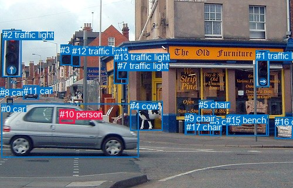
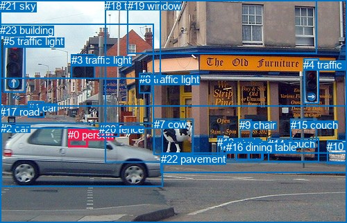

# 图片 1505：2386156.jpg

随机样本序号：75。图片 SHA256：`ed39786969f33646d5cafcca041df8c684dbdc17359fc7244a833d8738baa8f8`。

红色框表示人，蓝色框表示其他物体。两个模式分别保留自身框编号，可依据位置比较对应对象。

## 自动检测框与输出

人的框编号：`[10]`。状态：`ok`。

### 自动检测全部物体框

| 编号 | 类别 | 是否为人 | 检测分数 | 像素坐标 xyxy |
|---|---|---|---|---|
| 0 | car | False | 0.9994 | 2.3, 177.9, 236.9, 269.3 |
| 1 | traffic light | False | 0.9953 | 436.6, 86.9, 459.5, 148.6 |
| 2 | traffic light | False | 0.9919 | 5.0, 51.4, 36.6, 131.8 |
| 3 | traffic light | False | 0.9820 | 103.3, 76.9, 122.3, 112.0 |
| 4 | cow | False | 0.9756 | 222.1, 173.4, 277.3, 223.1 |
| 5 | chair | False | 0.9532 | 339.1, 171.4, 364.0, 231.1 |
| 6 | chair | False | 0.9507 | 358.0, 200.3, 377.5, 232.6 |
| 7 | traffic light | False | 0.9461 | 200.8, 104.3, 218.4, 136.0 |
| 8 | car | False | 0.9361 | 0.1, 150.0, 7.0, 166.1 |
| 9 | chair | False | 0.9294 | 315.2, 194.3, 334.8, 230.3 |
| 10 | person | True | 0.9273 | 101.6, 187.1, 127.7, 211.9 |
| 11 | car | False | 0.8941 | 39.7, 146.8, 66.4, 170.5 |
| 12 | traffic light | False | 0.8811 | 122.9, 79.0, 136.4, 113.8 |
| 13 | traffic light | False | 0.8312 | 194.6, 89.0, 218.0, 144.0 |
| 14 | couch | False | 0.5989 | 387.8, 196.1, 458.6, 232.6 |
| 15 | bench | False | 0.5921 | 386.4, 197.4, 455.4, 232.6 |
| 16 | chair | False | 0.5352 | 469.1, 200.3, 500.0, 237.5 |
| 17 | chair | False | 0.4007 | 317.6, 209.1, 334.1, 230.1 |

### 自动检测 Top50 人相关候选

评分物体对：306；人相关物体对：34；输出关系：50。

| 排名 | 主语编号与类别 | 关系 | 宾语编号与类别 | 类型 | 人与人 | 排序分数 | 原始融合 logit |
|---|---|---|---|---|---|---|---|
| 1 | #10 person | driving on | #0 car | semantic | False | 0.99195 | 4.8146 |
| 2 | #10 person | in | #0 car | spatial | False | 0.95580 | 3.0738 |
| 3 | #0 car | driving | #10 person | semantic | False | 0.54590 | 0.1841 |
| 4 | #10 person | looking at | #4 cow | semantic | False | 0.50566 | 0.0226 |
| 5 | #0 car | in | #10 person | spatial | False | 0.46467 | -0.1416 |
| 6 | #10 person | beside | #4 cow | spatial | False | 0.08664 | -2.3554 |
| 7 | #10 person | on | #11 car | spatial | False | 0.03020 | -3.4694 |
| 8 | #10 person | on | #5 chair | spatial | False | 0.01880 | -3.9549 |
| 9 | #10 person | walking on | #11 car | semantic | False | 0.01706 | -4.0540 |
| 10 | #10 person | walking on | #8 car | semantic | False | 0.00759 | -4.8728 |
| 11 | #10 person | walking on | #5 chair | semantic | False | 0.00726 | -4.9180 |
| 12 | #10 person | walking on | #15 bench | semantic | False | 0.00645 | -5.0365 |
| 13 | #10 person | walking on | #14 couch | semantic | False | 0.00588 | -5.1303 |
| 14 | #5 chair | in | #10 person | spatial | False | 0.00565 | -5.1700 |
| 15 | #10 person | looking at | #13 traffic light | semantic | False | 0.00536 | -5.2228 |
| 16 | #10 person | looking at | #12 traffic light | semantic | False | 0.00533 | -5.2287 |
| 17 | #11 car | driving | #10 person | semantic | False | 0.00473 | -5.3481 |
| 18 | #10 person | looking at | #3 traffic light | semantic | False | 0.00452 | -5.3941 |
| 19 | #10 person | looking at | #1 traffic light | semantic | False | 0.00431 | -5.4430 |
| 20 | #10 person | looking at | #7 traffic light | semantic | False | 0.00382 | -5.5629 |
| 21 | #10 person | walking on | #16 chair | semantic | False | 0.00368 | -5.6019 |
| 22 | #10 person | in | #13 traffic light | spatial | False | 0.00325 | -5.7262 |
| 23 | #10 person | sitting on | #17 chair | semantic | False | 0.00317 | -5.7494 |
| 24 | #10 person | on | #9 chair | spatial | False | 0.00292 | -5.8322 |
| 25 | #6 chair | in | #10 person | spatial | False | 0.00283 | -5.8630 |
| 26 | #10 person | in | #15 bench | spatial | False | 0.00282 | -5.8674 |
| 27 | #4 cow | walking on | #10 person | semantic | False | 0.00275 | -5.8916 |
| 28 | #10 person | in | #14 couch | spatial | False | 0.00269 | -5.9173 |
| 29 | #10 person | in | #2 traffic light | spatial | False | 0.00244 | -6.0125 |
| 30 | #17 chair | in | #10 person | spatial | False | 0.00233 | -6.0581 |
| 31 | #10 person | walking on | #6 chair | semantic | False | 0.00224 | -6.0971 |
| 32 | #10 person | looking at | #2 traffic light | semantic | False | 0.00218 | -6.1245 |
| 33 | #16 chair | in | #10 person | spatial | False | 0.00217 | -6.1326 |
| 34 | #10 person | in | #17 chair | spatial | False | 0.00203 | -6.1995 |
| 35 | #10 person | in | #7 traffic light | spatial | False | 0.00197 | -6.2260 |
| 36 | #10 person | in | #16 chair | spatial | False | 0.00193 | -6.2485 |
| 37 | #11 car | on | #10 person | spatial | False | 0.00187 | -6.2799 |
| 38 | #3 traffic light | over | #10 person | spatial | False | 0.00186 | -6.2871 |
| 39 | #10 person | walking on | #9 chair | semantic | False | 0.00183 | -6.2999 |
| 40 | #9 chair | in | #10 person | spatial | False | 0.00178 | -6.3299 |
| 41 | #8 car | on | #10 person | spatial | False | 0.00177 | -6.3338 |
| 42 | #10 person | in | #8 car | spatial | False | 0.00163 | -6.4186 |
| 43 | #10 person | in | #12 traffic light | spatial | False | 0.00162 | -6.4225 |
| 44 | #12 traffic light | over | #10 person | spatial | False | 0.00162 | -6.4233 |
| 45 | #1 traffic light | in | #10 person | spatial | False | 0.00143 | -6.5506 |
| 46 | #10 person | in | #3 traffic light | spatial | False | 0.00135 | -6.6090 |
| 47 | #3 traffic light | guiding | #10 person | semantic | False | 0.00128 | -6.6617 |
| 48 | #15 bench | in | #10 person | spatial | False | 0.00127 | -6.6660 |
| 49 | #2 traffic light | guiding | #10 person | semantic | False | 0.00125 | -6.6798 |
| 50 | #14 couch | in | #10 person | spatial | False | 0.00125 | -6.6801 |

### 自动检测逐条人相关 GT 核验

R@50：50.00%；命中 1/2。

| GT 主语编号 | GT 关系 | GT 宾语编号 | 结果阶段 | 匹配预测主语编号 | 匹配预测宾语编号 |
|---|---|---|---|---|---|
| 0 | in | 2 | hit50 | [10] | [0] |
| 0 | driving | 2 | wrong_predicate | [10] | [0] |

## 真实框与输出

人的框编号：`[0]`。

### 真实框全部物体框

| 编号 | 类别 | 是否为人 | 检测分数 | 像素坐标 xyxy |
|---|---|---|---|---|
| 0 | person | True | GT | 98.0, 186.0, 126.0, 213.0 |
| 1 | car | False | GT | 41.0, 147.0, 64.0, 170.0 |
| 2 | car | False | GT | 1.0, 177.0, 235.0, 269.0 |
| 3 | traffic light | False | GT | 103.0, 78.0, 137.0, 113.0 |
| 4 | traffic light | False | GT | 437.0, 85.0, 459.0, 150.0 |
| 5 | traffic light | False | GT | 5.0, 51.0, 36.0, 133.0 |
| 6 | traffic light | False | GT | 201.0, 106.0, 218.0, 135.0 |
| 7 | cow | False | GT | 222.0, 171.0, 278.0, 223.0 |
| 8 | chair | False | GT | 358.0, 201.0, 377.0, 231.0 |
| 9 | chair | False | GT | 345.0, 172.0, 362.0, 203.0 |
| 10 | chair | False | GT | 471.0, 203.0, 500.0, 237.0 |
| 11 | chair | False | GT | 318.0, 202.0, 341.0, 230.0 |
| 12 | chair | False | GT | 313.0, 197.0, 321.0, 229.0 |
| 13 | chair | False | GT | 340.0, 201.0, 358.0, 232.0 |
| 14 | couch | False | GT | 386.0, 199.0, 459.0, 233.0 |
| 15 | couch | False | GT | 419.0, 172.0, 457.0, 204.0 |
| 16 | dining table | False | GT | 326.0, 204.0, 380.0, 231.0 |
| 17 | road | False | GT | 0.0, 153.0, 500.0, 322.0 |
| 18 | tent | False | GT | 151.0, 0.0, 500.0, 235.0 |
| 19 | window | False | GT | 184.0, 0.0, 457.0, 77.0 |
| 20 | fence | False | GT | 143.0, 178.0, 171.0, 197.0 |
| 21 | sky | False | GT | 0.0, 0.0, 231.0, 114.0 |
| 22 | pavement | False | GT | 232.0, 221.0, 500.0, 250.0 |
| 23 | building | False | GT | 0.0, 35.0, 221.0, 185.0 |

### 真实框 Top50 人相关候选

评分物体对：552；人相关物体对：46；输出关系：50。

| 排名 | 主语编号与类别 | 关系 | 宾语编号与类别 | 类型 | 人与人 | 排序分数 | 原始融合 logit |
|---|---|---|---|---|---|---|---|
| 1 | #0 person | driving on | #2 car | semantic | False | 0.98796 | 4.4078 |
| 2 | #0 person | in | #2 car | spatial | False | 0.96234 | 3.2409 |
| 3 | #2 car | in | #0 person | spatial | False | 0.52970 | 0.1190 |
| 4 | #2 car | wearing | #0 person | semantic | False | 0.13967 | -1.8181 |
| 5 | #0 person | looking at | #7 cow | semantic | False | 0.08569 | -2.3674 |
| 6 | #0 person | walking on | #17 road | semantic | False | 0.08113 | -2.4271 |
| 7 | #0 person | in | #17 road | spatial | False | 0.06711 | -2.6320 |
| 8 | #0 person | on | #7 cow | spatial | False | 0.06246 | -2.7088 |
| 9 | #0 person | on | #20 fence | spatial | False | 0.04158 | -3.1378 |
| 10 | #0 person | on | #1 car | spatial | False | 0.02561 | -3.6388 |
| 11 | #0 person | on | #15 couch | spatial | False | 0.01432 | -4.2316 |
| 12 | #20 fence | beside | #0 person | spatial | False | 0.01010 | -4.5852 |
| 13 | #0 person | on | #9 chair | spatial | False | 0.00870 | -4.7357 |
| 14 | #0 person | on | #10 chair | spatial | False | 0.00830 | -4.7833 |
| 15 | #0 person | holding | #20 fence | semantic | False | 0.00749 | -4.8867 |
| 16 | #7 cow | in | #0 person | spatial | False | 0.00699 | -4.9568 |
| 17 | #0 person | on | #23 building | spatial | False | 0.00691 | -4.9679 |
| 18 | #0 person | on | #19 window | spatial | False | 0.00680 | -4.9844 |
| 19 | #9 chair | in | #0 person | spatial | False | 0.00551 | -5.1965 |
| 20 | #0 person | on | #14 couch | spatial | False | 0.00489 | -5.3149 |
| 21 | #17 road | in | #0 person | spatial | False | 0.00473 | -5.3495 |
| 22 | #0 person | on | #18 tent | spatial | False | 0.00468 | -5.3594 |
| 23 | #4 traffic light | on | #0 person | spatial | False | 0.00460 | -5.3771 |
| 24 | #3 traffic light | over | #0 person | spatial | False | 0.00455 | -5.3883 |
| 25 | #0 person | on | #5 traffic light | spatial | False | 0.00425 | -5.4575 |
| 26 | #15 couch | in | #0 person | spatial | False | 0.00417 | -5.4748 |
| 27 | #10 chair | in | #0 person | spatial | False | 0.00383 | -5.5611 |
| 28 | #13 chair | in | #0 person | spatial | False | 0.00380 | -5.5696 |
| 29 | #8 chair | in | #0 person | spatial | False | 0.00372 | -5.5900 |
| 30 | #0 person | on | #13 chair | spatial | False | 0.00356 | -5.6356 |
| 31 | #0 person | on | #16 dining table | spatial | False | 0.00352 | -5.6465 |
| 32 | #0 person | walking on | #22 pavement | semantic | False | 0.00349 | -5.6534 |
| 33 | #0 person | on | #8 chair | spatial | False | 0.00348 | -5.6559 |
| 34 | #0 person | sitting on | #15 couch | semantic | False | 0.00339 | -5.6826 |
| 35 | #20 fence | holding | #0 person | semantic | False | 0.00321 | -5.7383 |
| 36 | #1 car | on | #0 person | spatial | False | 0.00319 | -5.7455 |
| 37 | #0 person | on | #11 chair | spatial | False | 0.00310 | -5.7748 |
| 38 | #14 couch | in | #0 person | spatial | False | 0.00295 | -5.8242 |
| 39 | #0 person | looking at | #4 traffic light | semantic | False | 0.00293 | -5.8305 |
| 40 | #0 person | in | #3 traffic light | spatial | False | 0.00278 | -5.8843 |
| 41 | #11 chair | in | #0 person | spatial | False | 0.00276 | -5.8898 |
| 42 | #0 person | on | #4 traffic light | spatial | False | 0.00275 | -5.8947 |
| 43 | #16 dining table | in | #0 person | spatial | False | 0.00274 | -5.8971 |
| 44 | #0 person | in | #6 traffic light | spatial | False | 0.00270 | -5.9123 |
| 45 | #0 person | standing on | #1 car | semantic | False | 0.00266 | -5.9275 |
| 46 | #6 traffic light | over | #0 person | spatial | False | 0.00248 | -5.9961 |
| 47 | #12 chair | on | #0 person | spatial | False | 0.00243 | -6.0179 |
| 48 | #0 person | looking at | #23 building | semantic | False | 0.00240 | -6.0282 |
| 49 | #0 person | on | #22 pavement | spatial | False | 0.00231 | -6.0690 |
| 50 | #0 person | on | #12 chair | spatial | False | 0.00209 | -6.1689 |

### 真实框逐条人相关 GT 核验

R@50：50.00%；命中 1/2。

| GT 主语编号 | GT 关系 | GT 宾语编号 | 结果阶段 | 匹配预测主语编号 | 匹配预测宾语编号 |
|---|---|---|---|---|---|
| 0 | in | 2 | hit50 | [0] | [2] |
| 0 | driving | 2 | wrong_predicate | [0] | [2] |

## 全部人相关 GT

| 主语编号与类别 | 关系 | 宾语编号与类别 |
|---|---|---|
| #0 person | in | #2 car |
| #0 person | driving | #2 car |

原始记录、全部人相关物体对的两项预测与分项分数见 [逐图证据 JSON](../evidence/cases/1505.json)。全部56类 logits 保留于本机 HOR/output/random500/logits/。

<!-- HOR_COMPLETE_RESULTS -->

## 六组条件的完整输出对照

以下保留同一图片三种框与候选模式、两种谓词输出规则的全部 Top50。框编号各自在所属模式内解释。

### 自动检测框完整枚举：空间与语义各保留一个谓词

| 排名 | 主语编号与类别 | 谓词 | 宾语编号与类别 | 分组 | 排序分数 | predicate logit | pair logit |
|---|---|---|---|---|---|---|---|
| 1 | #10 person | driving on | #0 car | semantic | 0.9919550 | 4.5666232 | 0.2480032 |
| 2 | #10 person | in | #0 car | spatial | 0.9557976 | 2.8257627 | 0.2480032 |
| 3 | #0 car | driving | #10 person | semantic | 0.5458974 | 0.6890588 | -0.5049509 |
| 4 | #10 person | looking at | #4 cow | semantic | 0.5056610 | 1.0778584 | -1.0552133 |
| 5 | #0 car | in | #10 person | spatial | 0.4646664 | 0.3633804 | -0.5049509 |
| 6 | #10 person | beside | #4 cow | spatial | 0.0866404 | -1.3001506 | -1.0552133 |
| 7 | #10 person | on | #11 car | spatial | 0.0301957 | -2.3416181 | -1.1277767 |
| 8 | #10 person | on | #5 chair | spatial | 0.0187995 | -2.1542215 | -1.8007228 |
| 9 | #10 person | walking on | #11 car | semantic | 0.0170566 | -2.9262357 | -1.1277767 |
| 10 | #10 person | walking on | #8 car | semantic | 0.0075941 | -3.1061525 | -1.7666116 |
| 11 | #10 person | walking on | #5 chair | semantic | 0.0072607 | -3.1172643 | -1.8007228 |
| 12 | #10 person | walking on | #15 bench | semantic | 0.0064545 | -3.0691621 | -1.9673392 |
| 13 | #10 person | walking on | #14 couch | semantic | 0.0058800 | -3.1473973 | -1.9829015 |
| 14 | #5 chair | in | #10 person | spatial | 0.0056525 | -3.2250166 | -1.9449766 |
| 15 | #10 person | looking at | #13 traffic light | semantic | 0.0053634 | -3.3594663 | -1.8633124 |
| 16 | #10 person | looking at | #12 traffic light | semantic | 0.0053322 | -3.7623549 | -1.4662980 |
| 17 | #11 car | driving | #10 person | semantic | 0.0047346 | -3.7831142 | -1.5649985 |
| 18 | #10 person | looking at | #3 traffic light | semantic | 0.0045229 | -3.8685322 | -1.5255384 |
| 19 | #10 person | looking at | #1 traffic light | semantic | 0.0043079 | -3.6142135 | -1.8287768 |
| 20 | #10 person | looking at | #7 traffic light | semantic | 0.0038228 | -3.6018319 | -1.9611034 |
| 21 | #10 person | walking on | #16 chair | semantic | 0.0036772 | -3.7206154 | -1.8813026 |
| 22 | #10 person | in | #13 traffic light | spatial | 0.0032488 | -3.8629024 | -1.8633124 |
| 23 | #10 person | sitting on | #17 chair | semantic | 0.0031747 | -3.4759731 | -2.2733774 |
| 24 | #10 person | on | #9 chair | spatial | 0.0029229 | -3.5918095 | -2.2404277 |
| 25 | #6 chair | in | #10 person | spatial | 0.0028346 | -3.8642278 | -1.9987853 |
| 26 | #10 person | in | #15 bench | spatial | 0.0028222 | -3.9000814 | -1.9673392 |
| 27 | #4 cow | walking on | #10 person | semantic | 0.0027550 | -4.2503066 | -1.6412759 |
| 28 | #10 person | in | #14 couch | spatial | 0.0026853 | -3.9343765 | -1.9829015 |
| 29 | #10 person | in | #2 traffic light | spatial | 0.0024419 | -4.7746572 | -1.2378608 |
| 30 | #17 chair | in | #10 person | spatial | 0.0023334 | -3.7898798 | -2.2682006 |
| 31 | #10 person | walking on | #6 chair | semantic | 0.0022443 | -3.8285847 | -2.2685087 |
| 32 | #10 person | looking at | #2 traffic light | semantic | 0.0021839 | -4.8866067 | -1.2378608 |
| 33 | #16 chair | in | #10 person | spatial | 0.0021661 | -4.2035332 | -1.9291078 |
| 34 | #10 person | in | #17 chair | spatial | 0.0020264 | -3.9260747 | -2.2733774 |
| 35 | #10 person | in | #7 traffic light | spatial | 0.0019734 | -4.2649350 | -1.9611034 |
| 36 | #10 person | in | #16 chair | spatial | 0.0019297 | -4.3671584 | -1.8813026 |
| 37 | #11 car | on | #10 person | spatial | 0.0018700 | -4.7149458 | -1.5649985 |
| 38 | #3 traffic light | over | #10 person | spatial | 0.0018566 | -4.3282156 | -1.9589303 |
| 39 | #10 person | walking on | #9 chair | semantic | 0.0018331 | -4.0595059 | -2.2404277 |
| 40 | #9 chair | in | #10 person | spatial | 0.0017790 | -4.0189991 | -2.3109097 |
| 41 | #8 car | on | #10 person | spatial | 0.0017721 | -4.1215348 | -2.2122722 |
| 42 | #10 person | in | #8 car | spatial | 0.0016282 | -4.6520200 | -1.7666116 |
| 43 | #10 person | in | #12 traffic light | spatial | 0.0016219 | -4.9562359 | -1.4662980 |
| 44 | #12 traffic light | over | #10 person | spatial | 0.0016207 | -4.4281530 | -1.9951088 |
| 45 | #1 traffic light | in | #10 person | spatial | 0.0014272 | -4.6371956 | -1.9134241 |
| 46 | #10 person | in | #3 traffic light | spatial | 0.0013464 | -5.0834608 | -1.5255384 |
| 47 | #3 traffic light | guiding | #10 person | semantic | 0.0012774 | -4.7027426 | -1.9589303 |
| 48 | #15 bench | in | #10 person | spatial | 0.0012719 | -4.7154717 | -1.9504817 |
| 49 | #2 traffic light | guiding | #10 person | semantic | 0.0012544 | -4.7479863 | -1.9318395 |
| 50 | #14 couch | in | #10 person | spatial | 0.0012540 | -4.7338362 | -1.9462873 |

GT 命中：1/2，R@50=50.00%。

| GT主语 | GT谓词 | GT宾语 | 结果阶段 | 匹配主语框 | 匹配宾语框 |
|---|---|---|---|---|---|
| 0 | in | 2 | hit50 | [10] | [0] |
| 0 | driving | 2 | wrong_predicate | [10] | [0] |

### 自动检测框完整枚举：每对只保留一个谓词

| 排名 | 主语编号与类别 | 谓词 | 宾语编号与类别 | 分组 | 排序分数 | predicate logit | pair logit |
|---|---|---|---|---|---|---|---|
| 1 | #10 person | driving on | #0 car | single | 0.9919550 | 4.5666232 | 0.2480032 |
| 2 | #0 car | driving | #10 person | single | 0.5458974 | 0.6890588 | -0.5049509 |
| 3 | #10 person | looking at | #4 cow | single | 0.5056610 | 1.0778584 | -1.0552133 |
| 4 | #10 person | on | #11 car | single | 0.0301957 | -2.3416181 | -1.1277767 |
| 5 | #10 person | on | #5 chair | single | 0.0187995 | -2.1542215 | -1.8007228 |
| 6 | #10 person | walking on | #8 car | single | 0.0075941 | -3.1061525 | -1.7666116 |
| 7 | #10 person | walking on | #15 bench | single | 0.0064545 | -3.0691621 | -1.9673392 |
| 8 | #10 person | walking on | #14 couch | single | 0.0058800 | -3.1473973 | -1.9829015 |
| 9 | #5 chair | in | #10 person | single | 0.0056525 | -3.2250166 | -1.9449766 |
| 10 | #10 person | looking at | #13 traffic light | single | 0.0053634 | -3.3594663 | -1.8633124 |
| 11 | #10 person | looking at | #12 traffic light | single | 0.0053322 | -3.7623549 | -1.4662980 |
| 12 | #11 car | driving | #10 person | single | 0.0047346 | -3.7831142 | -1.5649985 |
| 13 | #10 person | looking at | #3 traffic light | single | 0.0045229 | -3.8685322 | -1.5255384 |
| 14 | #10 person | looking at | #1 traffic light | single | 0.0043079 | -3.6142135 | -1.8287768 |
| 15 | #10 person | looking at | #7 traffic light | single | 0.0038228 | -3.6018319 | -1.9611034 |
| 16 | #10 person | walking on | #16 chair | single | 0.0036772 | -3.7206154 | -1.8813026 |
| 17 | #10 person | sitting on | #17 chair | single | 0.0031747 | -3.4759731 | -2.2733774 |
| 18 | #10 person | on | #9 chair | single | 0.0029229 | -3.5918095 | -2.2404277 |
| 19 | #6 chair | in | #10 person | single | 0.0028346 | -3.8642278 | -1.9987853 |
| 20 | #4 cow | walking on | #10 person | single | 0.0027550 | -4.2503066 | -1.6412759 |
| 21 | #10 person | in | #2 traffic light | single | 0.0024419 | -4.7746572 | -1.2378608 |
| 22 | #17 chair | in | #10 person | single | 0.0023334 | -3.7898798 | -2.2682006 |
| 23 | #10 person | walking on | #6 chair | single | 0.0022443 | -3.8285847 | -2.2685087 |
| 24 | #16 chair | in | #10 person | single | 0.0021661 | -4.2035332 | -1.9291078 |
| 25 | #3 traffic light | over | #10 person | single | 0.0018566 | -4.3282156 | -1.9589303 |
| 26 | #9 chair | in | #10 person | single | 0.0017790 | -4.0189991 | -2.3109097 |
| 27 | #8 car | on | #10 person | single | 0.0017721 | -4.1215348 | -2.2122722 |
| 28 | #12 traffic light | over | #10 person | single | 0.0016207 | -4.4281530 | -1.9951088 |
| 29 | #1 traffic light | in | #10 person | single | 0.0014272 | -4.6371956 | -1.9134241 |
| 30 | #15 bench | in | #10 person | single | 0.0012719 | -4.7154717 | -1.9504817 |
| 31 | #2 traffic light | guiding | #10 person | single | 0.0012544 | -4.7479863 | -1.9318395 |
| 32 | #14 couch | in | #10 person | single | 0.0012540 | -4.7338362 | -1.9462873 |
| 33 | #13 traffic light | over | #10 person | single | 0.0007773 | -4.9409795 | -2.2179036 |
| 34 | #7 traffic light | over | #10 person | single | 0.0006955 | -5.0139260 | -2.2561984 |

GT 命中：0/2，R@50=0.00%。

| GT主语 | GT谓词 | GT宾语 | 结果阶段 | 匹配主语框 | 匹配宾语框 |
|---|---|---|---|---|---|
| 0 | in | 2 | wrong_predicate | [10] | [0] |
| 0 | driving | 2 | wrong_predicate | [10] | [0] |

### 真实框完整枚举：空间与语义各保留一个谓词

| 排名 | 主语编号与类别 | 谓词 | 宾语编号与类别 | 分组 | 排序分数 | predicate logit | pair logit |
|---|---|---|---|---|---|---|---|
| 1 | #0 person | driving on | #2 car | semantic | 0.9879644 | 4.1462140 | 0.2615628 |
| 2 | #0 person | in | #2 car | spatial | 0.9623440 | 2.9793158 | 0.2615628 |
| 3 | #2 car | in | #0 person | spatial | 0.5297036 | 0.5901470 | -0.4711927 |
| 4 | #2 car | wearing | #0 person | semantic | 0.1396659 | -1.3468747 | -0.4711927 |
| 5 | #0 person | looking at | #7 cow | semantic | 0.0856897 | -1.3144834 | -1.0529537 |
| 6 | #0 person | walking on | #17 road | semantic | 0.0811292 | -0.5505047 | -1.8765975 |
| 7 | #0 person | in | #17 road | spatial | 0.0671080 | -0.7553892 | -1.8765975 |
| 8 | #0 person | on | #7 cow | spatial | 0.0624564 | -1.6558404 | -1.0529537 |
| 9 | #0 person | on | #20 fence | spatial | 0.0415766 | -1.7646277 | -1.3731254 |
| 10 | #0 person | on | #1 car | spatial | 0.0256103 | -2.5221224 | -1.1166949 |
| 11 | #0 person | on | #15 couch | spatial | 0.0143214 | -2.8676791 | -1.3638984 |
| 12 | #20 fence | beside | #0 person | spatial | 0.0100986 | -3.0564117 | -1.5287956 |
| 13 | #0 person | on | #9 chair | spatial | 0.0086996 | -2.9351020 | -1.8006390 |
| 14 | #0 person | on | #10 chair | spatial | 0.0082987 | -2.8801470 | -1.9031711 |
| 15 | #0 person | holding | #20 fence | semantic | 0.0074895 | -3.5136101 | -1.3731254 |
| 16 | #7 cow | in | #0 person | spatial | 0.0069859 | -3.3252563 | -1.6315895 |
| 17 | #0 person | on | #23 building | spatial | 0.0069100 | -3.4880543 | -1.4797971 |
| 18 | #0 person | on | #19 window | spatial | 0.0067973 | -3.1388483 | -1.8455607 |
| 19 | #9 chair | in | #0 person | spatial | 0.0055057 | -3.0139933 | -2.1824596 |
| 20 | #0 person | on | #14 couch | spatial | 0.0048939 | -3.3506451 | -1.9642233 |
| 21 | #17 road | in | #0 person | spatial | 0.0047283 | -3.4508171 | -1.8986404 |
| 22 | #0 person | on | #18 tent | spatial | 0.0046819 | -3.5294695 | -1.8298938 |
| 23 | #4 traffic light | on | #0 person | spatial | 0.0046000 | -3.5167263 | -1.8603606 |
| 24 | #3 traffic light | over | #0 person | spatial | 0.0045491 | -3.4791102 | -1.9091616 |
| 25 | #0 person | on | #5 traffic light | spatial | 0.0042461 | -4.2545266 | -1.2029831 |
| 26 | #15 couch | in | #0 person | spatial | 0.0041734 | -3.8251872 | -1.6496508 |
| 27 | #10 chair | in | #0 person | spatial | 0.0038297 | -3.6259413 | -1.9351808 |
| 28 | #13 chair | in | #0 person | spatial | 0.0037974 | -3.5775919 | -1.9920335 |
| 29 | #8 chair | in | #0 person | spatial | 0.0037211 | -3.6059127 | -1.9841063 |
| 30 | #0 person | on | #13 chair | spatial | 0.0035560 | -3.3371778 | -2.2983727 |
| 31 | #0 person | on | #16 dining table | spatial | 0.0035175 | -3.3903372 | -2.2561324 |
| 32 | #0 person | walking on | #22 pavement | semantic | 0.0034935 | -3.3226452 | -2.3307147 |
| 33 | #0 person | on | #8 chair | spatial | 0.0034846 | -3.3728588 | -2.2830400 |
| 34 | #0 person | sitting on | #15 couch | semantic | 0.0033932 | -4.3186889 | -1.3638984 |
| 35 | #20 fence | holding | #0 person | semantic | 0.0032098 | -4.2095261 | -1.5287956 |
| 36 | #1 car | on | #0 person | spatial | 0.0031869 | -4.1975803 | -1.5479310 |
| 37 | #0 person | on | #11 chair | spatial | 0.0030952 | -3.5025349 | -2.2722676 |
| 38 | #14 couch | in | #0 person | spatial | 0.0029464 | -3.8887997 | -1.9354059 |
| 39 | #0 person | looking at | #4 traffic light | semantic | 0.0029280 | -4.0098038 | -1.8207090 |
| 40 | #0 person | in | #3 traffic light | spatial | 0.0027750 | -4.4453664 | -1.4389486 |
| 41 | #11 chair | in | #0 person | spatial | 0.0027598 | -3.7539353 | -2.1359103 |
| 42 | #0 person | on | #4 traffic light | spatial | 0.0027464 | -4.0740075 | -1.8207090 |
| 43 | #16 dining table | in | #0 person | spatial | 0.0027400 | -3.9079328 | -1.9891388 |
| 44 | #0 person | in | #6 traffic light | spatial | 0.0026987 | -3.9389043 | -1.9733694 |
| 45 | #0 person | standing on | #1 car | semantic | 0.0026581 | -4.8107843 | -1.1166949 |
| 46 | #6 traffic light | over | #0 person | spatial | 0.0024823 | -3.7822917 | -2.2137799 |
| 47 | #12 chair | on | #0 person | spatial | 0.0024288 | -3.4777298 | -2.5402045 |
| 48 | #0 person | looking at | #23 building | semantic | 0.0024040 | -4.5484090 | -1.4797971 |
| 49 | #0 person | on | #22 pavement | spatial | 0.0023082 | -3.7382402 | -2.3307147 |
| 50 | #0 person | on | #12 chair | spatial | 0.0020893 | -3.6995618 | -2.4692910 |

GT 命中：1/2，R@50=50.00%。

| GT主语 | GT谓词 | GT宾语 | 结果阶段 | 匹配主语框 | 匹配宾语框 |
|---|---|---|---|---|---|
| 0 | in | 2 | hit50 | [0] | [2] |
| 0 | driving | 2 | wrong_predicate | [0] | [2] |

### 真实框完整枚举：每对只保留一个谓词

| 排名 | 主语编号与类别 | 谓词 | 宾语编号与类别 | 分组 | 排序分数 | predicate logit | pair logit |
|---|---|---|---|---|---|---|---|
| 1 | #0 person | driving on | #2 car | single | 0.9879644 | 4.1462140 | 0.2615628 |
| 2 | #2 car | in | #0 person | single | 0.5297036 | 0.5901470 | -0.4711927 |
| 3 | #0 person | looking at | #7 cow | single | 0.0856897 | -1.3144834 | -1.0529537 |
| 4 | #0 person | walking on | #17 road | single | 0.0811292 | -0.5505047 | -1.8765975 |
| 5 | #0 person | on | #20 fence | single | 0.0415766 | -1.7646277 | -1.3731254 |
| 6 | #0 person | on | #1 car | single | 0.0256103 | -2.5221224 | -1.1166949 |
| 7 | #0 person | on | #15 couch | single | 0.0143214 | -2.8676791 | -1.3638984 |
| 8 | #20 fence | beside | #0 person | single | 0.0100986 | -3.0564117 | -1.5287956 |
| 9 | #0 person | on | #9 chair | single | 0.0086996 | -2.9351020 | -1.8006390 |
| 10 | #0 person | on | #10 chair | single | 0.0082987 | -2.8801470 | -1.9031711 |
| 11 | #7 cow | in | #0 person | single | 0.0069859 | -3.3252563 | -1.6315895 |
| 12 | #0 person | on | #23 building | single | 0.0069100 | -3.4880543 | -1.4797971 |
| 13 | #0 person | on | #19 window | single | 0.0067973 | -3.1388483 | -1.8455607 |
| 14 | #9 chair | in | #0 person | single | 0.0055057 | -3.0139933 | -2.1824596 |
| 15 | #0 person | on | #14 couch | single | 0.0048939 | -3.3506451 | -1.9642233 |
| 16 | #17 road | in | #0 person | single | 0.0047283 | -3.4508171 | -1.8986404 |
| 17 | #0 person | on | #18 tent | single | 0.0046819 | -3.5294695 | -1.8298938 |
| 18 | #4 traffic light | on | #0 person | single | 0.0046000 | -3.5167263 | -1.8603606 |
| 19 | #3 traffic light | over | #0 person | single | 0.0045491 | -3.4791102 | -1.9091616 |
| 20 | #0 person | on | #5 traffic light | single | 0.0042461 | -4.2545266 | -1.2029831 |
| 21 | #15 couch | in | #0 person | single | 0.0041734 | -3.8251872 | -1.6496508 |
| 22 | #10 chair | in | #0 person | single | 0.0038297 | -3.6259413 | -1.9351808 |
| 23 | #13 chair | in | #0 person | single | 0.0037974 | -3.5775919 | -1.9920335 |
| 24 | #8 chair | in | #0 person | single | 0.0037211 | -3.6059127 | -1.9841063 |
| 25 | #0 person | on | #13 chair | single | 0.0035560 | -3.3371778 | -2.2983727 |
| 26 | #0 person | on | #16 dining table | single | 0.0035175 | -3.3903372 | -2.2561324 |
| 27 | #0 person | walking on | #22 pavement | single | 0.0034935 | -3.3226452 | -2.3307147 |
| 28 | #0 person | on | #8 chair | single | 0.0034846 | -3.3728588 | -2.2830400 |
| 29 | #1 car | on | #0 person | single | 0.0031869 | -4.1975803 | -1.5479310 |
| 30 | #0 person | on | #11 chair | single | 0.0030952 | -3.5025349 | -2.2722676 |
| 31 | #14 couch | in | #0 person | single | 0.0029464 | -3.8887997 | -1.9354059 |
| 32 | #0 person | looking at | #4 traffic light | single | 0.0029280 | -4.0098038 | -1.8207090 |
| 33 | #0 person | in | #3 traffic light | single | 0.0027750 | -4.4453664 | -1.4389486 |
| 34 | #11 chair | in | #0 person | single | 0.0027598 | -3.7539353 | -2.1359103 |
| 35 | #16 dining table | in | #0 person | single | 0.0027400 | -3.9079328 | -1.9891388 |
| 36 | #0 person | in | #6 traffic light | single | 0.0026987 | -3.9389043 | -1.9733694 |
| 37 | #6 traffic light | over | #0 person | single | 0.0024823 | -3.7822917 | -2.2137799 |
| 38 | #12 chair | on | #0 person | single | 0.0024288 | -3.4777298 | -2.5402045 |
| 39 | #0 person | on | #12 chair | single | 0.0020893 | -3.6995618 | -2.4692910 |
| 40 | #5 traffic light | over | #0 person | single | 0.0020170 | -4.3429117 | -1.8612005 |
| 41 | #21 sky | over | #0 person | single | 0.0016063 | -4.1489820 | -2.2832303 |
| 42 | #0 person | looking at | #21 sky | single | 0.0009111 | -4.8300653 | -2.1698418 |
| 43 | #22 pavement | in | #0 person | single | 0.0008843 | -4.5094290 | -2.5203466 |
| 44 | #18 tent | in | #0 person | single | 0.0007834 | -4.6727304 | -2.4783130 |
| 45 | #19 window | in | #0 person | single | 0.0005405 | -4.9020329 | -2.6204758 |
| 46 | #23 building | in | #0 person | single | 0.0004698 | -5.4200606 | -2.2425697 |

GT 命中：0/2，R@50=0.00%。

| GT主语 | GT谓词 | GT宾语 | 结果阶段 | 匹配主语框 | 匹配宾语框 |
|---|---|---|---|---|---|
| 0 | in | 2 | wrong_predicate | [0] | [2] |
| 0 | driving | 2 | wrong_predicate | [0] | [2] |

### 真实框400候选：空间与语义各保留一个谓词

| 排名 | 主语编号与类别 | 谓词 | 宾语编号与类别 | 分组 | 排序分数 | predicate logit | pair logit |
|---|---|---|---|---|---|---|---|
| 1 | #0 person | driving on | #2 car | semantic | 0.9879638 | 4.1461692 | 0.2615628 |
| 2 | #0 person | in | #2 car | spatial | 0.9606068 | 2.9324083 | 0.2615628 |
| 3 | #2 car | in | #0 person | spatial | 0.5029660 | 0.4830570 | -0.4711927 |
| 4 | #0 person | walking on | #17 road | semantic | 0.1680376 | 0.2769980 | -1.8765975 |
| 5 | #2 car | wearing | #0 person | semantic | 0.1312032 | -1.4191689 | -0.4711927 |
| 6 | #0 person | in | #17 road | spatial | 0.1122106 | -0.1917596 | -1.8765975 |
| 7 | #0 person | looking at | #7 cow | semantic | 0.0835814 | -1.3416982 | -1.0529537 |
| 8 | #0 person | on | #7 cow | spatial | 0.0623683 | -1.6573465 | -1.0529537 |
| 9 | #0 person | on | #20 fence | spatial | 0.0342167 | -1.9670994 | -1.3731254 |
| 10 | #0 person | on | #1 car | spatial | 0.0245060 | -2.5673318 | -1.1166949 |
| 11 | #0 person | on | #15 couch | spatial | 0.0193612 | -2.5610325 | -1.3638984 |
| 12 | #0 person | on | #9 chair | spatial | 0.0141321 | -2.4444325 | -1.8006390 |
| 13 | #9 chair | on | #0 person | spatial | 0.0108529 | -2.3299468 | -2.1824596 |
| 14 | #0 person | on | #23 building | spatial | 0.0099375 | -3.1216593 | -1.4797971 |
| 15 | #20 fence | on | #0 person | spatial | 0.0093003 | -3.1395721 | -1.5287956 |
| 16 | #0 person | on | #18 tent | spatial | 0.0076267 | -3.0385535 | -1.8298938 |
| 17 | #0 person | on | #14 couch | spatial | 0.0070463 | -2.9839606 | -1.9642233 |
| 18 | #0 person | walking on | #22 pavement | semantic | 0.0070442 | -2.6177690 | -2.3307147 |
| 19 | #7 cow | in | #0 person | spatial | 0.0069909 | -3.3245382 | -1.6315895 |
| 20 | #15 couch | in | #0 person | spatial | 0.0066102 | -3.3628654 | -1.6496508 |
| 21 | #0 person | on | #13 chair | spatial | 0.0065269 | -2.7268963 | -2.2983727 |
| 22 | #0 person | standing on | #20 fence | semantic | 0.0064748 | -3.6602120 | -1.3731254 |
| 23 | #0 person | on | #8 chair | spatial | 0.0062589 | -2.7844286 | -2.2830400 |
| 24 | #17 road | in | #0 person | spatial | 0.0062291 | -3.1736367 | -1.8986404 |
| 25 | #3 traffic light | over | #0 person | spatial | 0.0061912 | -3.1692591 | -1.9091616 |
| 26 | #0 person | on | #16 dining table | spatial | 0.0061733 | -2.8251925 | -2.2561324 |
| 27 | #13 chair | in | #0 person | spatial | 0.0060999 | -3.1013327 | -1.9920335 |
| 28 | #8 chair | in | #0 person | spatial | 0.0060676 | -3.1146076 | -1.9841063 |
| 29 | #0 person | on | #11 chair | spatial | 0.0057305 | -2.8839412 | -2.2722676 |
| 30 | #10 chair | in | #0 person | spatial | 0.0054994 | -3.2624130 | -1.9351808 |
| 31 | #0 person | looking at | #23 building | semantic | 0.0043998 | -3.9419844 | -1.4797971 |
| 32 | #14 couch | in | #0 person | spatial | 0.0043763 | -3.4917498 | -1.9354059 |
| 33 | #16 dining table | in | #0 person | spatial | 0.0042859 | -3.4589975 | -1.9891388 |
| 34 | #11 chair | in | #0 person | spatial | 0.0042804 | -3.3135195 | -2.1359103 |
| 35 | #0 person | sitting on | #15 couch | semantic | 0.0040730 | -4.1354036 | -1.3638984 |
| 36 | #1 car | on | #0 person | spatial | 0.0040592 | -3.9547725 | -1.5479310 |
| 37 | #0 person | on | #22 pavement | spatial | 0.0034047 | -3.3484876 | -2.3307147 |
| 38 | #0 person | in | #3 traffic light | spatial | 0.0031178 | -4.3285427 | -1.4389486 |
| 39 | #20 fence | holding | #0 person | semantic | 0.0030637 | -4.2562776 | -1.5287956 |
| 40 | #0 person | standing on | #1 car | semantic | 0.0026278 | -4.8222756 | -1.1166949 |
| 41 | #5 traffic light | on | #0 person | spatial | 0.0026044 | -4.0867367 | -1.8612005 |
| 42 | #0 person | sitting on | #9 chair | semantic | 0.0023975 | -4.2302847 | -1.8006390 |
| 43 | #17 road | wearing | #0 person | semantic | 0.0023775 | -4.1407037 | -1.8986404 |
| 44 | #0 person | looking at | #21 sky | semantic | 0.0023169 | -3.8953524 | -2.1698418 |
| 45 | #21 sky | over | #0 person | spatial | 0.0021943 | -3.8364866 | -2.2832303 |
| 46 | #0 person | sitting on | #16 dining table | semantic | 0.0021686 | -3.8753896 | -2.2561324 |
| 47 | #7 cow | wearing | #0 person | semantic | 0.0019823 | -4.5899167 | -1.6315895 |
| 48 | #15 couch | wearing | #0 person | semantic | 0.0019778 | -4.5741506 | -1.6496508 |
| 49 | #0 person | looking at | #3 traffic light | semantic | 0.0018646 | -4.8439174 | -1.4389486 |
| 50 | #0 person | sitting on | #13 chair | semantic | 0.0018498 | -3.9924424 | -2.2983727 |

GT 命中：1/2，R@50=50.00%。

| GT主语 | GT谓词 | GT宾语 | 结果阶段 | 匹配主语框 | 匹配宾语框 |
|---|---|---|---|---|---|
| 0 | in | 2 | hit50 | [0] | [2] |
| 0 | driving | 2 | wrong_predicate | [0] | [2] |

### 真实框400候选：每对只保留一个谓词

| 排名 | 主语编号与类别 | 谓词 | 宾语编号与类别 | 分组 | 排序分数 | predicate logit | pair logit |
|---|---|---|---|---|---|---|---|
| 1 | #0 person | driving on | #2 car | single | 0.9879638 | 4.1461692 | 0.2615628 |
| 2 | #2 car | in | #0 person | single | 0.5029660 | 0.4830570 | -0.4711927 |
| 3 | #0 person | walking on | #17 road | single | 0.1680376 | 0.2769980 | -1.8765975 |
| 4 | #0 person | looking at | #7 cow | single | 0.0835814 | -1.3416982 | -1.0529537 |
| 5 | #0 person | on | #20 fence | single | 0.0342167 | -1.9670994 | -1.3731254 |
| 6 | #0 person | on | #1 car | single | 0.0245060 | -2.5673318 | -1.1166949 |
| 7 | #0 person | on | #15 couch | single | 0.0193612 | -2.5610325 | -1.3638984 |
| 8 | #0 person | on | #9 chair | single | 0.0141321 | -2.4444325 | -1.8006390 |
| 9 | #9 chair | on | #0 person | single | 0.0108529 | -2.3299468 | -2.1824596 |
| 10 | #0 person | on | #23 building | single | 0.0099375 | -3.1216593 | -1.4797971 |
| 11 | #20 fence | on | #0 person | single | 0.0093003 | -3.1395721 | -1.5287956 |
| 12 | #0 person | on | #18 tent | single | 0.0076267 | -3.0385535 | -1.8298938 |
| 13 | #0 person | on | #14 couch | single | 0.0070463 | -2.9839606 | -1.9642233 |
| 14 | #0 person | walking on | #22 pavement | single | 0.0070442 | -2.6177690 | -2.3307147 |
| 15 | #7 cow | in | #0 person | single | 0.0069909 | -3.3245382 | -1.6315895 |
| 16 | #15 couch | in | #0 person | single | 0.0066102 | -3.3628654 | -1.6496508 |
| 17 | #0 person | on | #13 chair | single | 0.0065269 | -2.7268963 | -2.2983727 |
| 18 | #0 person | on | #8 chair | single | 0.0062589 | -2.7844286 | -2.2830400 |
| 19 | #17 road | in | #0 person | single | 0.0062291 | -3.1736367 | -1.8986404 |
| 20 | #3 traffic light | over | #0 person | single | 0.0061912 | -3.1692591 | -1.9091616 |
| 21 | #0 person | on | #16 dining table | single | 0.0061733 | -2.8251925 | -2.2561324 |
| 22 | #13 chair | in | #0 person | single | 0.0060999 | -3.1013327 | -1.9920335 |
| 23 | #8 chair | in | #0 person | single | 0.0060676 | -3.1146076 | -1.9841063 |
| 24 | #0 person | on | #11 chair | single | 0.0057305 | -2.8839412 | -2.2722676 |
| 25 | #10 chair | in | #0 person | single | 0.0054994 | -3.2624130 | -1.9351808 |
| 26 | #14 couch | in | #0 person | single | 0.0043763 | -3.4917498 | -1.9354059 |
| 27 | #16 dining table | in | #0 person | single | 0.0042859 | -3.4589975 | -1.9891388 |
| 28 | #11 chair | in | #0 person | single | 0.0042804 | -3.3135195 | -2.1359103 |
| 29 | #1 car | on | #0 person | single | 0.0040592 | -3.9547725 | -1.5479310 |
| 30 | #0 person | in | #3 traffic light | single | 0.0031178 | -4.3285427 | -1.4389486 |
| 31 | #5 traffic light | on | #0 person | single | 0.0026044 | -4.0867367 | -1.8612005 |
| 32 | #0 person | looking at | #21 sky | single | 0.0023169 | -3.8953524 | -2.1698418 |
| 33 | #21 sky | over | #0 person | single | 0.0021943 | -3.8364866 | -2.2832303 |
| 34 | #22 pavement | in | #0 person | single | 0.0011686 | -4.2304220 | -2.5203466 |
| 35 | #18 tent | in | #0 person | single | 0.0009304 | -4.5007024 | -2.4783130 |
| 36 | #23 building | in | #0 person | single | 0.0006296 | -5.1272311 | -2.2425697 |

GT 命中：0/2，R@50=0.00%。

| GT主语 | GT谓词 | GT宾语 | 结果阶段 | 匹配主语框 | 匹配宾语框 |
|---|---|---|---|---|---|
| 0 | in | 2 | wrong_predicate | [0] | [2] |
| 0 | driving | 2 | wrong_predicate | [0] | [2] |
