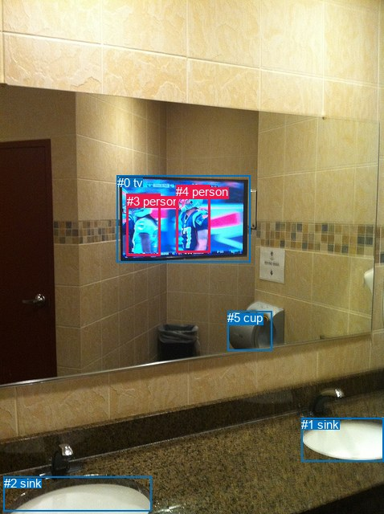
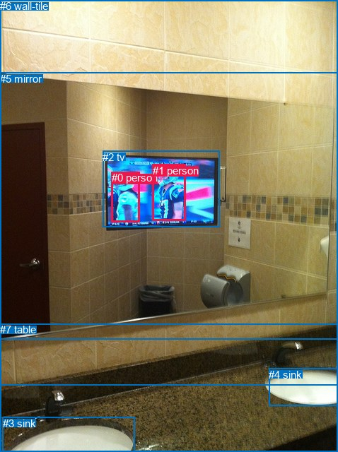

# 图片 1507：2386227.jpg

随机样本序号：51。图片 SHA256：`52b592adcb73170d7d07994a8781e92feddf3c7f1c45173a050c7ecfe12e7743`。

红色框表示人，蓝色框表示其他物体。两个模式分别保留自身框编号，可依据位置比较对应对象。

## 自动检测框与输出

人的框编号：`[3, 4]`。状态：`ok`。

### 自动检测全部物体框

| 编号 | 类别 | 是否为人 | 检测分数 | 像素坐标 xyxy |
|---|---|---|---|---|
| 0 | tv | False | 0.9970 | 145.6, 218.8, 311.1, 326.1 |
| 1 | sink | False | 0.9909 | 375.1, 520.0, 477.2, 574.1 |
| 2 | sink | False | 0.9826 | 4.9, 593.2, 188.5, 636.7 |
| 3 | person | True | 0.8501 | 157.6, 241.8, 199.3, 318.7 |
| 4 | person | True | 0.7473 | 219.2, 230.1, 261.4, 314.8 |
| 5 | cup | False | 0.7154 | 283.2, 387.2, 338.6, 436.0 |

### 自动检测 Top50 人相关候选

评分物体对：30；人相关物体对：18；输出关系：36。

| 排名 | 主语编号与类别 | 关系 | 宾语编号与类别 | 类型 | 人与人 | 排序分数 | 原始融合 logit |
|---|---|---|---|---|---|---|---|
| 1 | #4 person | on | #0 tv | spatial | False | 0.94613 | 2.8657 |
| 2 | #3 person | looking at | #0 tv | semantic | False | 0.92848 | 2.5636 |
| 3 | #3 person | on | #0 tv | spatial | False | 0.92310 | 2.4853 |
| 4 | #4 person | looking at | #0 tv | semantic | False | 0.90436 | 2.2467 |
| 5 | #4 person | beside | #3 person | spatial | True | 0.89042 | 2.0950 |
| 6 | #3 person | beside | #4 person | spatial | True | 0.85097 | 1.7422 |
| 7 | #0 tv | on | #4 person | spatial | False | 0.62770 | 0.5224 |
| 8 | #0 tv | on | #3 person | spatial | False | 0.50354 | 0.0142 |
| 9 | #3 person | looking at | #4 person | semantic | True | 0.36820 | -0.5400 |
| 10 | #4 person | looking at | #3 person | semantic | True | 0.32191 | -0.7450 |
| 11 | #4 person | over | #5 cup | spatial | False | 0.28497 | -0.9199 |
| 12 | #0 tv | wearing | #4 person | semantic | False | 0.23323 | -1.1902 |
| 13 | #5 cup | beside | #4 person | spatial | False | 0.21284 | -1.3079 |
| 14 | #0 tv | wearing | #3 person | semantic | False | 0.14952 | -1.7384 |
| 15 | #5 cup | beside | #3 person | spatial | False | 0.05018 | -2.9406 |
| 16 | #4 person | over | #2 sink | spatial | False | 0.03350 | -3.3621 |
| 17 | #3 person | over | #2 sink | spatial | False | 0.03306 | -3.3757 |
| 18 | #5 cup | looking at | #4 person | semantic | False | 0.01732 | -4.0386 |
| 19 | #2 sink | in | #3 person | spatial | False | 0.01482 | -4.1967 |
| 20 | #4 person | over | #1 sink | spatial | False | 0.01481 | -4.1976 |
| 21 | #3 person | standing on | #2 sink | semantic | False | 0.01348 | -4.2929 |
| 22 | #3 person | over | #5 cup | spatial | False | 0.01129 | -4.4726 |
| 23 | #1 sink | in | #4 person | spatial | False | 0.01086 | -4.5115 |
| 24 | #1 sink | in | #3 person | spatial | False | 0.01004 | -4.5909 |
| 25 | #4 person | holding | #5 cup | semantic | False | 0.00943 | -4.6541 |
| 26 | #2 sink | in | #4 person | spatial | False | 0.00937 | -4.6605 |
| 27 | #4 person | standing on | #2 sink | semantic | False | 0.00911 | -4.6893 |
| 28 | #5 cup | holding | #3 person | semantic | False | 0.00863 | -4.7435 |
| 29 | #3 person | over | #1 sink | spatial | False | 0.00826 | -4.7881 |
| 30 | #2 sink | holding | #3 person | semantic | False | 0.00537 | -5.2218 |
| 31 | #3 person | standing on | #1 sink | semantic | False | 0.00451 | -5.3964 |
| 32 | #4 person | standing on | #1 sink | semantic | False | 0.00449 | -5.4013 |
| 33 | #3 person | sitting on | #5 cup | semantic | False | 0.00355 | -5.6358 |
| 34 | #1 sink | holding | #3 person | semantic | False | 0.00307 | -5.7843 |
| 35 | #1 sink | holding | #4 person | semantic | False | 0.00304 | -5.7926 |
| 36 | #2 sink | holding | #4 person | semantic | False | 0.00304 | -5.7934 |

### 自动检测逐条人相关 GT 核验

R@50：50.00%；命中 1/2。

| GT 主语编号 | GT 关系 | GT 宾语编号 | 结果阶段 | 匹配预测主语编号 | 匹配预测宾语编号 |
|---|---|---|---|---|---|
| 0 | beside | 1 | hit50 | [3] | [4] |
| 1 | in | 2 | wrong_predicate | [4] | [0] |

## 真实框与输出

人的框编号：`[0, 1]`。

### 真实框全部物体框

| 编号 | 类别 | 是否为人 | 检测分数 | 像素坐标 xyxy |
|---|---|---|---|---|
| 0 | person | True | GT | 158.0, 243.0, 198.0, 314.0 |
| 1 | person | True | GT | 216.0, 233.0, 263.0, 313.0 |
| 2 | tv | False | GT | 145.0, 214.0, 311.0, 322.0 |
| 3 | sink | False | GT | 4.0, 591.0, 190.0, 640.0 |
| 4 | sink | False | GT | 380.0, 522.0, 478.0, 575.0 |
| 5 | mirror | False | GT | 0.0, 103.0, 478.0, 480.0 |
| 6 | wall-tile | False | GT | 0.0, 0.0, 478.0, 546.0 |
| 7 | table | False | GT | 0.0, 458.0, 478.0, 640.0 |

### 真实框 Top50 人相关候选

评分物体对：56；人相关物体对：26；输出关系：50。

| 排名 | 主语编号与类别 | 关系 | 宾语编号与类别 | 类型 | 人与人 | 排序分数 | 原始融合 logit |
|---|---|---|---|---|---|---|---|
| 1 | #0 person | on | #2 tv | spatial | False | 0.94262 | 2.7990 |
| 2 | #1 person | on | #2 tv | spatial | False | 0.94058 | 2.7618 |
| 3 | #1 person | in | #5 mirror | spatial | False | 0.93218 | 2.6206 |
| 4 | #0 person | in | #5 mirror | spatial | False | 0.89024 | 2.0932 |
| 5 | #1 person | playing | #2 tv | semantic | False | 0.82912 | 1.5794 |
| 6 | #0 person | looking at | #2 tv | semantic | False | 0.80839 | 1.4396 |
| 7 | #1 person | in | #6 wall-tile | spatial | False | 0.63077 | 0.5355 |
| 8 | #0 person | in | #6 wall-tile | spatial | False | 0.61429 | 0.4654 |
| 9 | #2 tv | on | #1 person | spatial | False | 0.53113 | 0.1247 |
| 10 | #0 person | beside | #1 person | spatial | True | 0.51341 | 0.0536 |
| 11 | #2 tv | on | #0 person | spatial | False | 0.43324 | -0.2686 |
| 12 | #2 tv | wearing | #1 person | semantic | False | 0.39982 | -0.4062 |
| 13 | #0 person | looking at | #5 mirror | semantic | False | 0.31175 | -0.7920 |
| 14 | #1 person | beside | #0 person | spatial | True | 0.30421 | -0.8273 |
| 15 | #2 tv | wearing | #0 person | semantic | False | 0.28089 | -0.9401 |
| 16 | #1 person | looking at | #5 mirror | semantic | False | 0.27188 | -0.9851 |
| 17 | #0 person | playing | #1 person | semantic | True | 0.22042 | -1.2632 |
| 18 | #1 person | playing | #0 person | semantic | True | 0.20850 | -1.3340 |
| 19 | #0 person | looking at | #6 wall-tile | semantic | False | 0.06944 | -2.5953 |
| 20 | #1 person | standing on | #6 wall-tile | semantic | False | 0.05473 | -2.8490 |
| 21 | #5 mirror | on | #1 person | spatial | False | 0.05298 | -2.8833 |
| 22 | #1 person | on | #7 table | spatial | False | 0.04646 | -3.0217 |
| 23 | #0 person | on | #7 table | spatial | False | 0.04520 | -3.0503 |
| 24 | #1 person | standing on | #7 table | semantic | False | 0.03652 | -3.2728 |
| 25 | #5 mirror | on | #0 person | spatial | False | 0.02854 | -3.5274 |
| 26 | #0 person | standing on | #7 table | semantic | False | 0.02848 | -3.5296 |
| 27 | #0 person | over | #3 sink | spatial | False | 0.02553 | -3.6419 |
| 28 | #1 person | over | #3 sink | spatial | False | 0.02295 | -3.7512 |
| 29 | #0 person | standing on | #3 sink | semantic | False | 0.02154 | -3.8161 |
| 30 | #0 person | standing on | #4 sink | semantic | False | 0.01750 | -4.0281 |
| 31 | #5 mirror | looking at | #1 person | semantic | False | 0.01527 | -4.1662 |
| 32 | #1 person | standing on | #3 sink | semantic | False | 0.01432 | -4.2316 |
| 33 | #5 mirror | looking at | #0 person | semantic | False | 0.01394 | -4.2592 |
| 34 | #0 person | in | #4 sink | spatial | False | 0.01137 | -4.4651 |
| 35 | #1 person | standing on | #4 sink | semantic | False | 0.01095 | -4.5032 |
| 36 | #6 wall-tile | on | #1 person | spatial | False | 0.00600 | -5.1105 |
| 37 | #1 person | over | #4 sink | spatial | False | 0.00481 | -5.3322 |
| 38 | #6 wall-tile | on | #0 person | spatial | False | 0.00432 | -5.4395 |
| 39 | #6 wall-tile | looking at | #1 person | semantic | False | 0.00357 | -5.6319 |
| 40 | #3 sink | in | #0 person | spatial | False | 0.00294 | -5.8276 |
| 41 | #4 sink | in | #0 person | spatial | False | 0.00283 | -5.8641 |
| 42 | #4 sink | in | #1 person | spatial | False | 0.00225 | -6.0951 |
| 43 | #3 sink | in | #1 person | spatial | False | 0.00218 | -6.1259 |
| 44 | #6 wall-tile | looking at | #0 person | semantic | False | 0.00199 | -6.2184 |
| 45 | #7 table | beside | #0 person | spatial | False | 0.00132 | -6.6323 |
| 46 | #7 table | beside | #1 person | spatial | False | 0.00099 | -6.9211 |
| 47 | #3 sink | holding | #0 person | semantic | False | 0.00089 | -7.0228 |
| 48 | #4 sink | holding | #0 person | semantic | False | 0.00071 | -7.2559 |
| 49 | #3 sink | holding | #1 person | semantic | False | 0.00055 | -7.5047 |
| 50 | #4 sink | holding | #1 person | semantic | False | 0.00055 | -7.5117 |

### 真实框逐条人相关 GT 核验

R@50：50.00%；命中 1/2。

| GT 主语编号 | GT 关系 | GT 宾语编号 | 结果阶段 | 匹配预测主语编号 | 匹配预测宾语编号 |
|---|---|---|---|---|---|
| 0 | beside | 1 | hit50 | [0] | [1] |
| 1 | in | 2 | wrong_predicate | [1] | [2] |

## 全部人相关 GT

| 主语编号与类别 | 关系 | 宾语编号与类别 |
|---|---|---|
| #0 person | beside | #1 person |
| #1 person | in | #2 tv |

原始记录、全部人相关物体对的两项预测与分项分数见 [逐图证据 JSON](../evidence/cases/1507.json)。全部56类 logits 保留于本机 HOR/output/random500/logits/。

<!-- HOR_COMPLETE_RESULTS -->

## 六组条件的完整输出对照

以下保留同一图片三种框与候选模式、两种谓词输出规则的全部 Top50。框编号各自在所属模式内解释。

### 自动检测框完整枚举：空间与语义各保留一个谓词

| 排名 | 主语编号与类别 | 谓词 | 宾语编号与类别 | 分组 | 排序分数 | predicate logit | pair logit |
|---|---|---|---|---|---|---|---|
| 1 | #4 person | on | #0 tv | spatial | 0.9461265 | 2.6051483 | 0.2605896 |
| 2 | #3 person | looking at | #0 tv | semantic | 0.9284823 | 2.2561889 | 0.3074174 |
| 3 | #3 person | on | #0 tv | spatial | 0.9231023 | 2.1778464 | 0.3074174 |
| 4 | #4 person | looking at | #0 tv | semantic | 0.9043616 | 1.9860654 | 0.2605896 |
| 5 | #4 person | beside | #3 person | spatial | 0.8904152 | 2.3809967 | -0.2860073 |
| 6 | #3 person | beside | #4 person | spatial | 0.8509722 | 2.0826283 | -0.3403822 |
| 7 | #0 tv | on | #4 person | spatial | 0.6277003 | 1.0704660 | -0.5481023 |
| 8 | #0 tv | on | #3 person | spatial | 0.5035402 | 0.5786958 | -0.5645349 |
| 9 | #3 person | looking at | #4 person | semantic | 0.3681985 | -0.1995711 | -0.3403822 |
| 10 | #4 person | looking at | #3 person | semantic | 0.3219111 | -0.4589958 | -0.2860073 |
| 11 | #4 person | over | #5 cup | spatial | 0.2849720 | 0.1108294 | -1.0307603 |
| 12 | #0 tv | wearing | #4 person | semantic | 0.2332302 | -0.6420584 | -0.5481023 |
| 13 | #5 cup | beside | #4 person | spatial | 0.2128412 | -0.1098690 | -1.1980145 |
| 14 | #0 tv | wearing | #3 person | semantic | 0.1495189 | -1.1738443 | -0.5645349 |
| 15 | #5 cup | beside | #3 person | spatial | 0.0501805 | -1.4315352 | -1.5091099 |
| 16 | #4 person | over | #2 sink | spatial | 0.0335017 | -1.8266160 | -1.5354660 |
| 17 | #3 person | over | #2 sink | spatial | 0.0330641 | -2.0819485 | -1.2937362 |
| 18 | #5 cup | looking at | #4 person | semantic | 0.0173164 | -2.8406167 | -1.1980145 |
| 19 | #2 sink | in | #3 person | spatial | 0.0148221 | -2.8119142 | -1.3847854 |
| 20 | #4 person | over | #1 sink | spatial | 0.0148096 | -2.6368794 | -1.5606792 |
| 21 | #3 person | standing on | #2 sink | semantic | 0.0134816 | -2.9991202 | -1.2937362 |
| 22 | #3 person | over | #5 cup | spatial | 0.0112892 | -3.0432305 | -1.4293227 |
| 23 | #1 sink | in | #4 person | spatial | 0.0108627 | -2.8035061 | -1.7079930 |
| 24 | #1 sink | in | #3 person | spatial | 0.0100423 | -3.0179088 | -1.5729514 |
| 25 | #4 person | holding | #5 cup | semantic | 0.0094330 | -3.6233029 | -1.0307603 |
| 26 | #2 sink | in | #4 person | spatial | 0.0093727 | -3.1148200 | -1.5457122 |
| 27 | #4 person | standing on | #2 sink | semantic | 0.0091093 | -3.1538460 | -1.5354660 |
| 28 | #5 cup | holding | #3 person | semantic | 0.0086333 | -3.2343450 | -1.5091099 |
| 29 | #3 person | over | #1 sink | spatial | 0.0082594 | -3.4285660 | -1.3595390 |
| 30 | #2 sink | holding | #3 person | semantic | 0.0053689 | -3.8369682 | -1.3847854 |
| 31 | #3 person | standing on | #1 sink | semantic | 0.0045122 | -4.0369086 | -1.3595390 |
| 32 | #4 person | standing on | #1 sink | semantic | 0.0044907 | -3.8405762 | -1.5606792 |
| 33 | #3 person | sitting on | #5 cup | semantic | 0.0035550 | -4.2065206 | -1.4293227 |
| 34 | #1 sink | holding | #3 person | semantic | 0.0030659 | -4.2113895 | -1.5729514 |
| 35 | #1 sink | holding | #4 person | semantic | 0.0030409 | -4.0845671 | -1.7079930 |
| 36 | #2 sink | holding | #4 person | semantic | 0.0030384 | -4.2476640 | -1.5457122 |

GT 命中：1/2，R@50=50.00%。

| GT主语 | GT谓词 | GT宾语 | 结果阶段 | 匹配主语框 | 匹配宾语框 |
|---|---|---|---|---|---|
| 0 | beside | 1 | hit50 | [3] | [4] |
| 1 | in | 2 | wrong_predicate | [4] | [0] |

### 自动检测框完整枚举：每对只保留一个谓词

| 排名 | 主语编号与类别 | 谓词 | 宾语编号与类别 | 分组 | 排序分数 | predicate logit | pair logit |
|---|---|---|---|---|---|---|---|
| 1 | #4 person | on | #0 tv | single | 0.9461265 | 2.6051483 | 0.2605896 |
| 2 | #3 person | looking at | #0 tv | single | 0.9284823 | 2.2561889 | 0.3074174 |
| 3 | #4 person | beside | #3 person | single | 0.8904152 | 2.3809967 | -0.2860073 |
| 4 | #3 person | beside | #4 person | single | 0.8509722 | 2.0826283 | -0.3403822 |
| 5 | #0 tv | on | #4 person | single | 0.6277003 | 1.0704660 | -0.5481023 |
| 6 | #0 tv | on | #3 person | single | 0.5035402 | 0.5786958 | -0.5645349 |
| 7 | #4 person | over | #5 cup | single | 0.2849720 | 0.1108294 | -1.0307603 |
| 8 | #5 cup | beside | #4 person | single | 0.2128412 | -0.1098690 | -1.1980145 |
| 9 | #5 cup | beside | #3 person | single | 0.0501805 | -1.4315352 | -1.5091099 |
| 10 | #4 person | over | #2 sink | single | 0.0335017 | -1.8266160 | -1.5354660 |
| 11 | #3 person | over | #2 sink | single | 0.0330641 | -2.0819485 | -1.2937362 |
| 12 | #2 sink | in | #3 person | single | 0.0148221 | -2.8119142 | -1.3847854 |
| 13 | #4 person | over | #1 sink | single | 0.0148096 | -2.6368794 | -1.5606792 |
| 14 | #3 person | over | #5 cup | single | 0.0112892 | -3.0432305 | -1.4293227 |
| 15 | #1 sink | in | #4 person | single | 0.0108627 | -2.8035061 | -1.7079930 |
| 16 | #1 sink | in | #3 person | single | 0.0100423 | -3.0179088 | -1.5729514 |
| 17 | #2 sink | in | #4 person | single | 0.0093727 | -3.1148200 | -1.5457122 |
| 18 | #3 person | over | #1 sink | single | 0.0082594 | -3.4285660 | -1.3595390 |

GT 命中：1/2，R@50=50.00%。

| GT主语 | GT谓词 | GT宾语 | 结果阶段 | 匹配主语框 | 匹配宾语框 |
|---|---|---|---|---|---|
| 0 | beside | 1 | hit50 | [3] | [4] |
| 1 | in | 2 | wrong_predicate | [4] | [0] |

### 真实框完整枚举：空间与语义各保留一个谓词

| 排名 | 主语编号与类别 | 谓词 | 宾语编号与类别 | 分组 | 排序分数 | predicate logit | pair logit |
|---|---|---|---|---|---|---|---|
| 1 | #0 person | on | #2 tv | spatial | 0.9426212 | 2.5105596 | 0.2884294 |
| 2 | #1 person | on | #2 tv | spatial | 0.9405791 | 2.5048246 | 0.2570249 |
| 3 | #1 person | in | #5 mirror | spatial | 0.9321786 | 2.7518606 | -0.1312149 |
| 4 | #0 person | in | #5 mirror | spatial | 0.8902423 | 2.1664066 | -0.0731880 |
| 5 | #1 person | playing | #2 tv | semantic | 0.8291156 | 1.3223472 | 0.2570249 |
| 6 | #0 person | looking at | #2 tv | semantic | 0.8083941 | 1.1511798 | 0.2884294 |
| 7 | #1 person | in | #6 wall-tile | spatial | 0.6307737 | 1.2262726 | -0.6907352 |
| 8 | #0 person | in | #6 wall-tile | spatial | 0.6142947 | 1.1519246 | -0.6865233 |
| 9 | #2 tv | on | #1 person | spatial | 0.5311347 | 0.6548944 | -0.5301942 |
| 10 | #0 person | beside | #1 person | spatial | 0.5134063 | 0.4037929 | -0.3501545 |
| 11 | #2 tv | on | #0 person | spatial | 0.4332428 | 0.2940893 | -0.5627220 |
| 12 | #2 tv | wearing | #1 person | semantic | 0.3998212 | 0.1239839 | -0.5301942 |
| 13 | #0 person | looking at | #5 mirror | semantic | 0.3117486 | -0.7187691 | -0.0731880 |
| 14 | #1 person | beside | #0 person | spatial | 0.3042147 | -0.5586720 | -0.2686355 |
| 15 | #2 tv | wearing | #0 person | semantic | 0.2808888 | -0.3773351 | -0.5627220 |
| 16 | #1 person | looking at | #5 mirror | semantic | 0.2718809 | -0.8538857 | -0.1312149 |
| 17 | #0 person | playing | #1 person | semantic | 0.2204151 | -0.9130943 | -0.3501545 |
| 18 | #1 person | playing | #0 person | semantic | 0.2084959 | -1.0653803 | -0.2686355 |
| 19 | #0 person | looking at | #6 wall-tile | semantic | 0.0694421 | -1.9087684 | -0.6865233 |
| 20 | #1 person | standing on | #6 wall-tile | semantic | 0.0547307 | -2.1583090 | -0.6907352 |
| 21 | #5 mirror | on | #1 person | spatial | 0.0529843 | -1.7672203 | -1.1161004 |
| 22 | #1 person | on | #7 table | spatial | 0.0464561 | -1.4580674 | -1.5636103 |
| 23 | #0 person | on | #7 table | spatial | 0.0452030 | -1.3682282 | -1.6821061 |
| 24 | #1 person | standing on | #7 table | semantic | 0.0365167 | -1.7091739 | -1.5636103 |
| 25 | #5 mirror | on | #0 person | spatial | 0.0285428 | -2.3508136 | -1.1765778 |
| 26 | #0 person | standing on | #7 table | semantic | 0.0284817 | -1.8474925 | -1.6821061 |
| 27 | #0 person | over | #3 sink | spatial | 0.0255338 | -2.3342612 | -1.3076255 |
| 28 | #1 person | over | #3 sink | spatial | 0.0229493 | -2.2189968 | -1.5322523 |
| 29 | #0 person | standing on | #3 sink | semantic | 0.0215404 | -2.5084257 | -1.3076255 |
| 30 | #0 person | standing on | #4 sink | semantic | 0.0174959 | -2.6754038 | -1.3527348 |
| 31 | #5 mirror | looking at | #1 person | semantic | 0.0152749 | -3.0500517 | -1.1161004 |
| 32 | #1 person | standing on | #3 sink | semantic | 0.0143205 | -2.6993895 | -1.5322523 |
| 33 | #5 mirror | looking at | #0 person | semantic | 0.0139366 | -3.0826268 | -1.1765778 |
| 34 | #0 person | in | #4 sink | spatial | 0.0113728 | -3.1123614 | -1.3527348 |
| 35 | #1 person | standing on | #4 sink | semantic | 0.0109521 | -2.9517334 | -1.5514783 |
| 36 | #6 wall-tile | on | #1 person | spatial | 0.0059968 | -3.5363622 | -1.5741498 |
| 37 | #1 person | over | #4 sink | spatial | 0.0048100 | -3.7807479 | -1.5514783 |
| 38 | #6 wall-tile | on | #0 person | spatial | 0.0043228 | -3.8303962 | -1.6091189 |
| 39 | #6 wall-tile | looking at | #1 person | semantic | 0.0035691 | -4.0577030 | -1.5741498 |
| 40 | #3 sink | in | #0 person | spatial | 0.0029364 | -4.4497876 | -1.3778596 |
| 41 | #4 sink | in | #0 person | spatial | 0.0028316 | -4.2663670 | -1.5976977 |
| 42 | #4 sink | in | #1 person | spatial | 0.0022487 | -4.3808684 | -1.7142620 |
| 43 | #3 sink | in | #1 person | spatial | 0.0021808 | -4.5861950 | -1.5396965 |
| 44 | #6 wall-tile | looking at | #0 person | semantic | 0.0019884 | -4.6093087 | -1.6091189 |
| 45 | #7 table | beside | #0 person | spatial | 0.0013154 | -5.0222540 | -1.6100596 |
| 46 | #7 table | beside | #1 person | spatial | 0.0009858 | -5.2580805 | -1.6629877 |
| 47 | #3 sink | holding | #0 person | semantic | 0.0008905 | -5.6449785 | -1.3778596 |
| 48 | #4 sink | holding | #0 person | semantic | 0.0007055 | -5.6581697 | -1.5976977 |
| 49 | #3 sink | holding | #1 person | semantic | 0.0005502 | -5.9649887 | -1.5396965 |
| 50 | #4 sink | holding | #1 person | semantic | 0.0005464 | -5.7974262 | -1.7142620 |

GT 命中：1/2，R@50=50.00%。

| GT主语 | GT谓词 | GT宾语 | 结果阶段 | 匹配主语框 | 匹配宾语框 |
|---|---|---|---|---|---|
| 0 | beside | 1 | hit50 | [0] | [1] |
| 1 | in | 2 | wrong_predicate | [1] | [2] |

### 真实框完整枚举：每对只保留一个谓词

| 排名 | 主语编号与类别 | 谓词 | 宾语编号与类别 | 分组 | 排序分数 | predicate logit | pair logit |
|---|---|---|---|---|---|---|---|
| 1 | #0 person | on | #2 tv | single | 0.9426212 | 2.5105596 | 0.2884294 |
| 2 | #1 person | on | #2 tv | single | 0.9405791 | 2.5048246 | 0.2570249 |
| 3 | #1 person | in | #5 mirror | single | 0.9321786 | 2.7518606 | -0.1312149 |
| 4 | #0 person | in | #5 mirror | single | 0.8902423 | 2.1664066 | -0.0731880 |
| 5 | #1 person | in | #6 wall-tile | single | 0.6307737 | 1.2262726 | -0.6907352 |
| 6 | #0 person | in | #6 wall-tile | single | 0.6142947 | 1.1519246 | -0.6865233 |
| 7 | #2 tv | on | #1 person | single | 0.5311347 | 0.6548944 | -0.5301942 |
| 8 | #0 person | beside | #1 person | single | 0.5134063 | 0.4037929 | -0.3501545 |
| 9 | #2 tv | on | #0 person | single | 0.4332428 | 0.2940893 | -0.5627220 |
| 10 | #1 person | beside | #0 person | single | 0.3042147 | -0.5586720 | -0.2686355 |
| 11 | #5 mirror | on | #1 person | single | 0.0529843 | -1.7672203 | -1.1161004 |
| 12 | #1 person | on | #7 table | single | 0.0464561 | -1.4580674 | -1.5636103 |
| 13 | #0 person | on | #7 table | single | 0.0452030 | -1.3682282 | -1.6821061 |
| 14 | #5 mirror | on | #0 person | single | 0.0285428 | -2.3508136 | -1.1765778 |
| 15 | #0 person | over | #3 sink | single | 0.0255338 | -2.3342612 | -1.3076255 |
| 16 | #1 person | over | #3 sink | single | 0.0229493 | -2.2189968 | -1.5322523 |
| 17 | #0 person | standing on | #4 sink | single | 0.0174959 | -2.6754038 | -1.3527348 |
| 18 | #1 person | standing on | #4 sink | single | 0.0109521 | -2.9517334 | -1.5514783 |
| 19 | #6 wall-tile | on | #1 person | single | 0.0059968 | -3.5363622 | -1.5741498 |
| 20 | #6 wall-tile | on | #0 person | single | 0.0043228 | -3.8303962 | -1.6091189 |
| 21 | #3 sink | in | #0 person | single | 0.0029364 | -4.4497876 | -1.3778596 |
| 22 | #4 sink | in | #0 person | single | 0.0028316 | -4.2663670 | -1.5976977 |
| 23 | #4 sink | in | #1 person | single | 0.0022487 | -4.3808684 | -1.7142620 |
| 24 | #3 sink | in | #1 person | single | 0.0021808 | -4.5861950 | -1.5396965 |
| 25 | #7 table | beside | #0 person | single | 0.0013154 | -5.0222540 | -1.6100596 |
| 26 | #7 table | beside | #1 person | single | 0.0009858 | -5.2580805 | -1.6629877 |

GT 命中：1/2，R@50=50.00%。

| GT主语 | GT谓词 | GT宾语 | 结果阶段 | 匹配主语框 | 匹配宾语框 |
|---|---|---|---|---|---|
| 0 | beside | 1 | hit50 | [0] | [1] |
| 1 | in | 2 | wrong_predicate | [1] | [2] |

### 真实框400候选：空间与语义各保留一个谓词

| 排名 | 主语编号与类别 | 谓词 | 宾语编号与类别 | 分组 | 排序分数 | predicate logit | pair logit |
|---|---|---|---|---|---|---|---|
| 1 | #0 person | on | #2 tv | spatial | 0.9420293 | 2.4996696 | 0.2884294 |
| 2 | #1 person | on | #2 tv | spatial | 0.9405791 | 2.5048246 | 0.2570249 |
| 3 | #1 person | in | #5 mirror | spatial | 0.9325970 | 2.7584982 | -0.1312149 |
| 4 | #0 person | in | #5 mirror | spatial | 0.8879296 | 2.1429529 | -0.0731880 |
| 5 | #1 person | playing | #2 tv | semantic | 0.8291156 | 1.3223472 | 0.2570249 |
| 6 | #0 person | looking at | #2 tv | semantic | 0.8083941 | 1.1511798 | 0.2884294 |
| 7 | #1 person | in | #6 wall-tile | spatial | 0.6300004 | 1.2229538 | -0.6907352 |
| 8 | #0 person | in | #6 wall-tile | spatial | 0.6198367 | 1.1753783 | -0.6865233 |
| 9 | #2 tv | on | #1 person | spatial | 0.5311347 | 0.6548944 | -0.5301942 |
| 10 | #0 person | beside | #1 person | spatial | 0.5283886 | 0.4638309 | -0.3501545 |
| 11 | #2 tv | on | #0 person | spatial | 0.4393041 | 0.3187351 | -0.5627220 |
| 12 | #2 tv | wearing | #1 person | semantic | 0.3926226 | 0.0938926 | -0.5301942 |
| 13 | #0 person | looking at | #5 mirror | semantic | 0.3117486 | -0.7187691 | -0.0731880 |
| 14 | #1 person | beside | #0 person | spatial | 0.3042025 | -0.5587296 | -0.2686355 |
| 15 | #2 tv | wearing | #0 person | semantic | 0.2760220 | -0.4015584 | -0.5627220 |
| 16 | #1 person | looking at | #5 mirror | semantic | 0.2689813 | -0.8685825 | -0.1312149 |
| 17 | #0 person | playing | #1 person | semantic | 0.2165190 | -0.9359138 | -0.3501545 |
| 18 | #1 person | playing | #0 person | semantic | 0.2039668 | -1.0930479 | -0.2686355 |
| 19 | #0 person | looking at | #6 wall-tile | semantic | 0.0694195 | -1.9091167 | -0.6865233 |
| 20 | #1 person | standing on | #6 wall-tile | semantic | 0.0547307 | -2.1583090 | -0.6907352 |
| 21 | #5 mirror | on | #1 person | spatial | 0.0528138 | -1.7706232 | -1.1161004 |
| 22 | #1 person | on | #7 table | spatial | 0.0466979 | -1.4526229 | -1.5636103 |
| 23 | #0 person | on | #7 table | spatial | 0.0453207 | -1.3655057 | -1.6821061 |
| 24 | #1 person | standing on | #7 table | semantic | 0.0374577 | -1.6827545 | -1.5636103 |
| 25 | #0 person | standing on | #7 table | semantic | 0.0292740 | -1.8192370 | -1.6821061 |
| 26 | #5 mirror | on | #0 person | spatial | 0.0286942 | -2.3453689 | -1.1765778 |
| 27 | #0 person | over | #3 sink | spatial | 0.0250973 | -2.3519509 | -1.3076255 |
| 28 | #1 person | over | #3 sink | spatial | 0.0228901 | -2.2216406 | -1.5322523 |
| 29 | #0 person | standing on | #3 sink | semantic | 0.0204820 | -2.5598869 | -1.3076255 |
| 30 | #0 person | standing on | #4 sink | semantic | 0.0172781 | -2.6881545 | -1.3527348 |
| 31 | #5 mirror | looking at | #1 person | semantic | 0.0150535 | -3.0648794 | -1.1161004 |
| 32 | #1 person | standing on | #3 sink | semantic | 0.0143351 | -2.6983566 | -1.5322523 |
| 33 | #5 mirror | looking at | #0 person | semantic | 0.0141430 | -3.0677121 | -1.1765778 |
| 34 | #0 person | in | #4 sink | spatial | 0.0113448 | -3.1148505 | -1.3527348 |
| 35 | #1 person | standing on | #4 sink | semantic | 0.0108001 | -2.9658608 | -1.5514783 |
| 36 | #6 wall-tile | on | #1 person | spatial | 0.0059968 | -3.5363622 | -1.5741498 |
| 37 | #1 person | over | #4 sink | spatial | 0.0048100 | -3.7807479 | -1.5514783 |
| 38 | #6 wall-tile | on | #0 person | spatial | 0.0043111 | -3.8331187 | -1.6091189 |
| 39 | #6 wall-tile | looking at | #1 person | semantic | 0.0035685 | -4.0578771 | -1.5741498 |
| 40 | #3 sink | in | #0 person | spatial | 0.0029096 | -4.4589701 | -1.3778596 |
| 41 | #4 sink | in | #0 person | spatial | 0.0027895 | -4.2814126 | -1.5976977 |
| 42 | #4 sink | in | #1 person | spatial | 0.0022413 | -4.3841872 | -1.7142620 |
| 43 | #3 sink | in | #1 person | spatial | 0.0021736 | -4.5895138 | -1.5396965 |
| 44 | #6 wall-tile | looking at | #0 person | semantic | 0.0019833 | -4.6118898 | -1.6091189 |
| 45 | #7 table | beside | #0 person | spatial | 0.0012884 | -5.0429778 | -1.6100596 |
| 46 | #7 table | beside | #1 person | spatial | 0.0009822 | -5.2617693 | -1.6629877 |
| 47 | #3 sink | holding | #0 person | semantic | 0.0008732 | -5.6645584 | -1.3778596 |
| 48 | #4 sink | holding | #0 person | semantic | 0.0006992 | -5.6671696 | -1.5976977 |
| 49 | #3 sink | holding | #1 person | semantic | 0.0005486 | -5.9679432 | -1.5396965 |
| 50 | #4 sink | holding | #1 person | semantic | 0.0005447 | -5.8003807 | -1.7142620 |

GT 命中：1/2，R@50=50.00%。

| GT主语 | GT谓词 | GT宾语 | 结果阶段 | 匹配主语框 | 匹配宾语框 |
|---|---|---|---|---|---|
| 0 | beside | 1 | hit50 | [0] | [1] |
| 1 | in | 2 | wrong_predicate | [1] | [2] |

### 真实框400候选：每对只保留一个谓词

| 排名 | 主语编号与类别 | 谓词 | 宾语编号与类别 | 分组 | 排序分数 | predicate logit | pair logit |
|---|---|---|---|---|---|---|---|
| 1 | #0 person | on | #2 tv | single | 0.9420293 | 2.4996696 | 0.2884294 |
| 2 | #1 person | on | #2 tv | single | 0.9405791 | 2.5048246 | 0.2570249 |
| 3 | #1 person | in | #5 mirror | single | 0.9325970 | 2.7584982 | -0.1312149 |
| 4 | #0 person | in | #5 mirror | single | 0.8879296 | 2.1429529 | -0.0731880 |
| 5 | #1 person | in | #6 wall-tile | single | 0.6300004 | 1.2229538 | -0.6907352 |
| 6 | #0 person | in | #6 wall-tile | single | 0.6198367 | 1.1753783 | -0.6865233 |
| 7 | #2 tv | on | #1 person | single | 0.5311347 | 0.6548944 | -0.5301942 |
| 8 | #0 person | beside | #1 person | single | 0.5283886 | 0.4638309 | -0.3501545 |
| 9 | #2 tv | on | #0 person | single | 0.4393041 | 0.3187351 | -0.5627220 |
| 10 | #1 person | beside | #0 person | single | 0.3042025 | -0.5587296 | -0.2686355 |
| 11 | #5 mirror | on | #1 person | single | 0.0528138 | -1.7706232 | -1.1161004 |
| 12 | #1 person | on | #7 table | single | 0.0466979 | -1.4526229 | -1.5636103 |
| 13 | #0 person | on | #7 table | single | 0.0453207 | -1.3655057 | -1.6821061 |
| 14 | #5 mirror | on | #0 person | single | 0.0286942 | -2.3453689 | -1.1765778 |
| 15 | #0 person | over | #3 sink | single | 0.0250973 | -2.3519509 | -1.3076255 |
| 16 | #1 person | over | #3 sink | single | 0.0228901 | -2.2216406 | -1.5322523 |
| 17 | #0 person | standing on | #4 sink | single | 0.0172781 | -2.6881545 | -1.3527348 |
| 18 | #1 person | standing on | #4 sink | single | 0.0108001 | -2.9658608 | -1.5514783 |
| 19 | #6 wall-tile | on | #1 person | single | 0.0059968 | -3.5363622 | -1.5741498 |
| 20 | #6 wall-tile | on | #0 person | single | 0.0043111 | -3.8331187 | -1.6091189 |
| 21 | #3 sink | in | #0 person | single | 0.0029096 | -4.4589701 | -1.3778596 |
| 22 | #4 sink | in | #0 person | single | 0.0027895 | -4.2814126 | -1.5976977 |
| 23 | #4 sink | in | #1 person | single | 0.0022413 | -4.3841872 | -1.7142620 |
| 24 | #3 sink | in | #1 person | single | 0.0021736 | -4.5895138 | -1.5396965 |
| 25 | #7 table | beside | #0 person | single | 0.0012884 | -5.0429778 | -1.6100596 |
| 26 | #7 table | beside | #1 person | single | 0.0009822 | -5.2617693 | -1.6629877 |

GT 命中：1/2，R@50=50.00%。

| GT主语 | GT谓词 | GT宾语 | 结果阶段 | 匹配主语框 | 匹配宾语框 |
|---|---|---|---|---|---|
| 0 | beside | 1 | hit50 | [0] | [1] |
| 1 | in | 2 | wrong_predicate | [1] | [2] |
