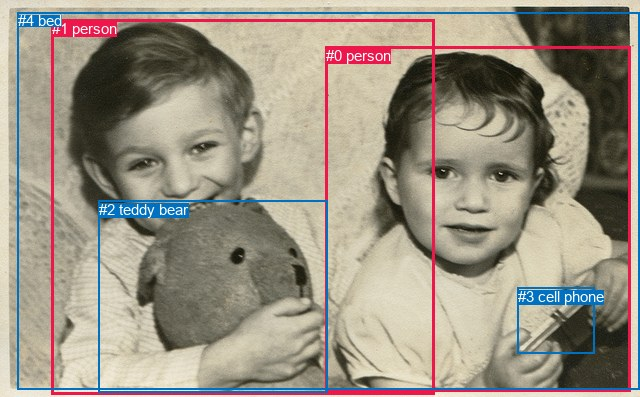
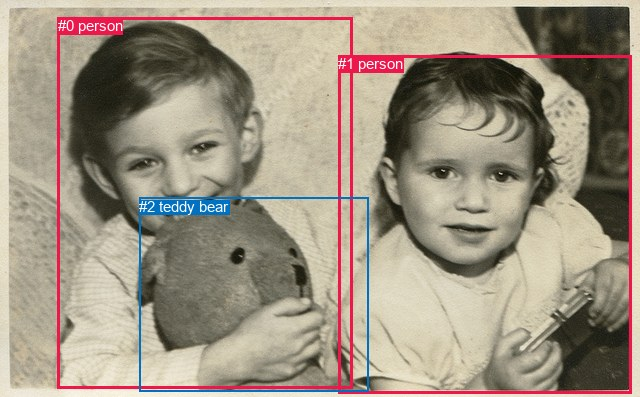

# 图片 1509：2386257.jpg

随机样本序号：251。图片 SHA256：`9c8eabf8fffdaa70aac997b49e6b571671a34098581069edaba4c19da0d98fe0`。

红色框表示人，蓝色框表示其他物体。两个模式分别保留自身框编号，可依据位置比较对应对象。

## 自动检测框与输出

人的框编号：`[0, 1]`。状态：`ok`。

### 自动检测全部物体框

| 编号 | 类别 | 是否为人 | 检测分数 | 像素坐标 xyxy |
|---|---|---|---|---|
| 0 | person | True | 0.9933 | 325.6, 46.6, 630.2, 391.6 |
| 1 | person | True | 0.9398 | 52.0, 20.0, 434.5, 394.6 |
| 2 | teddy bear | False | 0.9281 | 98.7, 200.6, 327.3, 392.7 |
| 3 | cell phone | False | 0.4832 | 517.9, 287.8, 594.2, 353.6 |
| 4 | bed | False | 0.3994 | 17.5, 12.4, 640.0, 389.5 |

### 自动检测 Top50 人相关候选

评分物体对：20；人相关物体对：14；输出关系：28。

| 排名 | 主语编号与类别 | 关系 | 宾语编号与类别 | 类型 | 人与人 | 排序分数 | 原始融合 logit |
|---|---|---|---|---|---|---|---|
| 1 | #1 person | holding | #2 teddy bear | semantic | False | 0.99468 | 5.2301 |
| 2 | #0 person | holding | #3 cell phone | semantic | False | 0.99458 | 5.2120 |
| 3 | #1 person | sitting on | #4 bed | semantic | False | 0.97701 | 3.7495 |
| 4 | #1 person | on | #4 bed | spatial | False | 0.95101 | 2.9660 |
| 5 | #0 person | sitting on | #4 bed | semantic | False | 0.95068 | 2.9588 |
| 6 | #0 person | holding | #2 teddy bear | semantic | False | 0.93803 | 2.7172 |
| 7 | #0 person | in | #4 bed | spatial | False | 0.90109 | 2.2094 |
| 8 | #0 person | on | #3 cell phone | spatial | False | 0.85761 | 1.7956 |
| 9 | #1 person | holding | #0 person | semantic | True | 0.83057 | 1.5897 |
| 10 | #1 person | beside | #0 person | spatial | True | 0.77646 | 1.2452 |
| 11 | #0 person | looking at | #1 person | semantic | True | 0.75581 | 1.1298 |
| 12 | #1 person | in | #2 teddy bear | spatial | False | 0.74881 | 1.0923 |
| 13 | #0 person | beside | #1 person | spatial | True | 0.73749 | 1.0330 |
| 14 | #1 person | holding | #3 cell phone | semantic | False | 0.70414 | 0.8671 |
| 15 | #2 teddy bear | holding | #1 person | semantic | False | 0.66288 | 0.6761 |
| 16 | #3 cell phone | holding | #0 person | semantic | False | 0.64711 | 0.6064 |
| 17 | #3 cell phone | in | #0 person | spatial | False | 0.55162 | 0.2072 |
| 18 | #4 bed | beside | #1 person | spatial | False | 0.53707 | 0.1486 |
| 19 | #4 bed | holding | #1 person | semantic | False | 0.47976 | -0.0810 |
| 20 | #0 person | in | #2 teddy bear | spatial | False | 0.44913 | -0.2042 |
| 21 | #4 bed | holding | #0 person | semantic | False | 0.35767 | -0.5855 |
| 22 | #4 bed | beside | #0 person | spatial | False | 0.34125 | -0.6577 |
| 23 | #2 teddy bear | in | #1 person | spatial | False | 0.34082 | -0.6597 |
| 24 | #2 teddy bear | on | #0 person | spatial | False | 0.11024 | -2.0883 |
| 25 | #2 teddy bear | holding | #0 person | semantic | False | 0.09485 | -2.2558 |
| 26 | #1 person | on | #3 cell phone | spatial | False | 0.06117 | -2.7310 |
| 27 | #3 cell phone | in | #1 person | spatial | False | 0.04615 | -3.0286 |
| 28 | #3 cell phone | holding | #1 person | semantic | False | 0.04402 | -3.0782 |

### 自动检测逐条人相关 GT 核验

R@50：0.00%；命中 0/5。

| GT 主语编号 | GT 关系 | GT 宾语编号 | 结果阶段 | 匹配预测主语编号 | 匹配预测宾语编号 |
|---|---|---|---|---|---|
| 0 | attached to | 1 | wrong_predicate | [1] | [0] |
| 0 | playing with | 2 | wrong_predicate | [1] | [2] |
| 1 | attached to | 0 | wrong_predicate | [0] | [1] |
| 1 | attached to | 2 | wrong_predicate | [0] | [2] |
| 2 | attached to | 1 | wrong_predicate | [2] | [0] |

## 真实框与输出

人的框编号：`[0, 1]`。

### 真实框全部物体框

| 编号 | 类别 | 是否为人 | 检测分数 | 像素坐标 xyxy |
|---|---|---|---|---|
| 0 | person | True | GT | 58.0, 17.0, 353.0, 389.0 |
| 1 | person | True | GT | 338.0, 55.0, 632.0, 393.0 |
| 2 | teddy bear | False | GT | 139.0, 198.0, 368.0, 392.0 |

### 真实框 Top50 人相关候选

评分物体对：6；人相关物体对：6；输出关系：12。

| 排名 | 主语编号与类别 | 关系 | 宾语编号与类别 | 类型 | 人与人 | 排序分数 | 原始融合 logit |
|---|---|---|---|---|---|---|---|
| 1 | #0 person | holding | #2 teddy bear | semantic | False | 0.98357 | 4.0919 |
| 2 | #1 person | holding | #2 teddy bear | semantic | False | 0.95878 | 3.1467 |
| 3 | #0 person | holding | #1 person | semantic | True | 0.66885 | 0.7030 |
| 4 | #1 person | holding | #0 person | semantic | True | 0.64218 | 0.5849 |
| 5 | #0 person | in | #2 teddy bear | spatial | False | 0.49300 | -0.0280 |
| 6 | #0 person | beside | #1 person | spatial | True | 0.33878 | -0.6687 |
| 7 | #1 person | in | #0 person | spatial | True | 0.26270 | -1.0320 |
| 8 | #1 person | in | #2 teddy bear | spatial | False | 0.24117 | -1.1463 |
| 9 | #2 teddy bear | holding | #0 person | semantic | False | 0.03717 | -3.2544 |
| 10 | #2 teddy bear | on | #0 person | spatial | False | 0.03508 | -3.3146 |
| 11 | #2 teddy bear | on | #1 person | spatial | False | 0.02513 | -3.6582 |
| 12 | #2 teddy bear | holding | #1 person | semantic | False | 0.02370 | -3.7181 |

### 真实框逐条人相关 GT 核验

R@50：0.00%；命中 0/5。

| GT 主语编号 | GT 关系 | GT 宾语编号 | 结果阶段 | 匹配预测主语编号 | 匹配预测宾语编号 |
|---|---|---|---|---|---|
| 0 | attached to | 1 | wrong_predicate | [0] | [1] |
| 0 | playing with | 2 | wrong_predicate | [0] | [2] |
| 1 | attached to | 0 | wrong_predicate | [1] | [0] |
| 1 | attached to | 2 | wrong_predicate | [1] | [2] |
| 2 | attached to | 1 | wrong_predicate | [2] | [1] |

## 全部人相关 GT

| 主语编号与类别 | 关系 | 宾语编号与类别 |
|---|---|---|
| #0 person | attached to | #1 person |
| #0 person | playing with | #2 teddy bear |
| #1 person | attached to | #0 person |
| #1 person | attached to | #2 teddy bear |
| #2 teddy bear | attached to | #1 person |

原始记录、全部人相关物体对的两项预测与分项分数见 [逐图证据 JSON](../evidence/cases/1509.json)。全部56类 logits 保留于本机 HOR/output/random500/logits/。

<!-- HOR_COMPLETE_RESULTS -->

## 六组条件的完整输出对照

以下保留同一图片三种框与候选模式、两种谓词输出规则的全部 Top50。框编号各自在所属模式内解释。

### 自动检测框完整枚举：空间与语义各保留一个谓词

| 排名 | 主语编号与类别 | 谓词 | 宾语编号与类别 | 分组 | 排序分数 | predicate logit | pair logit |
|---|---|---|---|---|---|---|---|
| 1 | #1 person | holding | #2 teddy bear | semantic | 0.9946754 | 4.9711146 | 0.2589769 |
| 2 | #0 person | holding | #3 cell phone | semantic | 0.9945788 | 4.8986964 | 0.3133098 |
| 3 | #1 person | sitting on | #4 bed | semantic | 0.9770111 | 3.6052823 | 0.1442070 |
| 4 | #1 person | on | #4 bed | spatial | 0.9510137 | 2.8217821 | 0.1442070 |
| 5 | #0 person | sitting on | #4 bed | semantic | 0.9506800 | 3.1207862 | -0.1619384 |
| 6 | #0 person | holding | #2 teddy bear | semantic | 0.9380318 | 3.4262900 | -0.7091272 |
| 7 | #0 person | in | #4 bed | spatial | 0.9010869 | 2.3712983 | -0.1619384 |
| 8 | #0 person | on | #3 cell phone | spatial | 0.8576069 | 1.4822450 | 0.3133098 |
| 9 | #1 person | holding | #0 person | semantic | 0.8305748 | 2.0860672 | -0.4963602 |
| 10 | #1 person | beside | #0 person | spatial | 0.7764595 | 1.7415123 | -0.4963602 |
| 11 | #0 person | looking at | #1 person | semantic | 0.7558069 | 1.5943985 | -0.4645717 |
| 12 | #1 person | in | #2 teddy bear | spatial | 0.7488112 | 0.8333054 | 0.2589769 |
| 13 | #0 person | beside | #1 person | spatial | 0.7374917 | 1.4975438 | -0.4645717 |
| 14 | #1 person | holding | #3 cell phone | semantic | 0.7041414 | 1.5936394 | -0.7265420 |
| 15 | #2 teddy bear | holding | #1 person | semantic | 0.6628762 | 1.5776801 | -0.9015419 |
| 16 | #3 cell phone | holding | #0 person | semantic | 0.6471096 | 1.4030404 | -0.7966819 |
| 17 | #3 cell phone | in | #0 person | spatial | 0.5516192 | 1.0038972 | -0.7966819 |
| 18 | #4 bed | beside | #1 person | spatial | 0.5370747 | 0.3789630 | -0.2303917 |
| 19 | #4 bed | holding | #1 person | semantic | 0.4797577 | 0.1493783 | -0.2303917 |
| 20 | #0 person | in | #2 teddy bear | spatial | 0.4491329 | 0.5049524 | -0.7091272 |
| 21 | #4 bed | holding | #0 person | semantic | 0.3576686 | -0.1799784 | -0.4055191 |
| 22 | #4 bed | beside | #0 person | spatial | 0.3412519 | -0.2522011 | -0.4055191 |
| 23 | #2 teddy bear | in | #1 person | spatial | 0.3408161 | 0.2418823 | -0.9015419 |
| 24 | #2 teddy bear | on | #0 person | spatial | 0.1102367 | -0.5622225 | -1.5261034 |
| 25 | #2 teddy bear | holding | #0 person | semantic | 0.0948479 | -0.7297256 | -1.5261034 |
| 26 | #1 person | on | #3 cell phone | spatial | 0.0611678 | -2.0044734 | -0.7265420 |
| 27 | #3 cell phone | in | #1 person | spatial | 0.0461496 | -1.5285792 | -1.5000395 |
| 28 | #3 cell phone | holding | #1 person | semantic | 0.0440162 | -1.5781436 | -1.5000395 |

GT 命中：0/5，R@50=0.00%。

| GT主语 | GT谓词 | GT宾语 | 结果阶段 | 匹配主语框 | 匹配宾语框 |
|---|---|---|---|---|---|
| 0 | attached to | 1 | wrong_predicate | [1] | [0] |
| 0 | playing with | 2 | wrong_predicate | [1] | [2] |
| 1 | attached to | 0 | wrong_predicate | [0] | [1] |
| 1 | attached to | 2 | wrong_predicate | [0] | [2] |
| 2 | attached to | 1 | wrong_predicate | [2] | [0] |

### 自动检测框完整枚举：每对只保留一个谓词

| 排名 | 主语编号与类别 | 谓词 | 宾语编号与类别 | 分组 | 排序分数 | predicate logit | pair logit |
|---|---|---|---|---|---|---|---|
| 1 | #1 person | holding | #2 teddy bear | single | 0.9946754 | 4.9711146 | 0.2589769 |
| 2 | #0 person | holding | #3 cell phone | single | 0.9945788 | 4.8986964 | 0.3133098 |
| 3 | #1 person | sitting on | #4 bed | single | 0.9770111 | 3.6052823 | 0.1442070 |
| 4 | #0 person | sitting on | #4 bed | single | 0.9506800 | 3.1207862 | -0.1619384 |
| 5 | #0 person | holding | #2 teddy bear | single | 0.9380318 | 3.4262900 | -0.7091272 |
| 6 | #1 person | holding | #0 person | single | 0.8305748 | 2.0860672 | -0.4963602 |
| 7 | #0 person | looking at | #1 person | single | 0.7558069 | 1.5943985 | -0.4645717 |
| 8 | #1 person | holding | #3 cell phone | single | 0.7041414 | 1.5936394 | -0.7265420 |
| 9 | #2 teddy bear | holding | #1 person | single | 0.6628762 | 1.5776801 | -0.9015419 |
| 10 | #3 cell phone | holding | #0 person | single | 0.6471096 | 1.4030404 | -0.7966819 |
| 11 | #4 bed | beside | #1 person | single | 0.5370747 | 0.3789630 | -0.2303917 |
| 12 | #4 bed | holding | #0 person | single | 0.3576686 | -0.1799784 | -0.4055191 |
| 13 | #2 teddy bear | on | #0 person | single | 0.1102367 | -0.5622225 | -1.5261034 |
| 14 | #3 cell phone | in | #1 person | single | 0.0461496 | -1.5285792 | -1.5000395 |

GT 命中：0/5，R@50=0.00%。

| GT主语 | GT谓词 | GT宾语 | 结果阶段 | 匹配主语框 | 匹配宾语框 |
|---|---|---|---|---|---|
| 0 | attached to | 1 | wrong_predicate | [1] | [0] |
| 0 | playing with | 2 | wrong_predicate | [1] | [2] |
| 1 | attached to | 0 | wrong_predicate | [0] | [1] |
| 1 | attached to | 2 | wrong_predicate | [0] | [2] |
| 2 | attached to | 1 | wrong_predicate | [2] | [0] |

### 真实框完整枚举：空间与语义各保留一个谓词

| 排名 | 主语编号与类别 | 谓词 | 宾语编号与类别 | 分组 | 排序分数 | predicate logit | pair logit |
|---|---|---|---|---|---|---|---|
| 1 | #0 person | holding | #2 teddy bear | semantic | 0.9835670 | 3.8062091 | 0.2856861 |
| 2 | #1 person | holding | #2 teddy bear | semantic | 0.9587787 | 3.8405623 | -0.6938574 |
| 3 | #0 person | holding | #1 person | semantic | 0.6688511 | 1.3716421 | -0.6686485 |
| 4 | #1 person | holding | #0 person | semantic | 0.6421839 | 1.1059704 | -0.5211150 |
| 5 | #0 person | in | #2 teddy bear | spatial | 0.4929961 | -0.3137035 | 0.2856861 |
| 6 | #0 person | beside | #1 person | spatial | 0.3387818 | -0.0000792 | -0.6686485 |
| 7 | #1 person | in | #0 person | spatial | 0.2627044 | -0.5108442 | -0.5211150 |
| 8 | #1 person | in | #2 teddy bear | spatial | 0.2411655 | -0.4524426 | -0.6938574 |
| 9 | #2 teddy bear | holding | #0 person | semantic | 0.0371702 | -2.3477712 | -0.9065983 |
| 10 | #2 teddy bear | on | #0 person | spatial | 0.0350754 | -2.4079530 | -0.9065983 |
| 11 | #2 teddy bear | on | #1 person | spatial | 0.0251302 | -2.2059033 | -1.4523294 |
| 12 | #2 teddy bear | holding | #1 person | semantic | 0.0237043 | -2.2657812 | -1.4523294 |

GT 命中：0/5，R@50=0.00%。

| GT主语 | GT谓词 | GT宾语 | 结果阶段 | 匹配主语框 | 匹配宾语框 |
|---|---|---|---|---|---|
| 0 | attached to | 1 | wrong_predicate | [0] | [1] |
| 0 | playing with | 2 | wrong_predicate | [0] | [2] |
| 1 | attached to | 0 | wrong_predicate | [1] | [0] |
| 1 | attached to | 2 | wrong_predicate | [1] | [2] |
| 2 | attached to | 1 | wrong_predicate | [2] | [1] |

### 真实框完整枚举：每对只保留一个谓词

| 排名 | 主语编号与类别 | 谓词 | 宾语编号与类别 | 分组 | 排序分数 | predicate logit | pair logit |
|---|---|---|---|---|---|---|---|
| 1 | #0 person | holding | #2 teddy bear | single | 0.9835670 | 3.8062091 | 0.2856861 |
| 2 | #1 person | holding | #2 teddy bear | single | 0.9587787 | 3.8405623 | -0.6938574 |
| 3 | #0 person | holding | #1 person | single | 0.6688511 | 1.3716421 | -0.6686485 |
| 4 | #1 person | holding | #0 person | single | 0.6421839 | 1.1059704 | -0.5211150 |
| 5 | #2 teddy bear | holding | #0 person | single | 0.0371702 | -2.3477712 | -0.9065983 |
| 6 | #2 teddy bear | on | #1 person | single | 0.0251302 | -2.2059033 | -1.4523294 |

GT 命中：0/5，R@50=0.00%。

| GT主语 | GT谓词 | GT宾语 | 结果阶段 | 匹配主语框 | 匹配宾语框 |
|---|---|---|---|---|---|
| 0 | attached to | 1 | wrong_predicate | [0] | [1] |
| 0 | playing with | 2 | wrong_predicate | [0] | [2] |
| 1 | attached to | 0 | wrong_predicate | [1] | [0] |
| 1 | attached to | 2 | wrong_predicate | [1] | [2] |
| 2 | attached to | 1 | wrong_predicate | [2] | [1] |

### 真实框400候选：空间与语义各保留一个谓词

| 排名 | 主语编号与类别 | 谓词 | 宾语编号与类别 | 分组 | 排序分数 | predicate logit | pair logit |
|---|---|---|---|---|---|---|---|
| 1 | #0 person | holding | #2 teddy bear | semantic | 0.9835670 | 3.8062091 | 0.2856861 |
| 2 | #1 person | holding | #2 teddy bear | semantic | 0.9587787 | 3.8405623 | -0.6938574 |
| 3 | #0 person | holding | #1 person | semantic | 0.6735361 | 1.3928704 | -0.6686485 |
| 4 | #1 person | holding | #0 person | semantic | 0.6421839 | 1.1059704 | -0.5211150 |
| 5 | #0 person | in | #2 teddy bear | spatial | 0.4929961 | -0.3137035 | 0.2856861 |
| 6 | #0 person | beside | #1 person | spatial | 0.3387818 | -0.0000792 | -0.6686485 |
| 7 | #1 person | in | #0 person | spatial | 0.2581870 | -0.5342979 | -0.5211150 |
| 8 | #1 person | in | #2 teddy bear | spatial | 0.2405587 | -0.4557614 | -0.6938574 |
| 9 | #2 teddy bear | holding | #0 person | semantic | 0.0369102 | -2.3550618 | -0.9065983 |
| 10 | #2 teddy bear | on | #0 person | spatial | 0.0351734 | -2.4050605 | -0.9065983 |
| 11 | #2 teddy bear | on | #1 person | spatial | 0.0243226 | -2.2393975 | -1.4523294 |
| 12 | #2 teddy bear | holding | #1 person | semantic | 0.0226410 | -2.3127644 | -1.4523294 |

GT 命中：0/5，R@50=0.00%。

| GT主语 | GT谓词 | GT宾语 | 结果阶段 | 匹配主语框 | 匹配宾语框 |
|---|---|---|---|---|---|
| 0 | attached to | 1 | wrong_predicate | [0] | [1] |
| 0 | playing with | 2 | wrong_predicate | [0] | [2] |
| 1 | attached to | 0 | wrong_predicate | [1] | [0] |
| 1 | attached to | 2 | wrong_predicate | [1] | [2] |
| 2 | attached to | 1 | wrong_predicate | [2] | [1] |

### 真实框400候选：每对只保留一个谓词

| 排名 | 主语编号与类别 | 谓词 | 宾语编号与类别 | 分组 | 排序分数 | predicate logit | pair logit |
|---|---|---|---|---|---|---|---|
| 1 | #0 person | holding | #2 teddy bear | single | 0.9835670 | 3.8062091 | 0.2856861 |
| 2 | #1 person | holding | #2 teddy bear | single | 0.9587787 | 3.8405623 | -0.6938574 |
| 3 | #0 person | holding | #1 person | single | 0.6735361 | 1.3928704 | -0.6686485 |
| 4 | #1 person | holding | #0 person | single | 0.6421839 | 1.1059704 | -0.5211150 |
| 5 | #2 teddy bear | holding | #0 person | single | 0.0369102 | -2.3550618 | -0.9065983 |
| 6 | #2 teddy bear | on | #1 person | single | 0.0243226 | -2.2393975 | -1.4523294 |

GT 命中：0/5，R@50=0.00%。

| GT主语 | GT谓词 | GT宾语 | 结果阶段 | 匹配主语框 | 匹配宾语框 |
|---|---|---|---|---|---|
| 0 | attached to | 1 | wrong_predicate | [0] | [1] |
| 0 | playing with | 2 | wrong_predicate | [0] | [2] |
| 1 | attached to | 0 | wrong_predicate | [1] | [0] |
| 1 | attached to | 2 | wrong_predicate | [1] | [2] |
| 2 | attached to | 1 | wrong_predicate | [2] | [1] |
