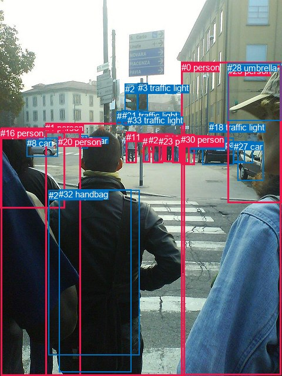
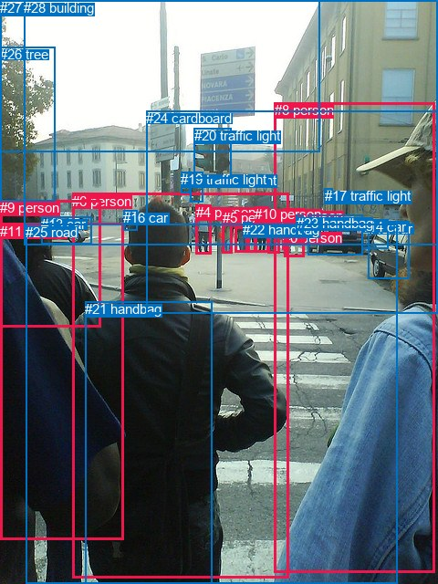

# 图片 1526：2387025.jpg

随机样本序号：149。图片 SHA256：`89dabb8b6940b9c08d005d03f0a22573eea72896f8314fbb0d4c128a99c261a1`。

红色框表示人，蓝色框表示其他物体。两个模式分别保留自身框编号，可依据位置比较对应对象。

## 自动检测框与输出

人的框编号：`[0, 1, 4, 6, 7, 10, 11, 12, 14, 16, 20, 21, 23, 24, 25, 30]`。状态：`ok`。

### 自动检测全部物体框

| 编号 | 类别 | 是否为人 | 检测分数 | 像素坐标 xyxy |
|---|---|---|---|---|
| 0 | person | True | 0.9992 | 308.7, 105.6, 478.0, 638.7 |
| 1 | person | True | 0.9983 | 77.3, 209.1, 314.7, 640.0 |
| 2 | traffic light | False | 0.9938 | 212.9, 142.9, 234.9, 189.4 |
| 3 | traffic light | False | 0.9909 | 235.0, 141.1, 251.9, 188.6 |
| 4 | person | True | 0.9894 | 0.0, 220.0, 110.8, 354.6 |
| 5 | car | False | 0.9883 | 344.1, 234.5, 397.3, 280.6 |
| 6 | person | True | 0.9864 | 310.2, 228.3, 331.7, 281.0 |
| 7 | person | True | 0.9840 | 293.4, 230.0, 306.2, 277.5 |
| 8 | car | False | 0.9839 | 45.9, 234.6, 98.2, 266.8 |
| 9 | car | False | 0.9804 | 404.2, 241.6, 448.9, 307.5 |
| 10 | person | True | 0.9772 | 281.2, 227.7, 294.3, 275.5 |
| 11 | person | True | 0.9730 | 214.6, 224.5, 232.2, 277.5 |
| 12 | person | True | 0.9702 | 259.7, 229.7, 277.0, 277.1 |
| 13 | car | False | 0.9689 | 396.4, 241.4, 416.1, 275.7 |
| 14 | person | True | 0.9648 | 243.3, 231.8, 255.4, 276.7 |
| 15 | car | False | 0.9403 | 134.2, 230.9, 149.6, 252.0 |
| 16 | person | True | 0.9273 | 1.5, 217.7, 137.0, 639.0 |
| 17 | backpack | False | 0.9182 | 323.1, 237.3, 334.5, 260.2 |
| 18 | traffic light | False | 0.9018 | 356.1, 208.3, 363.8, 223.2 |
| 19 | traffic light | False | 0.8464 | 198.7, 189.3, 207.1, 211.4 |
| 20 | person | True | 0.7645 | 99.3, 232.8, 103.1, 243.4 |
| 21 | person | True | 0.7459 | 252.6, 230.3, 262.4, 259.6 |
| 22 | traffic light | False | 0.6710 | 211.3, 188.1, 222.7, 214.0 |
| 23 | person | True | 0.6112 | 270.2, 231.8, 280.4, 275.2 |
| 24 | person | True | 0.5768 | 308.4, 233.3, 315.5, 275.2 |
| 25 | person | True | 0.5558 | 387.5, 112.3, 480.0, 345.4 |
| 26 | traffic light | False | 0.5379 | 198.7, 189.2, 202.9, 199.2 |
| 27 | car | False | 0.5291 | 397.9, 241.0, 430.7, 277.9 |
| 28 | umbrella | False | 0.5099 | 387.3, 107.4, 478.8, 205.1 |
| 29 | backpack | False | 0.5035 | 82.7, 323.8, 237.1, 604.5 |
| 30 | person | True | 0.3880 | 307.9, 229.1, 322.9, 278.1 |
| 31 | traffic light | False | 0.3717 | 208.3, 188.0, 218.0, 212.8 |
| 32 | handbag | False | 0.3611 | 100.0, 322.1, 223.1, 633.1 |
| 33 | traffic light | False | 0.3548 | 216.8, 195.9, 222.9, 209.9 |

### 自动检测 Top50 人相关候选

评分物体对：1122；人相关物体对：816；输出关系：50。

| 排名 | 主语编号与类别 | 关系 | 宾语编号与类别 | 类型 | 人与人 | 排序分数 | 原始融合 logit |
|---|---|---|---|---|---|---|---|
| 1 | #1 person | wearing | #32 handbag | semantic | False | 0.99428 | 5.1578 |
| 2 | #1 person | wearing | #29 backpack | semantic | False | 0.99400 | 5.1102 |
| 3 | #25 person | wearing | #28 umbrella | semantic | False | 0.99058 | 4.6560 |
| 4 | #0 person | wearing | #28 umbrella | semantic | False | 0.97918 | 3.8509 |
| 5 | #1 person | in | #32 handbag | spatial | False | 0.96970 | 3.4659 |
| 6 | #1 person | wearing | #15 car | semantic | False | 0.96533 | 3.3266 |
| 7 | #8 car | parked on | #20 person | semantic | False | 0.96484 | 3.3121 |
| 8 | #1 person | in | #29 backpack | spatial | False | 0.96308 | 3.2613 |
| 9 | #28 umbrella | on | #25 person | spatial | False | 0.96087 | 3.2010 |
| 10 | #6 person | carrying | #17 backpack | semantic | False | 0.94616 | 2.8664 |
| 11 | #30 person | wearing | #24 person | semantic | True | 0.88953 | 2.0859 |
| 12 | #25 person | in | #28 umbrella | spatial | False | 0.88853 | 2.0759 |
| 13 | #8 car | on | #20 person | spatial | False | 0.88668 | 2.0573 |
| 14 | #24 person | holding | #6 person | semantic | True | 0.83331 | 1.6093 |
| 15 | #30 person | wearing | #6 person | semantic | True | 0.82704 | 1.5648 |
| 16 | #6 person | in | #17 backpack | spatial | False | 0.82128 | 1.5251 |
| 17 | #16 person | in | #4 person | spatial | True | 0.81310 | 1.4703 |
| 18 | #29 backpack | on | #1 person | spatial | False | 0.80755 | 1.4342 |
| 19 | #1 person | in | #15 car | spatial | False | 0.80612 | 1.4250 |
| 20 | #30 person | in | #6 person | spatial | True | 0.79547 | 1.3582 |
| 21 | #14 person | carrying | #21 person | semantic | True | 0.78598 | 1.3009 |
| 22 | #32 handbag | on | #1 person | spatial | False | 0.78081 | 1.2704 |
| 23 | #28 umbrella | on | #0 person | spatial | False | 0.77408 | 1.2315 |
| 24 | #24 person | in | #30 person | spatial | True | 0.77360 | 1.2287 |
| 25 | #30 person | in | #24 person | spatial | True | 0.76979 | 1.2071 |
| 26 | #24 person | wearing | #30 person | semantic | True | 0.74488 | 1.0715 |
| 27 | #16 person | wearing | #15 car | semantic | False | 0.74120 | 1.0522 |
| 28 | #6 person | wearing | #30 person | semantic | True | 0.74108 | 1.0516 |
| 29 | #25 person | parked on | #9 car | semantic | False | 0.73401 | 1.0151 |
| 30 | #16 person | standing on | #1 person | semantic | True | 0.72809 | 0.9849 |
| 31 | #0 person | in | #28 umbrella | spatial | False | 0.72418 | 0.9653 |
| 32 | #20 person | on | #8 car | spatial | False | 0.72130 | 0.9509 |
| 33 | #6 person | carrying | #24 person | semantic | True | 0.67811 | 0.7451 |
| 34 | #30 person | walking on | #17 backpack | semantic | False | 0.66637 | 0.6918 |
| 35 | #4 person | wearing | #29 backpack | semantic | False | 0.66266 | 0.6752 |
| 36 | #0 person | looking at | #25 person | semantic | True | 0.65820 | 0.6553 |
| 37 | #0 person | looking at | #1 person | semantic | True | 0.65734 | 0.6515 |
| 38 | #24 person | in | #6 person | spatial | True | 0.64495 | 0.5969 |
| 39 | #16 person | beside | #1 person | spatial | True | 0.62897 | 0.5278 |
| 40 | #6 person | in | #30 person | spatial | True | 0.62657 | 0.5175 |
| 41 | #16 person | wearing | #4 person | semantic | True | 0.62340 | 0.5040 |
| 42 | #4 person | wearing | #15 car | semantic | False | 0.62166 | 0.4966 |
| 43 | #28 umbrella | wearing | #25 person | semantic | False | 0.61383 | 0.4634 |
| 44 | #4 person | in | #8 car | spatial | False | 0.61199 | 0.4557 |
| 45 | #16 person | wearing | #29 backpack | semantic | False | 0.59961 | 0.4038 |
| 46 | #4 person | on | #16 person | spatial | True | 0.58904 | 0.3600 |
| 47 | #12 person | holding | #21 person | semantic | True | 0.58501 | 0.3434 |
| 48 | #9 car | parked on | #25 person | semantic | False | 0.55987 | 0.2406 |
| 49 | #4 person | wearing | #8 car | semantic | False | 0.53665 | 0.1469 |
| 50 | #4 person | wearing | #32 handbag | semantic | False | 0.53326 | 0.1332 |

### 自动检测逐条人相关 GT 核验

R@50：0.00%；命中 0/2。

| GT 主语编号 | GT 关系 | GT 宾语编号 | 结果阶段 | 匹配预测主语编号 | 匹配预测宾语编号 |
|---|---|---|---|---|---|
| 6 | carrying | 21 | wrong_predicate | [1] | [32] |
| 8 | wearing | 24 | endpoint_missing_or_wrong_class | [0] | [] |

## 真实框与输出

人的框编号：`[0, 1, 2, 3, 4, 5, 6, 7, 8, 9, 10, 11]`。

### 真实框全部物体框

| 编号 | 类别 | 是否为人 | 检测分数 | 像素坐标 xyxy |
|---|---|---|---|---|
| 0 | person | True | GT | 310.0, 252.0, 314.0, 274.0 |
| 1 | person | True | GT | 257.0, 234.0, 271.0, 277.0 |
| 2 | person | True | GT | 293.0, 230.0, 306.0, 278.0 |
| 3 | person | True | GT | 271.0, 231.0, 280.0, 276.0 |
| 4 | person | True | GT | 215.0, 224.0, 232.0, 278.0 |
| 5 | person | True | GT | 244.0, 230.0, 255.0, 277.0 |
| 6 | person | True | GT | 79.0, 212.0, 316.0, 634.0 |
| 7 | person | True | GT | 311.0, 228.0, 334.0, 281.0 |
| 8 | person | True | GT | 301.0, 112.0, 477.0, 628.0 |
| 9 | person | True | GT | 0.0, 219.0, 110.0, 358.0 |
| 10 | person | True | GT | 279.0, 226.0, 294.0, 276.0 |
| 11 | person | True | GT | 0.0, 245.0, 136.0, 592.0 |
| 12 | car | False | GT | 403.0, 242.0, 448.0, 305.0 |
| 13 | car | False | GT | 45.0, 237.0, 100.0, 268.0 |
| 14 | car | False | GT | 396.0, 240.0, 425.0, 272.0 |
| 15 | car | False | GT | 337.0, 236.0, 398.0, 280.0 |
| 16 | car | False | GT | 135.0, 230.0, 150.0, 252.0 |
| 17 | traffic light | False | GT | 356.0, 206.0, 365.0, 223.0 |
| 18 | traffic light | False | GT | 209.0, 189.0, 223.0, 222.0 |
| 19 | traffic light | False | GT | 198.0, 188.0, 208.0, 211.0 |
| 20 | traffic light | False | GT | 213.0, 140.0, 254.0, 195.0 |
| 21 | handbag | False | GT | 93.0, 330.0, 233.0, 640.0 |
| 22 | handbag | False | GT | 266.0, 243.0, 276.0, 259.0 |
| 23 | handbag | False | GT | 325.0, 236.0, 333.0, 260.0 |
| 24 | cardboard | False | GT | 160.0, 121.0, 480.0, 343.0 |
| 25 | road | False | GT | 28.0, 246.0, 435.0, 640.0 |
| 26 | tree | False | GT | 0.0, 51.0, 60.0, 220.0 |
| 27 | sky | False | GT | 0.0, 0.0, 351.0, 166.0 |
| 28 | building | False | GT | 26.0, 0.0, 480.0, 269.0 |

### 真实框 Top50 人相关候选

评分物体对：812；人相关物体对：540；输出关系：50。

| 排名 | 主语编号与类别 | 关系 | 宾语编号与类别 | 类型 | 人与人 | 排序分数 | 原始融合 logit |
|---|---|---|---|---|---|---|---|
| 1 | #6 person | wearing | #21 handbag | semantic | False | 0.99505 | 5.3035 |
| 2 | #6 person | standing on | #25 road | semantic | False | 0.98544 | 4.2145 |
| 3 | #9 person | wearing | #11 person | semantic | True | 0.97914 | 3.8488 |
| 4 | #8 person | standing on | #25 road | semantic | False | 0.97893 | 3.8386 |
| 5 | #7 person | carrying | #0 person | semantic | True | 0.97486 | 3.6580 |
| 6 | #7 person | wearing | #23 handbag | semantic | False | 0.97079 | 3.5036 |
| 7 | #3 person | carrying | #22 handbag | semantic | False | 0.97042 | 3.4907 |
| 8 | #6 person | in | #21 handbag | spatial | False | 0.96890 | 3.4390 |
| 9 | #4 person | crossing | #25 road | semantic | False | 0.96727 | 3.3862 |
| 10 | #2 person | crossing | #25 road | semantic | False | 0.96457 | 3.3042 |
| 11 | #10 person | crossing | #25 road | semantic | False | 0.96169 | 3.2229 |
| 12 | #1 person | crossing | #25 road | semantic | False | 0.96096 | 3.2033 |
| 13 | #1 person | carrying | #22 handbag | semantic | False | 0.95641 | 3.0884 |
| 14 | #3 person | crossing | #25 road | semantic | False | 0.95196 | 2.9865 |
| 15 | #5 person | crossing | #25 road | semantic | False | 0.94660 | 2.8751 |
| 16 | #9 person | standing on | #25 road | semantic | False | 0.94253 | 2.7973 |
| 17 | #6 person | wearing | #16 car | semantic | False | 0.94058 | 2.7618 |
| 18 | #7 person | crossing | #25 road | semantic | False | 0.93890 | 2.7323 |
| 19 | #9 person | in | #11 person | spatial | True | 0.92696 | 2.5409 |
| 20 | #6 person | on | #25 road | spatial | False | 0.92343 | 2.4898 |
| 21 | #9 person | on | #25 road | spatial | False | 0.86925 | 1.8944 |
| 22 | #7 person | in | #23 handbag | spatial | False | 0.86844 | 1.8873 |
| 23 | #7 person | on | #25 road | spatial | False | 0.86538 | 1.8607 |
| 24 | #21 handbag | on | #6 person | spatial | False | 0.84321 | 1.6823 |
| 25 | #8 person | on | #25 road | spatial | False | 0.84074 | 1.6637 |
| 26 | #23 handbag | on | #7 person | spatial | False | 0.81303 | 1.4698 |
| 27 | #0 person | on | #25 road | spatial | False | 0.79685 | 1.3667 |
| 28 | #4 person | on | #25 road | spatial | False | 0.79022 | 1.3262 |
| 29 | #7 person | on | #0 person | spatial | True | 0.78580 | 1.2998 |
| 30 | #6 person | wearing | #11 person | semantic | True | 0.75998 | 1.1526 |
| 31 | #23 handbag | carrying | #7 person | semantic | False | 0.75181 | 1.1083 |
| 32 | #6 person | in | #16 car | spatial | False | 0.72734 | 0.9812 |
| 33 | #11 person | on | #9 person | spatial | True | 0.71697 | 0.9295 |
| 34 | #3 person | in | #22 handbag | spatial | False | 0.68319 | 0.7685 |
| 35 | #5 person | on | #25 road | spatial | False | 0.67920 | 0.7501 |
| 36 | #8 person | looking at | #6 person | semantic | True | 0.67204 | 0.7174 |
| 37 | #10 person | on | #25 road | spatial | False | 0.66131 | 0.6691 |
| 38 | #2 person | on | #25 road | spatial | False | 0.66012 | 0.6638 |
| 39 | #0 person | standing on | #25 road | semantic | False | 0.65777 | 0.6534 |
| 40 | #1 person | on | #25 road | spatial | False | 0.65637 | 0.6472 |
| 41 | #3 person | on | #25 road | spatial | False | 0.60707 | 0.4350 |
| 42 | #11 person | holding | #9 person | semantic | True | 0.58678 | 0.3507 |
| 43 | #0 person | carrying | #7 person | semantic | True | 0.57404 | 0.2983 |
| 44 | #8 person | beside | #6 person | spatial | True | 0.57203 | 0.2902 |
| 45 | #9 person | wearing | #21 handbag | semantic | False | 0.56018 | 0.2419 |
| 46 | #8 person | looking at | #24 cardboard | semantic | False | 0.55810 | 0.2335 |
| 47 | #9 person | wearing | #16 car | semantic | False | 0.54413 | 0.1770 |
| 48 | #7 person | in | #24 cardboard | spatial | False | 0.54345 | 0.1742 |
| 49 | #2 person | holding | #0 person | semantic | True | 0.53795 | 0.1521 |
| 50 | #1 person | in | #22 handbag | spatial | False | 0.53537 | 0.1417 |

### 真实框逐条人相关 GT 核验

R@50：0.00%；命中 0/2。

| GT 主语编号 | GT 关系 | GT 宾语编号 | 结果阶段 | 匹配预测主语编号 | 匹配预测宾语编号 |
|---|---|---|---|---|---|
| 6 | carrying | 21 | wrong_predicate | [6] | [21] |
| 8 | wearing | 24 | wrong_predicate | [8] | [24] |

## 全部人相关 GT

| 主语编号与类别 | 关系 | 宾语编号与类别 |
|---|---|---|
| #6 person | carrying | #21 handbag |
| #8 person | wearing | #24 cardboard |

原始记录、全部人相关物体对的两项预测与分项分数见 [逐图证据 JSON](../evidence/cases/1526.json)。全部56类 logits 保留于本机 HOR/output/random500/logits/。

<!-- HOR_COMPLETE_RESULTS -->

## 六组条件的完整输出对照

以下保留同一图片三种框与候选模式、两种谓词输出规则的全部 Top50。框编号各自在所属模式内解释。

### 自动检测框完整枚举：空间与语义各保留一个谓词

| 排名 | 主语编号与类别 | 谓词 | 宾语编号与类别 | 分组 | 排序分数 | predicate logit | pair logit |
|---|---|---|---|---|---|---|---|
| 1 | #1 person | wearing | #32 handbag | semantic | 0.9942786 | 4.4512334 | 0.7065591 |
| 2 | #1 person | wearing | #29 backpack | semantic | 0.9940016 | 4.6083093 | 0.5019376 |
| 3 | #25 person | wearing | #28 umbrella | semantic | 0.9905849 | 4.4321256 | 0.2238536 |
| 4 | #0 person | wearing | #28 umbrella | semantic | 0.9791825 | 3.7377715 | 0.1131526 |
| 5 | #1 person | in | #32 handbag | spatial | 0.9697031 | 2.7593880 | 0.7065591 |
| 6 | #1 person | wearing | #15 car | semantic | 0.9653296 | 3.4822993 | -0.1557150 |
| 7 | #8 car | parked on | #20 person | semantic | 0.9648409 | 3.6633372 | -0.3512571 |
| 8 | #1 person | in | #29 backpack | spatial | 0.9630779 | 2.7593880 | 0.5019376 |
| 9 | #28 umbrella | on | #25 person | spatial | 0.9608727 | 3.3657413 | -0.1647196 |
| 10 | #6 person | carrying | #17 backpack | semantic | 0.9461606 | 3.1871481 | -0.3207413 |
| 11 | #30 person | wearing | #24 person | semantic | 0.8895293 | 2.5148687 | -0.4289263 |
| 12 | #25 person | in | #28 umbrella | spatial | 0.8885338 | 1.8519969 | 0.2238536 |
| 13 | #8 car | on | #20 person | spatial | 0.8866830 | 2.4085560 | -0.3512571 |
| 14 | #24 person | holding | #6 person | semantic | 0.8333147 | 1.9815717 | -0.3722683 |
| 15 | #30 person | wearing | #6 person | semantic | 0.8270437 | 1.9187665 | -0.3539481 |
| 16 | #6 person | in | #17 backpack | spatial | 0.8212828 | 1.8458042 | -0.3207413 |
| 17 | #16 person | in | #4 person | spatial | 0.8130960 | 2.1119714 | -0.6417172 |
| 18 | #29 backpack | on | #1 person | spatial | 0.8075492 | 2.0583506 | -0.6241870 |
| 19 | #1 person | in | #15 car | spatial | 0.8061234 | 1.5807300 | -0.1557150 |
| 20 | #30 person | in | #6 person | spatial | 0.7954695 | 1.7121639 | -0.3539481 |
| 21 | #14 person | carrying | #21 person | semantic | 0.7859799 | 1.7385082 | -0.4376467 |
| 22 | #32 handbag | on | #1 person | spatial | 0.7808093 | 1.9600539 | -0.6896653 |
| 23 | #28 umbrella | on | #0 person | spatial | 0.7740755 | 1.7849517 | -0.5534835 |
| 24 | #24 person | in | #30 person | spatial | 0.7735952 | 1.6657014 | -0.4369774 |
| 25 | #30 person | in | #24 person | spatial | 0.7697907 | 1.6360559 | -0.4289263 |
| 26 | #24 person | wearing | #30 person | semantic | 0.7448812 | 1.5084729 | -0.4369774 |
| 27 | #16 person | wearing | #15 car | semantic | 0.7412006 | 1.6921730 | -0.6399548 |
| 28 | #6 person | wearing | #30 person | semantic | 0.7410794 | 1.5247192 | -0.4731328 |
| 29 | #25 person | parked on | #9 car | semantic | 0.7340150 | 1.7683353 | -0.7532461 |
| 30 | #16 person | standing on | #1 person | semantic | 0.7280892 | 1.9474783 | -0.9625287 |
| 31 | #0 person | in | #28 umbrella | spatial | 0.7241772 | 0.8521252 | 0.1131526 |
| 32 | #20 person | on | #8 car | spatial | 0.7213002 | 1.5651326 | -0.6142124 |
| 33 | #6 person | carrying | #24 person | semantic | 0.6781132 | 1.2294869 | -0.4843726 |
| 34 | #30 person | walking on | #17 backpack | semantic | 0.6663734 | 1.0111599 | -0.3193324 |
| 35 | #4 person | wearing | #29 backpack | semantic | 0.6626623 | 2.1310544 | -1.4558733 |
| 36 | #0 person | looking at | #25 person | semantic | 0.6582026 | 1.4380155 | -0.7827209 |
| 37 | #0 person | looking at | #1 person | semantic | 0.6573382 | 1.5492077 | -0.8977529 |
| 38 | #24 person | in | #6 person | spatial | 0.6449474 | 0.9691710 | -0.3722683 |
| 39 | #16 person | beside | #1 person | spatial | 0.6289669 | 1.4903159 | -0.9625287 |
| 40 | #6 person | in | #30 person | spatial | 0.6265652 | 0.9906421 | -0.4731328 |
| 41 | #16 person | wearing | #4 person | semantic | 0.6234016 | 1.1457286 | -0.6417172 |
| 42 | #4 person | wearing | #15 car | semantic | 0.6216569 | 0.8921242 | -0.3955373 |
| 43 | #28 umbrella | wearing | #25 person | semantic | 0.6138309 | 0.6281638 | -0.1647196 |
| 44 | #4 person | in | #8 car | spatial | 0.6119932 | 1.3114672 | -0.8557688 |
| 45 | #16 person | wearing | #29 backpack | semantic | 0.5996051 | 1.4176660 | -1.0138457 |
| 46 | #4 person | on | #16 person | spatial | 0.5890440 | 1.5920382 | -1.2320235 |
| 47 | #12 person | holding | #21 person | semantic | 0.5850133 | 0.6723275 | -0.3289392 |
| 48 | #9 car | parked on | #25 person | semantic | 0.5598710 | 0.7152863 | -0.4746479 |
| 49 | #4 person | wearing | #8 car | semantic | 0.5366530 | 1.0026441 | -0.8557688 |
| 50 | #4 person | wearing | #32 handbag | semantic | 0.5332622 | 1.6789341 | -1.5456885 |

GT 命中：0/2，R@50=0.00%。

| GT主语 | GT谓词 | GT宾语 | 结果阶段 | 匹配主语框 | 匹配宾语框 |
|---|---|---|---|---|---|
| 6 | carrying | 21 | wrong_predicate | [1] | [32] |
| 8 | wearing | 24 | endpoint_missing_or_wrong_class | [0] | [] |

### 自动检测框完整枚举：每对只保留一个谓词

| 排名 | 主语编号与类别 | 谓词 | 宾语编号与类别 | 分组 | 排序分数 | predicate logit | pair logit |
|---|---|---|---|---|---|---|---|
| 1 | #1 person | wearing | #32 handbag | single | 0.9942786 | 4.4512334 | 0.7065591 |
| 2 | #1 person | wearing | #29 backpack | single | 0.9940016 | 4.6083093 | 0.5019376 |
| 3 | #25 person | wearing | #28 umbrella | single | 0.9905849 | 4.4321256 | 0.2238536 |
| 4 | #0 person | wearing | #28 umbrella | single | 0.9791825 | 3.7377715 | 0.1131526 |
| 5 | #1 person | wearing | #15 car | single | 0.9653296 | 3.4822993 | -0.1557150 |
| 6 | #8 car | parked on | #20 person | single | 0.9648409 | 3.6633372 | -0.3512571 |
| 7 | #28 umbrella | on | #25 person | single | 0.9608727 | 3.3657413 | -0.1647196 |
| 8 | #6 person | carrying | #17 backpack | single | 0.9461606 | 3.1871481 | -0.3207413 |
| 9 | #30 person | wearing | #24 person | single | 0.8895293 | 2.5148687 | -0.4289263 |
| 10 | #24 person | holding | #6 person | single | 0.8333147 | 1.9815717 | -0.3722683 |
| 11 | #30 person | wearing | #6 person | single | 0.8270437 | 1.9187665 | -0.3539481 |
| 12 | #16 person | in | #4 person | single | 0.8130960 | 2.1119714 | -0.6417172 |
| 13 | #29 backpack | on | #1 person | single | 0.8075492 | 2.0583506 | -0.6241870 |
| 14 | #14 person | carrying | #21 person | single | 0.7859799 | 1.7385082 | -0.4376467 |
| 15 | #32 handbag | on | #1 person | single | 0.7808093 | 1.9600539 | -0.6896653 |
| 16 | #28 umbrella | on | #0 person | single | 0.7740755 | 1.7849517 | -0.5534835 |
| 17 | #24 person | in | #30 person | single | 0.7735952 | 1.6657014 | -0.4369774 |
| 18 | #16 person | wearing | #15 car | single | 0.7412006 | 1.6921730 | -0.6399548 |
| 19 | #6 person | wearing | #30 person | single | 0.7410794 | 1.5247192 | -0.4731328 |
| 20 | #25 person | parked on | #9 car | single | 0.7340150 | 1.7683353 | -0.7532461 |
| 21 | #16 person | standing on | #1 person | single | 0.7280892 | 1.9474783 | -0.9625287 |
| 22 | #20 person | on | #8 car | single | 0.7213002 | 1.5651326 | -0.6142124 |
| 23 | #6 person | carrying | #24 person | single | 0.6781132 | 1.2294869 | -0.4843726 |
| 24 | #30 person | walking on | #17 backpack | single | 0.6663734 | 1.0111599 | -0.3193324 |
| 25 | #4 person | wearing | #29 backpack | single | 0.6626623 | 2.1310544 | -1.4558733 |
| 26 | #0 person | looking at | #25 person | single | 0.6582026 | 1.4380155 | -0.7827209 |
| 27 | #0 person | looking at | #1 person | single | 0.6573382 | 1.5492077 | -0.8977529 |
| 28 | #4 person | wearing | #15 car | single | 0.6216569 | 0.8921242 | -0.3955373 |
| 29 | #4 person | in | #8 car | single | 0.6119932 | 1.3114672 | -0.8557688 |
| 30 | #16 person | wearing | #29 backpack | single | 0.5996051 | 1.4176660 | -1.0138457 |
| 31 | #4 person | on | #16 person | single | 0.5890440 | 1.5920382 | -1.2320235 |
| 32 | #12 person | holding | #21 person | single | 0.5850133 | 0.6723275 | -0.3289392 |
| 33 | #9 car | parked on | #25 person | single | 0.5598710 | 0.7152863 | -0.4746479 |
| 34 | #4 person | wearing | #32 handbag | single | 0.5332622 | 1.6789341 | -1.5456885 |
| 35 | #25 person | parked on | #27 car | single | 0.5191163 | 1.1359158 | -1.0594130 |
| 36 | #16 person | wearing | #32 handbag | single | 0.5154058 | 1.0118103 | -0.9501674 |
| 37 | #17 backpack | on | #6 person | single | 0.5110105 | 0.6090765 | -0.5650274 |
| 38 | #4 person | wearing | #20 person | single | 0.4923945 | 1.0996828 | -1.1301070 |
| 39 | #1 person | beside | #0 person | single | 0.4844230 | 0.8845015 | -0.9468294 |
| 40 | #24 person | walking on | #17 backpack | single | 0.4762068 | 0.2558823 | -0.3511270 |
| 41 | #10 person | walking on | #7 person | single | 0.4473821 | 0.3355775 | -0.5468311 |
| 42 | #1 person | standing on | #16 person | single | 0.4430270 | 0.8151264 | -1.0440125 |
| 43 | #7 person | walking on | #30 person | single | 0.4285570 | 0.1038928 | -0.3916338 |
| 44 | #7 person | walking on | #10 person | single | 0.4241873 | 0.3445954 | -0.6502029 |
| 45 | #7 person | walking on | #6 person | single | 0.4128562 | 0.0000854 | -0.3522559 |
| 46 | #1 person | wearing | #4 person | single | 0.3664703 | 0.4588919 | -1.0062814 |
| 47 | #7 person | walking on | #24 person | single | 0.3602579 | -0.1985111 | -0.3757338 |
| 48 | #12 person | holding | #23 person | single | 0.3579507 | 0.0935869 | -0.6778569 |
| 49 | #27 car | parked on | #25 person | single | 0.3564250 | -0.0066638 | -0.5842508 |
| 50 | #0 person | wearing | #32 handbag | single | 0.3558057 | 0.6396580 | -1.2332735 |

GT 命中：0/2，R@50=0.00%。

| GT主语 | GT谓词 | GT宾语 | 结果阶段 | 匹配主语框 | 匹配宾语框 |
|---|---|---|---|---|---|
| 6 | carrying | 21 | wrong_predicate | [1] | [32] |
| 8 | wearing | 24 | endpoint_missing_or_wrong_class | [0] | [] |

### 真实框完整枚举：空间与语义各保留一个谓词

| 排名 | 主语编号与类别 | 谓词 | 宾语编号与类别 | 分组 | 排序分数 | predicate logit | pair logit |
|---|---|---|---|---|---|---|---|
| 1 | #6 person | wearing | #21 handbag | semantic | 0.9950505 | 4.6039443 | 0.6995686 |
| 2 | #6 person | standing on | #25 road | semantic | 0.9854358 | 4.2564464 | -0.0419267 |
| 3 | #9 person | wearing | #11 person | semantic | 0.9791402 | 4.2749047 | -0.4260556 |
| 4 | #8 person | standing on | #25 road | semantic | 0.9789308 | 4.1976924 | -0.3590449 |
| 5 | #7 person | carrying | #0 person | semantic | 0.9748639 | 3.9811711 | -0.3231765 |
| 6 | #7 person | wearing | #23 handbag | semantic | 0.9707913 | 3.8066840 | -0.3030368 |
| 7 | #3 person | carrying | #22 handbag | semantic | 0.9704221 | 4.1104569 | -0.6197527 |
| 8 | #6 person | in | #21 handbag | spatial | 0.9689028 | 2.7394757 | 0.6995686 |
| 9 | #4 person | crossing | #25 road | semantic | 0.9672692 | 3.6419778 | -0.2558184 |
| 10 | #2 person | crossing | #25 road | semantic | 0.9645723 | 3.5208306 | -0.2166403 |
| 11 | #10 person | crossing | #25 road | semantic | 0.9616886 | 3.4013190 | -0.1783744 |
| 12 | #1 person | crossing | #25 road | semantic | 0.9609565 | 3.4010339 | -0.1977820 |
| 13 | #1 person | carrying | #22 handbag | semantic | 0.9564103 | 3.7726626 | -0.6842949 |
| 14 | #3 person | crossing | #25 road | semantic | 0.9519608 | 3.1608734 | -0.1743669 |
| 15 | #5 person | crossing | #25 road | semantic | 0.9466010 | 3.1014724 | -0.2263860 |
| 16 | #9 person | standing on | #25 road | semantic | 0.9425288 | 3.0793142 | -0.2820325 |
| 17 | #6 person | wearing | #16 car | semantic | 0.9405752 | 2.8789706 | -0.1171909 |
| 18 | #7 person | crossing | #25 road | semantic | 0.9389048 | 3.0448437 | -0.3125630 |
| 19 | #9 person | in | #11 person | spatial | 0.9269581 | 2.9669309 | -0.4260556 |
| 20 | #6 person | on | #25 road | spatial | 0.9234259 | 2.5317593 | -0.0419267 |
| 21 | #9 person | on | #25 road | spatial | 0.8692527 | 2.1763992 | -0.2820325 |
| 22 | #7 person | in | #23 handbag | spatial | 0.8684437 | 2.1903052 | -0.3030368 |
| 23 | #7 person | on | #25 road | spatial | 0.8653794 | 2.1732707 | -0.3125630 |
| 24 | #21 handbag | on | #6 person | spatial | 0.8432106 | 2.4306245 | -0.7483112 |
| 25 | #8 person | on | #25 road | spatial | 0.8407395 | 2.0227857 | -0.3590449 |
| 26 | #23 handbag | on | #7 person | spatial | 0.8130273 | 2.0010066 | -0.5312049 |
| 27 | #0 person | on | #25 road | spatial | 0.7968473 | 1.7568588 | -0.3901534 |
| 28 | #4 person | on | #25 road | spatial | 0.7902159 | 1.5820456 | -0.2558184 |
| 29 | #7 person | on | #0 person | spatial | 0.7858001 | 1.6229696 | -0.3231765 |
| 30 | #6 person | wearing | #11 person | semantic | 0.7599812 | 1.8403740 | -0.6877976 |
| 31 | #23 handbag | carrying | #7 person | semantic | 0.7518137 | 1.6395135 | -0.5312049 |
| 32 | #6 person | in | #16 car | spatial | 0.7273439 | 1.0983791 | -0.1171909 |
| 33 | #11 person | on | #9 person | spatial | 0.7169724 | 1.7682710 | -0.8387784 |
| 34 | #3 person | in | #22 handbag | spatial | 0.6831943 | 1.3882432 | -0.6197527 |
| 35 | #5 person | on | #25 road | spatial | 0.6792002 | 0.9764848 | -0.2263860 |
| 36 | #8 person | looking at | #6 person | semantic | 0.6720352 | 1.6170597 | -0.8996553 |
| 37 | #10 person | on | #25 road | spatial | 0.6613115 | 0.8475184 | -0.1783744 |
| 38 | #2 person | on | #25 road | spatial | 0.6601217 | 0.8804770 | -0.2166403 |
| 39 | #0 person | standing on | #25 road | semantic | 0.6577666 | 1.0435104 | -0.3901534 |
| 40 | #1 person | on | #25 road | spatial | 0.6563698 | 0.8449402 | -0.1977820 |
| 41 | #3 person | on | #25 road | spatial | 0.6070668 | 0.6093659 | -0.1743669 |
| 42 | #11 person | holding | #9 person | semantic | 0.5867799 | 1.1894479 | -0.8387784 |
| 43 | #0 person | carrying | #7 person | semantic | 0.5740365 | 0.8847017 | -0.5863624 |
| 44 | #8 person | beside | #6 person | spatial | 0.5720336 | 1.1898084 | -0.8996553 |
| 45 | #9 person | wearing | #21 handbag | semantic | 0.5601751 | 1.7619090 | -1.5200365 |
| 46 | #8 person | looking at | #24 cardboard | semantic | 0.5581027 | 1.1260786 | -0.8926130 |
| 47 | #9 person | wearing | #16 car | semantic | 0.5441275 | 0.5339632 | -0.3569928 |
| 48 | #7 person | in | #24 cardboard | spatial | 0.5434511 | 0.6521106 | -0.4778668 |
| 49 | #2 person | holding | #0 person | semantic | 0.5379505 | 0.3837805 | -0.2316858 |
| 50 | #1 person | in | #22 handbag | spatial | 0.5353721 | 0.8260202 | -0.6842949 |

GT 命中：0/2，R@50=0.00%。

| GT主语 | GT谓词 | GT宾语 | 结果阶段 | 匹配主语框 | 匹配宾语框 |
|---|---|---|---|---|---|
| 6 | carrying | 21 | wrong_predicate | [6] | [21] |
| 8 | wearing | 24 | wrong_predicate | [8] | [24] |

### 真实框完整枚举：每对只保留一个谓词

| 排名 | 主语编号与类别 | 谓词 | 宾语编号与类别 | 分组 | 排序分数 | predicate logit | pair logit |
|---|---|---|---|---|---|---|---|
| 1 | #6 person | wearing | #21 handbag | single | 0.9950505 | 4.6039443 | 0.6995686 |
| 2 | #6 person | standing on | #25 road | single | 0.9854358 | 4.2564464 | -0.0419267 |
| 3 | #9 person | wearing | #11 person | single | 0.9791402 | 4.2749047 | -0.4260556 |
| 4 | #8 person | standing on | #25 road | single | 0.9789308 | 4.1976924 | -0.3590449 |
| 5 | #7 person | carrying | #0 person | single | 0.9748639 | 3.9811711 | -0.3231765 |
| 6 | #7 person | wearing | #23 handbag | single | 0.9707913 | 3.8066840 | -0.3030368 |
| 7 | #3 person | carrying | #22 handbag | single | 0.9704221 | 4.1104569 | -0.6197527 |
| 8 | #4 person | crossing | #25 road | single | 0.9672692 | 3.6419778 | -0.2558184 |
| 9 | #2 person | crossing | #25 road | single | 0.9645723 | 3.5208306 | -0.2166403 |
| 10 | #10 person | crossing | #25 road | single | 0.9616886 | 3.4013190 | -0.1783744 |
| 11 | #1 person | crossing | #25 road | single | 0.9609565 | 3.4010339 | -0.1977820 |
| 12 | #1 person | carrying | #22 handbag | single | 0.9564103 | 3.7726626 | -0.6842949 |
| 13 | #3 person | crossing | #25 road | single | 0.9519608 | 3.1608734 | -0.1743669 |
| 14 | #5 person | crossing | #25 road | single | 0.9466010 | 3.1014724 | -0.2263860 |
| 15 | #9 person | standing on | #25 road | single | 0.9425288 | 3.0793142 | -0.2820325 |
| 16 | #6 person | wearing | #16 car | single | 0.9405752 | 2.8789706 | -0.1171909 |
| 17 | #7 person | crossing | #25 road | single | 0.9389048 | 3.0448437 | -0.3125630 |
| 18 | #21 handbag | on | #6 person | single | 0.8432106 | 2.4306245 | -0.7483112 |
| 19 | #23 handbag | on | #7 person | single | 0.8130273 | 2.0010066 | -0.5312049 |
| 20 | #0 person | on | #25 road | single | 0.7968473 | 1.7568588 | -0.3901534 |
| 21 | #6 person | wearing | #11 person | single | 0.7599812 | 1.8403740 | -0.6877976 |
| 22 | #11 person | on | #9 person | single | 0.7169724 | 1.7682710 | -0.8387784 |
| 23 | #8 person | looking at | #6 person | single | 0.6720352 | 1.6170597 | -0.8996553 |
| 24 | #0 person | carrying | #7 person | single | 0.5740365 | 0.8847017 | -0.5863624 |
| 25 | #9 person | wearing | #21 handbag | single | 0.5601751 | 1.7619090 | -1.5200365 |
| 26 | #8 person | looking at | #24 cardboard | single | 0.5581027 | 1.1260786 | -0.8926130 |
| 27 | #9 person | wearing | #16 car | single | 0.5441275 | 0.5339632 | -0.3569928 |
| 28 | #7 person | in | #24 cardboard | single | 0.5434511 | 0.6521106 | -0.4778668 |
| 29 | #2 person | holding | #0 person | single | 0.5379505 | 0.3837805 | -0.2316858 |
| 30 | #9 person | in | #13 car | single | 0.5163398 | 0.8930631 | -0.8276806 |
| 31 | #11 person | beside | #6 person | single | 0.4992414 | 1.0409131 | -1.0439472 |
| 32 | #26 tree | beside | #9 person | single | 0.4878537 | 0.6749606 | -0.7235551 |
| 33 | #9 person | beside | #6 person | single | 0.4476951 | 0.9817715 | -1.1917595 |
| 34 | #9 person | looking at | #28 building | single | 0.4429175 | 0.8685055 | -1.0978354 |
| 35 | #6 person | beside | #8 person | single | 0.4345046 | 0.7666221 | -1.0301176 |
| 36 | #9 person | looking at | #24 cardboard | single | 0.4313947 | 0.7366357 | -1.0127989 |
| 37 | #6 person | looking at | #24 cardboard | single | 0.3983060 | 0.4063287 | -0.8188570 |
| 38 | #3 person | walking on | #10 person | single | 0.3953659 | 0.2362723 | -0.6610841 |
| 39 | #13 car | beside | #9 person | single | 0.3928075 | 0.6462574 | -1.0817835 |
| 40 | #10 person | walking on | #24 cardboard | single | 0.3831200 | 0.0302191 | -0.5065452 |
| 41 | #10 person | walking on | #2 person | single | 0.3663253 | -0.0029383 | -0.5450757 |
| 42 | #2 person | walking on | #24 cardboard | single | 0.3456622 | -0.1322794 | -0.5058824 |
| 43 | #8 person | wearing | #21 handbag | single | 0.3445901 | 0.5575080 | -1.2004133 |
| 44 | #2 person | walking on | #10 person | single | 0.3407452 | 0.0030680 | -0.6630433 |
| 45 | #11 person | standing on | #25 road | single | 0.3403925 | -0.0038581 | -0.6576875 |
| 46 | #6 person | holding | #0 person | single | 0.3224324 | 0.4173751 | -1.1599908 |
| 47 | #6 person | looking at | #28 building | single | 0.3203970 | 0.1148295 | -0.8667775 |
| 48 | #8 person | looking at | #28 building | single | 0.2954669 | 0.1929011 | -1.0618796 |
| 49 | #10 person | walking on | #3 person | single | 0.2952275 | -0.2391524 | -0.6309763 |
| 50 | #16 car | on | #6 person | single | 0.2886109 | -0.2592835 | -0.6428566 |

GT 命中：0/2，R@50=0.00%。

| GT主语 | GT谓词 | GT宾语 | 结果阶段 | 匹配主语框 | 匹配宾语框 |
|---|---|---|---|---|---|
| 6 | carrying | 21 | wrong_predicate | [6] | [21] |
| 8 | wearing | 24 | wrong_predicate | [8] | [24] |

### 真实框400候选：空间与语义各保留一个谓词

| 排名 | 主语编号与类别 | 谓词 | 宾语编号与类别 | 分组 | 排序分数 | predicate logit | pair logit |
|---|---|---|---|---|---|---|---|
| 1 | #6 person | wearing | #21 handbag | semantic | 0.9941456 | 4.4351335 | 0.6995686 |
| 2 | #6 person | standing on | #25 road | semantic | 0.9845245 | 4.1948342 | -0.0419267 |
| 3 | #4 person | crossing | #25 road | semantic | 0.9828054 | 4.3016391 | -0.2558184 |
| 4 | #2 person | crossing | #25 road | semantic | 0.9813744 | 4.1810613 | -0.2166403 |
| 5 | #10 person | crossing | #25 road | semantic | 0.9809816 | 4.1215186 | -0.1783744 |
| 6 | #8 person | standing on | #25 road | semantic | 0.9805068 | 4.2770486 | -0.3590449 |
| 7 | #1 person | crossing | #25 road | semantic | 0.9768788 | 3.9413981 | -0.1977820 |
| 8 | #7 person | carrying | #0 person | semantic | 0.9765120 | 4.0506740 | -0.3231765 |
| 9 | #3 person | crossing | #25 road | semantic | 0.9760321 | 3.8811440 | -0.1743669 |
| 10 | #3 person | carrying | #22 handbag | semantic | 0.9738072 | 4.2354808 | -0.6197527 |
| 11 | #5 person | crossing | #25 road | semantic | 0.9716683 | 3.7614188 | -0.2263860 |
| 12 | #7 person | wearing | #23 handbag | semantic | 0.9692113 | 3.7523694 | -0.3030368 |
| 13 | #6 person | in | #21 handbag | spatial | 0.9689028 | 2.7394757 | 0.6995686 |
| 14 | #9 person | wearing | #11 person | semantic | 0.9622449 | 3.6642051 | -0.4260556 |
| 15 | #1 person | carrying | #22 handbag | semantic | 0.9567972 | 3.7819829 | -0.6842949 |
| 16 | #7 person | crossing | #25 road | semantic | 0.9565803 | 3.4050145 | -0.3125630 |
| 17 | #9 person | standing on | #25 road | semantic | 0.9373131 | 2.9868970 | -0.2820325 |
| 18 | #6 person | on | #25 road | spatial | 0.9283026 | 2.6028314 | -0.0419267 |
| 19 | #6 person | wearing | #16 car | semantic | 0.9226187 | 2.5956621 | -0.1171909 |
| 20 | #9 person | in | #11 person | spatial | 0.9153081 | 2.8062959 | -0.4260556 |
| 21 | #7 person | on | #25 road | spatial | 0.8821722 | 2.3257256 | -0.3125630 |
| 22 | #9 person | on | #25 road | spatial | 0.8654273 | 2.1431508 | -0.2820325 |
| 23 | #7 person | in | #23 handbag | spatial | 0.8602214 | 2.1201668 | -0.3030368 |
| 24 | #8 person | on | #25 road | spatial | 0.8601787 | 2.1758199 | -0.3590449 |
| 25 | #4 person | on | #25 road | spatial | 0.8341973 | 1.8714895 | -0.2558184 |
| 26 | #0 person | on | #25 road | spatial | 0.8220559 | 1.9204926 | -0.3901534 |
| 27 | #21 handbag | on | #6 person | spatial | 0.7866072 | 2.0529056 | -0.7483112 |
| 28 | #7 person | on | #0 person | spatial | 0.7696546 | 1.5295386 | -0.3231765 |
| 29 | #23 handbag | on | #7 person | spatial | 0.7508166 | 1.6341772 | -0.5312049 |
| 30 | #5 person | on | #25 road | spatial | 0.7387618 | 1.2659287 | -0.2263860 |
| 31 | #10 person | on | #25 road | spatial | 0.7293932 | 1.1699204 | -0.1783744 |
| 32 | #2 person | on | #25 road | spatial | 0.7195823 | 1.1590309 | -0.2166403 |
| 33 | #8 person | looking at | #24 cardboard | semantic | 0.7180135 | 1.8272419 | -0.8926130 |
| 34 | #8 person | looking at | #6 person | semantic | 0.7171735 | 1.8301396 | -0.8996553 |
| 35 | #1 person | on | #25 road | spatial | 0.7111686 | 1.0988483 | -0.1977820 |
| 36 | #0 person | standing on | #25 road | semantic | 0.7083652 | 1.2776108 | -0.3901534 |
| 37 | #3 person | on | #25 road | spatial | 0.6789802 | 0.9234562 | -0.1743669 |
| 38 | #6 person | wearing | #11 person | semantic | 0.6695884 | 1.3941216 | -0.6877976 |
| 39 | #6 person | in | #16 car | spatial | 0.6622677 | 0.7906070 | -0.1171909 |
| 40 | #11 person | on | #9 person | spatial | 0.6601194 | 1.5026045 | -0.8387784 |
| 41 | #23 handbag | carrying | #7 person | semantic | 0.6444260 | 1.1258316 | -0.5312049 |
| 42 | #3 person | in | #22 handbag | spatial | 0.6421307 | 1.2043767 | -0.6197527 |
| 43 | #9 person | looking at | #28 building | semantic | 0.5932401 | 1.4752116 | -1.0978354 |
| 44 | #11 person | standing on | #25 road | semantic | 0.5736064 | 0.9542680 | -0.6576875 |
| 45 | #9 person | looking at | #24 cardboard | semantic | 0.5679513 | 1.2862964 | -1.0127989 |
| 46 | #8 person | beside | #6 person | spatial | 0.5502333 | 1.1012688 | -0.8996553 |
| 47 | #8 person | looking at | #28 building | semantic | 0.5333120 | 1.1953254 | -1.0618796 |
| 48 | #9 person | looking at | #20 traffic light | semantic | 0.5332960 | 1.6494832 | -1.5161016 |
| 49 | #8 person | wearing | #21 handbag | semantic | 0.5298844 | 1.3200936 | -1.2004133 |
| 50 | #7 person | in | #24 cardboard | spatial | 0.5259472 | 0.5817490 | -0.4778668 |

GT 命中：0/2，R@50=0.00%。

| GT主语 | GT谓词 | GT宾语 | 结果阶段 | 匹配主语框 | 匹配宾语框 |
|---|---|---|---|---|---|
| 6 | carrying | 21 | wrong_predicate | [6] | [21] |
| 8 | wearing | 24 | wrong_predicate | [8] | [24] |

### 真实框400候选：每对只保留一个谓词

| 排名 | 主语编号与类别 | 谓词 | 宾语编号与类别 | 分组 | 排序分数 | predicate logit | pair logit |
|---|---|---|---|---|---|---|---|
| 1 | #6 person | wearing | #21 handbag | single | 0.9941456 | 4.4351335 | 0.6995686 |
| 2 | #6 person | standing on | #25 road | single | 0.9845245 | 4.1948342 | -0.0419267 |
| 3 | #4 person | crossing | #25 road | single | 0.9828054 | 4.3016391 | -0.2558184 |
| 4 | #2 person | crossing | #25 road | single | 0.9813744 | 4.1810613 | -0.2166403 |
| 5 | #10 person | crossing | #25 road | single | 0.9809816 | 4.1215186 | -0.1783744 |
| 6 | #8 person | standing on | #25 road | single | 0.9805068 | 4.2770486 | -0.3590449 |
| 7 | #1 person | crossing | #25 road | single | 0.9768788 | 3.9413981 | -0.1977820 |
| 8 | #7 person | carrying | #0 person | single | 0.9765120 | 4.0506740 | -0.3231765 |
| 9 | #3 person | crossing | #25 road | single | 0.9760321 | 3.8811440 | -0.1743669 |
| 10 | #3 person | carrying | #22 handbag | single | 0.9738072 | 4.2354808 | -0.6197527 |
| 11 | #5 person | crossing | #25 road | single | 0.9716683 | 3.7614188 | -0.2263860 |
| 12 | #7 person | wearing | #23 handbag | single | 0.9692113 | 3.7523694 | -0.3030368 |
| 13 | #9 person | wearing | #11 person | single | 0.9622449 | 3.6642051 | -0.4260556 |
| 14 | #1 person | carrying | #22 handbag | single | 0.9567972 | 3.7819829 | -0.6842949 |
| 15 | #7 person | crossing | #25 road | single | 0.9565803 | 3.4050145 | -0.3125630 |
| 16 | #9 person | standing on | #25 road | single | 0.9373131 | 2.9868970 | -0.2820325 |
| 17 | #6 person | wearing | #16 car | single | 0.9226187 | 2.5956621 | -0.1171909 |
| 18 | #0 person | on | #25 road | single | 0.8220559 | 1.9204926 | -0.3901534 |
| 19 | #21 handbag | on | #6 person | single | 0.7866072 | 2.0529056 | -0.7483112 |
| 20 | #23 handbag | on | #7 person | single | 0.7508166 | 1.6341772 | -0.5312049 |
| 21 | #8 person | looking at | #24 cardboard | single | 0.7180135 | 1.8272419 | -0.8926130 |
| 22 | #8 person | looking at | #6 person | single | 0.7171735 | 1.8301396 | -0.8996553 |
| 23 | #6 person | wearing | #11 person | single | 0.6695884 | 1.3941216 | -0.6877976 |
| 24 | #11 person | on | #9 person | single | 0.6601194 | 1.5026045 | -0.8387784 |
| 25 | #9 person | looking at | #28 building | single | 0.5932401 | 1.4752116 | -1.0978354 |
| 26 | #11 person | standing on | #25 road | single | 0.5736064 | 0.9542680 | -0.6576875 |
| 27 | #9 person | looking at | #24 cardboard | single | 0.5679513 | 1.2862964 | -1.0127989 |
| 28 | #8 person | looking at | #28 building | single | 0.5333120 | 1.1953254 | -1.0618796 |
| 29 | #9 person | looking at | #20 traffic light | single | 0.5332960 | 1.6494832 | -1.5161016 |
| 30 | #8 person | wearing | #21 handbag | single | 0.5298844 | 1.3200936 | -1.2004133 |
| 31 | #7 person | in | #24 cardboard | single | 0.5259472 | 0.5817490 | -0.4778668 |
| 32 | #11 person | looking at | #28 building | single | 0.5246255 | 1.4871736 | -1.3885918 |
| 33 | #6 person | talking to | #8 person | single | 0.5014288 | 1.0358329 | -1.0301176 |
| 34 | #0 person | carrying | #7 person | single | 0.4964943 | 0.5723391 | -0.5863624 |
| 35 | #2 person | holding | #0 person | single | 0.4908095 | 0.1949196 | -0.2316858 |
| 36 | #9 person | wearing | #21 handbag | single | 0.4872552 | 1.4690466 | -1.5200365 |
| 37 | #26 tree | beside | #9 person | single | 0.4726163 | 0.6139107 | -0.7235551 |
| 38 | #6 person | looking at | #24 cardboard | single | 0.4432958 | 0.5910602 | -0.8188570 |
| 39 | #8 person | wearing | #11 person | single | 0.4425515 | 0.7680731 | -0.9988862 |
| 40 | #11 person | on | #6 person | single | 0.4412676 | 0.8079281 | -1.0439472 |
| 41 | #10 person | walking on | #24 cardboard | single | 0.4141272 | 0.1596155 | -0.5065452 |
| 42 | #6 person | looking at | #28 building | single | 0.3834686 | 0.3919258 | -0.8667775 |
| 43 | #11 person | looking at | #20 traffic light | single | 0.3687590 | 1.0777493 | -1.6152936 |
| 44 | #9 person | in | #13 car | single | 0.3643398 | 0.2711034 | -0.8276806 |
| 45 | #2 person | walking on | #24 cardboard | single | 0.3614797 | -0.0630651 | -0.5058824 |
| 46 | #9 person | looking at | #6 person | single | 0.3582861 | 0.6089487 | -1.1917595 |
| 47 | #11 person | looking at | #27 sky | single | 0.3311258 | 1.0378966 | -1.7409942 |
| 48 | #11 person | looking at | #24 cardboard | single | 0.3157519 | 0.5809498 | -1.3543136 |
| 49 | #6 person | holding | #0 person | single | 0.3106912 | 0.3631010 | -1.1599908 |
| 50 | #3 person | walking on | #10 person | single | 0.2883836 | -0.2421632 | -0.6610841 |

GT 命中：0/2，R@50=0.00%。

| GT主语 | GT谓词 | GT宾语 | 结果阶段 | 匹配主语框 | 匹配宾语框 |
|---|---|---|---|---|---|
| 6 | carrying | 21 | wrong_predicate | [6] | [21] |
| 8 | wearing | 24 | wrong_predicate | [8] | [24] |
