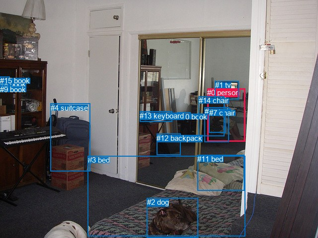
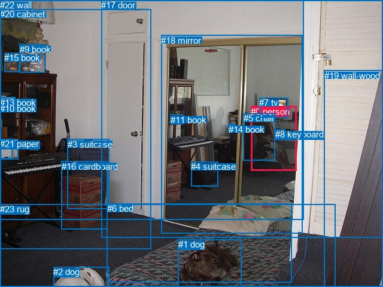

# 图片 1529：2387080.jpg

随机样本序号：138。图片 SHA256：`7d41c97dc524e33c5005651a44c75e6629d9f7b05b48b9b430b76db77765e0a8`。

红色框表示人，蓝色框表示其他物体。两个模式分别保留自身框编号，可依据位置比较对应对象。

## 自动检测框与输出

人的框编号：`[0]`。状态：`ok`。

### 自动检测全部物体框

| 编号 | 类别 | 是否为人 | 检测分数 | 像素坐标 xyxy |
|---|---|---|---|---|
| 0 | person | True | 0.9972 | 417.3, 178.2, 494.0, 285.1 |
| 1 | tv | False | 0.9875 | 432.8, 163.4, 480.2, 200.3 |
| 2 | dog | False | 0.9827 | 295.8, 399.3, 398.4, 479.7 |
| 3 | bed | False | 0.9325 | 176.9, 314.1, 493.5, 477.0 |
| 4 | suitcase | False | 0.8634 | 101.6, 208.8, 181.6, 345.6 |
| 5 | book | False | 0.7775 | 0.0, 164.0, 24.7, 172.2 |
| 6 | chair | False | 0.6813 | 411.7, 216.5, 460.7, 286.2 |
| 7 | chair | False | 0.6216 | 420.5, 219.4, 454.4, 267.3 |
| 8 | book | False | 0.5576 | 0.0, 161.5, 24.7, 182.3 |
| 9 | book | False | 0.5298 | 0.0, 171.7, 23.7, 181.7 |
| 10 | book | False | 0.5136 | 357.2, 226.9, 383.8, 234.4 |
| 11 | bed | False | 0.5136 | 397.1, 312.0, 491.4, 384.4 |
| 12 | backpack | False | 0.4749 | 315.1, 269.8, 363.6, 312.0 |
| 13 | keyboard | False | 0.4521 | 281.4, 224.6, 346.8, 245.1 |
| 14 | chair | False | 0.4159 | 399.6, 194.2, 451.2, 274.8 |
| 15 | book | False | 0.3923 | 0.0, 154.1, 19.1, 159.2 |

### 自动检测 Top50 人相关候选

评分物体对：240；人相关物体对：30；输出关系：50。

| 排名 | 主语编号与类别 | 关系 | 宾语编号与类别 | 类型 | 人与人 | 排序分数 | 原始融合 logit |
|---|---|---|---|---|---|---|---|
| 1 | #0 person | sitting on | #6 chair | semantic | False | 0.99094 | 4.6950 |
| 2 | #0 person | sitting on | #7 chair | semantic | False | 0.99063 | 4.6606 |
| 3 | #0 person | looking at | #1 tv | semantic | False | 0.99047 | 4.6442 |
| 4 | #0 person | sitting on | #14 chair | semantic | False | 0.98806 | 4.4159 |
| 5 | #0 person | on | #7 chair | spatial | False | 0.91525 | 2.3794 |
| 6 | #0 person | on | #6 chair | spatial | False | 0.90494 | 2.2534 |
| 7 | #0 person | on | #14 chair | spatial | False | 0.88682 | 2.0587 |
| 8 | #0 person | beside | #1 tv | spatial | False | 0.86661 | 1.8713 |
| 9 | #1 tv | beside | #0 person | spatial | False | 0.62485 | 0.5102 |
| 10 | #0 person | beside | #10 book | spatial | False | 0.49627 | -0.0149 |
| 11 | #14 chair | beside | #0 person | spatial | False | 0.48437 | -0.0625 |
| 12 | #1 tv | looking at | #0 person | semantic | False | 0.45274 | -0.1896 |
| 13 | #0 person | looking at | #10 book | semantic | False | 0.44497 | -0.2210 |
| 14 | #0 person | beside | #3 bed | spatial | False | 0.41960 | -0.3244 |
| 15 | #0 person | sitting on | #3 bed | semantic | False | 0.41387 | -0.3480 |
| 16 | #0 person | looking at | #13 keyboard | semantic | False | 0.34382 | -0.6463 |
| 17 | #6 chair | beside | #0 person | spatial | False | 0.26869 | -1.0013 |
| 18 | #0 person | beside | #13 keyboard | spatial | False | 0.22067 | -1.2618 |
| 19 | #3 bed | in front of | #0 person | spatial | False | 0.18585 | -1.4772 |
| 20 | #7 chair | beside | #0 person | spatial | False | 0.18512 | -1.4820 |
| 21 | #2 dog | looking at | #0 person | semantic | False | 0.11665 | -2.0246 |
| 22 | #14 chair | holding | #0 person | semantic | False | 0.11190 | -2.0715 |
| 23 | #7 chair | holding | #0 person | semantic | False | 0.06146 | -2.7259 |
| 24 | #0 person | beside | #12 backpack | spatial | False | 0.06089 | -2.7358 |
| 25 | #6 chair | holding | #0 person | semantic | False | 0.05534 | -2.8373 |
| 26 | #0 person | playing | #12 backpack | semantic | False | 0.04670 | -3.0162 |
| 27 | #12 backpack | beside | #0 person | spatial | False | 0.03881 | -3.2096 |
| 28 | #0 person | looking at | #2 dog | semantic | False | 0.03642 | -3.2756 |
| 29 | #0 person | sitting on | #4 suitcase | semantic | False | 0.03257 | -3.3912 |
| 30 | #10 book | beside | #0 person | spatial | False | 0.03140 | -3.4289 |
| 31 | #0 person | beside | #11 bed | spatial | False | 0.02597 | -3.6245 |
| 32 | #2 dog | in front of | #0 person | spatial | False | 0.02304 | -3.7470 |
| 33 | #0 person | playing | #5 book | semantic | False | 0.01812 | -3.9924 |
| 34 | #11 bed | beside | #0 person | spatial | False | 0.01760 | -4.0223 |
| 35 | #0 person | in front of | #4 suitcase | spatial | False | 0.01758 | -4.0235 |
| 36 | #4 suitcase | looking at | #0 person | semantic | False | 0.01710 | -4.0516 |
| 37 | #0 person | playing | #9 book | semantic | False | 0.01646 | -4.0900 |
| 38 | #0 person | wearing | #11 bed | semantic | False | 0.01539 | -4.1587 |
| 39 | #4 suitcase | beside | #0 person | spatial | False | 0.01450 | -4.2192 |
| 40 | #0 person | playing | #8 book | semantic | False | 0.01308 | -4.3239 |
| 41 | #0 person | beside | #2 dog | spatial | False | 0.01257 | -4.3640 |
| 42 | #0 person | playing | #15 book | semantic | False | 0.01015 | -4.5803 |
| 43 | #13 keyboard | beside | #0 person | spatial | False | 0.00941 | -4.6567 |
| 44 | #12 backpack | holding | #0 person | semantic | False | 0.00858 | -4.7497 |
| 45 | #10 book | holding | #0 person | semantic | False | 0.00693 | -4.9647 |
| 46 | #3 bed | holding | #0 person | semantic | False | 0.00492 | -5.3099 |
| 47 | #11 bed | holding | #0 person | semantic | False | 0.00213 | -6.1483 |
| 48 | #8 book | in front of | #0 person | spatial | False | 0.00212 | -6.1551 |
| 49 | #9 book | in front of | #0 person | spatial | False | 0.00159 | -6.4456 |
| 50 | #5 book | in front of | #0 person | spatial | False | 0.00153 | -6.4837 |

### 自动检测逐条人相关 GT 核验

R@50：100.00%；命中 1/1。

| GT 主语编号 | GT 关系 | GT 宾语编号 | 结果阶段 | 匹配预测主语编号 | 匹配预测宾语编号 |
|---|---|---|---|---|---|
| 0 | sitting on | 5 | hit50 | [0] | [14] |

## 真实框与输出

人的框编号：`[0]`。

### 真实框全部物体框

| 编号 | 类别 | 是否为人 | 检测分数 | 像素坐标 xyxy |
|---|---|---|---|---|
| 0 | person | True | GT | 419.0, 178.0, 495.0, 286.0 |
| 1 | dog | False | GT | 298.0, 400.0, 404.0, 480.0 |
| 2 | dog | False | GT | 89.0, 446.0, 182.0, 480.0 |
| 3 | suitcase | False | GT | 113.0, 233.0, 182.0, 350.0 |
| 4 | suitcase | False | GT | 319.0, 270.0, 364.0, 311.0 |
| 5 | chair | False | GT | 407.0, 189.0, 460.0, 268.0 |
| 6 | bed | False | GT | 179.0, 340.0, 488.0, 472.0 |
| 7 | tv | False | GT | 433.0, 163.0, 481.0, 197.0 |
| 8 | keyboard | False | GT | 460.0, 216.0, 477.0, 222.0 |
| 9 | book | False | GT | 33.0, 74.0, 76.0, 122.0 |
| 10 | book | False | GT | 0.0, 173.0, 23.0, 183.0 |
| 11 | book | False | GT | 285.0, 192.0, 306.0, 208.0 |
| 12 | book | False | GT | 0.0, 234.0, 21.0, 266.0 |
| 13 | book | False | GT | 0.0, 163.0, 25.0, 173.0 |
| 14 | book | False | GT | 382.0, 208.0, 395.0, 211.0 |
| 15 | book | False | GT | 7.0, 88.0, 33.0, 120.0 |
| 16 | cardboard | False | GT | 103.0, 270.0, 180.0, 384.0 |
| 17 | door | False | GT | 169.0, 0.0, 640.0, 398.0 |
| 18 | mirror | False | GT | 269.0, 59.0, 505.0, 390.0 |
| 19 | wall-wood | False | GT | 542.0, 118.0, 640.0, 480.0 |
| 20 | cabinet | False | GT | 0.0, 15.0, 252.0, 417.0 |
| 21 | paper | False | GT | 0.0, 232.0, 31.0, 266.0 |
| 22 | wall | False | GT | 0.0, 0.0, 507.0, 368.0 |
| 23 | rug | False | GT | 0.0, 341.0, 560.0, 480.0 |

### 真实框 Top50 人相关候选

评分物体对：552；人相关物体对：46；输出关系：50。

| 排名 | 主语编号与类别 | 关系 | 宾语编号与类别 | 类型 | 人与人 | 排序分数 | 原始融合 logit |
|---|---|---|---|---|---|---|---|
| 1 | #0 person | sitting on | #5 chair | semantic | False | 0.98744 | 4.3642 |
| 2 | #0 person | looking at | #7 tv | semantic | False | 0.98535 | 4.2084 |
| 3 | #0 person | on | #8 keyboard | spatial | False | 0.95857 | 3.1414 |
| 4 | #0 person | in | #17 door | spatial | False | 0.95074 | 2.9602 |
| 5 | #0 person | sitting on | #8 keyboard | semantic | False | 0.94339 | 2.8133 |
| 6 | #0 person | in | #18 mirror | spatial | False | 0.92786 | 2.5542 |
| 7 | #0 person | in | #5 chair | spatial | False | 0.92260 | 2.4782 |
| 8 | #0 person | in | #22 wall | spatial | False | 0.86347 | 1.8444 |
| 9 | #0 person | sitting on | #17 door | semantic | False | 0.78719 | 1.3081 |
| 10 | #0 person | beside | #7 tv | spatial | False | 0.76762 | 1.1949 |
| 11 | #0 person | looking at | #18 mirror | semantic | False | 0.72586 | 0.9737 |
| 12 | #0 person | sitting on | #22 wall | semantic | False | 0.51379 | 0.0552 |
| 13 | #7 tv | on | #0 person | spatial | False | 0.44282 | -0.2297 |
| 14 | #0 person | playing | #14 book | semantic | False | 0.43790 | -0.2497 |
| 15 | #5 chair | on | #0 person | spatial | False | 0.37755 | -0.4999 |
| 16 | #5 chair | sitting on | #0 person | semantic | False | 0.36748 | -0.5430 |
| 17 | #7 tv | looking at | #0 person | semantic | False | 0.29218 | -0.8848 |
| 18 | #0 person | on | #14 book | spatial | False | 0.28325 | -0.9284 |
| 19 | #0 person | sitting on | #23 rug | semantic | False | 0.25381 | -1.0784 |
| 20 | #0 person | sitting on | #6 bed | semantic | False | 0.19610 | -1.4109 |
| 21 | #0 person | on | #23 rug | spatial | False | 0.17316 | -1.5634 |
| 22 | #8 keyboard | on | #0 person | spatial | False | 0.14987 | -1.7356 |
| 23 | #18 mirror | in front of | #0 person | spatial | False | 0.13232 | -1.8806 |
| 24 | #0 person | in | #20 cabinet | spatial | False | 0.13224 | -1.8813 |
| 25 | #0 person | on | #6 bed | spatial | False | 0.11147 | -2.0759 |
| 26 | #19 wall-wood | beside | #0 person | spatial | False | 0.07916 | -2.4538 |
| 27 | #8 keyboard | holding | #0 person | semantic | False | 0.07297 | -2.5419 |
| 28 | #0 person | looking at | #11 book | semantic | False | 0.06973 | -2.5908 |
| 29 | #0 person | looking at | #20 cabinet | semantic | False | 0.06879 | -2.6054 |
| 30 | #18 mirror | holding | #0 person | semantic | False | 0.04158 | -3.1376 |
| 31 | #0 person | on | #4 suitcase | spatial | False | 0.03920 | -3.1991 |
| 32 | #0 person | sitting on | #3 suitcase | semantic | False | 0.03309 | -3.3749 |
| 33 | #0 person | playing | #4 suitcase | semantic | False | 0.03229 | -3.4002 |
| 34 | #0 person | on | #11 book | spatial | False | 0.03208 | -3.4069 |
| 35 | #0 person | looking at | #1 dog | semantic | False | 0.02814 | -3.5421 |
| 36 | #1 dog | looking at | #0 person | semantic | False | 0.02771 | -3.5579 |
| 37 | #4 suitcase | on | #0 person | spatial | False | 0.02197 | -3.7959 |
| 38 | #14 book | beside | #0 person | spatial | False | 0.02053 | -3.8649 |
| 39 | #0 person | playing | #13 book | semantic | False | 0.01940 | -3.9229 |
| 40 | #0 person | playing | #10 book | semantic | False | 0.01859 | -3.9662 |
| 41 | #0 person | beside | #19 wall-wood | spatial | False | 0.01834 | -3.9799 |
| 42 | #2 dog | looking at | #0 person | semantic | False | 0.01649 | -4.0887 |
| 43 | #0 person | in | #3 suitcase | spatial | False | 0.01625 | -4.1031 |
| 44 | #0 person | playing | #21 paper | semantic | False | 0.01250 | -4.3696 |
| 45 | #6 bed | in front of | #0 person | spatial | False | 0.01141 | -4.4617 |
| 46 | #0 person | in | #1 dog | spatial | False | 0.01130 | -4.4714 |
| 47 | #0 person | playing | #12 book | semantic | False | 0.01061 | -4.5352 |
| 48 | #17 door | in | #0 person | spatial | False | 0.00992 | -4.6034 |
| 49 | #0 person | sitting on | #19 wall-wood | semantic | False | 0.00937 | -4.6610 |
| 50 | #14 book | holding | #0 person | semantic | False | 0.00867 | -4.7395 |

### 真实框逐条人相关 GT 核验

R@50：100.00%；命中 1/1。

| GT 主语编号 | GT 关系 | GT 宾语编号 | 结果阶段 | 匹配预测主语编号 | 匹配预测宾语编号 |
|---|---|---|---|---|---|
| 0 | sitting on | 5 | hit50 | [0] | [5] |

## 全部人相关 GT

| 主语编号与类别 | 关系 | 宾语编号与类别 |
|---|---|---|
| #0 person | sitting on | #5 chair |

原始记录、全部人相关物体对的两项预测与分项分数见 [逐图证据 JSON](../evidence/cases/1529.json)。全部56类 logits 保留于本机 HOR/output/random500/logits/。

<!-- HOR_COMPLETE_RESULTS -->

## 六组条件的完整输出对照

以下保留同一图片三种框与候选模式、两种谓词输出规则的全部 Top50。框编号各自在所属模式内解释。

### 自动检测框完整枚举：空间与语义各保留一个谓词

| 排名 | 主语编号与类别 | 谓词 | 宾语编号与类别 | 分组 | 排序分数 | predicate logit | pair logit |
|---|---|---|---|---|---|---|---|
| 1 | #0 person | sitting on | #6 chair | semantic | 0.9909416 | 4.3064418 | 0.3885182 |
| 2 | #0 person | sitting on | #7 chair | semantic | 0.9906276 | 4.1078362 | 0.5527323 |
| 3 | #0 person | looking at | #1 tv | semantic | 0.9904748 | 4.2589469 | 0.3852912 |
| 4 | #0 person | sitting on | #14 chair | semantic | 0.9880602 | 4.0927825 | 0.3230817 |
| 5 | #0 person | on | #7 chair | spatial | 0.9152467 | 1.8267159 | 0.5527323 |
| 6 | #0 person | on | #6 chair | spatial | 0.9049413 | 1.8648577 | 0.3885182 |
| 7 | #0 person | on | #14 chair | spatial | 0.8868221 | 1.7356019 | 0.3230817 |
| 8 | #0 person | beside | #1 tv | spatial | 0.8666052 | 1.4859791 | 0.3852912 |
| 9 | #1 tv | beside | #0 person | spatial | 0.6248461 | 1.1209950 | -0.6108259 |
| 10 | #0 person | beside | #10 book | spatial | 0.4962663 | 0.4934301 | -0.5083654 |
| 11 | #14 chair | beside | #0 person | spatial | 0.4843696 | 0.6414289 | -0.7039707 |
| 12 | #1 tv | looking at | #0 person | semantic | 0.4527379 | 0.4212112 | -0.6108259 |
| 13 | #0 person | looking at | #10 book | semantic | 0.4449720 | 0.2873583 | -0.5083654 |
| 14 | #0 person | beside | #3 bed | spatial | 0.4195982 | 0.5473604 | -0.8717836 |
| 15 | #0 person | sitting on | #3 bed | semantic | 0.4138748 | 0.5238137 | -0.8717836 |
| 16 | #0 person | looking at | #13 keyboard | semantic | 0.3438176 | 0.7779918 | -1.4243195 |
| 17 | #6 chair | beside | #0 person | spatial | 0.2686881 | -0.2300897 | -0.7711990 |
| 18 | #0 person | beside | #13 keyboard | spatial | 0.2206656 | 0.1625280 | -1.4243195 |
| 19 | #3 bed | in front of | #0 person | spatial | 0.1858498 | 0.2213120 | -1.6985184 |
| 20 | #7 chair | beside | #0 person | spatial | 0.1851197 | -0.7101250 | -0.7719138 |
| 21 | #2 dog | looking at | #0 person | semantic | 0.1166466 | -0.4743357 | -1.5502412 |
| 22 | #14 chair | holding | #0 person | semantic | 0.1118959 | -1.3675499 | -0.7039707 |
| 23 | #7 chair | holding | #0 person | semantic | 0.0614643 | -1.9539502 | -0.7719138 |
| 24 | #0 person | beside | #12 backpack | spatial | 0.0608930 | -1.3719091 | -1.3639014 |
| 25 | #6 chair | holding | #0 person | semantic | 0.0553412 | -2.0661063 | -0.7711990 |
| 26 | #0 person | playing | #12 backpack | semantic | 0.0466974 | -1.6523414 | -1.3639014 |
| 27 | #12 backpack | beside | #0 person | spatial | 0.0388073 | -1.7033176 | -1.5062498 |
| 28 | #0 person | looking at | #2 dog | semantic | 0.0364175 | -1.6393530 | -1.6362569 |
| 29 | #0 person | sitting on | #4 suitcase | semantic | 0.0325731 | -1.6157413 | -1.7754109 |
| 30 | #10 book | beside | #0 person | spatial | 0.0314044 | -2.3350604 | -1.0938398 |
| 31 | #0 person | beside | #11 bed | spatial | 0.0259706 | -2.4721191 | -1.1523573 |
| 32 | #2 dog | in front of | #0 person | spatial | 0.0230443 | -2.1967802 | -1.5502412 |
| 33 | #0 person | playing | #5 book | semantic | 0.0181204 | -2.3237472 | -1.6686838 |
| 34 | #11 bed | beside | #0 person | spatial | 0.0175968 | -2.7254658 | -1.2968193 |
| 35 | #0 person | in front of | #4 suitcase | spatial | 0.0175754 | -2.2481151 | -1.7754109 |
| 36 | #4 suitcase | looking at | #0 person | semantic | 0.0170971 | -2.2543933 | -1.7972062 |
| 37 | #0 person | playing | #9 book | semantic | 0.0164638 | -2.4482508 | -1.6417420 |
| 38 | #0 person | wearing | #11 bed | semantic | 0.0153869 | -3.0063727 | -1.1523573 |
| 39 | #4 suitcase | beside | #0 person | spatial | 0.0144969 | -2.4220092 | -1.7972062 |
| 40 | #0 person | playing | #8 book | semantic | 0.0130755 | -2.6637371 | -1.6601163 |
| 41 | #0 person | beside | #2 dog | spatial | 0.0125677 | -2.7277212 | -1.6362569 |
| 42 | #0 person | playing | #15 book | semantic | 0.0101476 | -2.8382251 | -1.7420944 |
| 43 | #13 keyboard | beside | #0 person | spatial | 0.0094085 | -2.6943049 | -1.9623853 |
| 44 | #12 backpack | holding | #0 person | semantic | 0.0085798 | -3.2434821 | -1.5062498 |
| 45 | #10 book | holding | #0 person | semantic | 0.0069316 | -3.8708625 | -1.0938398 |
| 46 | #3 bed | holding | #0 person | semantic | 0.0049180 | -3.6114140 | -1.6985184 |
| 47 | #11 bed | holding | #0 person | semantic | 0.0021326 | -4.8514700 | -1.2968193 |
| 48 | #8 book | in front of | #0 person | spatial | 0.0021181 | -4.3866935 | -1.7684033 |
| 49 | #9 book | in front of | #0 person | spatial | 0.0015850 | -4.6910000 | -1.7545545 |
| 50 | #5 book | in front of | #0 person | spatial | 0.0015258 | -4.7152600 | -1.7684263 |

GT 命中：1/1，R@50=100.00%。

| GT主语 | GT谓词 | GT宾语 | 结果阶段 | 匹配主语框 | 匹配宾语框 |
|---|---|---|---|---|---|
| 0 | sitting on | 5 | hit50 | [0] | [14] |

### 自动检测框完整枚举：每对只保留一个谓词

| 排名 | 主语编号与类别 | 谓词 | 宾语编号与类别 | 分组 | 排序分数 | predicate logit | pair logit |
|---|---|---|---|---|---|---|---|
| 1 | #0 person | sitting on | #6 chair | single | 0.9909416 | 4.3064418 | 0.3885182 |
| 2 | #0 person | sitting on | #7 chair | single | 0.9906276 | 4.1078362 | 0.5527323 |
| 3 | #0 person | looking at | #1 tv | single | 0.9904748 | 4.2589469 | 0.3852912 |
| 4 | #0 person | sitting on | #14 chair | single | 0.9880602 | 4.0927825 | 0.3230817 |
| 5 | #1 tv | beside | #0 person | single | 0.6248461 | 1.1209950 | -0.6108259 |
| 6 | #0 person | beside | #10 book | single | 0.4962663 | 0.4934301 | -0.5083654 |
| 7 | #14 chair | beside | #0 person | single | 0.4843696 | 0.6414289 | -0.7039707 |
| 8 | #0 person | beside | #3 bed | single | 0.4195982 | 0.5473604 | -0.8717836 |
| 9 | #0 person | looking at | #13 keyboard | single | 0.3438176 | 0.7779918 | -1.4243195 |
| 10 | #6 chair | beside | #0 person | single | 0.2686881 | -0.2300897 | -0.7711990 |
| 11 | #3 bed | in front of | #0 person | single | 0.1858498 | 0.2213120 | -1.6985184 |
| 12 | #7 chair | beside | #0 person | single | 0.1851197 | -0.7101250 | -0.7719138 |
| 13 | #2 dog | looking at | #0 person | single | 0.1166466 | -0.4743357 | -1.5502412 |
| 14 | #0 person | beside | #12 backpack | single | 0.0608930 | -1.3719091 | -1.3639014 |
| 15 | #12 backpack | beside | #0 person | single | 0.0388073 | -1.7033176 | -1.5062498 |
| 16 | #0 person | looking at | #2 dog | single | 0.0364175 | -1.6393530 | -1.6362569 |
| 17 | #0 person | sitting on | #4 suitcase | single | 0.0325731 | -1.6157413 | -1.7754109 |
| 18 | #10 book | beside | #0 person | single | 0.0314044 | -2.3350604 | -1.0938398 |
| 19 | #0 person | beside | #11 bed | single | 0.0259706 | -2.4721191 | -1.1523573 |
| 20 | #0 person | playing | #5 book | single | 0.0181204 | -2.3237472 | -1.6686838 |
| 21 | #11 bed | beside | #0 person | single | 0.0175968 | -2.7254658 | -1.2968193 |
| 22 | #4 suitcase | looking at | #0 person | single | 0.0170971 | -2.2543933 | -1.7972062 |
| 23 | #0 person | playing | #9 book | single | 0.0164638 | -2.4482508 | -1.6417420 |
| 24 | #0 person | playing | #8 book | single | 0.0130755 | -2.6637371 | -1.6601163 |
| 25 | #0 person | playing | #15 book | single | 0.0101476 | -2.8382251 | -1.7420944 |
| 26 | #13 keyboard | beside | #0 person | single | 0.0094085 | -2.6943049 | -1.9623853 |
| 27 | #8 book | in front of | #0 person | single | 0.0021181 | -4.3866935 | -1.7684033 |
| 28 | #9 book | in front of | #0 person | single | 0.0015850 | -4.6910000 | -1.7545545 |
| 29 | #5 book | in front of | #0 person | single | 0.0015258 | -4.7152600 | -1.7684263 |
| 30 | #15 book | in front of | #0 person | single | 0.0010371 | -5.0812874 | -1.7889673 |

GT 命中：1/1，R@50=100.00%。

| GT主语 | GT谓词 | GT宾语 | 结果阶段 | 匹配主语框 | 匹配宾语框 |
|---|---|---|---|---|---|
| 0 | sitting on | 5 | hit50 | [0] | [14] |

### 真实框完整枚举：空间与语义各保留一个谓词

| 排名 | 主语编号与类别 | 谓词 | 宾语编号与类别 | 分组 | 排序分数 | predicate logit | pair logit |
|---|---|---|---|---|---|---|---|
| 1 | #0 person | sitting on | #5 chair | semantic | 0.9874352 | 4.0416131 | 0.3226013 |
| 2 | #0 person | looking at | #7 tv | semantic | 0.9853475 | 3.8404584 | 0.3679253 |
| 3 | #0 person | on | #8 keyboard | spatial | 0.9585693 | 2.6635365 | 0.4778832 |
| 4 | #0 person | in | #17 door | spatial | 0.9507433 | 3.1629386 | -0.2027385 |
| 5 | #0 person | sitting on | #8 keyboard | semantic | 0.9433899 | 2.3354092 | 0.4778832 |
| 6 | #0 person | in | #18 mirror | spatial | 0.9278551 | 2.9226542 | -0.3684554 |
| 7 | #0 person | in | #5 chair | spatial | 0.9225980 | 2.1555800 | 0.3226013 |
| 8 | #0 person | in | #22 wall | spatial | 0.8634740 | 2.4845600 | -0.6401110 |
| 9 | #0 person | sitting on | #17 door | semantic | 0.7871886 | 1.5107999 | -0.2027385 |
| 10 | #0 person | beside | #7 tv | spatial | 0.7676169 | 0.8269782 | 0.3679253 |
| 11 | #0 person | looking at | #18 mirror | semantic | 0.7258626 | 1.3421869 | -0.3684554 |
| 12 | #0 person | sitting on | #22 wall | semantic | 0.5137938 | 0.6953001 | -0.6401110 |
| 13 | #7 tv | on | #0 person | spatial | 0.4428152 | 0.3723435 | -0.6020879 |
| 14 | #0 person | playing | #14 book | semantic | 0.4379032 | 0.2826905 | -0.5323669 |
| 15 | #5 chair | on | #0 person | spatial | 0.3775546 | 0.1785898 | -0.6785306 |
| 16 | #5 chair | sitting on | #0 person | semantic | 0.3674838 | 0.1355038 | -0.6785306 |
| 17 | #7 tv | looking at | #0 person | semantic | 0.2921783 | -0.2827401 | -0.6020879 |
| 18 | #0 person | on | #14 book | spatial | 0.2832481 | -0.3960395 | -0.5323669 |
| 19 | #0 person | sitting on | #23 rug | semantic | 0.2538094 | -0.0628939 | -1.0155035 |
| 20 | #0 person | sitting on | #6 bed | semantic | 0.1960973 | -0.3081779 | -1.1026894 |
| 21 | #0 person | on | #23 rug | spatial | 0.1731648 | -0.5478582 | -1.0155035 |
| 22 | #8 keyboard | on | #0 person | spatial | 0.1498666 | -0.7953362 | -0.9403115 |
| 23 | #18 mirror | in front of | #0 person | spatial | 0.1323211 | -0.6961999 | -1.1843898 |
| 24 | #0 person | in | #20 cabinet | spatial | 0.1322444 | -0.7506843 | -1.1305740 |
| 25 | #0 person | on | #6 bed | spatial | 0.1114663 | -0.9731612 | -1.1026894 |
| 26 | #19 wall-wood | beside | #0 person | spatial | 0.0791583 | -0.9032829 | -1.5505559 |
| 27 | #8 keyboard | holding | #0 person | semantic | 0.0729709 | -1.6016133 | -0.9403115 |
| 28 | #0 person | looking at | #11 book | semantic | 0.0697341 | -0.8902094 | -1.7005718 |
| 29 | #0 person | looking at | #20 cabinet | semantic | 0.0687948 | -1.4747770 | -1.1305740 |
| 30 | #18 mirror | holding | #0 person | semantic | 0.0415829 | -1.9532030 | -1.1843898 |
| 31 | #0 person | on | #4 suitcase | spatial | 0.0391986 | -1.7967021 | -1.4024234 |
| 32 | #0 person | sitting on | #3 suitcase | semantic | 0.0330892 | -1.6337271 | -1.7411728 |
| 33 | #0 person | playing | #4 suitcase | semantic | 0.0322901 | -1.9977481 | -1.4024234 |
| 34 | #0 person | on | #11 book | spatial | 0.0320815 | -1.7062979 | -1.7005718 |
| 35 | #0 person | looking at | #1 dog | semantic | 0.0281388 | -1.8776755 | -1.6643870 |
| 36 | #1 dog | looking at | #0 person | semantic | 0.0277092 | -1.9600942 | -1.5977981 |
| 37 | #4 suitcase | on | #0 person | spatial | 0.0219697 | -2.2923105 | -1.5035667 |
| 38 | #14 book | beside | #0 person | spatial | 0.0205338 | -2.9681621 | -0.8967737 |
| 39 | #0 person | playing | #13 book | semantic | 0.0194001 | -2.2334487 | -1.6894393 |
| 40 | #0 person | playing | #10 book | semantic | 0.0185925 | -2.3038297 | -1.6623976 |
| 41 | #0 person | beside | #19 wall-wood | spatial | 0.0183448 | -2.4241776 | -1.5557177 |
| 42 | #2 dog | looking at | #0 person | semantic | 0.0164852 | -2.3131599 | -1.7755083 |
| 43 | #0 person | in | #3 suitcase | spatial | 0.0162526 | -2.3619418 | -1.7411728 |
| 44 | #0 person | playing | #21 paper | semantic | 0.0124979 | -2.5275931 | -1.8420240 |
| 45 | #6 bed | in front of | #0 person | spatial | 0.0114112 | -2.7691624 | -1.6925241 |
| 46 | #0 person | in | #1 dog | spatial | 0.0113022 | -2.8070068 | -1.6643870 |
| 47 | #0 person | playing | #12 book | semantic | 0.0106106 | -2.6887503 | -1.8464803 |
| 48 | #17 door | in | #0 person | spatial | 0.0099186 | -3.3621521 | -1.2412239 |
| 49 | #0 person | sitting on | #19 wall-wood | semantic | 0.0093689 | -3.1052339 | -1.5557177 |
| 50 | #14 book | holding | #0 person | semantic | 0.0086672 | -3.8427322 | -0.8967737 |

GT 命中：1/1，R@50=100.00%。

| GT主语 | GT谓词 | GT宾语 | 结果阶段 | 匹配主语框 | 匹配宾语框 |
|---|---|---|---|---|---|
| 0 | sitting on | 5 | hit50 | [0] | [5] |

### 真实框完整枚举：每对只保留一个谓词

| 排名 | 主语编号与类别 | 谓词 | 宾语编号与类别 | 分组 | 排序分数 | predicate logit | pair logit |
|---|---|---|---|---|---|---|---|
| 1 | #0 person | sitting on | #5 chair | single | 0.9874352 | 4.0416131 | 0.3226013 |
| 2 | #0 person | looking at | #7 tv | single | 0.9853475 | 3.8404584 | 0.3679253 |
| 3 | #0 person | on | #8 keyboard | single | 0.9585693 | 2.6635365 | 0.4778832 |
| 4 | #0 person | in | #17 door | single | 0.9507433 | 3.1629386 | -0.2027385 |
| 5 | #0 person | in | #18 mirror | single | 0.9278551 | 2.9226542 | -0.3684554 |
| 6 | #0 person | in | #22 wall | single | 0.8634740 | 2.4845600 | -0.6401110 |
| 7 | #7 tv | on | #0 person | single | 0.4428152 | 0.3723435 | -0.6020879 |
| 8 | #0 person | playing | #14 book | single | 0.4379032 | 0.2826905 | -0.5323669 |
| 9 | #5 chair | on | #0 person | single | 0.3775546 | 0.1785898 | -0.6785306 |
| 10 | #0 person | sitting on | #23 rug | single | 0.2538094 | -0.0628939 | -1.0155035 |
| 11 | #0 person | sitting on | #6 bed | single | 0.1960973 | -0.3081779 | -1.1026894 |
| 12 | #8 keyboard | on | #0 person | single | 0.1498666 | -0.7953362 | -0.9403115 |
| 13 | #18 mirror | in front of | #0 person | single | 0.1323211 | -0.6961999 | -1.1843898 |
| 14 | #0 person | in | #20 cabinet | single | 0.1322444 | -0.7506843 | -1.1305740 |
| 15 | #19 wall-wood | beside | #0 person | single | 0.0791583 | -0.9032829 | -1.5505559 |
| 16 | #0 person | looking at | #11 book | single | 0.0697341 | -0.8902094 | -1.7005718 |
| 17 | #0 person | on | #4 suitcase | single | 0.0391986 | -1.7967021 | -1.4024234 |
| 18 | #0 person | sitting on | #3 suitcase | single | 0.0330892 | -1.6337271 | -1.7411728 |
| 19 | #0 person | looking at | #1 dog | single | 0.0281388 | -1.8776755 | -1.6643870 |
| 20 | #1 dog | looking at | #0 person | single | 0.0277092 | -1.9600942 | -1.5977981 |
| 21 | #4 suitcase | on | #0 person | single | 0.0219697 | -2.2923105 | -1.5035667 |
| 22 | #14 book | beside | #0 person | single | 0.0205338 | -2.9681621 | -0.8967737 |
| 23 | #0 person | playing | #13 book | single | 0.0194001 | -2.2334487 | -1.6894393 |
| 24 | #0 person | playing | #10 book | single | 0.0185925 | -2.3038297 | -1.6623976 |
| 25 | #0 person | beside | #19 wall-wood | single | 0.0183448 | -2.4241776 | -1.5557177 |
| 26 | #2 dog | looking at | #0 person | single | 0.0164852 | -2.3131599 | -1.7755083 |
| 27 | #0 person | playing | #21 paper | single | 0.0124979 | -2.5275931 | -1.8420240 |
| 28 | #6 bed | in front of | #0 person | single | 0.0114112 | -2.7691624 | -1.6925241 |
| 29 | #0 person | playing | #12 book | single | 0.0106106 | -2.6887503 | -1.8464803 |
| 30 | #17 door | in | #0 person | single | 0.0099186 | -3.3621521 | -1.2412239 |
| 31 | #0 person | in | #2 dog | single | 0.0075400 | -3.1281657 | -1.7517945 |
| 32 | #11 book | beside | #0 person | single | 0.0050943 | -3.5294528 | -1.7450695 |
| 33 | #22 wall | in | #0 person | single | 0.0042980 | -3.7403975 | -1.7048931 |
| 34 | #0 person | sitting on | #16 cardboard | single | 0.0041645 | -3.5144622 | -1.9625177 |
| 35 | #13 book | in | #0 person | single | 0.0038398 | -3.8297048 | -1.7287741 |
| 36 | #10 book | on | #0 person | single | 0.0036932 | -3.8826725 | -1.7148855 |
| 37 | #0 person | playing | #15 book | single | 0.0036573 | -3.7000761 | -1.9072999 |
| 38 | #23 rug | in | #0 person | single | 0.0034840 | -4.0175676 | -1.6385123 |
| 39 | #3 suitcase | beside | #0 person | single | 0.0029887 | -3.9684989 | -1.8414202 |
| 40 | #12 book | on | #0 person | single | 0.0029356 | -4.1740780 | -1.6538422 |
| 41 | #21 paper | on | #0 person | single | 0.0026846 | -4.2528176 | -1.6647221 |
| 42 | #0 person | playing | #9 book | single | 0.0025686 | -3.8949149 | -2.0669117 |
| 43 | #15 book | on | #0 person | single | 0.0019956 | -4.3088441 | -1.9059632 |
| 44 | #20 cabinet | beside | #0 person | single | 0.0016979 | -4.2716150 | -2.1050777 |
| 45 | #16 cardboard | in | #0 person | single | 0.0012617 | -4.5202174 | -2.1537831 |
| 46 | #9 book | on | #0 person | single | 0.0012253 | -4.6462269 | -2.0571048 |

GT 命中：1/1，R@50=100.00%。

| GT主语 | GT谓词 | GT宾语 | 结果阶段 | 匹配主语框 | 匹配宾语框 |
|---|---|---|---|---|---|
| 0 | sitting on | 5 | hit50 | [0] | [5] |

### 真实框400候选：空间与语义各保留一个谓词

| 排名 | 主语编号与类别 | 谓词 | 宾语编号与类别 | 分组 | 排序分数 | predicate logit | pair logit |
|---|---|---|---|---|---|---|---|
| 1 | #0 person | sitting on | #5 chair | semantic | 0.9873979 | 4.0386090 | 0.3226013 |
| 2 | #0 person | looking at | #7 tv | semantic | 0.9844741 | 3.7816701 | 0.3679253 |
| 3 | #0 person | on | #8 keyboard | spatial | 0.9589996 | 2.6744261 | 0.4778832 |
| 4 | #0 person | in | #17 door | spatial | 0.9543617 | 3.2430339 | -0.2027385 |
| 5 | #0 person | sitting on | #8 keyboard | semantic | 0.9452881 | 2.3715243 | 0.4778832 |
| 6 | #0 person | in | #18 mirror | spatial | 0.9251125 | 2.8823843 | -0.3684554 |
| 7 | #0 person | in | #5 chair | spatial | 0.9151132 | 2.0551271 | 0.3226013 |
| 8 | #0 person | in | #22 wall | spatial | 0.9068242 | 2.9155717 | -0.6401110 |
| 9 | #0 person | sitting on | #17 door | semantic | 0.8085259 | 1.6431985 | -0.2027385 |
| 10 | #0 person | beside | #7 tv | spatial | 0.7567410 | 0.7669692 | 0.3679253 |
| 11 | #0 person | looking at | #18 mirror | semantic | 0.7258626 | 1.3421869 | -0.3684554 |
| 12 | #0 person | sitting on | #22 wall | semantic | 0.6147771 | 1.1075487 | -0.6401110 |
| 13 | #7 tv | on | #0 person | spatial | 0.4067002 | 0.2244644 | -0.6020879 |
| 14 | #5 chair | on | #0 person | spatial | 0.3559944 | 0.0857382 | -0.6785306 |
| 15 | #5 chair | sitting on | #0 person | semantic | 0.3083579 | -0.1292768 | -0.6785306 |
| 16 | #0 person | sitting on | #23 rug | semantic | 0.3001263 | 0.1688070 | -1.0155035 |
| 17 | #7 tv | looking at | #0 person | semantic | 0.2452397 | -0.5220761 | -0.6020879 |
| 18 | #0 person | in | #20 cabinet | spatial | 0.2333694 | -0.0588083 | -1.1305740 |
| 19 | #0 person | sitting on | #6 bed | semantic | 0.2295666 | -0.1080704 | -1.1026894 |
| 20 | #0 person | on | #23 rug | spatial | 0.1906389 | -0.4303603 | -1.0155035 |
| 21 | #8 keyboard | on | #0 person | spatial | 0.1367847 | -0.9019444 | -0.9403115 |
| 22 | #18 mirror | in front of | #0 person | spatial | 0.1285265 | -0.7296607 | -1.1843898 |
| 23 | #0 person | on | #6 bed | spatial | 0.1198613 | -0.8910546 | -1.1026894 |
| 24 | #0 person | looking at | #20 cabinet | semantic | 0.1144346 | -0.9156485 | -1.1305740 |
| 25 | #19 wall-wood | beside | #0 person | spatial | 0.0802598 | -0.8882661 | -1.5505559 |
| 26 | #0 person | playing | #11 book | semantic | 0.0773478 | -0.7783680 | -1.7005718 |
| 27 | #8 keyboard | holding | #0 person | semantic | 0.0640743 | -1.7411809 | -0.9403115 |
| 28 | #0 person | sitting on | #3 suitcase | semantic | 0.0415996 | -1.3960013 | -1.7411728 |
| 29 | #0 person | on | #4 suitcase | spatial | 0.0378350 | -1.8335268 | -1.4024234 |
| 30 | #18 mirror | holding | #0 person | semantic | 0.0363901 | -2.0920005 | -1.1843898 |
| 31 | #0 person | on | #11 book | spatial | 0.0349627 | -1.6173127 | -1.7005718 |
| 32 | #0 person | looking at | #1 dog | semantic | 0.0340597 | -1.6806006 | -1.6643870 |
| 33 | #0 person | playing | #4 suitcase | semantic | 0.0328405 | -1.9802787 | -1.4024234 |
| 34 | #1 dog | looking at | #0 person | semantic | 0.0294210 | -1.8983865 | -1.5977981 |
| 35 | #0 person | in | #3 suitcase | spatial | 0.0191025 | -2.1974771 | -1.7411728 |
| 36 | #0 person | beside | #19 wall-wood | spatial | 0.0183437 | -2.4242356 | -1.5557177 |
| 37 | #4 suitcase | on | #0 person | spatial | 0.0178428 | -2.5045867 | -1.5035667 |
| 38 | #2 dog | looking at | #0 person | semantic | 0.0155627 | -2.3716862 | -1.7755083 |
| 39 | #0 person | playing | #21 paper | semantic | 0.0145049 | -2.3766339 | -1.8420240 |
| 40 | #0 person | in | #1 dog | spatial | 0.0141101 | -2.5822637 | -1.6643870 |
| 41 | #0 person | playing | #12 book | semantic | 0.0125027 | -2.5227454 | -1.8464803 |
| 42 | #0 person | in | #2 dog | spatial | 0.0102251 | -2.8208385 | -1.7517945 |
| 43 | #6 bed | in front of | #0 person | spatial | 0.0100718 | -2.8953652 | -1.6925241 |
| 44 | #0 person | sitting on | #19 wall-wood | semantic | 0.0096523 | -3.0751426 | -1.5557177 |
| 45 | #17 door | in | #0 person | spatial | 0.0092540 | -3.4321795 | -1.2412239 |
| 46 | #0 person | looking at | #2 dog | semantic | 0.0088576 | -2.9657922 | -1.7517945 |
| 47 | #1 dog | beside | #0 person | spatial | 0.0071363 | -3.3375950 | -1.5977981 |
| 48 | #2 dog | in | #0 person | spatial | 0.0069234 | -3.1903920 | -1.7755083 |
| 49 | #19 wall-wood | standing on | #0 person | semantic | 0.0061438 | -3.5355895 | -1.5505559 |
| 50 | #0 person | sitting on | #16 cardboard | semantic | 0.0061093 | -3.1292925 | -1.9625177 |

GT 命中：1/1，R@50=100.00%。

| GT主语 | GT谓词 | GT宾语 | 结果阶段 | 匹配主语框 | 匹配宾语框 |
|---|---|---|---|---|---|
| 0 | sitting on | 5 | hit50 | [0] | [5] |

### 真实框400候选：每对只保留一个谓词

| 排名 | 主语编号与类别 | 谓词 | 宾语编号与类别 | 分组 | 排序分数 | predicate logit | pair logit |
|---|---|---|---|---|---|---|---|
| 1 | #0 person | sitting on | #5 chair | single | 0.9873979 | 4.0386090 | 0.3226013 |
| 2 | #0 person | looking at | #7 tv | single | 0.9844741 | 3.7816701 | 0.3679253 |
| 3 | #0 person | on | #8 keyboard | single | 0.9589996 | 2.6744261 | 0.4778832 |
| 4 | #0 person | in | #17 door | single | 0.9543617 | 3.2430339 | -0.2027385 |
| 5 | #0 person | in | #18 mirror | single | 0.9251125 | 2.8823843 | -0.3684554 |
| 6 | #0 person | in | #22 wall | single | 0.9068242 | 2.9155717 | -0.6401110 |
| 7 | #7 tv | on | #0 person | single | 0.4067002 | 0.2244644 | -0.6020879 |
| 8 | #5 chair | on | #0 person | single | 0.3559944 | 0.0857382 | -0.6785306 |
| 9 | #0 person | sitting on | #23 rug | single | 0.3001263 | 0.1688070 | -1.0155035 |
| 10 | #0 person | in | #20 cabinet | single | 0.2333694 | -0.0588083 | -1.1305740 |
| 11 | #0 person | sitting on | #6 bed | single | 0.2295666 | -0.1080704 | -1.1026894 |
| 12 | #8 keyboard | on | #0 person | single | 0.1367847 | -0.9019444 | -0.9403115 |
| 13 | #18 mirror | in front of | #0 person | single | 0.1285265 | -0.7296607 | -1.1843898 |
| 14 | #19 wall-wood | beside | #0 person | single | 0.0802598 | -0.8882661 | -1.5505559 |
| 15 | #0 person | playing | #11 book | single | 0.0773478 | -0.7783680 | -1.7005718 |
| 16 | #0 person | sitting on | #3 suitcase | single | 0.0415996 | -1.3960013 | -1.7411728 |
| 17 | #0 person | on | #4 suitcase | single | 0.0378350 | -1.8335268 | -1.4024234 |
| 18 | #0 person | looking at | #1 dog | single | 0.0340597 | -1.6806006 | -1.6643870 |
| 19 | #1 dog | looking at | #0 person | single | 0.0294210 | -1.8983865 | -1.5977981 |
| 20 | #0 person | beside | #19 wall-wood | single | 0.0183437 | -2.4242356 | -1.5557177 |
| 21 | #4 suitcase | on | #0 person | single | 0.0178428 | -2.5045867 | -1.5035667 |
| 22 | #2 dog | looking at | #0 person | single | 0.0155627 | -2.3716862 | -1.7755083 |
| 23 | #0 person | playing | #21 paper | single | 0.0145049 | -2.3766339 | -1.8420240 |
| 24 | #0 person | playing | #12 book | single | 0.0125027 | -2.5227454 | -1.8464803 |
| 25 | #0 person | in | #2 dog | single | 0.0102251 | -2.8208385 | -1.7517945 |
| 26 | #6 bed | in front of | #0 person | single | 0.0100718 | -2.8953652 | -1.6925241 |
| 27 | #17 door | in | #0 person | single | 0.0092540 | -3.4321795 | -1.2412239 |
| 28 | #0 person | sitting on | #16 cardboard | single | 0.0061093 | -3.1292925 | -1.9625177 |
| 29 | #0 person | playing | #15 book | single | 0.0046180 | -3.4658632 | -1.9072999 |
| 30 | #22 wall | in | #0 person | single | 0.0044329 | -3.7093651 | -1.7048931 |
| 31 | #0 person | playing | #9 book | single | 0.0041578 | -3.4116945 | -2.0669117 |
| 32 | #11 book | beside | #0 person | single | 0.0037749 | -3.8305387 | -1.7450695 |
| 33 | #23 rug | in | #0 person | single | 0.0034956 | -4.0142488 | -1.6385123 |
| 34 | #12 book | on | #0 person | single | 0.0032371 | -4.0759921 | -1.6538422 |
| 35 | #21 paper | on | #0 person | single | 0.0029704 | -4.1513648 | -1.6647221 |
| 36 | #3 suitcase | beside | #0 person | single | 0.0029115 | -3.9947567 | -1.8414202 |
| 37 | #20 cabinet | beside | #0 person | single | 0.0018610 | -4.1796989 | -2.1050777 |
| 38 | #9 book | on | #0 person | single | 0.0015693 | -4.3984737 | -2.0571048 |
| 39 | #16 cardboard | in | #0 person | single | 0.0014572 | -4.3760118 | -2.1537831 |

GT 命中：1/1，R@50=100.00%。

| GT主语 | GT谓词 | GT宾语 | 结果阶段 | 匹配主语框 | 匹配宾语框 |
|---|---|---|---|---|---|
| 0 | sitting on | 5 | hit50 | [0] | [5] |
