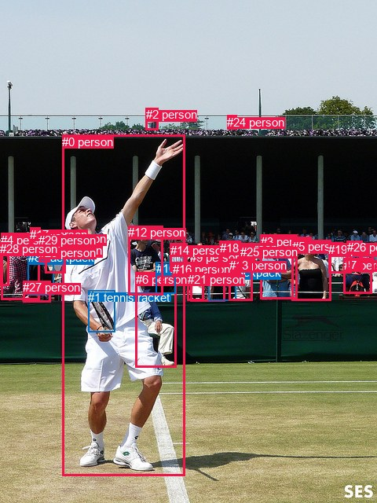
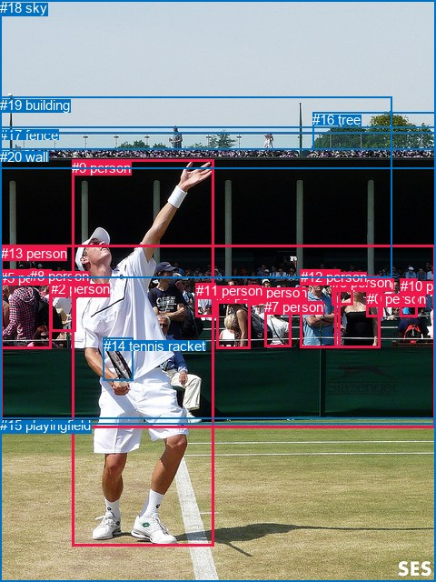

# 图片 1534：2387240.jpg

随机样本序号：119。图片 SHA256：`09359564291303089b691418a019548a7a795d7e577d9c7682199128bcdab251`。

红色框表示人，蓝色框表示其他物体。两个模式分别保留自身框编号，可依据位置比较对应对象。

## 自动检测框与输出

人的框编号：`[0, 2, 3, 4, 5, 6, 7, 9, 12, 13, 14, 15, 16, 17, 18, 19, 20, 21, 22, 23, 24, 25, 26, 27, 28, 29]`。状态：`ok`。

### 自动检测全部物体框

| 编号 | 类别 | 是否为人 | 检测分数 | 像素坐标 xyxy |
|---|---|---|---|---|
| 0 | person | True | 0.9996 | 79.3, 171.8, 235.1, 606.0 |
| 1 | tennis racket | False | 0.9955 | 112.1, 369.8, 146.6, 422.2 |
| 2 | person | True | 0.9817 | 185.8, 137.1, 201.5, 165.9 |
| 3 | person | True | 0.9594 | 331.6, 298.9, 378.7, 380.9 |
| 4 | person | True | 0.9563 | 1.4, 296.5, 50.2, 381.1 |
| 5 | person | True | 0.9479 | 371.7, 305.4, 421.0, 382.3 |
| 6 | person | True | 0.9256 | 172.6, 346.7, 225.0, 467.3 |
| 7 | person | True | 0.8937 | 437.6, 328.9, 473.2, 373.7 |
| 8 | backpack | False | 0.8932 | 36.0, 319.2, 68.7, 375.6 |
| 9 | person | True | 0.8895 | 242.0, 318.6, 286.1, 383.3 |
| 10 | backpack | False | 0.8793 | 198.9, 333.5, 223.1, 374.0 |
| 11 | backpack | False | 0.8545 | 265.6, 338.0, 300.9, 382.1 |
| 12 | person | True | 0.8500 | 163.1, 287.5, 207.3, 375.3 |
| 13 | person | True | 0.8266 | 291.6, 329.1, 321.1, 383.0 |
| 14 | person | True | 0.7799 | 216.7, 309.8, 238.7, 345.7 |
| 15 | person | True | 0.7420 | 57.1, 310.0, 83.3, 347.7 |
| 16 | person | True | 0.7057 | 219.7, 333.7, 241.3, 352.8 |
| 17 | person | True | 0.6901 | 38.5, 290.0, 51.7, 315.5 |
| 18 | person | True | 0.6789 | 279.8, 306.8, 306.4, 349.3 |
| 19 | person | True | 0.6686 | 418.3, 309.1, 447.9, 347.4 |
| 20 | person | True | 0.6622 | 49.2, 312.9, 63.2, 333.8 |
| 21 | person | True | 0.6311 | 238.7, 347.0, 259.7, 382.6 |
| 22 | person | True | 0.5969 | 62.4, 295.4, 77.5, 311.3 |
| 23 | person | True | 0.5801 | 457.1, 309.2, 475.8, 346.0 |
| 24 | person | True | 0.5473 | 289.4, 146.5, 301.2, 164.5 |
| 25 | person | True | 0.5424 | 305.9, 311.9, 324.2, 346.3 |
| 26 | person | True | 0.4730 | 441.6, 306.0, 461.4, 344.0 |
| 27 | person | True | 0.4196 | 29.2, 357.5, 64.3, 384.9 |
| 28 | person | True | 0.3801 | 0.1, 308.3, 11.1, 363.6 |
| 29 | person | True | 0.3705 | 49.1, 296.6, 59.8, 311.8 |

### 自动检测 Top50 人相关候选

评分物体对：870；人相关物体对：858；输出关系：50。

| 排名 | 主语编号与类别 | 关系 | 宾语编号与类别 | 类型 | 人与人 | 排序分数 | 原始融合 logit |
|---|---|---|---|---|---|---|---|
| 1 | #0 person | holding | #1 tennis racket | semantic | False | 0.99133 | 4.7395 |
| 2 | #0 person | holding | #6 person | semantic | True | 0.96366 | 3.2778 |
| 3 | #9 person | wearing | #11 backpack | semantic | False | 0.94997 | 2.9437 |
| 4 | #4 person | sitting on | #27 person | semantic | True | 0.94754 | 2.8938 |
| 5 | #8 backpack | sitting on | #27 person | semantic | False | 0.93137 | 2.6079 |
| 6 | #4 person | on | #27 person | spatial | True | 0.93104 | 2.6027 |
| 7 | #3 person | talking to | #5 person | semantic | True | 0.90906 | 2.3022 |
| 8 | #9 person | in | #11 backpack | spatial | False | 0.89666 | 2.1607 |
| 9 | #9 person | holding | #21 person | semantic | True | 0.88601 | 2.0506 |
| 10 | #8 backpack | in | #27 person | spatial | False | 0.88072 | 1.9993 |
| 11 | #4 person | wearing | #17 person | semantic | True | 0.87885 | 1.9816 |
| 12 | #0 person | in | #1 tennis racket | spatial | False | 0.87717 | 1.9659 |
| 13 | #4 person | in | #17 person | spatial | True | 0.86628 | 1.8685 |
| 14 | #8 backpack | wearing | #20 person | semantic | False | 0.86266 | 1.8376 |
| 15 | #4 person | wearing | #8 backpack | semantic | False | 0.83246 | 1.6032 |
| 16 | #14 person | wearing | #16 person | semantic | True | 0.82215 | 1.5310 |
| 17 | #4 person | wearing | #29 person | semantic | True | 0.80762 | 1.4346 |
| 18 | #14 person | in | #16 person | spatial | True | 0.79914 | 1.3809 |
| 19 | #9 person | in | #21 person | spatial | True | 0.79883 | 1.3790 |
| 20 | #4 person | in | #8 backpack | spatial | False | 0.78836 | 1.3151 |
| 21 | #0 person | in | #6 person | spatial | True | 0.78499 | 1.2950 |
| 22 | #8 backpack | in | #20 person | spatial | False | 0.78339 | 1.2855 |
| 23 | #12 person | looking at | #0 person | semantic | True | 0.76910 | 1.2033 |
| 24 | #4 person | wearing | #28 person | semantic | True | 0.76762 | 1.1949 |
| 25 | #4 person | wearing | #20 person | semantic | True | 0.74976 | 1.0973 |
| 26 | #21 person | in | #16 person | spatial | True | 0.73435 | 1.0168 |
| 27 | #4 person | in | #29 person | spatial | True | 0.72693 | 0.9791 |
| 28 | #9 person | wearing | #16 person | semantic | True | 0.69832 | 0.8393 |
| 29 | #9 person | in | #16 person | spatial | True | 0.69452 | 0.8213 |
| 30 | #17 person | in | #29 person | spatial | True | 0.67654 | 0.7379 |
| 31 | #12 person | holding | #10 backpack | semantic | False | 0.67051 | 0.7105 |
| 32 | #4 person | in | #20 person | spatial | True | 0.66341 | 0.6785 |
| 33 | #4 person | in | #28 person | spatial | True | 0.64684 | 0.6052 |
| 34 | #3 person | looking at | #0 person | semantic | True | 0.63608 | 0.5584 |
| 35 | #17 person | in | #20 person | spatial | True | 0.63350 | 0.5473 |
| 36 | #26 person | wearing | #23 person | semantic | True | 0.61886 | 0.4847 |
| 37 | #15 person | in | #27 person | spatial | True | 0.60864 | 0.4416 |
| 38 | #28 person | in | #4 person | spatial | True | 0.60808 | 0.4393 |
| 39 | #13 person | talking to | #25 person | semantic | True | 0.59703 | 0.3931 |
| 40 | #1 tennis racket | on | #0 person | spatial | False | 0.59174 | 0.3712 |
| 41 | #7 person | wearing | #23 person | semantic | True | 0.59080 | 0.3673 |
| 42 | #15 person | wearing | #22 person | semantic | True | 0.58830 | 0.3570 |
| 43 | #7 person | wearing | #26 person | semantic | True | 0.58806 | 0.3560 |
| 44 | #21 person | holding | #16 person | semantic | True | 0.57983 | 0.3221 |
| 45 | #7 person | in | #23 person | spatial | True | 0.57058 | 0.2842 |
| 46 | #17 person | wearing | #29 person | semantic | True | 0.56310 | 0.2537 |
| 47 | #5 person | talking to | #19 person | semantic | True | 0.56239 | 0.2509 |
| 48 | #12 person | wearing | #16 person | semantic | True | 0.56230 | 0.2505 |
| 49 | #7 person | in | #26 person | spatial | True | 0.54397 | 0.1763 |
| 50 | #23 person | wearing | #26 person | semantic | True | 0.54397 | 0.1763 |

### 自动检测逐条人相关 GT 核验

R@50：50.00%；命中 2/4。

| GT 主语编号 | GT 关系 | GT 宾语编号 | 结果阶段 | 匹配预测主语编号 | 匹配预测宾语编号 |
|---|---|---|---|---|---|
| 4 | in front of | 13 | endpoint_missing_or_wrong_class | [9] | [] |
| 9 | holding | 14 | hit50 | [0] | [1] |
| 9 | standing on | 15 | endpoint_missing_or_wrong_class | [0] | [] |
| 12 | looking at | 9 | hit50 | [3] | [0] |

## 真实框与输出

人的框编号：`[0, 1, 2, 3, 4, 5, 6, 7, 8, 9, 10, 11, 12, 13]`。

### 真实框全部物体框

| 编号 | 类别 | 是否为人 | 检测分数 | 像素坐标 xyxy |
|---|---|---|---|---|
| 0 | person | True | GT | 404.0, 320.0, 422.0, 348.0 |
| 1 | person | True | GT | 368.0, 304.0, 418.0, 383.0 |
| 2 | person | True | GT | 56.0, 309.0, 84.0, 364.0 |
| 3 | person | True | GT | 366.0, 302.0, 389.0, 336.0 |
| 4 | person | True | GT | 238.0, 316.0, 275.0, 383.0 |
| 5 | person | True | GT | 0.0, 297.0, 56.0, 384.0 |
| 6 | person | True | GT | 273.0, 313.0, 284.0, 335.0 |
| 7 | person | True | GT | 291.0, 329.0, 320.0, 382.0 |
| 8 | person | True | GT | 33.0, 295.0, 39.0, 300.0 |
| 9 | person | True | GT | 79.0, 176.0, 236.0, 600.0 |
| 10 | person | True | GT | 441.0, 306.0, 459.0, 348.0 |
| 11 | person | True | GT | 216.0, 311.0, 238.0, 348.0 |
| 12 | person | True | GT | 331.0, 296.0, 375.0, 382.0 |
| 13 | person | True | GT | 1.0, 270.0, 480.0, 471.0 |
| 14 | tennis racket | False | GT | 114.0, 372.0, 147.0, 419.0 |
| 15 | playingfield | False | GT | 0.0, 459.0, 480.0, 640.0 |
| 16 | tree | False | GT | 344.0, 123.0, 480.0, 164.0 |
| 17 | fence | False | GT | 0.0, 140.0, 480.0, 186.0 |
| 18 | sky | False | GT | 0.0, 0.0, 480.0, 147.0 |
| 19 | building | False | GT | 0.0, 107.0, 431.0, 306.0 |
| 20 | wall | False | GT | 0.0, 164.0, 480.0, 466.0 |

### 真实框 Top50 人相关候选

评分物体对：420；人相关物体对：378；输出关系：50。

| 排名 | 主语编号与类别 | 关系 | 宾语编号与类别 | 类型 | 人与人 | 排序分数 | 原始融合 logit |
|---|---|---|---|---|---|---|---|
| 1 | #9 person | holding | #14 tennis racket | semantic | False | 0.99241 | 4.8739 |
| 2 | #5 person | wearing | #8 person | semantic | True | 0.96289 | 3.2560 |
| 3 | #9 person | on | #15 playingfield | spatial | False | 0.96222 | 3.2375 |
| 4 | #9 person | standing on | #15 playingfield | semantic | False | 0.96167 | 3.2224 |
| 5 | #13 person | in | #20 wall | spatial | False | 0.92910 | 2.5729 |
| 6 | #12 person | in | #13 person | spatial | True | 0.92702 | 2.5417 |
| 7 | #13 person | looking at | #9 person | semantic | True | 0.92628 | 2.5309 |
| 8 | #12 person | in | #20 wall | spatial | False | 0.92407 | 2.4990 |
| 9 | #4 person | in | #20 wall | spatial | False | 0.91584 | 2.3871 |
| 10 | #5 person | in | #20 wall | spatial | False | 0.91576 | 2.3861 |
| 11 | #1 person | holding | #0 person | semantic | True | 0.90804 | 2.2899 |
| 12 | #5 person | in | #13 person | spatial | True | 0.89697 | 2.1640 |
| 13 | #1 person | in | #20 wall | spatial | False | 0.89634 | 2.1572 |
| 14 | #1 person | in | #13 person | spatial | True | 0.88533 | 2.0439 |
| 15 | #4 person | holding | #6 person | semantic | True | 0.88235 | 2.0149 |
| 16 | #4 person | in | #13 person | spatial | True | 0.87458 | 1.9421 |
| 17 | #8 person | on | #5 person | spatial | True | 0.87317 | 1.9293 |
| 18 | #5 person | in | #8 person | spatial | True | 0.86688 | 1.8737 |
| 19 | #12 person | talking to | #1 person | semantic | True | 0.86201 | 1.8321 |
| 20 | #13 person | looking at | #20 wall | semantic | False | 0.84886 | 1.7257 |
| 21 | #2 person | looking at | #9 person | semantic | True | 0.84837 | 1.7219 |
| 22 | #12 person | looking at | #9 person | semantic | True | 0.83835 | 1.6460 |
| 23 | #12 person | looking at | #20 wall | semantic | False | 0.83657 | 1.6329 |
| 24 | #1 person | looking at | #20 wall | semantic | False | 0.83290 | 1.6064 |
| 25 | #9 person | in | #14 tennis racket | spatial | False | 0.83101 | 1.5928 |
| 26 | #4 person | in | #6 person | spatial | True | 0.82255 | 1.5337 |
| 27 | #1 person | on | #3 person | spatial | True | 0.81691 | 1.4955 |
| 28 | #12 person | touching | #3 person | semantic | True | 0.81478 | 1.4814 |
| 29 | #5 person | sitting on | #20 wall | semantic | False | 0.81386 | 1.4753 |
| 30 | #4 person | looking at | #20 wall | semantic | False | 0.80916 | 1.4446 |
| 31 | #1 person | in | #0 person | spatial | True | 0.80264 | 1.4029 |
| 32 | #7 person | leaning on | #20 wall | spatial | False | 0.80193 | 1.3984 |
| 33 | #5 person | looking at | #9 person | semantic | True | 0.79482 | 1.3542 |
| 34 | #3 person | on | #1 person | spatial | True | 0.78595 | 1.3007 |
| 35 | #11 person | looking at | #20 wall | semantic | False | 0.78535 | 1.2971 |
| 36 | #9 person | playing | #20 wall | semantic | False | 0.78093 | 1.2711 |
| 37 | #1 person | looking at | #9 person | semantic | True | 0.77882 | 1.2588 |
| 38 | #14 tennis racket | holding | #9 person | semantic | False | 0.75676 | 1.1350 |
| 39 | #13 person | on | #15 playingfield | spatial | False | 0.75129 | 1.1055 |
| 40 | #1 person | touching | #3 person | semantic | True | 0.70760 | 0.8838 |
| 41 | #2 person | looking at | #20 wall | semantic | False | 0.70478 | 0.8701 |
| 42 | #2 person | leaning on | #20 wall | spatial | False | 0.69196 | 0.8093 |
| 43 | #13 person | looking at | #15 playingfield | semantic | False | 0.68861 | 0.7936 |
| 44 | #12 person | in | #3 person | spatial | True | 0.68488 | 0.7763 |
| 45 | #11 person | in | #20 wall | spatial | False | 0.68387 | 0.7716 |
| 46 | #0 person | on | #1 person | spatial | True | 0.67383 | 0.7256 |
| 47 | #4 person | looking at | #9 person | semantic | True | 0.66371 | 0.6799 |
| 48 | #12 person | looking at | #13 person | semantic | True | 0.65593 | 0.6452 |
| 49 | #11 person | looking at | #9 person | semantic | True | 0.65547 | 0.6432 |
| 50 | #7 person | in | #13 person | spatial | True | 0.63538 | 0.5554 |

### 真实框逐条人相关 GT 核验

R@50：75.00%；命中 3/4。

| GT 主语编号 | GT 关系 | GT 宾语编号 | 结果阶段 | 匹配预测主语编号 | 匹配预测宾语编号 |
|---|---|---|---|---|---|
| 4 | in front of | 13 | wrong_predicate | [4] | [13] |
| 9 | holding | 14 | hit50 | [9] | [14] |
| 9 | standing on | 15 | hit50 | [9] | [15] |
| 12 | looking at | 9 | hit50 | [12] | [9] |

## 全部人相关 GT

| 主语编号与类别 | 关系 | 宾语编号与类别 |
|---|---|---|
| #4 person | in front of | #13 person |
| #9 person | holding | #14 tennis racket |
| #9 person | standing on | #15 playingfield |
| #12 person | looking at | #9 person |

原始记录、全部人相关物体对的两项预测与分项分数见 [逐图证据 JSON](../evidence/cases/1534.json)。全部56类 logits 保留于本机 HOR/output/random500/logits/。

<!-- HOR_COMPLETE_RESULTS -->

## 六组条件的完整输出对照

以下保留同一图片三种框与候选模式、两种谓词输出规则的全部 Top50。框编号各自在所属模式内解释。

### 自动检测框完整枚举：空间与语义各保留一个谓词

| 排名 | 主语编号与类别 | 谓词 | 宾语编号与类别 | 分组 | 排序分数 | predicate logit | pair logit |
|---|---|---|---|---|---|---|---|
| 1 | #0 person | holding | #1 tennis racket | semantic | 0.9913331 | 4.3988309 | 0.3407079 |
| 2 | #0 person | holding | #6 person | semantic | 0.9636584 | 3.5009046 | -0.2231308 |
| 3 | #9 person | wearing | #11 backpack | semantic | 0.9499673 | 2.9435182 | 0.0002314 |
| 4 | #4 person | sitting on | #27 person | semantic | 0.9475379 | 2.9913120 | -0.0975370 |
| 5 | #8 backpack | sitting on | #27 person | semantic | 0.9313677 | 2.9281254 | -0.3202342 |
| 6 | #4 person | on | #27 person | spatial | 0.9310366 | 2.7002592 | -0.0975370 |
| 7 | #3 person | talking to | #5 person | semantic | 0.9090554 | 2.8986931 | -0.5965374 |
| 8 | #9 person | in | #11 backpack | spatial | 0.8966615 | 2.1604366 | 0.0002314 |
| 9 | #9 person | holding | #21 person | semantic | 0.8860095 | 2.1859622 | -0.1353493 |
| 10 | #8 backpack | in | #27 person | spatial | 0.8807235 | 2.3195343 | -0.3202342 |
| 11 | #4 person | wearing | #17 person | semantic | 0.8788517 | 1.9885755 | -0.0069749 |
| 12 | #0 person | in | #1 tennis racket | spatial | 0.8771697 | 1.6251888 | 0.3407079 |
| 13 | #4 person | in | #17 person | spatial | 0.8662818 | 1.8754506 | -0.0069749 |
| 14 | #8 backpack | wearing | #20 person | semantic | 0.8626615 | 2.2073369 | -0.3697627 |
| 15 | #4 person | wearing | #8 backpack | semantic | 0.8324593 | 1.5988927 | 0.0042655 |
| 16 | #14 person | wearing | #16 person | semantic | 0.8221458 | 1.7221184 | -0.1911647 |
| 17 | #4 person | wearing | #29 person | semantic | 0.8076234 | 1.5430741 | -0.1084330 |
| 18 | #14 person | in | #16 person | spatial | 0.7991426 | 1.5721092 | -0.1911647 |
| 19 | #9 person | in | #21 person | spatial | 0.7988313 | 1.5143552 | -0.1353493 |
| 20 | #4 person | in | #8 backpack | spatial | 0.7883595 | 1.3107991 | 0.0042655 |
| 21 | #0 person | in | #6 person | spatial | 0.7849870 | 1.5180993 | -0.2231308 |
| 22 | #8 backpack | in | #20 person | spatial | 0.7833909 | 1.6553001 | -0.3697627 |
| 23 | #12 person | looking at | #0 person | semantic | 0.7691046 | 1.9431834 | -0.7399210 |
| 24 | #4 person | wearing | #28 person | semantic | 0.7676163 | 1.1643758 | 0.0305247 |
| 25 | #4 person | wearing | #20 person | semantic | 0.7497571 | 1.1753597 | -0.0780428 |
| 26 | #21 person | in | #16 person | spatial | 0.7343508 | 1.2083631 | -0.1915531 |
| 27 | #4 person | in | #29 person | spatial | 0.7269337 | 1.0875535 | -0.1084330 |
| 28 | #9 person | wearing | #16 person | semantic | 0.6983151 | 0.9081516 | -0.0688641 |
| 29 | #9 person | in | #16 person | spatial | 0.6945177 | 0.8901896 | -0.0688641 |
| 30 | #17 person | in | #29 person | spatial | 0.6765434 | 1.1340156 | -0.3960839 |
| 31 | #12 person | holding | #10 backpack | semantic | 0.6705101 | 0.6991248 | 0.0113683 |
| 32 | #4 person | in | #20 person | spatial | 0.6634055 | 0.7565498 | -0.0780428 |
| 33 | #4 person | in | #28 person | spatial | 0.6468431 | 0.5746665 | 0.0305247 |
| 34 | #3 person | looking at | #0 person | semantic | 0.6360849 | 1.4512639 | -0.8928527 |
| 35 | #17 person | in | #20 person | spatial | 0.6334975 | 1.0337858 | -0.4865353 |
| 36 | #26 person | wearing | #23 person | semantic | 0.6188641 | 0.8694043 | -0.3846746 |
| 37 | #15 person | in | #27 person | spatial | 0.6086418 | 0.8284693 | -0.3868626 |
| 38 | #28 person | in | #4 person | spatial | 0.6080818 | 0.7525635 | -0.3133072 |
| 39 | #13 person | talking to | #25 person | semantic | 0.5970258 | 0.7156625 | -0.3225751 |
| 40 | #1 tennis racket | on | #0 person | spatial | 0.5917412 | 0.7136574 | -0.3424892 |
| 41 | #7 person | wearing | #23 person | semantic | 0.5907996 | 0.6814122 | -0.3141401 |
| 42 | #15 person | wearing | #22 person | semantic | 0.5883026 | 0.5948243 | -0.2378714 |
| 43 | #7 person | wearing | #26 person | semantic | 0.5880598 | 0.6175437 | -0.2615933 |
| 44 | #21 person | holding | #16 person | semantic | 0.5798321 | 0.5136371 | -0.1915531 |
| 45 | #7 person | in | #23 person | spatial | 0.5705763 | 0.5983429 | -0.3141401 |
| 46 | #17 person | wearing | #29 person | semantic | 0.5630953 | 0.6498175 | -0.3960839 |
| 47 | #5 person | talking to | #19 person | semantic | 0.5623918 | 0.4743700 | -0.2234952 |
| 48 | #12 person | wearing | #16 person | semantic | 0.5623039 | 0.3709464 | -0.1204288 |
| 49 | #7 person | in | #26 person | spatial | 0.5439704 | 0.4379306 | -0.2615933 |
| 50 | #23 person | wearing | #26 person | semantic | 0.5439692 | 0.3768868 | -0.2005546 |

GT 命中：2/4，R@50=50.00%。

| GT主语 | GT谓词 | GT宾语 | 结果阶段 | 匹配主语框 | 匹配宾语框 |
|---|---|---|---|---|---|
| 4 | in front of | 13 | endpoint_missing_or_wrong_class | [9] | [] |
| 9 | holding | 14 | hit50 | [0] | [1] |
| 9 | standing on | 15 | endpoint_missing_or_wrong_class | [0] | [] |
| 12 | looking at | 9 | hit50 | [3] | [0] |

### 自动检测框完整枚举：每对只保留一个谓词

| 排名 | 主语编号与类别 | 谓词 | 宾语编号与类别 | 分组 | 排序分数 | predicate logit | pair logit |
|---|---|---|---|---|---|---|---|
| 1 | #0 person | holding | #1 tennis racket | single | 0.9913331 | 4.3988309 | 0.3407079 |
| 2 | #0 person | holding | #6 person | single | 0.9636584 | 3.5009046 | -0.2231308 |
| 3 | #9 person | wearing | #11 backpack | single | 0.9499673 | 2.9435182 | 0.0002314 |
| 4 | #4 person | sitting on | #27 person | single | 0.9475379 | 2.9913120 | -0.0975370 |
| 5 | #8 backpack | sitting on | #27 person | single | 0.9313677 | 2.9281254 | -0.3202342 |
| 6 | #3 person | talking to | #5 person | single | 0.9090554 | 2.8986931 | -0.5965374 |
| 7 | #9 person | holding | #21 person | single | 0.8860095 | 2.1859622 | -0.1353493 |
| 8 | #4 person | wearing | #17 person | single | 0.8788517 | 1.9885755 | -0.0069749 |
| 9 | #8 backpack | wearing | #20 person | single | 0.8626615 | 2.2073369 | -0.3697627 |
| 10 | #4 person | wearing | #8 backpack | single | 0.8324593 | 1.5988927 | 0.0042655 |
| 11 | #14 person | wearing | #16 person | single | 0.8221458 | 1.7221184 | -0.1911647 |
| 12 | #4 person | wearing | #29 person | single | 0.8076234 | 1.5430741 | -0.1084330 |
| 13 | #12 person | looking at | #0 person | single | 0.7691046 | 1.9431834 | -0.7399210 |
| 14 | #4 person | wearing | #28 person | single | 0.7676163 | 1.1643758 | 0.0305247 |
| 15 | #4 person | wearing | #20 person | single | 0.7497571 | 1.1753597 | -0.0780428 |
| 16 | #21 person | in | #16 person | single | 0.7343508 | 1.2083631 | -0.1915531 |
| 17 | #9 person | wearing | #16 person | single | 0.6983151 | 0.9081516 | -0.0688641 |
| 18 | #17 person | in | #29 person | single | 0.6765434 | 1.1340156 | -0.3960839 |
| 19 | #12 person | holding | #10 backpack | single | 0.6705101 | 0.6991248 | 0.0113683 |
| 20 | #3 person | looking at | #0 person | single | 0.6360849 | 1.4512639 | -0.8928527 |
| 21 | #17 person | in | #20 person | single | 0.6334975 | 1.0337858 | -0.4865353 |
| 22 | #26 person | wearing | #23 person | single | 0.6188641 | 0.8694043 | -0.3846746 |
| 23 | #15 person | in | #27 person | single | 0.6086418 | 0.8284693 | -0.3868626 |
| 24 | #28 person | in | #4 person | single | 0.6080818 | 0.7525635 | -0.3133072 |
| 25 | #13 person | talking to | #25 person | single | 0.5970258 | 0.7156625 | -0.3225751 |
| 26 | #1 tennis racket | on | #0 person | single | 0.5917412 | 0.7136574 | -0.3424892 |
| 27 | #7 person | wearing | #23 person | single | 0.5907996 | 0.6814122 | -0.3141401 |
| 28 | #15 person | wearing | #22 person | single | 0.5883026 | 0.5948243 | -0.2378714 |
| 29 | #7 person | wearing | #26 person | single | 0.5880598 | 0.6175437 | -0.2615933 |
| 30 | #5 person | talking to | #19 person | single | 0.5623918 | 0.4743700 | -0.2234952 |
| 31 | #12 person | wearing | #16 person | single | 0.5623039 | 0.3709464 | -0.1204288 |
| 32 | #23 person | wearing | #26 person | single | 0.5439692 | 0.3768868 | -0.2005546 |
| 33 | #7 person | on | #19 person | single | 0.5422045 | 0.4519887 | -0.2827680 |
| 34 | #4 person | looking at | #0 person | single | 0.5418484 | 1.0233622 | -0.8555759 |
| 35 | #8 backpack | talking to | #15 person | single | 0.5347332 | 0.6531668 | -0.5140098 |
| 36 | #8 backpack | wearing | #29 person | single | 0.5246301 | 0.5287738 | -0.4301733 |
| 37 | #15 person | looking at | #0 person | single | 0.5071270 | 0.7899537 | -0.7614436 |
| 38 | #29 person | in | #20 person | single | 0.5058655 | 0.4748816 | -0.4514188 |
| 39 | #21 person | in | #9 person | single | 0.5008528 | 0.3443379 | -0.3409269 |
| 40 | #9 person | talking to | #18 person | single | 0.4965594 | 0.2642312 | -0.2779936 |
| 41 | #19 person | wearing | #26 person | single | 0.4954285 | 0.4120946 | -0.4303809 |
| 42 | #5 person | talking to | #3 person | single | 0.4921520 | 0.5604229 | -0.5918174 |
| 43 | #18 person | looking at | #0 person | single | 0.4857635 | 1.0733261 | -1.1302872 |
| 44 | #5 person | looking at | #0 person | single | 0.4806035 | 0.7003775 | -0.7780021 |
| 45 | #26 person | wearing | #7 person | single | 0.4669259 | 0.3950968 | -0.5275868 |
| 46 | #20 person | in | #29 person | single | 0.4647285 | 0.1637902 | -0.3051108 |
| 47 | #28 person | in | #27 person | single | 0.4638226 | 0.1608157 | -0.3057785 |
| 48 | #15 person | wearing | #29 person | single | 0.4510486 | 0.0671730 | -0.2636080 |
| 49 | #10 backpack | holding | #16 person | single | 0.4485719 | 0.1996002 | -0.4060428 |
| 50 | #0 person | throwing | #22 person | single | 0.4426583 | 0.2771502 | -0.5075307 |

GT 命中：2/4，R@50=50.00%。

| GT主语 | GT谓词 | GT宾语 | 结果阶段 | 匹配主语框 | 匹配宾语框 |
|---|---|---|---|---|---|
| 4 | in front of | 13 | endpoint_missing_or_wrong_class | [9] | [] |
| 9 | holding | 14 | hit50 | [0] | [1] |
| 9 | standing on | 15 | endpoint_missing_or_wrong_class | [0] | [] |
| 12 | looking at | 9 | hit50 | [3] | [0] |

### 真实框完整枚举：空间与语义各保留一个谓词

| 排名 | 主语编号与类别 | 谓词 | 宾语编号与类别 | 分组 | 排序分数 | predicate logit | pair logit |
|---|---|---|---|---|---|---|---|
| 1 | #9 person | holding | #14 tennis racket | semantic | 0.9924143 | 4.5110927 | 0.3627856 |
| 2 | #5 person | wearing | #8 person | semantic | 0.9628873 | 3.1827445 | 0.0732331 |
| 3 | #9 person | on | #15 playingfield | spatial | 0.9622195 | 3.2275944 | 0.0098569 |
| 4 | #9 person | standing on | #15 playingfield | semantic | 0.9616684 | 3.2125411 | 0.0098569 |
| 5 | #13 person | in | #20 wall | spatial | 0.9290985 | 2.8115978 | -0.2386748 |
| 6 | #12 person | in | #13 person | spatial | 0.9270173 | 3.1673903 | -0.6256406 |
| 7 | #13 person | looking at | #9 person | semantic | 0.9262771 | 3.2520986 | -0.7212383 |
| 8 | #12 person | in | #20 wall | spatial | 0.9240691 | 2.7967844 | -0.2978209 |
| 9 | #4 person | in | #20 wall | spatial | 0.9158362 | 2.7934656 | -0.4063928 |
| 10 | #5 person | in | #20 wall | spatial | 0.9157580 | 2.7014322 | -0.3153733 |
| 11 | #1 person | holding | #0 person | semantic | 0.9080389 | 2.3702221 | -0.0803004 |
| 12 | #5 person | in | #13 person | spatial | 0.8969725 | 2.7877192 | -0.6236901 |
| 13 | #1 person | in | #20 wall | spatial | 0.8963379 | 2.3290453 | -0.1718638 |
| 14 | #1 person | in | #13 person | spatial | 0.8853295 | 2.5556097 | -0.5117120 |
| 15 | #4 person | holding | #6 person | semantic | 0.8823548 | 2.0886822 | -0.0737609 |
| 16 | #4 person | in | #13 person | spatial | 0.8745827 | 2.5427799 | -0.6006795 |
| 17 | #8 person | on | #5 person | spatial | 0.8731697 | 2.5701628 | -0.6408835 |
| 18 | #5 person | in | #8 person | spatial | 0.8668821 | 1.8004346 | 0.0732331 |
| 19 | #12 person | talking to | #1 person | semantic | 0.8620142 | 2.3975210 | -0.5653996 |
| 20 | #13 person | looking at | #20 wall | semantic | 0.8488573 | 1.9643412 | -0.2386748 |
| 21 | #2 person | looking at | #9 person | semantic | 0.8483736 | 2.4886608 | -0.7667593 |
| 22 | #12 person | looking at | #9 person | semantic | 0.8383496 | 2.5075951 | -0.8615960 |
| 23 | #12 person | looking at | #20 wall | semantic | 0.8365723 | 1.9307637 | -0.2978209 |
| 24 | #1 person | looking at | #20 wall | semantic | 0.8329043 | 1.7782159 | -0.1718638 |
| 25 | #9 person | in | #14 tennis racket | spatial | 0.8310098 | 1.2300158 | 0.3627856 |
| 26 | #4 person | in | #6 person | spatial | 0.8225531 | 1.6075025 | -0.0737609 |
| 27 | #1 person | on | #3 person | spatial | 0.8169061 | 1.5908232 | -0.0952983 |
| 28 | #12 person | touching | #3 person | semantic | 0.8147805 | 1.4290991 | 0.0522784 |
| 29 | #5 person | sitting on | #20 wall | semantic | 0.8138583 | 1.7906508 | -0.3153733 |
| 30 | #4 person | looking at | #20 wall | semantic | 0.8091592 | 1.8509488 | -0.4063928 |
| 31 | #1 person | in | #0 person | spatial | 0.8026358 | 1.4831510 | -0.0803004 |
| 32 | #7 person | leaning on | #20 wall | spatial | 0.8019306 | 1.7810907 | -0.3826861 |
| 33 | #5 person | looking at | #9 person | semantic | 0.7948207 | 2.1765914 | -0.8223588 |
| 34 | #3 person | on | #1 person | spatial | 0.7859456 | 2.1975989 | -0.8969415 |
| 35 | #11 person | looking at | #20 wall | semantic | 0.7853507 | 1.6466942 | -0.3495688 |
| 36 | #9 person | playing | #20 wall | semantic | 0.7809342 | 2.0438948 | -0.7727758 |
| 37 | #1 person | looking at | #9 person | semantic | 0.7788216 | 2.0250893 | -0.7662765 |
| 38 | #14 tennis racket | holding | #9 person | semantic | 0.7567593 | 1.4782033 | -0.3432096 |
| 39 | #13 person | on | #15 playingfield | spatial | 0.7512904 | 1.6513805 | -0.5458744 |
| 40 | #1 person | touching | #3 person | semantic | 0.7076042 | 0.9790750 | -0.0952983 |
| 41 | #2 person | looking at | #20 wall | semantic | 0.7047751 | 0.9895678 | -0.1194265 |
| 42 | #2 person | leaning on | #20 wall | spatial | 0.6919578 | 0.9287148 | -0.1194265 |
| 43 | #13 person | looking at | #15 playingfield | semantic | 0.6886106 | 1.3395061 | -0.5458744 |
| 44 | #12 person | in | #3 person | spatial | 0.6848795 | 0.7240095 | 0.0522784 |
| 45 | #11 person | in | #20 wall | spatial | 0.6838707 | 1.1211863 | -0.3495688 |
| 46 | #0 person | on | #1 person | spatial | 0.6738282 | 1.4312711 | -0.7057203 |
| 47 | #4 person | looking at | #9 person | semantic | 0.6637079 | 1.6132250 | -0.9333628 |
| 48 | #12 person | looking at | #13 person | semantic | 0.6559296 | 1.2708478 | -0.6256406 |
| 49 | #11 person | looking at | #9 person | semantic | 0.6554690 | 1.6475000 | -1.0043334 |
| 50 | #7 person | in | #13 person | spatial | 0.6353812 | 1.1322556 | -0.5768827 |

GT 命中：3/4，R@50=75.00%。

| GT主语 | GT谓词 | GT宾语 | 结果阶段 | 匹配主语框 | 匹配宾语框 |
|---|---|---|---|---|---|
| 4 | in front of | 13 | wrong_predicate | [4] | [13] |
| 9 | holding | 14 | hit50 | [9] | [14] |
| 9 | standing on | 15 | hit50 | [9] | [15] |
| 12 | looking at | 9 | hit50 | [12] | [9] |

### 真实框完整枚举：每对只保留一个谓词

| 排名 | 主语编号与类别 | 谓词 | 宾语编号与类别 | 分组 | 排序分数 | predicate logit | pair logit |
|---|---|---|---|---|---|---|---|
| 1 | #9 person | holding | #14 tennis racket | single | 0.9924143 | 4.5110927 | 0.3627856 |
| 2 | #5 person | wearing | #8 person | single | 0.9628873 | 3.1827445 | 0.0732331 |
| 3 | #9 person | on | #15 playingfield | single | 0.9622195 | 3.2275944 | 0.0098569 |
| 4 | #13 person | in | #20 wall | single | 0.9290985 | 2.8115978 | -0.2386748 |
| 5 | #12 person | in | #13 person | single | 0.9270173 | 3.1673903 | -0.6256406 |
| 6 | #13 person | looking at | #9 person | single | 0.9262771 | 3.2520986 | -0.7212383 |
| 7 | #12 person | in | #20 wall | single | 0.9240691 | 2.7967844 | -0.2978209 |
| 8 | #4 person | in | #20 wall | single | 0.9158362 | 2.7934656 | -0.4063928 |
| 9 | #5 person | in | #20 wall | single | 0.9157580 | 2.7014322 | -0.3153733 |
| 10 | #1 person | holding | #0 person | single | 0.9080389 | 2.3702221 | -0.0803004 |
| 11 | #5 person | in | #13 person | single | 0.8969725 | 2.7877192 | -0.6236901 |
| 12 | #1 person | in | #20 wall | single | 0.8963379 | 2.3290453 | -0.1718638 |
| 13 | #1 person | in | #13 person | single | 0.8853295 | 2.5556097 | -0.5117120 |
| 14 | #4 person | holding | #6 person | single | 0.8823548 | 2.0886822 | -0.0737609 |
| 15 | #4 person | in | #13 person | single | 0.8745827 | 2.5427799 | -0.6006795 |
| 16 | #8 person | on | #5 person | single | 0.8731697 | 2.5701628 | -0.6408835 |
| 17 | #12 person | talking to | #1 person | single | 0.8620142 | 2.3975210 | -0.5653996 |
| 18 | #2 person | looking at | #9 person | single | 0.8483736 | 2.4886608 | -0.7667593 |
| 19 | #12 person | looking at | #9 person | single | 0.8383496 | 2.5075951 | -0.8615960 |
| 20 | #1 person | on | #3 person | single | 0.8169061 | 1.5908232 | -0.0952983 |
| 21 | #12 person | touching | #3 person | single | 0.8147805 | 1.4290991 | 0.0522784 |
| 22 | #7 person | leaning on | #20 wall | single | 0.8019306 | 1.7810907 | -0.3826861 |
| 23 | #5 person | looking at | #9 person | single | 0.7948207 | 2.1765914 | -0.8223588 |
| 24 | #3 person | on | #1 person | single | 0.7859456 | 2.1975989 | -0.8969415 |
| 25 | #11 person | looking at | #20 wall | single | 0.7853507 | 1.6466942 | -0.3495688 |
| 26 | #9 person | playing | #20 wall | single | 0.7809342 | 2.0438948 | -0.7727758 |
| 27 | #1 person | looking at | #9 person | single | 0.7788216 | 2.0250893 | -0.7662765 |
| 28 | #14 tennis racket | holding | #9 person | single | 0.7567593 | 1.4782033 | -0.3432096 |
| 29 | #13 person | on | #15 playingfield | single | 0.7512904 | 1.6513805 | -0.5458744 |
| 30 | #2 person | looking at | #20 wall | single | 0.7047751 | 0.9895678 | -0.1194265 |
| 31 | #0 person | on | #1 person | single | 0.6738282 | 1.4312711 | -0.7057203 |
| 32 | #4 person | looking at | #9 person | single | 0.6637079 | 1.6132250 | -0.9333628 |
| 33 | #11 person | looking at | #9 person | single | 0.6554690 | 1.6475000 | -1.0043334 |
| 34 | #7 person | in | #13 person | single | 0.6353812 | 1.1322556 | -0.5768827 |
| 35 | #9 person | throwing | #8 person | single | 0.6307222 | 1.1143084 | -0.5789921 |
| 36 | #20 wall | in | #13 person | single | 0.5594823 | 0.8273354 | -0.5882741 |
| 37 | #7 person | looking at | #9 person | single | 0.5562980 | 1.3119640 | -1.0858134 |
| 38 | #10 person | looking at | #20 wall | single | 0.5468377 | 0.3496327 | -0.1617312 |
| 39 | #1 person | talking to | #12 person | single | 0.5129726 | 0.6590443 | -0.6071423 |
| 40 | #2 person | in | #13 person | single | 0.5059187 | 0.4314146 | -0.4077387 |
| 41 | #18 sky | over | #9 person | single | 0.4715333 | 0.7380829 | -0.8520730 |
| 42 | #6 person | looking at | #20 wall | single | 0.4704615 | 0.6092973 | -0.7275890 |
| 43 | #5 person | looking at | #15 playingfield | single | 0.4566110 | 0.5362158 | -0.7102094 |
| 44 | #2 person | wearing | #8 person | single | 0.4556116 | 0.1642122 | -0.3422346 |
| 45 | #18 sky | over | #13 person | single | 0.4526890 | 0.6878452 | -0.8776571 |
| 46 | #6 person | looking at | #9 person | single | 0.4476911 | 0.9004483 | -1.1104525 |
| 47 | #5 person | looking at | #2 person | single | 0.4405842 | 0.0733414 | -0.3121328 |
| 48 | #2 person | looking at | #15 playingfield | single | 0.4351284 | 0.3955207 | -0.6564780 |
| 49 | #10 person | in | #13 person | single | 0.4329403 | 0.1584883 | -0.4283531 |
| 50 | #11 person | looking at | #13 person | single | 0.4269517 | 0.1988282 | -0.4931274 |

GT 命中：2/4，R@50=50.00%。

| GT主语 | GT谓词 | GT宾语 | 结果阶段 | 匹配主语框 | 匹配宾语框 |
|---|---|---|---|---|---|
| 4 | in front of | 13 | wrong_predicate | [4] | [13] |
| 9 | holding | 14 | hit50 | [9] | [14] |
| 9 | standing on | 15 | wrong_predicate | [9] | [15] |
| 12 | looking at | 9 | hit50 | [12] | [9] |

### 真实框400候选：空间与语义各保留一个谓词

| 排名 | 主语编号与类别 | 谓词 | 宾语编号与类别 | 分组 | 排序分数 | predicate logit | pair logit |
|---|---|---|---|---|---|---|---|
| 1 | #9 person | holding | #14 tennis racket | semantic | 0.9924143 | 4.5110927 | 0.3627856 |
| 2 | #5 person | wearing | #8 person | semantic | 0.9628873 | 3.1827445 | 0.0732331 |
| 3 | #9 person | on | #15 playingfield | spatial | 0.9622195 | 3.2275944 | 0.0098569 |
| 4 | #9 person | standing on | #15 playingfield | semantic | 0.9599559 | 3.1670470 | 0.0098569 |
| 5 | #12 person | in | #13 person | spatial | 0.9309859 | 3.2275729 | -0.6256406 |
| 6 | #13 person | in | #20 wall | spatial | 0.9290985 | 2.8115978 | -0.2386748 |
| 7 | #13 person | looking at | #9 person | semantic | 0.9262294 | 3.2514005 | -0.7212383 |
| 8 | #12 person | in | #20 wall | spatial | 0.9204691 | 2.7465587 | -0.2978209 |
| 9 | #5 person | in | #20 wall | spatial | 0.9160137 | 2.7047505 | -0.3153733 |
| 10 | #4 person | in | #20 wall | spatial | 0.9155801 | 2.7901473 | -0.4063928 |
| 11 | #1 person | holding | #0 person | semantic | 0.9075443 | 2.3643136 | -0.0803004 |
| 12 | #5 person | in | #13 person | spatial | 0.8975843 | 2.7943563 | -0.6236901 |
| 13 | #1 person | in | #20 wall | spatial | 0.8963379 | 2.3290453 | -0.1718638 |
| 14 | #1 person | in | #13 person | spatial | 0.8856660 | 2.5589280 | -0.5117120 |
| 15 | #4 person | holding | #6 person | semantic | 0.8823548 | 2.0886822 | -0.0737609 |
| 16 | #4 person | in | #13 person | spatial | 0.8742182 | 2.5394611 | -0.6006795 |
| 17 | #5 person | in | #8 person | spatial | 0.8668821 | 1.8004346 | 0.0732331 |
| 18 | #8 person | on | #5 person | spatial | 0.8663538 | 2.5099802 | -0.6408835 |
| 19 | #12 person | talking to | #1 person | semantic | 0.8584111 | 2.3675551 | -0.5653996 |
| 20 | #2 person | looking at | #9 person | semantic | 0.8482839 | 2.4879632 | -0.7667593 |
| 21 | #13 person | looking at | #20 wall | semantic | 0.8449560 | 1.9342499 | -0.2386748 |
| 22 | #12 person | looking at | #9 person | semantic | 0.8383496 | 2.5075951 | -0.8615960 |
| 23 | #12 person | looking at | #20 wall | semantic | 0.8325137 | 1.9013691 | -0.2978209 |
| 24 | #1 person | looking at | #20 wall | semantic | 0.8287732 | 1.7488217 | -0.1718638 |
| 25 | #9 person | in | #14 tennis racket | spatial | 0.8267419 | 1.1999249 | 0.3627856 |
| 26 | #4 person | in | #6 person | spatial | 0.8225531 | 1.6075025 | -0.0737609 |
| 27 | #12 person | touching | #3 person | semantic | 0.8147832 | 1.4291167 | 0.0522784 |
| 28 | #1 person | on | #3 person | spatial | 0.8140165 | 1.5716214 | -0.0952983 |
| 29 | #4 person | looking at | #20 wall | semantic | 0.8091592 | 1.8509488 | -0.4063928 |
| 30 | #5 person | sitting on | #20 wall | semantic | 0.8073921 | 1.7485261 | -0.3153733 |
| 31 | #1 person | in | #0 person | spatial | 0.8036852 | 1.4897885 | -0.0803004 |
| 32 | #5 person | looking at | #9 person | semantic | 0.7996287 | 2.2063341 | -0.8223588 |
| 33 | #7 person | leaning on | #20 wall | spatial | 0.7970275 | 1.7505050 | -0.3826861 |
| 34 | #9 person | playing | #20 wall | semantic | 0.7852222 | 2.0691385 | -0.7727758 |
| 35 | #3 person | on | #1 person | spatial | 0.7841079 | 2.1867094 | -0.8969415 |
| 36 | #1 person | looking at | #9 person | semantic | 0.7838435 | 2.0544829 | -0.7662765 |
| 37 | #11 person | looking at | #20 wall | semantic | 0.7750313 | 1.5865111 | -0.3495688 |
| 38 | #13 person | on | #15 playingfield | spatial | 0.7593929 | 1.6952286 | -0.5458744 |
| 39 | #14 tennis racket | holding | #9 person | semantic | 0.7511775 | 1.4481120 | -0.3432096 |
| 40 | #1 person | touching | #3 person | semantic | 0.7076080 | 0.9790931 | -0.0952983 |
| 41 | #13 person | looking at | #15 playingfield | semantic | 0.6950260 | 1.3695974 | -0.5458744 |
| 42 | #2 person | looking at | #20 wall | semantic | 0.6922492 | 0.9300823 | -0.1194265 |
| 43 | #12 person | in | #3 person | spatial | 0.6848795 | 0.7240095 | 0.0522784 |
| 44 | #2 person | leaning on | #20 wall | spatial | 0.6790916 | 0.8690267 | -0.1194265 |
| 45 | #11 person | in | #20 wall | spatial | 0.6699846 | 1.0576844 | -0.3495688 |
| 46 | #0 person | on | #1 person | spatial | 0.6671804 | 1.4011803 | -0.7057203 |
| 47 | #4 person | looking at | #9 person | semantic | 0.6637079 | 1.6132250 | -0.9333628 |
| 48 | #12 person | looking at | #13 person | semantic | 0.6494246 | 1.2421513 | -0.6256406 |
| 49 | #11 person | looking at | #9 person | semantic | 0.6488008 | 1.6181059 | -1.0043334 |
| 50 | #7 person | in | #13 person | spatial | 0.6346120 | 1.1289368 | -0.5768827 |

GT 命中：3/4，R@50=75.00%。

| GT主语 | GT谓词 | GT宾语 | 结果阶段 | 匹配主语框 | 匹配宾语框 |
|---|---|---|---|---|---|
| 4 | in front of | 13 | wrong_predicate | [4] | [13] |
| 9 | holding | 14 | hit50 | [9] | [14] |
| 9 | standing on | 15 | hit50 | [9] | [15] |
| 12 | looking at | 9 | hit50 | [12] | [9] |

### 真实框400候选：每对只保留一个谓词

| 排名 | 主语编号与类别 | 谓词 | 宾语编号与类别 | 分组 | 排序分数 | predicate logit | pair logit |
|---|---|---|---|---|---|---|---|
| 1 | #9 person | holding | #14 tennis racket | single | 0.9924143 | 4.5110927 | 0.3627856 |
| 2 | #5 person | wearing | #8 person | single | 0.9628873 | 3.1827445 | 0.0732331 |
| 3 | #9 person | on | #15 playingfield | single | 0.9622195 | 3.2275944 | 0.0098569 |
| 4 | #12 person | in | #13 person | single | 0.9309859 | 3.2275729 | -0.6256406 |
| 5 | #13 person | in | #20 wall | single | 0.9290985 | 2.8115978 | -0.2386748 |
| 6 | #13 person | looking at | #9 person | single | 0.9262294 | 3.2514005 | -0.7212383 |
| 7 | #12 person | in | #20 wall | single | 0.9204691 | 2.7465587 | -0.2978209 |
| 8 | #5 person | in | #20 wall | single | 0.9160137 | 2.7047505 | -0.3153733 |
| 9 | #4 person | in | #20 wall | single | 0.9155801 | 2.7901473 | -0.4063928 |
| 10 | #1 person | holding | #0 person | single | 0.9075443 | 2.3643136 | -0.0803004 |
| 11 | #5 person | in | #13 person | single | 0.8975843 | 2.7943563 | -0.6236901 |
| 12 | #1 person | in | #20 wall | single | 0.8963379 | 2.3290453 | -0.1718638 |
| 13 | #1 person | in | #13 person | single | 0.8856660 | 2.5589280 | -0.5117120 |
| 14 | #4 person | holding | #6 person | single | 0.8823548 | 2.0886822 | -0.0737609 |
| 15 | #4 person | in | #13 person | single | 0.8742182 | 2.5394611 | -0.6006795 |
| 16 | #8 person | on | #5 person | single | 0.8663538 | 2.5099802 | -0.6408835 |
| 17 | #12 person | talking to | #1 person | single | 0.8584111 | 2.3675551 | -0.5653996 |
| 18 | #2 person | looking at | #9 person | single | 0.8482839 | 2.4879632 | -0.7667593 |
| 19 | #12 person | looking at | #9 person | single | 0.8383496 | 2.5075951 | -0.8615960 |
| 20 | #12 person | touching | #3 person | single | 0.8147832 | 1.4291167 | 0.0522784 |
| 21 | #1 person | on | #3 person | single | 0.8140165 | 1.5716214 | -0.0952983 |
| 22 | #5 person | looking at | #9 person | single | 0.7996287 | 2.2063341 | -0.8223588 |
| 23 | #7 person | leaning on | #20 wall | single | 0.7970275 | 1.7505050 | -0.3826861 |
| 24 | #9 person | playing | #20 wall | single | 0.7852222 | 2.0691385 | -0.7727758 |
| 25 | #3 person | on | #1 person | single | 0.7841079 | 2.1867094 | -0.8969415 |
| 26 | #1 person | looking at | #9 person | single | 0.7838435 | 2.0544829 | -0.7662765 |
| 27 | #11 person | looking at | #20 wall | single | 0.7750313 | 1.5865111 | -0.3495688 |
| 28 | #13 person | on | #15 playingfield | single | 0.7593929 | 1.6952286 | -0.5458744 |
| 29 | #14 tennis racket | holding | #9 person | single | 0.7511775 | 1.4481120 | -0.3432096 |
| 30 | #2 person | looking at | #20 wall | single | 0.6922492 | 0.9300823 | -0.1194265 |
| 31 | #0 person | on | #1 person | single | 0.6671804 | 1.4011803 | -0.7057203 |
| 32 | #4 person | looking at | #9 person | single | 0.6637079 | 1.6132250 | -0.9333628 |
| 33 | #11 person | looking at | #9 person | single | 0.6488008 | 1.6181059 | -1.0043334 |
| 34 | #7 person | in | #13 person | single | 0.6346120 | 1.1289368 | -0.5768827 |
| 35 | #9 person | throwing | #8 person | single | 0.5878971 | 0.9342709 | -0.5789921 |
| 36 | #20 wall | in | #13 person | single | 0.5603001 | 0.8306541 | -0.5882741 |
| 37 | #7 person | looking at | #9 person | single | 0.5563840 | 1.3123126 | -1.0858134 |
| 38 | #10 person | looking at | #20 wall | single | 0.5320601 | 0.2901478 | -0.1617312 |
| 39 | #1 person | talking to | #12 person | single | 0.4980235 | 0.5992365 | -0.6071423 |
| 40 | #2 person | in | #13 person | single | 0.4959071 | 0.3913670 | -0.4077387 |
| 41 | #6 person | looking at | #20 wall | single | 0.4629723 | 0.5792065 | -0.7275890 |
| 42 | #18 sky | over | #9 person | single | 0.4620696 | 0.7000594 | -0.8520730 |
| 43 | #6 person | looking at | #9 person | single | 0.4477772 | 0.9007969 | -1.1104525 |
| 44 | #18 sky | over | #13 person | single | 0.4439389 | 0.6524658 | -0.8776571 |
| 45 | #10 person | in | #13 person | single | 0.4309046 | 0.1501918 | -0.4283531 |
| 46 | #5 person | looking at | #2 person | single | 0.4259790 | 0.0138569 | -0.3121328 |
| 47 | #5 person | looking at | #15 playingfield | single | 0.4197614 | 0.3864565 | -0.7102094 |
| 48 | #11 person | looking at | #13 person | single | 0.4125494 | 0.1396914 | -0.4931274 |
| 49 | #9 person | playing | #13 person | single | 0.4032814 | 0.6076102 | -0.9994214 |
| 50 | #2 person | wearing | #8 person | single | 0.3880624 | -0.1132293 | -0.3422346 |

GT 命中：2/4，R@50=50.00%。

| GT主语 | GT谓词 | GT宾语 | 结果阶段 | 匹配主语框 | 匹配宾语框 |
|---|---|---|---|---|---|
| 4 | in front of | 13 | wrong_predicate | [4] | [13] |
| 9 | holding | 14 | hit50 | [9] | [14] |
| 9 | standing on | 15 | wrong_predicate | [9] | [15] |
| 12 | looking at | 9 | hit50 | [12] | [9] |
