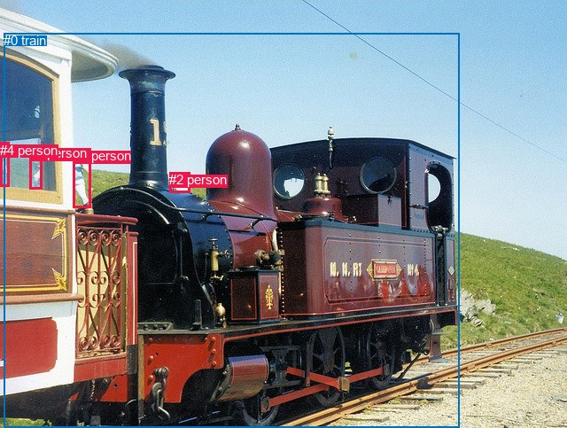
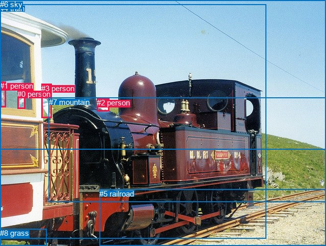

# 图片 1540：2387468.jpg

随机样本序号：465。图片 SHA256：`d01a64f7b4ef09844c7ef9616a127b9bfe11c2bd0549e1bc91882f4f51449bcd`。

红色框表示人，蓝色框表示其他物体。两个模式分别保留自身框编号，可依据位置比较对应对象。

## 自动检测框与输出

人的框编号：`[1, 2, 3, 4]`。状态：`ok`。

### 自动检测全部物体框

| 编号 | 类别 | 是否为人 | 检测分数 | 像素坐标 xyxy |
|---|---|---|---|---|
| 0 | train | False | 0.9992 | 4.2, 37.4, 518.9, 483.0 |
| 1 | person | True | 0.9900 | 82.5, 167.1, 102.0, 234.7 |
| 2 | person | True | 0.9269 | 191.1, 194.1, 214.1, 217.8 |
| 3 | person | True | 0.8800 | 33.4, 164.4, 47.6, 213.6 |
| 4 | person | True | 0.6502 | 0.1, 161.0, 10.6, 210.4 |

### 自动检测 Top50 人相关候选

评分物体对：20；人相关物体对：20；输出关系：40。

| 排名 | 主语编号与类别 | 关系 | 宾语编号与类别 | 类型 | 人与人 | 排序分数 | 原始融合 logit |
|---|---|---|---|---|---|---|---|
| 1 | #2 person | riding | #0 train | semantic | False | 0.99553 | 5.4055 |
| 2 | #3 person | riding | #0 train | semantic | False | 0.98414 | 4.1281 |
| 3 | #4 person | riding | #0 train | semantic | False | 0.98133 | 3.9620 |
| 4 | #1 person | riding | #0 train | semantic | False | 0.98063 | 3.9245 |
| 5 | #1 person | beside | #0 train | spatial | False | 0.97984 | 3.8838 |
| 6 | #2 person | beside | #0 train | spatial | False | 0.95973 | 3.1710 |
| 7 | #4 person | beside | #0 train | spatial | False | 0.95330 | 3.0161 |
| 8 | #3 person | beside | #0 train | spatial | False | 0.95282 | 3.0054 |
| 9 | #0 train | carrying | #4 person | semantic | False | 0.92102 | 2.4563 |
| 10 | #0 train | carrying | #3 person | semantic | False | 0.86136 | 1.8266 |
| 11 | #0 train | beside | #4 person | spatial | False | 0.81188 | 1.4623 |
| 12 | #0 train | beside | #1 person | spatial | False | 0.77831 | 1.2559 |
| 13 | #0 train | carrying | #2 person | semantic | False | 0.75399 | 1.1200 |
| 14 | #0 train | beside | #2 person | spatial | False | 0.71729 | 0.9311 |
| 15 | #0 train | beside | #3 person | spatial | False | 0.70667 | 0.8793 |
| 16 | #0 train | carrying | #1 person | semantic | False | 0.67802 | 0.7447 |
| 17 | #3 person | beside | #1 person | spatial | True | 0.52641 | 0.1057 |
| 18 | #1 person | beside | #3 person | spatial | True | 0.44259 | -0.2306 |
| 19 | #3 person | beside | #4 person | spatial | True | 0.37119 | -0.5271 |
| 20 | #4 person | beside | #3 person | spatial | True | 0.26126 | -1.0394 |
| 21 | #1 person | walking on | #3 person | semantic | True | 0.12870 | -1.9125 |
| 22 | #3 person | looking at | #1 person | semantic | True | 0.08071 | -2.4327 |
| 23 | #2 person | beside | #1 person | spatial | True | 0.07159 | -2.5625 |
| 24 | #1 person | beside | #2 person | spatial | True | 0.06656 | -2.6408 |
| 25 | #3 person | looking at | #4 person | semantic | True | 0.05224 | -2.8982 |
| 26 | #4 person | looking at | #3 person | semantic | True | 0.03917 | -3.1998 |
| 27 | #4 person | beside | #1 person | spatial | True | 0.03559 | -3.2995 |
| 28 | #1 person | walking on | #4 person | semantic | True | 0.03379 | -3.3533 |
| 29 | #1 person | beside | #4 person | spatial | True | 0.02939 | -3.4973 |
| 30 | #1 person | looking at | #2 person | semantic | True | 0.02392 | -3.7090 |
| 31 | #4 person | looking at | #1 person | semantic | True | 0.01889 | -3.9498 |
| 32 | #2 person | looking at | #1 person | semantic | True | 0.01747 | -4.0295 |
| 33 | #3 person | beside | #2 person | spatial | True | 0.01403 | -4.2522 |
| 34 | #2 person | beside | #3 person | spatial | True | 0.00835 | -4.7767 |
| 35 | #3 person | looking at | #2 person | semantic | True | 0.00815 | -4.8020 |
| 36 | #2 person | looking at | #3 person | semantic | True | 0.00715 | -4.9333 |
| 37 | #4 person | beside | #2 person | spatial | True | 0.00665 | -5.0062 |
| 38 | #4 person | looking at | #2 person | semantic | True | 0.00472 | -5.3519 |
| 39 | #2 person | looking at | #4 person | semantic | True | 0.00424 | -5.4598 |
| 40 | #2 person | beside | #4 person | spatial | True | 0.00164 | -6.4099 |

### 自动检测逐条人相关 GT 核验

R@50：100.00%；命中 3/3。

| GT 主语编号 | GT 关系 | GT 宾语编号 | 结果阶段 | 匹配预测主语编号 | 匹配预测宾语编号 |
|---|---|---|---|---|---|
| 0 | beside | 4 | hit50 | [3] | [0] |
| 2 | beside | 4 | hit50 | [2] | [0] |
| 3 | beside | 4 | hit50 | [1] | [0] |

## 真实框与输出

人的框编号：`[0, 1, 2, 3]`。

### 真实框全部物体框

| 编号 | 类别 | 是否为人 | 检测分数 | 像素坐标 xyxy |
|---|---|---|---|---|
| 0 | person | True | GT | 34.0, 176.0, 49.0, 214.0 |
| 1 | person | True | GT | 0.0, 160.0, 11.0, 210.0 |
| 2 | person | True | GT | 190.0, 193.0, 214.0, 218.0 |
| 3 | person | True | GT | 81.0, 165.0, 101.0, 232.0 |
| 4 | train | False | GT | 0.0, 8.0, 522.0, 469.0 |
| 5 | railroad | False | GT | 195.0, 372.0, 640.0, 483.0 |
| 6 | sky | False | GT | 0.0, 0.0, 640.0, 294.0 |
| 7 | mountain | False | GT | 96.0, 192.0, 640.0, 397.0 |
| 8 | grass | False | GT | 0.0, 449.0, 91.0, 483.0 |

### 真实框 Top50 人相关候选

评分物体对：72；人相关物体对：52；输出关系：50。

| 排名 | 主语编号与类别 | 关系 | 宾语编号与类别 | 类型 | 人与人 | 排序分数 | 原始融合 logit |
|---|---|---|---|---|---|---|---|
| 1 | #3 person | walking on | #4 train | semantic | False | 0.96785 | 3.4047 |
| 2 | #2 person | on | #4 train | spatial | False | 0.95862 | 3.1427 |
| 3 | #3 person | beside | #4 train | spatial | False | 0.95065 | 2.9582 |
| 4 | #3 person | walking on | #7 mountain | semantic | False | 0.94486 | 2.8412 |
| 5 | #2 person | riding | #4 train | semantic | False | 0.93714 | 2.7019 |
| 6 | #1 person | on | #4 train | spatial | False | 0.93573 | 2.6783 |
| 7 | #0 person | on | #4 train | spatial | False | 0.93299 | 2.6336 |
| 8 | #0 person | looking at | #4 train | semantic | False | 0.92251 | 2.4769 |
| 9 | #1 person | looking at | #4 train | semantic | False | 0.87117 | 1.9114 |
| 10 | #2 person | standing on | #7 mountain | semantic | False | 0.78051 | 1.2686 |
| 11 | #3 person | on | #7 mountain | spatial | False | 0.70479 | 0.8702 |
| 12 | #4 train | carrying | #1 person | semantic | False | 0.65378 | 0.6357 |
| 13 | #2 person | on | #7 mountain | spatial | False | 0.58026 | 0.3238 |
| 14 | #4 train | carrying | #0 person | semantic | False | 0.52663 | 0.1066 |
| 15 | #4 train | pulling | #2 person | semantic | False | 0.52125 | 0.0851 |
| 16 | #4 train | pulling | #3 person | semantic | False | 0.50650 | 0.0260 |
| 17 | #0 person | walking on | #7 mountain | semantic | False | 0.44517 | -0.2202 |
| 18 | #3 person | walking on | #5 railroad | semantic | False | 0.44161 | -0.2346 |
| 19 | #0 person | beside | #3 person | spatial | True | 0.31791 | -0.7634 |
| 20 | #4 train | on | #1 person | spatial | False | 0.28836 | -0.9034 |
| 21 | #0 person | looking at | #3 person | semantic | True | 0.27909 | -0.9490 |
| 22 | #0 person | beside | #1 person | spatial | True | 0.25865 | -1.0530 |
| 23 | #4 train | beside | #3 person | spatial | False | 0.23803 | -1.1635 |
| 24 | #4 train | on | #2 person | spatial | False | 0.22816 | -1.2187 |
| 25 | #0 person | looking at | #1 person | semantic | True | 0.18718 | -1.4685 |
| 26 | #4 train | on | #0 person | spatial | False | 0.17912 | -1.5224 |
| 27 | #1 person | beside | #0 person | spatial | True | 0.17870 | -1.5252 |
| 28 | #1 person | walking on | #7 mountain | semantic | False | 0.15242 | -1.7158 |
| 29 | #3 person | on | #5 railroad | spatial | False | 0.14861 | -1.7455 |
| 30 | #1 person | looking at | #0 person | semantic | True | 0.14307 | -1.7901 |
| 31 | #3 person | walking on | #0 person | semantic | True | 0.12935 | -1.9067 |
| 32 | #1 person | in | #6 sky | spatial | False | 0.12931 | -1.9070 |
| 33 | #3 person | beside | #0 person | spatial | True | 0.12753 | -1.9230 |
| 34 | #1 person | looking at | #3 person | semantic | True | 0.10943 | -2.0966 |
| 35 | #2 person | looking at | #6 sky | semantic | False | 0.08395 | -2.3898 |
| 36 | #1 person | looking at | #6 sky | semantic | False | 0.08287 | -2.4040 |
| 37 | #0 person | on | #7 mountain | spatial | False | 0.08238 | -2.4104 |
| 38 | #2 person | walking on | #5 railroad | semantic | False | 0.07296 | -2.5421 |
| 39 | #0 person | looking at | #6 sky | semantic | False | 0.07223 | -2.5529 |
| 40 | #0 person | in | #6 sky | spatial | False | 0.07004 | -2.5861 |
| 41 | #3 person | looking at | #6 sky | semantic | False | 0.06996 | -2.5874 |
| 42 | #2 person | on | #5 railroad | spatial | False | 0.05730 | -2.8004 |
| 43 | #3 person | walking on | #8 grass | semantic | False | 0.05571 | -2.8303 |
| 44 | #3 person | looking at | #2 person | semantic | True | 0.05070 | -2.9298 |
| 45 | #0 person | walking on | #5 railroad | semantic | False | 0.04852 | -2.9759 |
| 46 | #3 person | in | #6 sky | spatial | False | 0.04604 | -3.0311 |
| 47 | #1 person | on | #7 mountain | spatial | False | 0.04418 | -3.0743 |
| 48 | #2 person | in | #6 sky | spatial | False | 0.04256 | -3.1133 |
| 49 | #3 person | walking on | #1 person | semantic | True | 0.04146 | -3.1407 |
| 50 | #0 person | looking at | #2 person | semantic | True | 0.04137 | -3.1431 |

### 真实框逐条人相关 GT 核验

R@50：33.33%；命中 1/3。

| GT 主语编号 | GT 关系 | GT 宾语编号 | 结果阶段 | 匹配预测主语编号 | 匹配预测宾语编号 |
|---|---|---|---|---|---|
| 0 | beside | 4 | wrong_predicate | [0] | [4] |
| 2 | beside | 4 | wrong_predicate | [2] | [4] |
| 3 | beside | 4 | hit50 | [3] | [4] |

## 全部人相关 GT

| 主语编号与类别 | 关系 | 宾语编号与类别 |
|---|---|---|
| #0 person | beside | #4 train |
| #2 person | beside | #4 train |
| #3 person | beside | #4 train |

原始记录、全部人相关物体对的两项预测与分项分数见 [逐图证据 JSON](../evidence/cases/1540.json)。全部56类 logits 保留于本机 HOR/output/random500/logits/。

<!-- HOR_COMPLETE_RESULTS -->

## 六组条件的完整输出对照

以下保留同一图片三种框与候选模式、两种谓词输出规则的全部 Top50。框编号各自在所属模式内解释。

### 自动检测框完整枚举：空间与语义各保留一个谓词

| 排名 | 主语编号与类别 | 谓词 | 宾语编号与类别 | 分组 | 排序分数 | predicate logit | pair logit |
|---|---|---|---|---|---|---|---|
| 1 | #2 person | riding | #0 train | semantic | 0.9955284 | 5.1912379 | 0.2142873 |
| 2 | #3 person | riding | #0 train | semantic | 0.9841425 | 4.1064868 | 0.0216433 |
| 3 | #4 person | riding | #0 train | semantic | 0.9813294 | 3.9897876 | -0.0278311 |
| 4 | #1 person | riding | #0 train | semantic | 0.9806300 | 3.7483239 | 0.1761466 |
| 5 | #1 person | beside | #0 train | spatial | 0.9798431 | 3.7077003 | 0.1761466 |
| 6 | #2 person | beside | #0 train | spatial | 0.9597274 | 2.9566917 | 0.2142873 |
| 7 | #4 person | beside | #0 train | spatial | 0.9532974 | 3.0439582 | -0.0278311 |
| 8 | #3 person | beside | #0 train | spatial | 0.9528183 | 2.9837761 | 0.0216433 |
| 9 | #0 train | carrying | #4 person | semantic | 0.9210187 | 3.3691916 | -0.9129216 |
| 10 | #0 train | carrying | #3 person | semantic | 0.8613585 | 3.0819683 | -1.2553487 |
| 11 | #0 train | beside | #4 person | spatial | 0.8118831 | 2.3752141 | -0.9129216 |
| 12 | #0 train | beside | #1 person | spatial | 0.7783127 | 2.6772938 | -1.4214334 |
| 13 | #0 train | carrying | #2 person | semantic | 0.7539915 | 2.1437140 | -1.0236990 |
| 14 | #0 train | beside | #2 person | spatial | 0.7172906 | 1.9547606 | -1.0236990 |
| 15 | #0 train | beside | #3 person | spatial | 0.7066700 | 2.1346140 | -1.2553487 |
| 16 | #0 train | carrying | #1 person | semantic | 0.6780245 | 2.1661410 | -1.4214334 |
| 17 | #3 person | beside | #1 person | spatial | 0.5264108 | 0.6026635 | -0.4969221 |
| 18 | #1 person | beside | #3 person | spatial | 0.4425931 | 0.0020528 | -0.2326976 |
| 19 | #3 person | beside | #4 person | spatial | 0.3711862 | -0.5397334 | 0.0126020 |
| 20 | #4 person | beside | #3 person | spatial | 0.2612586 | -0.6916356 | -0.3478018 |
| 21 | #1 person | walking on | #3 person | semantic | 0.1287031 | -1.6797767 | -0.2326976 |
| 22 | #3 person | looking at | #1 person | semantic | 0.0807113 | -1.9357991 | -0.4969221 |
| 23 | #2 person | beside | #1 person | spatial | 0.0715903 | -1.7389891 | -0.8235241 |
| 24 | #1 person | beside | #2 person | spatial | 0.0665597 | -2.0699928 | -0.5707853 |
| 25 | #3 person | looking at | #4 person | semantic | 0.0522438 | -2.9107790 | 0.0126020 |
| 26 | #4 person | looking at | #3 person | semantic | 0.0391727 | -2.8520131 | -0.3478018 |
| 27 | #4 person | beside | #1 person | spatial | 0.0355882 | -2.5341518 | -0.7653514 |
| 28 | #1 person | walking on | #4 person | semantic | 0.0337872 | -3.0579703 | -0.2953314 |
| 29 | #1 person | beside | #4 person | spatial | 0.0293889 | -3.2019763 | -0.2953314 |
| 30 | #1 person | looking at | #2 person | semantic | 0.0239171 | -3.1381688 | -0.5707853 |
| 31 | #4 person | looking at | #1 person | semantic | 0.0188949 | -3.1844387 | -0.7653514 |
| 32 | #2 person | looking at | #1 person | semantic | 0.0174725 | -3.2059774 | -0.8235241 |
| 33 | #3 person | beside | #2 person | spatial | 0.0140328 | -3.1796103 | -1.0726125 |
| 34 | #2 person | beside | #3 person | spatial | 0.0083533 | -3.7425201 | -1.0341876 |
| 35 | #3 person | looking at | #2 person | semantic | 0.0081461 | -3.7294202 | -1.0726125 |
| 36 | #2 person | looking at | #3 person | semantic | 0.0071514 | -3.8990865 | -1.0341876 |
| 37 | #4 person | beside | #2 person | spatial | 0.0066516 | -3.7056866 | -1.3005373 |
| 38 | #4 person | looking at | #2 person | semantic | 0.0047170 | -4.0513186 | -1.3005373 |
| 39 | #2 person | looking at | #4 person | semantic | 0.0042365 | -4.2553473 | -1.2044183 |
| 40 | #2 person | beside | #4 person | spatial | 0.0016425 | -5.2054496 | -1.2044183 |

GT 命中：3/3，R@50=100.00%。

| GT主语 | GT谓词 | GT宾语 | 结果阶段 | 匹配主语框 | 匹配宾语框 |
|---|---|---|---|---|---|
| 0 | beside | 4 | hit50 | [3] | [0] |
| 2 | beside | 4 | hit50 | [2] | [0] |
| 3 | beside | 4 | hit50 | [1] | [0] |

### 自动检测框完整枚举：每对只保留一个谓词

| 排名 | 主语编号与类别 | 谓词 | 宾语编号与类别 | 分组 | 排序分数 | predicate logit | pair logit |
|---|---|---|---|---|---|---|---|
| 1 | #2 person | riding | #0 train | single | 0.9955284 | 5.1912379 | 0.2142873 |
| 2 | #3 person | riding | #0 train | single | 0.9841425 | 4.1064868 | 0.0216433 |
| 3 | #4 person | riding | #0 train | single | 0.9813294 | 3.9897876 | -0.0278311 |
| 4 | #1 person | riding | #0 train | single | 0.9806300 | 3.7483239 | 0.1761466 |
| 5 | #0 train | carrying | #4 person | single | 0.9210187 | 3.3691916 | -0.9129216 |
| 6 | #0 train | carrying | #3 person | single | 0.8613585 | 3.0819683 | -1.2553487 |
| 7 | #0 train | beside | #1 person | single | 0.7783127 | 2.6772938 | -1.4214334 |
| 8 | #0 train | carrying | #2 person | single | 0.7539915 | 2.1437140 | -1.0236990 |
| 9 | #3 person | beside | #1 person | single | 0.5264108 | 0.6026635 | -0.4969221 |
| 10 | #1 person | beside | #3 person | single | 0.4425931 | 0.0020528 | -0.2326976 |
| 11 | #3 person | beside | #4 person | single | 0.3711862 | -0.5397334 | 0.0126020 |
| 12 | #4 person | beside | #3 person | single | 0.2612586 | -0.6916356 | -0.3478018 |
| 13 | #2 person | beside | #1 person | single | 0.0715903 | -1.7389891 | -0.8235241 |
| 14 | #1 person | beside | #2 person | single | 0.0665597 | -2.0699928 | -0.5707853 |
| 15 | #4 person | beside | #1 person | single | 0.0355882 | -2.5341518 | -0.7653514 |
| 16 | #1 person | walking on | #4 person | single | 0.0337872 | -3.0579703 | -0.2953314 |
| 17 | #3 person | beside | #2 person | single | 0.0140328 | -3.1796103 | -1.0726125 |
| 18 | #2 person | beside | #3 person | single | 0.0083533 | -3.7425201 | -1.0341876 |
| 19 | #4 person | beside | #2 person | single | 0.0066516 | -3.7056866 | -1.3005373 |
| 20 | #2 person | looking at | #4 person | single | 0.0042365 | -4.2553473 | -1.2044183 |

GT 命中：0/3，R@50=0.00%。

| GT主语 | GT谓词 | GT宾语 | 结果阶段 | 匹配主语框 | 匹配宾语框 |
|---|---|---|---|---|---|
| 0 | beside | 4 | wrong_predicate | [3] | [0] |
| 2 | beside | 4 | wrong_predicate | [2] | [0] |
| 3 | beside | 4 | wrong_predicate | [1] | [0] |

### 真实框完整枚举：空间与语义各保留一个谓词

| 排名 | 主语编号与类别 | 谓词 | 宾语编号与类别 | 分组 | 排序分数 | predicate logit | pair logit |
|---|---|---|---|---|---|---|---|
| 1 | #3 person | walking on | #4 train | semantic | 0.9678513 | 3.2288256 | 0.1758794 |
| 2 | #2 person | on | #4 train | spatial | 0.9586194 | 2.9300995 | 0.2125816 |
| 3 | #3 person | beside | #4 train | spatial | 0.9506501 | 2.7823315 | 0.1758794 |
| 4 | #3 person | walking on | #7 mountain | semantic | 0.9448611 | 3.2769938 | -0.4358110 |
| 5 | #2 person | riding | #4 train | semantic | 0.9371401 | 2.4893427 | 0.2125816 |
| 6 | #1 person | on | #4 train | spatial | 0.9357326 | 2.6704865 | 0.0077910 |
| 7 | #0 person | on | #4 train | spatial | 0.9329912 | 2.6039896 | 0.0295831 |
| 8 | #0 person | looking at | #4 train | semantic | 0.9225056 | 2.4473042 | 0.0295831 |
| 9 | #1 person | looking at | #4 train | semantic | 0.8711720 | 1.9035702 | 0.0077910 |
| 10 | #2 person | standing on | #7 mountain | semantic | 0.7805070 | 1.8851523 | -0.6165287 |
| 11 | #3 person | on | #7 mountain | spatial | 0.7047935 | 1.3060408 | -0.4358110 |
| 12 | #4 train | carrying | #1 person | semantic | 0.6537777 | 1.5216441 | -0.8859580 |
| 13 | #2 person | on | #7 mountain | spatial | 0.5802601 | 0.9403701 | -0.6165287 |
| 14 | #4 train | carrying | #0 person | semantic | 0.5266269 | 1.3352714 | -1.2286627 |
| 15 | #4 train | pulling | #2 person | semantic | 0.5212509 | 1.0800261 | -0.9949712 |
| 16 | #4 train | pulling | #3 person | semantic | 0.5065048 | 1.4108667 | -1.3848460 |
| 17 | #0 person | walking on | #7 mountain | semantic | 0.4451720 | 0.7222753 | -0.9424727 |
| 18 | #3 person | walking on | #5 railroad | semantic | 0.4416110 | 0.5086546 | -0.7432811 |
| 19 | #0 person | beside | #3 person | spatial | 0.3179094 | -0.2897949 | -0.4736009 |
| 20 | #4 train | on | #1 person | spatial | 0.2883561 | -0.0174236 | -0.8859580 |
| 21 | #0 person | looking at | #3 person | semantic | 0.2790938 | -0.4753604 | -0.4736009 |
| 22 | #0 person | beside | #1 person | spatial | 0.2586517 | -1.0305436 | -0.0224446 |
| 23 | #4 train | beside | #3 person | spatial | 0.2380276 | 0.2213225 | -1.3848460 |
| 24 | #4 train | on | #2 person | spatial | 0.2281570 | -0.2237759 | -0.9949712 |
| 25 | #0 person | looking at | #1 person | semantic | 0.1871751 | -1.4460263 | -0.0224446 |
| 26 | #4 train | on | #0 person | spatial | 0.1791154 | -0.2936893 | -1.2286627 |
| 27 | #1 person | beside | #0 person | spatial | 0.1786975 | -1.1779063 | -0.3472907 |
| 28 | #1 person | walking on | #7 mountain | semantic | 0.1524176 | -0.5565953 | -1.1591690 |
| 29 | #3 person | on | #5 railroad | spatial | 0.1486131 | -1.0022390 | -0.7432811 |
| 30 | #1 person | looking at | #0 person | semantic | 0.1430654 | -1.4427691 | -0.3472907 |
| 31 | #3 person | walking on | #0 person | semantic | 0.1293490 | -1.7008152 | -0.2059116 |
| 32 | #1 person | in | #6 sky | spatial | 0.1293136 | -0.7462523 | -1.1607890 |
| 33 | #3 person | beside | #0 person | spatial | 0.1275303 | -1.7170622 | -0.2059116 |
| 34 | #1 person | looking at | #3 person | semantic | 0.1094302 | -1.3495536 | -0.7470208 |
| 35 | #2 person | looking at | #6 sky | semantic | 0.0839548 | -1.4195955 | -0.9701915 |
| 36 | #1 person | looking at | #6 sky | semantic | 0.0828716 | -1.2431660 | -1.1607890 |
| 37 | #0 person | on | #7 mountain | spatial | 0.0823819 | -1.4679434 | -0.9424727 |
| 38 | #2 person | walking on | #5 railroad | semantic | 0.0729615 | -1.6954770 | -0.8465860 |
| 39 | #0 person | looking at | #6 sky | semantic | 0.0722331 | -1.4118056 | -1.1410767 |
| 40 | #0 person | in | #6 sky | spatial | 0.0700406 | -1.4449885 | -1.1410767 |
| 41 | #3 person | looking at | #6 sky | semantic | 0.0699560 | -1.4922631 | -1.0951015 |
| 42 | #2 person | on | #5 railroad | spatial | 0.0573046 | -1.9537768 | -0.8465860 |
| 43 | #3 person | walking on | #8 grass | semantic | 0.0557110 | -2.1167545 | -0.7135007 |
| 44 | #3 person | looking at | #2 person | semantic | 0.0506990 | -2.3377388 | -0.5920807 |
| 45 | #0 person | walking on | #5 railroad | semantic | 0.0485243 | -1.8896070 | -1.0863427 |
| 46 | #3 person | in | #6 sky | spatial | 0.0460402 | -1.9360051 | -1.0951015 |
| 47 | #1 person | on | #7 mountain | spatial | 0.0441797 | -1.9151349 | -1.1591690 |
| 48 | #2 person | in | #6 sky | spatial | 0.0425619 | -2.1431100 | -0.9701915 |
| 49 | #3 person | walking on | #1 person | semantic | 0.0414595 | -2.8367565 | -0.3039386 |
| 50 | #0 person | looking at | #2 person | semantic | 0.0413654 | -2.0679305 | -1.0751357 |

GT 命中：1/3，R@50=33.33%。

| GT主语 | GT谓词 | GT宾语 | 结果阶段 | 匹配主语框 | 匹配宾语框 |
|---|---|---|---|---|---|
| 0 | beside | 4 | wrong_predicate | [0] | [4] |
| 2 | beside | 4 | wrong_predicate | [2] | [4] |
| 3 | beside | 4 | hit50 | [3] | [4] |

### 真实框完整枚举：每对只保留一个谓词

| 排名 | 主语编号与类别 | 谓词 | 宾语编号与类别 | 分组 | 排序分数 | predicate logit | pair logit |
|---|---|---|---|---|---|---|---|
| 1 | #3 person | walking on | #4 train | single | 0.9678513 | 3.2288256 | 0.1758794 |
| 2 | #2 person | on | #4 train | single | 0.9586194 | 2.9300995 | 0.2125816 |
| 3 | #3 person | walking on | #7 mountain | single | 0.9448611 | 3.2769938 | -0.4358110 |
| 4 | #1 person | on | #4 train | single | 0.9357326 | 2.6704865 | 0.0077910 |
| 5 | #0 person | on | #4 train | single | 0.9329912 | 2.6039896 | 0.0295831 |
| 6 | #2 person | standing on | #7 mountain | single | 0.7805070 | 1.8851523 | -0.6165287 |
| 7 | #4 train | carrying | #1 person | single | 0.6537777 | 1.5216441 | -0.8859580 |
| 8 | #4 train | carrying | #0 person | single | 0.5266269 | 1.3352714 | -1.2286627 |
| 9 | #4 train | pulling | #2 person | single | 0.5212509 | 1.0800261 | -0.9949712 |
| 10 | #4 train | pulling | #3 person | single | 0.5065048 | 1.4108667 | -1.3848460 |
| 11 | #0 person | walking on | #7 mountain | single | 0.4451720 | 0.7222753 | -0.9424727 |
| 12 | #3 person | walking on | #5 railroad | single | 0.4416110 | 0.5086546 | -0.7432811 |
| 13 | #0 person | beside | #3 person | single | 0.3179094 | -0.2897949 | -0.4736009 |
| 14 | #0 person | beside | #1 person | single | 0.2586517 | -1.0305436 | -0.0224446 |
| 15 | #1 person | beside | #0 person | single | 0.1786975 | -1.1779063 | -0.3472907 |
| 16 | #1 person | walking on | #7 mountain | single | 0.1524176 | -0.5565953 | -1.1591690 |
| 17 | #3 person | walking on | #0 person | single | 0.1293490 | -1.7008152 | -0.2059116 |
| 18 | #1 person | in | #6 sky | single | 0.1293136 | -0.7462523 | -1.1607890 |
| 19 | #1 person | looking at | #3 person | single | 0.1094302 | -1.3495536 | -0.7470208 |
| 20 | #2 person | looking at | #6 sky | single | 0.0839548 | -1.4195955 | -0.9701915 |
| 21 | #2 person | walking on | #5 railroad | single | 0.0729615 | -1.6954770 | -0.8465860 |
| 22 | #0 person | looking at | #6 sky | single | 0.0722331 | -1.4118056 | -1.1410767 |
| 23 | #3 person | looking at | #6 sky | single | 0.0699560 | -1.4922631 | -1.0951015 |
| 24 | #3 person | walking on | #8 grass | single | 0.0557110 | -2.1167545 | -0.7135007 |
| 25 | #3 person | looking at | #2 person | single | 0.0506990 | -2.3377388 | -0.5920807 |
| 26 | #0 person | walking on | #5 railroad | single | 0.0485243 | -1.8896070 | -1.0863427 |
| 27 | #3 person | walking on | #1 person | single | 0.0414595 | -2.8367565 | -0.3039386 |
| 28 | #0 person | looking at | #2 person | single | 0.0413654 | -2.0679305 | -1.0751357 |
| 29 | #1 person | looking at | #2 person | single | 0.0409332 | -1.8497417 | -1.3042771 |
| 30 | #2 person | looking at | #3 person | single | 0.0215279 | -3.0102868 | -0.8063538 |
| 31 | #0 person | walking on | #8 grass | single | 0.0193898 | -3.0496008 | -0.8738275 |
| 32 | #6 sky | over | #2 person | single | 0.0162982 | -2.6449823 | -1.4552847 |
| 33 | #1 person | looking at | #5 railroad | single | 0.0127699 | -3.1015406 | -1.2462678 |
| 34 | #2 person | walking on | #8 grass | single | 0.0121139 | -3.0510747 | -1.3501360 |
| 35 | #2 person | looking at | #0 person | single | 0.0117827 | -3.4280505 | -1.0012215 |
| 36 | #2 person | looking at | #1 person | single | 0.0102445 | -3.3748407 | -1.1958748 |
| 37 | #6 sky | over | #3 person | single | 0.0077638 | -3.2801738 | -1.5703108 |
| 38 | #1 person | on | #8 grass | single | 0.0065661 | -4.0553565 | -0.9638836 |
| 39 | #7 mountain | in | #2 person | single | 0.0042070 | -3.8197587 | -1.6470404 |
| 40 | #8 grass | beside | #3 person | single | 0.0028439 | -4.1146708 | -1.7450644 |
| 41 | #6 sky | over | #0 person | single | 0.0022861 | -4.3599019 | -1.7187272 |
| 42 | #7 mountain | beside | #3 person | single | 0.0022596 | -4.1866145 | -1.9036838 |
| 43 | #8 grass | in | #1 person | single | 0.0019906 | -4.5559974 | -1.6613333 |
| 44 | #6 sky | over | #1 person | single | 0.0019828 | -4.5360742 | -1.6851740 |
| 45 | #8 grass | beside | #2 person | single | 0.0017214 | -4.7227302 | -1.6401638 |
| 46 | #8 grass | in | #0 person | single | 0.0014795 | -4.7547450 | -1.7598515 |
| 47 | #5 railroad | beside | #2 person | single | 0.0014645 | -4.6446791 | -1.8800964 |
| 48 | #5 railroad | beside | #3 person | single | 0.0010265 | -4.6707778 | -2.2097645 |
| 49 | #5 railroad | beside | #1 person | single | 0.0007545 | -4.8758450 | -2.3128648 |
| 50 | #5 railroad | beside | #0 person | single | 0.0006460 | -4.9574571 | -2.3865433 |

GT 命中：0/3，R@50=0.00%。

| GT主语 | GT谓词 | GT宾语 | 结果阶段 | 匹配主语框 | 匹配宾语框 |
|---|---|---|---|---|---|
| 0 | beside | 4 | wrong_predicate | [0] | [4] |
| 2 | beside | 4 | wrong_predicate | [2] | [4] |
| 3 | beside | 4 | wrong_predicate | [3] | [4] |

### 真实框400候选：空间与语义各保留一个谓词

| 排名 | 主语编号与类别 | 谓词 | 宾语编号与类别 | 分组 | 排序分数 | predicate logit | pair logit |
|---|---|---|---|---|---|---|---|
| 1 | #3 person | walking on | #4 train | semantic | 0.9678513 | 3.2288256 | 0.1758794 |
| 2 | #2 person | on | #4 train | spatial | 0.9586194 | 2.9300995 | 0.2125816 |
| 3 | #3 person | beside | #4 train | spatial | 0.9520376 | 2.8123069 | 0.1758794 |
| 4 | #3 person | walking on | #7 mountain | semantic | 0.9419704 | 3.2228317 | -0.4358110 |
| 5 | #2 person | riding | #4 train | semantic | 0.9371257 | 2.4890985 | 0.2125816 |
| 6 | #1 person | on | #4 train | spatial | 0.9357326 | 2.6704865 | 0.0077910 |
| 7 | #0 person | on | #4 train | spatial | 0.9329912 | 2.6039896 | 0.0295831 |
| 8 | #0 person | looking at | #4 train | semantic | 0.9225056 | 2.4473042 | 0.0295831 |
| 9 | #1 person | looking at | #4 train | semantic | 0.8711720 | 1.9035702 | 0.0077910 |
| 10 | #2 person | standing on | #7 mountain | semantic | 0.7856187 | 1.9152436 | -0.6165287 |
| 11 | #3 person | on | #7 mountain | spatial | 0.7036594 | 1.3005958 | -0.4358110 |
| 12 | #4 train | carrying | #1 person | semantic | 0.6600344 | 1.5494056 | -0.8859580 |
| 13 | #2 person | on | #7 mountain | spatial | 0.5815856 | 0.9458146 | -0.6165287 |
| 14 | #4 train | carrying | #0 person | semantic | 0.5266269 | 1.3352714 | -1.2286627 |
| 15 | #4 train | pulling | #2 person | semantic | 0.5212509 | 1.0800261 | -0.9949712 |
| 16 | #4 train | pulling | #3 person | semantic | 0.4914628 | 1.3506937 | -1.3848460 |
| 17 | #0 person | walking on | #7 mountain | semantic | 0.4526162 | 0.7523670 | -0.9424727 |
| 18 | #3 person | walking on | #5 railroad | semantic | 0.4408687 | 0.5056438 | -0.7432811 |
| 19 | #0 person | beside | #3 person | spatial | 0.3179189 | -0.2897515 | -0.4736009 |
| 20 | #4 train | on | #1 person | spatial | 0.2883561 | -0.0174236 | -0.8859580 |
| 21 | #0 person | looking at | #3 person | semantic | 0.2791289 | -0.4751859 | -0.4736009 |
| 22 | #0 person | beside | #1 person | spatial | 0.2557937 | -1.0455024 | -0.0224446 |
| 23 | #4 train | beside | #3 person | spatial | 0.2326466 | 0.1914191 | -1.3848460 |
| 24 | #4 train | on | #2 person | spatial | 0.2291173 | -0.2183309 | -0.9949712 |
| 25 | #0 person | looking at | #1 person | semantic | 0.1871552 | -1.4461572 | -0.0224446 |
| 26 | #1 person | beside | #0 person | spatial | 0.1809185 | -1.1628461 | -0.3472907 |
| 27 | #4 train | on | #0 person | spatial | 0.1791154 | -0.2936893 | -1.2286627 |
| 28 | #1 person | walking on | #7 mountain | semantic | 0.1524176 | -0.5565953 | -1.1591690 |
| 29 | #3 person | on | #5 railroad | spatial | 0.1458605 | -1.0241630 | -0.7432811 |
| 30 | #1 person | looking at | #0 person | semantic | 0.1413312 | -1.4569867 | -0.3472907 |
| 31 | #3 person | walking on | #0 person | semantic | 0.1307104 | -1.6887803 | -0.2059116 |
| 32 | #1 person | in | #6 sky | spatial | 0.1291269 | -0.7479117 | -1.1607890 |
| 33 | #3 person | beside | #0 person | spatial | 0.1258704 | -1.7320645 | -0.2059116 |
| 34 | #1 person | looking at | #3 person | semantic | 0.1094132 | -1.3497281 | -0.7470208 |
| 35 | #2 person | looking at | #6 sky | semantic | 0.0850785 | -1.4050729 | -0.9701915 |
| 36 | #0 person | on | #7 mountain | spatial | 0.0844746 | -1.4405749 | -0.9424727 |
| 37 | #1 person | looking at | #6 sky | semantic | 0.0828451 | -1.2435145 | -1.1607890 |
| 38 | #2 person | walking on | #5 railroad | semantic | 0.0757572 | -1.6548560 | -0.8465860 |
| 39 | #0 person | looking at | #6 sky | semantic | 0.0722097 | -1.4121542 | -1.1410767 |
| 40 | #3 person | looking at | #6 sky | semantic | 0.0709413 | -1.4772174 | -1.0951015 |
| 41 | #0 person | in | #6 sky | spatial | 0.0700406 | -1.4449885 | -1.1410767 |
| 42 | #2 person | on | #5 railroad | spatial | 0.0575994 | -1.9483321 | -0.8465860 |
| 43 | #3 person | walking on | #8 grass | semantic | 0.0565881 | -2.1002038 | -0.7135007 |
| 44 | #3 person | looking at | #2 person | semantic | 0.0514281 | -2.3226929 | -0.5920807 |
| 45 | #0 person | walking on | #5 railroad | semantic | 0.0479029 | -1.9031475 | -1.0863427 |
| 46 | #3 person | in | #6 sky | spatial | 0.0468350 | -1.9180555 | -1.0951015 |
| 47 | #1 person | on | #7 mountain | spatial | 0.0451002 | -1.8935511 | -1.1591690 |
| 48 | #2 person | in | #6 sky | spatial | 0.0421347 | -2.1536443 | -0.9701915 |
| 49 | #0 person | looking at | #2 person | semantic | 0.0413619 | -2.0680177 | -1.0751357 |
| 50 | #3 person | walking on | #1 person | semantic | 0.0409690 | -2.8491678 | -0.3039386 |

GT 命中：1/3，R@50=33.33%。

| GT主语 | GT谓词 | GT宾语 | 结果阶段 | 匹配主语框 | 匹配宾语框 |
|---|---|---|---|---|---|
| 0 | beside | 4 | wrong_predicate | [0] | [4] |
| 2 | beside | 4 | wrong_predicate | [2] | [4] |
| 3 | beside | 4 | hit50 | [3] | [4] |

### 真实框400候选：每对只保留一个谓词

| 排名 | 主语编号与类别 | 谓词 | 宾语编号与类别 | 分组 | 排序分数 | predicate logit | pair logit |
|---|---|---|---|---|---|---|---|
| 1 | #3 person | walking on | #4 train | single | 0.9678513 | 3.2288256 | 0.1758794 |
| 2 | #2 person | on | #4 train | single | 0.9586194 | 2.9300995 | 0.2125816 |
| 3 | #3 person | walking on | #7 mountain | single | 0.9419704 | 3.2228317 | -0.4358110 |
| 4 | #1 person | on | #4 train | single | 0.9357326 | 2.6704865 | 0.0077910 |
| 5 | #0 person | on | #4 train | single | 0.9329912 | 2.6039896 | 0.0295831 |
| 6 | #2 person | standing on | #7 mountain | single | 0.7856187 | 1.9152436 | -0.6165287 |
| 7 | #4 train | carrying | #1 person | single | 0.6600344 | 1.5494056 | -0.8859580 |
| 8 | #4 train | carrying | #0 person | single | 0.5266269 | 1.3352714 | -1.2286627 |
| 9 | #4 train | pulling | #2 person | single | 0.5212509 | 1.0800261 | -0.9949712 |
| 10 | #4 train | pulling | #3 person | single | 0.4914628 | 1.3506937 | -1.3848460 |
| 11 | #0 person | walking on | #7 mountain | single | 0.4526162 | 0.7523670 | -0.9424727 |
| 12 | #3 person | walking on | #5 railroad | single | 0.4408687 | 0.5056438 | -0.7432811 |
| 13 | #0 person | beside | #3 person | single | 0.3179189 | -0.2897515 | -0.4736009 |
| 14 | #0 person | beside | #1 person | single | 0.2557937 | -1.0455024 | -0.0224446 |
| 15 | #1 person | beside | #0 person | single | 0.1809185 | -1.1628461 | -0.3472907 |
| 16 | #1 person | walking on | #7 mountain | single | 0.1524176 | -0.5565953 | -1.1591690 |
| 17 | #3 person | walking on | #0 person | single | 0.1307104 | -1.6887803 | -0.2059116 |
| 18 | #1 person | in | #6 sky | single | 0.1291269 | -0.7479117 | -1.1607890 |
| 19 | #1 person | looking at | #3 person | single | 0.1094132 | -1.3497281 | -0.7470208 |
| 20 | #2 person | looking at | #6 sky | single | 0.0850785 | -1.4050729 | -0.9701915 |
| 21 | #2 person | walking on | #5 railroad | single | 0.0757572 | -1.6548560 | -0.8465860 |
| 22 | #0 person | looking at | #6 sky | single | 0.0722097 | -1.4121542 | -1.1410767 |
| 23 | #3 person | looking at | #6 sky | single | 0.0709413 | -1.4772174 | -1.0951015 |
| 24 | #3 person | walking on | #8 grass | single | 0.0565881 | -2.1002038 | -0.7135007 |
| 25 | #3 person | looking at | #2 person | single | 0.0514281 | -2.3226929 | -0.5920807 |
| 26 | #0 person | walking on | #5 railroad | single | 0.0479029 | -1.9031475 | -1.0863427 |
| 27 | #0 person | looking at | #2 person | single | 0.0413619 | -2.0680177 | -1.0751357 |
| 28 | #3 person | walking on | #1 person | single | 0.0409690 | -2.8491678 | -0.3039386 |
| 29 | #1 person | looking at | #2 person | single | 0.0403567 | -1.8645260 | -1.3042771 |
| 30 | #2 person | looking at | #3 person | single | 0.0213700 | -3.0178094 | -0.8063538 |
| 31 | #0 person | walking on | #8 grass | single | 0.0199409 | -3.0210147 | -0.8738275 |
| 32 | #6 sky | over | #2 person | single | 0.0156206 | -2.6881361 | -1.4552847 |
| 33 | #1 person | looking at | #5 railroad | single | 0.0128629 | -3.0941920 | -1.2462678 |
| 34 | #2 person | walking on | #8 grass | single | 0.0120153 | -3.0593500 | -1.3501360 |
| 35 | #2 person | looking at | #0 person | single | 0.0116974 | -3.4353991 | -1.0012215 |
| 36 | #2 person | looking at | #1 person | single | 0.0103946 | -3.3601439 | -1.1958748 |
| 37 | #6 sky | over | #3 person | single | 0.0079782 | -3.2527266 | -1.5703108 |
| 38 | #1 person | on | #8 grass | single | 0.0067289 | -4.0307102 | -0.9638836 |
| 39 | #7 mountain | in | #2 person | single | 0.0041581 | -3.8314855 | -1.6470404 |
| 40 | #8 grass | beside | #3 person | single | 0.0027913 | -4.1334057 | -1.7450644 |
| 41 | #7 mountain | beside | #3 person | single | 0.0023110 | -4.1640749 | -1.9036838 |
| 42 | #6 sky | over | #0 person | single | 0.0022660 | -4.3687468 | -1.7187272 |
| 43 | #8 grass | in | #1 person | single | 0.0020207 | -4.5409522 | -1.6613333 |
| 44 | #6 sky | over | #1 person | single | 0.0019706 | -4.5422750 | -1.6851740 |
| 45 | #8 grass | beside | #2 person | single | 0.0017308 | -4.7172856 | -1.6401638 |
| 46 | #8 grass | in | #0 person | single | 0.0014975 | -4.7426310 | -1.7598515 |
| 47 | #5 railroad | beside | #2 person | single | 0.0014296 | -4.6687999 | -1.8800964 |
| 48 | #5 railroad | beside | #3 person | single | 0.0010106 | -4.6864090 | -2.2097645 |
| 49 | #5 railroad | beside | #1 person | single | 0.0007468 | -4.8861494 | -2.3128648 |
| 50 | #5 railroad | beside | #0 person | single | 0.0006412 | -4.9649510 | -2.3865433 |

GT 命中：0/3，R@50=0.00%。

| GT主语 | GT谓词 | GT宾语 | 结果阶段 | 匹配主语框 | 匹配宾语框 |
|---|---|---|---|---|---|
| 0 | beside | 4 | wrong_predicate | [0] | [4] |
| 2 | beside | 4 | wrong_predicate | [2] | [4] |
| 3 | beside | 4 | wrong_predicate | [3] | [4] |
