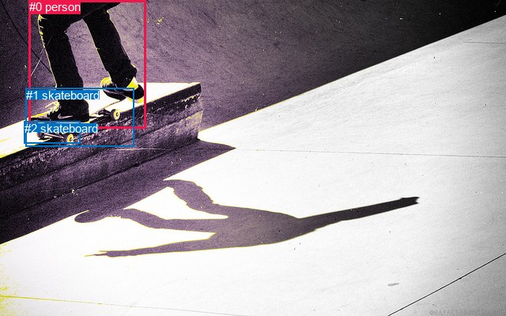
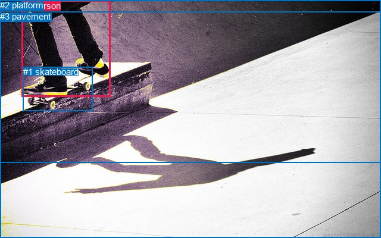

# 图片 1547：2387788.jpg

随机样本序号：417。图片 SHA256：`648e943efa21901e713674f4cbeae363522de87291a9377f0537463ca59ba217`。

红色框表示人，蓝色框表示其他物体。两个模式分别保留自身框编号，可依据位置比较对应对象。

## 自动检测框与输出

人的框编号：`[0]`。状态：`ok`。

### 自动检测全部物体框

| 编号 | 类别 | 是否为人 | 检测分数 | 像素坐标 xyxy |
|---|---|---|---|---|
| 0 | person | True | 0.9960 | 36.7, 0.0, 184.7, 162.2 |
| 1 | skateboard | False | 0.9770 | 32.7, 111.8, 169.1, 185.3 |
| 2 | skateboard | False | 0.9012 | 30.9, 153.8, 101.0, 181.6 |

### 自动检测 Top50 人相关候选

评分物体对：6；人相关物体对：4；输出关系：8。

| 排名 | 主语编号与类别 | 关系 | 宾语编号与类别 | 类型 | 人与人 | 排序分数 | 原始融合 logit |
|---|---|---|---|---|---|---|---|
| 1 | #0 person | riding | #1 skateboard | semantic | False | 0.97828 | 3.8077 |
| 2 | #0 person | riding | #2 skateboard | semantic | False | 0.96249 | 3.2449 |
| 3 | #0 person | on | #1 skateboard | spatial | False | 0.82364 | 1.5412 |
| 4 | #0 person | on | #2 skateboard | spatial | False | 0.68887 | 0.7948 |
| 5 | #2 skateboard | on | #0 person | spatial | False | 0.12317 | -1.9627 |
| 6 | #1 skateboard | in | #0 person | spatial | False | 0.07427 | -2.5228 |
| 7 | #2 skateboard | wearing | #0 person | semantic | False | 0.07029 | -2.5822 |
| 8 | #1 skateboard | wearing | #0 person | semantic | False | 0.04433 | -3.0709 |

### 自动检测逐条人相关 GT 核验

R@50：0.00%；命中 0/4。

| GT 主语编号 | GT 关系 | GT 宾语编号 | 结果阶段 | 匹配预测主语编号 | 匹配预测宾语编号 |
|---|---|---|---|---|---|
| 0 | standing on | 1 | wrong_predicate | [0] | [1] |
| 0 | playing | 1 | wrong_predicate | [0] | [1] |
| 0 | wearing | 2 | endpoint_missing_or_wrong_class | [0] | [] |
| 0 | wearing | 3 | endpoint_missing_or_wrong_class | [0] | [] |

## 真实框与输出

人的框编号：`[0]`。

### 真实框全部物体框

| 编号 | 类别 | 是否为人 | 检测分数 | 像素坐标 xyxy |
|---|---|---|---|---|
| 0 | person | True | GT | 37.0, 1.0, 186.0, 162.0 |
| 1 | skateboard | False | GT | 39.0, 112.0, 155.0, 186.0 |
| 2 | platform | False | GT | 0.0, 0.0, 640.0, 273.0 |
| 3 | pavement | False | GT | 0.0, 19.0, 640.0, 400.0 |

### 真实框 Top50 人相关候选

评分物体对：12；人相关物体对：6；输出关系：12。

| 排名 | 主语编号与类别 | 关系 | 宾语编号与类别 | 类型 | 人与人 | 排序分数 | 原始融合 logit |
|---|---|---|---|---|---|---|---|
| 1 | #0 person | riding | #1 skateboard | semantic | False | 0.98997 | 4.5917 |
| 2 | #0 person | on | #1 skateboard | spatial | False | 0.97351 | 3.6041 |
| 3 | #0 person | on | #2 platform | spatial | False | 0.94051 | 2.7607 |
| 4 | #0 person | on | #3 pavement | spatial | False | 0.92611 | 2.5285 |
| 5 | #0 person | riding | #2 platform | semantic | False | 0.90067 | 2.2047 |
| 6 | #0 person | riding | #3 pavement | semantic | False | 0.83102 | 1.5929 |
| 7 | #1 skateboard | on | #0 person | spatial | False | 0.61674 | 0.4758 |
| 8 | #1 skateboard | wearing | #0 person | semantic | False | 0.44782 | -0.2095 |
| 9 | #2 platform | in | #0 person | spatial | False | 0.38347 | -0.4748 |
| 10 | #2 platform | wearing | #0 person | semantic | False | 0.25232 | -1.0863 |
| 11 | #3 pavement | beside | #0 person | spatial | False | 0.06249 | -2.7082 |
| 12 | #3 pavement | holding | #0 person | semantic | False | 0.03855 | -3.2165 |

### 真实框逐条人相关 GT 核验

R@50：0.00%；命中 0/4。

| GT 主语编号 | GT 关系 | GT 宾语编号 | 结果阶段 | 匹配预测主语编号 | 匹配预测宾语编号 |
|---|---|---|---|---|---|
| 0 | standing on | 1 | wrong_predicate | [0] | [1] |
| 0 | playing | 1 | wrong_predicate | [0] | [1] |
| 0 | wearing | 2 | wrong_predicate | [0] | [2] |
| 0 | wearing | 3 | wrong_predicate | [0] | [3] |

## 全部人相关 GT

| 主语编号与类别 | 关系 | 宾语编号与类别 |
|---|---|---|
| #0 person | standing on | #1 skateboard |
| #0 person | playing | #1 skateboard |
| #0 person | wearing | #2 platform |
| #0 person | wearing | #3 pavement |

原始记录、全部人相关物体对的两项预测与分项分数见 [逐图证据 JSON](../evidence/cases/1547.json)。全部56类 logits 保留于本机 HOR/output/random500/logits/。

<!-- HOR_COMPLETE_RESULTS -->

## 六组条件的完整输出对照

以下保留同一图片三种框与候选模式、两种谓词输出规则的全部 Top50。框编号各自在所属模式内解释。

### 自动检测框完整枚举：空间与语义各保留一个谓词

| 排名 | 主语编号与类别 | 谓词 | 宾语编号与类别 | 分组 | 排序分数 | predicate logit | pair logit |
|---|---|---|---|---|---|---|---|
| 1 | #0 person | riding | #1 skateboard | semantic | 0.9782826 | 3.5768180 | 0.2308667 |
| 2 | #0 person | riding | #2 skateboard | semantic | 0.9624900 | 3.0918145 | 0.1531043 |
| 3 | #0 person | on | #1 skateboard | spatial | 0.8236383 | 1.3103275 | 0.2308667 |
| 4 | #0 person | on | #2 skateboard | spatial | 0.6888655 | 0.6417165 | 0.1531043 |
| 5 | #2 skateboard | on | #0 person | spatial | 0.1231724 | -1.2959003 | -0.6668252 |
| 6 | #1 skateboard | in | #0 person | spatial | 0.0742729 | -1.7314525 | -0.7913803 |
| 7 | #2 skateboard | wearing | #0 person | semantic | 0.0702930 | -1.9153714 | -0.6668252 |
| 8 | #1 skateboard | wearing | #0 person | semantic | 0.0443256 | -2.2794733 | -0.7913803 |

GT 命中：0/4，R@50=0.00%。

| GT主语 | GT谓词 | GT宾语 | 结果阶段 | 匹配主语框 | 匹配宾语框 |
|---|---|---|---|---|---|
| 0 | standing on | 1 | wrong_predicate | [0] | [1] |
| 0 | playing | 1 | wrong_predicate | [0] | [1] |
| 0 | wearing | 2 | endpoint_missing_or_wrong_class | [0] | [] |
| 0 | wearing | 3 | endpoint_missing_or_wrong_class | [0] | [] |

### 自动检测框完整枚举：每对只保留一个谓词

| 排名 | 主语编号与类别 | 谓词 | 宾语编号与类别 | 分组 | 排序分数 | predicate logit | pair logit |
|---|---|---|---|---|---|---|---|
| 1 | #0 person | riding | #1 skateboard | single | 0.9782826 | 3.5768180 | 0.2308667 |
| 2 | #0 person | riding | #2 skateboard | single | 0.9624900 | 3.0918145 | 0.1531043 |
| 3 | #2 skateboard | on | #0 person | single | 0.1231724 | -1.2959003 | -0.6668252 |
| 4 | #1 skateboard | in | #0 person | single | 0.0742729 | -1.7314525 | -0.7913803 |

GT 命中：0/4，R@50=0.00%。

| GT主语 | GT谓词 | GT宾语 | 结果阶段 | 匹配主语框 | 匹配宾语框 |
|---|---|---|---|---|---|
| 0 | standing on | 1 | wrong_predicate | [0] | [1] |
| 0 | playing | 1 | wrong_predicate | [0] | [1] |
| 0 | wearing | 2 | endpoint_missing_or_wrong_class | [0] | [] |
| 0 | wearing | 3 | endpoint_missing_or_wrong_class | [0] | [] |

### 真实框完整枚举：空间与语义各保留一个谓词

| 排名 | 主语编号与类别 | 谓词 | 宾语编号与类别 | 分组 | 排序分数 | predicate logit | pair logit |
|---|---|---|---|---|---|---|---|
| 1 | #0 person | riding | #1 skateboard | semantic | 0.9899663 | 4.4232821 | 0.1684391 |
| 2 | #0 person | on | #1 skateboard | spatial | 0.9735088 | 3.4356551 | 0.1684391 |
| 3 | #0 person | on | #2 platform | spatial | 0.9405133 | 3.1909280 | -0.4302554 |
| 4 | #0 person | on | #3 pavement | spatial | 0.9261137 | 2.7639165 | -0.2354467 |
| 5 | #0 person | riding | #2 platform | semantic | 0.9006669 | 2.6349120 | -0.4302554 |
| 6 | #0 person | riding | #3 pavement | semantic | 0.8310190 | 1.8283129 | -0.2354467 |
| 7 | #1 skateboard | on | #0 person | spatial | 0.6167440 | 1.1739173 | -0.6981665 |
| 8 | #1 skateboard | wearing | #0 person | semantic | 0.4478219 | 0.4886918 | -0.6981665 |
| 9 | #2 platform | in | #0 person | spatial | 0.3834729 | 0.6525354 | -1.1273687 |
| 10 | #2 platform | wearing | #0 person | semantic | 0.2523181 | 0.0410814 | -1.1273687 |
| 11 | #3 pavement | beside | #0 person | spatial | 0.0624900 | -1.3976922 | -1.3105280 |
| 12 | #3 pavement | holding | #0 person | semantic | 0.0385487 | -1.9059935 | -1.3105280 |

GT 命中：0/4，R@50=0.00%。

| GT主语 | GT谓词 | GT宾语 | 结果阶段 | 匹配主语框 | 匹配宾语框 |
|---|---|---|---|---|---|
| 0 | standing on | 1 | wrong_predicate | [0] | [1] |
| 0 | playing | 1 | wrong_predicate | [0] | [1] |
| 0 | wearing | 2 | wrong_predicate | [0] | [2] |
| 0 | wearing | 3 | wrong_predicate | [0] | [3] |

### 真实框完整枚举：每对只保留一个谓词

| 排名 | 主语编号与类别 | 谓词 | 宾语编号与类别 | 分组 | 排序分数 | predicate logit | pair logit |
|---|---|---|---|---|---|---|---|
| 1 | #0 person | riding | #1 skateboard | single | 0.9899663 | 4.4232821 | 0.1684391 |
| 2 | #0 person | on | #2 platform | single | 0.9405133 | 3.1909280 | -0.4302554 |
| 3 | #0 person | on | #3 pavement | single | 0.9261137 | 2.7639165 | -0.2354467 |
| 4 | #1 skateboard | on | #0 person | single | 0.6167440 | 1.1739173 | -0.6981665 |
| 5 | #2 platform | in | #0 person | single | 0.3834729 | 0.6525354 | -1.1273687 |
| 6 | #3 pavement | beside | #0 person | single | 0.0624900 | -1.3976922 | -1.3105280 |

GT 命中：0/4，R@50=0.00%。

| GT主语 | GT谓词 | GT宾语 | 结果阶段 | 匹配主语框 | 匹配宾语框 |
|---|---|---|---|---|---|
| 0 | standing on | 1 | wrong_predicate | [0] | [1] |
| 0 | playing | 1 | wrong_predicate | [0] | [1] |
| 0 | wearing | 2 | wrong_predicate | [0] | [2] |
| 0 | wearing | 3 | wrong_predicate | [0] | [3] |

### 真实框400候选：空间与语义各保留一个谓词

| 排名 | 主语编号与类别 | 谓词 | 宾语编号与类别 | 分组 | 排序分数 | predicate logit | pair logit |
|---|---|---|---|---|---|---|---|
| 1 | #0 person | riding | #1 skateboard | semantic | 0.9899663 | 4.4232821 | 0.1684391 |
| 2 | #0 person | on | #1 skateboard | spatial | 0.9735088 | 3.4356551 | 0.1684391 |
| 3 | #0 person | on | #2 platform | spatial | 0.9405133 | 3.1909280 | -0.4302554 |
| 4 | #0 person | on | #3 pavement | spatial | 0.9261137 | 2.7639165 | -0.2354467 |
| 5 | #0 person | riding | #2 platform | semantic | 0.9006669 | 2.6349120 | -0.4302554 |
| 6 | #0 person | riding | #3 pavement | semantic | 0.8351690 | 1.8581600 | -0.2354467 |
| 7 | #1 skateboard | on | #0 person | spatial | 0.6225528 | 1.1985641 | -0.6981665 |
| 8 | #1 skateboard | wearing | #0 person | semantic | 0.4478219 | 0.4886918 | -0.6981665 |
| 9 | #2 platform | in | #0 person | spatial | 0.3834729 | 0.6525354 | -1.1273687 |
| 10 | #2 platform | wearing | #0 person | semantic | 0.2580372 | 0.0711732 | -1.1273687 |
| 11 | #3 pavement | beside | #0 person | spatial | 0.0624900 | -1.3976922 | -1.3105280 |
| 12 | #3 pavement | holding | #0 person | semantic | 0.0384803 | -1.9078400 | -1.3105280 |

GT 命中：0/4，R@50=0.00%。

| GT主语 | GT谓词 | GT宾语 | 结果阶段 | 匹配主语框 | 匹配宾语框 |
|---|---|---|---|---|---|
| 0 | standing on | 1 | wrong_predicate | [0] | [1] |
| 0 | playing | 1 | wrong_predicate | [0] | [1] |
| 0 | wearing | 2 | wrong_predicate | [0] | [2] |
| 0 | wearing | 3 | wrong_predicate | [0] | [3] |

### 真实框400候选：每对只保留一个谓词

| 排名 | 主语编号与类别 | 谓词 | 宾语编号与类别 | 分组 | 排序分数 | predicate logit | pair logit |
|---|---|---|---|---|---|---|---|
| 1 | #0 person | riding | #1 skateboard | single | 0.9899663 | 4.4232821 | 0.1684391 |
| 2 | #0 person | on | #2 platform | single | 0.9405133 | 3.1909280 | -0.4302554 |
| 3 | #0 person | on | #3 pavement | single | 0.9261137 | 2.7639165 | -0.2354467 |
| 4 | #1 skateboard | on | #0 person | single | 0.6225528 | 1.1985641 | -0.6981665 |
| 5 | #2 platform | in | #0 person | single | 0.3834729 | 0.6525354 | -1.1273687 |
| 6 | #3 pavement | beside | #0 person | single | 0.0624900 | -1.3976922 | -1.3105280 |

GT 命中：0/4，R@50=0.00%。

| GT主语 | GT谓词 | GT宾语 | 结果阶段 | 匹配主语框 | 匹配宾语框 |
|---|---|---|---|---|---|
| 0 | standing on | 1 | wrong_predicate | [0] | [1] |
| 0 | playing | 1 | wrong_predicate | [0] | [1] |
| 0 | wearing | 2 | wrong_predicate | [0] | [2] |
| 0 | wearing | 3 | wrong_predicate | [0] | [3] |
