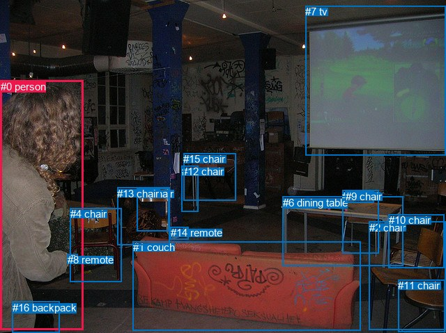
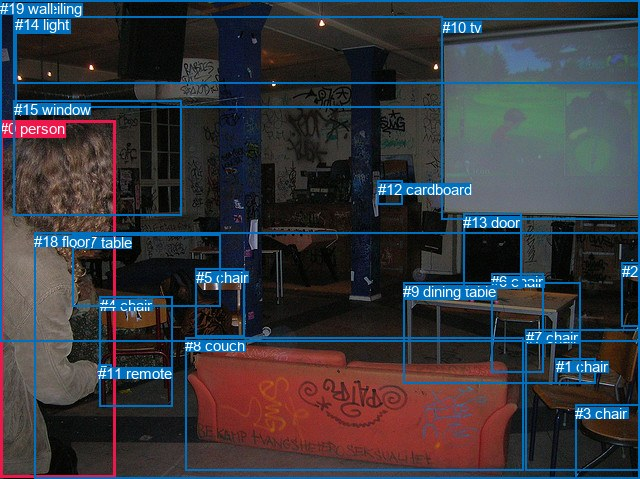

# 图片 1563：2388324.jpg

随机样本序号：211。图片 SHA256：`d539581c8f79189c5f0fb5ab1f963ece3e4c54401a5d2d88fd0bbe62ad6d46b1`。

红色框表示人，蓝色框表示其他物体。两个模式分别保留自身框编号，可依据位置比较对应对象。

## 自动检测框与输出

人的框编号：`[0]`。状态：`ok`。

### 自动检测全部物体框

| 编号 | 类别 | 是否为人 | 检测分数 | 像素坐标 xyxy |
|---|---|---|---|---|
| 0 | person | True | 0.9978 | 0.7, 115.9, 119.7, 474.1 |
| 1 | couch | False | 0.9963 | 190.6, 347.1, 517.9, 475.9 |
| 2 | chair | False | 0.9959 | 529.5, 318.9, 639.8, 475.0 |
| 3 | chair | False | 0.9928 | 491.2, 273.8, 543.4, 364.2 |
| 4 | chair | False | 0.9833 | 100.8, 299.1, 174.0, 405.6 |
| 5 | chair | False | 0.9349 | 196.7, 270.3, 242.8, 332.7 |
| 6 | dining table | False | 0.9262 | 405.7, 282.8, 578.0, 382.5 |
| 7 | tv | False | 0.8709 | 438.3, 8.4, 640.0, 223.7 |
| 8 | remote | False | 0.8640 | 96.5, 365.3, 111.4, 378.7 |
| 9 | chair | False | 0.8453 | 495.8, 274.4, 537.0, 291.7 |
| 10 | chair | False | 0.7998 | 557.9, 308.1, 637.2, 385.3 |
| 11 | chair | False | 0.7200 | 571.5, 402.2, 638.9, 477.7 |
| 12 | chair | False | 0.6552 | 260.5, 238.2, 284.4, 304.3 |
| 13 | chair | False | 0.5670 | 168.5, 269.8, 243.2, 352.5 |
| 14 | remote | False | 0.4479 | 244.9, 326.1, 270.7, 344.7 |
| 15 | chair | False | 0.4053 | 263.2, 220.3, 338.4, 288.5 |
| 16 | backpack | False | 0.3713 | 18.0, 433.8, 85.0, 479.0 |

### 自动检测 Top50 人相关候选

评分物体对：272；人相关物体对：32；输出关系：50。

| 排名 | 主语编号与类别 | 关系 | 宾语编号与类别 | 类型 | 人与人 | 排序分数 | 原始融合 logit |
|---|---|---|---|---|---|---|---|
| 1 | #0 person | wearing | #16 backpack | semantic | False | 0.99445 | 5.1878 |
| 2 | #0 person | wearing | #8 remote | semantic | False | 0.99242 | 4.8740 |
| 3 | #0 person | holding | #4 chair | semantic | False | 0.95982 | 3.1734 |
| 4 | #16 backpack | on | #0 person | spatial | False | 0.92408 | 2.4990 |
| 5 | #0 person | beside | #4 chair | spatial | False | 0.90477 | 2.2514 |
| 6 | #0 person | in | #16 backpack | spatial | False | 0.89032 | 2.0941 |
| 7 | #8 remote | on | #0 person | spatial | False | 0.88248 | 2.0161 |
| 8 | #4 chair | beside | #0 person | spatial | False | 0.87742 | 1.9682 |
| 9 | #0 person | looking at | #1 couch | semantic | False | 0.82464 | 1.5481 |
| 10 | #0 person | in | #8 remote | spatial | False | 0.80844 | 1.4399 |
| 11 | #0 person | looking at | #7 tv | semantic | False | 0.72936 | 0.9914 |
| 12 | #13 chair | beside | #0 person | spatial | False | 0.71369 | 0.9134 |
| 13 | #0 person | beside | #1 couch | spatial | False | 0.70714 | 0.8815 |
| 14 | #16 backpack | wearing | #0 person | semantic | False | 0.69389 | 0.8184 |
| 15 | #0 person | beside | #13 chair | spatial | False | 0.65962 | 0.6616 |
| 16 | #0 person | looking at | #13 chair | semantic | False | 0.56033 | 0.2425 |
| 17 | #1 couch | beside | #0 person | spatial | False | 0.45091 | -0.1970 |
| 18 | #8 remote | holding | #0 person | semantic | False | 0.33850 | -0.6700 |
| 19 | #0 person | beside | #5 chair | spatial | False | 0.27015 | -0.9939 |
| 20 | #4 chair | holding | #0 person | semantic | False | 0.25839 | -1.0544 |
| 21 | #0 person | in front of | #15 chair | spatial | False | 0.25686 | -1.0624 |
| 22 | #5 chair | beside | #0 person | spatial | False | 0.25253 | -1.0852 |
| 23 | #0 person | looking at | #15 chair | semantic | False | 0.21953 | -1.2684 |
| 24 | #0 person | standing on | #5 chair | semantic | False | 0.20270 | -1.3695 |
| 25 | #0 person | in front of | #6 dining table | spatial | False | 0.19271 | -1.4325 |
| 26 | #0 person | looking at | #14 remote | semantic | False | 0.16427 | -1.6268 |
| 27 | #13 chair | looking at | #0 person | semantic | False | 0.13625 | -1.8468 |
| 28 | #0 person | looking at | #6 dining table | semantic | False | 0.13117 | -1.8907 |
| 29 | #0 person | in front of | #7 tv | spatial | False | 0.12920 | -1.9081 |
| 30 | #1 couch | holding | #0 person | semantic | False | 0.06920 | -2.5991 |
| 31 | #7 tv | beside | #0 person | spatial | False | 0.06351 | -2.6910 |
| 32 | #0 person | in front of | #12 chair | spatial | False | 0.05084 | -2.9268 |
| 33 | #0 person | standing on | #12 chair | semantic | False | 0.04803 | -2.9866 |
| 34 | #14 remote | beside | #0 person | spatial | False | 0.04656 | -3.0194 |
| 35 | #15 chair | beside | #0 person | spatial | False | 0.04437 | -3.0699 |
| 36 | #6 dining table | beside | #0 person | spatial | False | 0.04032 | -3.1698 |
| 37 | #2 chair | beside | #0 person | spatial | False | 0.02673 | -3.5950 |
| 38 | #0 person | beside | #14 remote | spatial | False | 0.02605 | -3.6212 |
| 39 | #14 remote | holding | #0 person | semantic | False | 0.02476 | -3.6733 |
| 40 | #5 chair | holding | #0 person | semantic | False | 0.01778 | -4.0116 |
| 41 | #0 person | standing on | #2 chair | semantic | False | 0.01737 | -4.0355 |
| 42 | #0 person | in front of | #2 chair | spatial | False | 0.01566 | -4.1408 |
| 43 | #0 person | in front of | #3 chair | spatial | False | 0.01498 | -4.1862 |
| 44 | #0 person | looking at | #3 chair | semantic | False | 0.01469 | -4.2056 |
| 45 | #0 person | standing on | #11 chair | semantic | False | 0.01460 | -4.2117 |
| 46 | #12 chair | beside | #0 person | spatial | False | 0.01331 | -4.3058 |
| 47 | #10 chair | beside | #0 person | spatial | False | 0.01304 | -4.3269 |
| 48 | #11 chair | beside | #0 person | spatial | False | 0.01274 | -4.3503 |
| 49 | #7 tv | looking at | #0 person | semantic | False | 0.01171 | -4.4355 |
| 50 | #0 person | looking at | #9 chair | semantic | False | 0.01008 | -4.5874 |

### 自动检测逐条人相关 GT 核验

R@50：25.00%；命中 1/4。

| GT 主语编号 | GT 关系 | GT 宾语编号 | 结果阶段 | 匹配预测主语编号 | 匹配预测宾语编号 |
|---|---|---|---|---|---|
| 0 | in | 10 | wrong_predicate | [0] | [7] |
| 0 | looking at | 10 | hit50 | [0] | [7] |
| 0 | playing | 10 | wrong_predicate | [0] | [7] |
| 0 | holding | 11 | wrong_predicate | [0] | [8] |

## 真实框与输出

人的框编号：`[0]`。

### 真实框全部物体框

| 编号 | 类别 | 是否为人 | 检测分数 | 像素坐标 xyxy |
|---|---|---|---|---|
| 0 | person | True | GT | 0.0, 120.0, 115.0, 477.0 |
| 1 | chair | False | GT | 556.0, 358.0, 596.0, 383.0 |
| 2 | chair | False | GT | 622.0, 263.0, 640.0, 327.0 |
| 3 | chair | False | GT | 575.0, 405.0, 640.0, 479.0 |
| 4 | chair | False | GT | 100.0, 297.0, 173.0, 407.0 |
| 5 | chair | False | GT | 196.0, 269.0, 245.0, 337.0 |
| 6 | chair | False | GT | 491.0, 273.0, 543.0, 372.0 |
| 7 | chair | False | GT | 526.0, 329.0, 640.0, 470.0 |
| 8 | couch | False | GT | 185.0, 337.0, 523.0, 470.0 |
| 9 | dining table | False | GT | 403.0, 283.0, 580.0, 384.0 |
| 10 | tv | False | GT | 442.0, 19.0, 640.0, 220.0 |
| 11 | remote | False | GT | 98.0, 365.0, 112.0, 379.0 |
| 12 | cardboard | False | GT | 378.0, 181.0, 402.0, 205.0 |
| 13 | door | False | GT | 463.0, 214.0, 521.0, 289.0 |
| 14 | light | False | GT | 15.0, 16.0, 443.0, 107.0 |
| 15 | window | False | GT | 14.0, 101.0, 181.0, 216.0 |
| 16 | ceiling | False | GT | 13.0, 0.0, 640.0, 84.0 |
| 17 | table | False | GT | 73.0, 234.0, 221.0, 306.0 |
| 18 | floor | False | GT | 34.0, 233.0, 640.0, 479.0 |
| 19 | wall | False | GT | 0.0, 0.0, 640.0, 342.0 |

### 真实框 Top50 人相关候选

评分物体对：380；人相关物体对：38；输出关系：50。

| 排名 | 主语编号与类别 | 关系 | 宾语编号与类别 | 类型 | 人与人 | 排序分数 | 原始融合 logit |
|---|---|---|---|---|---|---|---|
| 1 | #0 person | wearing | #11 remote | semantic | False | 0.99137 | 4.7436 |
| 2 | #0 person | holding | #4 chair | semantic | False | 0.95386 | 3.0288 |
| 3 | #0 person | standing on | #18 floor | semantic | False | 0.94606 | 2.8644 |
| 4 | #0 person | on | #18 floor | spatial | False | 0.91152 | 2.3323 |
| 5 | #0 person | in | #15 window | spatial | False | 0.88743 | 2.0647 |
| 6 | #0 person | standing on | #17 table | semantic | False | 0.87441 | 1.9406 |
| 7 | #11 remote | on | #0 person | spatial | False | 0.86944 | 1.8960 |
| 8 | #0 person | beside | #4 chair | spatial | False | 0.86757 | 1.8796 |
| 9 | #0 person | beside | #17 table | spatial | False | 0.86094 | 1.8231 |
| 10 | #4 chair | beside | #0 person | spatial | False | 0.83870 | 1.6486 |
| 11 | #15 window | on | #0 person | spatial | False | 0.81666 | 1.4939 |
| 12 | #0 person | in | #11 remote | spatial | False | 0.80147 | 1.3955 |
| 13 | #0 person | looking at | #8 couch | semantic | False | 0.79935 | 1.3822 |
| 14 | #0 person | playing with | #15 window | semantic | False | 0.74302 | 1.0617 |
| 15 | #17 table | beside | #0 person | spatial | False | 0.67125 | 0.7139 |
| 16 | #0 person | beside | #8 couch | spatial | False | 0.57607 | 0.3067 |
| 17 | #0 person | looking at | #10 tv | semantic | False | 0.49375 | -0.0250 |
| 18 | #0 person | in | #19 wall | spatial | False | 0.45169 | -0.1938 |
| 19 | #0 person | looking at | #19 wall | semantic | False | 0.37078 | -0.5289 |
| 20 | #11 remote | holding | #0 person | semantic | False | 0.33460 | -0.6875 |
| 21 | #5 chair | beside | #0 person | spatial | False | 0.30532 | -0.8221 |
| 22 | #4 chair | holding | #0 person | semantic | False | 0.24584 | -1.1209 |
| 23 | #8 couch | beside | #0 person | spatial | False | 0.24507 | -1.1251 |
| 24 | #15 window | holding | #0 person | semantic | False | 0.21483 | -1.2961 |
| 25 | #18 floor | beside | #0 person | spatial | False | 0.18734 | -1.4674 |
| 26 | #0 person | beside | #5 chair | spatial | False | 0.17658 | -1.5397 |
| 27 | #0 person | looking at | #5 chair | semantic | False | 0.14872 | -1.7447 |
| 28 | #0 person | looking at | #9 dining table | semantic | False | 0.13062 | -1.8955 |
| 29 | #17 table | holding | #0 person | semantic | False | 0.10542 | -2.1385 |
| 30 | #0 person | beside | #9 dining table | spatial | False | 0.07721 | -2.4809 |
| 31 | #18 floor | holding | #0 person | semantic | False | 0.06113 | -2.7317 |
| 32 | #5 chair | looking at | #0 person | semantic | False | 0.03868 | -3.2129 |
| 33 | #7 chair | beside | #0 person | spatial | False | 0.03156 | -3.4240 |
| 34 | #14 light | over | #0 person | spatial | False | 0.02929 | -3.5008 |
| 35 | #0 person | looking at | #13 door | semantic | False | 0.02831 | -3.5359 |
| 36 | #0 person | beside | #10 tv | spatial | False | 0.02808 | -3.5442 |
| 37 | #8 couch | looking at | #0 person | semantic | False | 0.02773 | -3.5570 |
| 38 | #9 dining table | beside | #0 person | spatial | False | 0.02748 | -3.5664 |
| 39 | #0 person | looking at | #14 light | semantic | False | 0.02720 | -3.5769 |
| 40 | #0 person | looking at | #16 ceiling | semantic | False | 0.02542 | -3.6463 |
| 41 | #0 person | in | #14 light | spatial | False | 0.02513 | -3.6582 |
| 42 | #0 person | in | #16 ceiling | spatial | False | 0.02152 | -3.8172 |
| 43 | #0 person | in | #7 chair | spatial | False | 0.01733 | -4.0376 |
| 44 | #0 person | looking at | #6 chair | semantic | False | 0.01666 | -4.0779 |
| 45 | #16 ceiling | over | #0 person | spatial | False | 0.01625 | -4.1035 |
| 46 | #0 person | looking at | #12 cardboard | semantic | False | 0.01617 | -4.1080 |
| 47 | #10 tv | beside | #0 person | spatial | False | 0.01598 | -4.1204 |
| 48 | #19 wall | beside | #0 person | spatial | False | 0.01332 | -4.3052 |
| 49 | #0 person | in | #3 chair | spatial | False | 0.01237 | -4.3797 |
| 50 | #0 person | standing on | #7 chair | semantic | False | 0.01153 | -4.4511 |

### 真实框逐条人相关 GT 核验

R@50：25.00%；命中 1/4。

| GT 主语编号 | GT 关系 | GT 宾语编号 | 结果阶段 | 匹配预测主语编号 | 匹配预测宾语编号 |
|---|---|---|---|---|---|
| 0 | in | 10 | wrong_predicate | [0] | [10] |
| 0 | looking at | 10 | hit50 | [0] | [10] |
| 0 | playing | 10 | wrong_predicate | [0] | [10] |
| 0 | holding | 11 | wrong_predicate | [0] | [11] |

## 全部人相关 GT

| 主语编号与类别 | 关系 | 宾语编号与类别 |
|---|---|---|
| #0 person | in | #10 tv |
| #0 person | looking at | #10 tv |
| #0 person | playing | #10 tv |
| #0 person | holding | #11 remote |

原始记录、全部人相关物体对的两项预测与分项分数见 [逐图证据 JSON](../evidence/cases/1563.json)。全部56类 logits 保留于本机 HOR/output/random500/logits/。

<!-- HOR_COMPLETE_RESULTS -->

## 六组条件的完整输出对照

以下保留同一图片三种框与候选模式、两种谓词输出规则的全部 Top50。框编号各自在所属模式内解释。

### 自动检测框完整枚举：空间与语义各保留一个谓词

| 排名 | 主语编号与类别 | 谓词 | 宾语编号与类别 | 分组 | 排序分数 | predicate logit | pair logit |
|---|---|---|---|---|---|---|---|
| 1 | #0 person | wearing | #16 backpack | semantic | 0.9944468 | 4.8123279 | 0.3754787 |
| 2 | #0 person | wearing | #8 remote | semantic | 0.9924152 | 4.5818305 | 0.2921751 |
| 3 | #0 person | holding | #4 chair | semantic | 0.9598199 | 3.4680686 | -0.2946953 |
| 4 | #16 backpack | on | #0 person | spatial | 0.9240750 | 2.7690716 | -0.2700232 |
| 5 | #0 person | beside | #4 chair | spatial | 0.9047726 | 2.5461116 | -0.2946953 |
| 6 | #0 person | in | #16 backpack | spatial | 0.8903243 | 1.7185788 | 0.3754787 |
| 7 | #8 remote | on | #0 person | spatial | 0.8824770 | 2.4082661 | -0.3921673 |
| 8 | #4 chair | beside | #0 person | spatial | 0.8774204 | 2.4811873 | -0.5129621 |
| 9 | #0 person | looking at | #1 couch | semantic | 0.8246424 | 1.9462118 | -0.3980895 |
| 10 | #0 person | in | #8 remote | spatial | 0.8084376 | 1.1477156 | 0.2921751 |
| 11 | #0 person | looking at | #7 tv | semantic | 0.7293564 | 1.6935201 | -0.7021606 |
| 12 | #13 chair | beside | #0 person | spatial | 0.7136949 | 1.5134969 | -0.6000994 |
| 13 | #0 person | beside | #1 couch | spatial | 0.7071391 | 1.2796192 | -0.3980895 |
| 14 | #16 backpack | wearing | #0 person | semantic | 0.6938933 | 1.0884075 | -0.2700232 |
| 15 | #0 person | beside | #13 chair | spatial | 0.6596183 | 1.0986667 | -0.4370732 |
| 16 | #0 person | looking at | #13 chair | semantic | 0.5603339 | 0.6795907 | -0.4370732 |
| 17 | #1 couch | beside | #0 person | spatial | 0.4509085 | 0.9405632 | -1.1375637 |
| 18 | #8 remote | holding | #0 person | semantic | 0.3385024 | -0.2778077 | -0.3921673 |
| 19 | #0 person | beside | #5 chair | spatial | 0.2701516 | -0.1376042 | -0.8562496 |
| 20 | #4 chair | holding | #0 person | semantic | 0.2583858 | -0.5414133 | -0.5129621 |
| 21 | #0 person | in front of | #15 chair | spatial | 0.2568590 | 0.1032453 | -1.1656036 |
| 22 | #5 chair | beside | #0 person | spatial | 0.2525266 | -0.2931199 | -0.7920625 |
| 23 | #0 person | looking at | #15 chair | semantic | 0.2195338 | -0.1027813 | -1.1656036 |
| 24 | #0 person | standing on | #5 chair | semantic | 0.2026967 | -0.5132751 | -0.8562496 |
| 25 | #0 person | in front of | #6 dining table | spatial | 0.1927099 | -0.7345622 | -0.6979347 |
| 26 | #0 person | looking at | #14 remote | semantic | 0.1642734 | -0.4141536 | -1.2126160 |
| 27 | #13 chair | looking at | #0 person | semantic | 0.1362547 | -1.2466524 | -0.6000994 |
| 28 | #0 person | looking at | #6 dining table | semantic | 0.1311670 | -1.1927452 | -0.6979347 |
| 29 | #0 person | in front of | #7 tv | spatial | 0.1291974 | -1.2059133 | -0.7021606 |
| 30 | #1 couch | holding | #0 person | semantic | 0.0691951 | -1.4615564 | -1.1375637 |
| 31 | #7 tv | beside | #0 person | spatial | 0.0635077 | -1.2073903 | -1.4835896 |
| 32 | #0 person | in front of | #12 chair | spatial | 0.0508449 | -1.5114207 | -1.4153712 |
| 33 | #0 person | standing on | #12 chair | semantic | 0.0480334 | -1.5712626 | -1.4153712 |
| 34 | #14 remote | beside | #0 person | spatial | 0.0465575 | -1.7048500 | -1.3145412 |
| 35 | #15 chair | beside | #0 person | spatial | 0.0443660 | -1.5565045 | -1.5133981 |
| 36 | #6 dining table | beside | #0 person | spatial | 0.0403195 | -1.7395093 | -1.4302554 |
| 37 | #2 chair | beside | #0 person | spatial | 0.0267259 | -2.6397603 | -0.9552706 |
| 38 | #0 person | beside | #14 remote | spatial | 0.0260544 | -2.4085536 | -1.2126160 |
| 39 | #14 remote | holding | #0 person | semantic | 0.0247636 | -2.3587644 | -1.3145412 |
| 40 | #5 chair | holding | #0 person | semantic | 0.0177822 | -3.2195539 | -0.7920625 |
| 41 | #0 person | standing on | #2 chair | semantic | 0.0173694 | -3.0569012 | -0.9786240 |
| 42 | #0 person | in front of | #2 chair | spatial | 0.0156611 | -3.1621685 | -0.9786240 |
| 43 | #0 person | in front of | #3 chair | spatial | 0.0149760 | -3.1664572 | -1.0197606 |
| 44 | #0 person | looking at | #3 chair | semantic | 0.0146932 | -3.1858058 | -1.0197606 |
| 45 | #0 person | standing on | #11 chair | semantic | 0.0146045 | -2.9512718 | -1.2604395 |
| 46 | #12 chair | beside | #0 person | spatial | 0.0133103 | -2.9696655 | -1.3361516 |
| 47 | #10 chair | beside | #0 person | spatial | 0.0130366 | -2.9255116 | -1.4013577 |
| 48 | #11 chair | beside | #0 person | spatial | 0.0127387 | -3.1049027 | -1.2453856 |
| 49 | #7 tv | looking at | #0 person | semantic | 0.0117098 | -2.9519601 | -1.4835896 |
| 50 | #0 person | looking at | #9 chair | semantic | 0.0100766 | -3.2051978 | -1.3822095 |

GT 命中：1/4，R@50=25.00%。

| GT主语 | GT谓词 | GT宾语 | 结果阶段 | 匹配主语框 | 匹配宾语框 |
|---|---|---|---|---|---|
| 0 | in | 10 | wrong_predicate | [0] | [7] |
| 0 | looking at | 10 | hit50 | [0] | [7] |
| 0 | playing | 10 | wrong_predicate | [0] | [7] |
| 0 | holding | 11 | wrong_predicate | [0] | [8] |

### 自动检测框完整枚举：每对只保留一个谓词

| 排名 | 主语编号与类别 | 谓词 | 宾语编号与类别 | 分组 | 排序分数 | predicate logit | pair logit |
|---|---|---|---|---|---|---|---|
| 1 | #0 person | wearing | #16 backpack | single | 0.9944468 | 4.8123279 | 0.3754787 |
| 2 | #0 person | wearing | #8 remote | single | 0.9924152 | 4.5818305 | 0.2921751 |
| 3 | #0 person | holding | #4 chair | single | 0.9598199 | 3.4680686 | -0.2946953 |
| 4 | #16 backpack | on | #0 person | single | 0.9240750 | 2.7690716 | -0.2700232 |
| 5 | #8 remote | on | #0 person | single | 0.8824770 | 2.4082661 | -0.3921673 |
| 6 | #4 chair | beside | #0 person | single | 0.8774204 | 2.4811873 | -0.5129621 |
| 7 | #0 person | looking at | #1 couch | single | 0.8246424 | 1.9462118 | -0.3980895 |
| 8 | #0 person | looking at | #7 tv | single | 0.7293564 | 1.6935201 | -0.7021606 |
| 9 | #13 chair | beside | #0 person | single | 0.7136949 | 1.5134969 | -0.6000994 |
| 10 | #0 person | beside | #13 chair | single | 0.6596183 | 1.0986667 | -0.4370732 |
| 11 | #1 couch | beside | #0 person | single | 0.4509085 | 0.9405632 | -1.1375637 |
| 12 | #0 person | beside | #5 chair | single | 0.2701516 | -0.1376042 | -0.8562496 |
| 13 | #0 person | in front of | #15 chair | single | 0.2568590 | 0.1032453 | -1.1656036 |
| 14 | #5 chair | beside | #0 person | single | 0.2525266 | -0.2931199 | -0.7920625 |
| 15 | #0 person | in front of | #6 dining table | single | 0.1927099 | -0.7345622 | -0.6979347 |
| 16 | #0 person | looking at | #14 remote | single | 0.1642734 | -0.4141536 | -1.2126160 |
| 17 | #7 tv | beside | #0 person | single | 0.0635077 | -1.2073903 | -1.4835896 |
| 18 | #0 person | in front of | #12 chair | single | 0.0508449 | -1.5114207 | -1.4153712 |
| 19 | #14 remote | beside | #0 person | single | 0.0465575 | -1.7048500 | -1.3145412 |
| 20 | #15 chair | beside | #0 person | single | 0.0443660 | -1.5565045 | -1.5133981 |
| 21 | #6 dining table | beside | #0 person | single | 0.0403195 | -1.7395093 | -1.4302554 |
| 22 | #2 chair | beside | #0 person | single | 0.0267259 | -2.6397603 | -0.9552706 |
| 23 | #0 person | standing on | #2 chair | single | 0.0173694 | -3.0569012 | -0.9786240 |
| 24 | #0 person | in front of | #3 chair | single | 0.0149760 | -3.1664572 | -1.0197606 |
| 25 | #0 person | standing on | #11 chair | single | 0.0146045 | -2.9512718 | -1.2604395 |
| 26 | #12 chair | beside | #0 person | single | 0.0133103 | -2.9696655 | -1.3361516 |
| 27 | #10 chair | beside | #0 person | single | 0.0130366 | -2.9255116 | -1.4013577 |
| 28 | #11 chair | beside | #0 person | single | 0.0127387 | -3.1049027 | -1.2453856 |
| 29 | #0 person | looking at | #9 chair | single | 0.0100766 | -3.2051978 | -1.3822095 |
| 30 | #0 person | in front of | #10 chair | single | 0.0079595 | -3.4765952 | -1.3488072 |
| 31 | #3 chair | beside | #0 person | single | 0.0061136 | -3.5782905 | -1.5128201 |
| 32 | #9 chair | beside | #0 person | single | 0.0056009 | -3.5707965 | -1.6084170 |

GT 命中：1/4，R@50=25.00%。

| GT主语 | GT谓词 | GT宾语 | 结果阶段 | 匹配主语框 | 匹配宾语框 |
|---|---|---|---|---|---|
| 0 | in | 10 | wrong_predicate | [0] | [7] |
| 0 | looking at | 10 | hit50 | [0] | [7] |
| 0 | playing | 10 | wrong_predicate | [0] | [7] |
| 0 | holding | 11 | wrong_predicate | [0] | [8] |

### 真实框完整枚举：空间与语义各保留一个谓词

| 排名 | 主语编号与类别 | 谓词 | 宾语编号与类别 | 分组 | 排序分数 | predicate logit | pair logit |
|---|---|---|---|---|---|---|---|
| 1 | #0 person | wearing | #11 remote | semantic | 0.9913681 | 4.4555974 | 0.2880307 |
| 2 | #0 person | holding | #4 chair | semantic | 0.9538569 | 3.3052468 | -0.2764787 |
| 3 | #0 person | standing on | #18 floor | semantic | 0.9460586 | 3.0248485 | -0.1604424 |
| 4 | #0 person | on | #18 floor | spatial | 0.9115198 | 2.4927769 | -0.1604424 |
| 5 | #0 person | in | #15 window | spatial | 0.8874259 | 1.7694535 | 0.2952592 |
| 6 | #0 person | standing on | #17 table | semantic | 0.8744138 | 2.4509706 | -0.5104096 |
| 7 | #11 remote | on | #0 person | spatial | 0.8694428 | 2.3145461 | -0.4185054 |
| 8 | #0 person | beside | #4 chair | spatial | 0.8675656 | 2.1560822 | -0.2764787 |
| 9 | #0 person | beside | #17 table | spatial | 0.8609373 | 2.3335066 | -0.5104096 |
| 10 | #4 chair | beside | #0 person | spatial | 0.8387046 | 2.1827040 | -0.5340824 |
| 11 | #15 window | on | #0 person | spatial | 0.8166584 | 1.9626036 | -0.4687340 |
| 12 | #0 person | in | #11 remote | spatial | 0.8014651 | 1.1074457 | 0.2880307 |
| 13 | #0 person | looking at | #8 couch | semantic | 0.7993508 | 1.7566004 | -0.3743587 |
| 14 | #0 person | playing with | #15 window | semantic | 0.7430203 | 0.7664671 | 0.2952592 |
| 15 | #17 table | beside | #0 person | spatial | 0.6712543 | 1.6381121 | -0.9242486 |
| 16 | #0 person | beside | #8 couch | spatial | 0.5760732 | 0.6810327 | -0.3743587 |
| 17 | #0 person | looking at | #10 tv | semantic | 0.4937495 | 0.6634445 | -0.6884477 |
| 18 | #0 person | in | #19 wall | spatial | 0.4516943 | 0.3938961 | -0.5877235 |
| 19 | #0 person | looking at | #19 wall | semantic | 0.3707752 | 0.0588307 | -0.5877235 |
| 20 | #11 remote | holding | #0 person | semantic | 0.3346004 | -0.2689452 | -0.4185054 |
| 21 | #5 chair | beside | #0 person | spatial | 0.3053177 | -0.0182366 | -0.8038650 |
| 22 | #4 chair | holding | #0 person | semantic | 0.2458431 | -0.5868244 | -0.5340824 |
| 23 | #8 couch | beside | #0 person | spatial | 0.2450708 | 0.0141969 | -1.1392736 |
| 24 | #15 window | holding | #0 person | semantic | 0.2148257 | -0.8273449 | -0.4687340 |
| 25 | #18 floor | beside | #0 person | spatial | 0.1873358 | -0.3751683 | -1.0922468 |
| 26 | #0 person | beside | #5 chair | spatial | 0.1765825 | -0.7033961 | -0.8362792 |
| 27 | #0 person | looking at | #5 chair | semantic | 0.1487205 | -0.9083927 | -0.8362792 |
| 28 | #0 person | looking at | #9 dining table | semantic | 0.1306175 | -1.2023327 | -0.6931772 |
| 29 | #17 table | holding | #0 person | semantic | 0.1054152 | -1.2142045 | -0.9242486 |
| 30 | #0 person | beside | #9 dining table | spatial | 0.0772102 | -1.7876933 | -0.6931772 |
| 31 | #18 floor | holding | #0 person | semantic | 0.0611313 | -1.6394041 | -1.0922468 |
| 32 | #5 chair | looking at | #0 person | semantic | 0.0386844 | -2.4090002 | -0.8038650 |
| 33 | #7 chair | beside | #0 person | spatial | 0.0315552 | -2.3656719 | -1.0582817 |
| 34 | #14 light | over | #0 person | spatial | 0.0292900 | -2.0465305 | -1.4542513 |
| 35 | #0 person | looking at | #13 door | semantic | 0.0283088 | -1.9450591 | -1.5908062 |
| 36 | #0 person | beside | #10 tv | spatial | 0.0280814 | -2.8557155 | -0.6884477 |
| 37 | #8 couch | looking at | #0 person | semantic | 0.0277320 | -2.4177706 | -1.1392736 |
| 38 | #9 dining table | beside | #0 person | spatial | 0.0274811 | -2.1237855 | -1.4426055 |
| 39 | #0 person | looking at | #14 light | semantic | 0.0272029 | -2.7804236 | -0.7964268 |
| 40 | #0 person | looking at | #16 ceiling | semantic | 0.0254237 | -2.8164687 | -0.8298509 |
| 41 | #0 person | in | #14 light | spatial | 0.0251312 | -2.8617663 | -0.7964268 |
| 42 | #0 person | in | #16 ceiling | spatial | 0.0215165 | -2.9873319 | -0.8298509 |
| 43 | #0 person | in | #7 chair | spatial | 0.0173343 | -3.0004349 | -1.0371495 |
| 44 | #0 person | looking at | #6 chair | semantic | 0.0166610 | -3.0892730 | -0.9886110 |
| 45 | #16 ceiling | over | #0 person | spatial | 0.0162462 | -2.7426255 | -1.3608890 |
| 46 | #0 person | looking at | #12 cardboard | semantic | 0.0161741 | -1.7958126 | -2.3122253 |
| 47 | #10 tv | beside | #0 person | spatial | 0.0159780 | -2.6052167 | -1.5152209 |
| 48 | #19 wall | beside | #0 person | spatial | 0.0133179 | -2.9686589 | -1.3365827 |
| 49 | #0 person | in | #3 chair | spatial | 0.0123743 | -3.1108437 | -1.2688408 |
| 50 | #0 person | standing on | #7 chair | semantic | 0.0115316 | -3.4139147 | -1.0371495 |

GT 命中：1/4，R@50=25.00%。

| GT主语 | GT谓词 | GT宾语 | 结果阶段 | 匹配主语框 | 匹配宾语框 |
|---|---|---|---|---|---|
| 0 | in | 10 | wrong_predicate | [0] | [10] |
| 0 | looking at | 10 | hit50 | [0] | [10] |
| 0 | playing | 10 | wrong_predicate | [0] | [10] |
| 0 | holding | 11 | wrong_predicate | [0] | [11] |

### 真实框完整枚举：每对只保留一个谓词

| 排名 | 主语编号与类别 | 谓词 | 宾语编号与类别 | 分组 | 排序分数 | predicate logit | pair logit |
|---|---|---|---|---|---|---|---|
| 1 | #0 person | wearing | #11 remote | single | 0.9913681 | 4.4555974 | 0.2880307 |
| 2 | #0 person | holding | #4 chair | single | 0.9538569 | 3.3052468 | -0.2764787 |
| 3 | #0 person | standing on | #18 floor | single | 0.9460586 | 3.0248485 | -0.1604424 |
| 4 | #0 person | in | #15 window | single | 0.8874259 | 1.7694535 | 0.2952592 |
| 5 | #0 person | standing on | #17 table | single | 0.8744138 | 2.4509706 | -0.5104096 |
| 6 | #11 remote | on | #0 person | single | 0.8694428 | 2.3145461 | -0.4185054 |
| 7 | #4 chair | beside | #0 person | single | 0.8387046 | 2.1827040 | -0.5340824 |
| 8 | #15 window | on | #0 person | single | 0.8166584 | 1.9626036 | -0.4687340 |
| 9 | #0 person | looking at | #8 couch | single | 0.7993508 | 1.7566004 | -0.3743587 |
| 10 | #17 table | beside | #0 person | single | 0.6712543 | 1.6381121 | -0.9242486 |
| 11 | #0 person | looking at | #10 tv | single | 0.4937495 | 0.6634445 | -0.6884477 |
| 12 | #0 person | in | #19 wall | single | 0.4516943 | 0.3938961 | -0.5877235 |
| 13 | #5 chair | beside | #0 person | single | 0.3053177 | -0.0182366 | -0.8038650 |
| 14 | #8 couch | beside | #0 person | single | 0.2450708 | 0.0141969 | -1.1392736 |
| 15 | #18 floor | beside | #0 person | single | 0.1873358 | -0.3751683 | -1.0922468 |
| 16 | #0 person | beside | #5 chair | single | 0.1765825 | -0.7033961 | -0.8362792 |
| 17 | #0 person | looking at | #9 dining table | single | 0.1306175 | -1.2023327 | -0.6931772 |
| 18 | #7 chair | beside | #0 person | single | 0.0315552 | -2.3656719 | -1.0582817 |
| 19 | #14 light | over | #0 person | single | 0.0292900 | -2.0465305 | -1.4542513 |
| 20 | #0 person | looking at | #13 door | single | 0.0283088 | -1.9450591 | -1.5908062 |
| 21 | #9 dining table | beside | #0 person | single | 0.0274811 | -2.1237855 | -1.4426055 |
| 22 | #0 person | looking at | #14 light | single | 0.0272029 | -2.7804236 | -0.7964268 |
| 23 | #0 person | looking at | #16 ceiling | single | 0.0254237 | -2.8164687 | -0.8298509 |
| 24 | #0 person | in | #7 chair | single | 0.0173343 | -3.0004349 | -1.0371495 |
| 25 | #0 person | looking at | #6 chair | single | 0.0166610 | -3.0892730 | -0.9886110 |
| 26 | #16 ceiling | over | #0 person | single | 0.0162462 | -2.7426255 | -1.3608890 |
| 27 | #0 person | looking at | #12 cardboard | single | 0.0161741 | -1.7958126 | -2.3122253 |
| 28 | #10 tv | beside | #0 person | single | 0.0159780 | -2.6052167 | -1.5152209 |
| 29 | #19 wall | beside | #0 person | single | 0.0133179 | -2.9686589 | -1.3365827 |
| 30 | #0 person | in | #3 chair | single | 0.0123743 | -3.1108437 | -1.2688408 |
| 31 | #2 chair | beside | #0 person | single | 0.0112913 | -2.8777146 | -1.5946560 |
| 32 | #3 chair | beside | #0 person | single | 0.0103638 | -3.2966213 | -1.2623965 |
| 33 | #0 person | looking at | #2 chair | single | 0.0080037 | -3.3868515 | -1.4329619 |
| 34 | #6 chair | beside | #0 person | single | 0.0072778 | -3.3789387 | -1.5366778 |
| 35 | #0 person | in | #1 chair | single | 0.0058285 | -3.7013869 | -1.4377612 |
| 36 | #13 door | beside | #0 person | single | 0.0049744 | -3.2009356 | -2.0975208 |
| 37 | #1 chair | beside | #0 person | single | 0.0034245 | -4.0269413 | -1.6464311 |
| 38 | #12 cardboard | beside | #0 person | single | 0.0022378 | -3.7115614 | -2.3884621 |

GT 命中：1/4，R@50=25.00%。

| GT主语 | GT谓词 | GT宾语 | 结果阶段 | 匹配主语框 | 匹配宾语框 |
|---|---|---|---|---|---|
| 0 | in | 10 | wrong_predicate | [0] | [10] |
| 0 | looking at | 10 | hit50 | [0] | [10] |
| 0 | playing | 10 | wrong_predicate | [0] | [10] |
| 0 | holding | 11 | wrong_predicate | [0] | [11] |

### 真实框400候选：空间与语义各保留一个谓词

| 排名 | 主语编号与类别 | 谓词 | 宾语编号与类别 | 分组 | 排序分数 | predicate logit | pair logit |
|---|---|---|---|---|---|---|---|
| 1 | #0 person | wearing | #11 remote | semantic | 0.9913681 | 4.4555974 | 0.2880307 |
| 2 | #0 person | holding | #4 chair | semantic | 0.9538569 | 3.3052468 | -0.2764787 |
| 3 | #0 person | standing on | #18 floor | semantic | 0.9460586 | 3.0248485 | -0.1604424 |
| 4 | #0 person | on | #18 floor | spatial | 0.9115198 | 2.4927769 | -0.1604424 |
| 5 | #0 person | in | #15 window | spatial | 0.8874259 | 1.7694535 | 0.2952592 |
| 6 | #0 person | standing on | #17 table | semantic | 0.8744138 | 2.4509706 | -0.5104096 |
| 7 | #11 remote | on | #0 person | spatial | 0.8694428 | 2.3145461 | -0.4185054 |
| 8 | #0 person | beside | #4 chair | spatial | 0.8675656 | 2.1560822 | -0.2764787 |
| 9 | #0 person | beside | #17 table | spatial | 0.8609373 | 2.3335066 | -0.5104096 |
| 10 | #4 chair | beside | #0 person | spatial | 0.8387046 | 2.1827040 | -0.5340824 |
| 11 | #15 window | on | #0 person | spatial | 0.8166584 | 1.9626036 | -0.4687340 |
| 12 | #0 person | in | #11 remote | spatial | 0.8014651 | 1.1074457 | 0.2880307 |
| 13 | #0 person | looking at | #8 couch | semantic | 0.7993508 | 1.7566004 | -0.3743587 |
| 14 | #0 person | playing with | #15 window | semantic | 0.7430203 | 0.7664671 | 0.2952592 |
| 15 | #17 table | beside | #0 person | spatial | 0.6712543 | 1.6381121 | -0.9242486 |
| 16 | #0 person | beside | #8 couch | spatial | 0.5760732 | 0.6810327 | -0.3743587 |
| 17 | #0 person | looking at | #10 tv | semantic | 0.4937495 | 0.6634445 | -0.6884477 |
| 18 | #0 person | in | #19 wall | spatial | 0.4516943 | 0.3938961 | -0.5877235 |
| 19 | #0 person | looking at | #19 wall | semantic | 0.3707752 | 0.0588307 | -0.5877235 |
| 20 | #11 remote | holding | #0 person | semantic | 0.3346004 | -0.2689452 | -0.4185054 |
| 21 | #5 chair | beside | #0 person | spatial | 0.3053177 | -0.0182366 | -0.8038650 |
| 22 | #4 chair | holding | #0 person | semantic | 0.2458431 | -0.5868244 | -0.5340824 |
| 23 | #8 couch | beside | #0 person | spatial | 0.2450708 | 0.0141969 | -1.1392736 |
| 24 | #15 window | holding | #0 person | semantic | 0.2148257 | -0.8273449 | -0.4687340 |
| 25 | #18 floor | beside | #0 person | spatial | 0.1873358 | -0.3751683 | -1.0922468 |
| 26 | #0 person | beside | #5 chair | spatial | 0.1765825 | -0.7033961 | -0.8362792 |
| 27 | #0 person | looking at | #5 chair | semantic | 0.1487205 | -0.9083927 | -0.8362792 |
| 28 | #0 person | looking at | #9 dining table | semantic | 0.1306175 | -1.2023327 | -0.6931772 |
| 29 | #17 table | holding | #0 person | semantic | 0.1054152 | -1.2142045 | -0.9242486 |
| 30 | #0 person | beside | #9 dining table | spatial | 0.0772102 | -1.7876933 | -0.6931772 |
| 31 | #18 floor | holding | #0 person | semantic | 0.0611313 | -1.6394041 | -1.0922468 |
| 32 | #5 chair | looking at | #0 person | semantic | 0.0386844 | -2.4090002 | -0.8038650 |
| 33 | #7 chair | beside | #0 person | spatial | 0.0315552 | -2.3656719 | -1.0582817 |
| 34 | #14 light | over | #0 person | spatial | 0.0292900 | -2.0465305 | -1.4542513 |
| 35 | #0 person | looking at | #13 door | semantic | 0.0283088 | -1.9450591 | -1.5908062 |
| 36 | #0 person | beside | #10 tv | spatial | 0.0280814 | -2.8557155 | -0.6884477 |
| 37 | #8 couch | looking at | #0 person | semantic | 0.0277320 | -2.4177706 | -1.1392736 |
| 38 | #9 dining table | beside | #0 person | spatial | 0.0274811 | -2.1237855 | -1.4426055 |
| 39 | #0 person | looking at | #14 light | semantic | 0.0272029 | -2.7804236 | -0.7964268 |
| 40 | #0 person | looking at | #16 ceiling | semantic | 0.0254237 | -2.8164687 | -0.8298509 |
| 41 | #0 person | in | #14 light | spatial | 0.0251312 | -2.8617663 | -0.7964268 |
| 42 | #0 person | in | #16 ceiling | spatial | 0.0215165 | -2.9873319 | -0.8298509 |
| 43 | #0 person | in | #7 chair | spatial | 0.0173343 | -3.0004349 | -1.0371495 |
| 44 | #0 person | looking at | #6 chair | semantic | 0.0166610 | -3.0892730 | -0.9886110 |
| 45 | #16 ceiling | over | #0 person | spatial | 0.0162462 | -2.7426255 | -1.3608890 |
| 46 | #0 person | looking at | #12 cardboard | semantic | 0.0161741 | -1.7958126 | -2.3122253 |
| 47 | #10 tv | beside | #0 person | spatial | 0.0159780 | -2.6052167 | -1.5152209 |
| 48 | #19 wall | beside | #0 person | spatial | 0.0133179 | -2.9686589 | -1.3365827 |
| 49 | #0 person | in | #3 chair | spatial | 0.0123743 | -3.1108437 | -1.2688408 |
| 50 | #0 person | standing on | #7 chair | semantic | 0.0115316 | -3.4139147 | -1.0371495 |

GT 命中：1/4，R@50=25.00%。

| GT主语 | GT谓词 | GT宾语 | 结果阶段 | 匹配主语框 | 匹配宾语框 |
|---|---|---|---|---|---|
| 0 | in | 10 | wrong_predicate | [0] | [10] |
| 0 | looking at | 10 | hit50 | [0] | [10] |
| 0 | playing | 10 | wrong_predicate | [0] | [10] |
| 0 | holding | 11 | wrong_predicate | [0] | [11] |

### 真实框400候选：每对只保留一个谓词

| 排名 | 主语编号与类别 | 谓词 | 宾语编号与类别 | 分组 | 排序分数 | predicate logit | pair logit |
|---|---|---|---|---|---|---|---|
| 1 | #0 person | wearing | #11 remote | single | 0.9913681 | 4.4555974 | 0.2880307 |
| 2 | #0 person | holding | #4 chair | single | 0.9538569 | 3.3052468 | -0.2764787 |
| 3 | #0 person | standing on | #18 floor | single | 0.9460586 | 3.0248485 | -0.1604424 |
| 4 | #0 person | in | #15 window | single | 0.8874259 | 1.7694535 | 0.2952592 |
| 5 | #0 person | standing on | #17 table | single | 0.8744138 | 2.4509706 | -0.5104096 |
| 6 | #11 remote | on | #0 person | single | 0.8694428 | 2.3145461 | -0.4185054 |
| 7 | #4 chair | beside | #0 person | single | 0.8387046 | 2.1827040 | -0.5340824 |
| 8 | #15 window | on | #0 person | single | 0.8166584 | 1.9626036 | -0.4687340 |
| 9 | #0 person | looking at | #8 couch | single | 0.7993508 | 1.7566004 | -0.3743587 |
| 10 | #17 table | beside | #0 person | single | 0.6712543 | 1.6381121 | -0.9242486 |
| 11 | #0 person | looking at | #10 tv | single | 0.4937495 | 0.6634445 | -0.6884477 |
| 12 | #0 person | in | #19 wall | single | 0.4516943 | 0.3938961 | -0.5877235 |
| 13 | #5 chair | beside | #0 person | single | 0.3053177 | -0.0182366 | -0.8038650 |
| 14 | #8 couch | beside | #0 person | single | 0.2450708 | 0.0141969 | -1.1392736 |
| 15 | #18 floor | beside | #0 person | single | 0.1873358 | -0.3751683 | -1.0922468 |
| 16 | #0 person | beside | #5 chair | single | 0.1765825 | -0.7033961 | -0.8362792 |
| 17 | #0 person | looking at | #9 dining table | single | 0.1306175 | -1.2023327 | -0.6931772 |
| 18 | #7 chair | beside | #0 person | single | 0.0315552 | -2.3656719 | -1.0582817 |
| 19 | #14 light | over | #0 person | single | 0.0292900 | -2.0465305 | -1.4542513 |
| 20 | #0 person | looking at | #13 door | single | 0.0283088 | -1.9450591 | -1.5908062 |
| 21 | #9 dining table | beside | #0 person | single | 0.0274811 | -2.1237855 | -1.4426055 |
| 22 | #0 person | looking at | #14 light | single | 0.0272029 | -2.7804236 | -0.7964268 |
| 23 | #0 person | looking at | #16 ceiling | single | 0.0254237 | -2.8164687 | -0.8298509 |
| 24 | #0 person | in | #7 chair | single | 0.0173343 | -3.0004349 | -1.0371495 |
| 25 | #0 person | looking at | #6 chair | single | 0.0166610 | -3.0892730 | -0.9886110 |
| 26 | #16 ceiling | over | #0 person | single | 0.0162462 | -2.7426255 | -1.3608890 |
| 27 | #0 person | looking at | #12 cardboard | single | 0.0161741 | -1.7958126 | -2.3122253 |
| 28 | #10 tv | beside | #0 person | single | 0.0159780 | -2.6052167 | -1.5152209 |
| 29 | #19 wall | beside | #0 person | single | 0.0133179 | -2.9686589 | -1.3365827 |
| 30 | #0 person | in | #3 chair | single | 0.0123743 | -3.1108437 | -1.2688408 |
| 31 | #2 chair | beside | #0 person | single | 0.0112913 | -2.8777146 | -1.5946560 |
| 32 | #3 chair | beside | #0 person | single | 0.0103638 | -3.2966213 | -1.2623965 |
| 33 | #0 person | looking at | #2 chair | single | 0.0080037 | -3.3868515 | -1.4329619 |
| 34 | #6 chair | beside | #0 person | single | 0.0072778 | -3.3789387 | -1.5366778 |
| 35 | #0 person | in | #1 chair | single | 0.0058285 | -3.7013869 | -1.4377612 |
| 36 | #13 door | beside | #0 person | single | 0.0049744 | -3.2009356 | -2.0975208 |
| 37 | #1 chair | beside | #0 person | single | 0.0034245 | -4.0269413 | -1.6464311 |
| 38 | #12 cardboard | beside | #0 person | single | 0.0022378 | -3.7115614 | -2.3884621 |

GT 命中：1/4，R@50=25.00%。

| GT主语 | GT谓词 | GT宾语 | 结果阶段 | 匹配主语框 | 匹配宾语框 |
|---|---|---|---|---|---|
| 0 | in | 10 | wrong_predicate | [0] | [10] |
| 0 | looking at | 10 | hit50 | [0] | [10] |
| 0 | playing | 10 | wrong_predicate | [0] | [10] |
| 0 | holding | 11 | wrong_predicate | [0] | [11] |
