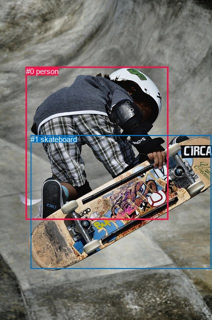
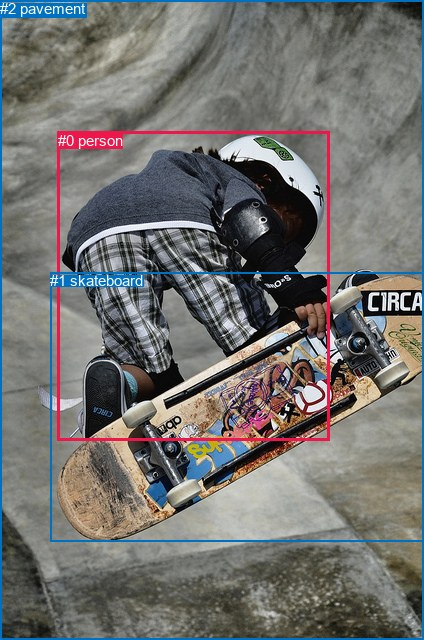

# 图片 1575：2388803.jpg

随机样本序号：458。图片 SHA256：`e7d7b2042253c96bbb74418afee60182f133ee7f3ccbc1b41159b0c42183602f`。

红色框表示人，蓝色框表示其他物体。两个模式分别保留自身框编号，可依据位置比较对应对象。

## 自动检测框与输出

人的框编号：`[0]`。状态：`ok`。

### 自动检测全部物体框

| 编号 | 类别 | 是否为人 | 检测分数 | 像素坐标 xyxy |
|---|---|---|---|---|
| 0 | person | True | 0.9998 | 51.6, 133.9, 336.3, 439.6 |
| 1 | skateboard | False | 0.9997 | 61.4, 270.1, 422.8, 537.3 |

### 自动检测 Top50 人相关候选

评分物体对：2；人相关物体对：2；输出关系：4。

| 排名 | 主语编号与类别 | 关系 | 宾语编号与类别 | 类型 | 人与人 | 排序分数 | 原始融合 logit |
|---|---|---|---|---|---|---|---|
| 1 | #0 person | jumping over | #1 skateboard | semantic | False | 0.98050 | 3.9179 |
| 2 | #0 person | on | #1 skateboard | spatial | False | 0.35308 | -0.6055 |
| 3 | #1 skateboard | carrying | #0 person | semantic | False | 0.00048 | -7.6363 |
| 4 | #1 skateboard | in | #0 person | spatial | False | 0.00023 | -8.3652 |

### 自动检测逐条人相关 GT 核验

R@50：0.00%；命中 0/6。

| GT 主语编号 | GT 关系 | GT 宾语编号 | 结果阶段 | 匹配预测主语编号 | 匹配预测宾语编号 |
|---|---|---|---|---|---|
| 0 | wearing | 1 | wrong_predicate | [0] | [1] |
| 0 | looking at | 1 | wrong_predicate | [0] | [1] |
| 0 | catching | 1 | wrong_predicate | [0] | [1] |
| 0 | playing | 1 | wrong_predicate | [0] | [1] |
| 0 | jumping over | 2 | endpoint_missing_or_wrong_class | [0] | [] |
| 0 | wearing | 2 | endpoint_missing_or_wrong_class | [0] | [] |

## 真实框与输出

人的框编号：`[0]`。

### 真实框全部物体框

| 编号 | 类别 | 是否为人 | 检测分数 | 像素坐标 xyxy |
|---|---|---|---|---|
| 0 | person | True | GT | 58.0, 132.0, 330.0, 441.0 |
| 1 | skateboard | False | GT | 50.0, 272.0, 424.0, 541.0 |
| 2 | pavement | False | GT | 0.0, 0.0, 424.0, 640.0 |

### 真实框 Top50 人相关候选

评分物体对：6；人相关物体对：4；输出关系：8。

| 排名 | 主语编号与类别 | 关系 | 宾语编号与类别 | 类型 | 人与人 | 排序分数 | 原始融合 logit |
|---|---|---|---|---|---|---|---|
| 1 | #0 person | riding | #1 skateboard | semantic | False | 0.98562 | 4.2277 |
| 2 | #0 person | on | #1 skateboard | spatial | False | 0.97606 | 3.7081 |
| 3 | #0 person | in | #2 pavement | spatial | False | 0.92644 | 2.5333 |
| 4 | #0 person | riding | #2 pavement | semantic | False | 0.78584 | 1.3001 |
| 5 | #2 pavement | beside | #0 person | spatial | False | 0.39291 | -0.4351 |
| 6 | #1 skateboard | on | #0 person | spatial | False | 0.16068 | -1.6531 |
| 7 | #2 pavement | holding | #0 person | semantic | False | 0.13434 | -1.8631 |
| 8 | #1 skateboard | carrying | #0 person | semantic | False | 0.12907 | -1.9092 |

### 真实框逐条人相关 GT 核验

R@50：0.00%；命中 0/6。

| GT 主语编号 | GT 关系 | GT 宾语编号 | 结果阶段 | 匹配预测主语编号 | 匹配预测宾语编号 |
|---|---|---|---|---|---|
| 0 | wearing | 1 | wrong_predicate | [0] | [1] |
| 0 | looking at | 1 | wrong_predicate | [0] | [1] |
| 0 | catching | 1 | wrong_predicate | [0] | [1] |
| 0 | playing | 1 | wrong_predicate | [0] | [1] |
| 0 | jumping over | 2 | wrong_predicate | [0] | [2] |
| 0 | wearing | 2 | wrong_predicate | [0] | [2] |

## 全部人相关 GT

| 主语编号与类别 | 关系 | 宾语编号与类别 |
|---|---|---|
| #0 person | wearing | #1 skateboard |
| #0 person | looking at | #1 skateboard |
| #0 person | catching | #1 skateboard |
| #0 person | playing | #1 skateboard |
| #0 person | jumping over | #2 pavement |
| #0 person | wearing | #2 pavement |

原始记录、全部人相关物体对的两项预测与分项分数见 [逐图证据 JSON](../evidence/cases/1575.json)。全部56类 logits 保留于本机 HOR/output/random500/logits/。

<!-- HOR_COMPLETE_RESULTS -->

## 六组条件的完整输出对照

以下保留同一图片三种框与候选模式、两种谓词输出规则的全部 Top50。框编号各自在所属模式内解释。

### 自动检测框完整枚举：空间与语义各保留一个谓词

| 排名 | 主语编号与类别 | 谓词 | 宾语编号与类别 | 分组 | 排序分数 | predicate logit | pair logit |
|---|---|---|---|---|---|---|---|
| 1 | #0 person | jumping over | #1 skateboard | semantic | 0.9805042 | 3.4220719 | 0.4957908 |
| 2 | #0 person | on | #1 skateboard | spatial | 0.3530807 | -1.1013160 | 0.4957908 |
| 3 | #1 skateboard | carrying | #0 person | semantic | 0.0004824 | -6.5795074 | -1.0567780 |
| 4 | #1 skateboard | in | #0 person | spatial | 0.0002328 | -7.3084664 | -1.0567780 |

GT 命中：0/6，R@50=0.00%。

| GT主语 | GT谓词 | GT宾语 | 结果阶段 | 匹配主语框 | 匹配宾语框 |
|---|---|---|---|---|---|
| 0 | wearing | 1 | wrong_predicate | [0] | [1] |
| 0 | looking at | 1 | wrong_predicate | [0] | [1] |
| 0 | catching | 1 | wrong_predicate | [0] | [1] |
| 0 | playing | 1 | wrong_predicate | [0] | [1] |
| 0 | jumping over | 2 | endpoint_missing_or_wrong_class | [0] | [] |
| 0 | wearing | 2 | endpoint_missing_or_wrong_class | [0] | [] |

### 自动检测框完整枚举：每对只保留一个谓词

| 排名 | 主语编号与类别 | 谓词 | 宾语编号与类别 | 分组 | 排序分数 | predicate logit | pair logit |
|---|---|---|---|---|---|---|---|
| 1 | #0 person | jumping over | #1 skateboard | single | 0.9805042 | 3.4220719 | 0.4957908 |
| 2 | #1 skateboard | carrying | #0 person | single | 0.0004824 | -6.5795074 | -1.0567780 |

GT 命中：0/6，R@50=0.00%。

| GT主语 | GT谓词 | GT宾语 | 结果阶段 | 匹配主语框 | 匹配宾语框 |
|---|---|---|---|---|---|
| 0 | wearing | 1 | wrong_predicate | [0] | [1] |
| 0 | looking at | 1 | wrong_predicate | [0] | [1] |
| 0 | catching | 1 | wrong_predicate | [0] | [1] |
| 0 | playing | 1 | wrong_predicate | [0] | [1] |
| 0 | jumping over | 2 | endpoint_missing_or_wrong_class | [0] | [] |
| 0 | wearing | 2 | endpoint_missing_or_wrong_class | [0] | [] |

### 真实框完整枚举：空间与语义各保留一个谓词

| 排名 | 主语编号与类别 | 谓词 | 宾语编号与类别 | 分组 | 排序分数 | predicate logit | pair logit |
|---|---|---|---|---|---|---|---|
| 1 | #0 person | riding | #1 skateboard | semantic | 0.9856236 | 3.7133098 | 0.5143762 |
| 2 | #0 person | on | #1 skateboard | spatial | 0.9760640 | 3.1937671 | 0.5143762 |
| 3 | #0 person | in | #2 pavement | spatial | 0.9264419 | 2.6644802 | -0.1312045 |
| 4 | #0 person | riding | #2 pavement | semantic | 0.7858447 | 1.4312620 | -0.1312045 |
| 5 | #2 pavement | beside | #0 person | spatial | 0.3929125 | 0.3102660 | -0.7453521 |
| 6 | #1 skateboard | on | #0 person | spatial | 0.1606848 | -0.5901423 | -1.0629995 |
| 7 | #2 pavement | holding | #0 person | semantic | 0.1343375 | -1.1177876 | -0.7453521 |
| 8 | #1 skateboard | carrying | #0 person | semantic | 0.1290697 | -0.8462098 | -1.0629995 |

GT 命中：0/6，R@50=0.00%。

| GT主语 | GT谓词 | GT宾语 | 结果阶段 | 匹配主语框 | 匹配宾语框 |
|---|---|---|---|---|---|
| 0 | wearing | 1 | wrong_predicate | [0] | [1] |
| 0 | looking at | 1 | wrong_predicate | [0] | [1] |
| 0 | catching | 1 | wrong_predicate | [0] | [1] |
| 0 | playing | 1 | wrong_predicate | [0] | [1] |
| 0 | jumping over | 2 | wrong_predicate | [0] | [2] |
| 0 | wearing | 2 | wrong_predicate | [0] | [2] |

### 真实框完整枚举：每对只保留一个谓词

| 排名 | 主语编号与类别 | 谓词 | 宾语编号与类别 | 分组 | 排序分数 | predicate logit | pair logit |
|---|---|---|---|---|---|---|---|
| 1 | #0 person | riding | #1 skateboard | single | 0.9856236 | 3.7133098 | 0.5143762 |
| 2 | #0 person | in | #2 pavement | single | 0.9264419 | 2.6644802 | -0.1312045 |
| 3 | #2 pavement | beside | #0 person | single | 0.3929125 | 0.3102660 | -0.7453521 |
| 4 | #1 skateboard | on | #0 person | single | 0.1606848 | -0.5901423 | -1.0629995 |

GT 命中：0/6，R@50=0.00%。

| GT主语 | GT谓词 | GT宾语 | 结果阶段 | 匹配主语框 | 匹配宾语框 |
|---|---|---|---|---|---|
| 0 | wearing | 1 | wrong_predicate | [0] | [1] |
| 0 | looking at | 1 | wrong_predicate | [0] | [1] |
| 0 | catching | 1 | wrong_predicate | [0] | [1] |
| 0 | playing | 1 | wrong_predicate | [0] | [1] |
| 0 | jumping over | 2 | wrong_predicate | [0] | [2] |
| 0 | wearing | 2 | wrong_predicate | [0] | [2] |

### 真实框400候选：空间与语义各保留一个谓词

| 排名 | 主语编号与类别 | 谓词 | 宾语编号与类别 | 分组 | 排序分数 | predicate logit | pair logit |
|---|---|---|---|---|---|---|---|
| 1 | #0 person | riding | #1 skateboard | semantic | 0.9856236 | 3.7133098 | 0.5143762 |
| 2 | #0 person | on | #1 skateboard | spatial | 0.9760640 | 3.1937671 | 0.5143762 |
| 3 | #0 person | in | #2 pavement | spatial | 0.9231806 | 2.6175728 | -0.1312045 |
| 4 | #0 person | riding | #2 pavement | semantic | 0.7807788 | 1.4014149 | -0.1312045 |
| 5 | #2 pavement | beside | #0 person | spatial | 0.3857549 | 0.2801604 | -0.7453521 |
| 6 | #1 skateboard | on | #0 person | spatial | 0.1603180 | -0.5928645 | -1.0629995 |
| 7 | #2 pavement | holding | #0 person | semantic | 0.1338230 | -1.1222188 | -0.7453521 |
| 8 | #1 skateboard | carrying | #0 person | semantic | 0.1290697 | -0.8462098 | -1.0629995 |

GT 命中：0/6，R@50=0.00%。

| GT主语 | GT谓词 | GT宾语 | 结果阶段 | 匹配主语框 | 匹配宾语框 |
|---|---|---|---|---|---|
| 0 | wearing | 1 | wrong_predicate | [0] | [1] |
| 0 | looking at | 1 | wrong_predicate | [0] | [1] |
| 0 | catching | 1 | wrong_predicate | [0] | [1] |
| 0 | playing | 1 | wrong_predicate | [0] | [1] |
| 0 | jumping over | 2 | wrong_predicate | [0] | [2] |
| 0 | wearing | 2 | wrong_predicate | [0] | [2] |

### 真实框400候选：每对只保留一个谓词

| 排名 | 主语编号与类别 | 谓词 | 宾语编号与类别 | 分组 | 排序分数 | predicate logit | pair logit |
|---|---|---|---|---|---|---|---|
| 1 | #0 person | riding | #1 skateboard | single | 0.9856236 | 3.7133098 | 0.5143762 |
| 2 | #0 person | in | #2 pavement | single | 0.9231806 | 2.6175728 | -0.1312045 |
| 3 | #2 pavement | beside | #0 person | single | 0.3857549 | 0.2801604 | -0.7453521 |
| 4 | #1 skateboard | on | #0 person | single | 0.1603180 | -0.5928645 | -1.0629995 |

GT 命中：0/6，R@50=0.00%。

| GT主语 | GT谓词 | GT宾语 | 结果阶段 | 匹配主语框 | 匹配宾语框 |
|---|---|---|---|---|---|
| 0 | wearing | 1 | wrong_predicate | [0] | [1] |
| 0 | looking at | 1 | wrong_predicate | [0] | [1] |
| 0 | catching | 1 | wrong_predicate | [0] | [1] |
| 0 | playing | 1 | wrong_predicate | [0] | [1] |
| 0 | jumping over | 2 | wrong_predicate | [0] | [2] |
| 0 | wearing | 2 | wrong_predicate | [0] | [2] |
