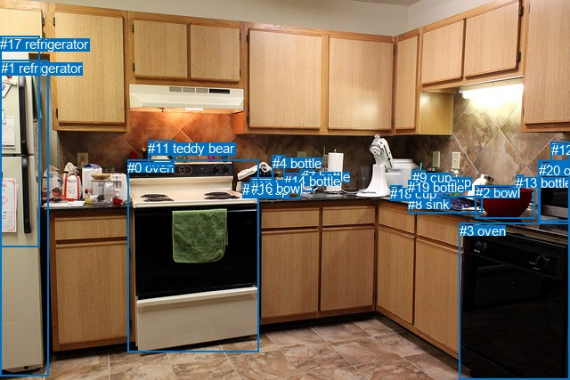
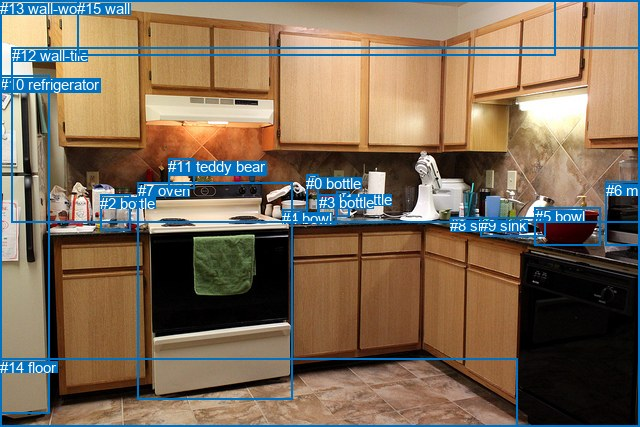

# 图片 1583：2389278.jpg

随机样本序号：459。图片 SHA256：`f6b10f771a3d40d6d273013bb9ea58fb3a285d0b6ef14b94b9f2fc058d91fefe`。

红色框表示人，蓝色框表示其他物体。两个模式分别保留自身框编号，可依据位置比较对应对象。

## 自动检测框与输出

人的框编号：`[]`。状态：`no_person`。

### 自动检测全部物体框

| 编号 | 类别 | 是否为人 | 检测分数 | 像素坐标 xyxy |
|---|---|---|---|---|
| 0 | oven | False | 0.9976 | 143.4, 179.7, 290.8, 395.6 |
| 1 | refrigerator | False | 0.9907 | 0.8, 67.8, 54.2, 422.7 |
| 2 | bowl | False | 0.9861 | 533.7, 208.2, 601.0, 245.4 |
| 3 | oven | False | 0.9835 | 515.5, 250.9, 640.0, 427.0 |
| 4 | bottle | False | 0.9736 | 306.0, 174.7, 319.4, 220.3 |
| 5 | microwave | False | 0.9247 | 605.7, 180.9, 640.0, 251.7 |
| 6 | cup | False | 0.8703 | 485.2, 196.1, 500.4, 221.7 |
| 7 | bottle | False | 0.8673 | 337.6, 190.4, 351.3, 215.9 |
| 8 | sink | False | 0.8430 | 458.4, 220.8, 541.3, 239.6 |
| 9 | cup | False | 0.8073 | 463.0, 191.1, 477.8, 218.8 |
| 10 | bowl | False | 0.6486 | 281.4, 199.9, 307.2, 212.1 |
| 11 | teddy bear | False | 0.6221 | 166.3, 157.9, 195.8, 188.6 |
| 12 | bowl | False | 0.5746 | 618.8, 160.0, 640.0, 182.1 |
| 13 | bottle | False | 0.5581 | 579.3, 196.6, 587.4, 210.3 |
| 14 | bottle | False | 0.5545 | 318.9, 194.7, 336.1, 223.5 |
| 15 | cup | False | 0.5051 | 272.1, 205.0, 282.7, 219.0 |
| 16 | bowl | False | 0.4962 | 281.5, 202.7, 307.1, 220.2 |
| 17 | refrigerator | False | 0.4675 | 0.2, 40.6, 44.5, 277.6 |
| 18 | cup | False | 0.4664 | 438.4, 209.0, 451.6, 220.3 |
| 19 | bottle | False | 0.4592 | 458.4, 202.3, 464.5, 217.6 |
| 20 | oven | False | 0.3838 | 604.7, 183.1, 640.0, 248.6 |

### 自动检测 Top50 人相关候选

评分物体对：0；人相关物体对：0；输出关系：0。

| 排名 | 主语编号与类别 | 关系 | 宾语编号与类别 | 类型 | 人与人 | 排序分数 | 原始融合 logit |
|---|---|---|---|---|---|---|---|

### 自动检测逐条人相关 GT 核验

本图没有人相关 GT，R@50 无分母；预测候选继续展示。

## 真实框与输出

人的框编号：`[]`。

### 真实框全部物体框

| 编号 | 类别 | 是否为人 | 检测分数 | 像素坐标 xyxy |
|---|---|---|---|---|
| 0 | bottle | False | GT | 306.0, 175.0, 319.0, 219.0 |
| 1 | bottle | False | GT | 337.0, 191.0, 350.0, 216.0 |
| 2 | bottle | False | GT | 100.0, 195.0, 130.0, 231.0 |
| 3 | bottle | False | GT | 319.0, 194.0, 337.0, 224.0 |
| 4 | bowl | False | GT | 282.0, 210.0, 307.0, 224.0 |
| 5 | bowl | False | GT | 535.0, 208.0, 601.0, 246.0 |
| 6 | microwave | False | GT | 606.0, 182.0, 640.0, 245.0 |
| 7 | oven | False | GT | 138.0, 182.0, 293.0, 399.0 |
| 8 | sink | False | GT | 450.0, 217.0, 480.0, 229.0 |
| 9 | sink | False | GT | 480.0, 217.0, 545.0, 236.0 |
| 10 | refrigerator | False | GT | 0.0, 76.0, 49.0, 414.0 |
| 11 | teddy bear | False | GT | 168.0, 158.0, 194.0, 188.0 |
| 12 | wall-tile | False | GT | 12.0, 47.0, 640.0, 223.0 |
| 13 | wall-wood | False | GT | 0.0, 0.0, 640.0, 427.0 |
| 14 | floor | False | GT | 0.0, 359.0, 517.0, 427.0 |
| 15 | wall | False | GT | 77.0, 0.0, 555.0, 55.0 |

### 真实框 Top50 人相关候选

评分物体对：0；人相关物体对：0；输出关系：0。

| 排名 | 主语编号与类别 | 关系 | 宾语编号与类别 | 类型 | 人与人 | 排序分数 | 原始融合 logit |
|---|---|---|---|---|---|---|---|

### 真实框逐条人相关 GT 核验

本图没有人相关 GT，R@50 无分母；预测候选继续展示。

## 全部人相关 GT

| 主语编号与类别 | 关系 | 宾语编号与类别 |
|---|---|---|

原始记录、全部人相关物体对的两项预测与分项分数见 [逐图证据 JSON](../evidence/cases/1583.json)。全部56类 logits 保留于本机 HOR/output/random500/logits/。

<!-- HOR_COMPLETE_RESULTS -->

## 六组条件的完整输出对照

以下保留同一图片三种框与候选模式、两种谓词输出规则的全部 Top50。框编号各自在所属模式内解释。

### 自动检测框完整枚举：空间与语义各保留一个谓词

| 排名 | 主语编号与类别 | 谓词 | 宾语编号与类别 | 分组 | 排序分数 | predicate logit | pair logit |
|---|---|---|---|---|---|---|---|

没有人相关 GT，本条件的召回率无分母。

### 自动检测框完整枚举：每对只保留一个谓词

| 排名 | 主语编号与类别 | 谓词 | 宾语编号与类别 | 分组 | 排序分数 | predicate logit | pair logit |
|---|---|---|---|---|---|---|---|

没有人相关 GT，本条件的召回率无分母。

### 真实框完整枚举：空间与语义各保留一个谓词

| 排名 | 主语编号与类别 | 谓词 | 宾语编号与类别 | 分组 | 排序分数 | predicate logit | pair logit |
|---|---|---|---|---|---|---|---|

没有人相关 GT，本条件的召回率无分母。

### 真实框完整枚举：每对只保留一个谓词

| 排名 | 主语编号与类别 | 谓词 | 宾语编号与类别 | 分组 | 排序分数 | predicate logit | pair logit |
|---|---|---|---|---|---|---|---|

没有人相关 GT，本条件的召回率无分母。

### 真实框400候选：空间与语义各保留一个谓词

| 排名 | 主语编号与类别 | 谓词 | 宾语编号与类别 | 分组 | 排序分数 | predicate logit | pair logit |
|---|---|---|---|---|---|---|---|

没有人相关 GT，本条件的召回率无分母。

### 真实框400候选：每对只保留一个谓词

| 排名 | 主语编号与类别 | 谓词 | 宾语编号与类别 | 分组 | 排序分数 | predicate logit | pair logit |
|---|---|---|---|---|---|---|---|

没有人相关 GT，本条件的召回率无分母。
