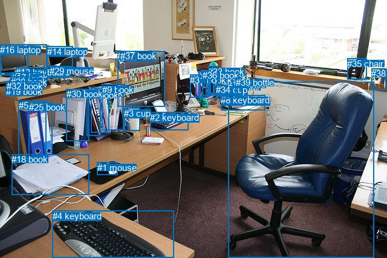
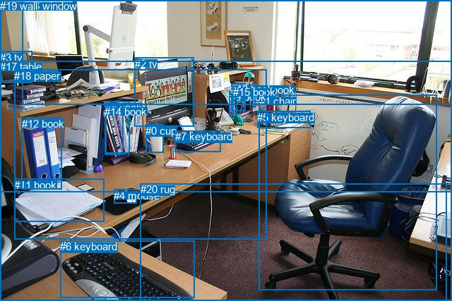

# 图片 1587：2389462.jpg

随机样本序号：291。图片 SHA256：`194f0aca3fbaed6f998e1f87d90ee64f8590bf29d39fdc4c250b79015731faab`。

红色框表示人，蓝色框表示其他物体。两个模式分别保留自身框编号，可依据位置比较对应对象。

## 自动检测框与输出

人的框编号：`[]`。状态：`no_person`。

### 自动检测全部物体框

| 编号 | 类别 | 是否为人 | 检测分数 | 像素坐标 xyxy |
|---|---|---|---|---|
| 0 | chair | False | 0.9993 | 377.8, 135.8, 618.0, 427.0 |
| 1 | mouse | False | 0.9990 | 160.7, 268.8, 194.4, 289.7 |
| 2 | keyboard | False | 0.9989 | 248.2, 185.7, 311.4, 215.4 |
| 3 | cup | False | 0.9931 | 205.0, 178.8, 231.5, 216.3 |
| 4 | keyboard | False | 0.9903 | 86.9, 348.5, 287.1, 426.3 |
| 5 | book | False | 0.9601 | 30.8, 166.3, 76.9, 264.0 |
| 6 | book | False | 0.9593 | 151.0, 145.4, 181.0, 219.6 |
| 7 | book | False | 0.9151 | 144.0, 148.5, 166.3, 224.4 |
| 8 | keyboard | False | 0.9147 | 365.1, 157.0, 438.9, 182.7 |
| 9 | book | False | 0.9060 | 168.6, 140.0, 204.2, 215.7 |
| 10 | tv | False | 0.8835 | 0.0, 73.3, 46.0, 121.3 |
| 11 | bottle | False | 0.8784 | 376.3, 131.5, 389.8, 162.9 |
| 12 | book | False | 0.8531 | 16.8, 130.2, 62.1, 140.2 |
| 13 | keyboard | False | 0.8391 | 26.1, 111.1, 76.3, 123.4 |
| 14 | laptop | False | 0.8080 | 77.7, 76.9, 120.4, 110.1 |
| 15 | book | False | 0.7955 | 328.0, 119.2, 335.5, 162.2 |
| 16 | laptop | False | 0.7427 | 0.2, 73.9, 77.4, 124.0 |
| 17 | book | False | 0.7307 | 18.7, 119.8, 66.0, 133.9 |
| 18 | book | False | 0.7170 | 19.3, 255.1, 147.2, 322.9 |
| 19 | book | False | 0.6924 | 9.6, 143.0, 63.6, 158.4 |
| 20 | cup | False | 0.6914 | 357.4, 140.9, 376.6, 163.7 |
| 21 | book | False | 0.6909 | 323.9, 123.9, 331.2, 161.9 |
| 22 | tv | False | 0.6546 | 194.5, 84.2, 272.9, 176.1 |
| 23 | book | False | 0.6349 | 328.4, 117.1, 344.5, 161.5 |
| 24 | book | False | 0.6240 | 343.4, 117.3, 353.1, 157.0 |
| 25 | book | False | 0.6102 | 47.7, 169.1, 86.8, 256.8 |
| 26 | book | False | 0.6057 | 340.4, 117.6, 347.4, 156.5 |
| 27 | book | False | 0.5726 | 347.8, 118.7, 355.4, 156.4 |
| 28 | book | False | 0.5681 | 17.7, 126.6, 64.2, 136.9 |
| 29 | mouse | False | 0.5604 | 81.5, 108.8, 93.0, 116.7 |
| 30 | book | False | 0.5574 | 109.7, 147.1, 147.2, 233.8 |
| 31 | book | False | 0.5505 | 314.1, 123.7, 331.2, 161.6 |
| 32 | book | False | 0.5106 | 11.0, 134.1, 64.2, 149.3 |
| 33 | book | False | 0.4882 | 344.1, 109.6, 360.7, 154.6 |
| 34 | cup | False | 0.4838 | 357.1, 139.8, 368.6, 159.9 |
| 35 | chair | False | 0.4752 | 574.0, 96.7, 606.1, 131.3 |
| 36 | book | False | 0.4750 | 334.9, 116.3, 348.6, 158.2 |
| 37 | book | False | 0.4737 | 198.6, 84.2, 252.4, 101.3 |
| 38 | chair | False | 0.4716 | 614.3, 113.0, 638.7, 148.7 |
| 39 | bottle | False | 0.4685 | 389.6, 128.1, 400.3, 159.7 |

### 自动检测 Top50 人相关候选

评分物体对：0；人相关物体对：0；输出关系：0。

| 排名 | 主语编号与类别 | 关系 | 宾语编号与类别 | 类型 | 人与人 | 排序分数 | 原始融合 logit |
|---|---|---|---|---|---|---|---|

### 自动检测逐条人相关 GT 核验

本图没有人相关 GT，R@50 无分母；预测候选继续展示。

## 真实框与输出

人的框编号：`[]`。

### 真实框全部物体框

| 编号 | 类别 | 是否为人 | 检测分数 | 像素坐标 xyxy |
|---|---|---|---|---|
| 0 | cup | False | GT | 206.0, 177.0, 231.0, 217.0 |
| 1 | chair | False | GT | 367.0, 135.0, 619.0, 412.0 |
| 2 | tv | False | GT | 191.0, 82.0, 275.0, 179.0 |
| 3 | tv | False | GT | 0.0, 73.0, 46.0, 118.0 |
| 4 | mouse | False | GT | 161.0, 269.0, 194.0, 289.0 |
| 5 | keyboard | False | GT | 364.0, 158.0, 439.0, 182.0 |
| 6 | keyboard | False | GT | 85.0, 341.0, 275.0, 422.0 |
| 7 | keyboard | False | GT | 248.0, 185.0, 312.0, 215.0 |
| 8 | book | False | GT | 149.0, 144.0, 183.0, 218.0 |
| 9 | book | False | GT | 325.0, 129.0, 331.0, 163.0 |
| 10 | book | False | GT | 357.0, 119.0, 361.0, 152.0 |
| 11 | book | False | GT | 20.0, 254.0, 147.0, 315.0 |
| 12 | book | False | GT | 31.0, 167.0, 88.0, 269.0 |
| 13 | book | False | GT | 327.0, 118.0, 348.0, 157.0 |
| 14 | book | False | GT | 148.0, 150.0, 174.0, 220.0 |
| 15 | book | False | GT | 330.0, 122.0, 336.0, 161.0 |
| 16 | window | False | GT | 32.0, 0.0, 640.0, 149.0 |
| 17 | table | False | GT | 0.0, 86.0, 640.0, 427.0 |
| 18 | paper | False | GT | 20.0, 99.0, 378.0, 340.0 |
| 19 | wall | False | GT | 0.0, 0.0, 640.0, 272.0 |
| 20 | rug | False | GT | 199.0, 260.0, 633.0, 427.0 |

### 真实框 Top50 人相关候选

评分物体对：0；人相关物体对：0；输出关系：0。

| 排名 | 主语编号与类别 | 关系 | 宾语编号与类别 | 类型 | 人与人 | 排序分数 | 原始融合 logit |
|---|---|---|---|---|---|---|---|

### 真实框逐条人相关 GT 核验

本图没有人相关 GT，R@50 无分母；预测候选继续展示。

## 全部人相关 GT

| 主语编号与类别 | 关系 | 宾语编号与类别 |
|---|---|---|

原始记录、全部人相关物体对的两项预测与分项分数见 [逐图证据 JSON](../evidence/cases/1587.json)。全部56类 logits 保留于本机 HOR/output/random500/logits/。

<!-- HOR_COMPLETE_RESULTS -->

## 六组条件的完整输出对照

以下保留同一图片三种框与候选模式、两种谓词输出规则的全部 Top50。框编号各自在所属模式内解释。

### 自动检测框完整枚举：空间与语义各保留一个谓词

| 排名 | 主语编号与类别 | 谓词 | 宾语编号与类别 | 分组 | 排序分数 | predicate logit | pair logit |
|---|---|---|---|---|---|---|---|

没有人相关 GT，本条件的召回率无分母。

### 自动检测框完整枚举：每对只保留一个谓词

| 排名 | 主语编号与类别 | 谓词 | 宾语编号与类别 | 分组 | 排序分数 | predicate logit | pair logit |
|---|---|---|---|---|---|---|---|

没有人相关 GT，本条件的召回率无分母。

### 真实框完整枚举：空间与语义各保留一个谓词

| 排名 | 主语编号与类别 | 谓词 | 宾语编号与类别 | 分组 | 排序分数 | predicate logit | pair logit |
|---|---|---|---|---|---|---|---|

没有人相关 GT，本条件的召回率无分母。

### 真实框完整枚举：每对只保留一个谓词

| 排名 | 主语编号与类别 | 谓词 | 宾语编号与类别 | 分组 | 排序分数 | predicate logit | pair logit |
|---|---|---|---|---|---|---|---|

没有人相关 GT，本条件的召回率无分母。

### 真实框400候选：空间与语义各保留一个谓词

| 排名 | 主语编号与类别 | 谓词 | 宾语编号与类别 | 分组 | 排序分数 | predicate logit | pair logit |
|---|---|---|---|---|---|---|---|

没有人相关 GT，本条件的召回率无分母。

### 真实框400候选：每对只保留一个谓词

| 排名 | 主语编号与类别 | 谓词 | 宾语编号与类别 | 分组 | 排序分数 | predicate logit | pair logit |
|---|---|---|---|---|---|---|---|

没有人相关 GT，本条件的召回率无分母。
