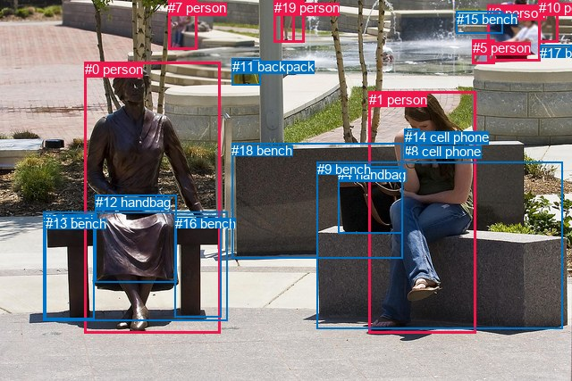
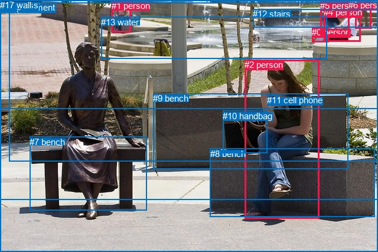

# 图片 1589：2389680.jpg

随机样本序号：253。图片 SHA256：`6ad91f53f6e9d9c788852373253089e9e97238879e31bbb5315e76a0bbb6e299`。

红色框表示人，蓝色框表示其他物体。两个模式分别保留自身框编号，可依据位置比较对应对象。

## 自动检测框与输出

人的框编号：`[0, 1, 2, 5, 6, 7, 10, 19]`。状态：`ok`。

### 自动检测全部物体框

| 编号 | 类别 | 是否为人 | 检测分数 | 像素坐标 xyxy |
|---|---|---|---|---|
| 0 | person | True | 0.9996 | 94.9, 69.2, 246.2, 373.8 |
| 1 | person | True | 0.9994 | 413.0, 102.7, 532.6, 373.5 |
| 2 | person | True | 0.9973 | 545.2, 5.6, 604.4, 68.3 |
| 3 | bench | False | 0.9813 | 48.5, 238.0, 254.6, 359.2 |
| 4 | handbag | False | 0.9749 | 378.2, 186.6, 450.5, 261.2 |
| 5 | person | True | 0.9722 | 528.8, 45.0, 553.9, 71.7 |
| 6 | person | True | 0.9655 | 314.0, 0.2, 329.6, 47.8 |
| 7 | person | True | 0.9520 | 188.1, 0.3, 220.8, 55.7 |
| 8 | cell phone | False | 0.9514 | 452.0, 160.9, 469.1, 175.0 |
| 9 | bench | False | 0.8845 | 354.7, 181.1, 629.8, 368.5 |
| 10 | person | True | 0.8693 | 602.9, 0.3, 624.7, 47.7 |
| 11 | backpack | False | 0.8162 | 259.7, 65.6, 291.1, 95.7 |
| 12 | handbag | False | 0.8072 | 106.6, 218.3, 197.8, 316.6 |
| 13 | bench | False | 0.5333 | 50.9, 242.3, 105.9, 357.3 |
| 14 | cell phone | False | 0.4683 | 452.8, 144.9, 469.6, 175.4 |
| 15 | bench | False | 0.4502 | 510.6, 12.6, 562.3, 37.1 |
| 16 | bench | False | 0.4454 | 195.8, 241.9, 247.8, 355.3 |
| 17 | bench | False | 0.4292 | 604.0, 50.8, 640.0, 60.2 |
| 18 | bench | False | 0.4081 | 259.3, 160.1, 450.7, 289.2 |
| 19 | person | True | 0.3876 | 306.8, 0.0, 340.6, 47.5 |

### 自动检测 Top50 人相关候选

评分物体对：380；人相关物体对：248；输出关系：50。

| 排名 | 主语编号与类别 | 关系 | 宾语编号与类别 | 类型 | 人与人 | 排序分数 | 原始融合 logit |
|---|---|---|---|---|---|---|---|
| 1 | #0 person | wearing | #12 handbag | semantic | False | 0.99035 | 4.6314 |
| 2 | #1 person | holding | #4 handbag | semantic | False | 0.98892 | 4.4915 |
| 3 | #1 person | sitting on | #9 bench | semantic | False | 0.98346 | 4.0852 |
| 4 | #0 person | sitting on | #3 bench | semantic | False | 0.98339 | 4.0810 |
| 5 | #10 person | on | #17 bench | spatial | False | 0.97428 | 3.6345 |
| 6 | #2 person | holding | #5 person | semantic | True | 0.97310 | 3.5884 |
| 7 | #1 person | holding | #8 cell phone | semantic | False | 0.97304 | 3.5862 |
| 8 | #0 person | on | #3 bench | spatial | False | 0.97205 | 3.5491 |
| 9 | #2 person | on | #17 bench | spatial | False | 0.96543 | 3.3296 |
| 10 | #0 person | sitting on | #13 bench | semantic | False | 0.96523 | 3.3237 |
| 11 | #1 person | on | #9 bench | spatial | False | 0.96513 | 3.3207 |
| 12 | #2 person | pushing | #15 bench | semantic | False | 0.96447 | 3.3011 |
| 13 | #10 person | sitting on | #17 bench | semantic | False | 0.96338 | 3.2698 |
| 14 | #6 person | on | #19 person | spatial | True | 0.95628 | 3.0854 |
| 15 | #1 person | holding | #14 cell phone | semantic | False | 0.95589 | 3.0761 |
| 16 | #0 person | sitting on | #16 bench | semantic | False | 0.94807 | 2.9045 |
| 17 | #5 person | in | #17 bench | spatial | False | 0.94163 | 2.7807 |
| 18 | #0 person | on | #13 bench | spatial | False | 0.94109 | 2.7709 |
| 19 | #5 person | lying on | #17 bench | semantic | False | 0.93846 | 2.7245 |
| 20 | #0 person | in | #12 handbag | spatial | False | 0.93754 | 2.7087 |
| 21 | #5 person | in | #15 bench | spatial | False | 0.92804 | 2.5569 |
| 22 | #2 person | on | #15 bench | spatial | False | 0.92111 | 2.4576 |
| 23 | #2 person | standing on | #17 bench | semantic | False | 0.91819 | 2.4180 |
| 24 | #1 person | on | #8 cell phone | spatial | False | 0.91213 | 2.3399 |
| 25 | #0 person | on | #16 bench | spatial | False | 0.90806 | 2.2901 |
| 26 | #1 person | on | #14 cell phone | spatial | False | 0.90775 | 2.2865 |
| 27 | #5 person | wearing | #15 bench | semantic | False | 0.90768 | 2.2856 |
| 28 | #2 person | pushing | #10 person | semantic | True | 0.90707 | 2.2784 |
| 29 | #19 person | on | #6 person | spatial | True | 0.89124 | 2.1035 |
| 30 | #12 handbag | on | #0 person | spatial | False | 0.87163 | 1.9155 |
| 31 | #10 person | pushing | #2 person | semantic | True | 0.86895 | 1.8917 |
| 32 | #2 person | in | #10 person | spatial | True | 0.84967 | 1.7320 |
| 33 | #10 person | wearing | #15 bench | semantic | False | 0.81252 | 1.4665 |
| 34 | #1 person | on | #4 handbag | spatial | False | 0.80721 | 1.4320 |
| 35 | #1 person | sitting on | #18 bench | semantic | False | 0.79380 | 1.3480 |
| 36 | #2 person | on | #5 person | spatial | True | 0.78737 | 1.3092 |
| 37 | #1 person | leaning on | #18 bench | spatial | False | 0.78663 | 1.3047 |
| 38 | #10 person | in | #15 bench | spatial | False | 0.78268 | 1.2813 |
| 39 | #0 person | leaning on | #18 bench | spatial | False | 0.75285 | 1.1139 |
| 40 | #11 backpack | in | #19 person | spatial | False | 0.73473 | 1.0187 |
| 41 | #0 person | sitting on | #18 bench | semantic | False | 0.73002 | 0.9947 |
| 42 | #5 person | talking to | #2 person | semantic | True | 0.72239 | 0.9563 |
| 43 | #11 backpack | on | #6 person | spatial | False | 0.69754 | 0.8356 |
| 44 | #1 person | looking at | #0 person | semantic | True | 0.68727 | 0.7874 |
| 45 | #6 person | holding | #19 person | semantic | True | 0.67573 | 0.7342 |
| 46 | #5 person | in | #2 person | spatial | True | 0.61737 | 0.4784 |
| 47 | #0 person | sitting on | #9 bench | semantic | False | 0.60740 | 0.4364 |
| 48 | #0 person | looking at | #1 person | semantic | True | 0.59820 | 0.3980 |
| 49 | #19 person | holding | #6 person | semantic | True | 0.59068 | 0.3668 |
| 50 | #7 person | walking on | #19 person | semantic | True | 0.56654 | 0.2678 |

### 自动检测逐条人相关 GT 核验

R@50：20.00%；命中 2/10。

| GT 主语编号 | GT 关系 | GT 宾语编号 | 结果阶段 | 匹配预测主语编号 | 匹配预测宾语编号 |
|---|---|---|---|---|---|
| 0 | beside | 12 | endpoint_missing_or_wrong_class | [5] | [] |
| 0 | beside | 13 | endpoint_missing_or_wrong_class | [5] | [] |
| 2 | sitting on | 8 | hit50 | [1] | [9] |
| 2 | holding | 11 | hit50 | [1] | [8] |
| 2 | looking at | 11 | wrong_predicate | [1] | [8] |
| 4 | beside | 0 | wrong_predicate | [2] | [5] |
| 4 | looking at | 0 | wrong_predicate | [2] | [5] |
| 4 | beside | 12 | endpoint_missing_or_wrong_class | [2] | [] |
| 4 | beside | 13 | endpoint_missing_or_wrong_class | [2] | [] |
| 10 | beside | 2 | wrong_predicate | [4] | [1] |

## 真实框与输出

人的框编号：`[0, 1, 2, 3, 4, 5, 6]`。

### 真实框全部物体框

| 编号 | 类别 | 是否为人 | 检测分数 | 像素坐标 xyxy |
|---|---|---|---|---|
| 0 | person | True | GT | 528.0, 46.0, 556.0, 71.0 |
| 1 | person | True | GT | 189.0, 1.0, 222.0, 55.0 |
| 2 | person | True | GT | 414.0, 101.0, 541.0, 370.0 |
| 3 | person | True | GT | 601.0, 0.0, 629.0, 49.0 |
| 4 | person | True | GT | 548.0, 12.0, 610.0, 70.0 |
| 5 | person | True | GT | 542.0, 1.0, 591.0, 60.0 |
| 6 | person | True | GT | 590.0, 0.0, 599.0, 15.0 |
| 7 | bench | False | GT | 50.0, 232.0, 249.0, 357.0 |
| 8 | bench | False | GT | 356.0, 252.0, 635.0, 368.0 |
| 9 | bench | False | GT | 259.0, 158.0, 589.0, 286.0 |
| 10 | handbag | False | GT | 377.0, 188.0, 453.0, 260.0 |
| 11 | cell phone | False | GT | 452.0, 161.0, 471.0, 176.0 |
| 12 | stairs | False | GT | 428.0, 15.0, 640.0, 46.0 |
| 13 | water | False | GT | 171.0, 29.0, 553.0, 100.0 |
| 14 | tree | False | GT | 16.0, 0.0, 640.0, 273.0 |
| 15 | pavement | False | GT | 0.0, 4.0, 640.0, 427.0 |
| 16 | grass | False | GT | 0.0, 0.0, 640.0, 339.0 |
| 17 | wall | False | GT | 0.0, 0.0, 640.0, 185.0 |

### 真实框 Top50 人相关候选

评分物体对：306；人相关物体对：196；输出关系：50。

| 排名 | 主语编号与类别 | 关系 | 宾语编号与类别 | 类型 | 人与人 | 排序分数 | 原始融合 logit |
|---|---|---|---|---|---|---|---|
| 1 | #2 person | holding | #10 handbag | semantic | False | 0.99063 | 4.6604 |
| 2 | #2 person | sitting on | #8 bench | semantic | False | 0.98652 | 4.2931 |
| 3 | #2 person | holding | #11 cell phone | semantic | False | 0.98029 | 3.9066 |
| 4 | #5 person | leaning on | #12 stairs | spatial | False | 0.96117 | 3.2090 |
| 5 | #1 person | in | #17 wall | spatial | False | 0.96052 | 3.1917 |
| 6 | #5 person | pushing | #4 person | semantic | True | 0.96036 | 3.1874 |
| 7 | #2 person | sitting on | #9 bench | semantic | False | 0.95712 | 3.1054 |
| 8 | #3 person | sitting on | #12 stairs | semantic | False | 0.95695 | 3.1013 |
| 9 | #2 person | on | #8 bench | spatial | False | 0.95301 | 3.0098 |
| 10 | #4 person | leaning on | #12 stairs | spatial | False | 0.94859 | 2.9151 |
| 11 | #4 person | sitting on | #12 stairs | semantic | False | 0.94284 | 2.8031 |
| 12 | #0 person | in | #13 water | spatial | False | 0.93939 | 2.7407 |
| 13 | #1 person | in | #14 tree | spatial | False | 0.93840 | 2.7236 |
| 14 | #1 person | in | #13 water | spatial | False | 0.93582 | 2.6798 |
| 15 | #5 person | standing on | #12 stairs | semantic | False | 0.93349 | 2.6415 |
| 16 | #1 person | walking on | #17 wall | semantic | False | 0.93217 | 2.6205 |
| 17 | #1 person | walking on | #15 pavement | semantic | False | 0.92823 | 2.5598 |
| 18 | #3 person | on | #12 stairs | spatial | False | 0.92573 | 2.5229 |
| 19 | #1 person | walking on | #13 water | semantic | False | 0.92019 | 2.4449 |
| 20 | #0 person | in | #17 wall | spatial | False | 0.91939 | 2.4341 |
| 21 | #1 person | in | #16 grass | spatial | False | 0.91716 | 2.4044 |
| 22 | #4 person | in | #17 wall | spatial | False | 0.91277 | 2.3480 |
| 23 | #2 person | on | #11 cell phone | spatial | False | 0.90718 | 2.2797 |
| 24 | #0 person | in | #14 tree | spatial | False | 0.90492 | 2.2531 |
| 25 | #4 person | holding | #0 person | semantic | True | 0.90460 | 2.2495 |
| 26 | #1 person | walking on | #14 tree | semantic | False | 0.89656 | 2.1596 |
| 27 | #1 person | walking on | #16 grass | semantic | False | 0.89361 | 2.1282 |
| 28 | #2 person | leaning on | #9 bench | spatial | False | 0.89055 | 2.0964 |
| 29 | #2 person | sitting on | #15 pavement | semantic | False | 0.88744 | 2.0649 |
| 30 | #5 person | pushing | #0 person | semantic | True | 0.88652 | 2.0557 |
| 31 | #4 person | holding | #5 person | semantic | True | 0.88104 | 2.0023 |
| 32 | #1 person | in | #15 pavement | spatial | False | 0.87485 | 1.9446 |
| 33 | #0 person | sitting on | #12 stairs | semantic | False | 0.87259 | 1.9241 |
| 34 | #0 person | playing | #13 water | semantic | False | 0.87106 | 1.9103 |
| 35 | #3 person | in | #17 wall | spatial | False | 0.86864 | 1.8890 |
| 36 | #4 person | in | #14 tree | spatial | False | 0.86464 | 1.8543 |
| 37 | #2 person | on | #15 pavement | spatial | False | 0.86305 | 1.8409 |
| 38 | #0 person | in | #12 stairs | spatial | False | 0.85531 | 1.7768 |
| 39 | #0 person | in | #16 grass | spatial | False | 0.85144 | 1.7459 |
| 40 | #5 person | in | #17 wall | spatial | False | 0.84857 | 1.7234 |
| 41 | #2 person | sitting on | #7 bench | semantic | False | 0.83525 | 1.6233 |
| 42 | #2 person | on | #10 handbag | spatial | False | 0.83420 | 1.6157 |
| 43 | #3 person | in | #14 tree | spatial | False | 0.83087 | 1.5918 |
| 44 | #4 person | in | #16 grass | spatial | False | 0.81471 | 1.4809 |
| 45 | #6 person | holding | #4 person | semantic | True | 0.80912 | 1.4443 |
| 46 | #4 person | holding | #6 person | semantic | True | 0.79528 | 1.3570 |
| 47 | #6 person | in | #17 wall | spatial | False | 0.79178 | 1.3357 |
| 48 | #4 person | in | #15 pavement | spatial | False | 0.78482 | 1.2940 |
| 49 | #0 person | in | #15 pavement | spatial | False | 0.78411 | 1.2898 |
| 50 | #4 person | sitting on | #17 wall | semantic | False | 0.77531 | 1.2385 |

### 真实框逐条人相关 GT 核验

R@50：20.00%；命中 2/10。

| GT 主语编号 | GT 关系 | GT 宾语编号 | 结果阶段 | 匹配预测主语编号 | 匹配预测宾语编号 |
|---|---|---|---|---|---|
| 0 | beside | 12 | wrong_predicate | [0] | [12] |
| 0 | beside | 13 | wrong_predicate | [0] | [13] |
| 2 | sitting on | 8 | hit50 | [2] | [8] |
| 2 | holding | 11 | hit50 | [2] | [11] |
| 2 | looking at | 11 | wrong_predicate | [2] | [11] |
| 4 | beside | 0 | wrong_predicate | [4] | [0] |
| 4 | looking at | 0 | wrong_predicate | [4] | [0] |
| 4 | beside | 12 | wrong_predicate | [4] | [12] |
| 4 | beside | 13 | wrong_predicate | [4] | [13] |
| 10 | beside | 2 | rank_below50 | [10] | [2] |

## 全部人相关 GT

| 主语编号与类别 | 关系 | 宾语编号与类别 |
|---|---|---|
| #0 person | beside | #12 stairs |
| #0 person | beside | #13 water |
| #2 person | sitting on | #8 bench |
| #2 person | holding | #11 cell phone |
| #2 person | looking at | #11 cell phone |
| #4 person | beside | #0 person |
| #4 person | looking at | #0 person |
| #4 person | beside | #12 stairs |
| #4 person | beside | #13 water |
| #10 handbag | beside | #2 person |

原始记录、全部人相关物体对的两项预测与分项分数见 [逐图证据 JSON](../evidence/cases/1589.json)。全部56类 logits 保留于本机 HOR/output/random500/logits/。

<!-- HOR_COMPLETE_RESULTS -->

## 六组条件的完整输出对照

以下保留同一图片三种框与候选模式、两种谓词输出规则的全部 Top50。框编号各自在所属模式内解释。

### 自动检测框完整枚举：空间与语义各保留一个谓词

| 排名 | 主语编号与类别 | 谓词 | 宾语编号与类别 | 分组 | 排序分数 | predicate logit | pair logit |
|---|---|---|---|---|---|---|---|
| 1 | #0 person | wearing | #12 handbag | semantic | 0.9903532 | 4.0753961 | 0.5560414 |
| 2 | #1 person | holding | #4 handbag | semantic | 0.9889204 | 4.2537341 | 0.2377744 |
| 3 | #1 person | sitting on | #9 bench | semantic | 0.9834592 | 3.8339953 | 0.2512493 |
| 4 | #0 person | sitting on | #3 bench | semantic | 0.9833898 | 3.6775136 | 0.4034749 |
| 5 | #10 person | on | #17 bench | spatial | 0.9742819 | 3.4763179 | 0.1581893 |
| 6 | #2 person | holding | #5 person | semantic | 0.9731010 | 3.8276467 | -0.2392504 |
| 7 | #1 person | holding | #8 cell phone | semantic | 0.9730425 | 3.4827609 | 0.1034057 |
| 8 | #0 person | on | #3 bench | spatial | 0.9720532 | 3.1456323 | 0.4034749 |
| 9 | #2 person | on | #17 bench | spatial | 0.9654292 | 3.2458987 | 0.0836672 |
| 10 | #0 person | sitting on | #13 bench | semantic | 0.9652335 | 3.1298308 | 0.1938856 |
| 11 | #1 person | on | #9 bench | spatial | 0.9651306 | 3.0694046 | 0.2512493 |
| 12 | #2 person | pushing | #15 bench | semantic | 0.9644666 | 3.1857915 | 0.1153094 |
| 13 | #10 person | sitting on | #17 bench | semantic | 0.9633793 | 3.1116452 | 0.1581893 |
| 14 | #6 person | on | #19 person | spatial | 0.9562848 | 3.0292645 | 0.0560955 |
| 15 | #1 person | holding | #14 cell phone | semantic | 0.9558947 | 2.9378242 | 0.1382451 |
| 16 | #0 person | sitting on | #16 bench | semantic | 0.9480684 | 2.8830280 | 0.0214708 |
| 17 | #5 person | in | #17 bench | spatial | 0.9416252 | 2.7248650 | 0.0558586 |
| 18 | #0 person | on | #13 bench | spatial | 0.9410852 | 2.5770555 | 0.1938856 |
| 19 | #5 person | lying on | #17 bench | semantic | 0.9384583 | 2.6686630 | 0.0558586 |
| 20 | #0 person | in | #12 handbag | spatial | 0.9375396 | 2.1526861 | 0.5560414 |
| 21 | #5 person | in | #15 bench | spatial | 0.9280353 | 2.5562572 | 0.0006359 |
| 22 | #2 person | on | #15 bench | spatial | 0.9211135 | 2.3422637 | 0.1153094 |
| 23 | #2 person | standing on | #17 bench | semantic | 0.9181929 | 2.3343773 | 0.0836672 |
| 24 | #1 person | on | #8 cell phone | spatial | 0.9121305 | 2.2365246 | 0.1034057 |
| 25 | #0 person | on | #16 bench | spatial | 0.9080573 | 2.2686710 | 0.0214708 |
| 26 | #1 person | on | #14 cell phone | spatial | 0.9077523 | 2.1482487 | 0.1382451 |
| 27 | #5 person | wearing | #15 bench | semantic | 0.9076784 | 2.2849770 | 0.0006359 |
| 28 | #2 person | pushing | #10 person | semantic | 0.9070737 | 2.3733749 | -0.0949575 |
| 29 | #19 person | on | #6 person | spatial | 0.8912409 | 2.0499816 | 0.0534977 |
| 30 | #12 handbag | on | #0 person | spatial | 0.8716321 | 2.4042692 | -0.4888023 |
| 31 | #10 person | pushing | #2 person | semantic | 0.8689520 | 2.1324120 | -0.2406880 |
| 32 | #2 person | in | #10 person | spatial | 0.8496715 | 1.8269844 | -0.0949575 |
| 33 | #10 person | wearing | #15 bench | semantic | 0.8125199 | 1.6089792 | -0.1425116 |
| 34 | #1 person | on | #4 handbag | spatial | 0.8072119 | 1.1942205 | 0.2377744 |
| 35 | #1 person | sitting on | #18 bench | semantic | 0.7938014 | 2.0434775 | -0.6954835 |
| 36 | #2 person | on | #5 person | spatial | 0.7873746 | 1.5484228 | -0.2392504 |
| 37 | #1 person | leaning on | #18 bench | spatial | 0.7866280 | 2.0002017 | -0.6954835 |
| 38 | #10 person | in | #15 bench | spatial | 0.7826791 | 1.4238591 | -0.1425116 |
| 39 | #0 person | leaning on | #18 bench | spatial | 0.7528517 | 1.7052221 | -0.5913427 |
| 40 | #11 backpack | in | #19 person | spatial | 0.7347254 | 1.4831510 | -0.4644197 |
| 41 | #0 person | sitting on | #18 bench | semantic | 0.7300171 | 1.5860524 | -0.5913427 |
| 42 | #5 person | talking to | #2 person | semantic | 0.7223871 | 1.0831351 | -0.1268018 |
| 43 | #11 backpack | on | #6 person | spatial | 0.6975384 | 1.3180604 | -0.4824572 |
| 44 | #1 person | looking at | #0 person | semantic | 0.6872708 | 1.2343497 | -0.4469591 |
| 45 | #6 person | holding | #19 person | semantic | 0.6757265 | 0.6781058 | 0.0560955 |
| 46 | #5 person | in | #2 person | spatial | 0.6173655 | 0.6051826 | -0.1268018 |
| 47 | #0 person | sitting on | #9 bench | semantic | 0.6074014 | 0.8428478 | -0.4064459 |
| 48 | #0 person | looking at | #1 person | semantic | 0.5981960 | 1.0348673 | -0.6369131 |
| 49 | #19 person | holding | #6 person | semantic | 0.5906844 | 0.3132977 | 0.0534977 |
| 50 | #7 person | walking on | #19 person | semantic | 0.5665417 | 1.2638903 | -0.9961354 |

GT 命中：2/10，R@50=20.00%。

| GT主语 | GT谓词 | GT宾语 | 结果阶段 | 匹配主语框 | 匹配宾语框 |
|---|---|---|---|---|---|
| 0 | beside | 12 | endpoint_missing_or_wrong_class | [5] | [] |
| 0 | beside | 13 | endpoint_missing_or_wrong_class | [5] | [] |
| 2 | sitting on | 8 | hit50 | [1] | [9] |
| 2 | holding | 11 | hit50 | [1] | [8] |
| 2 | looking at | 11 | wrong_predicate | [1] | [8] |
| 4 | beside | 0 | wrong_predicate | [2] | [5] |
| 4 | looking at | 0 | wrong_predicate | [2] | [5] |
| 4 | beside | 12 | endpoint_missing_or_wrong_class | [2] | [] |
| 4 | beside | 13 | endpoint_missing_or_wrong_class | [2] | [] |
| 10 | beside | 2 | wrong_predicate | [4] | [1] |

### 自动检测框完整枚举：每对只保留一个谓词

| 排名 | 主语编号与类别 | 谓词 | 宾语编号与类别 | 分组 | 排序分数 | predicate logit | pair logit |
|---|---|---|---|---|---|---|---|
| 1 | #0 person | wearing | #12 handbag | single | 0.9903532 | 4.0753961 | 0.5560414 |
| 2 | #1 person | holding | #4 handbag | single | 0.9889204 | 4.2537341 | 0.2377744 |
| 3 | #1 person | sitting on | #9 bench | single | 0.9834592 | 3.8339953 | 0.2512493 |
| 4 | #0 person | sitting on | #3 bench | single | 0.9833898 | 3.6775136 | 0.4034749 |
| 5 | #10 person | on | #17 bench | single | 0.9742819 | 3.4763179 | 0.1581893 |
| 6 | #2 person | holding | #5 person | single | 0.9731010 | 3.8276467 | -0.2392504 |
| 7 | #1 person | holding | #8 cell phone | single | 0.9730425 | 3.4827609 | 0.1034057 |
| 8 | #2 person | on | #17 bench | single | 0.9654292 | 3.2458987 | 0.0836672 |
| 9 | #0 person | sitting on | #13 bench | single | 0.9652335 | 3.1298308 | 0.1938856 |
| 10 | #2 person | pushing | #15 bench | single | 0.9644666 | 3.1857915 | 0.1153094 |
| 11 | #6 person | on | #19 person | single | 0.9562848 | 3.0292645 | 0.0560955 |
| 12 | #1 person | holding | #14 cell phone | single | 0.9558947 | 2.9378242 | 0.1382451 |
| 13 | #0 person | sitting on | #16 bench | single | 0.9480684 | 2.8830280 | 0.0214708 |
| 14 | #5 person | in | #17 bench | single | 0.9416252 | 2.7248650 | 0.0558586 |
| 15 | #5 person | in | #15 bench | single | 0.9280353 | 2.5562572 | 0.0006359 |
| 16 | #2 person | pushing | #10 person | single | 0.9070737 | 2.3733749 | -0.0949575 |
| 17 | #19 person | on | #6 person | single | 0.8912409 | 2.0499816 | 0.0534977 |
| 18 | #12 handbag | on | #0 person | single | 0.8716321 | 2.4042692 | -0.4888023 |
| 19 | #10 person | pushing | #2 person | single | 0.8689520 | 2.1324120 | -0.2406880 |
| 20 | #10 person | wearing | #15 bench | single | 0.8125199 | 1.6089792 | -0.1425116 |
| 21 | #1 person | sitting on | #18 bench | single | 0.7938014 | 2.0434775 | -0.6954835 |
| 22 | #0 person | leaning on | #18 bench | single | 0.7528517 | 1.7052221 | -0.5913427 |
| 23 | #11 backpack | in | #19 person | single | 0.7347254 | 1.4831510 | -0.4644197 |
| 24 | #5 person | talking to | #2 person | single | 0.7223871 | 1.0831351 | -0.1268018 |
| 25 | #11 backpack | on | #6 person | single | 0.6975384 | 1.3180604 | -0.4824572 |
| 26 | #1 person | looking at | #0 person | single | 0.6872708 | 1.2343497 | -0.4469591 |
| 27 | #0 person | sitting on | #9 bench | single | 0.6074014 | 0.8428478 | -0.4064459 |
| 28 | #0 person | looking at | #1 person | single | 0.5981960 | 1.0348673 | -0.6369131 |
| 29 | #7 person | walking on | #19 person | single | 0.5665417 | 1.2638903 | -0.9961354 |
| 30 | #10 person | holding | #5 person | single | 0.5223576 | 0.3926435 | -0.3031532 |
| 31 | #4 handbag | holding | #1 person | single | 0.5215929 | 0.4872584 | -0.4008329 |
| 32 | #15 bench | on | #5 person | single | 0.5023916 | 0.6164908 | -0.6069243 |
| 33 | #14 cell phone | on | #1 person | single | 0.4469250 | 0.2663145 | -0.4794173 |
| 34 | #5 person | looking at | #10 person | single | 0.4404808 | -0.1381683 | -0.1010427 |
| 35 | #7 person | looking at | #0 person | single | 0.4398061 | 0.4647679 | -0.7067168 |
| 36 | #7 person | in | #17 bench | single | 0.4326239 | 0.3374782 | -0.6086319 |
| 37 | #7 person | wearing | #11 backpack | single | 0.4313813 | 0.2673602 | -0.5435777 |
| 38 | #18 bench | beside | #1 person | single | 0.4264267 | 0.4080138 | -0.7044592 |
| 39 | #7 person | walking on | #6 person | single | 0.4206712 | 0.6966863 | -1.0167048 |
| 40 | #15 bench | talking to | #2 person | single | 0.4022504 | 0.0929999 | -0.4890972 |
| 41 | #18 bench | beside | #0 person | single | 0.3997309 | 0.4361100 | -0.8426965 |
| 42 | #19 person | on | #18 bench | single | 0.3841255 | -0.0967793 | -0.3752947 |
| 43 | #15 bench | in | #10 person | single | 0.3683144 | -0.0765147 | -0.4629401 |
| 44 | #6 person | on | #18 bench | single | 0.3681031 | -0.1787405 | -0.3616227 |
| 45 | #8 cell phone | on | #1 person | single | 0.3636383 | 0.0364742 | -0.5960814 |
| 46 | #17 bench | in | #10 person | single | 0.3297172 | -0.2254124 | -0.4840520 |
| 47 | #10 person | looking at | #1 person | single | 0.2955455 | 0.1551399 | -1.0237408 |
| 48 | #0 person | holding | #4 handbag | single | 0.2943946 | -0.0628171 | -0.8113178 |
| 49 | #5 person | looking at | #1 person | single | 0.2789411 | -0.2597537 | -0.6899664 |
| 50 | #7 person | wearing | #15 bench | single | 0.2743408 | -0.2647285 | -0.7079809 |

GT 命中：2/10，R@50=20.00%。

| GT主语 | GT谓词 | GT宾语 | 结果阶段 | 匹配主语框 | 匹配宾语框 |
|---|---|---|---|---|---|
| 0 | beside | 12 | endpoint_missing_or_wrong_class | [5] | [] |
| 0 | beside | 13 | endpoint_missing_or_wrong_class | [5] | [] |
| 2 | sitting on | 8 | hit50 | [1] | [9] |
| 2 | holding | 11 | hit50 | [1] | [8] |
| 2 | looking at | 11 | wrong_predicate | [1] | [8] |
| 4 | beside | 0 | wrong_predicate | [2] | [5] |
| 4 | looking at | 0 | wrong_predicate | [2] | [5] |
| 4 | beside | 12 | endpoint_missing_or_wrong_class | [2] | [] |
| 4 | beside | 13 | endpoint_missing_or_wrong_class | [2] | [] |
| 10 | beside | 2 | wrong_predicate | [4] | [1] |

### 真实框完整枚举：空间与语义各保留一个谓词

| 排名 | 主语编号与类别 | 谓词 | 宾语编号与类别 | 分组 | 排序分数 | predicate logit | pair logit |
|---|---|---|---|---|---|---|---|
| 1 | #2 person | holding | #10 handbag | semantic | 0.9906262 | 4.4412885 | 0.2191374 |
| 2 | #2 person | sitting on | #8 bench | semantic | 0.9865216 | 4.0025249 | 0.2905669 |
| 3 | #2 person | holding | #11 cell phone | semantic | 0.9802874 | 3.8084044 | 0.0981888 |
| 4 | #5 person | leaning on | #12 stairs | spatial | 0.9611724 | 3.2930689 | -0.0840461 |
| 5 | #1 person | in | #17 wall | spatial | 0.9605215 | 3.3607678 | -0.1690462 |
| 6 | #5 person | pushing | #4 person | semantic | 0.9603590 | 3.3057380 | -0.1182942 |
| 7 | #2 person | sitting on | #9 bench | semantic | 0.9571169 | 3.5420957 | -0.4366475 |
| 8 | #3 person | sitting on | #12 stairs | semantic | 0.9569464 | 3.0424819 | 0.0588174 |
| 9 | #2 person | on | #8 bench | spatial | 0.9530134 | 2.7191997 | 0.2905669 |
| 10 | #4 person | leaning on | #12 stairs | spatial | 0.9485869 | 3.0040226 | -0.0889419 |
| 11 | #4 person | sitting on | #12 stairs | semantic | 0.9428431 | 2.8920412 | -0.0889419 |
| 12 | #0 person | in | #13 water | spatial | 0.9393870 | 2.9770894 | -0.2363707 |
| 13 | #1 person | in | #14 tree | spatial | 0.9384021 | 2.9863977 | -0.2628472 |
| 14 | #1 person | in | #13 water | spatial | 0.9358226 | 3.0846238 | -0.4048490 |
| 15 | #5 person | standing on | #12 stairs | semantic | 0.9334862 | 2.7255630 | -0.0840461 |
| 16 | #1 person | walking on | #17 wall | semantic | 0.9321690 | 2.7895398 | -0.1690462 |
| 17 | #1 person | walking on | #15 pavement | semantic | 0.9282314 | 2.8467402 | -0.2869068 |
| 18 | #3 person | on | #12 stairs | spatial | 0.9257333 | 2.4641051 | 0.0588174 |
| 19 | #1 person | walking on | #13 water | semantic | 0.9201858 | 2.8497229 | -0.4048490 |
| 20 | #0 person | in | #17 wall | spatial | 0.9193921 | 2.5836978 | -0.1495813 |
| 21 | #1 person | in | #16 grass | spatial | 0.9171587 | 2.6925683 | -0.2882136 |
| 22 | #4 person | in | #17 wall | spatial | 0.9127731 | 2.7646899 | -0.4167150 |
| 23 | #2 person | on | #11 cell phone | spatial | 0.9071805 | 2.1814971 | 0.0981888 |
| 24 | #0 person | in | #14 tree | spatial | 0.9049206 | 2.4031501 | -0.1500144 |
| 25 | #4 person | holding | #0 person | semantic | 0.9046035 | 2.5616188 | -0.3121643 |
| 26 | #1 person | walking on | #14 tree | semantic | 0.8965604 | 2.4224248 | -0.2628472 |
| 27 | #1 person | walking on | #16 grass | semantic | 0.8936144 | 2.4164176 | -0.2882136 |
| 28 | #2 person | leaning on | #9 bench | spatial | 0.8905494 | 2.5330124 | -0.4366475 |
| 29 | #2 person | sitting on | #15 pavement | semantic | 0.8874411 | 2.0283918 | 0.0364736 |
| 30 | #5 person | pushing | #0 person | semantic | 0.8865179 | 2.3730488 | -0.3173926 |
| 31 | #4 person | holding | #5 person | semantic | 0.8810413 | 2.1575179 | -0.1551889 |
| 32 | #1 person | in | #15 pavement | spatial | 0.8748521 | 2.2314658 | -0.2869068 |
| 33 | #0 person | sitting on | #12 stairs | semantic | 0.8725944 | 1.8507848 | 0.0733095 |
| 34 | #0 person | playing | #13 water | semantic | 0.8710561 | 2.1466994 | -0.2363707 |
| 35 | #3 person | in | #17 wall | spatial | 0.8686419 | 1.9528942 | -0.0638908 |
| 36 | #4 person | in | #14 tree | spatial | 0.8646369 | 2.2903132 | -0.4359641 |
| 37 | #2 person | on | #15 pavement | spatial | 0.8630537 | 1.8044143 | 0.0364736 |
| 38 | #0 person | in | #12 stairs | spatial | 0.8553054 | 1.7035236 | 0.0733095 |
| 39 | #0 person | in | #16 grass | spatial | 0.8514379 | 1.9119563 | -0.1660327 |
| 40 | #5 person | in | #17 wall | spatial | 0.8485695 | 2.1363153 | -0.4128902 |
| 41 | #2 person | sitting on | #7 bench | semantic | 0.8352504 | 2.1157413 | -0.4924362 |
| 42 | #2 person | on | #10 handbag | spatial | 0.8341991 | 1.3965468 | 0.2191374 |
| 43 | #3 person | in | #14 tree | spatial | 0.8308661 | 1.6922517 | -0.1004736 |
| 44 | #4 person | in | #16 grass | spatial | 0.8147098 | 1.8860745 | -0.4051656 |
| 45 | #6 person | holding | #4 person | semantic | 0.8091171 | 1.4044776 | 0.0398062 |
| 46 | #4 person | holding | #6 person | semantic | 0.7952771 | 1.6476135 | -0.2905804 |
| 47 | #6 person | in | #17 wall | spatial | 0.7917848 | 1.6278601 | -0.2921430 |
| 48 | #4 person | in | #15 pavement | spatial | 0.7848239 | 1.6393747 | -0.3453724 |
| 49 | #0 person | in | #15 pavement | spatial | 0.7841059 | 1.5382543 | -0.2484984 |
| 50 | #4 person | sitting on | #17 wall | semantic | 0.7753057 | 1.6552320 | -0.4167150 |

GT 命中：2/10，R@50=20.00%。

| GT主语 | GT谓词 | GT宾语 | 结果阶段 | 匹配主语框 | 匹配宾语框 |
|---|---|---|---|---|---|
| 0 | beside | 12 | wrong_predicate | [0] | [12] |
| 0 | beside | 13 | wrong_predicate | [0] | [13] |
| 2 | sitting on | 8 | hit50 | [2] | [8] |
| 2 | holding | 11 | hit50 | [2] | [11] |
| 2 | looking at | 11 | wrong_predicate | [2] | [11] |
| 4 | beside | 0 | wrong_predicate | [4] | [0] |
| 4 | looking at | 0 | wrong_predicate | [4] | [0] |
| 4 | beside | 12 | wrong_predicate | [4] | [12] |
| 4 | beside | 13 | wrong_predicate | [4] | [13] |
| 10 | beside | 2 | rank_below50 | [10] | [2] |

### 真实框完整枚举：每对只保留一个谓词

| 排名 | 主语编号与类别 | 谓词 | 宾语编号与类别 | 分组 | 排序分数 | predicate logit | pair logit |
|---|---|---|---|---|---|---|---|
| 1 | #2 person | holding | #10 handbag | single | 0.9906262 | 4.4412885 | 0.2191374 |
| 2 | #2 person | sitting on | #8 bench | single | 0.9865216 | 4.0025249 | 0.2905669 |
| 3 | #2 person | holding | #11 cell phone | single | 0.9802874 | 3.8084044 | 0.0981888 |
| 4 | #5 person | leaning on | #12 stairs | single | 0.9611724 | 3.2930689 | -0.0840461 |
| 5 | #1 person | in | #17 wall | single | 0.9605215 | 3.3607678 | -0.1690462 |
| 6 | #5 person | pushing | #4 person | single | 0.9603590 | 3.3057380 | -0.1182942 |
| 7 | #2 person | sitting on | #9 bench | single | 0.9571169 | 3.5420957 | -0.4366475 |
| 8 | #3 person | sitting on | #12 stairs | single | 0.9569464 | 3.0424819 | 0.0588174 |
| 9 | #4 person | leaning on | #12 stairs | single | 0.9485869 | 3.0040226 | -0.0889419 |
| 10 | #0 person | in | #13 water | single | 0.9393870 | 2.9770894 | -0.2363707 |
| 11 | #1 person | in | #14 tree | single | 0.9384021 | 2.9863977 | -0.2628472 |
| 12 | #1 person | in | #13 water | single | 0.9358226 | 3.0846238 | -0.4048490 |
| 13 | #1 person | walking on | #15 pavement | single | 0.9282314 | 2.8467402 | -0.2869068 |
| 14 | #0 person | in | #17 wall | single | 0.9193921 | 2.5836978 | -0.1495813 |
| 15 | #1 person | in | #16 grass | single | 0.9171587 | 2.6925683 | -0.2882136 |
| 16 | #4 person | in | #17 wall | single | 0.9127731 | 2.7646899 | -0.4167150 |
| 17 | #0 person | in | #14 tree | single | 0.9049206 | 2.4031501 | -0.1500144 |
| 18 | #4 person | holding | #0 person | single | 0.9046035 | 2.5616188 | -0.3121643 |
| 19 | #2 person | sitting on | #15 pavement | single | 0.8874411 | 2.0283918 | 0.0364736 |
| 20 | #5 person | pushing | #0 person | single | 0.8865179 | 2.3730488 | -0.3173926 |
| 21 | #4 person | holding | #5 person | single | 0.8810413 | 2.1575179 | -0.1551889 |
| 22 | #0 person | sitting on | #12 stairs | single | 0.8725944 | 1.8507848 | 0.0733095 |
| 23 | #3 person | in | #17 wall | single | 0.8686419 | 1.9528942 | -0.0638908 |
| 24 | #4 person | in | #14 tree | single | 0.8646369 | 2.2903132 | -0.4359641 |
| 25 | #0 person | in | #16 grass | single | 0.8514379 | 1.9119563 | -0.1660327 |
| 26 | #5 person | in | #17 wall | single | 0.8485695 | 2.1363153 | -0.4128902 |
| 27 | #2 person | sitting on | #7 bench | single | 0.8352504 | 2.1157413 | -0.4924362 |
| 28 | #3 person | in | #14 tree | single | 0.8308661 | 1.6922517 | -0.1004736 |
| 29 | #4 person | in | #16 grass | single | 0.8147098 | 1.8860745 | -0.4051656 |
| 30 | #6 person | holding | #4 person | single | 0.8091171 | 1.4044776 | 0.0398062 |
| 31 | #4 person | holding | #6 person | single | 0.7952771 | 1.6476135 | -0.2905804 |
| 32 | #6 person | in | #17 wall | single | 0.7917848 | 1.6278601 | -0.2921430 |
| 33 | #4 person | in | #15 pavement | single | 0.7848239 | 1.6393747 | -0.3453724 |
| 34 | #0 person | in | #15 pavement | single | 0.7841059 | 1.5382543 | -0.2484984 |
| 35 | #3 person | in | #15 pavement | single | 0.7735931 | 1.3953257 | -0.1666135 |
| 36 | #5 person | in | #14 tree | single | 0.7731641 | 1.6583967 | -0.4321320 |
| 37 | #3 person | in | #16 grass | single | 0.7527718 | 1.1709671 | -0.0575169 |
| 38 | #3 person | pushing | #4 person | single | 0.7418279 | 1.2599578 | -0.2044669 |
| 39 | #4 person | talking to | #3 person | single | 0.7330213 | 1.2053757 | -0.1953698 |
| 40 | #5 person | in | #16 grass | single | 0.7259673 | 1.3678856 | -0.3936276 |
| 41 | #5 person | in | #15 pavement | single | 0.7209331 | 1.2882361 | -0.3391410 |
| 42 | #6 person | in | #14 tree | single | 0.7055073 | 1.1966262 | -0.3229631 |
| 43 | #5 person | wearing | #6 person | single | 0.6697862 | 0.9941335 | -0.2869153 |
| 44 | #0 person | pushing | #4 person | single | 0.6645556 | 0.7182803 | -0.0346181 |
| 45 | #4 person | in | #13 water | single | 0.6501351 | 1.1585622 | -0.5389291 |
| 46 | #6 person | wearing | #5 person | single | 0.6169145 | 0.4721313 | 0.0043406 |
| 47 | #6 person | standing on | #12 stairs | single | 0.6053284 | 0.3899784 | 0.0377389 |
| 48 | #6 person | in | #16 grass | single | 0.5724065 | 0.5919280 | -0.3002516 |
| 49 | #5 person | in | #13 water | single | 0.5602551 | 0.7908292 | -0.5486317 |
| 50 | #11 cell phone | on | #2 person | single | 0.5389625 | 0.7552176 | -0.5990511 |

GT 命中：2/10，R@50=20.00%。

| GT主语 | GT谓词 | GT宾语 | 结果阶段 | 匹配主语框 | 匹配宾语框 |
|---|---|---|---|---|---|
| 0 | beside | 12 | wrong_predicate | [0] | [12] |
| 0 | beside | 13 | wrong_predicate | [0] | [13] |
| 2 | sitting on | 8 | hit50 | [2] | [8] |
| 2 | holding | 11 | hit50 | [2] | [11] |
| 2 | looking at | 11 | wrong_predicate | [2] | [11] |
| 4 | beside | 0 | wrong_predicate | [4] | [0] |
| 4 | looking at | 0 | wrong_predicate | [4] | [0] |
| 4 | beside | 12 | wrong_predicate | [4] | [12] |
| 4 | beside | 13 | wrong_predicate | [4] | [13] |
| 10 | beside | 2 | wrong_predicate | [10] | [2] |

### 真实框400候选：空间与语义各保留一个谓词

| 排名 | 主语编号与类别 | 谓词 | 宾语编号与类别 | 分组 | 排序分数 | predicate logit | pair logit |
|---|---|---|---|---|---|---|---|
| 1 | #2 person | holding | #10 handbag | semantic | 0.9906262 | 4.4412885 | 0.2191374 |
| 2 | #2 person | sitting on | #8 bench | semantic | 0.9865216 | 4.0025249 | 0.2905669 |
| 3 | #2 person | holding | #11 cell phone | semantic | 0.9802874 | 3.8084044 | 0.0981888 |
| 4 | #5 person | pushing | #4 person | semantic | 0.9646941 | 3.4260564 | -0.1182942 |
| 5 | #1 person | in | #17 wall | spatial | 0.9622624 | 3.4076753 | -0.1690462 |
| 6 | #5 person | leaning on | #12 stairs | spatial | 0.9611724 | 3.2930689 | -0.0840461 |
| 7 | #3 person | sitting on | #12 stairs | semantic | 0.9576841 | 3.0605392 | 0.0588174 |
| 8 | #2 person | sitting on | #9 bench | semantic | 0.9571169 | 3.5420957 | -0.4366475 |
| 9 | #2 person | on | #8 bench | spatial | 0.9530134 | 2.7191997 | 0.2905669 |
| 10 | #4 person | leaning on | #12 stairs | spatial | 0.9485869 | 3.0040226 | -0.0889419 |
| 11 | #4 person | sitting on | #12 stairs | semantic | 0.9418621 | 2.8739834 | -0.0889419 |
| 12 | #0 person | in | #13 water | spatial | 0.9393870 | 2.9770894 | -0.2363707 |
| 13 | #1 person | in | #14 tree | spatial | 0.9380173 | 2.9797606 | -0.2628472 |
| 14 | #1 person | in | #13 water | spatial | 0.9329471 | 3.0377164 | -0.4048490 |
| 15 | #1 person | walking on | #17 wall | semantic | 0.9323591 | 2.7925506 | -0.1690462 |
| 16 | #5 person | standing on | #12 stairs | semantic | 0.9301293 | 2.6727252 | -0.0840461 |
| 17 | #3 person | on | #12 stairs | spatial | 0.9290519 | 2.5133982 | 0.0588174 |
| 18 | #1 person | walking on | #15 pavement | semantic | 0.9264063 | 2.8196597 | -0.2869068 |
| 19 | #1 person | walking on | #13 water | semantic | 0.9199644 | 2.8467121 | -0.4048490 |
| 20 | #0 person | in | #17 wall | spatial | 0.9193921 | 2.5836978 | -0.1495813 |
| 21 | #1 person | in | #16 grass | spatial | 0.9135243 | 2.6456609 | -0.2882136 |
| 22 | #4 person | in | #17 wall | spatial | 0.9122432 | 2.7580523 | -0.4167150 |
| 23 | #2 person | on | #11 cell phone | spatial | 0.9071805 | 2.1814971 | 0.0981888 |
| 24 | #0 person | in | #14 tree | spatial | 0.9049206 | 2.4031501 | -0.1500144 |
| 25 | #4 person | holding | #0 person | semantic | 0.9046035 | 2.5616188 | -0.3121643 |
| 26 | #1 person | walking on | #14 tree | semantic | 0.8940219 | 2.3953443 | -0.2628472 |
| 27 | #1 person | walking on | #16 grass | semantic | 0.8936144 | 2.4164176 | -0.2882136 |
| 28 | #2 person | leaning on | #9 bench | spatial | 0.8905494 | 2.5330124 | -0.4366475 |
| 29 | #2 person | sitting on | #15 pavement | semantic | 0.8874411 | 2.0283918 | 0.0364736 |
| 30 | #5 person | pushing | #0 person | semantic | 0.8865179 | 2.3730488 | -0.3173926 |
| 31 | #4 person | holding | #5 person | semantic | 0.8847629 | 2.1935172 | -0.1551889 |
| 32 | #1 person | in | #15 pavement | spatial | 0.8744884 | 2.2281470 | -0.2869068 |
| 33 | #0 person | playing | #13 water | semantic | 0.8743983 | 2.1767907 | -0.2363707 |
| 34 | #3 person | in | #17 wall | spatial | 0.8697738 | 1.9628506 | -0.0638908 |
| 35 | #0 person | sitting on | #12 stairs | semantic | 0.8692113 | 1.8206940 | 0.0733095 |
| 36 | #2 person | on | #15 pavement | spatial | 0.8630537 | 1.8044143 | 0.0364736 |
| 37 | #4 person | in | #14 tree | spatial | 0.8582467 | 2.2367678 | -0.4359641 |
| 38 | #0 person | in | #12 stairs | spatial | 0.8515413 | 1.6734324 | 0.0733095 |
| 39 | #5 person | in | #17 wall | spatial | 0.8485695 | 2.1363153 | -0.4128902 |
| 40 | #0 person | in | #16 grass | spatial | 0.8475913 | 1.8818655 | -0.1660327 |
| 41 | #2 person | sitting on | #7 bench | semantic | 0.8352504 | 2.1157413 | -0.4924362 |
| 42 | #2 person | on | #10 handbag | spatial | 0.8341991 | 1.3965468 | 0.2191374 |
| 43 | #3 person | in | #14 tree | spatial | 0.8270704 | 1.6654792 | -0.1004736 |
| 44 | #4 person | in | #16 grass | spatial | 0.8101242 | 1.8559828 | -0.4051656 |
| 45 | #6 person | holding | #4 person | semantic | 0.8082029 | 1.3985691 | 0.0398062 |
| 46 | #6 person | in | #17 wall | spatial | 0.7917848 | 1.6278601 | -0.2921430 |
| 47 | #4 person | holding | #6 person | semantic | 0.7903343 | 1.6175222 | -0.2905804 |
| 48 | #0 person | in | #15 pavement | spatial | 0.7835435 | 1.5349355 | -0.2484984 |
| 49 | #4 person | in | #15 pavement | spatial | 0.7796986 | 1.6092830 | -0.3453724 |
| 50 | #5 person | in | #14 tree | spatial | 0.7783981 | 1.6884875 | -0.4321320 |

GT 命中：2/10，R@50=20.00%。

| GT主语 | GT谓词 | GT宾语 | 结果阶段 | 匹配主语框 | 匹配宾语框 |
|---|---|---|---|---|---|
| 0 | beside | 12 | wrong_predicate | [0] | [12] |
| 0 | beside | 13 | wrong_predicate | [0] | [13] |
| 2 | sitting on | 8 | hit50 | [2] | [8] |
| 2 | holding | 11 | hit50 | [2] | [11] |
| 2 | looking at | 11 | wrong_predicate | [2] | [11] |
| 4 | beside | 0 | wrong_predicate | [4] | [0] |
| 4 | looking at | 0 | wrong_predicate | [4] | [0] |
| 4 | beside | 12 | wrong_predicate | [4] | [12] |
| 4 | beside | 13 | wrong_predicate | [4] | [13] |
| 10 | beside | 2 | rank_below50 | [10] | [2] |

### 真实框400候选：每对只保留一个谓词

| 排名 | 主语编号与类别 | 谓词 | 宾语编号与类别 | 分组 | 排序分数 | predicate logit | pair logit |
|---|---|---|---|---|---|---|---|
| 1 | #2 person | holding | #10 handbag | single | 0.9906262 | 4.4412885 | 0.2191374 |
| 2 | #2 person | sitting on | #8 bench | single | 0.9865216 | 4.0025249 | 0.2905669 |
| 3 | #2 person | holding | #11 cell phone | single | 0.9802874 | 3.8084044 | 0.0981888 |
| 4 | #5 person | pushing | #4 person | single | 0.9646941 | 3.4260564 | -0.1182942 |
| 5 | #1 person | in | #17 wall | single | 0.9622624 | 3.4076753 | -0.1690462 |
| 6 | #5 person | leaning on | #12 stairs | single | 0.9611724 | 3.2930689 | -0.0840461 |
| 7 | #3 person | sitting on | #12 stairs | single | 0.9576841 | 3.0605392 | 0.0588174 |
| 8 | #2 person | sitting on | #9 bench | single | 0.9571169 | 3.5420957 | -0.4366475 |
| 9 | #4 person | leaning on | #12 stairs | single | 0.9485869 | 3.0040226 | -0.0889419 |
| 10 | #0 person | in | #13 water | single | 0.9393870 | 2.9770894 | -0.2363707 |
| 11 | #1 person | in | #14 tree | single | 0.9380173 | 2.9797606 | -0.2628472 |
| 12 | #1 person | in | #13 water | single | 0.9329471 | 3.0377164 | -0.4048490 |
| 13 | #1 person | walking on | #15 pavement | single | 0.9264063 | 2.8196597 | -0.2869068 |
| 14 | #0 person | in | #17 wall | single | 0.9193921 | 2.5836978 | -0.1495813 |
| 15 | #1 person | in | #16 grass | single | 0.9135243 | 2.6456609 | -0.2882136 |
| 16 | #4 person | in | #17 wall | single | 0.9122432 | 2.7580523 | -0.4167150 |
| 17 | #0 person | in | #14 tree | single | 0.9049206 | 2.4031501 | -0.1500144 |
| 18 | #4 person | holding | #0 person | single | 0.9046035 | 2.5616188 | -0.3121643 |
| 19 | #2 person | sitting on | #15 pavement | single | 0.8874411 | 2.0283918 | 0.0364736 |
| 20 | #5 person | pushing | #0 person | single | 0.8865179 | 2.3730488 | -0.3173926 |
| 21 | #4 person | holding | #5 person | single | 0.8847629 | 2.1935172 | -0.1551889 |
| 22 | #3 person | in | #17 wall | single | 0.8697738 | 1.9628506 | -0.0638908 |
| 23 | #0 person | sitting on | #12 stairs | single | 0.8692113 | 1.8206940 | 0.0733095 |
| 24 | #4 person | in | #14 tree | single | 0.8582467 | 2.2367678 | -0.4359641 |
| 25 | #5 person | in | #17 wall | single | 0.8485695 | 2.1363153 | -0.4128902 |
| 26 | #0 person | in | #16 grass | single | 0.8475913 | 1.8818655 | -0.1660327 |
| 27 | #2 person | sitting on | #7 bench | single | 0.8352504 | 2.1157413 | -0.4924362 |
| 28 | #3 person | in | #14 tree | single | 0.8270704 | 1.6654792 | -0.1004736 |
| 29 | #4 person | in | #16 grass | single | 0.8101242 | 1.8559828 | -0.4051656 |
| 30 | #6 person | holding | #4 person | single | 0.8082029 | 1.3985691 | 0.0398062 |
| 31 | #6 person | in | #17 wall | single | 0.7917848 | 1.6278601 | -0.2921430 |
| 32 | #4 person | holding | #6 person | single | 0.7903343 | 1.6175222 | -0.2905804 |
| 33 | #0 person | in | #15 pavement | single | 0.7835435 | 1.5349355 | -0.2484984 |
| 34 | #4 person | in | #15 pavement | single | 0.7796986 | 1.6092830 | -0.3453724 |
| 35 | #5 person | in | #14 tree | single | 0.7783981 | 1.6884875 | -0.4321320 |
| 36 | #3 person | in | #15 pavement | single | 0.7735931 | 1.3953257 | -0.1666135 |
| 37 | #3 person | in | #16 grass | single | 0.7477556 | 1.1441946 | -0.0575169 |
| 38 | #3 person | pushing | #4 person | single | 0.7418279 | 1.2599578 | -0.2044669 |
| 39 | #4 person | talking to | #3 person | single | 0.7330459 | 1.2055011 | -0.1953698 |
| 40 | #5 person | in | #16 grass | single | 0.7266271 | 1.3712044 | -0.3936276 |
| 41 | #5 person | in | #15 pavement | single | 0.7216003 | 1.2915545 | -0.3391410 |
| 42 | #6 person | in | #14 tree | single | 0.7103567 | 1.2200799 | -0.3229631 |
| 43 | #0 person | pushing | #4 person | single | 0.6712288 | 0.7483659 | -0.0346181 |
| 44 | #5 person | wearing | #6 person | single | 0.6704348 | 0.9970675 | -0.2869153 |
| 45 | #4 person | in | #13 water | single | 0.6508896 | 1.1618810 | -0.5389291 |
| 46 | #6 person | wearing | #5 person | single | 0.6169145 | 0.4721313 | 0.0043406 |
| 47 | #6 person | standing on | #12 stairs | single | 0.6107496 | 0.4127254 | 0.0377389 |
| 48 | #6 person | in | #16 grass | single | 0.5715940 | 0.5886092 | -0.3002516 |
| 49 | #5 person | in | #13 water | single | 0.5594373 | 0.7875104 | -0.5486317 |
| 50 | #11 cell phone | on | #2 person | single | 0.5376092 | 0.7497725 | -0.5990511 |

GT 命中：2/10，R@50=20.00%。

| GT主语 | GT谓词 | GT宾语 | 结果阶段 | 匹配主语框 | 匹配宾语框 |
|---|---|---|---|---|---|
| 0 | beside | 12 | wrong_predicate | [0] | [12] |
| 0 | beside | 13 | wrong_predicate | [0] | [13] |
| 2 | sitting on | 8 | hit50 | [2] | [8] |
| 2 | holding | 11 | hit50 | [2] | [11] |
| 2 | looking at | 11 | wrong_predicate | [2] | [11] |
| 4 | beside | 0 | wrong_predicate | [4] | [0] |
| 4 | looking at | 0 | wrong_predicate | [4] | [0] |
| 4 | beside | 12 | wrong_predicate | [4] | [12] |
| 4 | beside | 13 | wrong_predicate | [4] | [13] |
| 10 | beside | 2 | wrong_predicate | [10] | [2] |
