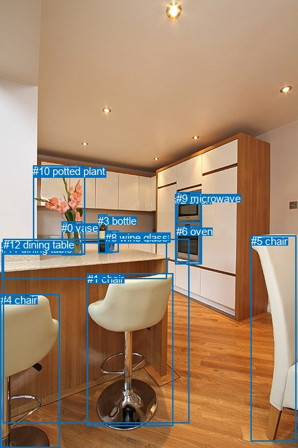
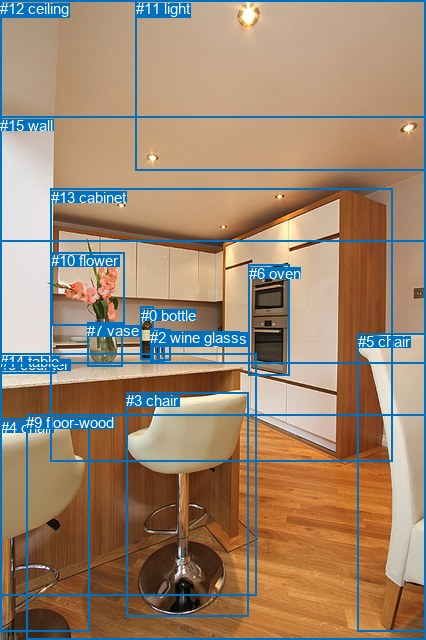

# 图片 1590：2389706.jpg

随机样本序号：32。图片 SHA256：`eb819611fa1c5aa9b823a6b9d44308b37d41dc62b8a33fb2e6c7f5b0216a6e33`。

红色框表示人，蓝色框表示其他物体。两个模式分别保留自身框编号，可依据位置比较对应对象。

## 自动检测框与输出

人的框编号：`[]`。状态：`no_person`。

### 自动检测全部物体框

| 编号 | 类别 | 是否为人 | 检测分数 | 像素坐标 xyxy |
|---|---|---|---|---|
| 0 | vase | False | 0.9959 | 88.4, 316.8, 117.8, 364.2 |
| 1 | chair | False | 0.9911 | 124.6, 390.5, 247.6, 608.5 |
| 2 | oven | False | 0.9882 | 250.3, 277.1, 288.7, 377.0 |
| 3 | bottle | False | 0.9857 | 140.4, 306.9, 153.9, 361.2 |
| 4 | chair | False | 0.9823 | 0.9, 420.3, 85.9, 640.0 |
| 5 | chair | False | 0.9782 | 358.8, 336.2, 424.0, 630.4 |
| 6 | oven | False | 0.9741 | 251.8, 322.3, 286.5, 374.6 |
| 7 | wine glass | False | 0.9442 | 154.1, 329.6, 169.8, 360.8 |
| 8 | wine glass | False | 0.9373 | 151.0, 330.7, 160.7, 361.4 |
| 9 | microwave | False | 0.8828 | 252.0, 274.8, 287.9, 317.7 |
| 10 | potted plant | False | 0.8445 | 47.4, 236.2, 121.0, 363.0 |
| 11 | dining table | False | 0.5733 | 2.1, 346.6, 238.8, 398.7 |
| 12 | dining table | False | 0.3860 | 4.9, 341.5, 270.2, 604.2 |

### 自动检测 Top50 人相关候选

评分物体对：0；人相关物体对：0；输出关系：0。

| 排名 | 主语编号与类别 | 关系 | 宾语编号与类别 | 类型 | 人与人 | 排序分数 | 原始融合 logit |
|---|---|---|---|---|---|---|---|

### 自动检测逐条人相关 GT 核验

本图没有人相关 GT，R@50 无分母；预测候选继续展示。

## 真实框与输出

人的框编号：`[]`。

### 真实框全部物体框

| 编号 | 类别 | 是否为人 | 检测分数 | 像素坐标 xyxy |
|---|---|---|---|---|
| 0 | bottle | False | GT | 141.0, 307.0, 154.0, 360.0 |
| 1 | wine glass | False | GT | 158.0, 330.0, 170.0, 361.0 |
| 2 | wine glass | False | GT | 150.0, 329.0, 164.0, 362.0 |
| 3 | chair | False | GT | 126.0, 392.0, 249.0, 616.0 |
| 4 | chair | False | GT | 1.0, 419.0, 89.0, 632.0 |
| 5 | chair | False | GT | 358.0, 333.0, 426.0, 632.0 |
| 6 | oven | False | GT | 249.0, 265.0, 290.0, 376.0 |
| 7 | vase | False | GT | 87.0, 322.0, 122.0, 366.0 |
| 8 | counter | False | GT | 0.0, 356.0, 57.0, 373.0 |
| 9 | floor-wood | False | GT | 26.0, 414.0, 426.0, 640.0 |
| 10 | flower | False | GT | 51.0, 252.0, 124.0, 325.0 |
| 11 | light | False | GT | 136.0, 0.0, 426.0, 170.0 |
| 12 | ceiling | False | GT | 0.0, 0.0, 426.0, 241.0 |
| 13 | cabinet | False | GT | 51.0, 189.0, 393.0, 461.0 |
| 14 | table | False | GT | 0.0, 353.0, 256.0, 595.0 |
| 15 | wall | False | GT | 0.0, 117.0, 426.0, 364.0 |

### 真实框 Top50 人相关候选

评分物体对：0；人相关物体对：0；输出关系：0。

| 排名 | 主语编号与类别 | 关系 | 宾语编号与类别 | 类型 | 人与人 | 排序分数 | 原始融合 logit |
|---|---|---|---|---|---|---|---|

### 真实框逐条人相关 GT 核验

本图没有人相关 GT，R@50 无分母；预测候选继续展示。

## 全部人相关 GT

| 主语编号与类别 | 关系 | 宾语编号与类别 |
|---|---|---|

原始记录、全部人相关物体对的两项预测与分项分数见 [逐图证据 JSON](../evidence/cases/1590.json)。全部56类 logits 保留于本机 HOR/output/random500/logits/。

<!-- HOR_COMPLETE_RESULTS -->

## 六组条件的完整输出对照

以下保留同一图片三种框与候选模式、两种谓词输出规则的全部 Top50。框编号各自在所属模式内解释。

### 自动检测框完整枚举：空间与语义各保留一个谓词

| 排名 | 主语编号与类别 | 谓词 | 宾语编号与类别 | 分组 | 排序分数 | predicate logit | pair logit |
|---|---|---|---|---|---|---|---|

没有人相关 GT，本条件的召回率无分母。

### 自动检测框完整枚举：每对只保留一个谓词

| 排名 | 主语编号与类别 | 谓词 | 宾语编号与类别 | 分组 | 排序分数 | predicate logit | pair logit |
|---|---|---|---|---|---|---|---|

没有人相关 GT，本条件的召回率无分母。

### 真实框完整枚举：空间与语义各保留一个谓词

| 排名 | 主语编号与类别 | 谓词 | 宾语编号与类别 | 分组 | 排序分数 | predicate logit | pair logit |
|---|---|---|---|---|---|---|---|

没有人相关 GT，本条件的召回率无分母。

### 真实框完整枚举：每对只保留一个谓词

| 排名 | 主语编号与类别 | 谓词 | 宾语编号与类别 | 分组 | 排序分数 | predicate logit | pair logit |
|---|---|---|---|---|---|---|---|

没有人相关 GT，本条件的召回率无分母。

### 真实框400候选：空间与语义各保留一个谓词

| 排名 | 主语编号与类别 | 谓词 | 宾语编号与类别 | 分组 | 排序分数 | predicate logit | pair logit |
|---|---|---|---|---|---|---|---|

没有人相关 GT，本条件的召回率无分母。

### 真实框400候选：每对只保留一个谓词

| 排名 | 主语编号与类别 | 谓词 | 宾语编号与类别 | 分组 | 排序分数 | predicate logit | pair logit |
|---|---|---|---|---|---|---|---|

没有人相关 GT，本条件的召回率无分母。
